# 评分矩阵的稀疏性
image(realM, main ="原始评分")
```

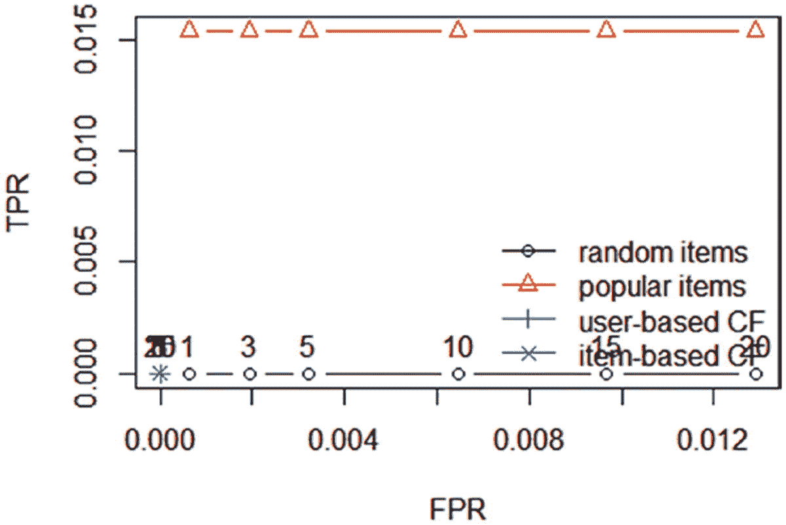

图 6-54

真正率与假正率

1.  UBCF 推荐模型


```
    #UBCF 模型
    r_UBCF 0]
    $AY6MB5S44GMH4
    [1] "B000084EK5" "B000084EKL" "B000084ETV" "B00008DF91" "B00008JOL0"
    $AYOMAHLWRQHUG
    [1] "B000084EK5" "B000084EKL" "B000084ETV" "B00008DF91" "B00008JOL0"
    $AYX86RC7QV2UT
    [1] "B000084EK5" "B000084EKL" "B000084ETV" "B00008DF91" "B00008JOL0"
    $AZ4IFJ01WKBTB
    [1] "B000084EK5" "B000084EKL" "B000084ETV" "B00008DF91" "B00008JOL0"
    ```

同样，你可以为 IBCF 提取此类推荐。

2.  评估

```
    set.seed(2016)
    scheme =3.000000
    数据集：1700 x 867 评分矩阵，类型为 'realRatingMatrix'，包含 1729 个评分。
    algorithms <-list(
    "随机项目" =list(name="RANDOM", param=NULL),
    "热门项目" =list(name="POPULAR", param=NULL),
    "基于用户的协同过滤" =list(name="UBCF", param=list(nn=50)),
    "基于项目的协同过滤" =list(name="IBCF", param=list(k=50))
    )
    results <-evaluate(scheme, algorithms, type ="topNList",
    n=c(1, 3, 5, 10, 15, 20))
    RANDOM 运行 折/样本 [模型时间/预测时间]
    1  [0 秒/0.91 秒]
    POPULAR 运行 折/样本 [模型时间/预测时间]
    1  [0.03 秒/2.14 秒]
    UBCF 运行 折/样本 [模型时间/预测时间]
    1  [0 秒/71.13 秒]
    IBCF 运行 折/样本 [模型时间/预测时间]
    1  [292.13 秒/0.46 秒]
    plot(results, annotate=c(1,3), legend="bottomright")
    ```

你可以看到，ROC 曲线显示这些推荐在此数据上的准确率较低。这可能是由于评分的稀疏性和高偏差造成的。

### 6.10.4 结论

关联规则挖掘也可以被视为概率模型（如朴素贝叶斯）的一种频繁版本。尽管我们不直接将这些术语称为概率，但它们具有相同的根源。这些算法尤其以处理超市或电商平台中的交易数据而闻名，在这些场景中，客户通常在一次交易中购买多种商品。

在这些交易中发现一些有趣的模式，有助于为企业揭示全新的发展方向，或通过产品推荐提升客户体验。在本节中，我们从 Apriori 等关联规则挖掘算法开始，接着讨论了推荐算法，这些算法密切相关但采用了不同的方法。尽管许多文献将推荐算法归类为独立主题，但我们将其归入关联规则挖掘之下，以展示其演变过程。

在下一章中，我们将讨论人工智能领域最广泛使用的模型之一，该模型源于人类生物神经网络结构。

## 6.11 人工神经网络

我们开始构建本节关于神经网络的内容，并在最后介绍深度学习，这是神经网络的扩展。近年来，深度学习因其高精度而受到研究界和工业界的广泛关注。基于神经网络的算法近年来变得非常流行，并在机器学习算法中占据核心地位。从统计学习的角度来看，它们在机器学习中变得非常流行，主要有两个原因：

*   我们不再需要对数据做出任何假设；任何类型的数据（分类数据和数值数据）都适用于神经网络。
*   它们是可扩展的技术，可以处理数十亿个数据点，并能捕捉到非常高层次的抽象。

这里需要指出的是，神经网络的灵感来源于人脑的学习方式。这些领域的最新发展使得训练更密集的神经网络成为可能，从而能够捕捉到其他机器学习技术无法捕捉的信号。

### 6.11.1 人类认知学习

人工神经网络源于生物神经网络。人脑就是这样一个大型神经网络，神经元是这个大型网络中的处理单元。要理解信号在大脑中是如何处理的，我们需要了解大脑神经网络的基本构建块——*神经元*的结构。

在图 6-55 中，你可以看到神经元的解剖结构。神经元的结构及其功能将帮助我们在计算机系统中构建人工神经网络。

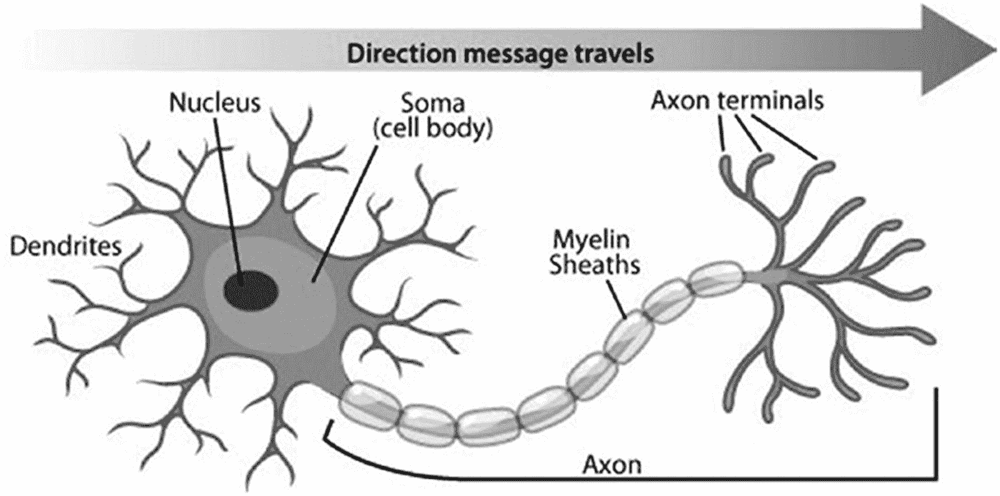

图 6-55

神经元解剖结构

神经元是神经网络的最小单位，可以被电信号激发。它可以通过电信号和化学信号处理并传递信息。神经元的激发状态可以看作是晶体管中的 1 状态，未激发状态则是 0 状态。神经元通过树突接收输入，并通过轴突传递在细胞体中产生（处理）的信号。每个轴突随后连接到网络中的其他神经元。下一个神经元再次处理信息并将其传递给另一个神经元。

其他重要问题包括信号传递的过程。该过程通过突触进行。存在化学突触和电突触的概念，电突触工作速度非常快，传递连续信号，而化学突触则基于激活能概念工作。只有当信号强度超过阈值时，神经元才会传递信号。这些重要特征使神经元能够区分信号和噪声。

由这些微小神经元组成的大型网络构建了我们的神经系统，由大脑中密集的神经网络驱动。我们的大脑在该密集的神经网络中学习和存储所有信息。科学家们开始研究我们大脑的工作方式，并开始使用人工神经元进行学习过程的实验。

现在你已经了解了大脑架构的结构，让我们尝试理解我们人类是如何学习东西的。我将以高尔夫为例，说明高尔夫球手如何学习击球的最佳力度。

学习步骤：

1.  你用一定的力度击球（力度的初始值，F1）。
2.  球未到达球洞，比如差了 3 米（误差为 3 米）。
3.  你知道球打短了，所以在下一次击球时，你增加一个增量 delta（即 F2 = F1 + delta）。
4.  球再次短了 50 厘米（误差为 50 厘米）。
5.  你再次发现球打短了，所以你再次增加一个增量 delta（即 F3 = F2 + delta）。
6.  现在你会观察到球飞过了球洞 2 米（误差为 -2 米）。
7.  现在你知道力度过大了，所以你改变了力度增加的速率（学习率），比如 `delta2`。
8.  你再次用新的力度击球，以 `delta2` 作为对第二次击球的改进（F4 = F2 + delta2）。
9.  现在球非常接近球洞，比如 25 厘米。
10.  现在你知道之前的 `delta2` 有效，所以你用相同的 delta 再次尝试，这次球进洞了。

这个过程仅仅是基于学习和自我更新以获得更好结果。可能有很多方法可以学习如何纠正以及以多大的幅度进行改进。这种从大量事件中学习的生物学思想，已被研究人员成功转化为人工神经网络学习，这是数据科学家拥有的最强大的工具。

Warren McCulloch 和 Walter Pitts（1943 年）发表的论文《神经活动中内在思想的逻辑演算》[12]，为神经网络的计算框架奠定了基础。在他们开创性的工作之后，神经网络的进一步发展分化为生物过程与机器学习（应用神经网络）。

在阅读后续神经网络内容时，回顾生物架构和学习方法将大有裨益。


### 6.11.2 感知机

*感知机*是人工神经网络的基本单元，它接收多个输入并产生二进制输出。在机器学习术语中，它是一种监督学习算法，可以将输入分类为二进制 0 或 1 类。简单来说，它是一种分类算法，能够基于结合特征向量权重（参数）的线性预测函数进行分类。参见图 6-56。

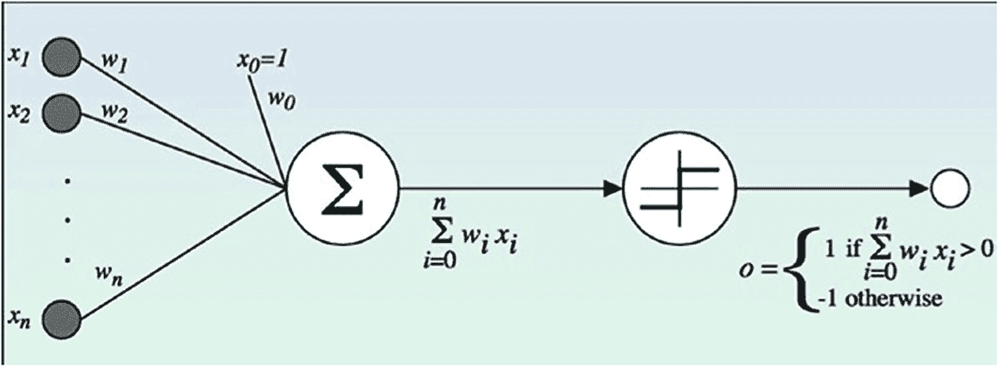

图 6-56

感知机的工作原理（数学表示）

在机器学习中，感知机被定义为一个二元分类器函数，它将输入 x（一个实值向量）映射到输出值 f(x)（一个单一的二进制值）：

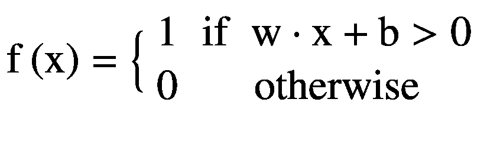

其中 *w* 是一个实值权重向量，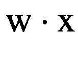 是点积 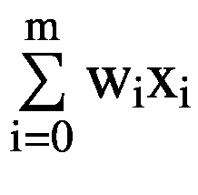，这里 *m* 是感知机的输入数量，*b* 是偏置。偏置独立于输入值，有助于确定决策边界。

单个感知机的学习算法可以描述如下：

1.  将权重初始化为一些可行的值。

2.  对于训练集中的每个数据点，执行步骤 3 和 4。

3.  使用上一步的权重计算输出。

![$$ {\displaystyle \begin{array}{l}{y}_j(t)=f\left[w(t)\cdot {x}_j\right]\\ {}\kern5.25em =\kern1em f\left[{w}_0(t){x}_{j,0}+{w}_1(t){x}_{j,1}+{w}_2(t){x}_{j,2}+\cdots +{w}_n(t){x}_{j,n}\right]\end{array}} $$](images/416805_2_En_6_Chapter/416805_2_En_6_Chapter_TeX_Equbf.png)

这是使用感知机当前权重得到的输出。

1.  更新权重：


你注意到这与我们高尔夫示例的相似之处了吗？

1.  通常，有三种停止准则：
    *   训练集中的所有点都已用完

*   预设的迭代次数

*   迭代误差小于用户指定的误差阈值 γ

迭代误差定义如下：

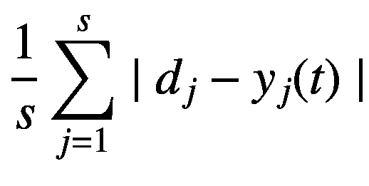

现在，让我们用一个简单的感知机示例来解释，以阐明它可以成为一个多么强大的分类器。

与非门是一个布尔运算符，当且仅当所有操作数的值都为 1 时，其输出值为 0，否则输出值为 1（等价于“非与”）。

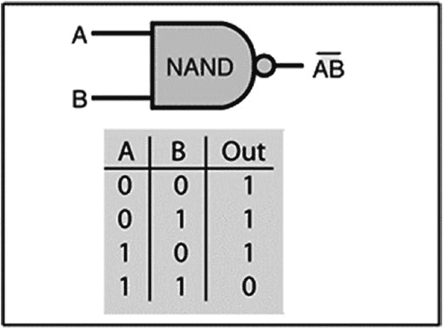

图 6-57

与非门运算符

现在，我们将尝试用图 6-58 中的感知机来重现这个与非门，并通过应用权重逻辑，看看它是否给出与之前输出相同的结果。

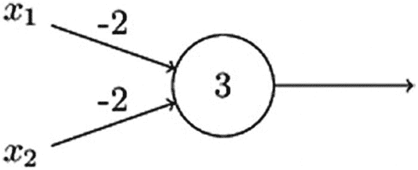

图 6-58

与非门感知机

感知机有两个输入 x1 和 x2，其可能取值为 0 和 1。因此，共有四种输入类型，并且根据图 6-58，我们也知道与非门的输出。

感知机是权重的函数，如果权重的点积大于 1，则输出为 1。在我们的示例中，我们选择权重 w1=w2= -2，偏置 = 3。现在让我们计算输入对应的感知机输出。

1.  00 (-2)0 + (-2)0 + 3 = 3 >0，输出为 1

2.  01 (-2)0 + (-2)1 + 3 = 1 >0，输出为 1

3.  10 (-2)1 + (-2)1 + 3 = 1 >0，输出为 1

4.  11 (-2)1 + (-2)1 + 3 = -1 <0，输出为 0

我们的感知机刚刚实现了一个与非门！

现在，神经网络的基本概念已经确立，我们可以转向增加复杂性，为这些基本概念赋予更强大的能力。

### 6.11.3 S 型神经元

神经网络有一种特殊的神经元，称为*S 型神经元*。它们允许连续输出，这是感知机所不具备的。S 型神经元的输出在一个连续的尺度上。

S 型函数是一个具有 S 形曲线（一条 S 型曲线）的数学函数。该函数定义如下：

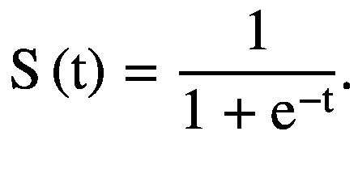

S 型函数的其他示例/变体包括 ogee 曲线、Gompertz 曲线和逻辑曲线。S 型函数在神经网络中用作激活函数（回想一下化学突触）。参见图 6-59。

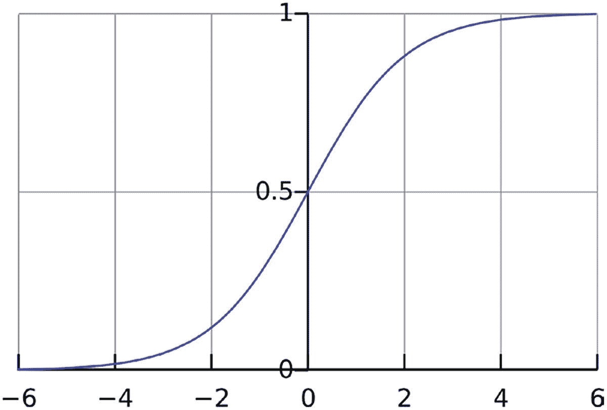

图 6-59

S 型函数

在神经网络中，一个 S 型神经元有多个输入 x1, x2,.. , xn。但输出在 0 到 1 的范围内。与感知机类似，S 型神经元对每个输入都有权重，即 w1,w2,…，以及一个整体偏置。为了与感知机进行类比，观察当输入（输入与权重的点积加上偏置）非常大时，S 型感知机的输出趋近于 1，与感知机相同，但这是渐近的。对于非常大的负值也是如此。

现在我们已经涵盖了神经网络的基本组成部分，接下来在下一节中讨论神经网络的架构。


### 6.11.4 神经网络架构

简单的感知机无法很好地处理线性分类之外的问题，因此图 6-60 中的示例将展示我们所说的线性可分性。

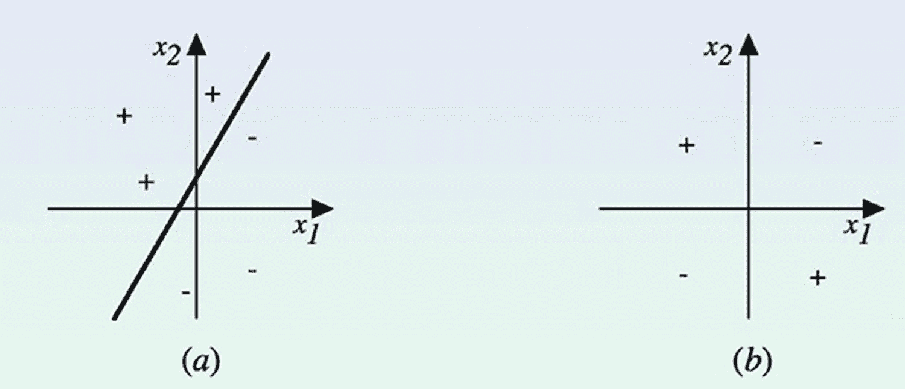

图 6-60

线性可分性

在左侧的图 6-60(a) 中，你可以画一条线（权重和偏置的线性函数）来区分 + 和 -，但请看右侧的图。在图 6-60(b) 中，+ 和 - 不是线性可分的。我们需要扩展我们的神经网络架构，加入更多感知机来进行非线性分离。

与生物系统中学习复杂事物的过程类似，我们将神经元网络的概念作为感知机网络应用于我们的人工神经网络。图 6-61 展示了从单个感知机到感知机网络的一个简单扩展。

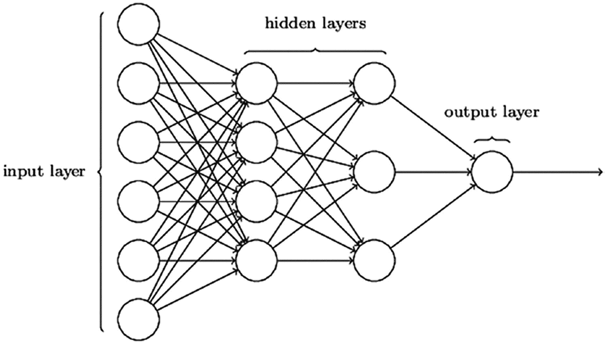

图 6-61

人工网络架构

这种网络有时被称为多层感知机（MLP）。最左边的层称为输入层，最右边的层称为输出层，而输入层和输出层之间的层称为隐藏层。

隐藏层与输入层不同，因为它没有任何直接输入。虽然输入层和输出层的设计和数量分别由输入和输出决定，但确定隐藏层的设计和数量并非易事。研究人员已经为隐藏层开发了许多设计启发式方法；这些不同的启发式方法有助于网络按照期望的方式运行。在本节中，有必要讨论神经网络的另外两个特性：

*   **前馈神经网络（FFNN）**：从简单的架构可以看出，如果每一层的输入都是单向的，我们称这种网络为前馈神经网络。这种网络确保神经网络内部没有循环。还有许多其他类型的神经网络，尤其是深度学习极大地扩展了这个列表，但这是最通用的框架。

*   **特化与泛化**：这是一个与架构复杂性（隐藏层的大小和数量）相关的通用概念。如果你有太多隐藏层或过于复杂的架构，神经网络往往会变得非常特化；用机器学习的术语来说，就是过拟合。这被称为特化神经网络。另一个极端是，如果你使用简单的架构，模型会非常泛化，无法很好地拟合数据。数据科学家在设计神经网络时必须牢记这种平衡。

人工神经网络有三个主要组成部分来设置训练过程：

*   **架构**：层数、权重矩阵、偏置、连接等。

*   **规则**：指神经元根据彼此信号做出响应的机制。

*   **学习规则**：神经网络权重随时间变化的方式。

在下一节中，我们将涉及监督学习和无监督学习，这将与我们书中一直在学习的关于因变量和无因变量（如聚类）的概念相关联。

### 6.11.5 监督式与无监督式神经网络

我们通过 Andrew NG 在 Coursera 课程中的一个图示来快速回顾这个主题。我们展示一个简单直观的例子来区分监督学习和无监督学习（见图 6-62）。

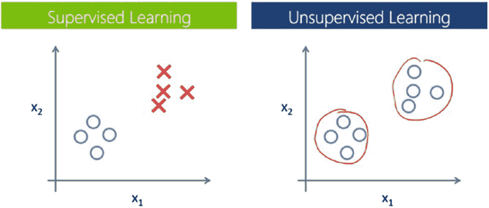

图 6-62

监督学习与无监督学习

左侧的图像将数据标记为两种不同的类型，因此算法知道这些对象是不同的；而右侧的图像有相同的对象，但没有告诉算法哪个是哪个。

所以，用非常简单的话来说，监督学习就是我们为机器学习算法提供每个输入对应的输出。而无监督学习则是我们不提供输出，算法必须自己找出不同的输出集合。

示例：

*   **监督学习**：在我们的数据中，每个输入变量都对应给出了 `HousePrice`。我们的学习算法将尝试经过多次迭代，学习如何根据底层特征（例如，线性回归）来确定房价。

*   **无监督学习**：我们只提供房屋特征数据，没有目标变量。在这种情况下，算法将基于相似的特征集进行归类（例如，聚类）。

在下一节中，我们将介绍一种用于神经网络的监督学习算法，并展示一个在 R 语言中使用神经网络的示例。R 语言并非神经网络和深度学习的首选平台之一。我们将仅限于简单的示例。

### 6.11.6 神经网络学习算法

学习算法决定了我们的机器学习过程将如何为底层数据选择一个模型。其一般原则是选择使成本函数最小化的模型。学习算法通过控制神经网络的训练来找到问题的最佳解决方案。大多数学习算法都基于非线性优化和统计估计的原理。

接下来，我们将介绍更广泛的神经网络学习算法类别。

#### 6.11.6.1 进化方法

进化方法源于生物学中的进化过程，进化可以体现在繁殖、突变、选择和重组方面。使用适应度函数来确定模型的性能，并根据此函数选择最终模型。

这种学习方法涉及的步骤如下：

1.  创建一个解的种群（即所有输入上的权重）。

2.  应用适应度函数，观察这个初始种群在初始条件下的表现。

3.  从步骤 2 中选择最佳的解集，然后与其他解进行杂交（例如，将一个变量上的权重与另一个解交换）。

4.  再次在适应度函数上进行评估，并继续执行步骤 3 和 4，直到获得一个解。

遗传算法的灵感就来源于这种进化过程。

#### 6.11.6.2 基因表达式编程

基因表达式编程也是一种进化学习算法。其学习方法的灵感来源于生物体内基因表达的发生方式。基因表达式学习程序被实现为复杂的树状结构，能够适应大小、形状和组成的变化。

尽管这被认为是对遗传算法的一种改进，但普遍观点认为它并未能显著改善学习结果。在计算机编程中，基因表达式编程（GEP）是一种进化算法。


#### 6.11.6.3 模拟退火

模拟退火是一种与进化方法截然不同的方法。该方法采用概率论方法逼近代价函数的全局最优解，通过模拟过程在广阔空间中搜索解决方案。

该方法包含以下步骤：

1.  以随机值/解权重开始迭代。

2.  在每次迭代中，算法获取概率以决定是停留在当前状态还是转移到某个相邻状态。

3.  如果转移到下一个状态，则检查代价函数的值。若该值低于前一个状态，则转移成功。

4.  重复步骤 2 和 3，直到获得期望结果或希望停止迭代。

该方法需要强大的计算能力。然而，它很好地解决了因缺乏概率跳跃而导致模型收敛于局部最优的问题。

#### 6.11.6.4 期望最大化

期望最大化是一种统计学习方法，它使用迭代方法寻找最大似然或最大后验估计。该算法通常分两步进行：

1.  使用参数的当前估计值（为开始迭代取一些随机种子值）生成对数似然的期望函数。

2.  通过调整参数来最大化期望函数，然后在下次迭代中使用这些参数。

这两个步骤迭代进行，会使算法收敛到使函数对数似然最大化的参数。

#### 6.11.6.5 非参数方法

非参数方法与期望最大化方法正好相反。在非参数方法中，我们不对底层数据分布做任何假设。由于没有来自分布的限制，这使得函数能够进行复杂表示。

在神经网络中，模型由多个 S 型函数的加权和（每个 S 型函数都是解释变量的函数）的未知函数表示。然后，算法进行非线性最小二乘优化，以获得底层目标函数的最终权重。

#### 6.11.6.6 粒子群优化

粒子群优化算法是通过观察鸟群或鱼群如何找到阻力最小、速度最快的移动形状而开发的。在该算法中，我们有粒子的位置和速度概念。粒子是候选解的种群。

该算法尝试在广阔空间中搜索解集，每个粒子的运动由关于速度（群体能移动多快？）和位置（群体中粒子的位置如何影响速度？）的数学公式控制。虽然这是一种非常强大的学习方法，但它不能保证得到全局最优解。

### 6.11.7 前馈反向传播

反向传播学习是神经网络中最流行的学习方法之一。这也被称为“误差反向传播”方法。结合一些优化方法（如梯度下降法），它可以用于训练人工神经网络。

顾名思义，这是一种监督学习方法，涉及误差的传播。回想一下高尔夫的例子。虽然该方法可用于无监督学习，但它仍然是训练前馈神经网络的最佳方法。

另一个需要考虑的重要点是，该方法通常基于梯度下降原理，因此神经元函数（激活函数）必须是可微的。否则无法计算梯度下降，该方法将失效。见图 6-63。

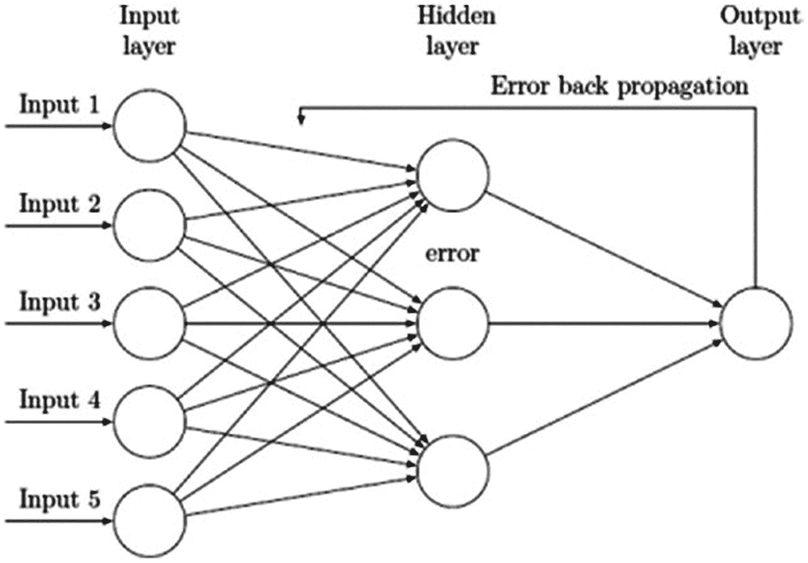

图 6-63

反向传播方法的工作原理

该算法可以通过以下步骤简单执行。我们将给出当使用 S 型函数作为激活函数时误差校正的数学表示：

1.  将输入前馈到网络并获取输出。

2.  反向传播输出，以计算每个神经元处的增量（误差）。

3.  将增量与输入激活函数相乘，得到权重的梯度。

4.  通过从权重梯度中减去一个比率来更新权重。

该算法将在每次迭代中校正误差，并收敛到没有更多可减少误差的点。

数学上，对于每个神经元 *j*，其输出 *o*[*j*] 定义为

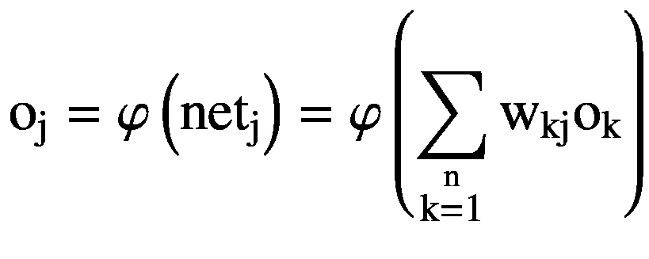

要使用梯度下降更新权重 w[*ij*]，必须选择一个学习率 α。权重的变化量（加到旧权重上）等于学习率与梯度的乘积，再乘以 -1：

![$$ \varDelta {\mathrm{w}}_{ij}=-\alpha \frac{\partial E}{\partial {w}_{ij}}=\Big\{{\displaystyle \begin{array}{cc}-\alpha {\mathrm{o}}_i\left({o}_j-{t}_j\right){\mathrm{o}}_j\left(1-{\mathrm{o}}_j\right)&amp; \mathrm{if}\kern0.28em j\kern0.28em \mathrm{is}\ \mathrm{an}\ \mathrm{output}\ \mathrm{neuron},\\ {}-\alpha {o}_i\left(\sum \limits_{l\in L}{\delta}_{\mathrm{l}}{w}_{jl}\right){\mathrm{o}}_j\left(1-{\mathrm{o}}_j\right)&amp; \mathrm{if}\kern0.28em j\kern0.28em \mathrm{is}\ \mathrm{an}\ \mathrm{inner}\ \mathrm{neuron}.\end{array}} $$](img/416805_2_En_6_Chapter_TeX_Equbk.png)

需要 -1 是为了朝着误差函数的最小值方向更新，而不是最大值方向。


#### 6.11.7.1 购买预测：基于神经网络的分类

让我们使用 R 语言中的 `nnet` 包来运行购买预测数据，看看神经网络与我们之前在回归章节讨论的逻辑回归示例相比表现如何。

```
#加载数据并准备用于逻辑回归的数据集
Data_Purchase_Prediction <-read.csv("Dataset/Purchase Prediction Dataset.csv",header=TRUE);
Data_Purchase_Prediction$choice <-ifelse(Data_Purchase_Prediction$ProductChoice ==1,1,
ifelse(Data_Purchase_Prediction$ProductChoice ==3,0,999));
Data_Neural_Net <-Data_Purchase_Prediction[Data_Purchase_Prediction$choice %in%c("0","1"),]
#移除缺失值
Data_Neural_Net <-na.omit(Data_Neural_Net)
rownames(Data_Neural_Net) <-NULL
```

通常，将连续变量缩放到区间 [0,1] 或 [-1,1] 会得到更好的结果。将分类变量转换为二元变量。

```
#转换连续变量
cont <-Data_Neural_Net[,c("PurchaseTenure","CustomerAge","MembershipPoints","IncomeClass")]
maxs <-apply(cont, 2, max)
mins <-apply(cont, 2, min)
scaled_cont <-as.data.frame(scale(cont, center = mins, scale = maxs -mins))
#因变量
dep <-factor(Data_Neural_Net$choice)
Data_Neural_Net$ModeOfPayment <-factor(Data_Neural_Net$ModeOfPayment);
flags_ModeOfPayment =data.frame(Reduce(cbind,
lapply(levels(Data_Neural_Net$ModeOfPayment), function(x){(Data_Neural_Net$ModeOfPayment ==x)*1})
))
names(flags_ModeOfPayment) =levels(Data_Neural_Net$ModeOfPayment)
Data_Neural_Net$CustomerPropensity <-factor(Data_Neural_Net$CustomerPropensity);
flags_CustomerPropensity =data.frame(Reduce(cbind,
lapply(levels(Data_Neural_Net$CustomerPropensity), function(x){(Data_Neural_Net$CustomerPropensity ==x)*1})
))
names(flags_CustomerPropensity) =levels(Data_Neural_Net$CustomerPropensity)
cate <-cbind(flags_ModeOfPayment,flags_CustomerPropensity)
#将所有数据合并为单个建模数据集
Dataset <-cbind(dep,scaled_cont,cate);
#将数据分为训练集和测试集
set.seed(917);
index <-sample(1:nrow(Dataset),round(0.7*nrow(Dataset)))
train <-Dataset[index,]
test <-Dataset[-index,]
```

现在我们将使用 R 中 `nnet()` 包内置的反向传播算法。

```
library(nnet)
i <-names(train)
form <-as.formula(paste("dep ~", paste(i[!i %in% "dep"], collapse =" + ")))
nn <-nnet.formula(form,size=10,data=train)
