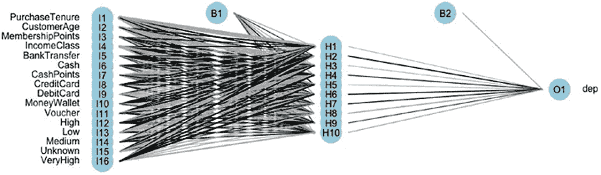

# 绘制神经网络图
plotnet(nn)
```



图 6-64

单隐藏层神经网络

```
#获取神经网络的权重
neuralweights(nn)
$struct
[1] 16 10  1
$wts
$wts$`hidden 1 1`
[1]  -1.7688041 -20.6924206   2.3683340   0.3254776   0.3755354
[6]  -0.4381737  -0.9342264  -0.4396708   0.2488121  -0.8040053
[11]  -0.2513980   1.1595037  -0.5800809   0.9427963  -0.5210107
[16]  -0.5680854   0.9942396
$wts$`hidden 1 2`
[1]  0.3785581  2.7997630  0.0419642 -1.8159788 -2.0329127  0.2695198
[7]  0.3923006 -2.1276359  0.3242286  0.4522314  0.5254541  1.2197842
[13] -0.1996586  2.2651791  0.4066352  3.6192206 -5.2330743
$wts$`hidden 1 3`
[1]  -1.4357242 -12.9881898 -12.3360008   1.1062240   3.6054822
[6]   1.5317392   0.6969328  -6.2048082   0.9177840  -0.1734451
[11]   0.1648537   2.1053240   0.6816542  -2.9358718  -1.0474676
[16]  -0.4098642   1.5974077
$wts$`hidden 1 4`
[1] -5.30486658  2.93556841 -9.97245085  0.30268208  6.59471280
[6]  1.95089306  0.69071825  0.31481250 -0.06330620 -1.00934374
[11]  0.93998141 -9.14052075 -6.52385269 -1.32746226 -1.07514308
[16]  0.06271666  3.52729817
$wts$`hidden 1 5`
[1]   2.24357572  -7.90629807  -2.19299184   0.78657421 -13.42029541
[6]   1.35697587   0.76688140  -4.08706478   2.90349734  -0.59422438
[11]   2.21698054  -0.08467332   1.68745126  -0.43716182  -0.34025868
[16]  -2.29645501   2.73500554
$wts$`hidden 1 6`
[1] -3.7195678  1.5885211  0.9809355 -0.8999143 -3.3623349 -1.6354780
[7] -1.0924695  0.3577909 -0.4331445 -0.9332748 -0.6803754  1.4831636
[13]  0.1024139 -5.6953417  0.8179687 -3.9350386  4.9241476
$wts$`hidden 1 7`
[1] -0.8225491 -4.8242434 -2.9266563  2.5035607  0.1378938 -0.3450762
[7] -0.6713392  1.0763017 -0.2546451 -0.8533341 -0.5570266 -0.2484610
[13]  1.3856182 -1.1600616  1.2339496 -1.2949715 -0.7762755
$wts$`hidden 1 8`
[1] -3.86805085  2.35232847 -2.48545877 -0.14794972  0.07481260
[6]  0.70845847  0.38961887 -2.34134097 -2.32810205 -0.80392872
[11] -0.08502893 -1.81432815  0.05929793 -0.19809056 -0.27217330
[16]  0.47082670 -4.67137272
$wts$`hidden 1 9`
[1]   0.80066147   2.72835254  -6.01889627 -10.63057306   7.63526853
[6]  -1.85188181  -0.59883189   0.86011432   2.28279639  -0.80140313
[11]  -3.41439405   4.47209147   3.98812529   0.05217016   1.42120448
[16]  -2.87977768  -1.80152670
$wts$`hidden 1 10`
[1]  -1.41326881 -16.86494495  -0.25563167   0.02405375  -5.82554392
[6]   0.20502350   0.68081754  -4.30017547   0.24592770   0.94533019
[11]   0.51276882  -0.10970560   1.52611041   1.41750276   2.40763017
[16]  -1.56584208  -5.13504576
$wts$`out 1`
[1] -2.0906131 -0.8660608  2.5900163 -0.9717815  1.1467203 -0.8147543
[7]  2.3220405  1.7924673 -3.5013152  0.2313364 -2.3259027
