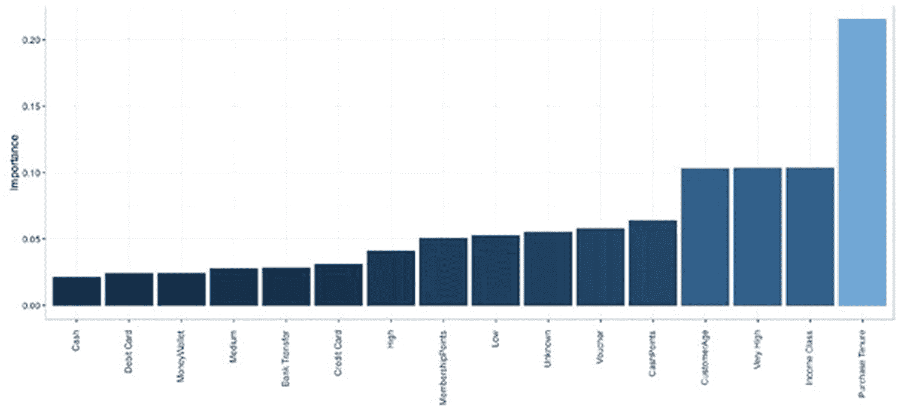
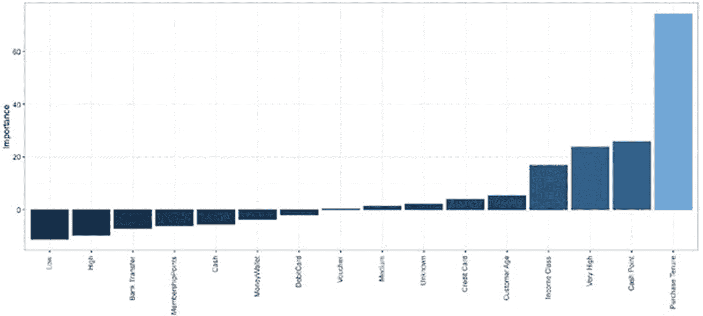
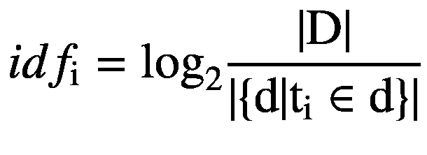
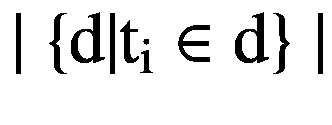
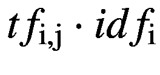
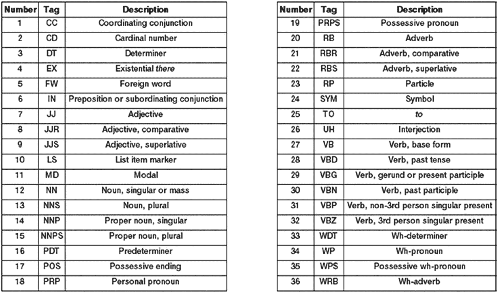
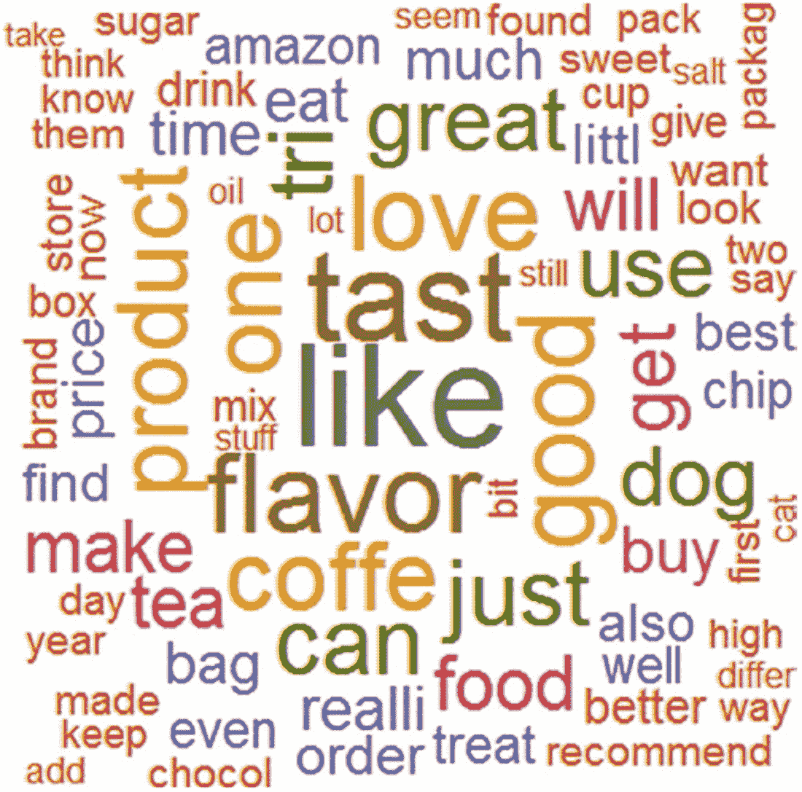

# 绘制重要性图
olden(nn)
```



图 6-66

通过 Garson 方法得到的属性重要性



图 6-65

通过 olden 方法得到的属性重要性

```
#通过 garson 算法计算变量重要性
garson(nn)
```

我们展示了如何创建神经网络并测试其权重和预测。R 语言库在神经网络方面扩展得非常快。建议你及时了解研究社区创建的新工具。*《人工智能：一种现代方法》*（Stuart Russell 和 Peter Norvig 著）是一本深入探讨人工神经网络的优秀书籍。


### 6.11.8 结论

神经网络是非常强大的工具，可以在不对输入数据做任何假设的情况下从任何数据集中学习。此外，在其架构和学习方法方面的新研究催生了深度神经网络。这推动了深度学习在各个领域的整体发展，特别是在数据量大且抽象程度高的领域。深度神经网络使得计算机视觉、语音识别、基因匹配以及其他复杂问题成为可能。

在下一节中，我们将深入探讨非结构化数据的世界。你将看到一些简单的技术如何将完全非结构化的文本数据转换为数值观测矩阵，然后该矩阵可与许多其他算法一起用于分类、聚类等。

## 6.12 文本挖掘方法

近年来，文本数据成倍增长。特别是，数字生成或数字存储的文本数据增长了很多。大数据世界的一个重要组成部分是，这些文本数据被大量生成和存储。文本数据的另一个重要方面是，它可以由任何人生成，并对企业产生影响。

例如，一个差评可能会损害产品的市场形象，或者一个关于社会议题的社交媒体帖子可能会发起一场运动。在所有这些情况下，文本数据在影响行为方面都起着关键作用。在 21 世纪，组织投资于文本数据并了解其对消费者行为或产品性能的洞察已变得至关重要。

Brandwatch（[`https://www.brandwatch.com/2016/05/44-twitter-stats-2016/`](https://www.brandwatch.com/2016/05/44-twitter-stats-2016/)）发布了关于 Twitter 统计数据的数据；让我们看看其中的一些数据。

*   Twitter 拥有 3.1 亿活跃用户（每个用户都是文本数据的来源）
*   全球 83%的领导人都在使用 Twitter（领导人的推文是影响市场、民众、政策等的文本数据）
*   每天发送 5 亿条推文（这难道不是大数据吗？）
*   65.8%拥有 100 名以上员工的美国公司使用 Twitter 进行营销（我们如何利用这些数据来管理和在营销项目中脱颖而出？）
*   80%的 Twitter 用户曾在推文中提及某个品牌（这难道不促使我们去审视隐藏在文本数据中的信息宝库吗？）

这些统计数据告诉我们，在当今世界，分析文本数据非常重要。由于其规模庞大，我们需要先进的机器学习方法和增强的自然语言处理技术来利用文本数据的力量。一些统计数据显示，我们今天存储的信息中有 80%是文本格式，这凸显了文本挖掘的商业价值。

从形式上讲，文本分析涉及信息检索、用于研究词频分布的词汇分析、标记/注释、信息提取、包括链接和关联分析在内的数据挖掘技术、可视化、模式识别和预测分析。最终目标是利用自然语言处理和其他数学方法（例如频率图、奇异值分解等）的强大技术，处理文本中的非结构化数据，并将其转换为可用于分析的数据。

在本节中，我们将介绍使用 R 进行文本分析的基础知识。在本章末尾，我们将展示一个如何使用 Microsoft API 来解锁当前 R 中尚不可用的强大文本挖掘工具的示例。

### 6.12.1 文本挖掘简介

非结构化数据量的激增带来了众多文本挖掘用例。快速处理文本数据并将其转换为数值特征矩阵的能力，为在此类数据上使用大量机器学习算法开辟了道路。自然语言处理（NLP）领域虽然广阔，但可以被视为机器学习的一个子领域。另一种观点是，文本挖掘方法通过应用 NLP 和分析方法，帮助将文本转化为可用于分析的数据。

在接下来的部分中，我们将更深入地探讨文本挖掘概念，如文本分类、摘要、TF-IDF、词性标注以及使用 WordCloud 进行简单可视化。

我们将使用亚马逊美食评论数据集来演示几种文本挖掘方法。

让我们先简要查看一下数据，然后选择一个较小的子集用于所有演示。

1.  数据摘要

    ```
    library(data.table)
    fine_food_data <-read.csv("Dataset/Food_Reviews.csv",
    stringsAsFactors =FALSE)
    fine_food_data$Score <-as.factor(fine_food_data$Score)
    str(fine_food_data[-10])
    'data.frame':    35173 obs. of  9 variables:
    $ Id                    : int  1 2 3 4 5 6 7 8 9 10 ...
    $ ProductId             : chr  "B001E4KFG0" "B00813GRG4" "B000LQOCH0" "B000UA0QIQ" ...
    $ UserId                : chr  "A3SGXH7AUHU8GW" "A1D87F6ZCVE5NK" "ABXLMWJIXXAIN" "A395BORC6FGVXV" ...
    $ ProfileName           : chr  "delmartian" "dll pa" "Natalia Corres \"Natalia Corres\"" "Karl" ...
    $ HelpfulnessNumerator  : int  1 0 1 3 0 0 0 0 1 0 ...
    $ HelpfulnessDenominator: int  1 0 1 3 0 0 0 0 1 0 ...
    $ Score                 : Factor w/ 5 levels "1","2","3","4",..: 5 1 4 2 5 4 5 5 5 5 ...
    $ Time                  : int  1303862400 1346976000 1219017600 1307923200 1350777600 1342051200 1340150400 1336003200 1322006400 1351209600 ...
    $ Summary               : chr  "Good Quality Dog Food" "Not as Advertised" "\"Delight\" says it all" "Cough Medicine" ...
    # 最后一列 - 客户评论的自由文本
    head(fine_food_data[,10],2)
    [1] "I have bought several of the Vitality canned dog food products and have found them all to be of good quality. The product looks more like a stew than processed meat and it smells better. My Labrador is finicky and she appreciates this product better than  most."
    [2] "Product arrived labeled as Jumbo Salted Peanuts...the peanuts were actually small sized unsalted. Not sure if this was an error or if the vendor intended to represent the product as \"Jumbo\"."
    ```

2.  数据准备

    ```
    library(caTools)
    # 随机拆分数据，仅使用数据集的 10%
    set.seed(90)
    split =sample.split(fine_food_data$Score, SplitRatio =0.10)
    fine_food_data =subset(fine_food_data, split ==TRUE)
    select_col <-c("Id","HelpfulnessNumerator","HelpfulnessDenominator","Score","Summary","Text")
    fine_food_data_selected <-fine_food_data[,select_col]
    ```


### 6.12.2 文本摘要

该方法借鉴了 Gong & Liu (2001) 通过潜在语义分析对文本文档 D 进行通用文本摘要的思路：

1.  将文档 D 分解为单个句子，并用这些句子构成候选句子集 S，设 k = 1。

2.  为文档 D 构建术语-句子矩阵 A。

3.  对 A 执行奇异值分解，得到奇异值矩阵和右奇异向量矩阵 V^t。在奇异向量空间中，每个句子 i 由列向量表示。

4.  从矩阵 V^t 中选择第 k 个右奇异向量。

5.  选择与第 k 个右奇异向量具有最大索引值的句子，并将其纳入摘要。

6.  如果 k 达到预设值，则终止操作；否则，将 k 增加 1 并返回步骤 4。

*(直接引自 Gong & Liu, 2001, 第 21 页)[9]*

让我们看看在我们的亚马逊美食评论数据集中，摘要效果如何。为了比较结果，我们使用数据集中的摘要属性，并对输出进行定性评估。

1.  原始文本

    ```
    fine_food_data_selected[2,6]
    ```

    [1] “McCann’s Instant Oatmeal is great if you must have your oatmeal but can only scrape together two or three minutes to prepare it. There is no escaping the fact, however, that even the best instant oatmeal is nowhere near as good as even a store brand of oatmeal requiring stovetop preparation. Still, the McCann’s is as good as it gets for instant oatmeal. It’s even better than the organic, all-natural brands I have tried. All the varieties in the McCann’s variety pack taste good. It can be prepared in the microwave or by adding boiling water so it is convenient in the extreme when time is an issue.<br /><br />

    McCann’s use of actual cane sugar instead of high fructose corn syrup helped me decide to buy this product. Real sugar tastes better and is not as harmful as the other stuff. One thing I do not like, though, is McCann’s use of thickeners. Oats plus water plus heat should make a creamy, tasty oatmeal without the need for guar gum. But this is a convenience product. Maybe the guar gum is why, after sitting in the bowl a while, the instant McCann’s becomes too thick and gluey.”

2.  由 `genericSummary` 生成的摘要

    ```
    library(LSAfun)
    genericSummary(fine_food_data_selected[2,6],k=1)
    ```

    [1] “There is no escaping the fact, however, that even the best instant oatmeal is nowhere near as good as even a store brand of oatmeal requiring stovetop preparation.”

3.  由 `genericSummary` 生成的多个摘要

    ```
    library(LSAfun)
    genericSummary(fine_food_data_selected[2,6],k=2)
    ```

    [1] “There is no escaping the fact, however, that even the best instant oatmeal is nowhere near as good as even a store brand of oatmeal requiring stovetop preparation.”

    [2] “It can be prepared in the microwave or by adding boiling water so it is convenient in the extreme when time is an issue.”

4.  数据集中的摘要

    ```
    fine_food_data_selected[2,5]
    ```

    [1] “Best of the Instant Oatmeals”

    观察文本上下文与函数生成的摘要之间的惊人相似性。文本摘要具有广泛的应用。谷歌用它来在从给定网页返回查询结果时显示最相关的信息片段；许多自然语言处理方法处理文本摘要，而不是处理大量文本数据；脸书可以构建用例来自动总结用户帖子（确保匿名性），以定位正确的广告，以及许多其他此类应用。

### 6.12.3 TF-IDF

词频-逆文档频率（TF-IDF）是词的频率，它是将词袋转换为数值矩阵的关键，从而允许许多机器学习算法应用于这些数据。

1.  *词频 tf*[i,j]：统计术语 t[i] 在文档 d[j] 中出现的次数 n[i,j]。在归一化的情况下，词频 *tf*[i,j] 除以 ∑kn[k,j]。

2.  *逆文档频率：idf*[i]，对于术语 t_i 定义为

    

    其中 |D| 表示文档总数， 是术语 t[*i*] 出现的文档数量。

直观地说，如果你观察，*I* 有两个属性：

1.  *词频-逆文档频率（TF-IDF）：*  的乘积

*   某些出现过于频繁的术语在确定文档相关性方面作用很小。*idf*[i] 对过于频繁出现的词进行降权。

*   在文档中仅出现几次的术语具有更高的相关性。*idf*[i] 对较少出现的词进行升权。

    例如，在一组与体育相关的文档中，“比赛”这个词可能过于频繁，然而任何包含“板球”一词的文章可能显示出很高的相关性，从而将文章归类到特定的比赛中。

让我们从文本挖掘中的词袋方法创建一个 tf-idf 矩阵。tf-idf 矩阵是文档集合（由行表示）及其包含的词（由列表示）的数值表示。

```
library(tm)
Warning: package 'tm' was built under R version 3.2.3
Loading required package: NLP
fine_food_data_corpus >
Non-/sparse entries: 8/42
Sparsity           : 84%
Maximal term length: 6
Weighting          : term frequency (tf)
Terms
Docs also bag buy can coffee dog eat find flavor food
1    1   0   0   0     0   0   0    0      0    0
2    0   0   1   2     0   0   0    0      0    0
3    0   0   0   0     2   0   0    0      0    0
4    0   0   0   0     0   0   1    1      0    0
5    0   0   0   0     0   0   0    1      2    0
#Create a tf-idf matrix
fine_food_data_tfidf >
Non-/sparse entries: 8/42
Sparsity           : 84%
Maximal term length: 6
Weighting          : term frequency - inverse document frequency (tf-idf)
Terms
Docs    also bag      buy      can   coffee dog      eat     find   flavor
1 3.04583   0 0.000000 0.000000 0.00000   0 0.000000 0.000000 0.000000
2 0.00000   0 2.635882 4.525741 0.00000   0 0.000000 0.000000 0.000000
3 0.00000   0 0.000000 0.000000 5.82035   0 0.000000 0.000000 0.000000
4 0.00000   0 0.000000 0.000000 0.00000   0 2.960361 2.992637 0.000000
5 0.00000   0 0.000000 0.000000 0.00000   0 0.000000 2.992637 4.024711
Terms
Docs food
1    0
2    0
3    0
4    0
5    0
```


### 6.12.4 词性标注

词性是文本中识别人名或组织等命名实体以及其他信息提取任务的有用特征。这有助于将文本中的命名实体分类为人名、公司、地点、时间表达等类别。这一技术在分子生物学、生物信息学和医学领域有许多应用。

我们将使用亚马逊食品评论数据集，通过 R 语言提取词性标签。图 6-67 展示了 R 脚本生成的词性缩写与英语词性之间的映射关系。



图 6-67

词性映射

1.  预处理

```
    library("NLP")
    library(tm)
    fine_food_data_corpus i keep it in a dry cool place because is not recommended it to put it in the fridge. according to the guinness book of records, the longest licorice twist ever made measured 1.200 feet (370 m) and weighted 100 pounds (45 kg) and was made by y & s candies, inc. this record-breaking twist became a guinness world record on july 19, 1998\. this product is kosher! thank you"
    fine_food_data_cleaned  keep    dry cool place    recommended   put    fridge. according   guinness book  records,  longest licorice twist ever made measured 1.200 feet (370 m)  weighted 100 pounds (45 kg)   made  y & s candies, inc. record-breaking twist became  guinness world record  july 19, 1998\. product  kosher! thank "
    fine_food_data_cleaned <-tm_map(fine_food_data_cleaned, removePunctuation)
    fine_food_data_cleaned[[1]]
    [1] "twizzlers strawberry  childhood favorite candy made  lancaster pennsylvania  y  s candies inc one   oldest confectionery firms   united states now  subsidiary   hershey company  company  established  1845  young  smylie  also make apple licorice twists green color  blue raspberry licorice twists  like  br br  keep    dry cool place    recommended   put    fridge according   guinness book  records  longest licorice twist ever made measured 1200 feet 370 m  weighted 100 pounds 45 kg   made  y  s candies inc  recordbreaking twist became  guinness world record  july 19 1998  product  kosher thank "
    fine_food_data_cleaned <-tm_map(fine_food_data_cleaned, removeNumbers)
    fine_food_data_cleaned[[1]]
    [1] "twizzlers strawberry  childhood favorite candy made  lancaster pennsylvania  y  s candies inc one   oldest confectionery firms   united states now  subsidiary   hershey company  company  established    young  smylie  also make apple licorice twists green color  blue raspberry licorice twists  like  br br  keep    dry cool place    recommended   put    fridge according   guinness book  records  longest licorice twist ever made measured  feet  m  weighted  pounds  kg   made  y  s candies inc  recordbreaking twist became  guinness world record  july    product  kosher thank "
    fine_food_data_cleaned <-tm_map(fine_food_data_cleaned, stripWhitespace)
    fine_food_data_cleaned[[1]]
    [1] "twizzlers strawberry childhood favorite candy made lancaster pennsylvania y s candies inc one oldest confectionery firms united states now subsidiary hershey company company established young smylie also make apple licorice twists green color blue raspberry licorice twists like br br keep dry cool place recommended put fridge according guinness book records longest licorice twist ever made measured feet m weighted pounds kg made y s candies inc recordbreaking twist became guinness world record july product kosher thank "
    ```

2.  词性提取

```
    library(openNLP)
    Warning: package 'openNLP' was built under R version 3.2.3
    library(NLP)
    fine_food_data_string >
    2 word         1   9 POS=NNS, POS=NNS, POS_prob=0.7822268
    3 word        11  20 POS=VBP, POS=VBP, POS_prob=0.3488425
    4 word        22  30 POS=NN, POS=NN, POS_prob=0.8055908
    5 word        32  39 POS=JJ, POS=JJ, POS_prob=0.6114238
    6 word        41  45 POS=NN, POS=NN, POS_prob=0.9833723
    确定词性标签在单词标记中的分布。
    fine_food_data_string_an2w <-subset(fine_food_data_string_an2, type == "word")
    tags <-sapply(fine_food_data_string_an2w$features, `[`, "POS")
    table(tags)
    tags
    ,  CC  CD  IN  JJ JJS  NN NNS  RB  VB VBD VBG VBN VBP VBZ
    1   2   1   1  10   2  28   9   5   1   6   2   4   2   3
    plot(table(tags), type ="h", xlab="Part-Of_Speech", ylab ="Frequency")
    ```

![../images/416805_2_En_6_Chapter/416805_2_En_6_Fig68_HTML.jpg

图 6-68

词性频率

```
提取所有标记/词性对
head(sprintf("%s/%s", fine_food_data_string[fine_food_data_string_an2w], tags),15)
[1] "twizzlers/NNS"    "strawberry/VBP"   "childhood/NN"
[4] "favorite/JJ"      "candy/NN"         "made/VBD"
[7] "lancaster/NN"     "pennsylvania/NN"  "y/RB"
[10] "s/VBZ"            "candies/NNS"      "inc/CC"
[13] "one/CD"           "oldest/JJS"       "confectionery/NN"
```

在此数据中，名词（NN）似乎是使用频率最高的词性，其次是形容词（JJ）。这非常符合直觉，因为在评论相关数据中，人们会谈论餐厅、食物及其特征，例如“好”、“差”、“棒极了”等。这种词性识别有助于比阅读整个文本信息更好地理解评论。

### 6.12.5 词云

词云有助于可视化评论中最常使用的词语（见图 6-69）：



图 6-69

使用亚马逊食品评论数据集生成的词云

```
library(SnowballC)
library(wordcloud)
fine_food_data_corpus <-VCorpus(VectorSource(fine_food_data_selected$Text))
fine_food_data_text_tdm <-TermDocumentMatrix(fine_food_data_corpus, control =list(
tolower =TRUE,
removeNumbers =TRUE,
stopwords =TRUE,
removePunctuation =TRUE,
stemming =TRUE
))
wc_tdm <- rollup(fine_food_data_text_tdm,2,na.rm=TRUE,FUN=sum)
matrix_c <-as.matrix(wc_tdm)
wc_freq <-sort(rowSums(matrix_c))
wc_tmdata <-data.frame(words=names(wc_freq), wc_freq)
wc_tmdata <-na.omit(wc_tmdata)
wordcloud (tail(wc_tmdata$words,100), tail(wc_tmdata$wc_freq,100), random.order=FALSE, colors=brewer.pal(8, "Dark2"))
```

词云是一个简单的探索性工具，用于理解词语使用的总体趋势，这有助于进一步构建直觉和洞察。

### 6.12.6 文本分析：微软认知服务

在本节中，我们将通过从 R 语言内部调用第三方 API，向您介绍强大的文本分析世界。我们使用微软认知服务 API，对一家新闻机构的 Twitter 推送内容进行实时文本分析。


### 注意

我们选择微软认知服务来展示一些文本分析的真实案例。我们并不推荐任何第三方工具或服务。

微软认知服务是微软提供的一项机器智能服务，其前身为 Project Oxford。该服务为开发者提供了基于云的 API，用于实现人脸识别、语音识别、文本挖掘、视频流分析等众多高级功能。我们使用其免费开发者服务来展示以下文本分析功能：

*   *情感分析：* 推文的情感倾向是什么？是正面、负面还是中性？
*   *主题检测：* 讨论的主题是什么？
*   *语言检测：* 能否根据输入的文本判断其语言？
*   *摘要生成：* 能否自动将长篇文档总结为易于阅读的摘要？

我们将使用 Twitter 信息流进行情感分析和主题检测，使用某种语言的随机文本进行语言检测，并使用一篇文章进行摘要生成。

要开始这个示例，我们需要在微软认知服务上注册一个账户，并获取一个 API 密钥来使用其 REST API。该密钥可以通过在 [`https://www.microsoft.com/cognitive-services/`](https://www.microsoft.com/cognitive-services/) 注册获得。

你还需要一个 Twitter 开发者账户，以便在 R 中设置应用程序来提取推文。你可以通过在 [`https://apps.twitter.com/`](https://apps.twitter.com/) 注册来获取 Twitter API 密钥。

首先，我们将使用从 Twitter 应用获取的 API 密钥来设置 `TwitterR` 包。`twitterR()` 包提供了与 Twitter Web API 的接口。

```
library("stringr")
library("dplyr")
library("twitteR")
#getTwitterOAuth(consumer_key, consumer_secret)
consumerKey  https://t.co/dUx77VDXGj
4                                    IN PICS: Union Minister Venkaiah Naidu pays tribute to Mahatma Gandhi #GandhiJayanti https://t.co/7gbSV4hHTN
5                           IN PICS:  Union Minister Venkaiah Naidu flags off the 'Swachhta Rally' from India Gate, Delhi https://t.co/X0w0xJRoSG
created.orig
1   1475379487
2   1475380198
3   1475380803
4   1475380922
5   1475381398
```

现在我们已经设置好 Twitter 账户，可以将信息流拉取到系统中。接下来，我们同样设置一个微软认知服务账户。用于调用微软服务的包是 `mscstexta4r`。这个 R 客户端用于微软认知服务文本分析 REST API，包括情感分析、主题检测、语言检测和关键短语提取。*必须*在微软认知服务网站 [`https://www.microsoft.com/cognitive-services/`](https://www.microsoft.com/cognitive-services/) 注册一个账户，才能获得（免费的）API 密钥。没有 API 密钥，这个包将无法正常工作。

```
#install.packages("mscstexta4r")
library(mscstexta4r)
Warning: package 'mscstexta4r' was built under R version 3.2.5
#Put the authentication APi keys you got from Microsoft
Sys.setenv(MSCS_TEXTANALYTICS_URL ="https://westus.api.cognitive.microsoft.com/text/analytics/v2.0/")
Sys.setenv(MSCS_TEXTANALYTICS_KEY ="YOUR KEY")
#Initialize the service
textaInit()
```

现在，我们还需要一篇新闻文章来演示摘要生成功能。我们使用的是这篇文章：[`http://www.yourarticlelibrary.com/essay/essay-on-india-after-independence/41354/`](http://www.yourarticlelibrary.com/essay/essay-on-india-after-independence/41354/) 。

```
