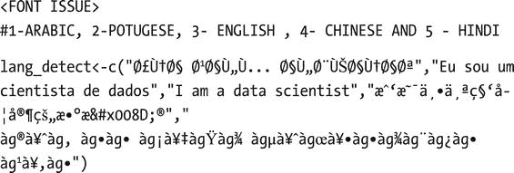
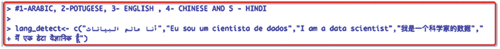
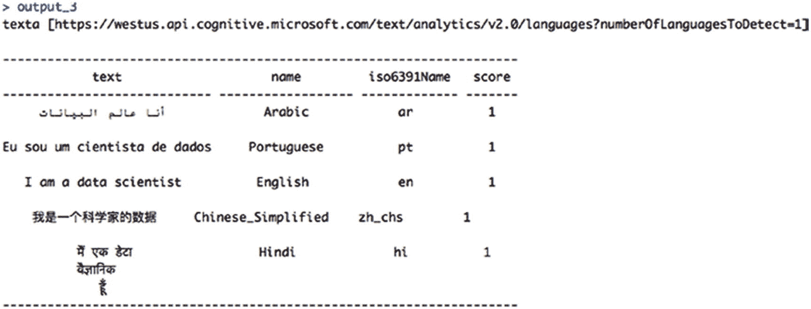

# Convert the text into sentences
article_text =convert_text_to_sentences(y, lang ="en")
```

现在所有输入都已准备就绪，我们将展示样本数据中前面列出的四个主要分析项目。

1.  情感分析

情感分析会告诉我们推文承载了何种情绪。微软 API 返回一个介于 0 和 1 之间的值，其中 1 表示高度正面的情感，而 0 表示高度负面的情感。

```
    document_lang  practice,the curators vision,the commerce of the auction house,the best of the indian art world on https://t.co/gbxzgzydzt
    37      the artists practice,the curators vision,the commerce of the auction house,the best of the indian art world on https://t.co/tqx07ytmku
    43                           prime minister narendra modi extends new year greetings to jewish community around the world https://t.co/xzpoqq4npd
    54 china provides pak terror shield, stalls masood azhars entry to terror list. #chinatopakrescue\n\ntune in,join special broadcast on @timesnow
    90         founder of sulabh international bindeshwar pathak presents a book 'mahatma gandhi's life in colour' to pm modi https://t.co/r1zsqwt93r
    9                                                    2nd test, day 3: new zealand all out for 204 in 1st innings, india lead by 112 runs #indvsnz
    score
    73 0.9468260
    37 0.9484612
    43 0.9579207
    54 0.9739059
    90 0.9759967
    9  0.9879231
    ```

情感分析器对来自 `@TimesNow` 账号的最新 100 条推文处理得非常好。你可以用这个相同的应用程序做很多事情，例如衡量主要新闻频道播出了多少正面新闻和负面新闻。这可以让你一窥国家的总体情绪。

2.  主题检测

对于主题检测，让我们尝试看看 `@CNN` 官方 Twitter 账号在其最近 100 条推文中讨论了什么。主题检测算法会尝试将这 100 条推文视为一次对话来读取，并提取出这些文本（或推文）中讨论的主题。

```  
    handle <- "@CNN"  
    topic_text <-GetTweets(handle, 150)  
    write.csv(topic_text,"Dataset/Twitter Feed from CNN.csv",row.names=FALSE)  
    tryCatch({  
    # 检测文档组中的热门主题  
    output_2 <-textaDetectTopics(  
    topic_text$text,                  # 至少 100 篇文档（仅限英文）  
    stopWords =NULL,           # 停用词列表（可选）  
    topicsToExclude =NULL,     # 需排除的主题（可选）  
    minDocumentsPerWord =NULL, # 排除稀有主题的阈值（可选）  
    maxDocumentsPerWord =NULL, # 排除普遍主题的阈值（可选）  
    resultsPollInterval = 30L,  # 轮询间隔（单位：秒，默认 30 秒，设为 0L 表示异步）  
    resultsTimeout = 1200L,     # 超时放弃时间（单位：秒，默认 1200 秒=20 分钟）  
    verbose =FALSE              # 若设为 TRUE，则每次轮询状态输出到 stdout  
    )  
    }, error = function(err) {  
    # 打印错误  
    geterrmessage()  
    })  
    output_2  
    textatopics [https://westus.api.cognitive.microsoft.com/text/analytics/v2.0/topics?]  
    status: Succeeded  
    operationId: 726edfccabdd4acb87a90716d7165343  
    operationType: topics  
    topics (first 20):  
    -----------------------------  
    keyPhrase        score  
    --------------------- -------  
    clinton          17  
    trump           15  
    donald trump        10  
    water            8  
    rudy giuliani        8  
    hillary clinton       7  
    president          5  
    trump tax          4  
    reporter           4  
    water monitor lizards    4  
    famous parks         4  
    beer corpse         4  
    iconic talking bear     4  
    teddy ruxpin         4  
    daymond john         3  
    police officer        3  
    president obama       3  
    bernie sanders        3  
    defend trump         3  
    tax             3  
    -----------------------------  
    ```  

推文列表中的主题检测告诉我们，CNN 新闻频道在 2016 年美国总统大选期间一直在讨论唐纳德·特朗普和希拉里·克林顿。

3.  语言检测

如今，数字内容以多种语言生成。为了扩大文本挖掘的范围，我们需要自动识别书面语言，并从中提取集体语义。语言检测方法帮助我们识别和翻译语言。这里，我使用谷歌翻译器创建了五种不同语言的五条消息（见图 6-70 和 6-71）。你也可以创建自己的示例。





图 6-70

语言检测输入



图 6-71

语言检测输出

```  
tryCatch({  
