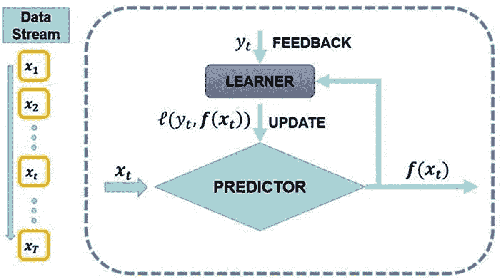
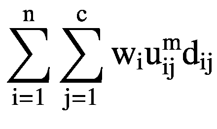
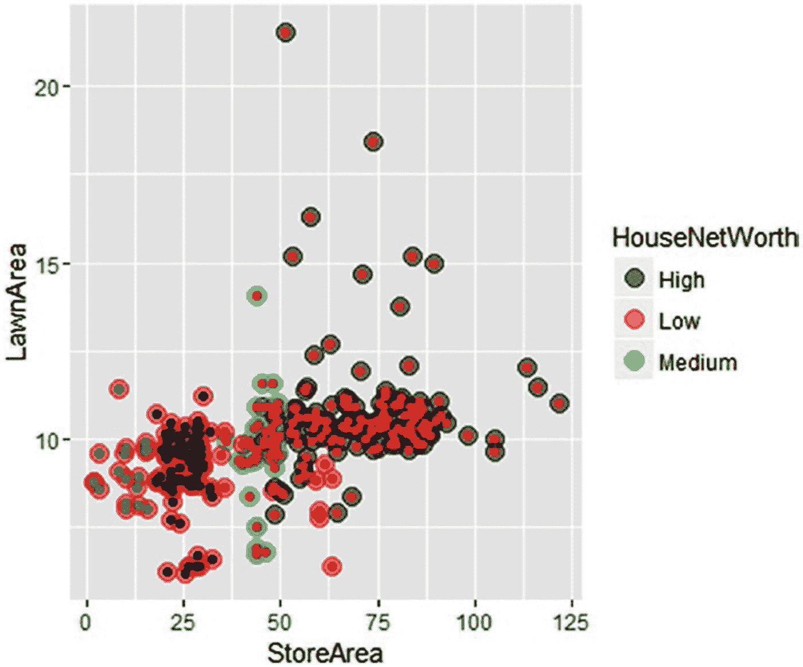
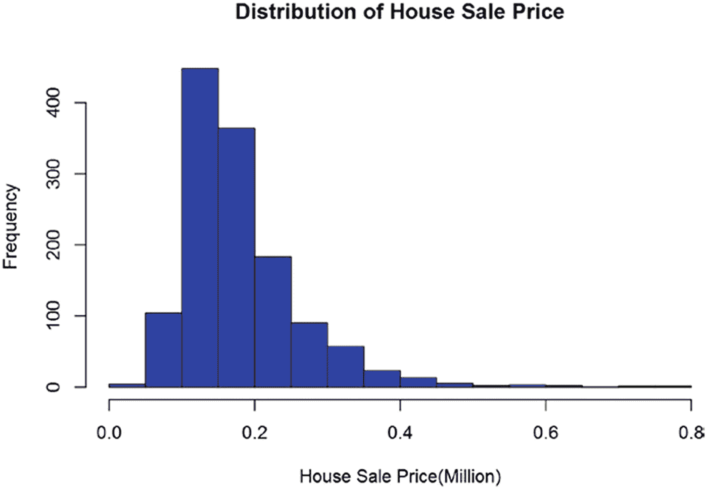
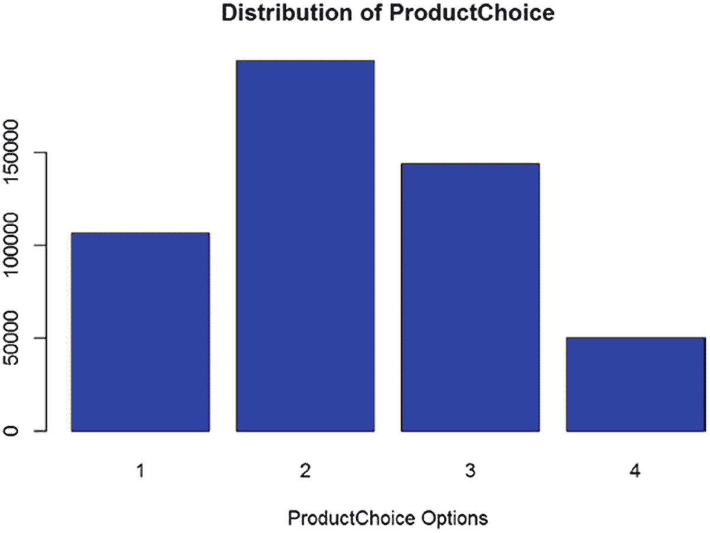
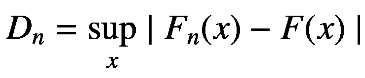
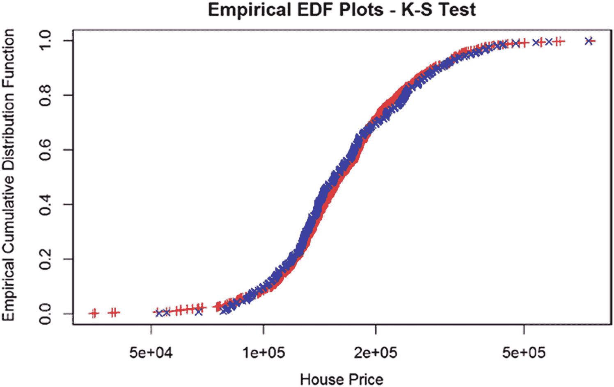

# 打印错误  
geterrmessage()  
})  
output_3  
texta [https://westus.api.cognitive.microsoft.com/text/analytics/v2.0/languages?numberOfLanguagesToDetect=1]  
```  

微软能够正确检测所有语言。当我们知道同一主题的内容以不同语言生成，并需要将它们整合到同一平台时，这项服务非常强大。

1.  摘要生成

对于摘要生成，我们将使用从网站加载的文章。算法会尝试逐句对文档进行上下文挖掘，然后从文档中创建一个有序的句子列表，以概括其内容。

```  
    article_lang s growth story since its independence, some others think the countryâs performance in the six decades has been abysmal."  
    [2] "Itâs arguably true that the Five-Year Plans did target specific sectors in order to quicken the pace of development, yet the outcome hasnât been on expected lines."  
    [3] "And, the country is taking its own sweet time to catch up with the developed world."  
    [4] "All efforts are frustrated by lopsided strategies and inept implementation of policies."  
    [5] "India is the worldâs largest democracy."  
    ```  

摘要表明，这篇文章讨论了印度及其发展之路，并强调了印度的民主制度。

在本章中，我们看到了文本分析在监测人类行为方面的强大能力。我们学习了 R 语言的基础知识，并学会了使用强大的 API。你可以在自然语言处理领域进行更多探索。

### 6.12.7 结论

我们看到了一个机会：通过基于文本挖掘的预处理和基于 NLP 算法的模型构建，将结构混乱的字符流和数据批次转化为有意义的信息集。尽管文本挖掘最恰当地归属于自然语言处理（NLP）范畴，而 NLP 本身被视为机器学习的子领域，但用于文本摘要、词性标注的算法大量使用了统计技术。

现在我们进入本章的最后一个主题，讨论如何使机器学习算法更适用于处理数据流这一最前沿的理念。换句话说，算法能够从持续进入系统的数据流中学习，而不是使用一批训练数据。


## 6.13 在线机器学习算法

在许多实际机器学习模型中，适应现实世界中不断变化的数据是一项关键需求。应对这种变化需求有两种可能的方式：

*   **定期手动更新模型**：根据模型部署后业务变化的速度和频率，定期（可能每周、每月或每年）手动更新模型。例如，用于癌症预测的医学诊断模型。正如你所料，癌症类型随时间变化并不迅速。因此，即使没有更新，这类模型也可以长期使用。然而，当有新的癌症患者数据出现时，可以手动更新模型并重新部署到系统中。

*   **实时更新模型**：随着数据在系统中流动，实时更新模型。例如，如果谷歌完全转向基于机器学习模型的搜索引擎，那么当前使用的启发式算法可能会根据用户输入的搜索查询实时调整。图 6-72 展示了新数据流进入系统时在线更新的过程。

    

    图 6-72

    *在线机器学习算法* *(来源：* [*http://www.doyensahoo.com/introduction.html*](http://www.doyensahoo.com/introduction.html) *)*

图 6-72 展示了预测器如何接收连续输入数据流并从中学习，以及学习模型如何接收反馈更新。

这种基于在线实时学习的方法有许多优点和挑战，主要包括：

*   ***高效且节省空间***：由于无需将大量数据作为批次传递给学习模型，我们可以每次用一个观测值训练模型并更新。这加快了模型训练速度，并优化了存储。如果数据不能提升模型性能，则将其丢弃。

*   ***难以构建管道***：构建这样的在线学习数据管道是一项具有挑战性的任务。一方面，如果数据量和数据流速很高，模型训练可能成为瓶颈。然而，如果模型管道受到控制，则需要大量存储空间。

*   ***模型评估困难***：与批处理不同，批处理中我们有受控的训练和测试数据集，可以用测试数据评估模型；而在在线数据场景下，这是不可能的。在任何给定时刻，我们无法知道模型是否已经见过足够多种类的观测值，从而能够真正按照预期表现。

尽管存在诸多挑战，但随着越来越多的系统成为数据的实时消费者，且适应速度成为首要任务，在线机器学习正成为一个新兴的研究领域。我们将使用 `HouseWorth` 数据集，并应用无监督模糊竞争学习的在线更新方法。虽然对该主题的详细讨论超出了本书的范围，但我们将通过一个示例来演示该方法在聚类问题上的出色表现。该方法通过在每次输入信号后（即每个单一观测值后）立即执行更新来工作。

### 6.13.1 模糊 C 均值聚类

这是已知的 k 均值聚类算法的模糊版本，也是一种在线变体（无监督模糊竞争学习）。我们将使用 R 语言中的 `e1071` 包，该包在名为 `cmeans` 的函数中实现了该算法。

正如 R 语言文档对该主题的描述，由 *x* 给出的数据通过模糊 c 均值算法的广义版本进行聚类，该算法使用固定点或在线启发式方法来最小化目标函数。



其中

w[i] 是观测值 i 的权重

u[ij] 是观测值 i 在聚类 j 中的隶属度

d[ij] 是观测值 i 与聚类 j 中心之间的距离

1.  数据准备

```
    library(ggplot2)
    Warning: package 'ggplot2' was built under R version 3.2.5
    library(e1071)
    Warning: package 'e1071' was built under R version 3.2.5
    Data_House_Worth <-read.csv("Dataset/House Worth Data.csv",header=TRUE);
    str(Data_House_Worth)
    'data.frame':    316 obs. of  5 variables:
    $ HousePrice   : int  138800 155000 152000 160000 226000 275000 215000 392000 325000 151000 ...
    $ StoreArea    : num  29.9 44 46.2 46.2 48.7 56.4 47.1 56.7 84 49.2 ...
    $ BasementArea : int  75 504 493 510 445 1148 380 945 1572 506 ...
    $ LawnArea     : num  11.22 9.69 10.19 6.82 10.92 ...
    $ HouseNetWorth: Factor w/ 3 levels "High","Low","Medium": 2 3 3 3 3 1 3 1 1 3 ...
    #remove the extra column that are not required for the model
    Data_House_Worth$BasementArea <-NULL
    ```

2.  模糊 C 均值聚类

请注意，我们向参数 `method` 传递了值 `ucfl`，该值使用无监督模糊竞争学习（UCFL）对模型进行在线更新。


```
    online_cmean <-cmeans(Data_House_Worth[,2:3],3,20,verbose=TRUE,method="ufcl",m=2)
    Iteration:   1, Error: 465.1579393478
    Iteration:   2, Error: 444.0414997086
    Iteration:   3, Error: 424.6549206588
    Iteration:   4, Error: 406.6721061449
    Iteration:   5, Error: 389.8788008700
    Iteration:   6, Error: 374.1842570779
    Iteration:   7, Error: 359.5913592120
    Iteration:   8, Error: 346.1483860876
    Iteration:   9, Error: 333.9078002276
    Iteration:  10, Error: 322.9024279730
    Iteration:  11, Error: 313.1374056984
    Iteration:  12, Error: 304.5921263137
    Iteration:  13, Error: 297.2268898905
    Iteration:  14, Error: 290.9907447391
    Iteration:  15, Error: 285.8286344099
    Iteration:  16, Error: 281.6870892396
    Iteration:  17, Error: 278.5183573747
    Iteration:  18, Error: 276.2831875877
    Iteration:  19, Error: 274.9525794936
    Iteration:  20, Error: 274.5088021136
    print(online_cmean)
    Fuzzy c-means clustering with 3 clusters
    Cluster centers:
    StoreArea  LawnArea
    1  21.44992  9.584415
    2  43.59627  9.916090
    3  11.04677 11.214669
    Memberships:
    1            2            3
    [1,] 0.6250584893 2.446492e-01 1.302923e-01
    [2,] 0.0004209086 9.993824e-01 1.966837e-04
    [3,] 0.0110012372 9.835467e-01 5.452043e-03
    [4,] 0.0254099375 9.620333e-01 1.255677e-02
    [5,] 0.0344305970 9.474942e-01 1.807525e-02
    Closest hard clustering :
    [1] 1 2 2 2 2 2 2 2 2 2 1 2 3 1 2 3 3 2 2 1 1 2 2 2 1 2 2 1 2 1 3 2 2 2 2
    [36] 2 2 2 1 1 2 1 2 1 2 1 3 2 2 2 1 1 1 2 1 2 2 2 2 2 3 2 2 1 2 2 2 1 2 1
    [71] 2 1 1 2 1 3 2 2 2 1 2 2 2 2 2 2 2 2 2 1 3 2 1 2 2 1 1 2 2 2 1 2 2 2 2
    [106] 1 2 2 2 2 2 1 2 2 1 1 2 1 3 2 2 1 2 2 1 2 1 1 2 2 1 2 2 2 1 2 2 1 2 2
    [141] 2 2 2 2 2 1 1 1 2 2 1 1 1 2 2 2 3 2 2 1 2 2 1 1 2 2 1 1 1 2 1 1 2 3 1
    [176] 2 2 2 2 2 1 2 2 2 2 2 2 1 1 1 1 2 2 2 2 1 2 1 1 2 2 2 2 2 2 2 2 2 2 1
    [211] 2 2 3 1 3 2 1 1 2 1 2 1 3 2 1 2 1 2 1 1 2 1 1 2 2 2 2 2 1 2 2 1 1 1 1
    [246] 2 2 2 2 2 2 2 3 2 2 3 3 2 1 2 1 2 2 2 2 1 1 1 2 2 2 2 2 2 2 2 2 1 2 1
    [281] 1 1 2 1 2 2 1 1 2 1 2 1 2 2 1 1 2 1 2 2 1 3 2 2 2 2 2 2 2 1 2 2 2 2 2
    [316] 3
    Available components:
    [1] "centers"     "size"        "cluster"     "membership"  "iter"
    [6] "withinerror" "call"
    ```

3.  聚类准确性的可视化评估

该图展示了在线模糊 C 均值算法形成的聚类与我们手动创建的分类变量之间的重叠情况。图中显示近乎完美的重叠，这表明聚类效果良好。

```
    ggplot(Data_House_Worth, aes(StoreArea, LawnArea, color = HouseNetWorth)) + geom_point(alpha =0.4, size =3.5) + geom_point(col = online_cmean$cluster) + scale_color_manual(values =c('black', 'red', 'green'))
    ```

图 6-73 中的图表显示，这些聚类与我们事先的分类基本重叠。这充分证明了在线机器学习的能力。



图 6-73

使用模糊 C 均值聚类的聚类图

### 6.13.2 结论

在当今快节奏的世界中，决策速度比决策质量更重要。这在一定程度上是由竞争格局驱动的，部分原因也在于延迟的成本。未来，在线机器学习工具和技术在机器学习领域的重要性必将日益凸显。我们的行业和研究人员必须共同努力，创造出优雅的算法，以及能够以高数据量和高数据流速实现这些算法的硬件/软件。

## 6.14 模型构建检查清单

在本章结束之前，我们整理了一份检查清单，列出了你在着手任何机器学习项目之前需要解决的问题。每当需要选择机器学习算法或决定将机器学习应用于新问题时，对可用数据的评估是整个过程中最重要的部分。在进一步行动之前，请先过一遍这份全面的检查清单：

*   你在这个问题中想要实现什么？目标是预测、估算一个值、寻找模式，还是仅仅进行探索？
*   数据集中每个变量的类型是什么？是全部数值型、分类型，还是混合型？
*   你是否已经确定了响应（输出）变量和预测（输入）变量？
*   数据中是否存在大量缺失值和异常值？
*   假设不使用机器学习算法，你会如何解决这个问题？是否有可能通过简单的统计和可视化来探索数据，从而在不使用机器学习的情况下找到问题的答案？
*   箱线图、直方图或散点图是否揭示了数据中的任何有趣见解？
*   你是否计算了所有数值变量的标准差、四分位数、均值和相关性度量？它们是否显示了任何有趣的信息？
*   你的数据集有多大？你的问题需要使用全部数据，还是一个小样本就足够了？
*   是否有足够的计算资源（内存、存储和 CPU）来运行任何机器学习算法？
*   你认为当前的数据是否会很快过时，机器学习模型在构建后不久是否需要更新？
*   是否有计划基于最终的机器学习模型构建一个数据产品？

这份检查清单听起来可能有点长；然而，如果你在开始构建机器学习模型之前就弄清楚这些问题的答案，你可能会节省 40%-60%的时间。

## 6.15 总结

像机器学习这样的领域之所以广阔，是因为多年来它在许多学科和行业中得到了应用。多年来工具和技术的进步，使得机器学习更接近甚至是没有太多统计学背景的普通用户。这促进了机器学习中方法的实际应用，以及许多以机器学习为中心的产品和设计的发展。我们正处在一个激动人心的时代，身处机器学习领域，它提供了无限的机会。精通机器学习的专家在许多行业都备受青睐。机器学习成为每个行业和产品核心的时代已经不远了，届时不仅仅是使用一组逻辑语句编写软件，而是融入一个能够适应不断变化需求的学习算法。

脚注 1   2


# 7. 机器学习模型评估

模型评估是开发任何机器学习解决方案中最重要的步骤。在模型开发的这个阶段，我们衡量模型性能，并决定是继续使用该模型，还是像我们在第[1](http://dx.doi.org/10.1007/978-1-4842-4215-5_1)章中描述的机器学习流程 PEBE 那样，重新审视之前的所有步骤。在许多情况下，我们甚至可能根据性能指标完全放弃整个模型。PEBE 的这一阶段对于任何基于机器学习的项目的成功都起着非常关键的作用。

模型评估的核心思想是最小化测试数据上的误差，而误差可以通过多种方式定义。在最直观的意义上，误差是数据中预测变量的实际值与机器学习模型预测值之间的差异。误差指标并非总是通用的，某些特定问题需要创造性地使用适合该问题和领域知识的误差指标。

这里需要强调的是，用于训练模型的误差指标可能与评估误差指标不同。例如，对于一个分类模型，你可能使用了 `LogLoss` 误差指标，但在评估模型时，你可能希望使用混淆矩阵来查看分类率。

在本章中，我们将阐述评估模型背后的基本思想，并详细讨论一些方法。

本章的学习目标如下：

*   模型性能与评估简介
*   群体稳定性指标
*   连续输出的模型评估
*   离散输出的模型评估
*   概率技术
*   高级指标（如 Kappa 误差指标）的说明

## 7.1 数据集

本章使用的数据集与我们在第[6](http://dx.doi.org/10.1007/978-1-4842-4215-5_6)章中介绍的数据集相同，用于解释基于回归的方法和分类问题的机器学习技术。让我们快速回顾一下它们，然后就可以进入概念部分了。

### 7.1.1 房屋销售价格

我们将使用第[6](http://dx.doi.org/10.1007/978-1-4842-4215-5_6)章中详述的房屋销售价格数据集。让我们快速浏览一下这个数据集。

```
library(data.table)
Data_House_Price 
```

这些是变量及其类型。可以看出，数据是字符型和数值型数据的混合。

以下代码和图 7-1 展示了 `House Sale Price` 的摘要。这是我们在本书中构建的所有建模示例中的因变量。



图 7-1

房屋销售价格分布

```
dim(Data_House_Price)
[1] 1300   14
检查因变量（房屋价格）的分布。我们绘制一个
直方图来查看房屋价格在数据集中的分布情况。
hist(Data_House_Price$HousePrice/1000000, breaks=20, col="blue", xlab="房屋
销售价格（百万）",
main="房屋销售价格分布")
```

这里，我们调用 `summary()` 函数来查看 `HousePrice` 数据的基本属性。输出结果给出了最小值、第一四分位数、中位数、均值、第三四分位数和最大值。

```
#同时查看因变量的摘要
summary(Data_House_Price$HousePrice)
最小值 第一四分位数 中位数 均值 第三四分位数 最大值
34900  129800  163000  181500  214000  755000
#提取相关列并在数据集中分配所需字段
Data_House_Price <-Data_House_Price[,.(HOUSE_ID,HousePrice,StoreArea,StreetH
ouseFront,BasementArea,LawnArea,Rating,SaleType)]
```

以下代码片段从数据集中移除缺失值。这对于确保数据在整个过程中保持一致非常重要。

```
#忽略任何缺失值
Data_House_Price <-na.omit(Data_House_Price)
Data_House_Price$HOUSE_ID <-as.character(Data_House_Price$HOUSE_ID)
```

这些统计信息让我们对房屋价格在数据集中的分布有了一些了解。平均销售价格为 181,500 美元，最高销售价格为 755,000 美元。

### 7.1.2 购买偏好

该数据包含购买了特定产品的客户的交易历史。对于每个 `customer_ID`，模拟了多个数据点来捕捉购买行为。该数据最初是为解决保险行业中四种可能产品的多类问题而设置的。这里，我们展示了购买预测数据的摘要。

```
Data_Purchase 
```

此数据输出显示了购买预测数据中变量的混合情况。请仔细查看此数据集中的因变量 `PurchaseChoice`，它是以整数形式加载的。我们必须确保在将其用于建模之前将其转换为因子类型。

与连续因变量类似，我们将从购买预测数据中为离散情况创建因变量。为简单易懂，我们仅将产品偏好 `ProductChoice` 作为具有四个级别（即 1、2、3 和 4）的因变量。见图 7-2。



图 7-2

产品选择选项的分布

```
dim(Data_Purchase);
[1] 500000     12
#在分组前检查数据分布
table(Data_Purchase$ProductChoice)
1      2      3      4
106603 199286 143893  50218
下面的条形图显示了 ProductChoice 的分布。数量最多的是
ProductChoice = 2，其次是 3，然后是 1 和 4。
barplot(table(Data_Purchase$ProductChoice),main="ProductChoice 分布", xlab="ProductChoice 选项", col="蓝色")
```

在以下代码中，我们对数据进行子集化，仅选择本章将使用的列。同时，我们移除所有缺失值 (NA)，以保持不同选项之间的数据一致性。

```
#仅提取与本章相关的数据
Data_Purchase  <- Data_Purchase[,.(CUSTOMER_ID,ProductChoice,MembershipPoints,
IncomeClass,CustomerPropensity,LastPurchaseDuration)]
#从子集中删除 NA
Data_Purchase <-na.omit(Data_Purchase)
Data_Purchase$CUSTOMER_ID <-as.character(Data_Purchase$CUSTOMER_ID)
```

这个数据子集将在本章中用于解释各种概念。


## 7.2 模型性能与评估简介

模型性能与评估是在你开发完模型并希望了解模型在测试数据/验证数据上的表现时进行的。在开始模型开发之前，你通常会将数据分为三类：

*   *训练数据*：该数据集用于训练模型/机器。在此阶段，机器学习算法的重点是优化一些能反映模型拟合度的明确定义的指标。例如，在普通最小二乘法中，我们将使用训练数据通过最小化平方误差来训练线性回归模型。

*   *测试数据*：测试数据集包含机器学习算法从未见过的数据点。我们应用该数据集来查看模型在新数据上的表现。大多数模型性能与评估都是在这一步计算并对照阈值进行评价的。在此，建模者可以决定模型是否需要改进，并据此进行修改和调整。

*   *验证数据*：在许多情况下，由于多种原因（例如数据有限、时间周期短、测试集较大等），建模者不会保留该数据集。本质上，该数据集的目的是检查模型的过拟合情况，并为校准需求提供见解。一旦建模者认为机器学习模型在测试数据上表现良好并开始使用验证数据，就不能再回头修改模型。他们只能尝试校准模型并检查过拟合。如果模型未能达到标准，我们只能放弃该模型并重新开始整个过程。

根据问题和其他统计约束，将决定这些数据集的比例。通常，对于足够大的数据，我们可能会对训练、测试和验证数据集采用 60:20:20 的比例。

模型性能使用测试数据进行衡量，建模者决定哪些阈值是可接受的以验证模型。性能指标通常基于模型拟合的基本标准生成，即模型输出与实际值之间的差异程度。实际值与预测值之间的这种误差，就是为获得良好性能而应最小化的误差。

在本节范围内，我们将讨论如何对两种类型的模型输出（预测变量）使用一些常用的性能和评估指标：

*   *连续输出*：针对模型中的连续因变量给出连续预测值的模型或模型系列。例如，房价是连续的，当使用模型进行预测时，会给出连续的预测值。

*   *离散输出*：针对模型中的离散因变量给出离散预测值的模型或模型系列。例如，对于信用卡申请，借款人的风险等级在用于分类预测模型时，会给出一个离散的预测值（即预测的风险等级）。

我们可以根据其他复杂的建模技术以及我们想要如何评估它们来扩展这个列表。例如，考虑一个逻辑模型；因变量是一个二项分布变量，但输出是在概率尺度上（0 到 1）。根据业务的最终目的，我们必须决定评估什么以及在过程的哪个步骤进行评估。为了完整性，你可以使用一致-不一致比率来评估模型在 0 和 1 之间的区分能力。一致-不一致比率在第 [6](http://dx.doi.org/10.1007/978-1-4842-4215-5_6) 章中讨论。鼓励你深入研究模型性能度量概念的统计基础。

## 7.3 模型性能评估的目标

业务利益相关者在定义性能指标方面扮演着重要角色。模型对业务的成本有直接影响。简单地最小化一个复杂的统计度量并不总是对业务最有利的模型。为了说明，假设一个用于新申请者信用评分的信用风险模型。其中一些输入变量是内部的，另一些是从外部来源购买的。通过使用来自多个方的外部数据，模型表现非常好，但这需要成本。在这种情况下，仅仅拥有一个分类误差最小的模型是不够的；模型输出还应对业务具有经济意义。

通常，我们可以将模型性能和评估关注点的目的分为三类。这三类是使用统计方法及其解释的通用框架的一部分。

*   *准确性*：模型的准确性反映了正确预测的比例——在连续情况下，是残差最小；在离散情况下，是正确分类预测。连续情况下的最小残差或离散情况下的少量错误分类意味着更高的准确性和更好的模型。

*   *增益*：增益统计量让我们了解模型本身的性能。该方法适用于不同的建模技术，并且非常直观。它将模型输出与不使用模型（或随机模型）得到的结果进行比较。因此，本质上，它会告诉你与产生随机结果的随机模型相比，你的模型有多好。在比较两个模型时，在指定百分位数上具有更高增益统计量的模型更受青睐。

*   *认证*：模型认证反映了模型实际使用的可信度。该方法确保应用模型的数据与训练数据相似。群体稳定性指数是在使用模型前确保认证的衡量指标之一。群体稳定性指数是一个用于确定模型训练数据集是否与使用模型的数据相似，或者群体相对于模型中使用的特征是否稳定的度量。该指数值从 0 到 1 不等，高值表示两个数据集中的预测变量之间具有更大的相似性。稳定的群体确认了模型可用于预测。

关于群体稳定性指数的更多细节见第 7.4 节。

这类场景在实际应用中比比皆是。在本书中，我们将讨论用于评估模型性能的基本统计方法。我们还将探讨思考模型性能的直观方式。直观的思考方式有助于在衡量模型性能时创建新的误差度量并增加业务背景。


## 7.4 群体稳定性指数

模型开发者在不同数据集上测试模型性能时，很少会忽略群体稳定性。其核心理念是确保测试数据集与训练数据集保持一致。如果两者一致，那么在此数据上测试的模型性能将为你提供模型表现如何的洞察；否则，你的模型性能结果将毫无用处。

举个例子。你使用 2000 年至 2009 年的数据集开发了一个预测美国消费者平均收入的模型。你通过 2000 年至 2007 年的数据集训练模型，并保留最后两年用于测试模型。测试结果会怎样？训练出的模型可能是最佳模型，但测试结果中的模型性能仍然很差。为什么？因为训练集和测试集之间的群体特征发生了变化。美国经济在 2007 年第四季度至 2008 年第四季度经历了一次严重衰退。用统计术语来说，这两个时期的基础群体并不稳定。

在时间序列数据中，群体稳定性非常重要，需要持续跟踪群体的潜在变化，以确保模型保持相关性。金融服务行业长期以来一直使用这一指标，以确保金融模型与市场保持相关。

让我们用连续分布来阐述群体稳定性的概念。我们将群体数据分为两部分，例如 `set_1` 和 `set_2`。在机器学习性能测试中，可以将 `set_1` 视为训练数据，`set_2` 视为测试数据。

### 注意

当因变量和自变量的基础关系结构受到外部未知因素影响时，群体稳定性的概念非常重要。

```
#创建 set_1 和 set_2：前 2/3 作为 set_1，剩余 1/3 作为 set_2
summary(Data_House_Price$HousePrice)
Min. 1st Qu.  Median    Mean 3rd Qu.    Max.
34900  127500  159000  181300  213200  755000
set_1 <-Data_House_Price[1:floor(nrow(Data_House_Price)*(2/3)),]$HousePrice
summary(set_1)
Min. 1st Qu.  Median    Mean 3rd Qu.    Max.
34900  128800  160000  180800  208900  755000
set_2 <-Data_House_Price[floor(nrow(Data_House_Price)*(2/3) +1):nrow(Data_
House_Price),]$HousePrice
summary(set_2)
Min. 1st Qu.  Median   Mean 3rd Qu.    Max.
52500  127000  155000 182200  221000  745000
```

对于连续情况，我们可以使用双样本科尔莫戈罗夫-斯米尔诺夫检验（KS 检验）来检查稳定性。KS 检验是一种非参数检验，用于比较两个样本的累积分布。

对于 n 个独立同分布观测值 Xi，经验分布函数 Fn 定义为：

![$$ {F}_n(x)=\frac{1}{n}\kern0.125em \sum \limits_{i=1}^n{I}_{\left[-\infty, x\right]}\kern0.125em \left({X}_i\right) $$](images/416805_2_En_7_Chapter/416805_2_En_7_Chapter_TeX_Equa.png)

其中 *I*[[-∞, x ]]( *X*[i]) 是指示函数，如果 *X*[i] ≤ *x* 则等于 1，否则等于 0。

对于给定的累积分布函数 F(x)，科尔莫戈罗夫-斯米尔诺夫统计量为：



其中 *sup x* 是距离集合的最大值。

本质上，KS 统计量会获取两个样本经验分布比较中的最大差异点，如果该值过高，我们就认为这两个样本不同。就群体稳定性而言，这意味着你的模型性能无法在新样本上进行衡量，并且基础样本并非来自模型训练时所使用的同一分布。

以下代码首先定义了一个函数 `ks_test()`，该函数绘制经验累积分布函数（ECDF）并显示 KS 检验结果。

```
#定义一个函数，用于给出 KS 检验结果并在对数尺度上绘制 ECDF 图
library(rgr)
ks_test <-function (xx1, xx2, xlab ="House Price", x1lab
=deparse(substitute(xx1)),x2lab =deparse(substitute(xx2)), ylab ="Empirical
Cumulative Distribution Function",log =TRUE, main ="Empirical EDF Plots -
K-S Test", pch1 =3, col1 =2, pch2 =4, col2 =4, cex =0.8, cexp =0.9, ...)
{
temp.x <-remove.na(xx1)
x1 <-sort(temp.x$x[1:temp.x$n])
nx1 <-temp.x$n
y1 <-((1:nx1) -0.5)/nx1
temp.x <-remove.na(xx2)
x2 <-sort(temp.x$x[1:temp.x$n])
nx2 <-temp.x$n
y2 <-((1:nx2) -0.5)/nx2
xlim <-range(c(x1, x2))
if (log) {
logx <- "x"
if (xlim[1] <=0)
stop("\n Values cannot be .le. zero for a log plot\n")
}
else logx <- ""
plot(x1, y1, log = logx, xlim = xlim, xlab = xlab, ylab = ylab,
main = main, type ="n", ...)
points(x1, y1, pch = pch1, col = col1, cex = cexp)
points(x2, y2, pch = pch2, col = col2, cex = cexp)
temp <-ks.test(x1, x2)
print(temp)
}
```

这里，我们调用自定义函数，该函数对 `set_1` 和 `set_2` 执行 KS 检验，并显示经验累积分布图（ECDF）——见图 7-3：



图 7-3

Set_1 和 Set_2 的 ECDF 图

```
#对 set_1 和 set_2 执行 K-S 检验，并显示经验累积分布图
ks_test(set_1,set_2)
```

这里，我们展示 KS 检验的假设检验结果。这是针对两个分布是否来自同一基础分布这一假设的科尔莫戈罗夫-斯米尔诺夫检验。

```
双样本科尔莫戈罗夫-斯米尔诺夫检验
数据: x1 和 x2
D = 0.050684, p 值 = 0.5744
备择假设: 双尾
```


如您所见，p 值大于 0.05，因此我们无法拒绝原假设。这样我们就可以继续进行，在测试数据上检验模型性能。此外，观察经验累积分布函数（ECDF）图，我们可以看到两个样本的 ECDF 看起来相同，因此它们来自同一个总体分布。

当总体变得不稳定时，结果会如何？让我们操作一下 `set_2` 来展示这种情况。

假设 `set_2` 受到了一项新法规的影响，该法规规定 `set_2` 中的房屋需由地方机构征收额外税款，因此房价上涨了。我们面临的问题是，现有的模型在这个新数据集上还能表现良好吗？

```
#操作 set 2
set_2_new <-set_2*exp(set_2/100000)
