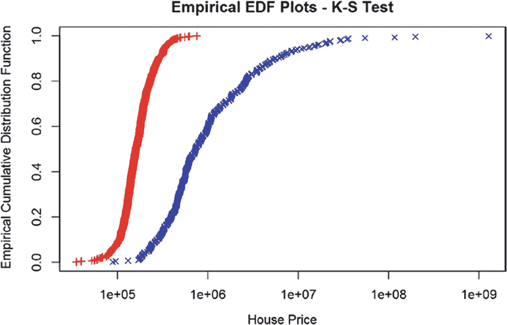

# 现在再次进行 K-S 检验
ks_test(set_1,set_2_new)
```

现在，让我们再次绘制 `set_1` 和 `set_2` 的 ECDF 图，看看它们对比起来如何（见图 7-4）。



图 7-4

Set_1 和 Set_2（经操作后）的 ECDF 图

我们再次执行 KS 检验来检查假设结果。

```
Two-sample Kolmogorov-Smirnov test
data:  x1 and x2
D = 0.79957, p-value < 2.2e-16
alternative hypothesis: two-sided
```

KS 检验的 p 值小于 0.05，因此检验拒绝了两个样本来自同一总体的原假设。从视觉上看，ECDF 图彼此差异很大。因此，该模型不能用于新的数据集，尽管该数据集具有相同的模式（schema）和业务来源。

我们可以快速展示如何对 `ProductChoice` 的购买预测这一离散情况进行总体稳定性检验。该检验通过计算统计量——总体稳定性指数（PSI）来完成，其定义如下：

PSI=∑((n1i/N1)−(n2i/N2))*ln((n1i/N1)/(n2i/N2))

其中 *n1i, n2i* 是总体 1 和总体 2 中第 i 个分箱的观测值数量，N1, N2 是总体 1 和总体 2 的总观测值数量。

由于离散情况下的总体稳定性指数不服从某种分布，因此我们使用阈值。作为经验法则，低于阈值的值可用于解释总体稳定性指数：

*   PSI < 0.1 表示总体变化极小。

*   PSI 在 0.1 到 0.2 之间表示需要进一步调查的变化。

*   PSI > 0.2 表示总体发生了显著变化。

以下代码片段使用此公式计算总体稳定性指数。

```
#让我们从购买预测数据中创建 set 1 和 set 2
print("分区前 ProductChoice 值的分布")
[1] "分区前 ProductChoice 值的分布"
table(Data_Purchase$ProductChoice)
1      2      3      4
104619 189351 142504  49470
set_1 <-Data_Purchase[1:floor(nrow(Data_Purchase)*(2/3)),]$ProductChoice
table(set_1)
set_1
1      2       3       4
69402 126391   95157   33012
set_2 <-Data_Purchase[floor(nrow(Data_Purchase)*(2/3) +1):nrow(Data_
Purchase),]$ProductChoice
table(set_2)
set_2
1      2       3       4
35217  62960   47347   16458
```

现在，我们将 `set_1` 视为总体 1，`set_2` 视为总体 2，并计算 PSI。可以使用不同参数重复类似练习，以查看总体相对于其他离散分布是否保持稳定。

```
#PSI=Summation((n1i/N1)(n2i/N2))ln((n1i/N1)/(n2i/N2))
temp1 =0.1 & psi <=0.2) {
cat("该总体需要进一步调查，PSI 为      "  ,psi)
} else {
cat("该总体经历了显著变化，PSI 为   " ,psi)
}
该总体是稳定的，PSI 为 0.002147654
```

正如您从这些示例中观察到的，我们本质上是在比较两个分布，并确保分布相似。这个检验有助于我们确定模型在新数据上的可信度。

## 7.5 连续输出的模型评估

因变量的分布是选择模型评估方法时的一个重要考虑因素。直观上，我们最终会将残差分布（实际值与预测值之差）与正态分布（即随机噪声）或基于所选指标的其他分布进行比较。

本节专门讨论残差为连续尺度的情况。在本章范围内，我们将重点关注线性回归模型并计算一些基本指标。这些指标各有优缺点，我们将尝试从业务解释的角度关注其中一些指标。

让我们在房价数据上拟合一个线性回归模型，变量通过前向选择法进行子集选择。然后，使用此模型，我们将展示不同的模型性能指标。

```
