# 在 Set 1 = 训练数据上创建模型
linear_reg_model |t|)
(Intercept)            -8.003e+04 3.262e+04  -2.454 0.014387 *
StoreArea               5.817e+01 9.851e+00   5.905 5.48e-09 ***
StreetHouseFront        1.370e+02 8.083e+01   1.695 0.090578 .
BasementArea            2.362e+01 3.722e+00   6.346 3.96e-10 ***
LawnArea                7.746e-01 1.987e-01   3.897 0.000107 ***
Rating                  3.540e+04 1.519e+03  23.300  < 2e-16 ***
SaleTypeFirstResale     1.012e+04 3.250e+04   0.311 0.755651
SaleTypeFourthResale   -3.221e+04 3.678e+04  -0.876 0.381511
SaleTypeNewHouse       -1.298e+04 3.190e+04  -0.407 0.684268
SaleTypeSecondResale   -2.456e+04 3.248e+04  -0.756 0.449750
SaleTypeThirdResale    -2.256e+04 3.485e+04  -0.647 0.517536

Signif. codes:  0 '***'   0.001 '**' 0.01 '*' 0.05 '.' 0.1 ' ' 1
残差标准误：44860，自由度：701
多重 R 方：0.7155，调整后 R 方：0.7115
F 统计量：176.3，分子自由度：10，分母自由度：701，p 值：< 2.2e-16
```

模型摘要显示了几点信息：

*   拟合模型的多重 R 方为 71.5%，这是一个拟合良好的模型。

*   `SaleType` 变量在所有水平上都不显著（但我们将其保留在模型中，因为我们相信它是 `HousePrice` 的一个重要元素）。

*   整体显著性检验的 F 检验 p 值小于 0.05，因此我们可以拒绝原假设，并得出结论：该模型比仅含截距的模型拟合得更好。

现在，我们将继续讨论连续因变量的性能度量指标。


### 7.5.1 平均绝对误差

平均绝对误差（MAD）是用于评估模型的最基本误差指标之一。MAD 直接源于残差的一阶范数，即绝对误差的平均值。

在统计学中，平均绝对误差是绝对误差的平均值

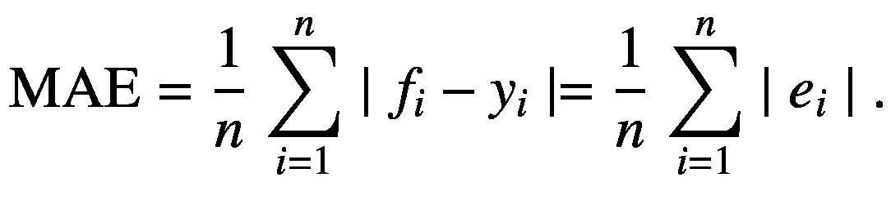

其中 *f*[*i*] 是预测值，*y*[*i*] 是真实值。

还有其他类似的度量指标，如平均绝对缩放误差（MASE）和平均绝对百分比误差（MAPE）。在所有这些度量中，性能总结的方式是同等对待低估和高估，而忽略平均符号差异。这是一个特定的缺点，因为它忽略了对高估或低估的考量。在业务问题中，我们通常可以接受一个方向的误差，但不能接受另一个方向。例如，计算信用卡的信用损失。如果业务高估了损失，从而多预留一些准备金，这是可以接受的。然而，另一个方向则代价高昂，在极端情况下可能引发破产。

```
#创建测试数据，即数据集 2
test <-Data_House_Price[floor(nrow(Data_House_Price)*(2/3) +1):nrow(Data_
House_Price),]
#在此数据上拟合线性回归模型并获取预测值
predicted_lm <-predict(linear_reg_model,test, type="response")
actual_predicted <-as.data.frame(cbind(as.numeric(test$HOUSE_ID),as.
numeric(test$HousePrice),as.numeric(predicted_lm)))
names(actual_predicted) <-c("HOUSE_ID","Actual","Predicted")
#计算绝对残差，然后取其平均值
library(ggplot2)
#绘制测试用例的实际值与预测值对比图
ggplot(actual_predicted,aes(x = actual_predicted$HOUSE_ID,color=Series)) +
geom_line(data = actual_predicted, aes(x = actual_predicted$HOUSE_ID,
y =Actual, color ="Actual")) +
geom_line(data = actual_predicted, aes(x = actual_predicted$HOUSE_ID, y =
Predicted, color ="Predicted")) +xlab('HOUSE_ID') +ylab('House Sale Price')
```

从图 7-5 中可以清楚地看到，实际值非常接近预测值。现在让我们看看我们的模型在均方误差指标上的表现如何。

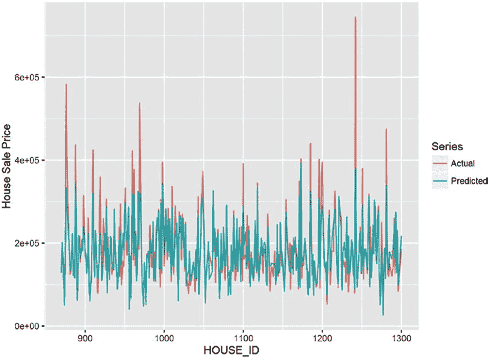

图 7-5

实际值与预测值对比图

```
#从测试数据中移除 NA 值，因为我们没有对 NA 进行任何处理
actual_predicted <-na.omit(actual_predicted)
#首先计算实际值减去预测值，然后取绝对误差（残差）的平均值
mae <-sum(abs(actual_predicted$Actual -actual_predicted$Predicted))/nrow(ac
tual_predicted)
cat("测试用例的平均绝对误差为  ", mae)
测试用例的平均绝对误差为   29570.3
```

MAE 表明平均误差为 29,570 美元。这相当于说，在美元尺度上，对于平均值为 180,921 美元的情况，预期误差为 17%。

该指标也可用于拟合线性模型。正如最小二乘法与均方误差相关一样，平均绝对误差与最小绝对偏差相关。

### 7.5.2 均方根误差

均方根误差（RMSE）是用于评估连续误差模型最流行的指标之一。顾名思义，它是均方误差的平方根。该指标最重要的特点是，通过平方的方式对误差进行加权。

例如，假设预测值为 5.5，而实际值为 4.1。那么误差为 1.4 (5.5 - 4.1)。该误差的平方为 1.4 x 1.4 = 1.96。假设另一种情况，预测值为 6.5，那么误差为 2.4 (6.5 - 4.1)，误差的平方为 2.4 x 2.4 = 5.76。如您所见，虽然误差仅变化了 2.4/1.4 = 1.7 倍，但平方误差却变化了 5.76/1.96 = 2.93 倍。因此，RMSE 对远离的误差惩罚比邻近的误差更严厉。

对于回归因变量 *y*[*t*] 在时间 t 的预测值 *ŷ*[*t*]，其 RMSE 是针对 *n* 个不同预测值计算的，即偏差平方的平均值的平方根：

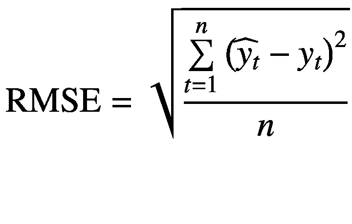

理解指标中的运算如何改变其解释方式非常重要。假设我们的因变量是房价，以美元数值表示。让我们看看指标维度如何演变以解释该度量。

预测值和实际值都以美元为单位，因此它们的差值（误差）也以美元为单位。然后对误差进行平方，维度变为美元的平方。您不能将美元的平方值与美元值进行比较。因此，我们对其开平方根，将维度恢复为美元，现在可以用美元来解释 RMSE。需要注意的是，通常用于模型比较的指标是无量纲的，但对于模型本身，我们更倾向于使用具有某种维度的指标，以便为指标提供业务背景。

```
#由于我们已经有了实际值和预测值，可以直接计算 RMSE 值
rmse <-sqrt(sum((actual_predicted$Actual-
actual_predicted$Predicted)²)/nrow(actual_predicted))
cat("测试用例的均方根误差为  ", rmse)
测试用例的均方根误差为   44459.42
```

现在您可以看到误差已放大至 44,459 美元。这是因为我们通过平方误差的方式惩罚了模型的远距离预测。

如前所述，如果您想使用一个指标来比较不同尺度的数据集或模型，则需要将该指标转化为无量纲形式。我们可以通过归一化 RMSE 来实现这一点。最常见的方法是将 RMSE 除以范围或均值：

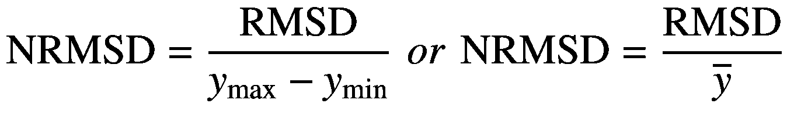

该值称为归一化均方根偏差或误差（NRMSD 或 NRMSE），通常以百分比表示。较低的值表示残差方差较小，因此是一个好模型。

### 7.5.3 R 方

R 方是一种常用于基于线性回归技术的流行度量指标。统计学家对 R 方的恰当术语是决定系数。决定系数指示了因变量 (y) 与一组自变量 (x) 之间的关系。在数学形式上，它是残差平方和与总平方和之比。再次注意，该度量也源于使用实际值和预测值的残差（误差指标）。在此，我们解释 *R*^(*2*) 指标如何为模型计算，以及我们如何解释该指标。


### 注意

大写 *R*² 和小写 *r*² 常被混用，但它们并不相同。*R*² 是多元回归模型中的多重 *R*²。在双变量线性回归中，不存在多重 *R*，此时 *R*² = *r*²。因此，关键区别在于术语（或符号）的适用性：多重 *R* 意味着多个回归变量，而 *R*² 则不然。

一个数据集包含 *n* 个值，记为 *y1…yn*（统称为 *yi* 或向量 y = [y1…yn]），每个值对应一个预测（或建模）值 *f1…fn*（称为 *fi*，有时记为 ŷi，作为向量 f）。

残差（预测误差）定义为 ei = yi - fi（构成向量 e）。

如果 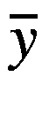 是观测数据的均值 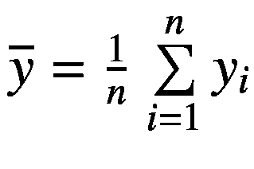，则数据集的变异性可通过以下三个平方和公式来衡量：

*   总平方和（与数据方差成正比）：

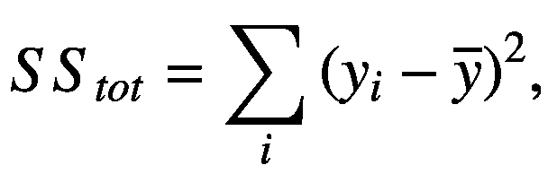

*   回归平方和，也称为可解释平方和：

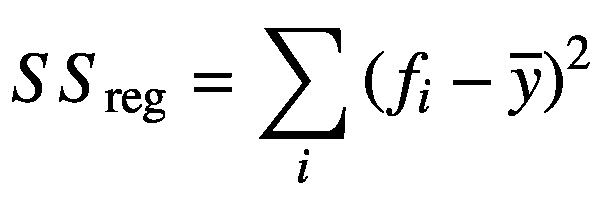

*   残差平方和，也称为剩余平方和：

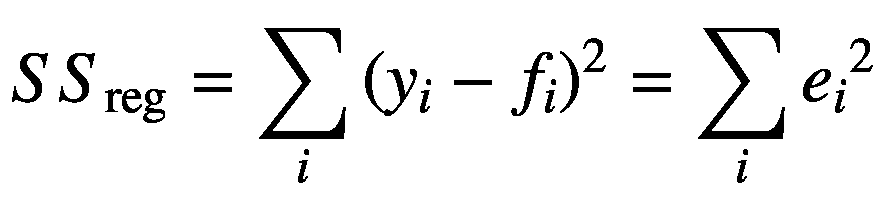

*   决定系数或 *r*² 的通用定义是：

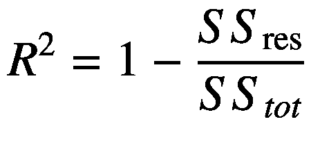

在图 7-6 中，我们可以看到平方和的解释，以及它们如何共同构成决定系数的定义。

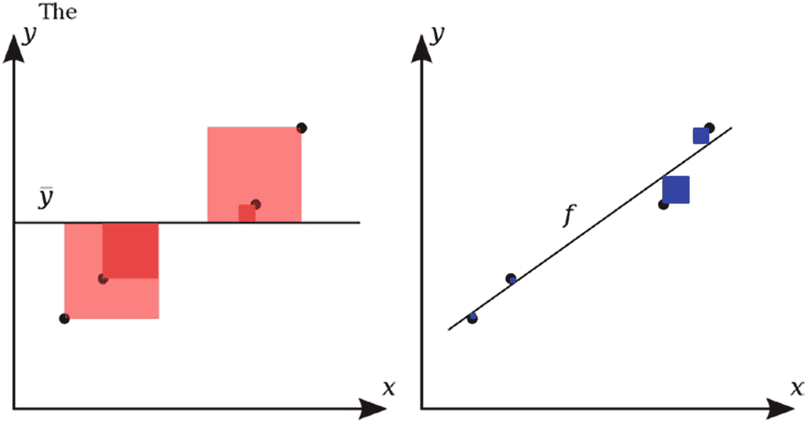

图 7-6

解释平方误差的图片（取自 [*https://en.wikipedia.org/wiki/Coefficient_of_determination*](https://en.wikipedia.org/wiki/Coefficient_of_determination)）

*R*² = 1 - 蓝色/红色

这些小方块代表相对于线性回归的平方残差。大方块的面积代表相对于平均值的平方残差。

左侧的线性回归与简单平均值相比更能拟合数据，而右侧则拟合数据的实际值。*R*² 是两者之间的比率，表明如果你使用此模型而不是简单平均值，你能多解释多少变异。毋庸置疑，完美值 1 意味着所有变异都被模型解释了。

由于 *R*² 是一个比例，它始终是介于 0 和 1 之间的数字。

*   如果 R² = 1，所有数据点都完美落在回归线上（即预测变量 x 解释了 y 的所有变异）
*   如果 R² = 0，估计的回归线完全水平（即预测变量 x 没有解释 y 的任何变异）
*   如果 R² 介于 0 和 1 之间，它解释了 y 的方差（使用模型比不使用模型更好）

尽管 R 平方是所有标准线性回归包的默认输出，但我们也会向您展示其计算过程。您还需要了解的另一个术语是调整后的 R 平方。它对模型中预测变量的数量进行了修正。换句话说，它考虑了因预测变量过多而导致的模型过拟合问题，并且只有当新项对模型的改进程度超过随机预期时，它才会增加。

```
#模型训练数据（我们将在此数据集上进行分析）
train <-Data_House_Price[1:floor(nrow(Data_House_Price)*(2/3)),.(HousePrice
,StoreArea,StreetHouseFront,BasementArea,LawnArea,StreetHouseFront,LawnArea
,Rating,SaleType)];
#从数据集中移除 NA 值
train <-na.omit(train)
#获取线性回归模型
linear_reg_model <-lm(HousePrice ~StoreArea +StreetHouseFront +BasementArea
+LawnArea +StreetHouseFront +LawnArea +Rating +SaleType ,data=train)
#显示函数调用以识别我们将要处理的模型
print(linear_reg_model$call)
lm(formula = HousePrice ~ StoreArea + StreetHouseFront + BasementArea +
LawnArea + StreetHouseFront + LawnArea + Rating + SaleType,
data = train)
#系统生成的 R 平方值
cat("系统生成的 R 平方值为 " , summary(linear_reg_model)$r.squared)
系统生成的 R 平方值为  0.7155461
```

您可以看到默认模型输出为我们计算了 R 平方。当前线性模型的 R 平方为 0.72。这可以解释为房价变异的 72% 被预测变量 `StoreArea`、`StreetHouseFront`、`BasementArea`、`LawnArea`、`StreetHouseFront`、`LawnArea`、`Rating` 和 `SaleType` 的变异所“解释”。

在这里，我们逐步计算该度量，以得到相同的 R 平方值。

```
#计算总平方和
SST <-sum((train$HousePrice -mean(train$HousePrice))²);
#计算回归平方和
SSR <-sum((linear_reg_model$fitted.values -mean(train$HousePrice))²);
#计算残差（误差）平方和
SSE <-sum((train$HousePrice -linear_reg_model$fitted.values)²);
```

这三个平方和之间的一个重要关系是：

```
SST = SSR + SSE
```

您可以自行验证这一点。现在我们将使用这些值来计算 R 平方模型评估：我们模型的 R 平方：

```
#计算 R 平方
R_Sqr <-1-(SSE/SST)
#显示计算出的 R 平方
cat("计算出的 R 平方为  ", R_Sqr)
计算出的 R 平方为   0.7155461
```

您可以看到计算出的 R 平方与 `lm()` 函数的输出相同。现在您已经了解了 R 平方背后的计算过程。

在本节中，您了解了一些围绕误差（残差）创建的基本度量指标，并将它们解释为衡量模型在实际数据上表现如何的指标。在下一节中，我们将介绍针对离散情况的技术。

## 7.6 离散输出的模型评估

在上一节中，我们介绍了针对因变量和预测值均为连续类型的模型的度量指标。在本节中，我们将介绍一些针对分布为离散情况的度量指标。

在本节中，我们将回到我们的购买预测数据，生成这些度量指标并讨论其解释。我们将利用之前为群体稳定性创建的设置。

### 7.6.1 分类矩阵

分类矩阵是查看分类器性能最直观的方式。有时也称为混淆矩阵。从视觉上看，这是一个双向矩阵，一个轴显示实际类别的分布，另一个轴显示预测类别（见图 7-7）。

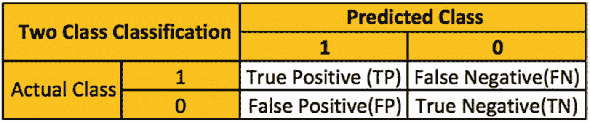

图 7-7

二分类分类矩阵

模型的准确率通过分类矩阵的对角线元素计算，因为它们代表了分类器的正确分类，即实际值和预测值相同。

```
分类率 = (真正例 + 真负例) / 总样本数
```

现在我们将向您展示分类矩阵，并为我们的购买预测数据计算分类率。我们用于建模概率的方法是多项逻辑回归，分类器将选择概率最高的类别。


### 注意

为避免类别不平衡问题，我们将采用分层抽样来创建大小相等的类别，以说明模型性能概念。类别不平衡问题会导致概率偏向高频类别，从而使分类器无法将类别分配给低频类别。

```
#移除含有缺失值的数据。建模算法会忽略缺失值
Data_Purchase<-na.omit(Data_Purchase)
#从 Data_Purchase 中抽取等量样本以减少类别不平衡问题
library(splitstackshape)
Data_Purchase_Model<-stratified(Data_Purchase, group=c("ProductChoice"),size
=10000,replace=FALSE)
print("等量类别的分布如下")
[1] "等量类别的分布如下"
table(Data_Purchase_Model$ProductChoice)
1     2     3     4
10000 10000 10000 10000
在训练数据（Set_1）上构建多项模型，然后测试数据（Set_2）将用于性能测试
set.seed(917);
train <-Data_Purchase_Model[sample(nrow(Data_Purchase_Model),size=nrow(Data_Purchase_Model)*(0.7), replace =TRUE, prob =NULL),]
dim(train)
[1] 28000     6
test <-Data_Purchase_Model[!(Data_Purchase_Model$CUSTOMER_ID
%in%train$CUSTOMER_ID),]
dim(test)
[1] 20002     6
拟合多项逻辑回归模型
library(nnet)
mnl_model <-multinom (ProductChoice ~MembershipPoints +IncomeClass
+CustomerPropensity +LastPurchaseDuration, data = train)
