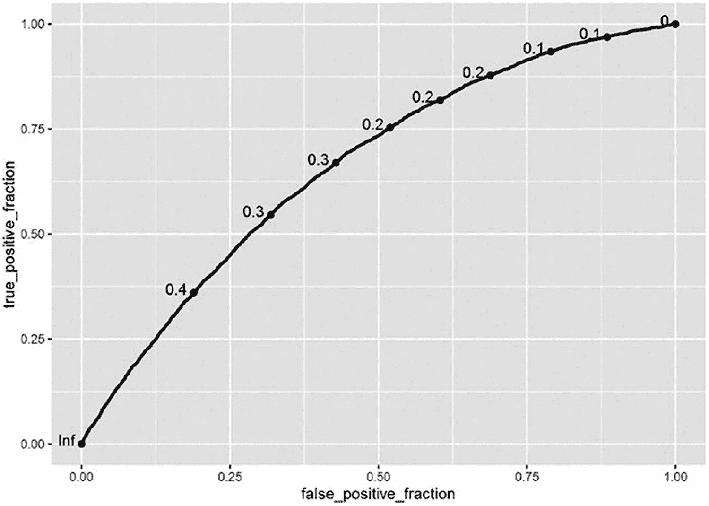
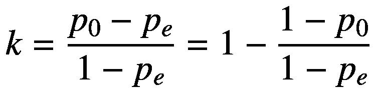
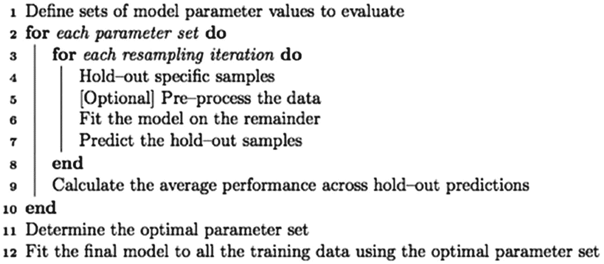

# 根据上述定义创建变量 Choice_binom
train$ProductChoice_binom |z|)
(Intercept)                -13.360676  71.621773  -0.187    0.852
MembershipPoints             0.038574   0.005830   6.616 3.68e-11 ***
IncomeClass1                12.379912  71.622606   0.173    0.863
IncomeClass2                12.142239  71.622424   0.170    0.865
IncomeClass3                11.881615  71.621801   0.166    0.868
IncomeClass4                12.086976  71.621763   0.169    0.866
IncomeClass5                11.981304  71.621759   0.167    0.867
IncomeClass6                11.874714  71.621761   0.166    0.868
IncomeClass7                11.879708  71.621765   0.166    0.868
IncomeClass8                11.759389  71.621792   0.164    0.870
IncomeClass9                12.214044  71.622000   0.171    0.865
CustomerPropensityLow        0.650186  0.054060   12.027   < 2e-16 ***
CustomerPropensityMedium     0.435307  0.054828    7.939  2.03e-15 ***
CustomerPropensityUnknown    0.952099  0.048078   19.803   < 2e-16 ***
CustomerPropensityVeryHigh  -0.430576  0.065156   -6.608  3.89e-11 ***
LastPurchaseDuration        -0.062538  0.003409  -18.347   < 2e-16 ***

Signif. codes:  0 '***' 0.001 '**' 0.01 '*' 0.05 '.' 0.1 ' ' 1
(Dispersion parameter for binomial family taken to be 1)
Null deviance: 31611  on 27999  degrees of freedom
Residual deviance: 29759  on 27984  degrees of freedom
AIC: 29791
Number of Fisher Scoring iterations: 11
```

我们将使用 R 语言中的 ROCR 库来计算曲线下面积（AUC）并创建受试者工作曲线（ROC）。ROCR 包有助于可视化评分分类器的性能。



图 7-8

ROC 曲线


```
Now create the performance dataset to create AUC curve
library(ROCR)
test_binom <-predict(glm_ProductChoice_binom,newdata=test, type ="response")
pred <-prediction(test_binom, test$ProductChoice_binom)
perf <-performance(pred,"tpr","fpr")
Calculating AUC
auc <-unlist(slot(performance(pred,"auc"),"y.values"));
cat("The Area Under ROC curve for this model is  ",auc);
The Area Under ROC curve for this model is   0.6699122
Plotting the ROCcurve
library(ggplot2)
library(plotROC)
debug <-as.data.frame(cbind(test_binom,test$ProductChoice_binom))
ggplot(debug, aes(d = V2, m = test_binom)) +geom_roc()
```

我们使用了一个 `ggplot()` 对象和 `plotROC` 库来绘制 ROC 曲线，并在图中高亮显示了截断值，以便于阅读（见图 7-8）。

在图中，我们希望在真正例和假正例之间取得平衡，并最大化真正例的同时最小化假正例。这个点就是你应该用来创建分类器的最佳截断值/阈值。在这里，你可以看到该值接近 0.2——真正例约为 74%，而假正例约为 48%。

第 [6](http://dx.doi.org/10.1007/978-1-4842-4215-5_6) 章讨论了如何使用这个最优值（即 0.2）作为二分类器的截断值。请参考该章关于逻辑回归的讨论。ROCR R 包的详细信息可在 [`https://cran.r-project.org/web/packages/ROCR/ROCR.pdf`](https://cran.r-project.org/web/packages/ROCR/ROCR.pdf) 获取。

## 7.7 概率技术

一般来说，并没有将模型性能技术明确划分为概率技术和其他技术的分类。然而，理解更复杂的方法是如何涌现出来用于模型性能测试的，对你是有帮助的。概率技术是基于抽样和模拟的技术。这些技术与我们之前章节讨论的不同；在之前的章节中，我们利用残差来创建指标。而在概率技术中，我们将通过模拟和抽取子集来获得一个稳健且稳定的模型。

在本节中，我们将从非常高的层面简要介绍两种技术，它们对应于数据科学家可以使用的两大类概率工具，尽管这两种技术都是基于重抽样的：

*   基于模拟：K 折交叉验证
*   基于抽样：Bootstrap 抽样

斯坦福大学的 Ron Kohavi 在其一篇备受赞誉的论文《A Study of Cross-Validation and Bootstrap for Accuracy Estimation and Model Selection》（发表于 *International Joint Conference on Artificial Intelligence* (IJCAI), 1995）中，对这些概念进行了非常透彻的阐述。对此主题感兴趣的读者应阅读这篇论文。在本节中，我们将从在 R 语言中应用这些方法的角度来探讨这些概念。

### 7.7.1 K 折交叉验证

交叉验证是模型评估中最常用的技术之一，并且近来已被认为是一种优于基于残差指标的技术。基于残差方法的问题在于，你需要保留一个测试集，而仅凭一个测试集，它无法准确告诉你模型在未见数据上的表现。因此，尽管训练、测试和验证方法很好，但概率模拟和抽样为我们提供了更多测试模型的方法。

K 折交叉验证在机器学习社区中非常流行。折数越多，解释性越好（回想一下大数定律）。执行 K 折交叉验证的步骤包括：

步骤 1：将数据集划分为 k 个子集。
步骤 2：在 k-1 个子集上训练模型。
步骤 3：在剩余的一个子集上测试模型并计算误差。
步骤 4：重复步骤 1-3，直到所有子集都恰好被用作一次测试集。
步骤 5：通过这种场景模拟练习，对误差进行平均，得到交叉验证误差。

这种方法的优点是，与训练/测试（或留出交叉验证）方法中的相同情况相比，你创建 k 个子集的方法并不那么重要。此外，该方法确保每个数据点恰好一次进入测试集，并 k-1 次进入训练集。随着 k 的增加，所得估计值的方差会减小。

这种方法的缺点是，模型需要被估计 k 次，然后进行 k 次测试，这意味着更高的计算成本（计算成本与折数成正比）。一种变体是随机分割数据并控制每折的大小。这样做的好处是，你可以独立选择每个测试集的大小以及进行平均的试验次数。

### 注意

在交叉验证技术中，我们不会保留训练和测试子集。通常，数据科学家会在交叉验证之外保留一个验证集，以测试模型的最终拟合效果。在我们的示例中，我们将把训练集视为训练集，测试集视为验证数据集。

让我们用房屋销售价格问题来展示一个示例。鼓励你也在分类问题上应用相同的技术。

```
library(caret)
library(randomForest)
set.seed(917);
模型训练数据（我们将在此数据集上展示我们的分析）
train <-Data_House_Price[1:floor(nrow(Data_House_Price)*(2/3)),.(HousePrice
,StoreArea,StreetHouseFront,BasementArea,LawnArea,StreetHouseFront,LawnArea
,Rating,SaleType)];
创建测试数据，即集合 2
test <-Data_House_Price[floor(nrow(Data_House_Price)*(2/3) +1):nrow(Data_
House_Price),.(HousePrice,StoreArea,StreetHouseFront,BasementArea,LawnArea,S
treetHouseFront,LawnArea,Rating,SaleType)]
从数据集中移除 NA
train <-na.omit(train)
test <-na.omit(test)
创建 k 个子集，我们取 k 为 10（即 10 折交叉验证）
k_10_fold <-trainControl(method ="repeatedcv", number =10, savePredictions
=TRUE)
在折上拟合模型，并使用 rmse 作为拟合模型的指标
model_fitted <-train(HousePrice ~StoreArea +StreetHouseFront +BasementArea
+LawnArea +StreetHouseFront +LawnArea +Rating +SaleType, data=train, family
= identity,trControl = k_10_fold, tuneLength =5)
显示交叉验证的摘要
model_fitted
Random Forest
712 samples
6 predictor
No  pre-processing
Resampling: Cross-Validated (10 fold, repeated 1 times)
Summary of sample sizes: 642, 640, 640, 641, 640, 641, ...
Resampling results across tuning parameters:
mtry  RMSE      Rsquared
2    40235.04  0.7891003
4    37938.62  0.7961153
6    38049.31  0.7927441
8    38132.67  0.7914360
10    38697.45  0.7858166
RMSE was used to select the optimal model using the smallest value.
The final value used for the model was mtry = 4.
```

从摘要中可以看出，通过交叉验证选择的模型具有比我们之前创建的模型更高的 *R*²。新的 R 平方为 80%，而旧的是 72%。另外，请注意，选择最佳模型的默认指标是 RMSE。你可以根据需求和优化函数更改指标和函数类型。


### 7.7.2 自助采样法

我们已经在第[3](http://dx.doi.org/10.1007/978-1-4842-4215-5_3)章中讨论过自助采样的概念。这里只是将该思想扩展到当前问题。基于数据中的随机样本，我们将尝试估计模型，并观察能否降低误差，从而获得高性能模型。当我们将这些技术用作性能评估方法时，可以看到模型（即预测变量）已经固定，我们正尝试从概率角度找出哪种方案性能最佳及其具体程度。

为了展示自助采样的示例，我们将扩展之前交叉验证的演示内容。

```
创建自助采样实验，我们取样本数为 10（即 10 个样本的自助采样集）
boot_10s <-trainControl(method ="boot", number =10, savePredictions =TRUE)
在自助采样集上拟合模型，并使用 rmse 作为拟合模型的评估指标
model_fitted <-train(HousePrice ~StoreArea +StreetHouseFront +BasementArea
+LawnArea +StreetHouseFront +LawnArea +Rating  +SaleType, data=train, family = identity,trControl = boot_10s, tuneLength =5)
显示自助采样模型的摘要
model_fitted
随机森林
712 个样本
6 个预测变量
无预处理
重采样：自助采样法（10 次重复）
样本量摘要：712, 712, 712, 712, 712, 712, ...
不同调参参数下的重采样结果：
mtry  RMSE      R 平方
2    40865.52  0.7778754
4    38474.68  0.7871019
6    38818.70  0.7819608
8    39540.90  0.7742633
10    40130.45  0.7681462
使用最小值选择最优模型时采用了 RMSE 指标。
模型最终使用的参数值为 mtry = 4。
```

在自助采样情况下，可以看到最佳模型的*R*²为 79%，这仍然高于之前案例中的 72%，但低于 10 折交叉验证的结果。需要注意的一个重要点是，自助采样样本会反复运行以进行模型估计，而交叉验证在每次运行中保持了子集的互斥性。

概率方法复杂且难以理解。建议只有经验丰富的数据科学家使用它们，因为需要深入理解机器学习算法才能正确设置这些实验并进行合理解释。下一章关于参数调优的内容，正是我们在此讨论的概率技术的延伸。

## 7.8 Kappa 误差指标

近年来，机器学习从业者尝试了大量新颖且复杂的误差指标用于评估和模型创建。这些新的误差指标之所以重要，是因为它们能解决特定的业务问题/目标。借助强大的计算能力，我们可以构建自己的优化函数，并利用数据应用迭代算法。

Kappa 或 Cohen's Kappa 系数是一种统计量，用于衡量观测准确率与期望准确率之间的关系。Jacob Cohen 在 1960 年发表于《教育心理测量杂志》的一篇论文中引入了 Kappa。Scott（1955）提出了一个类似的统计量，称为 Pi。Cohen's Kappa 和 Scott's Pi 在期望概率的计算方式上有所不同。该方法最初用于评估不同评分者对同一案例进行不同分类时的评分者间一致性。

在机器学习领域，Kappa 被用于比较纯随机机会与模型的表现。这种指标在类别不平衡的分类问题中非常有效。例如，假设你的训练数据包含 80%的“是”和 20%的“否”。即使没有模型，如果你简单地将所有样本都标记为“是”，分类准确率（对角线）仍可达到 80%。

下面给出 Kappa 更正式的定义。

Cohen's Kappa 衡量随机方法与建模方法之间的一致性，其中每种方法将*N*个项目分类到*C*个互斥类别中。

κ的公式为：



其中，*po*是两种方法之间的相对观测一致性，*pe*是随机重叠的假设概率，利用观测数据计算每种方法随机选择每个类别的概率。如果两种方法完全一致，则κ = 1。在极少数情况下，Kappa 可能为负值。这表明两个观测者的一致性低于仅凭随机预期的一致性。

如需更详细的阅读，请参考 Fleiss, J. L. (1981) *Statistical Methods for Rates and Proportions*，第 2 版（纽约：John Wiley）以及 Banerjee, M.; Capozzoli, Michelle; McSweeney, Laura; Sinha, Debajyoti (1999)，“Beyond Kappa: A Review of Interrater Agreement Measures”，来自*The Canadian Journal of Statistics*。

我们将使用购买预测数据配合一个非常简单的模型来演示 Kappa 和准确率指标。使用`caret()`包来展示此示例。该包提供了统一的方法来训练和评估近 270 种不同类型的模型。该包的详细信息在第[8](http://dx.doi.org/10.1007/978-1-4842-4215-5_8)章中提供。

```
library(caret)
library(mlbench)
下面我们随机抽取 5000 个案例以加快计算速度。
set.seed(917);
train_kappa A, 2->B, 3-> C 和 4->D
train_kappa$ProductChoice_multi  NIR] : < 2.2e-16
Kappa : 0.1377
McNemar 检验 P 值 : < 2.2e-16
按类别统计：
类别: A 类别: B 类别: C 类别: D
灵敏度            0.6530   0.1069   0.2413   0.4106
特异度            0.5830   0.9228   0.8602   0.7717
阳性预测值         0.3480   0.3144   0.3676   0.3685
阴性预测值         0.8314   0.7573   0.7709   0.8014
患病率             0.2542   0.2488   0.2520   0.2450
检出率             0.1660   0.0266   0.0608   0.1006
检出患病率         0.4770   0.0846   0.1654   0.2730
平衡准确率         0.6180   0.5149   0.5507   0.5911
```

从解释的角度来看，可以使用以下指导原则：

*   Kappa 为 0.20 或更低时，一致性较差
*   Kappa 在 0.20 至 0.40 之间时，一致性一般
*   Kappa 在 0.40 至 0.60 之间时，一致性中等
*   Kappa 在 0.60 至 0.80 之间时，一致性良好
*   Kappa 在 0.80 至 1.00 之间时，一致性非常好

在此模型输出中，Kappa 值为 0.1377，这表明随机模型与我们的模型之间一致性较差。我们的模型结果与随机模型不同。现在，存在两种可能性——模型表现比随机模型更差，或者表现异常出色。观察准确率指标——35.4%意味着我们的模型在分类方面表现不佳。我们需要更多的数据和特征才能获得良好的模型。


## 7.9 总结

模型评估是一个非常复杂的主题。本章仅触及了表面，旨在帮助你初步了解模型评估的概念。模型评估这一主题为我们用于评估性能的度量标准带来了许多深度。在这个不断变化的分析领域中，企业出于不同目的使用模型，有时会以定制化的方式对问题进行建模，以帮助制定业务决策。行业中的这一趋势催生了评估度量标准的竞争性。

要在真实环境中解决业务问题，你必须优化两个不同的目标函数：

*   **统计度量**，即我们在本章中讨论的内容
*   **业务约束**，即特定问题/业务的度量标准

让我们通过一个例子来理解这些对模型性能的约束。假设你需要构建一个模型，将客户分为八个类别。然而，处理每个类别客户的成本是不同的。为第 8 类客户服务的成本是为第 1 类客户服务的 10 倍。与此类似，每个类别的成本会随着类别编号及其他因素而变化。

现在，如果企业决定使用一个模型将对象分类到这些类别中，你将如何评估该模型的性能？纯粹的统计性能度量可能并不适用。我们该如何考虑创建混合性能指标，或一个序列依赖矩阵？评估的概念非常深入且相当复杂。数据科学家必须提出既富有创造性又在统计上有效的度量标准，以适应业务问题。

本章介绍了总体稳定性指数的概念，它确认了我们是否可以使用该模型进行预测。然后，我们将评估指标分为连续型和离散型两种情况。讨论的连续型指标是残差的不同函数，即平均绝对误差、均方根误差和 R 平方。离散型度量指标包括分类率、敏感性与特异性，以及 ROC 曲线下面积。我们使用房价数据和购买预测数据来展示评估指标的示例。

这些评估技术更适用于统计学习模型。先进的机器学习模型没有任何分布约束，无法用传统指标进行评估和解释。我们介绍了评估机器学习模型的概率方法，即交叉验证和自助采样。这两种方法构成了机器学习模型性能评估的基石。

最后，我们讨论了多类问题的一个重要指标——Kappa 指标。该指标越来越受欢迎，因为在分类问题中，每次错误分类都伴随着不同的成本。因此，我们需要以相对的方式衡量性能。

模型性能与评估技术正在快速发展。性能指标正成为多目标优化问题，因此也帮助算法采用新的方式来拟合数据。我们将在下一章继续探讨一些更高级的主题，届时将介绍统计学习与机器学习之间的区别，包括这种区别如何让我们更充分地利用数据，以及如何通过集成技术来提升模型性能。下一章将介绍偏差与方差之间的权衡，以帮助我们理解在给定约束条件下性能所能达到的极限。

# 8. 模型性能提升

模型性能是一个广义术语，通常用于衡量模型在新数据集（通常是测试数据集）上的表现。性能指标还扮演着阈值的角色，用于决定模型是否可以投入实际的决策系统，还是需要改进。在上一章中，我们讨论了一些适用于连续型和离散型情况的性能指标。在本章中，我们将讨论如何通过改变建模过程来帮助我们在这些指标上提升模型性能。

特征选择在建模开发过程中扮演着重要角色。正是特征包含了用于解释因变量的信息。数据科学家花费大量时间选择和创建特征，以拟合预测模型。特征工程过程涉及选择最佳特征集及其变换。然后将这些特征集输入算法以量化关系。算法从数据中学习并创建一个预测模型。随后应用模型性能提升方法，以在关注的误差指标上提升性能。模型的高级属性，例如复杂度和学习速度，也会影响模型性能。这些高级参数被称为超参数。我们将在后续章节中进一步讨论超参数。广义上讲，有两种方法可以提升模型性能，尤其是在机器学习算法中：

*   增加更多特征并提高数据质量
*   优化超参数

第一点正是本书迄今为止一直在讨论的内容。然而，我们也讨论了一些算法，其中学习过程受到超参数的影响，例如在决策树中，树的深度、交叉验证的折数等。这些参数独立于特征，并影响模型性能。例如，你可以使用相同的预测变量集但不同的超参数来训练两个不同的决策树模型。为了理解性能优化过程，我们需要理解偏差与方差之间的权衡。偏差指的是真实值与预测值之间的差异，而方差指的是预测值均值周围的离散程度。偏差和方差是预测模型中不精确性/性能的两个关键组成部分，并且通常它们之间存在权衡关系。这种权衡是非线性的，这意味着通常减少一个会导致另一个增加。

本章将探讨这些问题，并提供 R 语言中的示例，以帮助你掌握如何使用 R 实现一些流行的性能提升技术。

本章使用的数据集与上一章相同（购买预测和房屋销售价格），我们将展示本章的概念如何影响上一章指标的结果。

### 注意

本章中的 R 语言示例计算量较大，因此建议你在运行这些示例之前检查机器配置。

虽然我们在本章中力求在简洁性和完整性之间取得平衡，但我们期望使用这些技术的用户对数值计算和机器学习算法有良好的理解。我们将提供研究论文的参考文献，供你详细阅读统计基础。

本章的学习目标如下：

*   机器学习与统计建模
*   Caret 包概述
*   超参数简介
*   超参数调优示例
*   偏差与方差的权衡
*   集成学习简介
*   集成学习中的高级方法
*   高级主题：贝叶斯优化


## 8.1 Caret 包概述

Caret 包是 R 语言中最强大的包之一。该包允许用户充分发挥机器学习算法的潜力。Caret 包（分类与回归训练的缩写）包含用于复杂回归和分类问题的函数。该包拥有专门的 Git 页面，是 R 语言中积极更新且有完善文档的包之一。Caret 包由辉瑞公司的 Max Kuhn 创建并维护。

Caret 包拥有众多用于模型开发和性能评估指标的函数。作为一个综合性包，它还可用于其他采样技术以及复杂的特征选择过程。Caret 包中有两个最重要的函数/工具：

*   `trainControl()`

*   `train()`

`trainControl()` 函数就像一个包装器，定义了模型训练的规则以及采样和网格搜索的执行条件。`train()` 函数非常强大，支持 Caret 包中提供的 230 种模型类型（见图 8-1）。主要函数/工具 `train()` 可用于：

*   **模型评估**，使用交叉验证、重采样和其他常规指标。它还可用于衡量调参对性能的影响。
*   **模型选择**，通过基于最优参数选择最佳模型，从而计算多个指标以选定最终模型。
*   **模型估计**，使用训练模型列表中列出的 230 种模型类型中的任何一种，并采用默认参数或调优后的参数。

默认情况下，该函数会自动选择与最佳值相关的调优参数，尽管也可以使用不同的算法来调整参数（来源：[`http://topepo.github.io/caret/model-training-and-tuning.html`](http://topepo.github.io/caret/model-training-and-tuning.html)）。



图 8-1

Caret 包中的 train() 函数算法

通常，Caret 包的基本用法包括首先定义 `trainControl()`，然后调用 `train()` 函数。这里我们展示调用这两个函数以使用 Caret 功能的通用语法。

还有其他方法可用，例如重复 K 折交叉验证、留一法等。`trainControl` 函数可用于指定重采样的类型。默认情况下，使用简单的自助法重采样：

```
rfControl <-trainControl(# 示例：10 折交叉验证
method ="repeatedcv",   # 其他方法可用，例如重复 K 折交叉验证、留一法等
number =10,             # 折数
repeats =10             # 重复十次
)
```

`train` 函数的前两个参数分别是预测变量和结果数据对象。第三个参数 `method` 指定模型类型（请参阅训练模型列表或按标签训练模型）。以下是一个通过 `randomForest` 包拟合 `randomForest` 模型的示例，该模型使用 10 折交叉验证进行测试：

```
set.seed(917)
randomForectFit1 <-train(Class ~.,   # 定义模型公式
data = training,                     # 定义建模数据
method ="rf",                        # 列出要使用的模型，caret 在训练模型列表中提供了选项
trControl = rfControl,               # 定义控制训练的条件
...  )               # 特定于建模技术的其他选项
randomForectFit1
```

关于 `trainControl` 的更多信息将在后续章节中给出。详细信息可查阅 [`http://topepo.github.io/caret/model-training-and-tuning.html`](http://topepo.github.io/caret/model-training-and-tuning.html)。

由于这是 R 语言的核心包，它几乎涵盖了所有的机器学习技术。因此，牢记其功能非常重要。

### 注意

在本章中，我们不会使用完整的数据集。示例将基于较小的数据集，以确保您能在性能较低的机器上复现结果。


## 8.2 超参数简介

在机器学习中，我们处理两种参数：一种是标准模型参数，另一种是超参数。这两类参数的核心区别在于，模型参数可以直接从底层数据中学习得到，而超参数则不能。机器学习模型的训练过程用于学习数据，然后拟合模型参数。

然而，超参数并非直接从数据中学习得到，但它们对模型性能有着至关重要的影响。超参数描述了模型的“高层”属性，例如其复杂度、学习速度以及应达到的深度。另一个重要点是，超参数在训练开始前就已固定，因此模型的标准参数是在此基础上学习得到的。我们可以说，超参数决定了模型训练的规则，而模型的标准参数则是通过这些规则估算出来的。

那么，超参数是如何确定的呢？哪些因素会影响超参数的选择过程？这一领域被总结为*超参数优化*，将在后续章节中进行高层次探讨。

另一种理解超参数的方式是，将其视为贝叶斯统计学习方法的前提条件，该方法涉及在给定训练数据集的情况下，寻找模型参数的概率分布。例如，一个人工神经网络的训练需要预设四个超参数来从数据中学习：选择带有算法的模型类型、选择网络架构、分配训练参数以及学习模型参数。通常，在用数据训练模型之前，我们可以将超参数分为四个决策点：

*   **模型类型**：决定你在机器学习中选择哪种类型的模型，例如前馈或循环神经网络、支持向量机、线性回归等。

*   **架构**：一旦确定了模型类型，你就需要输入模型学习过程的边界条件，例如隐藏层数量、每层隐藏节点数、批量归一化和池化层等。

*   **训练参数**：确定模型类型和架构后，你需要决定模型应该如何学习，例如学习率和动量率、批量大小等。这些参数有时被称为训练参数。

*   **模型参数**：提供这些输入后，模型训练过程开始，模型参数（例如神经网络中的权重和偏置）被估算出来。

超参数的一些示例如下：

*   树的深度或叶子数量
*   矩阵分解中的潜在因子
*   学习率（基于神经网络的方法中）
*   深度神经网络中的隐藏层
*   k-means 聚类中的聚类数量

为了说明超参数对模型性能的影响，我们将创建一个使用不同超参数的示例，并检查模型的性能。在此示例中，我们将使用购买预测数据的一个子集。

在下面的示例中，我们创建了两个随机森林模型，它们使用相同的底层数据和相同的预测变量，但超参数（树的数量）采用了两个不同的值：

*   ntree = 20
*   ntree = 50

以下是两种情况的准确率结果：

*   模型 1：树的大小 = 20

```
setwd("C:/Personal/Machine Learning/Run Chap 8");
library(caret)
library(randomForest)
set.seed(917);
