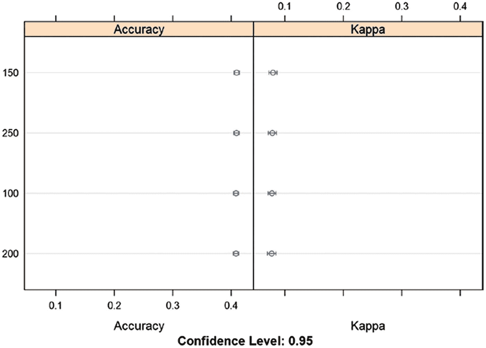

# 手动搜索
trainControl <-trainControl(method="repeatedcv", number=10, repeats=3, search="grid")
tunegrid <-expand.grid(.mtry=c(sqrt(ncol(dataset)-2)))
modellist <-list()
```

这里，我们设置 `train` 函数，其中 `method="rf"` 表示使用随机森林算法拟合模型，`ntree` 为循环变量中的树的数量。



图 8-2

性能图准确率指标

```
for (ntree in c(100, 150, 200, 250)) {
set.seed(917);
fit <-train(factor(ProductChoice) ~MembershipPoints +CustomerAge +PurchaseTenure +CustomerPropensity +LastPurchaseDuration, data=dataset, method="rf", metric=metric, tuneGrid=tunegrid, trControl=trainControl, ntree=ntree)
key <-toString(ntree)
modellist[[key]] <-fit
}
