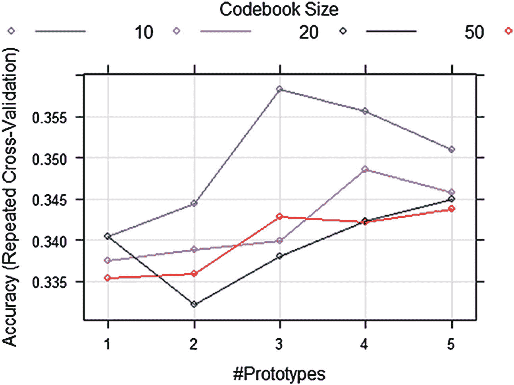

# plot the effect of parameters on accuracy
plot(model)
```

调优算法显示了最佳调优参数。图 8-3 也显示了准确率图中达到峰值的顶线，该顶线对应最佳模型。



图 8-3

交叉验证样本的准确率

### 8.3.3 自动网格搜索

本节将讨论用于自动网格搜索优化的模型细节。

*   *响应变量*：`ProductChoice`

*   *预测变量*：`MembershipPoints`、`CustomerAge`、`PurchaseTenure`、`CustomerPropensity` 和 `LastPurchaseDuration`

*   *误差计算*：交叉验证

*   *模型类型*：学习向量量化（LVQ）

```
