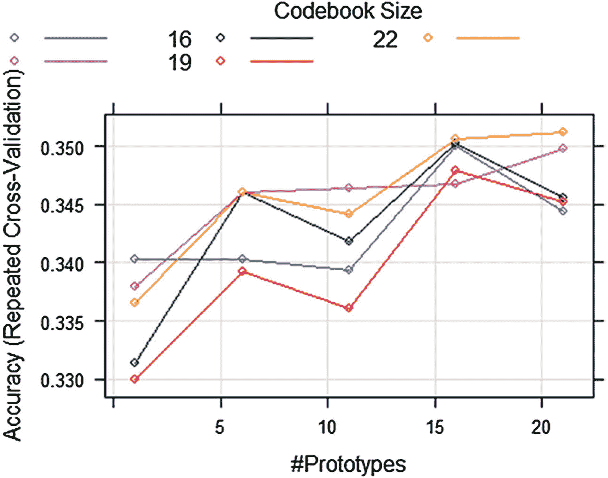

# Tune algorithm parameters using an automatic grid search.
set.seed(917);
dataset <-Data
```

此处，我们设置 `trainControl` 函数，其中 `method="repeatedCV"` 表示使用重复交叉验证，搜索方法为 `default`，即自动网格搜索。



图 8-4

自动网格搜索的交叉验证样本准确率

```
