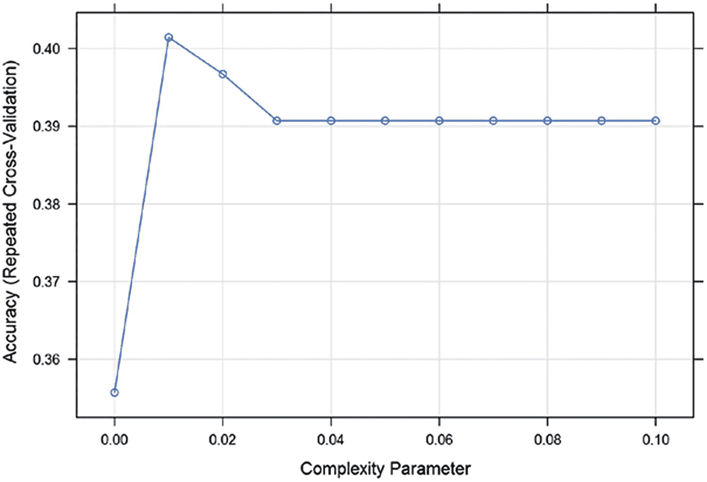

# 显示最佳配置
print(fit.cart$bestTune)
cp
2 0.01
plot(fit.cart)
```

图 8-5 中的图表清晰地显示，准确率的峰值出现在 cp 值等于 0.01 时，对应的准确率为 0.41，高于我们之前优化的模型。同时请注意，本例中的模型是递归划分与回归树。



图 8-5

跨交叉验证样本和复杂度参数的准确率

### 8.3.5 随机搜索

本节讨论随机搜索优化模型的细节。

*   *响应变量*：`ProductChoice`

*   *预测变量*：`MembershipPoints`、`CustomerAge`、`PurchaseTenure`、`CustomerPropensity` 和 `LastPurchaseDuration`

*   *误差计算*：交叉验证

*   *模型类型*：随机森林

```
