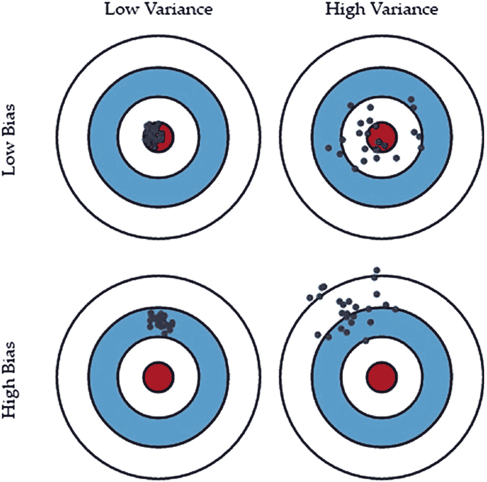
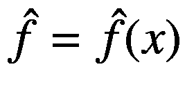
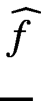
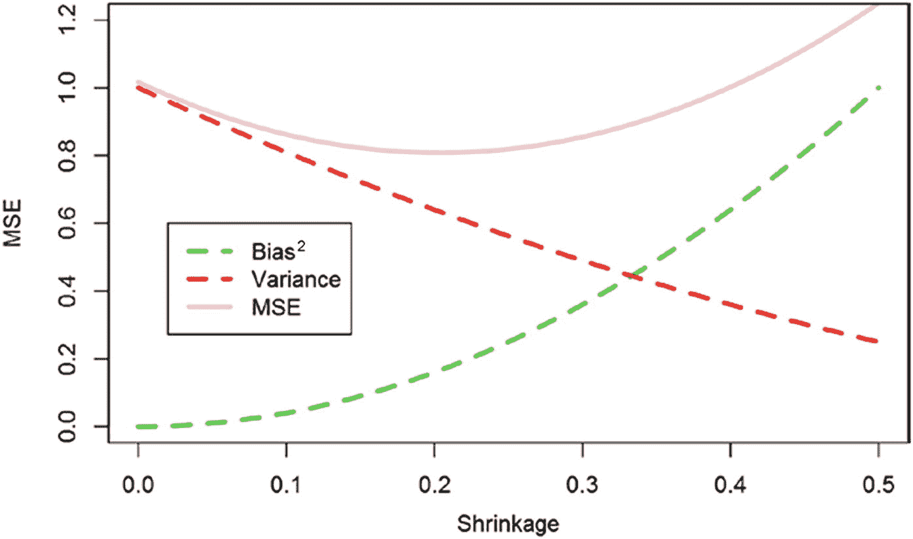

# 训练模型
trainControl <-trainControl(method="repeatedcv", number=10, repeats=3)
tunegrid <-expand.grid(.mtry=c(1:4), .ntree=c(100, 150, 200, 250))
set.seed(917)
custom <-train(factor(ProductChoice) ~MembershipPoints +CustomerAge +PurchaseTenure +CustomerPropensity +LastPurchaseDuration, data=dataset, method=customRF, metric=metric, tuneGrid=tunegrid, trControl=trainControl)
print(custom)
10000 samples
5 predictor
4 classes: '1', '2', '3', '4'
No pre-processing
Resampling: Cross-Validated (10 fold, repeated 3 times)
Summary of sample sizes: 9000, 8999, 9001, 9001, 9000, 9000, ...
Resampling results across tuning parameters:
mtry  ntree  Accuracy   Kappa
1     100    0.4091336  0.05088226
1     150    0.4078343  0.04944209
1     200    0.4082998  0.04973571
1     250    0.4076663  0.04861050
2     100    0.4141003  0.07256969
2     150    0.4145340  0.07306897
2     200    0.4142334  0.07232983
2     250    0.4144336  0.07289516
3     100    0.4090333  0.07980804
3     150    0.4081328  0.07744357
3     200    0.4079661  0.07782225
3     250    0.4086323  0.07818017
4     100    0.3797990  0.07244785
4     150    0.3804304  0.07231228
4     200    0.3826303  0.07566550
4     250    0.3838646  0.07796204
Accuracy was used to select the optimal model using  the largest value.
The final values used for the model were mtry = 2 and ntree = 150.
plot(custom)
```

自定义搜索优化目前为我们提供了最高 0.415 的准确率。对于这个问题，这似乎是最佳准确率。再次强调，我们使用的是相同的数据和相同的变量，并观察了性能如何不断变化。下一节将讨论模型性能中的一个非常重要的概念：偏差与方差。

## 8.4 偏差与方差的权衡

任何机器学习算法中的误差都可以归因于偏差、方差和不可约误差。偏差与方差的权衡或困境，是指在任何机器学习算法中同时最小化偏差和方差的问题。通常，减少其中一个往往会增加另一个。

在性能度量中，我们说偏差导致欠拟合，而方差导致过拟合。图 8-8 展示了一个非常好的图形表示，由 Scott Fortmann-Roe 在其博客中使用靶心图提供。



图 8-8

使用靶心图说明偏差与方差

Fortmann 进一步提供了由偏差和方差引起的误差的概念性定义。查看图 8-8 中的图像，可以很容易地想象出由偏差和方差引起的误差如何影响结果。Fortmann-Roe 提供了简单的定义：

*   *由偏差引起的误差：* 由偏差引起的误差被视为我们模型的预期（或平均）预测值与我们要预测的正确值之间的差异。

*   *由方差引起的误差：* 由方差引起的误差被视为模型对给定数据点预测的可变性。再次想象一下，你可以多次重复整个模型构建过程。方差就是给定点的预测在不同模型实现之间的变化程度（来源：[`http://scott.fortmann-roe.com/docs/BiasVariance.html`](http://scott.fortmann-roe.com/docs/BiasVariance.html)）。

机器学习算法中泛化误差的分解称为偏差-方差分解，它将误差分解为三个组成部分：

*   *偏差的平方*

*   *方差*

*   *不可约误差*

数学上，分解后的方程如下所示：

![$$ \mathrm{E}\left[{\left(y-\hat{f}(x)\right)}²\right]=\mathrm{Bias}{\left[\hat{f}(x)\right]}²+\mathrm{Var}\left[\hat{f}(x)\right]+{\sigma}² $$](images/416805_2_En_8_Chapter/416805_2_En_8_Chapter_TeX_Equa.png)

其中

![$$ \mathrm{Bias}\left[\hat{f}(x)\right]=\mathrm{E}\left[\hat{f}(x)-f(x)\right] $$](images/416805_2_En_8_Chapter/416805_2_En_8_Chapter_TeX_Equb.png)

且

![$$ \mathrm{Var}\left[\hat{f}(x)\right]=\mathrm{E}\left[\hat{f}{(x)}²\right]-\mathrm{E}{\left[\hat{f}(x)\right]}² $$](images/416805_2_En_8_Chapter/416805_2_En_8_Chapter_TeX_Equc.png)

这个方程的推导也很简单，可以针对一般情况进行，如下所示。

对于任何随机变量，方差定义为

![$$ \mathrm{Var}\left[X\right]=\mathrm{E}\left[{X}²\right]-\mathrm{E}{\left[X\right]}² $$](images/416805_2_En_8_Chapter/416805_2_En_8_Chapter_TeX_Equd.png)

等价地

![$$ \mathrm{E}\left[{X}²\right]=\mathrm{Var}\left[X\right]+\mathrm{E}{\left[X\right]}² $$](images/416805_2_En_8_Chapter/416805_2_En_8_Chapter_TeX_Eque.png)

假设 *f* = *f*(*x*) 且 ，由于 *f* 是确定性的。

![$$ \mathrm{E}\left[f\right]=f $$](images/416805_2_En_8_Chapter/416805_2_En_8_Chapter_TeX_Equf.png)

因此，*y* = *f*+∈ 且 E[∈] = 0 意味着

![$$ \mathrm{E}\left[\mathrm{y}\right]=\mathrm{E}\left[f+\in \right]=\mathrm{E}\left[f\right]=f. $$](images/416805_2_En_8_Chapter/416805_2_En_8_Chapter_TeX_Equg.png)

同样地，

![$$ \mathrm{Var}\left[\in \right]={\sigma}² $$](images/416805_2_En_8_Chapter/416805_2_En_8_Chapter_TeX_Equh.png)

因此，

![$$ \mathrm{Var}\left[y\right]=\mathrm{E}\left[{\left(y\hbox{-} \mathrm{E}\left[y\right]\right)}²\right]=\mathrm{E}\left[{\left(y-f\right)}²\right]=\mathrm{E}\left[{\left(f+\in -f\right)}²\right]=\mathrm{E}\left[{\in}²\right]=\mathrm{Var}\left[\in \right]+\mathrm{E}{\left[\in \right]}²={\sigma}² $$](images/416805_2_En_8_Chapter/416805_2_En_8_Chapter_TeX_Equi.png)


由于 *ϵ* 和  相互独立，我们有

![$$ \mathrm{E}\left[{\left(y-\hat{f}\right)}²\right]{\displaystyle \begin{array}{c}=\mathrm{E}\left[{y}²+{\widehat{f}}²-2y\widehat{f}\right]\\ {}=\mathrm{E}\left[{y}²\right]+\mathrm{E}\left[{\widehat{f}}²\right]-\mathrm{E}\left[2y\widehat{f}\right]\\ {}=\mathrm{Var}\left[y\right]+\mathrm{E}{\left[y\right]}²+\mathrm{Var}\left[\widehat{f}\right]+\mathrm{E}{\left[\widehat{f}\right]}²-2f\mathrm{E}\left[\widehat{f}\right]\\ {}\begin{array}{l}=\mathrm{Var}\left[y\right]+\mathrm{Var}\left[\widehat{f}\right]+\mathrm{E}\left(f-\mathrm{E}\left[\widehat{f}\right]\right)\\ {}=\mathrm{Var}\left[y\right]+\mathrm{Var}\left[\widehat{f}\right]+\mathrm{E}\left[f-\widehat{f}\right]\\ {}={\sigma}²+\mathrm{Var}\left[\widehat{f}\right]+\mathrm{Bias}\left[\widehat{f}\right]\end{array}\end{array}} $$](images/416805_2_En_8_Chapter/416805_2_En_8_Chapter_TeX_IEq3.png)

不可约误差是真实关系中的噪声项，任何模型都无法从根本上减少它。在线性回归设定下的这一推导过程，在 Shakhnarovich, Greg (2011) 的《线性回归中偏差-方差分解推导笔记》中有详细解释。其他机器学习算法中也可以进行类似的分解。

此外，这里展示了权衡关系。这种权衡关系的图形表示也让我们了解到，如何调整机器学习算法，以在给定权衡约束下达到方差和偏差最小的最佳点。

以下代码片段在一个真实模型原型上展示了这种权衡关系。在下面的示例中，我们计算了假设数据的均方误差、偏差和方差，然后绘制了改变 `shrink`（一个数值向量）的值如何改变这些量。

```
mu <-2
Z <-rnorm(20000, mu)
MSE <-function(estimate, mu) {
return(sum((estimate -mu)²) /length(estimate))
}
n <-100
shrink <-seq(0,0.5, length=n)
mse <-numeric(n)
bias <-numeric(n)
variance <-numeric(n)
for (i in 1:n) {
mse[i] <-MSE((1 -shrink[i]) *Z, mu)
bias[i] <-mu *shrink[i]
variance[i] <-(1 -shrink[i])²
}
```

现在，我们使用 `plot` 函数绘制偏差-方差权衡图；也可以使用 `ggplot` 函数。



图 8-9

偏差与方差权衡图

```
