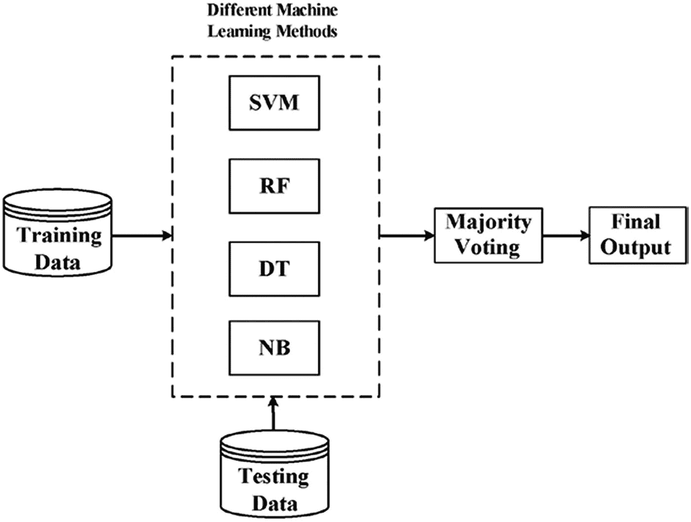
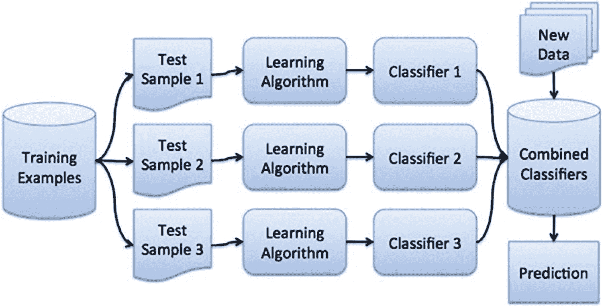
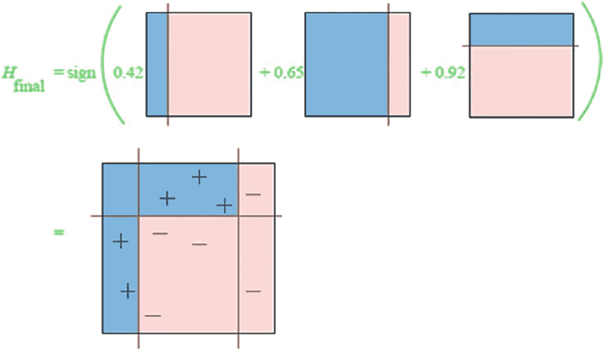

# 偏差-方差权衡图
plot(shrink, mse, xlab="收缩量", ylab="均方误差", type="l", col="pink", lwd=3, lty=1, ylim=c(0,1.2))
lines(shrink, bias², col="green", lwd=3, lty=2)
lines(shrink, variance, col="red", lwd=3, lty=2)
legend(0.02,0.6, c('偏差²', '方差', '均方误差'), col=c('green', 'red', 'pink'), lwd=rep(3,3), lty=c(2,2,1))
```

你可以在图 8-9 中看到，方差和偏差具有相反的行为。模型的最佳最优点存在于偏差和方差交汇之处。这也是我们试图用于最终模型的那个点。模型性能早期受到偏差或方差影响的迹象，可以通过在测试数据上拟合模型来观察。模型未曾见过测试数据，因此我们可以衡量其在测试数据/留出数据上的真实性能或误差。

*   **受方差影响的模型**：当模型在训练数据上拟合良好，但在测试数据上拟合不佳时。这表明预测的变异性很高，高方差误差占主导地位。

*   **受偏差影响的模型**：当模型在训练数据和测试数据上都拟合不佳时。由偏差引起的误差导致了模型的糟糕性能。

充分理解偏差-方差权衡有助于你决定采用哪些方法来纠正模型中的偏差或方差问题。但在我们进入通过处理偏差和方差来提升性能的主要方法之前，我们列出一些可能采取的常见步骤来改进模型性能：

*   向模型引入更多数据

*   引入更多特征

*   重新审视特征选择并创建更强的特征

*   使用正则化方法进行特征选择以提供帮助

*   探索采样（上采样/下采样/重采样）

*   尝试其他学习算法

一旦你对这些步骤感到满意，就可以考虑应用它们来改进模型性能。

## 8.5 集成学习简介

集成学习的总体理念是利用集体智慧做出更好的决策。集成技术无疑是机器学习领域的游戏规则改变者。在统计学和机器学习中，集成学习意味着从多个算法中学习，以提高模型性能。

通常，监督学习算法执行在假设/参数空间中搜索解决方案的任务，并找到适合当前问题的合适假设/参数。与任何搜索问题一样，我们无法在有限的迭代中总是找到最佳解决方案。在这种情况下，可以使用集成方法来组合多个假设，以形成一个（通常）更好的假设。

由于集成过程中涉及多个模型，它们显然计算量较大，并且难以在单一参数上进行评估。通常，建议在集成方法中使用快速算法，例如决策树集成（`randomForest`）；然而，较慢的算法同样能从集成方法中受益。类似地，你也可以将集成学习应用于无监督学习算法。集成学习从底层模型中学习，因此它本身就是一个监督学习算法。

我们将通过投票集成的一个示例来理解集成学习的好处。


### 8.5.1 投票集成

投票集成是分类问题中最流行的集成方法。这种集成方法将多个模型的最终分类结果结合起来，并选择得票最多的那个结果。它不一定非得是多数投票；你也可以根据其他多种因素（例如单个模型的性能、复杂度等）对它们进行加权。为了解释集成的一个示例，图 8-10 展示了多数投票的示意图。



图 8-10

分类问题的投票集成学习

（来源：Saha, Zubek 等人所著《使用蛋白质功能注释进行蛋白质相互作用的集成学习预测》）

现在，为了帮助内化投票集成的概念，让我们通过一个假设的例子来理解，如下所示。

*   *问题*：在一批制造出的灯泡中找出缺陷灯泡（=1）。
*   *集成模型*：我们有三位检查专家（可理解为模型）——A、B 和 C——来识别缺陷产品。你可以使用其中任何一个，或者全部使用。
*   *附加信息*：A 的准确率为 0.7，B 的准确率为 0.6，C 的准确率为 0.65。它们的决策相互独立。

我们有三个二元分类器模型（A、B 和 C），其准确率分别为 0.7、0.6 和 0.65。现在我们将展示，如果所有这些模型在一个采用多数投票的集成模型中被一起使用，会发生什么。

对于三个模型的多数投票，我们可以预期四种结果：

*   三个模型都错误
    1.  *0.3 * 0.32 * 0.35 = 0.0336*

*   两个模型错误
    1.  *0.3 * 0.32 * 0.65*

    2.  *0.3 * 0.68 * 0.35*

    3.  *0.7 * 0.32 * 0.35 = 0.2122*

*   两个模型正确
    1.  *0.7 * 0.68 * 0.35*

    2.  *0.7 * 0.32 * 0.65*

    3.  *0.3 * 0.68 * 0.65 = 0.4448*

*   *三个模型都正确*
    1.  *0.7 * 0.68 * 0.65 = 0.3094*

在场景 2（两个模型正确）中，我们可以看到，平均而言，多数投票集成能纠正约 44% 的情况。这个由三个模型组成的集成将为我们提供约 75.4%（0.4448 + 0.3094）的平均准确率，这高于任何一个单独的模型。然而，要实现这种提升，一个重要的考虑因素是假设模型之间相互独立，并且它们的预测也相互独立。这种独立性条件通常不成立，因此有时即使使用高维集成，你可能也难以看到模型性能的提升。

### 8.5.2 集成学习的高级方法

广义上讲，有两种集成方法有助于降低方差和偏差。围绕同一思想存在一些变体，例如混合、堆叠和自定义集成，但其核心思想可以通过装袋和提升这两种方法来解释。

#### 8.5.2.1 装袋

自助聚合，也称为*装袋*，是一种集成元算法。该算法提高了模型的稳定性和准确性，并减少了过拟合问题。该方法可以与任何方法一起使用；在连续函数的情况下，它取模型输出的加权平均值；在分类问题中，它对输出进行加权，以集成成一个单一输出。

装袋由 Leo Breiman 于 1994 年提出，用于改进分类问题的结果。他原始工作的详细信息可以在他的技术论文《装袋预测器》（技术报告编号 421，1994 年，统计系）中找到。

图 8-11 展示了装袋集成的流程。装袋的步骤大致分为四个部分：

1.  从训练数据中创建样本；样本数量应适当（不宜过多或过少）。
2.  在单个样本上训练模型。
3.  从每个模型创建分类器并存储结果。
4.  根据集成类型（加权、多数投票或某种自定义方式），结合结果来预测测试数据。

图 8-11 中的图像说明了前面提到的装袋的四个步骤（来源：[`http://cse-wiki.unl.edu/`](http://cse-wiki.unl.edu/)）。



图 8-11

装袋集成流程

考虑装袋的这些重要特性：

*   每个模型并行开发，且相互独立
*   有助于降低方差，但对减少偏差无效
*   最适合高方差、低偏差的模型（复杂模型）
*   随机森林是一个很好的例子（`randomForest` 算法通过剪枝来减少相关性）

#### 8.5.2.2 提升

与装袋类似，提升也是一种旨在减少监督学习模型中偏差的集成元算法。从历史上看，提升试图回答这样一个问题：假设我们有一个分类器，其分类准确率总是低于 50%（弱分类器）。我们能否构建一个模型序列以达到零误差（最小误差）？从理论上讲，通过将残差依次传递给后续模型，这是可能的。通常，后续模型会在最终模型中创建许多复杂的关系，以至于模型难以解释；因此，提升有时被认为会创建一个黑箱，一个非常难以解释和理解的东西。

例如，如果你设计一个三轮提升，并假设分类器的正确率始终为 40%，那么对于第一轮中的 100 个对象，你将得到 60 个错误分类。在第二轮中，只传递错误分类的对象，因此 36% 将被错误分类（60 的 60%）。同样在第三轮中，你传递错误分类的对象，得到 22% 的错误分类。所以本质上，通过使用一个准确率仅为 40% 的分类器，你可以创建一个误差仅为 22%（22/100）的集成，或者说一个准确率为 78% 的模型。

然而，在现实中，理论基础保持不变，但改进并不那么显著，因为许多其他因素开始起作用，例如，每一轮模型都会变弱、重新加权、相关性等。

图 8-12 展示了提升集成的流程。提升的步骤如下所述：



图 8-12

提升集成流程

1.  首先在完整的训练数据集上拟合一个模型。在图 8-12 中，第一个模型获得了 42% 的准确率。
2.  拟合另一个分类器以获得 65% 的准确率。
3.  拟合第三个模型以获得 92% 的准确率。
4.  现在，你将这些不同的分类器组合起来，形成一个强分类器。

（来源：[`https://alliance.seas.upenn.edu`](https://alliance.seas.upenn.edu) 。）你可以在这里看到，提升后的机器，即组合分类器，其性能远优于单个分类器。

这里列出了提升的一些重要特性：

*   每个模型是顺序开发的，因此每个后续模型都建立在先前模型的不足之处上。
*   有助于降低偏差，但对减少方差无效。
*   最适合低方差、高偏差的模型。
*   梯度提升机是一种使用提升集成的强大算法。

在接下来的章节中，我们将在我们的购买预测数据上分别展示装袋、提升、混合和堆叠的一个示例。输出表格易于阅读，图表将使模型改进的过程更加清晰。

请注意，这些示例中的参数未经调优。


## 8.6 R 语言中的集成技术示例

集成训练大致分为两种类型：装袋（bagging）和提升（boosting）。不过，研究人员还提出了许多其他变体。在本节中，我们将使用购买预测数据展示一些 R 语言示例。

本节展示了一段 R 代码，这些代码可复用于任何你想要使用的数据集。具体的函数调用及其选项可在 Caret 包及其他依赖包的文档中查阅。

在以下所有示例中，每种技术都有三个重要的校准函数：

*   `trainControl()`：设置采样方法、汇总方式及其他训练参数。

*   `train()`：使用`trainControl()`的参数训练模型；建模方法也在该函数中定义。

*   集成方法：使用自定义函数、重采样或`caretEnsemble`函数，将不同模型的结果进行组合。

现在，让我们开始使用 R 环境构建集成模型。

### 8.6.1 装袋树

这里使用两种最流行的装袋算法：

*   装袋 CART（回归树）

*   随机森林

以下代码基于这些技术创建了两个模型，并展示了这两种树方法的比较结果。

```
library(caret)
library(randomForest)
library(class)
library(ipred)
