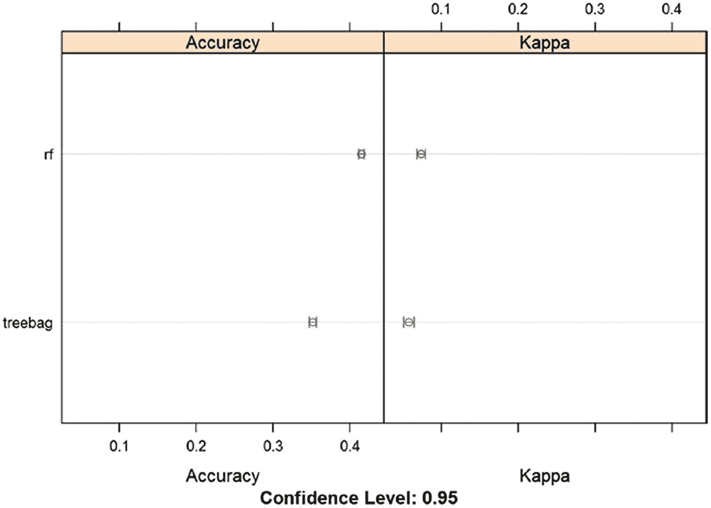

# 汇总结果
bagging_results <-resamples(list(treebag=fit.treebag, rf=fit.rf))
summary(bagging_results)
Call:
summary.resamples(object = bagging_results)
Models: treebag, rf
Number of resamples: 30
Accuracy
Min. 1st Qu. Median   Mean 3rd Qu.  Max. NA's
treebag 0.327  0.3444 0.3505 0.3518  0.3583 0.384    0
rf      0.395  0.4095 0.4167 0.4151  0.4216 0.435    0
Kappa
Min. 1st Qu.  Median    Mean 3rd Qu.   Max. NA's
treebag 0.02242 0.04812 0.05498 0.05786 0.06759 0.1044    0
rf      0.04252 0.06536 0.07513 0.07387 0.08290 0.1032    0
dotplot(bagging_results)
```

随机森林的准确率优于装袋 CART。图 8-13 中的图表展示了两种算法在 Kappa 值和准确率上的比较。



图 8-13

装袋树的准确率与 Kappa 值

### 8.6.2 基于决策树的梯度提升

对于提升方法，我们将介绍两种最流行的算法：

*   C5.0：由 Ross Quinlan 开发的决策树

*   梯度提升机

以下代码首先创建了一个 C5.0 决策树模型，然后创建了一个 GBM 模型。两个模型准备就绪后，我们将这两个模型组合起来创建一个提升集成模型。

```
library(C50)
library(gbm)
dataset <-Data;
