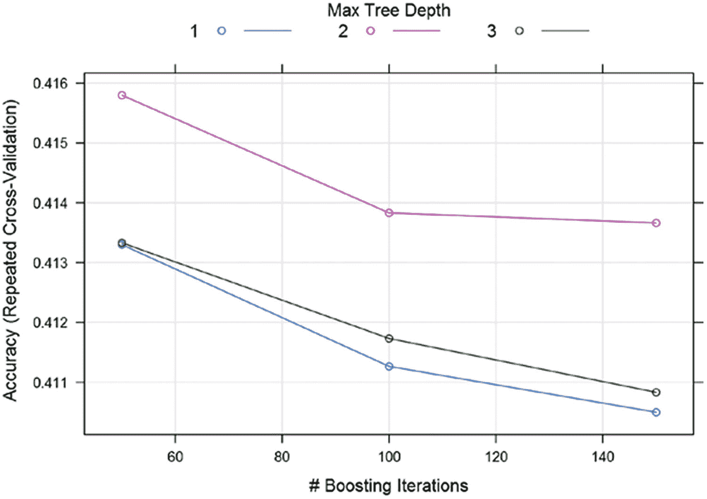

# C5.0
set.seed(917)
fit.c50 <-train(factor(ProductChoice) ~MembershipPoints +CustomerAge +PurchaseTenure +CustomerPropensity +LastPurchaseDuration, data=dataset, method="C5.0", metric=metric, trControl=control)
fit.c50
C5.0
10000 samples
5 predictor
4 classes: '1', '2', '3', '4'
No pre-processing
Resampling: Cross-Validated (10 fold, repeated 3 times)
Summary of sample sizes: 9000, 8999, 9001, 9001, 9000, 9000, ...
Resampling results across tuning parameters:
model  winnow  trials  Accuracy   Kappa
rules  FALSE    1      0.3924345  0.07807159
rules  FALSE   10      0.3924345  0.07807159
rules  FALSE   20      0.3924345  0.07807159
rules   TRUE    1      0.4003660  0.03854515
rules   TRUE   10      0.4003660  0.03854515
rules   TRUE   20      0.4003660  0.03854515
tree   FALSE    1      0.3786998  0.06855999
tree   FALSE   10      0.3786998  0.06855999
tree   FALSE   20      0.3786998  0.06855999
tree    TRUE    1      0.3999658  0.03799627
tree    TRUE   10      0.3999658  0.03799627
tree    TRUE   20      0.3999658  0.03799627
Accuracy was used to select the optimal model using  the largest value.
The final values used for the model were trials = 1, model = rules
and winnow = TRUE.
plot(fit.c50)
```

该模型使用准确率的最大值来选择最优模型。见图 8-14。

这里，我们使用相同的数据集创建了一个梯度提升机（GBM）。见图 8-15。



图 8-15

各提升迭代次数下的准确率：GBM

```
