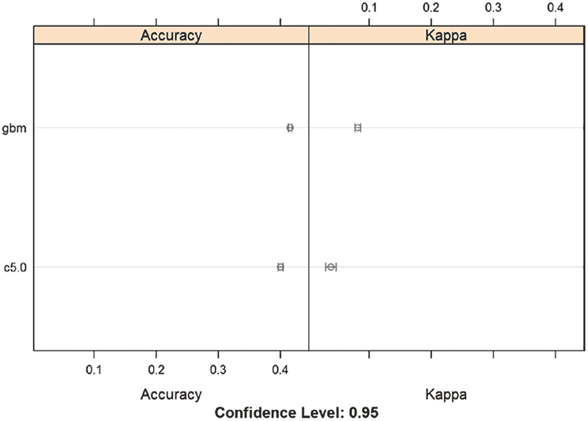

# 随机梯度提升
set.seed(917)
fit.gbm <-train(factor(ProductChoice) ~MembershipPoints +CustomerAge +PurchaseTenure +CustomerPropensity +LastPurchaseDuration, data=dataset, method="gbm", metric=metric, trControl=control, verbose=FALSE)
fit.gbm
Stochastic Gradient Boosting
10000 samples
5 predictor
4 classes: '1', '2', '3', '4'
No pre-processing
Resampling: Cross-Validated (10 fold, repeated 3 times)
Summary of sample sizes: 9000, 8999, 9001, 9001, 9000, 9000, ...
Resampling results across tuning parameters:
interaction.depth  n.trees  Accuracy   Kappa
1                   50      0.4133000  0.07395657
1                  100      0.4112656  0.07721806
1                  150      0.4104981  0.07825744
2                   50      0.4157985  0.08170535
2                  100      0.4138310  0.08341336
2                  150      0.4136634  0.08690728
3                   50      0.4133309  0.08146098
3                  100      0.4117326  0.08628274
3                  150      0.4108320  0.08948114
Tuning parameter 'shrinkage' was held constant at a value of 0.1
Tuning parameter 'n.minobsinnode' was held constant at a value of 10
Accuracy was used to select the optimal model using  the largest value.
The final values used for the model were n.trees = 50, interaction.depth
= 2, shrinkage = 0.1 and n.minobsinnode = 10.
plot(fit.gbm)
```

现在，我们使用 Caret 包中的`resamples()`函数，将 GBM 和 C5.0 模型的结果进行汇总。




图 8-16

提升集成模型的准确率

```
