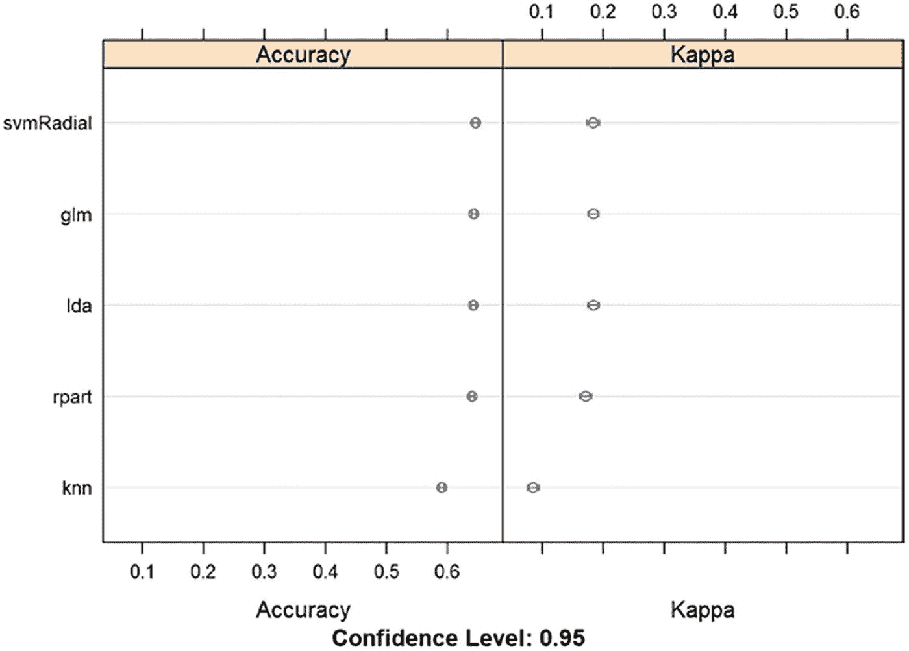
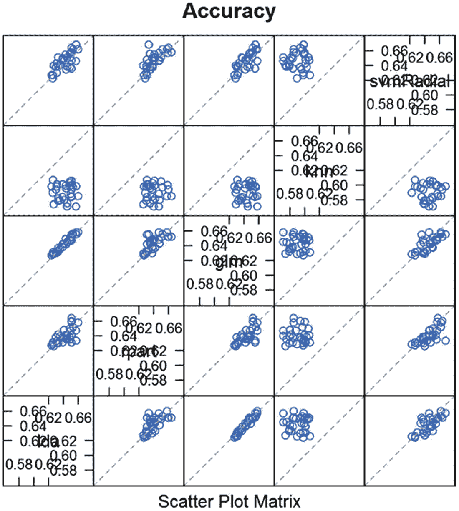

# 创建子模型
control <-trainControl(method="repeatedcv", number=10, repeats=3, savePredictions=TRUE, classProbs=TRUE)
```

以下是算法为堆叠列出的设置。五种算法存储在 `algorithmList` 变量中，该变量将用作训练函数中的参数。



图 8-17

各模型的准确率与 Kappa 值

```
algorithmList <-c('lda', 'rpart', 'glm', 'knn', 'svmRadial')
set.seed(917)
models <-caretList(choice ~MembershipPoints +CustomerAge +PurchaseTenure +CustomerPropensity +LastPurchaseDuration, data=dataset, trControl=control, methodList=algorithmList)
results <-resamples(models)
summary(results)
Call:
summary.resamples(object = results)
Models: lda, rpart, glm, knn, svmRadial
Number of resamples: 30
Accuracy
Min. 1st Qu. Median   Mean 3rd Qu.   Max. NA's
lda       0.6240  0.6330 0.6443 0.6424  0.6510 0.6600    0
rpart     0.6260  0.6315 0.6383 0.6403  0.6470 0.6640    0
glm       0.6270  0.6336 0.6447 0.6432  0.6518 0.6580    0
knn       0.5710  0.5825 0.5940 0.5908  0.5990 0.6070    0
svmRadial 0.6226  0.6381 0.6470 0.6462  0.6558 0.6683    0
Kappa
Min. 1st Qu.  Median    Mean 3rd Qu.   Max. NA's
lda       0.14170 0.16630 0.18680 0.18430  0.2038 0.2357    0
rpart     0.12510 0.15430 0.16750 0.17140  0.1859 0.2319    0
glm       0.14290 0.16440 0.18650 0.18430  0.2010 0.2282    0
knn       0.03609 0.06526 0.09152 0.08519  0.1047 0.1255    0
svmRadial 0.13230 0.16290 0.18680 0.18370  0.2019 0.2319    0
dotplot(results)
```


从图 8-17 的散点图可以看出，通过将多个算法堆叠在一起，性能已提升至 60%。同时请注意，模型训练非常消耗资源，且模型复杂度不适合生产环境。

现在，我们来看一下每个堆叠模型结果之间的相关性。相关性将显示各模型之间有多少结果是相同的。如果预测重叠的数量很高，那么堆叠可能不会带来结果的改善。



图 8-18

展示堆叠模型结果之间相关性的散点图

```
