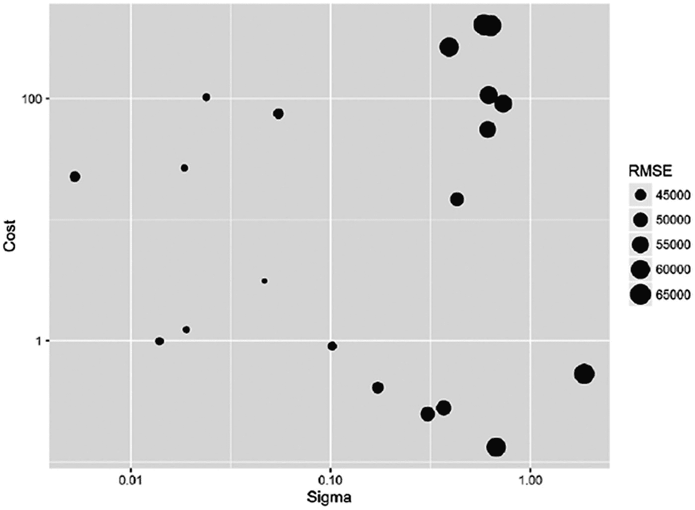

# Load Dataset
House_price <-read.csv("House Sale Price Dataset.csv",header=TRUE)
dataset <-na.omit(House_price)
#Create a sample of 10K records
set.seed(917);
rand_ctrl <-trainControl(method ="repeatedcv", repeats =5, search ="random")
rand_search <-train(HousePrice ~StoreArea +BasementArea +SellingYear +SaleType +ConstructionYear +Rating, data = dataset, method ="svmRadial",
Create 20 random parameter values
tuneLength =20,
metric ="RMSE",
preProc =c("center", "scale"),
trControl = rand_ctrl)
rand_search
Support Vector Machines with Radial Basis Function Kernel
1069 samples
6 predictor
Pre-processing: centered (10), scaled (10)
Resampling: Cross-Validated (10 fold, repeated 5 times)
Summary of sample sizes: 961, 962, 963, 962, 963, 962, ...
Resampling results across tuning parameters:
sigma        C            RMSE      Rsquared
0.005245534   22.6530619  43909.17  0.7456410
0.013918538    0.9927528  42284.81  0.7655819
...  0.730177279   90.8484676  57009.90  0.5687722
1.858138939    0.5329669  63431.60  0.4909382
```

RMSE was used to select the optimal model using the smallest value. The final values used for the model were sigma = 0.04674319 and C = 3.112494.



图 8-19

成本与 Sigma 空间中的 RMSE

```
ggplot(rand_search) +scale_x_log10() +scale_y_log10()
```

```
getTrainPerf(rand_search)
TrainRMSE TrainRsquared    method
1  41480.77     0.7706348 svmRadial
```

这个例子是一种优化，它假设贝叶斯模型基于高斯过程来预测良好的调优参数。因此，本次贝叶斯分析使用了线性回归类型的框架。

对于成本与 Sigma 的组合，我们可以计算预测 RMSE 的边界。由于预测的不确定性，有可能找到更好的优化方向。

```
