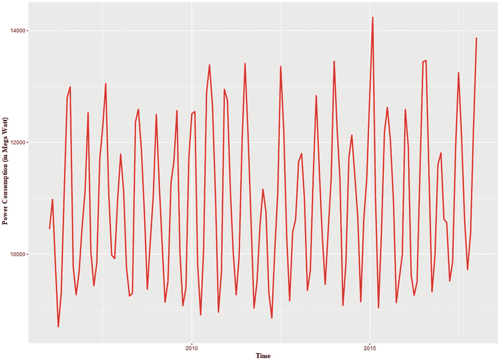
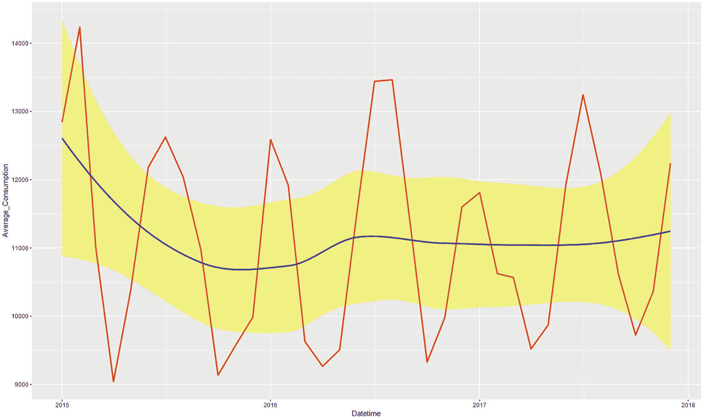
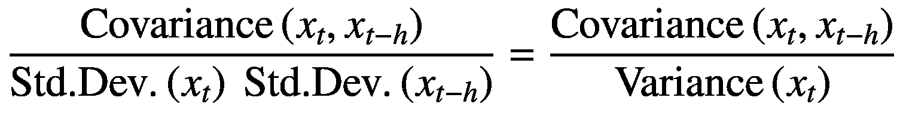
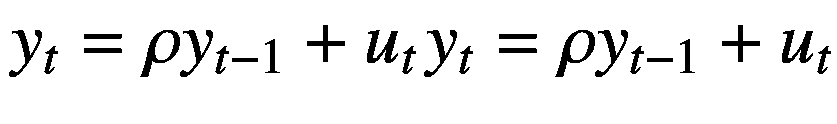
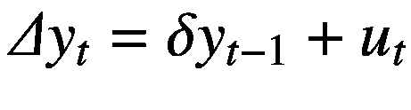
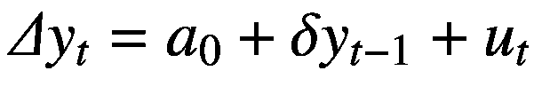
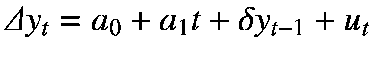

# Define the resampling method
ctrl <-trainControl(method ="repeatedcv", repeats =5)
```

使用此函数来优化模型。这两个参数根据其范围和规模在对数尺度上进行评估。


```
svm_fit_bayes <-function(logC, logSigma) {
使用相同的模型代码，但仅针对单个 (C, sigma) 对。
txt <-capture.output(
mod <-train(HousePrice ~StoreArea +BasementArea +SellingYear +SaleType +ConstructionYear +Rating , data = dataset,
method ="svmRadial",
preProc =c("center", "scale"),
metric ="RMSE",
trControl = ctrl,
tuneGrid =data.frame(C =exp(logC), sigma =exp(logSigma)))
)
该函数希望 _ 最大化 _ 结果，因此我们返回
重采样 RMSE 值的负值。`Pred` 可用于
返回预测值，但我们将避免使用它，并返回零
list(Score = -getTrainPerf(mod)[, "TrainRMSE"], Pred =0)
}
```

定义搜索的边界。

```
lower_bounds <-c(logC = -5, logSigma = -9)
upper_bounds <-c(logC =20, logSigma = -0.75)
bounds <-list(logC =c(lower_bounds[1], upper_bounds[1]),
logSigma =c(lower_bounds[2], upper_bounds[2]))
创建一个值网格，作为贝叶斯优化代码的输入
initial_grid <-rand_search$results[, c("C", "sigma", "RMSE")]
initial_grid$C <-log(initial_grid$C)
initial_grid$sigma <-log(initial_grid$sigma)
initial_grid$RMSE <--initial_grid$RMSE
names(initial_grid) <-c("logC", "logSigma", "Value")
```

使用初始网格并运行 30 次迭代进行优化。

```
library(rBayesianOptimization)
set.seed(917)
ba_search <-BayesianOptimization(svm_fit_bayes,
bounds = bounds,
init_grid_dt = initial_grid,
init_points =0,
n_iter =30,
acq ="ucb",
kappa =1,
eps =0.0,
verbose =TRUE)
在超参数空间中预先采样了 20 个点
elapsed = 7.02   Round = 21  logC = -0.6296  logSigma = -3.2325  Value = -
4.260364e+04
找到的最佳参数：
Round = 43   logC = 3.5271   logSigma = -3.3272  Value = -4.106852e+04
ba_search
$Best_Par
logC  logSigma
3.527062 -3.327152
$Best_Value
[1] -41068.52
$History
Round         logC   logSigma     Value
1:     1  3.120295026 -5.2503783 -43909.17
2:     2 -0.007273577 -4.2745337 -42284.81
49:    49  1.765610990 -2.6130250 -41510.91
50:    50  3.286583098 -3.4811229 -41876.16
Round         logC   logSigma     Value
$Pred
V1 V2 V3 V4 V5 V6 V7 V8 V9 V10 V11 V12 V13 V14 V15 V16 V17 V18 V19 V20
1:  0  0  0  0  0  0  0  0  0   0   0   0   0   0   0   0   0   0   0   0
V21 V22 V23 V24 V25 V26 V27 V28 V29 V30
1:   0   0   0   0   0   0   0   0   0   0
```

找到的最佳值如下：

```
Round = 43
logC = 3.5271
logSigma = -3.3272
Value = -4.106852e+04
```

现在，让我们使用这些参数开发一个模型，以验证优化是否确实有效。

```
final_search <-train(HousePrice ~StoreArea +BasementArea +SellingYear +SaleType +ConstructionYear +Rating, data = dataset,
method ="svmRadial",
tuneGrid =data.frame(C =exp(ba_search$Best_Par["logC"]),
sigma =exp(ba_search$Best_Par["logSigma"])),
metric ="RMSE",
preProc =c("center", "scale"),
trControl = ctrl)
final_search
使用径向基函数核的支持向量机
1069 个样本
6 个预测变量
预处理：中心化 (10)，缩放 (10)
重采样：交叉验证 (10 折，重复 5 次)
样本量摘要：962, 961, 964, 961, 964, 963, ...
重采样结果：
RMSE      Rsquared
41595.45  0.7671211
调优参数 'sigma' 保持恒定，值为 0.0358952
调优参数 'C' 保持恒定，值为 34.02386
```

以下命令将提供模型间的比较。比较使用单样本 t 检验进行。

```
compare_models(final_search, rand_search)
单样本 t 检验
data:  x
t = 0.061836, df = 49, p-value = 0.9509
备择假设：真实均值不等于 0
95% 置信区间：
-3612.507  3841.883
样本估计：
x 的均值
114.6878
```

新配置上的模型拟合在重采样 RMSE 和测试集 RMSE 方面与随机搜索相当。这表明优化效果良好。

## 8.8 总结

与统计模型相比，机器学习模型非常复杂。机器学习模型及其集成方法增加了模型的复杂性。模型变得难以解释，并且更难分离各个特征的贡献。集成模型进一步增加了机器学习模型所量化的因变量和预测变量之间关系的复杂性。另一方面，机器学习算法使得可以在没有任何假设的情况下使用任何数量的数据。这使得机器学习有别于统计学习，并为几乎任何数据问题的建模开辟了众多可能性。

统计学习和机器学习之间的主要区别之一在于两者从给定数据集中提取/学习的方式。机器学习算法本质上是迭代的，并依赖于一些“高级参数”，这些参数定义了模型的复杂度、学习率等。这些参数通常被称为超参数。超参数在很大程度上影响模型性能，因为它们定义了模型应如何从数据中学习的高维参数。我们学习了一些优化这些超参数的方法。本章中的所有优化模型拟合都是使用 R 中一个非常强大的包完成的，该包名为 Caret，代表分类和回归训练。它可以在单个函数调用中容纳近 230 多个模型。

在本章中，在介绍了各种类型的超参数优化方法之后，我们引入了偏差与方差权衡这一非常重要的主题。这种权衡是所有统计模型都存在的局限性，并且是任何模型性能优化问题的核心。该权衡指出，你无法同时减少偏差和方差。随后介绍了集成方法，以创建能够减少偏差（提升集成）和减少方差（装袋集成）的模型。装袋和提升都是强大的技术，并且近年来变得非常流行。

本章还使用 R 代码说明了四个非常流行的集成示例：装袋、提升、混合和堆叠。比较了结果，并讨论了结果中的相关性等问题。最后，我们介绍了一种非常先进的超参数优化技术，称为贝叶斯优化。这是一个热门的研究课题，因为机器学习模型已经变得如此庞大，以至于网格搜索不再是超参数优化的可行解决方案。

近年来，机器学习方法对计算能力的要求也越来越高。通过注意到本章仅使用了数据样本这一事实，你可以感受到我们所需的巨大计算能力。添加更多数据并扩展搜索网格可以增强结果。为了满足机器学习算法在数据量和计算能力方面的需求，我们需要探索可扩展的机器学习基础设施和算法。

下一章将介绍时间序列分析，这是一种经典的预测技术，深受统计学影响。在许多实际业务用例中，时间序列分析被广泛使用并已获得广泛认可。


# 9. 时间序列建模

按时间索引记录数据是一种古老的数据收集分析方法。时间索引数据主要用于观察与时间高度相关的事件，且其方差中相当一部分是由时间变化引起的。时间序列分析入门将帮助你理解如何计算随时间变化的波动。

时间序列分析在金融、经济和调查领域具有广泛的适用性。虽然时间序列方法被气象学、海洋学和天文学等研究自然过程的领域所采用，但许多其他领域也发现其具有实用价值。本章介绍时间序列的基础知识，并解释如何分析底层数据。

本章涵盖的核心要点包括：

*   时间序列的组成部分
*   平稳性检验
*   ACF 与 AR 模型
*   PACF 与 MA 模型
*   ARIMA 模型
*   含 AR 误差的线性回归

为了讨论这些概念，本章将使用每小时电力消耗数据集。

每小时电力消耗数据来自 PJM 网站，单位为兆瓦（MW）。PJM Interconnection LLC（PJM）是美国的一家区域输电组织（RTO）。它是东部互联电网的一部分，运营着一个输电系统，服务于特拉华州、伊利诺伊州、印第安纳州、肯塔基州、马里兰州、密歇根州、新泽西州、北卡罗来纳州、俄亥俄州、宾夕法尼亚州、田纳西州、弗吉尼亚州、西弗吉尼亚州以及哥伦比亚特区的全部或部分地区。

该数据集经过加载和精简，以适合解释相关概念。所有假设（如有应用）将在相应章节中说明。

## 9.1 时间序列的组成部分

时间序列数据是在一段时间内以通常固定的时间间隔收集的。*单变量时间序列*定义为同一变量等间隔的时间测量。这一特性使得数据的本质与我们在线性回归模型中看到的不同。关键区别在于，数据不一定是独立同分布的，且数据的顺序非常重要。

我们在时域中构建的模型大多涉及基于过去值和过去预测误差来预测序列的值。在某些情况下，时间分量也被用作回归中的普通 x 变量。

在提出建模方法之前，理解时间序列数据非常重要。需要关注的一些关键点包括：

*   趋势——时间序列总体上是否呈上升或下降趋势
*   季节性——序列是否显示出相似规模的季节性变化
*   时间序列中是否存在突变
*   在时间维度上是否存在无明显解释的明显异常值
*   周期性——能否发现重复出现的长期模式

现在让我们来看一下数据集。

### 注

该序列已缩减为月度聚合数据，但你可以按不同的时间步长进行分析，例如每日、每季度等。

```
library(reshape)
library(ggplot2)
library(dplyr)
library(lubridate)
Power_Consumption % group_by(Datetime) %>%  summarise(Average_Consumption=mean(DOM_MW))
#在开始可视化之前，了解时间序列的描述性元素是很好的。
#记录数量
dim(Power_Consumption)
## [1] 160   2
#序列的开始日期和时间
min(Power_Consumption$Datetime)
## [1] "2005-05-01"
#序列的结束日期和时间
max(Power_Consumption$Datetime)
## [1] "2018-08-01"
#记录消耗的时间间隔 - 假设所有间隔相等
Power_Consumption$Datetime[3]-Power_Consumption$Datetime[2]
## Time difference of 30 days
#记录的最高消耗量
max(Power_Consumption$Average_Consumption)
## [1] 14236.33
#记录的最低消耗量
min(Power_Consumption$Average_Consumption)
## [1] 8681.653
#序列中的平均消耗量
mean(Power_Consumption$Average_Consumption)
## [1] 10962.52
start_Date <- as.Date("2006-01-01")
end_Date <- as.Date("2018-01-01")
#简单折线图
ggplot(data = Power_Consumption, aes(x = Datetime, y = Average_Consumption)) +
geom_line(color = 'red', size = 1) +
scale_x_date(limits = c(start_Date, end_Date))+
theme(legend.title=element_text(family="Times",size=20),
legend.text=element_text(family="Times",face = "italic",size=15),
plot.title=element_text(family="Times", face="bold", size=20),
axis.title.x=element_text(family="Times", face="bold", size=12),
axis.title.y=element_text(family="Times", face="bold", size=12)) +
xlab("时间") +
ylab("电力消耗（兆瓦）") +
ggtitle("2005 年至 2018 年每月电力消耗随时间变化")
```



图 9-1

2005 年至 2018 年每月电力消耗随时间变化

图 9-1 的一些要点：

*   似乎没有趋势。平均消耗量在均值附近徘徊。
*   可以观察到一个周期，每个周期为一年。
*   每个周期中可见季节性模式。

为了进一步分析，我们将仅查看 2015 年至 2017 年的电力消耗数据，并尝试利用时间序列特征来构建时间相关的单变量模型。以下代码分析了叠加在 2015 年至 2017 年时间序列数据趋势上的平滑曲线。

```
#让我们仅关注 2015 年以后的时间序列分析，通过设置坐标轴限制
start_Date = start_Date & as.Date(Power_Consumption$Datetime) <= end_Date,]
ggplot(data = Power_Consumption, aes(x = Datetime, y = Average_Consumption)) +
geom_line(color = "red", size = 1) +
stat_smooth(  color = "blue", fill = "yellow", method = "loess" )
```



图 9-2

2015 年至 2017 年时间序列数据的趋势

图 9-2 中的平滑处理向我们显示，数据具有强烈的时间依赖性。你可以看到，平均消耗量的水平并非单调变化；它们或多或少与 2015 年初至 2017 年底的水平保持一致。平均消耗量的变化是时间序列分析的一个很好的用例。


## 9.2 平稳性检验

时间序列的平稳性是使用自相关函数（ACF）对时间序列进行推断的重要假设。平稳性意味着任何特定滞后的自相关不随时间变化。

*自相关*是随机过程中不同时间点时间序列值之间的相关性。

设 `X` 为一个随机过程，`t` 为任意时间点（对于离散时间过程，`t` 可以是整数；对于连续时间过程，`t` 可以是实数）。那么 `Xt` 是该过程在时间 `t` 时某次运行产生的值（或实现值）。假设该过程在时间 `t` 的均值为 *μ*[*t*]，方差为 *σ*[*t*]²。则时间 `s` 和 `t` 之间的自相关定义为：

![$$ R\left(s,t\right)=\frac{\mathrm{E}\left[\left({X}_t-{\mu}_t\right)\left({X}_s-{\mu}_s\right)\right]}{\sigma_t{\sigma}_s}, $$](images/416805_2_En_9_Chapter/416805_2_En_9_Chapter_TeX_Equa.png)

其中 `E` 是期望值算子。

更正式地说，如果序列 *X*[*t*] 满足以下性质，则称其为（弱）平稳序列：

1.  对于所有 `t`，均值 E(*x*[*t*]) 相同。
2.  对于所有 `t`，*x*[*t*] 的方差相同。
3.  对于所有 `t`，*x*[*t*] 与 *x*[*t* − *h*] 之间的协方差（以及相关性）相同。

设 *x*[*t*] 表示时间序列在时间 `t` 的值。该序列的 ACF 给出了 *x*[*t*] 与 *x*[*t* − *h*] 在 h = 1, 2, 3 等时的相关性。理论上，*x*[*t*] 与 *x*[*t* − *h*] 之间的自相关等于：



第二个公式中的分母之所以成立，是因为平稳序列的标准差在所有时间点上都相同。

现在我们将介绍用于检验平稳性的迪基-富勒检验，并将其应用于我们的数据集。在应用任何时间序列建模技术之前，必须检查时间序列的平稳性。

一个简单的 AR(1) 模型是：



其中 *y*[*t*] 是感兴趣的变量，*t* 是时间索引，*ρ* 是系数，*u*[*t*] 是误差项。如果 *ρ* = `1`，则存在单位根。在这种情况下，模型是非平稳的。

迪基-富勒检验用于检验原假设，以确定自回归模型中是否存在单位根。

该检验主要有三种形式：

1.  检验单位根：



1.  检验带漂移项的单位根：



1.  检验带漂移项和确定性时间趋势的单位根：



还有其他用于检验平稳性的统计检验。常用的有克维亚特科夫斯基-菲利普斯-施密特-辛（KPSS）检验和菲利普斯-佩龙检验。

```
