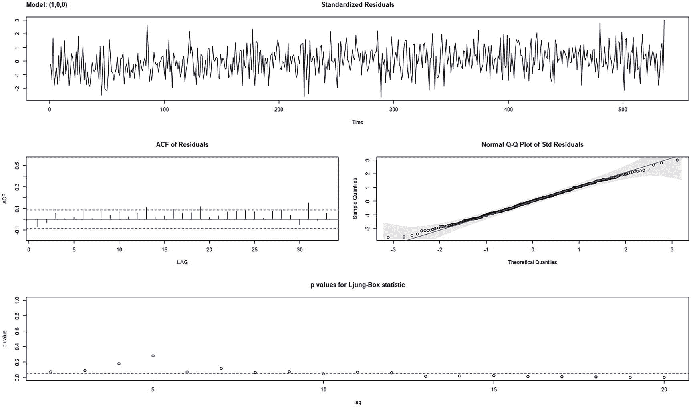
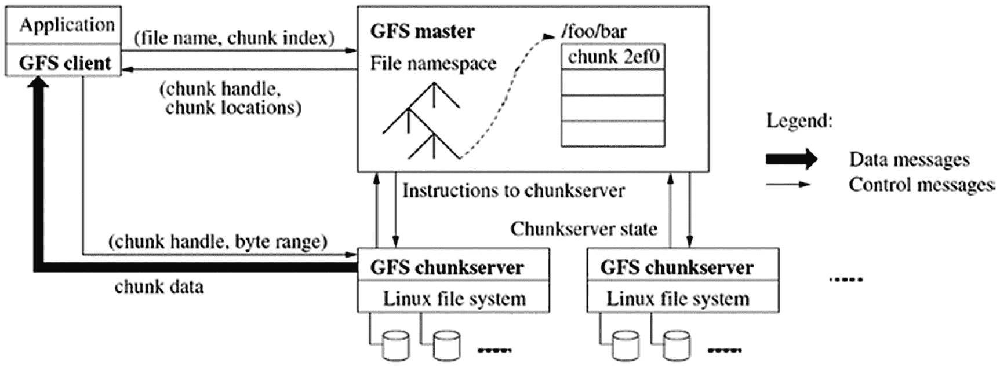
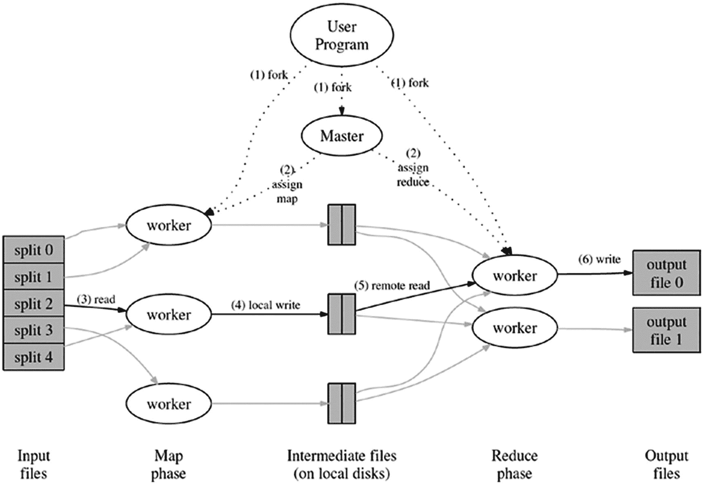

# Fit a linear regression model and analyze the residuals for AR structure by acf plot test
library(astsa)
fit_linear |t|)
## (Intercept)  2691.40      38.79   69.39   <2e-16 ***
## x_prime      -193.88       7.52  -25.78   <2e-16 ***
## ---
## Signif. codes:  0 '***' 0.001 '**' 0.01 '*' 0.05 '.' 0.1 ' ' 1
##
## Residual standard error: 307.9 on 534 degrees of freedom
## Multiple R-squared:  0.5545, Adjusted R-squared:  0.5537
## F-statistic: 664.7 on 1 and 534 DF,  p-value: < 2.2e-16
acf2(residuals(fit_linear))
```

```
##        ACF  PACF
##  [1,] 0.75  0.75
##  [2,] 0.61  0.10
##  [3,] 0.53  0.11
##  [4,] 0.47  0.04
##  [5,] 0.44  0.09
##  [6,] 0.44  0.10
##  [7,] 0.41  0.01
##  [8,] 0.41  0.09
##  [9,] 0.40  0.03
## [10,] 0.40  0.07
## [11,] 0.40  0.03
## [12,] 0.41  0.08
## [13,] 0.42  0.07
## [14,] 0.40 -0.01
## [15,] 0.41  0.08
## [16,] 0.43  0.09
## [17,] 0.43  0.04
## [18,] 0.44  0.04
## [19,] 0.44  0.05
## [20,] 0.41 -0.02
## [21,] 0.41  0.05
## [22,] 0.43  0.07
## [23,] 0.43  0.04
## [24,] 0.43  0.02
## [25,] 0.41 -0.02
## [26,] 0.39 -0.01
## [27,] 0.38  0.04
## [28,] 0.37 -0.03
## [29,] 0.33 -0.06
## [30,] 0.31 -0.04
## [31,] 0.34  0.09
## [32,] 0.30 -0.11
## [33,] 0.30  0.03
## [34,] 0.30 -0.04
ar1res = sarima (residuals (fit_linear), 1,0,0, no.constant=T) #AR(1)
## initial  value 5.728871
## iter   2 value 5.307745
## iter   3 value 5.307727
## iter   4 value 5.307720
## iter   4 value 5.307720
## final  value 5.307720
## converged
## initial  value 5.307628
## iter   2 value 5.307627
## iter   3 value 5.307626
## iter   3 value 5.307626
## final  value 5.307626
## converged
```



图 9-19
显示发达和发展中国家 GDP 与人口的直方图和密度图

残差被拟合为 AR(1)过程，残差的诊断结果显示，在拟合 AR(1)过程后，残差为白噪声。

## 9.7 总结

本章从较高层次介绍了时间序列建模的关键组成部分，并解释了 R 包如何帮助我们进行时间序列分析。我们首先观察了单变量时间序列的时序图。对时间序列的视觉检查可以告诉我们趋势、季节性、异常值以及其他特征。接着，我们还研究了自相关函数和偏自相关函数，它们帮助我们在应用任何建模技术之前检验时间序列的有效性。

我们还介绍了用于拟合模型的 AR 和 MA 过程。同时介绍了平稳时间序列的概念以及差分方法。我们讨论了用于对单变量时间序列拟合 ARIMA 模型的 Box-Jenkins 方法。在本章末尾，我们介绍了带有 AR 误差结构的线性回归概念。


# 10. 可扩展机器学习及相关技术

几年前，你几乎不会在机器学习领域听到“可扩展”这个词。这主要归因于基础设施、数据和实际应用的匮乏。当时，机器学习更多是学术界研究团体或资金充裕的行业研究实验室的热门话题。任何使用机器学习的实际应用原型都被视为一项重大成就和突破性研究的证明。然而，随着廉价且强大的商用硬件变得普及，以及大数据技术的广泛采用，时代已经改变。其结果是，数据变得易于获取，软件开发也日益数据化。每一字节的数据都被捕获，即使其近期用途尚不明确。

正如你在第 6 章所见，机器学习算法具有深厚的统计和数学基础，但这并不足以使其具备可扩展性。这些统计技术的准确性仅足以处理完全驻留在单台机器上的小规模数据集。然而，当数据量增长到足以挑战单台机器的存储能力时，分布式计算和算法复杂性的世界便开始主导。在这个世界里，诸如以下的问题开始涌现：

*   算法是线性时间运行还是二次方时间运行？
*   我们是否有该算法的分布式（并行）版本？
*   我们是否有足够多具备所需存储和计算能力的机器？

如果这些问题的答案是肯定的，那么你就准备好进行宏大思考了。构建数据产品这一非常新颖的概念——我们在 PEBE 机器学习流程中强调过——源于我们扩展事物以迎合不断变化的技术、数据以及日益增长的产品用户需求的能力。我们持续从增量添加的新数据中学习。

在本章中，我们将带你踏上 Apache Hadoop、Hive、Pig 和 Spark 等大数据技术的激动人心之旅，并特别关注使用实际示例进行可扩展机器学习。我们将对这些技术进行介绍。

## 10.1 分布式处理与存储

想象一个程序，它使用了最优化算法，具有最佳运行时间（时间复杂度），并且也设计用于高效存储。然而，对于像谷歌这样的公司，最佳运行时间的概念是几微秒甚至更短（针对其搜索程序），而一家从事 DNA 测序的公司可能愿意花费几天甚至几周的时间来完成程序。在大数据革命开始之前，并行和分布式计算一直在解决执行时间的问题。同样的程序被移植到多台机器（服务器）上同时运行。换句话说，程序被分成许多子任务，并分配给多台机器同时执行。大数据带来的这种分布式计算方式的范式转变，是设计一种能够高效划分数据以及处理数据的程序的机制。人们在分布式计算时代和大数据时代所考虑的问题类型也发生了巨大变化。例如，像顶点图着色问题（找到一种为图的顶点着色的方法，使得没有两个相邻顶点共享相同颜色）这样的问题，即使对于只有几个顶点的小图来说，也被认为是一项计算上极具挑战性的任务。有大量文献可用于设计此类分布式程序，例如本章末尾参考文献中描述的那样。

另一方面，当涉及海量数据时，例如对包含十亿个数字的数组进行排序，大数据技术已经找到了解决方案。本章的重点是使用一个实际示例来突出该领域中的一些技术。

尽管分布式和并行计算的演进始于几十年前，但两项突破性工作使其得以广泛应用，并催生了整个应用程序开发以及更先进的技术。第一个突破来自 2003 年的谷歌，他们推出了“谷歌文件系统”，随后在 2004 年推出了“MapReduce：大型集群上的简化数据处理”。前者为大型分布式数据密集型应用提供了可扩展的分布式文件系统，后者则设计了一种编程模型及其相关实现，用于处理和生成大型数据集。它们提供了一种架构，用于将大量数据分割成较小的块，并存储在数千台机器（节点）上，然后将计算任务本地化到存储较小数据块的机器上执行，而不是在整个数据集上运行。

第二个突破发生在 2006 年，它将这项技术带给了大众，那就是 Apache Hadoop，一个用于分布式存储和处理的完整开源框架。Hadoop 成功证明，通过使用由商用硬件构建的大型计算机集群，可以实现减少计算时间并自动处理硬件故障。

### 10.1.1 谷歌文件系统 (GFS)

GFS 的设计原则是考虑到数据密集型应用的需求。GFS 为大型数据提供了可扩展的分布式文件系统（用于存储）。

使用数千台机器上的数千个磁盘来处理数 TB 的数据，体现了此类系统设计用于处理的艰巨任务。

如图 10-1 所示（该图最初发表于论文“谷歌文件系统”），GFS 主节点存储关于存储在 GFS 块服务器中的每个数据块的元数据。



图 10-1

谷歌文件系统

元数据包含文件和块命名空间（一个包含唯一名称或标识符的抽象容器）、文件到块的映射，以及每个块副本的位置（用于容错）。在最初的设计中，只有一个主节点；然而，大多数当代分布式架构即使在主节点周围也有更复杂的设置。GFS 客户端与主节点交互以获取元数据请求，而所有数据请求则发送到块服务器。


### 10.1.2 MapReduce

使用 MapReduce 进行分布式处理，是根据分布式存储划分大数据集任务的核心。MapReduce 被设计为一种应用特定逻辑的编程模型，其应用范围从排序操作到在大量数据上运行机器学习算法。

简而言之，正如论文《MapReduce：大型集群上的简化数据处理》所解释的，用户指定一个 **map 函数**，该函数处理一个键值对以生成一组中间键值对，以及一个 **reduce 函数**，该函数合并所有与相同中间键关联的中间值。更简单地说，你将数据分解成更小的块，并编写一个 map 函数，在不同节点上同时处理每个小块中的键值对。这进而生成一个中间键值对，该键值对通过网络传输到中心节点，由 reduce 函数定义的特定逻辑进行合并。这两者的结合被称为 MapReduce 程序。我们将在 Hadoop 生态系统部分看到一个简单的例子。

来自经典论文《MapReduce：大型集群上的简化数据处理》的图 10-2 展示了被分割成更小块的输入文件如何放置在 map 程序执行的工作节点（块服务器）上。



图 10-2

MapReduce 执行流程

一旦 map 阶段完成了其分配的任务，它会将数据写回块服务器的本地磁盘，然后由 Reduce 程序拾取这些数据，最终输出结果。即使出现硬件故障，整个处理过程也能无缝执行。我们将在下一节更详细地解释 MapReduce。

### 10.1.3 R 中的并行执行

在 CRAN 文档《doParallel 和 foreach 入门》中，`doParallel` 包的创建者 Steve Weston 和 Rich Callaway 解释道：“doParallel 包是 foreach 包的‘并行后端’。它提供了并行执行 foreach 循环所需的机制。必须将 foreach 包与 doParallel 等包结合使用，才能并行执行代码。”

Foreach 是一种允许遍历集合中元素而无需使用显式循环计数器的惯用语法。

在深入 MapReduce 的一些示例并讨论 Hadoop 生态系统之前，让我们先看看一些方法，通过单台机器多核 CPU 的并行执行来模拟随机森林算法（在第 6 章中解释）。我们使用信用评分数据集。

#### 10.1.3.1 设置核心数

使用 R 中的 `doParallel` 库，我们可以设置 CPU 的核心数，即你希望机器在运行模型时使用的核心数。如果有专用机器用于此类处理，有一些算法方法（超出本书范围）可以决定应该使用多少个核心。但是，如果是你的个人机器，不要使用太多核心导致系统过载。请记住，将所有核心分配给此进程可能会因资源不足而导致其他进程崩溃。为了更安全，我们使用了 c-2 个核心，其中 c 是机器可用的核心数。

```
library(doParallel)
