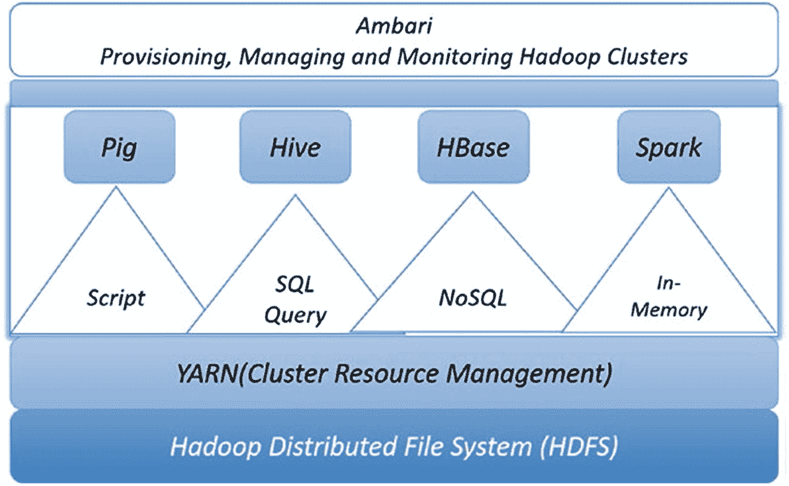
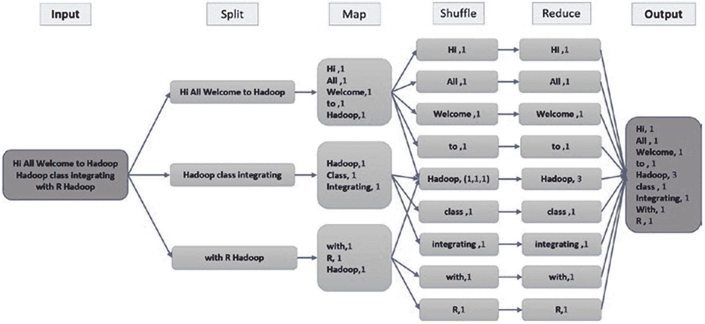

# 关闭集群 - 完成后，请务必使用以下命令关闭并行后端
stopCluster(cl)
```

在这里观察，大约并行执行比顺序执行快 80%（可能因你的系统而异）。如果单台机器使用多核就能带来如此巨大的改进，想象一下使用大型计算集群时你将节省的时间和资源。

注意：

*   “用户时间”是调用进程执行用户指令所花费的 CPU 时间。

*   “系统时间”是系统代表调用进程执行所花费的 CPU 时间。

在下一节中，我们将更深入地探讨 Hadoop 生态系统，并演示使用 Hadoop 和 R 的第一个“hello world”示例。


## 10.2 Hadoop 生态系统

由于 Hadoop 的普及，相关资源非常丰富。从宏观角度来看，Hadoop 框架由以下三个模块组成（框架的技术细节不在本书讨论范围内）：

*   *Hadoop 分布式文件系统：* 这是 Hadoop 的存储部分，是数据块实际驻留的核心。将数据划分为更小的片段意味着需要一种细致的方法，以元数据的形式存储引用，并使所有需要它的进程都能访问这些引用。

*   *Hadoop YARN：* 另一种资源协调器，也被称为数据操作系统。从 Hadoop 2.0 开始，YARN 通过一个精密的资源管理框架，成为高效驱动进程的核心引擎。

*   *Hadoop MapReduce：* MapReduce 决定了需要对数据执行何种操作的执行逻辑。该逻辑的设计方式应使其能够与驻留在分布式机器集群中的较小数据块并行执行。

在此之上，还有许多专门为在 Hadoop 框架上运行而设计的附加软件包，例如 Apache Pig、Hive、HBase、Mahout、Spark、Sqoop、Flume、Oozie、Storm、Solr 等。所有这些软件都是必要的，因为 Hadoop 给传统的关系型和小规模数据处理模式带来了范式转变。本章我们将简要介绍 Apache Pig、Hive、HBase 和 Spark，它们是 Hadoop 生态系统的三大支柱。图 10-3 展示了这些工具在 Hadoop 生态系统中的组织方式。



图 10-3

Hadoop 组件与工具

我们首先讨论位于 Hadoop YARN 层中的 MapReduce，即处理超级核心。

### 10.2.1 MapReduce

MapReduce 是一种用于在机器集群上设计并行和分布式算法的编程模型。从广义上讲，它包含两个过程。首先是 *Map*，它执行过滤和排序等操作。它处理键值对并生成中间键值对。然后是 *Reduce*，它将所有具有相同键的中间值合并。如果一个问题可以用这种方式表达，那么就有可能使用 MapReduce 将问题分解成更小的部分。多年来，该模型已成功应用于许多实际问题中。为了理解这个模型，让我们看一个简单的单词计数示例。

#### 10.2.1.1 MapReduce 示例：单词计数

假设有一个新闻聚合应用，试图为其网络上的所有文章构建一个自动主题生成器。主题生成器算法的第一步是构建一个包含词频的词袋，换句话说，就是统计文章中每个单词出现的次数。由于网络上的文章数量巨大，构建这个主题生成器无疑需要巨大的计算能力。

图 10-4 展示了 MapReduce 的执行流程：文章被分割成许多键值对，由 Map 函数处理，生成单词和值 1 的中间键值对。另一个称为 *shuffle* 的过程将 Map 的输出移动到 Reducer，在那里最终对每个关键字的值进行求和。



图 10-4

使用 MapReduce 的单词计数示例

注意：

*   运行代码需要合适的 Hadoop 版本。此代码在 Hadoop 版本 2.2.0（构建号 1529768）上运行。未检查此代码与最新版本 Hadoop 的兼容性。

*   该示例需要在 Linux/UNIX 机器上运行。

*   需要由管理员定义适当的系统路径。

*   以下是执行代码的系统信息。
    1.  `platform`: `i686-redhat-linux-gnu`

2.  `arch`: i686

3.  `os`: Linux-gnu

4.  `system`: i686, Linux-gnu

5.  `major`: 3

6.  `minor`: 1.2

7.  `year`: 2014

8.  `month`: 10

9.  `day`: 31

10.  `svn rev`: 66913

11.  `language`: R

12.  `version.string`: R version 3.1.2 (2014-10-31)

您必须使用 Hadoop `bin` 文件夹和 Hadoop streaming JAR 的位置设置环境变量。

```
Sys.setenv(HADOOP_CMD="/usr/lib/hadoop-2.2.0/bin/hadoop")
Sys.setenv(HADOOP_STREAMING="/usr/lib/hadoop-2.2.0/share/hadoop/tools/lib/hadoop-streaming-2.2.0.jar")
```

然后安装并调用 `rmr2` 和 `rhdfs` 库。成功后，初始化 HDFS 以从 HDFS 读取或写入数据。

```
library(rmr2)
library(rhdfs)
