# MapReduce 函数
wordcount <-function (input, output=NULL) {
mapreduce(input=input, output=output, input.format="text", map=map, reduce=reduce)
}
```

然后运行单词计数。我们定义的 `wordcount` 函数现在可以在 Hadoop 上执行了。在调用该函数之前，请确保已设置输入文件所在的基目录以及希望放置 `wordcount` 函数生成输出的目录：

```
从 HDFS 上的 input 文件夹读取文本文件
将结果保存到 HDFS 上的 output 文件夹
提交作业
basedir <- '/hadoop_practice'
infile  <-file.path(basedir, 'sample.txt')
outfile <-file.path(basedir, 'output')
ret <-wordcount(infile, outfile)
```

获取结果。`wordcount` 函数执行完成后，可以将结果取回 R 中，并将其转换为数据框并对结果进行排序，如下代码片段所示。

```
从 HDFS 获取结果
result <-from.dfs(outfile)
results.df <-as.data.frame(result, stringsAsFactors=F)
colnames(results.df) <-c('word', 'count')
tail(results.df,100)
word count
1           R     1
2          Hi     1
3          to     1
4         All     1
5        with     1
6       class     1
7      hadoop     3
8     Welcome     1
9 integrating     1
head(results.df[order(results.df$count, decreasing =TRUE),])
word count
7 hadoop     3
1      R     1
2     Hi     1
3     to     1
4    All     1
5   with     1
```

由于全书使用 R 语言编写，我们展示了这个单词计数示例，其中 R 通过其 Hadoop streaming 库与 Hadoop 集成，该库内置于 `rhdfc` 和 `rmr2` 包中。出于演示目的，这种集成可能没问题，但在实际生产系统中，它可能不是一个健壮的解决方案。其他编程语言如 Java、Scala 和 Python 具有健壮的生产级代码完整性，并且与 Hadoop 框架紧密耦合。在接下来的章节中，我们将介绍 Hive、Pig 和 HBase 的基础知识，并以一个使用 Spark 的实际示例作为结束。


### 10.2.2 Hive

在适应像 Hadoop 这样的大数据技术时，所需的最关键的范式转变是能够像在关系型数据库管理系统（RDBMS）中使用 SQL（结构化查询语言）那样，熟练地读取、写入和转换数据。RDBMS 具有结构良好的表设计，这些表被分组到遵循预定义模式的数据库中。只要正确遵循 SQL 语法、逻辑和模式，查询任何表都很容易。这些数据库在数据仓库中得到了良好的管理。

现在，为了便于轻松查询存储在 HDFS 中的数据，需要一个与 HDFS 紧密耦合，同时又能提供与传统 RDBMS 相同查询能力的数据仓库工具。Apache Hive 的开发正是将这一思想置于其设计原则的核心。尽管底层存储是 HDFS，但数据可以按照定义良好的模式进行结构化。在 Hadoop 生态系统的所有其他工具中，Hive 是业界使用最广泛的组件。关于 Hive 架构和设计的高级技术讨论超出了本书的范围；然而，我们将在此处提供入门材料，以便您能够将大数据与更宏大的体系联系起来。

市场上有许多工具可以帮助处理公司内部来自各种来源的大规模数据，并将其放入一个通用的数据平台（Hive 是此类数据平台中必不可少的数据处理引擎），然后该平台可供公司内的分析师、产品经理、开发人员、运营分析师等使用。Qubole Data Service 就是提供此类处理服务的平台之一。它还提供了一个用于编写在 Hive 上运行的 SQL 查询的图形用户界面。

**注意：**

*   在以下演示中，我们使用了来自 Cloudera 的 Linux 虚拟机。但是，如果您在个人系统中安装了 Linux 操作系统实例，可以按照链接 [`https://cwiki.apache.org/confluence/display/Hive/GettingStarted`](https://cwiki.apache.org/confluence/display/Hive/GettingStarted) 来设置 Hive。

*   或者，您可以从 Cloudera、Hortonworks 或 MapR 下载虚拟机（也称为沙箱）。这些虚拟机预装了 Hadoop 的所有必要工具和组件，可帮助您快速上手。这里有几个选项：Horton VM：[`http://hortonworks.com/products/sandbox/`](http://hortonworks.com/products/sandbox/) 和 Cloudera VM：[`http://www.cloudera.com/downloads/quickstart_vms/5-8.html`](http://www.cloudera.com/downloads/quickstart_vms/5-8.html)。对于本章中关于 Pig、Hive、HBase 的演示，我们使用了来自 Cloudera 的虚拟机。

*   我们将使用原生命令行界面来展示 Hive 的一些基础知识。

#### 10.2.2.1 创建表

该查询看起来与传统的 SQL 查询非常相似；然而，在后台发生的事情在 Hive 中却大不相同。成功执行此查询后，会在 HDFS 中 Hive 仓库的默认数据库里创建一个新文件（见图 10-5）。

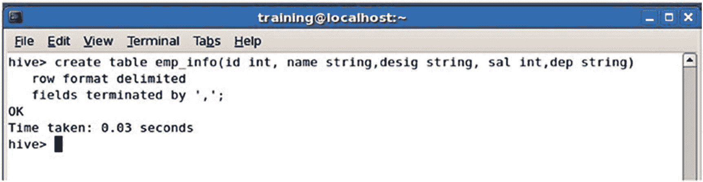

图 10-5

Hive 创建表命令

图 10-6 显示了 HDFS 中 `/user/hive/warehouse/` 文件夹结构下的 `emp_info` 表。

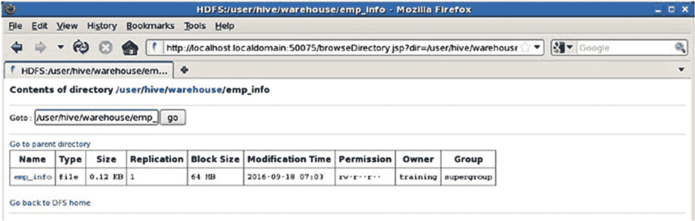

图 10-6

HDFS 中的 Hive 表

#### 10.2.2.2 描述表

创建表后，您可以使用 `describe formatted emp_info;` 命令查看表的结构，该结构应与我们在创建时使用的结构匹配。除了列名，它还显示列的数据类型（见图 10-7）。

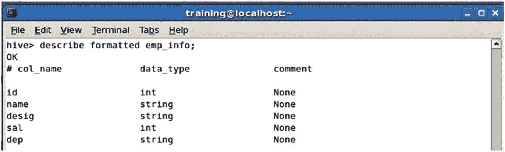

图 10-7

描述表命令

#### 10.2.2.3 生成数据并存储在本地文件中

现在表已准备好加载一些数据。我们在图 10-8 中展示了生成一些虚拟数据并将其存储在本地目录中名为 `emp_info` 的文件中的过程。

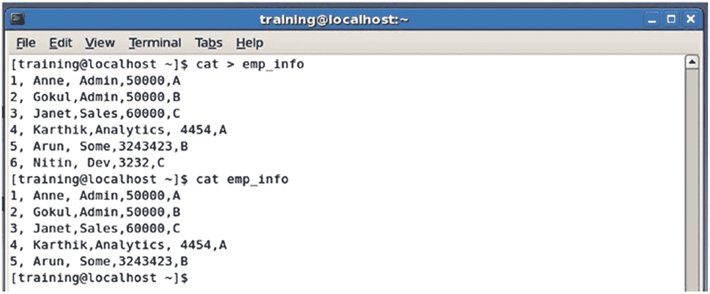

图 10-8

生成数据并存储在本地文件中

#### 10.2.2.4 将数据加载到 Hive 表中

一旦我们在本地文件中有了数据，使用命令 `load data local inpath '/home/training/emp_info' into table emp_info`；我们将把数据加载到 HDFS 中的 Hive 表 `emp_info` 中（见图 10-9）。

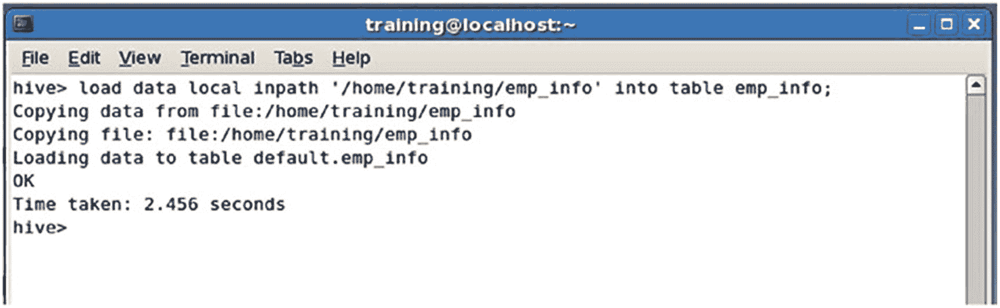

图 10-9

将数据加载到 Hive 表中

图 10-10 显示了我们从本地文件系统加载到 HDFS 文件中的数据。

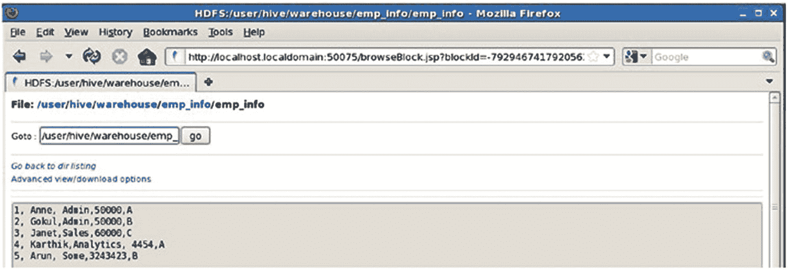

图 10-10

HDFS 文件中的数据

#### 10.2.2.5 选择查询

图 10-11 展示了 `select` 查询的两种变体。第一种没有 `where` 子句，第二种使用了 `where dep = 'A'`。请注意 Hadoop 内置的 MapReduce 框架是如何在 Hive 查询中发挥作用的。这正是我们将 Hive 等工具与 Hadoop 生态系统关联起来的原因。与单词计数示例相比，这里唯一的区别是我们不需要显式定义任何 Map 或 Reduce 方法；相反，Hive 会自动为我们完成这些工作。

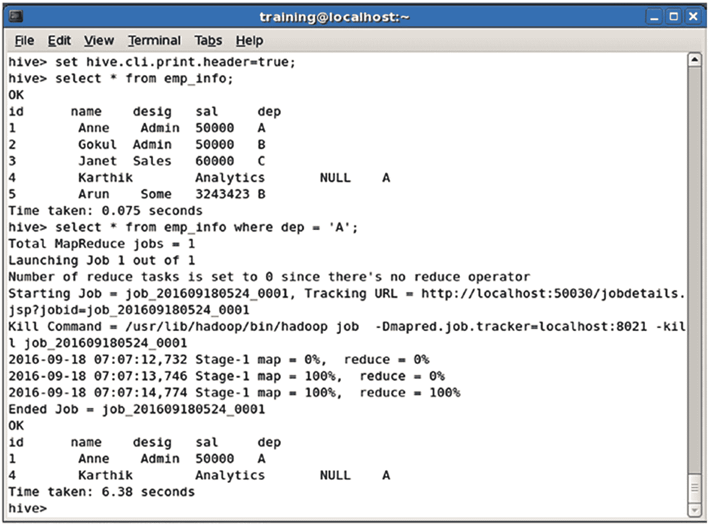

图 10-11

带和不带 where 子句的 Select 查询

除了这些基本命令，Hive 还支持数据分区、表连接、多重插入、用户定义函数和数据导出。这些功能足以支持将分析型数据库迁移到 Hive。

### 10.2.3 Apache Pig

Apache Pig 是一个用于处理大型数据集的分析平台。用 Pig Latin 编写的 Pig 程序，由 Pig 的基础设施层编译，生成一系列 MapReduce 程序，从而实现并行处理。它与 Hadoop 的强耦合提供了 HDFS 的存储结构和 YARN 的进程处理能力。

让我们回顾一下 MapReduce 部分中的单词计数示例，看看如何用一系列 Pig Latin 命令来编写相同的示例。有关 Pig 设置和使用的详细文档，请参考 [`http://pig.apache.org/docs/r0.16.0/start.html`](http://pig.apache.org/docs/r0.16.0/start.html)。

#### 10.2.3.1 连接到 Pig

`pig -x local` 命令连接到本地文件系统。在终端中直接使用 `pig` 命令将连接到 HDFS。对于我们的单词计数示例，我们将使用本地文件系统，如图 10-12 所示。

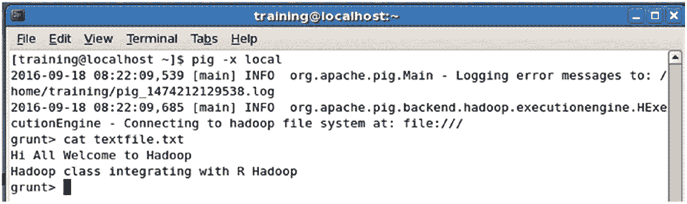

图 10-12

使用本地文件系统连接到 Pig

#### 10.2.3.2 加载数据

命令 `A1 = load '/home/training/wc.txt' as (line:chararray);` 将扫描文件并将每一行和字符数组存储起来。`dump A1` 命令将输出以下内容（见图 10-13）：

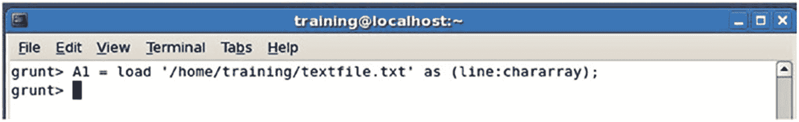

图 10-13

将数据加载到 A1

```
(Hi All Welcome to Hadoop )
(Hadoop class integrating with R Hadoop)
```


#### 10.2.3.3 对每一行进行分词

将每一行分词并存储为列表。`dump A2` 命令将输出以下内容（见图 10-14）：

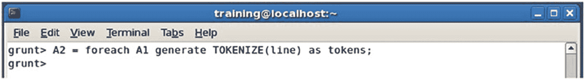

图 10-14

对每一行进行分词

```
({(Hi),(All),(Welcome),(to),(Hadoop)})
({(Hadoop),(class),(integrating),(with),(R),(Hadoop)})
```

#### 10.2.3.4 扁平化处理分词结果

`A3 = foreach A2 generate` `flatten(tokens) as words;` 命令将进一步把每个已分词的列表拆分成单个词。`dump A3` 命令将输出以下内容（见图 10-15）：


图 10-15

扁平化处理分词结果

```
(Hi)
(All)
(Welcome)
(to)
(Hadoop)
(Hadoop)
(class)
(integrating)
(with)
(R)
(Hadoop)
```

#### 10.2.3.5 对单词进行分组

使用命令 `A4 = group A3 by words;` 将创建一个键值对，其中键是单词，值是该单词在分词列表中出现的次数列表。`dump A4` 命令将输出以下内容（见图 10-16）：


图 10-16

对单词进行分组

```
(R,{(R)})
(Hi,{(Hi)})
(to,{(to)})
(All,{(All)})
(with,{(with)})
(class,{(class)})
(Hadoop,{(Hadoop),(Hadoop),(Hadoop)})
(Welcome,{(Welcome)})
(integrating,{(integrating)})
```

#### 10.2.3.6 计数与排序

以下两个命令将生成单词及其在文档中出现次数的键值对，并随后按计数进行排序。

*   A5 = `foreach A4 generate group,COUNT(A3);`

*   A6 = `order A5 by $1 desc;`

`dump A6` 命令将输出以下内容：

```
(Hadoop,3)
(R,1)
(Hi,1)
(to,1)
(All,1)
(with,1)
(class,1)
(Welcome,1)
(integrating,1)
```

使用 Pig，可以轻松地在大型数据集上创建许多此类涉及选择、过滤、连接、联合、排序、分组和转换的分析工作流。

### 10.2.4 HBase

到目前为止，我们一直在讨论使用预定义模式的行和列的结构化格式来表示数据，这种模式一旦创建，就很难为不断变化的需求进行调整。换句话说，尽管 Hive 在大型数据集上提供了 RDBMS 的分布式版本，但它仍然要求你遵循固定的数据库模式，并基于该模式将数据存储在仓库中。然而，随着数据的快速变化，我们需要对大型分布式数据进行随机的、实时的读写。在这种情况下，数据库不能再是关系型的；它必须是大数据领域人们所说的 NoSQL。HBase 的模型源自 Google 的 Bigtable：一个用于在 Google 文件系统（GFS）上存储结构化数据的分布式存储系统。

与传统的 RDBMS 系统（即使存在许多空值以及因规范化导致的跨表冗余数据，也会存储每一行的所有列）相反，HBase 是一种列式存储。这意味着每一行数据都按列族存储。例如，如果你有一个包含名为 `details` 的列族的员工表，你可以在 `details` 列族下存储 `name`、`age` 和 `qualification` 等列。因此，如果有一个名为 `address` 的新列，它可以实时添加到 `details` 下。

#### 10.2.4.1 启动 HBase

使用 shell 脚本 `start-hbase.sh` 启动 HBase。运行以下三个命令（见图 10-17）：

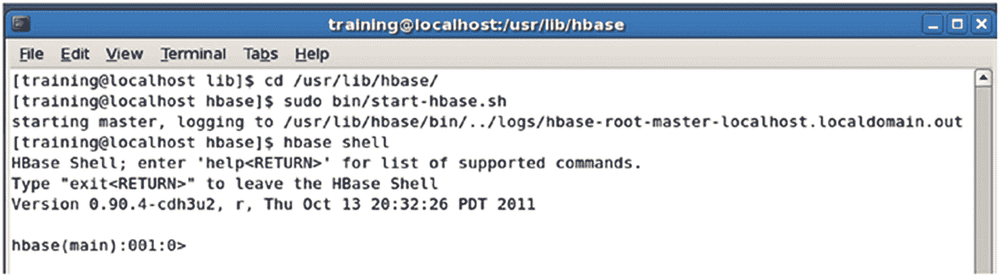

图 10-17

启动 HBase

1.  `cd /usr/lib/hbase/`

2.  `sudo bin/start-hbase.sh`

3.  `hbase shell`

#### 10.2.4.2 创建表并插入数据

以下命令将创建一个名为 `employee` 的表，该表包含两个列族：`details` 和 `salary`。并且在 `details` 列族下，将数据插入到 `name` 和 `gender` 列中（见图 10-18）。

1.  `create 'employee','details','salary'`

2.  `put 'employee','e1','details:name','karthik'`

3.  `put 'employee','e1','details:gender','m'`

4.  `put 'employee','e1','salary:sal','20000'`

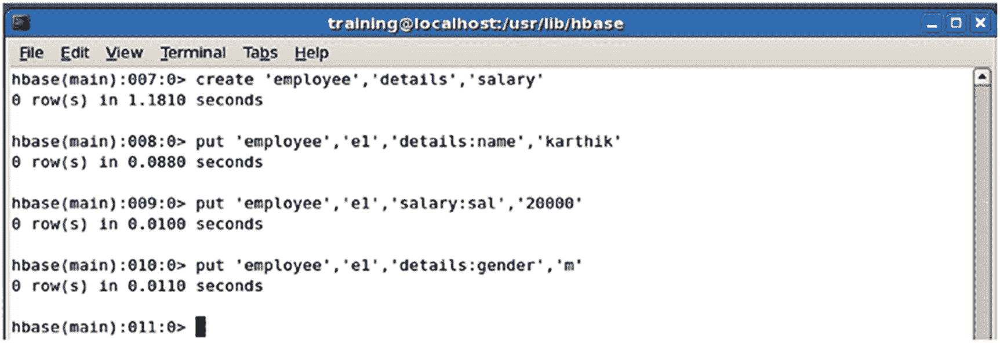

图 10-18

创建表并插入数据

#### 10.2.4.3 扫描数据

使用命令 `scan 'employee'`，你可以查看数据在 HBase 中的存储方式。每一行对应一个列族下的列值（见图 10-19）。

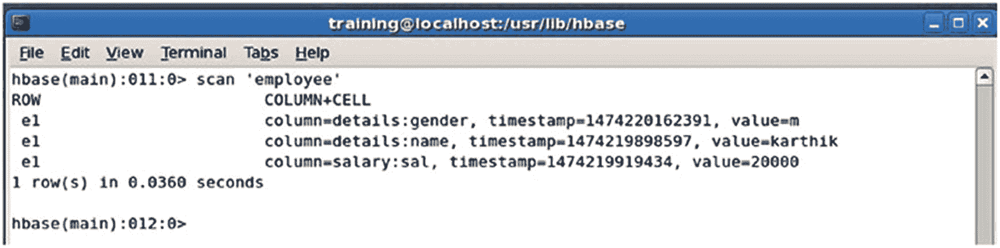

图 10-19

扫描数据

关于 HBase 的全面参考指南，请访问 [`http://hbase.apache.org/book.html#arch.overview`](http://hbase.apache.org/book.html%2523arch.overview) 。

### 10.2.5 Spark

Spark 提供了闪电般快速的集群计算（类似于多个节点协同工作的分布式计算）。Spark 拥有先进的基于有向无环图（DAG）的执行引擎，这使得它在内存中的运行速度比 Hadoop MapReduce 快 100 倍，在磁盘上快 10 倍。与仅支持 Java 的 Hadoop 相反，在 Spark 中，你可以使用 Java、Scala、Python 和 R 编写应用程序。如果这还不够，Spark 还提供了 SQL、流处理、机器学习和图库，这些可以以任何方式组合起来创建应用程序管道。除了从 HDFS 访问数据外，在 Spark 中，你还可以连接到 HBase、Cassandra、S3 以及更多其他数据源。

在本章中，我们使用 SparkR，这是一个轻量级的前端工具，用于从 R 中使用 Apache Spark。它轻量但功能非常丰富。简而言之，SparkR 提供以下功能：

*   你可以从本地数据框或 Hive 表创建 SparkDataFrame。

*   在 SparkDataFrame 上，可以进行 R 中 `dplyr` 包提供的选择、分组和聚合等操作。

*   你可以直接从 R 对 Hive 运行 SQL 查询。

*   它提供了来自 Spark 的 MLlib 库中的一些机器学习算法。

这个强大的工具无疑正在席卷整个行业。不过，我们将把重点放在 Spark 的机器学习库 MLlib 上。

对于感兴趣的读者，可以在 [`http://spark.apache.org/docs/latest/index.html`](http://spark.apache.org/docs/latest/index.html) 找到关于 Spark 的更多详细信息。


## 10.3 使用 Spark 在 R 中进行机器学习

MLlib 是 Spark 的机器学习（ML）库。其目标是让实用的机器学习变得可扩展且易于使用。从高层来看，它提供了以下工具：

*   *ML 算法：* 常见的机器学习算法，如分类、回归、聚类和协同过滤
*   *特征化：* 特征提取、转换、降维和选择
*   *流水线：* 用于构建、评估和调优 ML 流水线的工具
*   *持久化：* 保存和加载算法、模型和流水线
*   *工具：* 线性代数、统计、数据处理等

目前，SparkR 支持以下机器学习算法：

*   广义线性模型
*   加速失效时间（AFT）生存回归模型
*   朴素贝叶斯模型和 KMeans 模型

在底层，SparkR 使用 MLlib 来训练模型。以下 R 代码取自我们之前的房价预测示例，但这是使用 SparkR 的可扩展版本模型。

注意（针对 Windows 用户）：在运行代码之前，请遵循以下步骤：

1.  从 [`http://spark.apache.org/downloads.html`](http://spark.apache.org/downloads.html) 下载为 Hadoop 2.7 及更高版本预构建的 Spark 发行版。
2.  将文件解压到 `C:-2.0.0-bin-hadoop2.7` 文件夹（你可以选择自己的位置）。
3.  在 `cmd` 提示符中使用以下命令为 SparkR 库创建符号链接：`mklink /D "C:Files-3.2.2" "C:-2.0.0-bin-hadoop2.7"`。
4.  使用 RStudio 或 R 命令行，通过 `library(SparkR)` 进行测试。

让我们深入了解接下来的 R 代码，并理解 SparkR 如何帮助使用 Spark 引擎构建可扩展的机器学习模型。请记住，该代码是在只有一个节点的独立 Spark 集群上执行的。只有当相同的代码在拥有大量计算节点的大型企业级 Spark 集群上运行时，才能看到 Spark 的真正潜力。

### 10.3.1 设置环境变量

以下命令将让 R 知道 Spark 和 Hadoop 二进制文件在你机器上的安装位置。请记住，这两个环境变量与你可能在系统属性中设置的环境变量相同（针对 Windows 机器）。

```
#设置环境变量
Sys.setenv(SPARK_HOME='C:/Spark/spark-2.0.0-bin-hadoop2.7',HADOOP_HOME='C:/Hadoop-2.3.0')
.libPaths(c(file.path(Sys.getenv('SPARK_HOME'), 'R', 'lib'),.libPaths()))
Sys.setenv('SPARKR_SUBMIT_ARGS'='"sparkr-shell"')
```

### 10.3.2 初始化 Spark 会话

设置好环境变量后，使用 `spark.driver.memory`、`spark.sql.warehouse.dir` 等参数初始化 SparkR 会话，如下面的代码片段所示。此初始化是必需的，以便 R 环境能够连接到本地机器上运行的 Spark。

```
library(SparkR)
library(rJava)
#进入 SparkR 的入口点是 SparkSession，它将你的 R 程序连接到 Spark 集群
sparkR.session(enableHiveSupport =FALSE, appName ="SparkR-ML",master ="local[*]", sparkConfig =list(spark.driver.memory ="1g",spark.sql.warehouse.dir="C:/Hadoop-2.3.0"))
Launching java with spark-submit command C:/Spark/spark-2.0.0-bin-hadoop2.7/bin/spark-submit2.cmd   --driver-memory "1g" "sparkr-shell" C:\Users\Karthik\AppData\Local\Temp\Rtmpuoqh3M\backend_port1030727b704d
Java ref type org.apache.spark.sql.SparkSession id 1
```

### 10.3.3 加载数据并运行预处理

加载第 6 章介绍的房屋数据，并执行相同的一组预处理步骤，如下面的代码片段所示：

```
library(data.table)
#读取房屋数据
Data_House_Price 
#提取相关列并在数据集中分配所需字段
Data_House_Price <-Data_House_Price[,.(HOUSE_ID,HousePrice,StoreArea,StreetHouseFront,BasementArea,LawnArea,Rating,SaleType)]
#省略任何缺失值
Data_House_Price <-na.omit(Data_House_Price)
Data_House_Price$HOUSE_ID <-as.character(Data_House_Price$HOUSE_ID)
```

### 10.3.4 创建 SparkDataFrame

现在，通过将原始数据集 `Data_House_Price` 分割为前三分之二和剩余部分（最后三分之一），分别创建训练和测试 SparkDataFrame。它类似于 R 中的数据框，有助于存储任何行列形式的表格数据，但在 Spark 中，其实现对于处理网络传输和处理数千个计算节点来说要高效得多。

```
#Spark 数据框 - 训练
gaussianDF_train <-createDataFrame(Data_House_Price[1:floor(nrow(Data_House_Price)*(2/3)),])
#Spark 数据框 - 测试
gaussianDF_test <-createDataFrame(Data_House_Price[floor(nrow(Data_House_Price)*(2/3) +1):nrow(Data_House_Price),])
class(gaussianDF_train)
[1] "SparkDataFrame"
attr(,"package")
[1] "SparkR"
class(gaussianDF_test)
[1] "SparkDataFrame"
attr(,"package")
[1] "SparkR"
```

### 10.3.5 构建 ML 模型

这本质上是本章的核心。第一个机器学习模型被构建为可扩展以处理大型数据集。`spark.glm` 是 Spark 的 MLlib 库中的一个函数，它提供了广义线性模型（GLM）的可扩展实现。理想情况下，语法方面没有任何变化（除了函数名），但在底层，可能有大量的节点协同工作，自动运行 MapReduce 程序以及 Spark 支持的其他许多操作，以达到最终结果。

```
