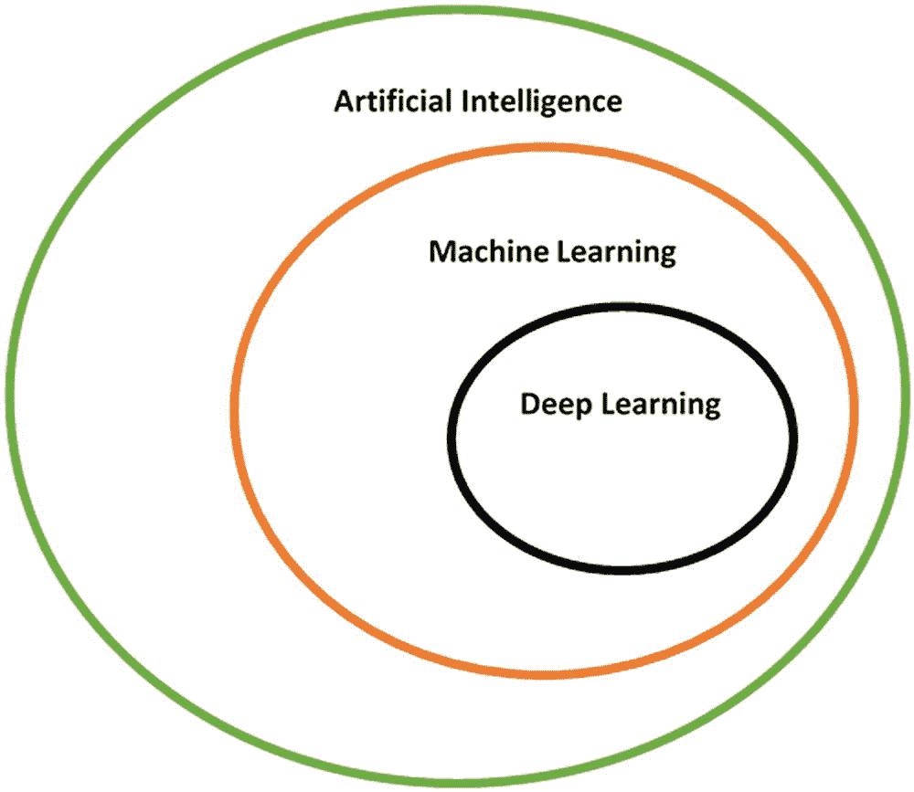
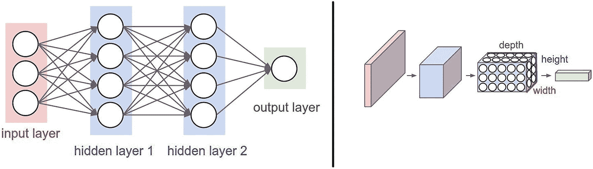
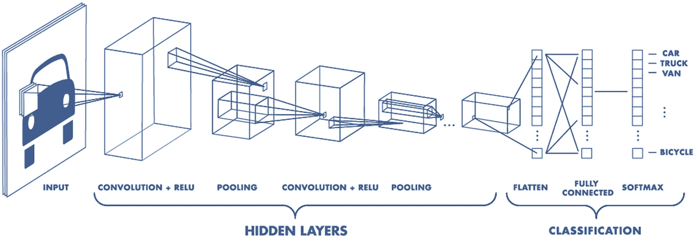
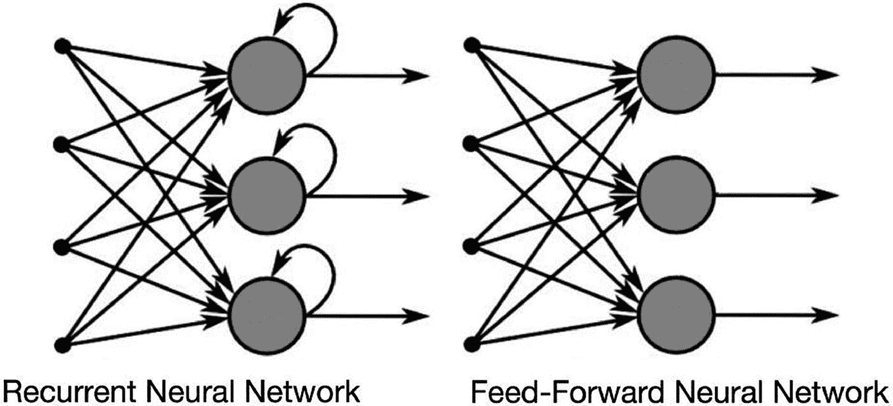
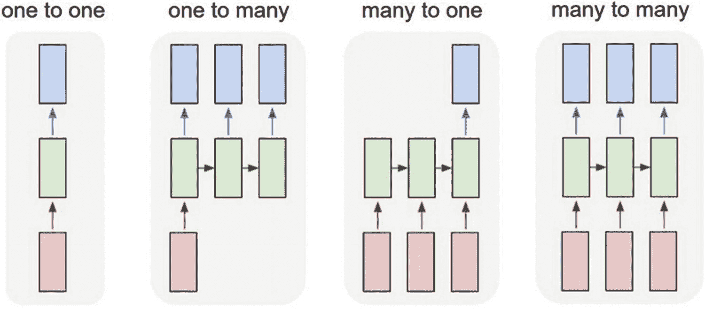
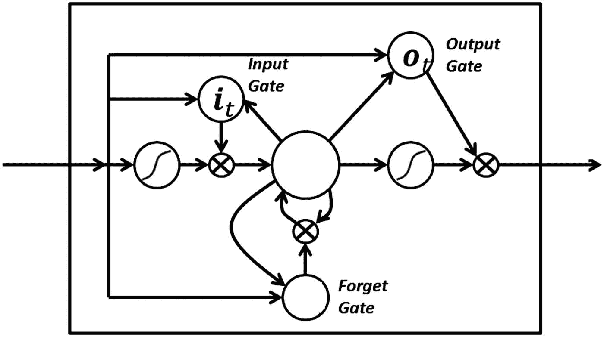
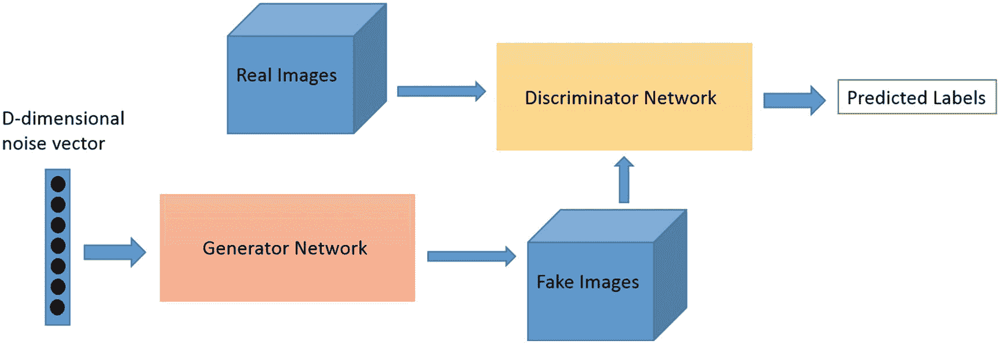

# 在 R 中加载 h2o 库
library(h2o);
#在您的机器中启动一个集群
localH2O =h2o.init()
上述函数将返回一个输出，显示连接成功，如下所示：
Starting H2O JVM and connecting: .... Connection successful!
R is connected to the H2O cluster:
H2O cluster uptime:         4 seconds 188 milliseconds
H2O cluster version:        3.10.0.6
H2O cluster version age:    1 month and 9 days
H2O cluster name:           H2O_started_from_R_abhisheksingh_zve484
H2O cluster total nodes:    1
H2O cluster total memory:   0.89 GB
H2O cluster total cores:    4
H2O cluster allowed cores:  2
H2O cluster healthy:        TRUE
H2O Connection ip:          localhost
H2O Connection port:        54321
H2O Connection proxy:       NA
R Version:                  R version 3.2.3 (2015-12-10)
注意：  启动时，H2O 被限制为 CRAN 默认的 2 个 CPU。
请按如下所示关闭并重新启动 H2O 以使用所有 CPU。
> h2o.shutdown()
> h2o.init(nthreads = -1)
```

一旦您在本地机器上启动了集群，就可以准备好在 H2O 的高性能集群上运行您的计算了。还有许多其他示例可以帮助您开始使用梯度提升机（GBM）、广义线性模型（GLM）、集成树等等。


## 10.5 总结

在未来，随着基础设施成本下降和数据量增加，扩展规模的需求将成为机器学习流程中的首要任务。每一个基于机器学习构建的应用，都必须首先考虑可扩展的实现思路。随着数据规模开始爆炸式增长，大多数传统的 RDBMS 系统将很快过时。行业巨头们已经率先迈出第一步，转向支持大规模扩展且能灵活适应业务需求的系统。在不久的将来，当另一波颠覆性技术解决了日益增长的数据量问题时，对高效算法设计的重视以及对量子计算等领域的关注将开始显现。

我们通过借鉴快速发展的数据科学方法论和技术，全面深入地探索了机器学习的世界。尽管经典文献中已经存在并优雅地解释了绝大部分机器学习模型构建流程，但我们仍感到有必要将机器学习模型构建流程与现代数据科学领域涌现的新思维结合起来。

我们还尽可能简化了统计学和数学内容，以使机器学习的学习更加实用，并提供了大量额外资源供进一步阅读。诸如抽样、回归模型和深度学习等主题的深度和广度都非常大，每个主题都足以写出一本同等篇幅的书籍。然而，得益于 CRAN 上丰富的 R 包，这些算法的实际应用才成为可能。

由于 R 是初学者和高级用户围绕实际问题快速构建机器学习原型的首选编程语言，我们选择使用 R 来演示本书中的所有示例。如果你想将机器学习作为职业或研究工作，那么在计算机科学、统计学和领域知识之间取得良好的平衡将大有裨益。

# 11. 使用 Keras 和 TensorFlow 进行深度学习

曾几何时，数据和计算资源非常稀缺，以至于业务应用或 IT 基础设施产生的每一个数据点都不会被存储，应用设计也缺乏数据驱动的思维。如今，时代确实变了，计算和存储资源丰富，我们拥有了“数据优先”的思维，并且每个业务应用都能提供越来越多的数据。大型企业现在的商业模式都建立在从数据推断中产生收入的基础上。在这场数据和计算能力的激增中，最有前景的进步在于我们看待解决复杂问题的方式发生了根本性的改变。

深度学习源于神经网络等传统机器学习算法，已经存在了几十年，然而，现在正是它回归的最佳时机。本章被收录为本书第二版的最后一章，因为很自然地，我们会将深度学习视为一种可扩展的机器学习算法，它能够处理海量数据。像 TensorFlow 这样的框架就是为运行这些算法而设计的。

更正式地说，深度学习算法受到人类认知系统的启发，能够学习复杂的数据表示。深度学习可以是监督式、半监督式和非监督式的。与神经网络类似，深度学习架构由多层神经元构建而成，以实现更好的特征提取。因此，它们创建了多个抽象层次，通常被称为概念层次结构。

在本章中，我们将重点理解各种深度学习架构——如 Keras 这样的库、TensorFlow 这样的框架，以及深度学习算法在哪些问题上引发了颠覆性的研究和跨越式发展。

## 11.1 深度学习简介

深度学习是机器学习的一个子领域，其根源在于神经网络模型。图 11-1 展示了人工智能（AI）、机器学习（ML）和深度学习（DL）之间的重叠关系。



图 11-1

AI、ML 和 DL 的重叠关系

对于图像分类，机器学习模型仅被设计用于在给定的特征集上使用线性分类器。然而，线性分类器只能创建简单的区域，比如被超平面分隔的空间。这类线性分类器不擅长检测位置、方向或光照的变化。对于视频、语音和音频，也存在类似的情况。另一方面，深度学习架构包含多层模块堆栈，这些模块通过计算非线性的输入-输出映射来学习。因此，这种架构能够从文本、视频、音频、语音和图像中的高级抽象表示中学习。第 11.2 节将带你了解流行的深度学习架构及其在各个领域的应用。

## 11.2 深度学习架构

在本节中，我们将讨论一些在实际应用中被广泛使用的流行深度学习架构。然而，考虑到本书的篇幅，我们将把细节限制在最低限度，并在必要时引用适当的资料。深度学习架构正随着来自各个领域的大量研究兴趣而迅速发展。

### 11.2.1 卷积神经网络（CNN）

与传统神经网络相比，卷积神经网络（CNN）将其神经元结构化为三维（宽度、高度和深度），如图 11-2 所示。CNN 的每一层都将三维输入转换为三维输出。在图 11-2 中，红色的输入层代表图像，因此其宽度和高度就是图像的尺寸，深度为三，分别对应红、绿、蓝三个通道。



图 11-2

神经网络与卷积神经网络对比。来源：[`http://cs231n.github.io/convolutional-networks/`](http://cs231n.github.io/convolutional-networks/)

图 11-3 展示了 CNN 的基本架构，该架构可扩展到更复杂的架构，如 LeNet、AlexNet、ZF Net、GoogLeNet、VGGNet 和 ResNet 等。通过使用输入层到输出 softmax 层之间的所有层，网络能够学习给定数据的各种特征，无论模式多么复杂。在许多方面，它确实模仿了人类思维。关于这些架构的更多细节，可参见“CS231n 卷积神经网络用于视觉识别” [7]。



图 11-3

卷积神经网络。来源：[`https://www.mathworks.com/videos/introduction-to-deep-learning-what-are-convolutional-neural-networks--1489512765771.html`](https://www.mathworks.com/videos/introduction-to-deep-learning-what-are-convolutional-neural-networks%252D%252D1489512765771.html)

CNN 的架构适用于图像或视频帧中的物体分类和检测。它在计算机视觉从业者中很受欢迎。CNN 架构被广泛应用于基于闭路电视监控的安全监控、MRI 和 CT 扫描中的异常检测、基于人脸识别的应用以及许多其他计算机视觉用例。


### 11.2.2 循环神经网络（RNN）

循环神经网络（RNN）因其基于神经网络的架构和内置的内部记忆功能而迅速流行起来。RNN 的历史可以追溯到 20 世纪 80 年代；然而，与其他深度学习架构一样，随着计算能力变得经济且充裕，其潜力在近年来才得以实现。

图 11-4 展示了 RNN 与前馈神经网络的区别。RNN 通常处理当前输入，并记住它从先前输入中学到的内容。



图 11-4

前馈神经网络与卷积神经网络。来源：[`https://towardsdatascience.com/recurrent-neural-networks-and-lstm-4b601dd822a5`](https://towardsdatascience.com/recurrent-neural-networks-and-lstm-4b601dd822a5)

另外需要注意的是，前馈神经网络将一个输入映射到一个输出，而 RNN 可以实现一对多、多对多（翻译）以及多对一（语音分类）的映射。图 11-5 展示了 RNN 中不同类型的映射。



图 11-5

RNN 映射。来源：[`https://towardsdatascience.com/recurrent-neural-networks-and-lstm-4b601dd822a5`](https://towardsdatascience.com/recurrent-neural-networks-and-lstm-4b601dd822a5)

RNN 能够记住输入中的重要部分，这使得它在处理语音、文本、时间序列、音频和视频等序列数据时表现出色。

RNN 的一个局限性是其短期记忆。为了解决这个局限，RNN 可以与长短期记忆（LSTM）单元结合，这有效地使其也能够存储长期记忆。这些通常被称为 LSTM 网络。LSTM 使 RNN 能够在较长时间内记住其输入。这种记忆被设计为一个门控单元（门可以打开或关闭），它可以根据信息的重要性决定存储（开门）或删除（关门）信息。图 11-6 展示了一个典型的 LSTM 单元。



图 11-6

LSTM 单元。来源：[`https://towardsdatascience.com/recurrent-neural-networks-and-lstm-4b601dd822a5`](https://towardsdatascience.com/recurrent-neural-networks-and-lstm-4b601dd822a5)

在本章后面，我们将展示一个使用 LSTM 网络解决实际问题的演示，即使用 Quora 重复问题数据集来识别重复文本。

### 11.2.3 生成对抗网络（GAN）

除了第 11.2.1 节中提到的流行的 AlexNet、VGG Net、GoogleNet、ResNet 和 SegNet 架构之外，我们将简要解释生成对抗网络（GAN），这是过去十年机器学习领域发展出的最有趣的想法之一。

正如文章《生成对抗网络（GAN）初学者指南》[8] 所述，GAN 的潜力巨大，因为它们可以学习模仿任何数据分布。也就是说，可以教会 GAN 在任何领域（图像、音乐、语音和散文）创造出与我们自己的世界惊人相似的世界。从某种意义上说，它们是机器人艺术家，其输出令人印象深刻——甚至令人感动。

GAN 基于生成算法。在第 6 章中，我们展示了多个判别算法的例子，这些算法试图根据输入特征对输入进行分类。例如，给定糖尿病数据集中的一条患者记录，判断该患者是否患有糖尿病。从数学上讲，这可以表示为 P(Y|X)，其中 Y 是类别（是或否），X 是输入特征向量。在生成算法中，我们反转这种关系并问：“我们能否生成一个糖尿病患者的所有特征？”换句话说，假设一个人患有糖尿病，我们观察到给定输入特征的可能性有多大？

因此，在 GAN 中，一个神经网络（我们称之为生成器）生成新的数据实例，而另一个神经网络（判别器）则决定它审查的每个数据实例是否属于实际的训练数据集。

判别器模型是一个分类器，用于确定给定的图像看起来像是数据集中的真实图像，还是像人工创建的图像。这基本上是一个二元分类器，将采用普通 CNN 的形式。生成器模型接收随机输入值，并通过反卷积神经网络将其转换为图像。图 11-7 展示了其架构。



图 11-7

GAN 架构。来源：[`https://www.oreilly.com/learning/generative-adversarial-networks-for-beginners`](https://www.oreilly.com/learning/generative-adversarial-networks-for-beginners)

GAN 在许多方面都是强大的概念，它们确实可以实现只有人类才能想到的能力。想象一下，一个 GAN 模型能够根据详细的文本描述生成逼真的鸟类和花卉图像。研究论文《生成对抗文本到图像合成》[10] 展示了这一想法。该网络在辅助残障人士、室内装饰、生成创意艺术形式等各个领域都有着巨大的潜力。

## 11.3 深度学习工具集

有许多工具和软件栈可用于在 CPU 或 GPU 硬件上构建深度学习模型。由于深度学习模型计算资源密集，近年来 GPU 的使用越来越多。为深度学习设计的各种软件都考虑到了算法的复杂性和计算需求。在本节中，我们将探讨可用于在真实世界的大规模数据集上构建深度学习模型的各种工具集。

### 11.3.1 高级库

Keras 是开源高级神经网络 API 无可争议的选择，最初用 Python 编写。Keras 很快成为在许多后端引擎（将在下一节讨论）之上构建深度学习架构的事实标准，这些引擎包括 TensorFlow、CNTK 和 Theano。它同时支持 CNN 和 RNN，并可在 CPU 和 GPU 机器上运行。

使用 Keras 的详细文档可在 [`https://keras.io/`](https://keras.io/) 找到。

除了 Keras，我们还有 Apache MXNet，这是一个为深度学习设计的库。尽管 MXNet 是一个全面且灵活的 Python API，但它并未获得开发者社区的足够兴趣以实现广泛使用。在本章的演示中，我们使用 Keras，因为它提供了与 R 的无缝集成。

### 11.3.2 后端引擎或框架

像 TensorFlow、Theano 和 CNTK 这样的后端引擎通常被称为用于数据流编程的软件库。某些参考资料也将这些引擎描述为机器学习框架。这些后端引擎为神经网络类架构对多维数据数组（如矩阵乘法）执行的操作提供了平台。在像 TensorFlow 这样的框架中，计算被表示为有状态的数据流图，这使得在处理大量数据时非常高效，并且易于将计算部署到各种平台，如 CPU、GPU 或 TPU。

在我们的演示中，我们将使用 TensorFlow 框架，它是这些引擎中最流行的。


### 11.3.3 硬件能力

随着各种深度学习库和框架的发展，对更强大、更专业的处理硬件的需求也开始增长。从通用 CPU 到谷歌最新的张量处理单元（TPU），这些专用硬件设计都是根据深度学习网络所涉及的操作类型精心构建的。谷歌的 TPU 专为高效、更快的输入输出而设计，以缩短模型训练所需的时间。

图形处理单元（GPU）广泛应用于高清动画渲染和游戏系统，后被重新用于执行高速计算。在当前深度学习工作中，GPU 因其更快的模型训练速度而成为最受青睐的处理单元选择。

### 11.3.4 编程语言选择

多年来，用于构建机器学习和深度学习模型的编程语言选择逐渐向 Python 靠拢。Python 的流行主要归功于其代码已为生产部署做好准备。它稳健可靠，被广泛认为与为速度和优雅而构建的传统编程语言（如 C/C++）不相上下。

为了保持全书的一致性，本章的所有演示均采用 R 语言。

### 11.3.5 云基础设施

由于深度学习模型需要大量计算能力，个人基础设施中的普通硬件（如笔记本电脑或台式机）并不具备所需的能力。公共云中有许多选择，例如 Amazon AWS、Google Cloud 和 Microsoft Azure。为了本书中的演示，读者可以在 rstudio 博客中选择其中一个选项：[`https://blog.rstudio.com/2018/09/12/getting-started-with-deep-learning-in-r/`](https://blog.rstudio.com/2018/09/12/getting-started-with-deep-learning-in-r/)。

不过，我们选择了一个示例数据集和问题，它们可以在中等配置的台式机或笔记本电脑系统上正常运行。请记住，所有云平台都涉及相关成本。在使用任何云平台之前，请仔细阅读定价结构。

## 11.4 用例：识别 Quora 上的重复问题

2017 年，Quora 在 Kaggle（一个面向众多数据科学项目的在线平台）竞赛中提供了一个庞大的 Quora 问题对数据集，包含 404,000 个问题对。该竞赛的目标是构建最准确的模型，用于预测哪些问题对是重复的。对于像 Quora 这样的平台，这将极大地帮助它们进行问题分类、分配等。这个问题对人类思维来说看似非常简单，但当涉及到机器理解一对问题的语义含义时，则涉及一个复杂的学习过程。那么，面对复杂问题，还有什么比深度学习更合适的呢？

在接下来的 R 语言演示中，我们将引导您实现一个名为“孪生循环架构”的模型。我们要感谢 Daniel Falbel 在[`https://blogs.rstudio.com/tensorflow/posts/2018-01-09-keras-duplicate-questions-quora/`](https://blogs.rstudio.com/tensorflow/posts/2018-01-09-keras-duplicate-questions-quora/) [6]上发表的帖子《使用 Keras 对 Quora 重复问题进行分类》。

### 11.4.1 环境设置

首先，我们需要安装 Keras 和 TensorFlow 作为后端。它们提供了数据预处理和模型构建所需的所有库：

```
#安装 Keras
install.packages("keras")
library(keras)
install_keras()
#安装 TensorFlow 作为 Keras 的后端。默认使用 CPU，但您也可以指定"tensorflow = "gpu"
install_keras(tensorflow)
```

### 11.4.2 数据预处理

为了运行我们的模型，我们需要将数据准备成合适的格式。以下代码使用`keras`库中的`text_tokenizer`和`fit_text_tokenizer`方法将单词标记化为整数：

```
#加载 keras
library(keras)
#数据可从以下地址下载
#https://www.kaggle.com/c/quora-question-pairs/data
quora_data <- read.csv("quora_duplicate_questions.tsv", sep = "\t", stringsAsFactors = FALSE)
#初始化文本分词器，词汇量上限为 50000
tokenizer <- text_tokenizer(num_words = 50000)
#将分词器适配到问题 1 和问题 2 的唯一值上
tokenizer %>% fit_text_tokenizer(unique(c(quora_data$question1, quora_data$question2)))
#文本分词器，将每个 question1 和 question2 转换为整数列表
question1 <- texts_to_sequences(tokenizer, quora_data$question1)
question2 <- texts_to_sequences(tokenizer, quora_data$question2)
```

在以下代码中，我们计算每个问题（单词数量）的长度。由于所有问题的长度并不相等，我们需要使用从 50001 开始的额外整数对单词列表进行填充（我们在分词过程中使用了整数 1 到 50000）。填充操作将序列归一化为相同大小，以便我们可以将它们输入模型。

```
library(purrr)
questions_length <- c(
map_int(question1, length),
map_int(question2, length)
)
```

从分位数可以看出，99%的问题长度最多为 31，因此我们可以选择 15 到 30 之间的填充长度。我们可以先选择 20（稍后也可以调整此参数）。

```
#80%、90%、95%和 99%分位数
quantile(questions_length, c(0.8, 0.9, 0.95, 0.99))
80%   90%   95%   99%
14.00 18.00 23.00 30.01
