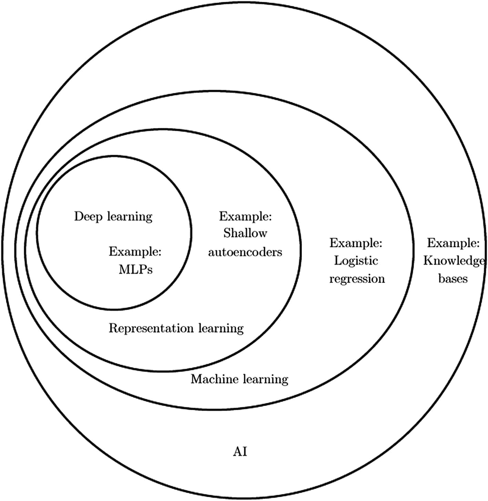
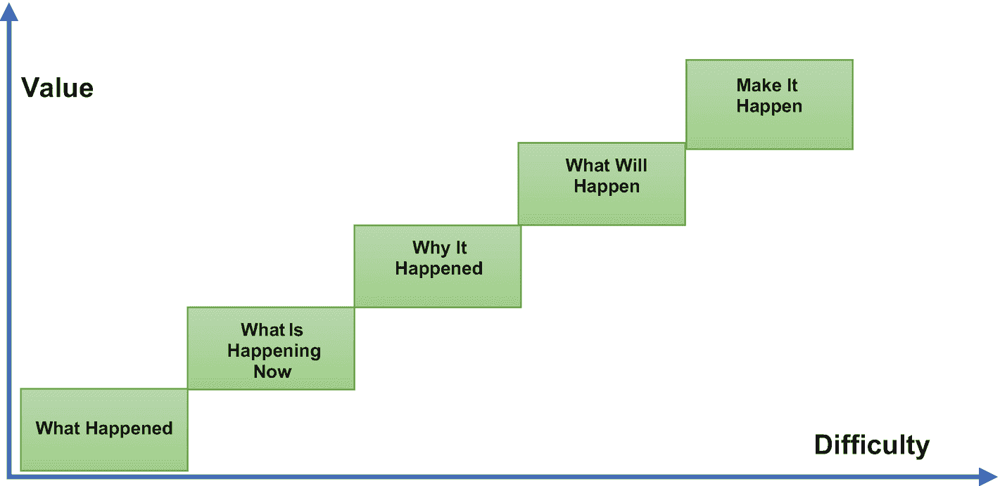
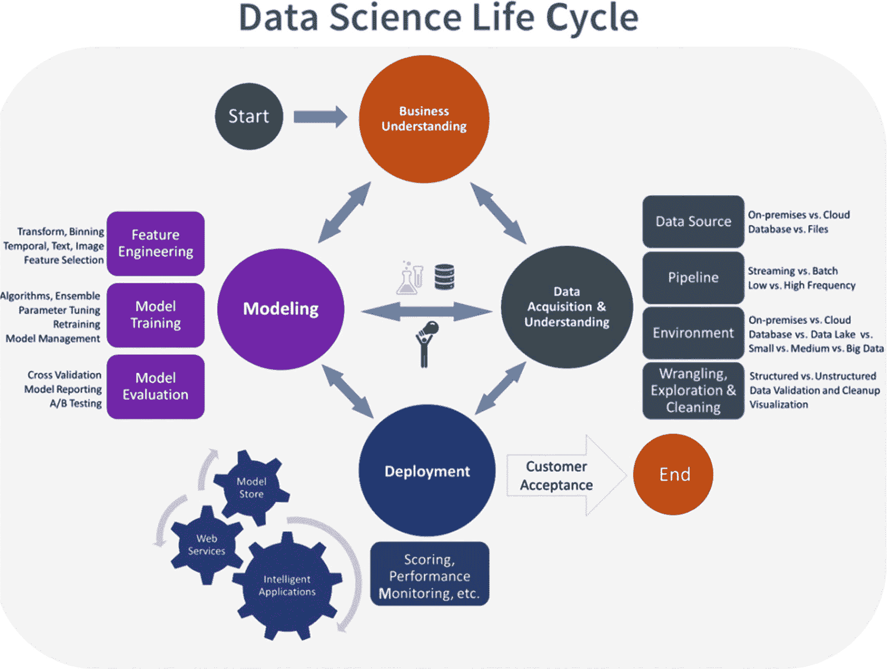
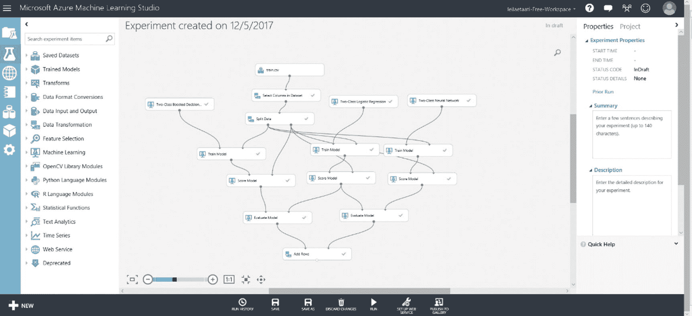
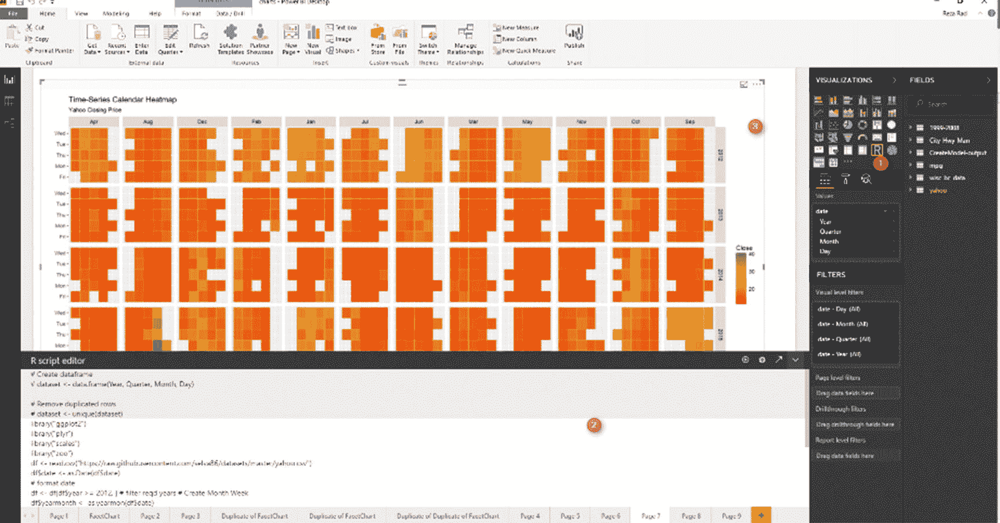
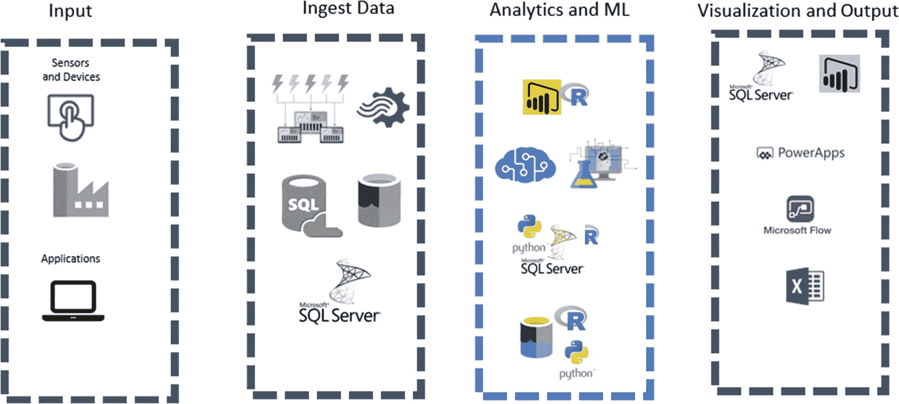
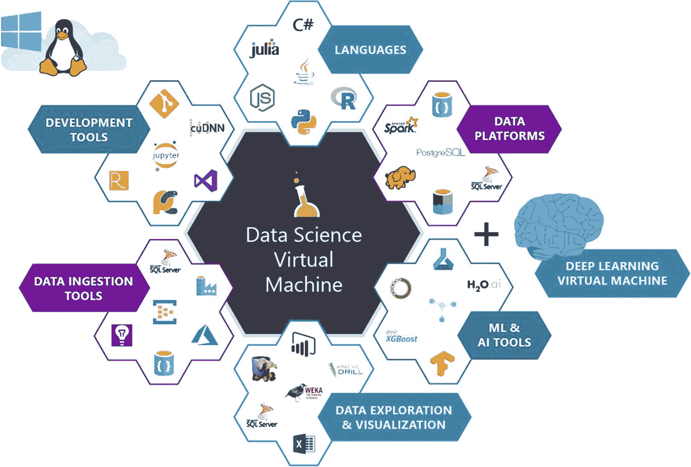

# 1. 机器学习简介

机器学习使决策者能够从其数据中获得更深入的洞察。如今，机器学习的应用已不再局限于研究和特定行业。在大多数领域，都存在利用机器学习从现有数据中获取更简洁、更深入信息的宝贵机会。因此，大多数大型软件公司都为其用户提供了通过易用软件访问机器学习的机会。例如，作为商业软件开发先驱的微软，在开发必应搜索引擎、Xbox、Kinect 等产品时都利用了机器学习。机器学习在微软的应用并不仅限于新软件的开发。在微软的许多软件开发工具中，例如 `Microsoft SQL Server`、`Power BI` 和 `.NET`，都有机会利用机器学习来创建更智能的应用程序和报告。

在本章中，你将学习机器学习的核心概念和方法，回顾机器学习的类型，并逐步了解机器学习的生命周期。此外，你还将了解微软产品中可用的、非常有用的机器学习工具。

## 机器学习概念

机器学习是人工智能的一个子集。Ian Goodfellow 及其同事 [1] 介绍了一个图表，展示了人工智能的不同方法。如图 1-1 所示，机器学习是人工智能的几种方法之一。

图 1-1 展示人工智能类别及子类别的维恩图 [1]

学者和作者们对机器学习提出了不同的定义。例如，Sebastian Raschka 将机器学习定义为使用算法理解数据的工具 [2]。他提到，我们会遇到大量的结构化数据（数字）和非结构化数据（图像、语音文本等）。从这些数据中获取洞察会影响决策过程，并帮助管理者更好地理解发生了什么、为什么发生、未来会发生什么以及如何使其发生。

机器学习的概念基于从当前数据集中发现共同模式。历史上，我们创建报告和软件来理解过去发生的事情。分析近期事件和数据总是有助于我们进行进一步的分析，例如寻找关键绩效指标等。调查过去发生的事情相对直接，并能为我们提供一些价值（图 1-2）。下一步，我们希望变得更加敏捷以应对变化，因此分析实时数据至关重要。分析近期数据显然比分析历史数据能提供更多洞察。这个过程比之前的方法稍微困难一些，但能为组织带来更多价值。

图 1-2 从过去到未来，各种分析的价值与难度

第三步是根本原因分析，这是一种侧重于因果关系的调查研究。例如，分析某个特定分支销售额下降的主要原因，可以为业务所有者提供大量价值。

从数据中获取更好价值的进一步步骤是分析未来会发生什么，即*预测分析*。了解未来会发生什么，或洞察数据模式，将帮助决策者实施更明智的公司政策。“将会发生什么”的分析比之前的步骤需要更多的努力和时间。然而，这是企业获取更有价值、更具可操作信息的机遇。

最后一步是“如何使其发生”。这种*规范性分析*在预测未来后推荐应采取的措施。这个过程为任何组织带来了更多洞察，但与其他阶段相比，实施起来更具挑战性。

## 机器学习方法

机器学习主要有两种方法：

- 监督学习
- 无监督学习

以下段落将对每种方法进行简要说明。在第 5 章中，我将更详细地介绍这些方法，并提供两者的示例。

### 监督学习

监督学习的主要目标是学习如何根据历史数据预测一个类别或数值。另一种定义是，监督学习是从带标签的训练数据中推断出函数关系的机器学习任务 [2]。

监督学习有不同的方法。一种是预测数值，例如预测某个视频频道的订阅人数，其范围可能从一人到数百万人不等。监督学习使得预测该频道将有多少人订阅成为可能。另一个例子是预测来年的销售额，其范围可能从 1,000 美元到 200,000 美元。通过这种方法，算法可以预测公司的销售数量。我们将这种方法称为*回归方法*，其输出结果是一个连续值。

监督学习的另一种方法涉及预测类别，例如预测客户是会留在公司还是离开。在这个例子中，目标是预测现有客户是否会留在某个群体中。另一个案例可能考虑一家提供不同客户等级的公司，例如金卡、银卡和铜卡客户。在这种情况下，监督学习方法可能会预测新客户属于金卡、银卡还是铜卡群体。在这种类型的监督学习中，预测列应该是一个*离散的类别标签*。

### 无监督学习

在监督学习中，我们在创建和训练模型之前就已经对答案有了概念。而在无监督学习中，我们不预测任何列，也不给数据附加任何标签。无监督学习的主要目标是发现数据的自然模式，探索数据并提取其中有意义的信息。

## 机器学习生命周期

机器学习生命周期包含四个主要步骤：

1.  业务理解
2.  数据获取与理解
    1.  数据收集
    2.  特征选择
    3.  数据整理
3.  建模
    1.  模型选择
    2.  拆分数据集
    3.  训练模型
4.  部署
    1.  评估模型
    2.  监控模型

微软提出了一个团队数据科学过程（TDSP）来说明这些阶段（图 1-3）。

图 1-3 微软提出的团队数据科学过程生命周期 [3]

第一步是理解业务问题。了解业务的人员是识别公司需求和机器学习能够解决的问题的最佳资源。然而，并非所有问题都能通过机器学习解决！此外，机器学习用例应与业务利益相关者、数据科学家和工程师协作确定优先级，以便从有价值、负担得起且成功概率高的解决方案开始。

第二步是数据摄取，涉及从不同来源收集所需数据，并进行探索和清洗。找到与问题相关的数据列（主要针对监督学习）有助于创建更准确的算法。此外，对于每个算法，在建模阶段之前必须完成特定的数据转换。

第三步是建模，包括模型选择。这是通过分析问题和数据的性质来完成的。大部分数据应分配给模型创建（训练），留一小部分用于测试和评估模型。如图 1-3 所示，机器学习过程是迭代的。例如，创建模型后，有可能其准确性不高。在这种情况下，我们必须重新检查之前的步骤，例如业务理解或数据获取。

## 机器学习语言与平台

为了创建机器学习模型，你必须至少熟悉一种便于进行机器学习的语言。不过，也有一些工具，例如 `Microsoft Azure` 机器学习，提供了拖放式环境。

有许多不同的语言可用于进行机器学习，包括 `Python`、`Java`、`R`、`C++`、`C`、`JavaScript` 等。然而，在所有这些语言中，`Python` 和 `R` 是使用最广泛的，它们专注于模型创建和机器学习过程。

还有许多不同的工具可用于进行机器学习。在本书中，我们将特别关注那些可以帮助我们执行机器学习的微软工具，以及如何使用不同的微软技术来实现特定的机器学习过程。

微软多年来已在其部分工具（如必应搜索或 Xbox）中集成了机器学习。2004 年，它将数据挖掘工具嵌入到 `SQL Server` 中。这些工具帮助 SQL 和商业智能（BI）开发人员利用机器学习来创建更具洞察力的报告。

`SQL Server` 允许用户利用多维数据集中的现有数据快速生成挖掘模型。在 `SQL Server` 中使用数据挖掘工具的主要优点是它们易于部署、界面出色且用户友好。然而，也存在一些缺点。例如，无法使用 `R` 或 `Python` 创建自定义代码，并且可用的算法数量有限。

随后，微软于 2014 年宣布推出基于云的机器学习平台 `Azure` 机器学习（AML）。该平台提供了流畅的拖放式环境，并且无需任何软件即可运行。`Azure` 机器学习支持 `R` 和 `Python`，并提供超过 25 种专用于机器学习的算法（图 1-4）。你将在第 12 章中了解更多相关信息。

图 1-4 Azure 机器学习环境易于使用且灵活

除了 `Azure` 机器学习之外，微软还提供了在其部分其他工具中嵌入 `R` 或 `Python` 代码的能力，例如 `Power BI`，这是一种广泛用于 BI 实践的自助式 BI 工具。2015 年，微软开始在 `Power BI` 中提供机器学习的新可能性，例如在报表部分提供自定义视觉对象，帮助开发人员编写 `R` 代码以实现可视化和机器学习。你将在第 4 章中了解更多相关信息。

`Microsoft Power BI` 的另一个关键组件是 `Power Query`。`Power Query` 帮助开发人员从不同来源获取数据，并提供许多用于清洗数据的功能。2016 年，微软引入了在 `Power Query` 内部编写 `R` 代码以进行机器学习的选项。在 `Power BI` 报表和 `Power Query` 中编写代码是有区别的。在前者中，你可以创建视觉对象（图 1-5），但在后者中则不能。此外，`R` 视觉对象中的代码会在筛选上下文更改或页面打开时每次运行，而 `Power Query` 编辑器中的 `R` 脚本仅在刷新时运行，除非存在直接查询连接。你将在第 6、7 和 8 章中学习如何在 `Power Query` 中使用 `R` 执行机器学习。

图 1-5

Power BI 报表中用于机器学习的 `R` 视觉对象

另一个集成机器学习的微软平台是 Microsoft Azure，这是一个云平台，包含用于数据获取、存储、可视化和输出的各种组件。Microsoft Azure 的多个部分都具备机器学习能力。如图 1-6 所示，可以在 Microsoft Power BI、Microsoft SQL Server 2016 和 2017（第 9 章和第 10 章）、Azure Data Lake（第 11 章）、Azure Stream Analytics（第 13 章）、Azure Machine Learning Studio（第 12 章）以及 `Azure Machine Learning Workbench`（第 14 章）中编写 `R` 或 `Python` 代码。此外，还将对 Azure HDInsight（第 15 章）进行一些介绍。接下来，在第 16 章中，将概述数据科学虚拟机。在第 17 章中，读者将熟悉 `CNTK` 的概念。此外，一些服务（如认知服务）提供了不同的 `API`，用于在自然语言处理、文本分析、图像和语音处理等领域进行机器学习。我将在第 18 章和第 19 章中详细介绍这些内容。图 1-6 展示了所有 Azure 组件如何与其他 Azure 工具交互，以加速机器学习开发的进程。

图 1-6

提供不同机器学习执行可能性的 Microsoft Azure 组件

此外，还可以在 Azure 门户中创建数据科学虚拟机（`DSVM`）（图 1-7）。`DSVM` 支持多种语言（例如 `R`、`Python`、`C#`）、机器学习模型（`Azure Machine Learning Workbench`、`H2O`）、数据摄取工具、数据探索和开发。我将在第五部分深入介绍如何使用这些组件。

图 1-7

Microsoft 数据科学虚拟机（DSVM）组件 [4]

## 总结

本章介绍了 Microsoft 机器学习产品，简要说明了什么是机器学习、机器学习流程以及机器学习生命周期。此外，还描述了一些主要的机器学习方法，例如描述性分析、预测性分析和规范性分析。概述了如何利用这些工具来创建预测性、描述性和规范性分析。在本书的其余部分，将深入介绍 Microsoft 技术栈中的大部分 AI 工具，并解释如何利用它们来实现机器学习。