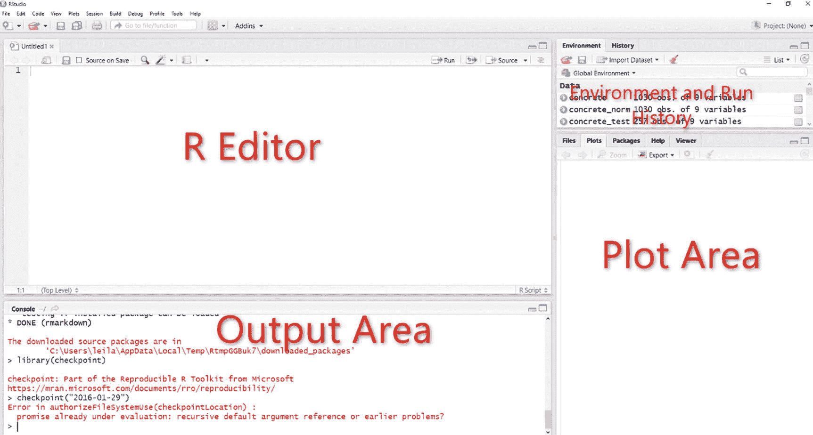
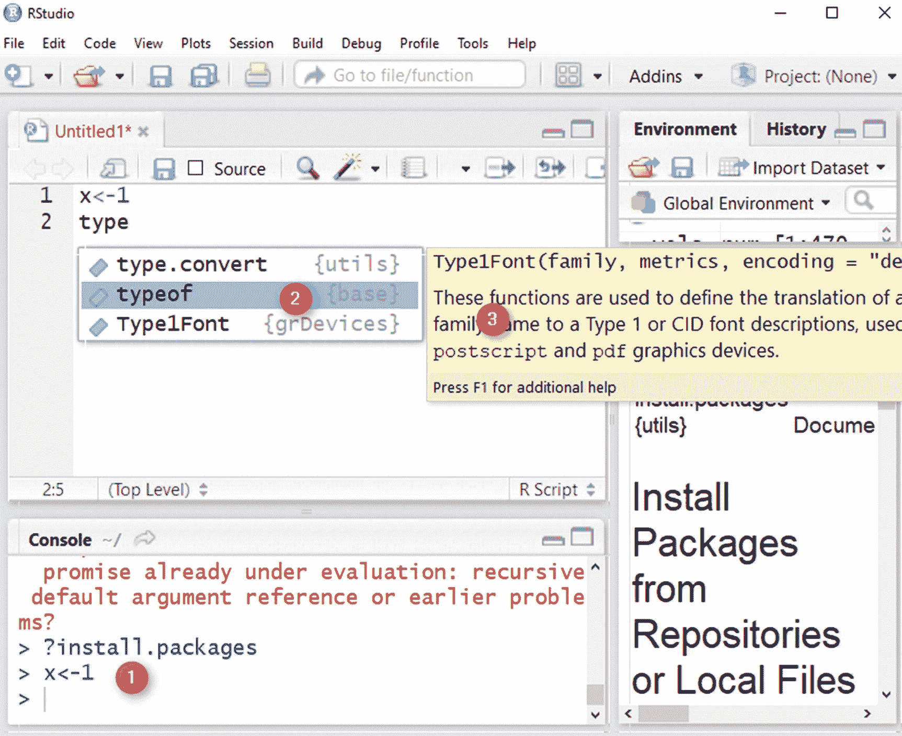
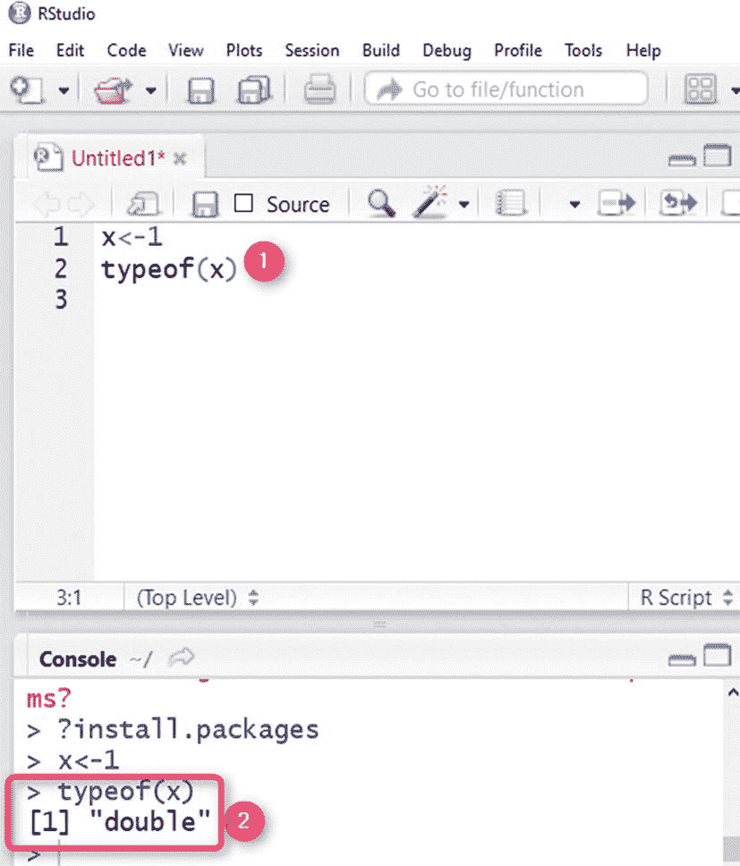
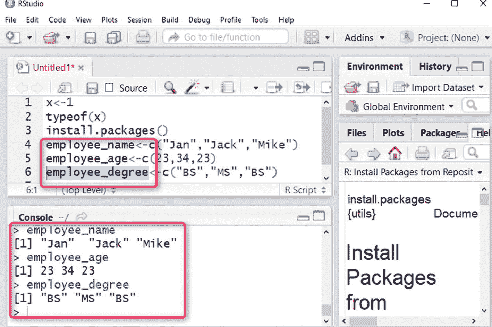
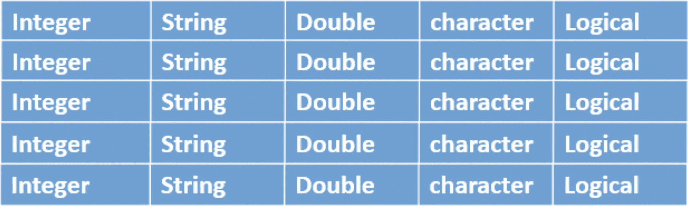
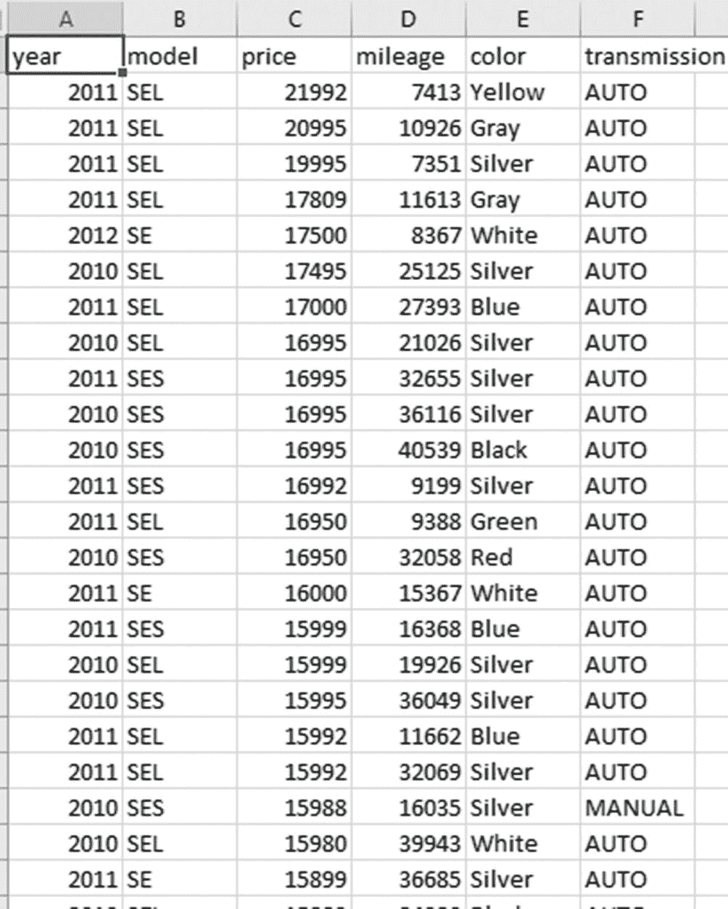
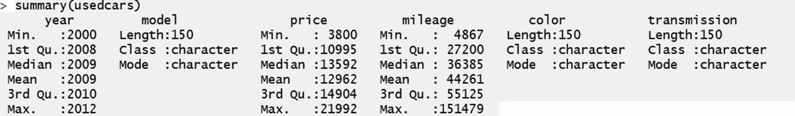
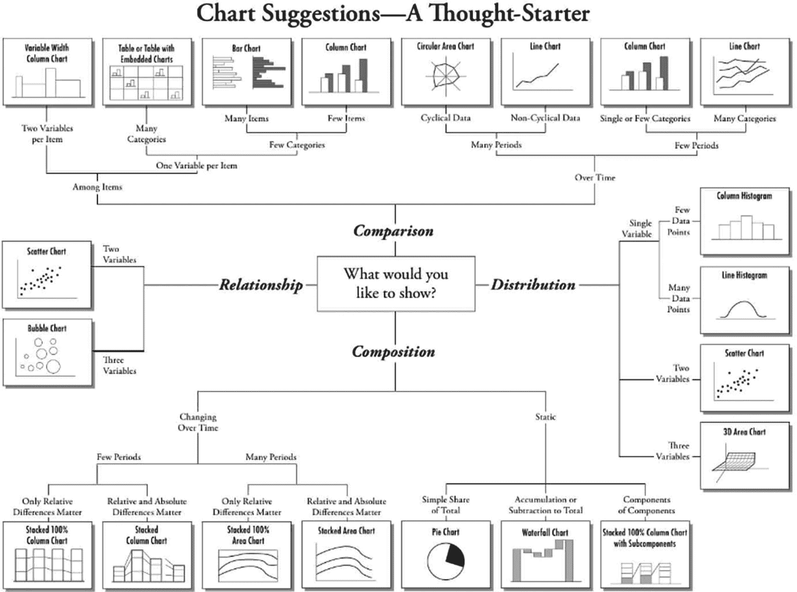

# 2. R 语言入门

R 无疑是机器学习中最流行的语言之一。它是一种编程语言和免费软件环境，主要用于统计计算和数据可视化。R 语言长期以来一直被学术界、数据科学家和统计学家使用。它是一种统计语言，非常适合机器学习、统计学，并可作为可视化工具使用。Microsoft 技术与 R 语言之间存在集成，这增强了 Microsoft 应用程序和报表中的机器学习能力。R 是一种开源且专有的语言，可用于 Windows 和 Mac 操作系统。它可以通过包进行扩展 [1]。本章概述了如何安装 RStudio，以及如何通过安装包来扩展 R 的功能，并将解释如何使用 R 进行机器学习、统计分析和可视化。

## 安装 RStudio

要编写和使用 R 进行机器学习和统计分析，你必须在机器上安装一个 R 版本。有不同版本的 R 和不同的工具来编写 R 代码，但在本书中，我们将使用 RStudio 编写 R 脚本，RStudio 是一个用于 R 的集成开发环境（IDE），可以使用语法高亮编辑器。要安装 RStudio，你必须访问网站 [`www.rstudio.com/products/RStudio/`](http://www.rstudio.com/products/RStudio/)。你也可以在桌面上或通过服务器运行 R 脚本。本书使用了桌面版 RStudio。此外，还安装并使用了免费的桌面版 RStudio。首先，在你的机器上安装 RStudio 桌面版并打开它。RStudio 环境有四个主要部分，如图 2-1 所示。



图 2-1

RStudio 环境

你可以在 R 编辑器中编写 R 代码。与其他 R IDE 相比，该编辑器更加用户友好。输出或控制台区域显示代码运行的结果。绘图区域显示可视化图表、帮助部分等。最后一个部分，环境和运行历史，显示变量和日志。

让我们从 R 中的一个简单表达式开始。我们想将值 10 赋给变量名 `X`。简单的语句是

```
X<-10
```

在 R 中，`<-` 符号用于将值赋给变量。要运行代码，你只需按 Ctrl+Enter 或单击编辑器窗口中的运行按钮。

如图 2-2 所示，我运行了语句 `x<-1`，结果会显示在控制台编辑器中。现在我将确定 `X` 变量的类型。为此，有一个名为 `typeof` 的函数，它接收一个变量并识别其类型。RStudio 还为每个函数提供“智能感知”。



图 2-2

在 R 代码中运行一个简单语句

运行 `typeof` 函数后（图 2-3），你将在控制台窗口中看到输出。变量 `X` 的类型是双精度型。R 中有不同的数据类型和结构，本章稍后将讨论这些内容。



图 2-3

在 RStudio 中运行 `typeof` 函数以识别变量类型

## 安装包

为了扩展 R 的功能，可以安装额外的包。每个包都有不同的函数，为使用 R 提供更多功能。

安装包的主要命令是 `install.packages()`。当你安装 R 时，你的机器上会创建一个库文件夹，其中包含一些用于使用 R 的基本包，例如“基础”包。但是，在第 4 章中，你将看到如何使用此命令添加一些有助于机器学习的包。

## R 数据结构

每种编程语言都有特定的数据结构。R 有一些预定义的数据结构，每种结构都有特定的用途。为了在 R 中执行机器学习，我们通常使用数据结构，例如向量、列表、数据框、因子、数组和矩阵。接下来，我将简要解释其中一些。


### 向量——c( )

向量存储一组有序的值。每个值都属于相同的数据类型。向量可以保存整数（不含小数的数字）、双精度浮点数（含小数的数字）、字符（文本数据）和逻辑值（`TRUE` 或 `FALSE`）等数据类型。参见图 2-4。


图 2-4

向量的简单可视化

要在 R 中创建向量数据结构，必须使用函数 `c()`。若要创建一个存储公司员工姓名的向量，可以编写如下代码：

```
employee_name<-c("Jan","Jack","Mike")
```

存储员工年龄和学历的方法与此相同。

```
employee_age<-c(23,34,23)
employee_degree<-c("BS","MS","BS")
```

`employee_name`、`employee_age` 和 `employee_degree` 的记录结果如下（图 2-5）：



图 2-5

员工姓名、年龄和学历记录

### 因子

因子是第二种数据结构，用于处理特定类型的向量：分类值或有序值。例如，因子不直接存储“女性”和“男性”类型，而是存储 1 和 2，从而占用更少的存储空间。要定义因子，首先需要定义一个向量；员工学历就是一个分类变量。我们使用常见的 `Factor()` 函数将向量转换为因子类型，如下所示：

```
employee_degreeFactor<-factor(c("BS","MS","BS"))
运行 employee_degreefactor 的结果为
employee_degreeFactor
[1] BS MS BS
Levels: BS MS
```

如上述输出所示，在每个员工的学历旁边，还有一个名为 `Level` 的参数。

### 列表——list( )

列表是另一种数据结构，与向量类似，但可以包含多种数据类型的组合（图 2-6）。而向量只能包含一种数据类型。


图 2-6

列表的简单可视化

列表帮助我们组合不同的数据类型。在 R 中创建列表时，我们使用 `list()` 命令，如下所示：

```
employee_list<-list(employee_name,employee_age,employee_degree)
```

如上述代码所示，`list()` 函数接收一个向量数据结构来创建列表。

运行变量 `employee_list` 的输出结果如下：

```
[[1]]
[1] "Jan"  "Jack" "Mike"
[[2]]
[1] 23 34 23
[[3]]
[1] "BS" "MS" "BS"
```

### 数据框——data.frame( )

我们在机器学习中使用的主要数据结构是数据框。数据框与 SQL Server 和 Power BI 中的表结构非常相似。它包含列和行。数据框的图形化表示如图 2-7 所示。



图 2-7

数据框结构的简单可视化

要定义数据框，我们使用 `data.frame` 语法，如下所示：

```
employee_DataFrame<-data.frame(employee_name,employee_age,employee_degree)
```

运行变量 `employee_Dataframe` 的结果为：

```
employee_name employee_age employee_degree
1           Jan           23              BS
2          Jack           34              MS
3          Mike           23              BS
```

数据框类似于一个表格。我们可以分别访问其中的单元格、行和列。例如，要提取 `employee_Dataframe` 中的特定列，比如员工年龄，我们可以使用以下代码：

```
employee_DataFrame$employee_age
```

另一种访问行或列的方式是通过索引编号。逗号前的空格代表所有行，逗号后的数字代表列号。例如，我们可以使用以下代码提取第一列的所有行：

```
employee_DataFrame[,1]
[1] Jan  Jack Mike
Levels: Jack Jan Mike
```

类似地，要提取所有列中某个特定员工的数据，我们可以利用以下代码：

```
employee_DataFrame[1,]
employee_name employee_age employee_degree
1           Jan           23              BS
```

## R 用于统计分析

R 已被广泛用于统计分析。它可以用于从简单的统计分析到复杂的统计检验。

一个简单的统计分析是寻找数据的中心。在 R 中，有一个简单的命令 `summary()` 可以做到这一点，它提供数据集的简要描述。

以下是一个二手车数据集（图 2-8）：



图 2-8

二手车数据集

如图 2-8 所示，我们拥有每辆车的价格和里程数。如果我们想查看它们的简单中心度量，可以使用 `summary` 函数。

```
summary(used cars)
```

在 RStudio 中运行代码后，我们得到以下输出（图 2-9）：



图 2-9

在 RStudio 中运行 `summary` 函数代码的输出

对于数值变量，例如价格或里程数，我们有五个度量值：最小值（Min.）和最大值（Max.）、平均值（mean）、中位数（median），以及第一和第三四分位数（1st Qu.、3rd Qu.）。

## R 用于机器学习

R 包含许多帮助数据科学家执行机器学习的包和函数。使用 R 语言，您可以进行预测性、描述性和规范性分析。来自 KDnuggets 网站的以下 R 包（表 2-1）在机器学习领域尤其受欢迎 [2]。

表 2-1

用于机器学习的 R 包

| **排名** | **包名称** | **机器学习类型** |
| --- | --- | --- |
| 1 | caret | 预测性分析（分类和回归） |
| 2 | randomForest | 预测性分析（分类和回归） |
| 3 | E1071 | 描述性分析 |
| 4 | rpart | 预测性分析（分类和回归） |
| 5 | nnet | 预测性分析（分类和回归） |
| 6 | arules | 描述性分析（数据挖掘） |
| 7 | kernlab | 预测性分析（分类和回归）及描述性分析 |

用于机器学习的包和函数还有很多。在本书中，我将展示如何在 Power BI 中使用它们。


## R 语言用于可视化

R 语言可用于可视化。`Ggplot2` 包是一个流行的包，可帮助我们绘制不同的图表。借助 R 可视化，您可以绘制静态、动态和 3D 图表。在第 6 章中，我将讨论在 Power BI 中使用 R 代码绘制图表的一些方法。

我们希望实现可视化的主要目的如下：

*   比较

*   构成

*   分布

*   关系 [3]

图 2-10 中的图表展示了可视化的主要目标。



图 2-10

根据目的选择合适的图表

图 2-10 说明，可视化的主要目的可分为四个方面：关系、分布、比较和构成。此图表是一张用于寻找最佳可视化匹配方案的地图。大多数可用的可视化工具都能遵循此图表。然而，使用 R 脚本扩展了这些能力，可以绘制我们想要的所有不同类型的图表。

## 总结

本章概述了什么是 R 语言以及如何安装它。它还简要介绍了 R 语言中可用的包和不同的数据结构。最后，简要讨论了如何使用 R 语言进行可视化和机器学习。本书的其余部分将更深入地解释如何借助 R 脚本绘制图表。

