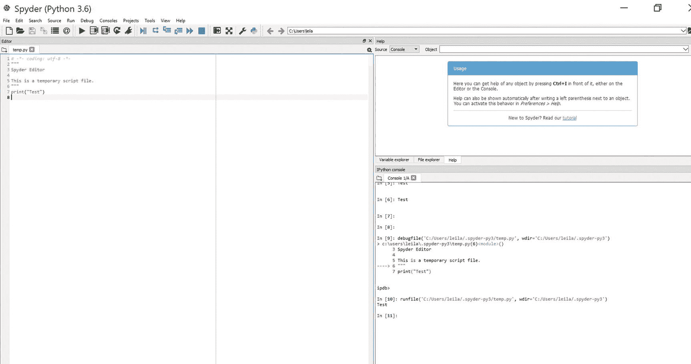
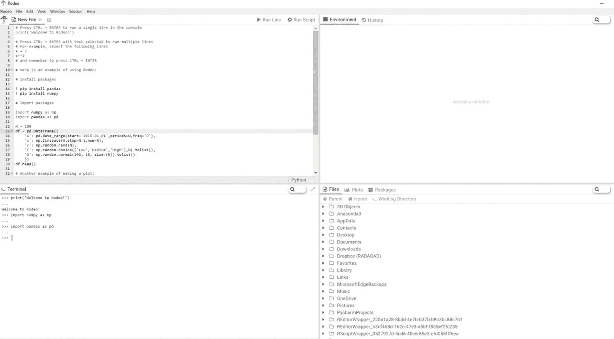
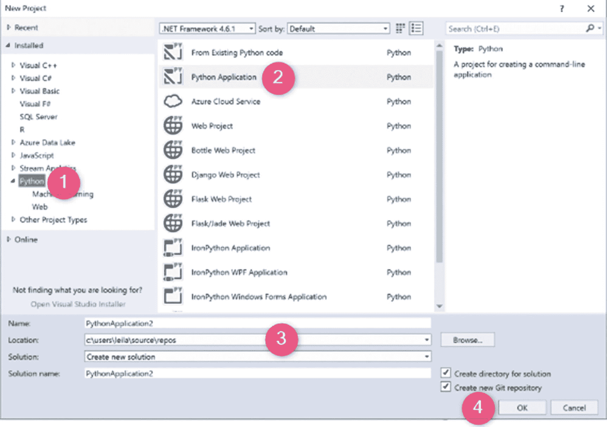
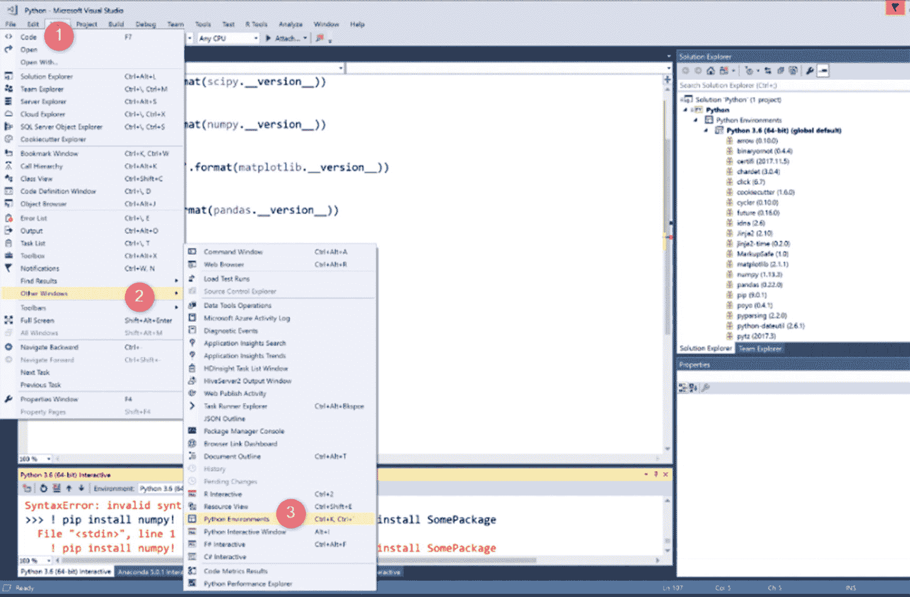
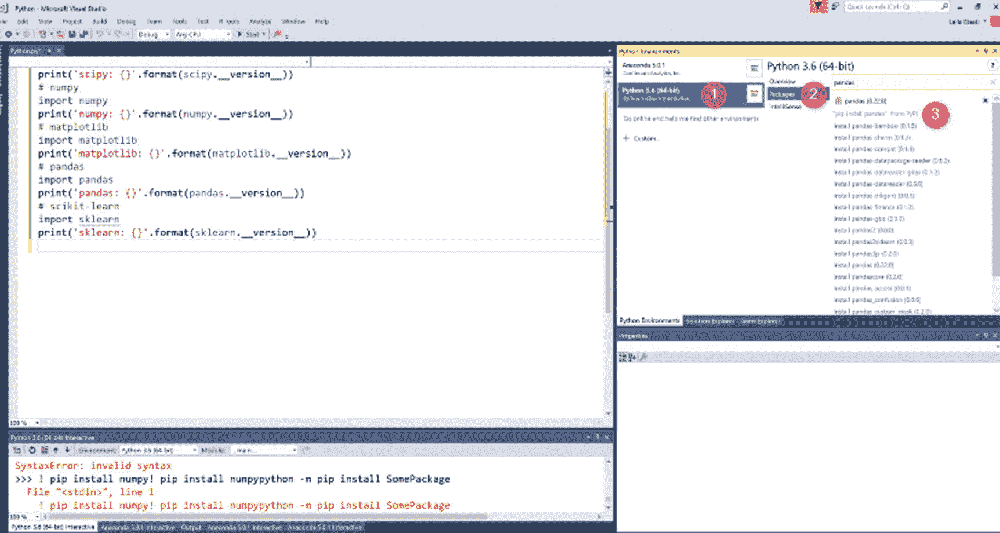
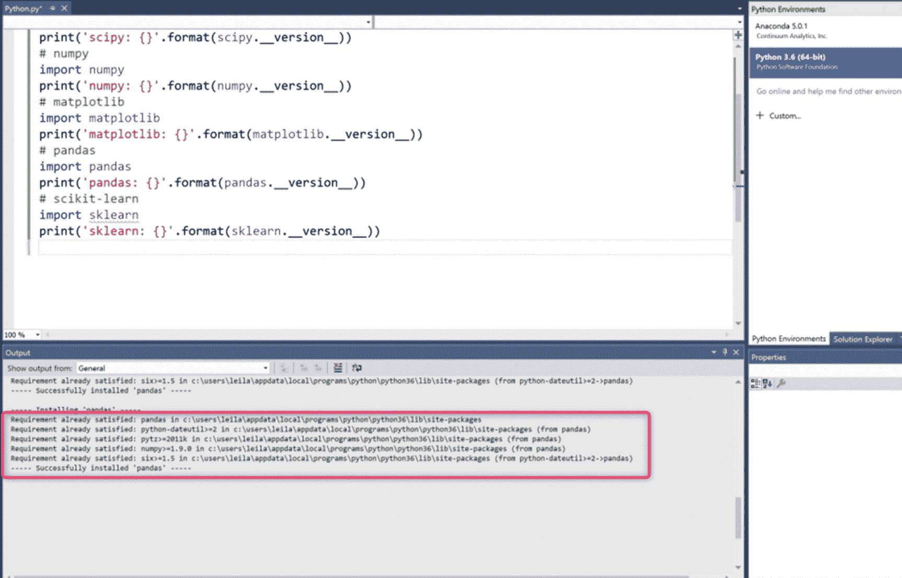
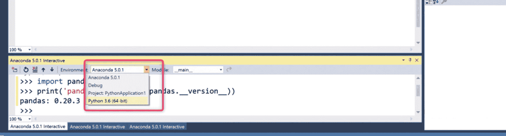

# 3. Python 入门

Python 是用于执行机器学习的主要语言之一。它是一种多用途语言，已被用于设备编程、面向对象编程、机器学习等领域。在本章中，您将学习

- Python IDE
- 安装包
- Python 数据结构
- 使用 Python 进行统计分析
- Python 用于可视化
- Python 用于机器学习

然而，本章的主要目的是简要介绍 R 语言。

## Python IDE

根据 DataCamp 网站 ( [www.datacamp.com/community/tutorials/data-science-python-ide](http://www.datacamp.com/community/tutorials/data-science-python-ide) ) 的介绍，有五种顶级的集成开发环境 (IDE) 可用于编写代码。以下是每种环境的简要说明。

- **Spyder** 是一个与 RStudio 非常相似的环境（图 3-1），因此如果您从 R 语言转向 Python，它是一个非常好的选择。它支持 Windows 和 MacOS 系统。Spyder 也可以从 Anaconda 网站 ( [www.anaconda.com/distribution/](http://www.anaconda.com/distribution/) ) 下载。
    
    图 3-1 Spyder 环境

- **Rodeo** 是另一个类似于 RStudio 的 Python IDE。您可以从 ( [https://rodeo.yhat.com/](https://rodeo.yhat.com/) ) 下载它。Rodeo 有四个主要环境（图 3-2）。一个用于编写代码，一个用于显示结果的控制台，一个用于安装包的区域，另一个用于显示图表。
    
    图 3-2 Rodeo 环境

- **PyCharm** 是另一个用于编写 Python 代码的 IDE。当前版本的 Azure Machine Learning Workbench 支持此 IDE ( [www.jetbrains.com/pycharm/](http://www.jetbrains.com/pycharm/) )。
- **Jupyter** 是另一个用于编写 Python 代码的 IDE，可以通过浏览器或桌面版本访问。
- **Microsoft Visual Studio** 是另一个用于编写 Python 的 IDE。可以在 Microsoft Visual Studio 内的 Azure Machine Learning Workbench 中编辑 Python 代码。下一节将详细说明如何使用 Azure Machine Learning 和 Visual Studio。

## 安装包

要在 Visual Studio 中编写 Python 代码，我们必须首先安装 Visual Studio 2017 ( [https://docs.microsoft.com/en-us/visualstudio/install/install-visual-studio](https://docs.microsoft.com/en-us/visualstudio/install/install-visual-studio) )。从“文件”菜单中，选择“新建项目”选项。然后选择 `Python` ➤ `Python 应用程序` ➤ 设置位置，然后单击“确定”按钮（图 3-3）。


图 3-3 在 Visual Studio 2017 中创建 Python 应用程序

为了扩展 Python 编程的能力，您必须安装一些额外的包。每个包都有不同的功能，为我们使用 Python 提供了更多的功能。要在 Visual Studio 中安装包，我们必须单击“视图” ➤ “其他窗口” ➤ “Python 环境”（图 3-4）。


图 3-4 Visual Studio 2017 中的 Python 环境

在“Python 环境”中，选择 Python 3.6 版本。在另一个选项卡中，选择“包”。在搜索区域中，输入包名称（图 3-5）。例如，要安装 Pandas，请单击“从 PyPi 安装 `pip install pandas`”。


图 3-5 在 Python 中安装包

安装包后，您将在输出中看到一条消息。图 3-6 显示 Panda 包已成功安装。


图 3-6 安装包的输出结果

安装包后，您将能够检查它是否已安装。在交互式 Python 3.6 中，编写以下代码，以检查 Pandas 包是否已安装。

```python
import pandas
print('pandas: {}'.format(pandas.__version__))
```

现在我们必须测试环境，以确保包已成功安装。您可以在不同的环境中运行代码。从图 3-7 中可以看出，可以在 Anaconda 5.0.1、Python 3.6 和 ProjectApplication 1 中运行代码。


图 3-7 在不同环境中的 Visual Studio 内运行 Python 代码

## Python 用于统计摘要

进行任何机器学习或统计分析的第一步是汇总数据集。我们将从维度、列的统计摘要以及数据预览方面来查看数据集。我们可以从以下链接访问关于汽车的数据资源： [https://archive.ics.uci.edu/ml/machine-learning-databases/auto-mpg/auto-mpg.data](https://archive.ics.uci.edu/ml/machine-learning-databases/auto-mpg/auto-mpg.data)。

我们将直接从网站加载数据，然后为每一列分配一个名称。为每一列分配名称将有助于我们更好地探索数据。然后我们将使用 Panda 包来加载和读取数据。

```python
URL = "https://archive.ics.uci.edu/ml/machine-learning-databases/auto-mpg/auto-mpg.data"
names = ['MPG', 'Cyl', 'Disp', 'HorsePower', 'Weight','Acceleration','Model Year','Origin','Car Name']
dataset = pandas.read_csv(URL, names=names)
```

### 维度

要获取数据的维度，例如行数和列数，我们使用 `shape` 属性，如下所示：

```python
print(dataset.shape)
```

结果

```
(398, 9)
```

上述结果表明我们有 398 行和 9 列。此外，我们可以使用 `head` 属性查看前 20 行数据，如下所示：

```python
print(dataset.head(20))
```

### 统计分布

要检查属性的统计摘要，我们可以使用 `describe` 命令，如下所示：

```python
print(dataset.describe())
```

### 用于可视化的 Python


## Python 数据可视化工具

Python 允许用户创建图表。它提供了多种数据可视化选项。`Matplotlib` 是 Python 中用于可视化的主要包。它非常强大，可用于创建复杂的图表。`Matplot` 是第一个可视化库，其他工具，如 `Seaborn`、`ggplot`、`Bokeh` 等，都是在其基础上构建的（参见 [Python 数据可视化库](https://blog.modeanalytics.com/python-data-visualization-libraries/) ）。

Python 中也可使用 `ggplot2` 包。`ggplot2` 基于 R 的绘图系统。它基于图层工作。

`Bokeh` 是另一个类似于 `ggplot2` 的库，但它是 Python 原生的。它帮助开发者绘制交互式和基于 Web 的图表。

`Plotly` 是一个在线数据可视化工具，对于创建交互式图表非常有用。`Plotly` 既可用于 R 也可用于 Python。

## 用于机器学习的 Python

Python 是一种简单、优雅且一致的语言。例如，与 R 相比，它的可读性更强。

Python 在应用数据科学领域尤其受欢迎。它拥有不同的机器学习包，例如 `NumPy`、`Pandas`、`Keras`、`TensorFlow` 等。然而，它是一种通用语言，可用于数据工程、网站抓取、Web 应用程序构建等。

## 总结

本章概述了 Python 及相关软件，并讨论了如何使用它来执行机器学习。
