# 4. Power BI 中的 R 可视化

Power BI 是一种自助式商业智能（BI）软件。该工具可用于企业级的数据可视化、数据清洗、建模、分析和协作。关于如何使用 Power BI，已经出版了许多书籍和博客。在本章中，我将展示如何利用 R 创建更好的可视化效果，并从 Power BI 中获得额外价值。在本章中，我将解释如何在 Power BI 中设置 R，如何使用 R 脚本在 Power BI 中绘制图表，如何设置 Power BI 报表环境，如何设置 Power BI 以编写 R 代码，以及如何在 Power BI 中绘制 R 图表。

## Power BI

Power BI 报表环境帮助我们可视化数据。根据 Abela 博士 [1] 的观点，数据可视化有四个主要目的，如下所示，并在图 4-1 中以图形方式呈现：

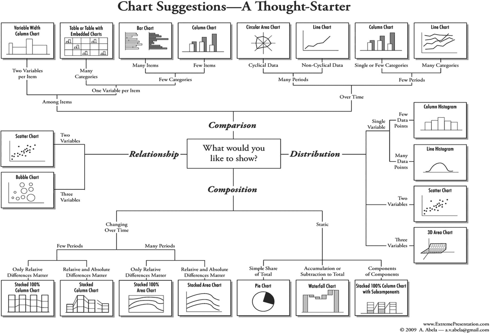

图 4-1

数据可视化示意图 [1]

1.  数据比较
2.  数据关系
3.  数据构成
4.  数据分布

Power BI Desktop 是一款免费应用程序，您可以从 [`https://powerbi.microsoft.com/en-us/desktop/`](https://powerbi.microsoft.com/en-us/desktop/) 下载。Power BI 可视化面板支持图 4-1 中建议的大部分图表。通过从市场或其他来源导入自定义视觉对象，可以扩展可视化功能。

Power BI Desktop 通过“获取数据”选项帮助用户从不同来源获取数据（图 4-2）。要了解更多关于 Power BI 的信息，请访问 [`http://radacad.com/online-book-power-bi-from-rookie-to-rockstar`](http://radacad.com/online-book-power-bi-from-rookie-to-rockstar) 。

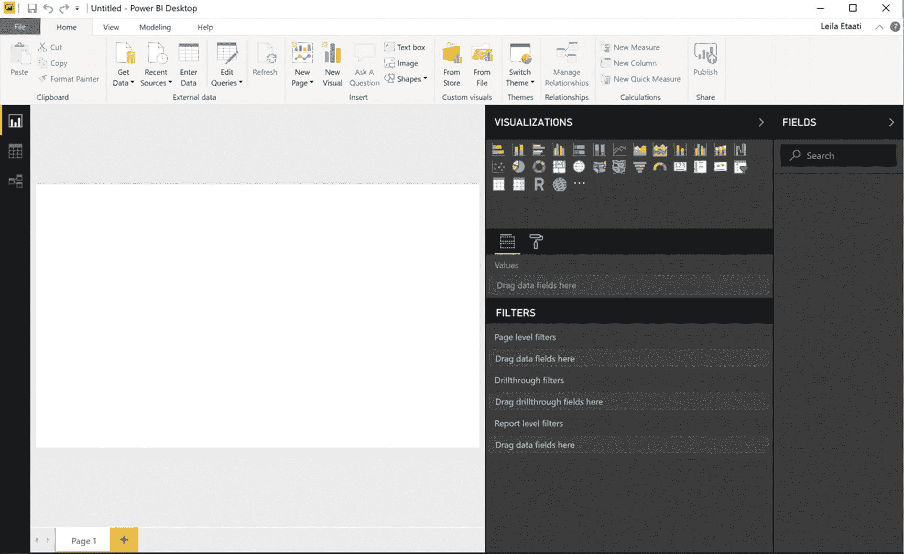

图 4-2

Power BI 可视化环境

### 在 Power BI 中设置 R

要在 Power BI 中绘制 R 图表，第一步是至少安装一个 R 版本或 Microsoft R Open。现在我们必须指定要使用的 R 版本。为此，我们单击“文件”菜单，然后单击“选项和设置”，再单击“选项”。在“全局”选项下，单击“R 脚本”，以指定 R 版本（图 4-3）。

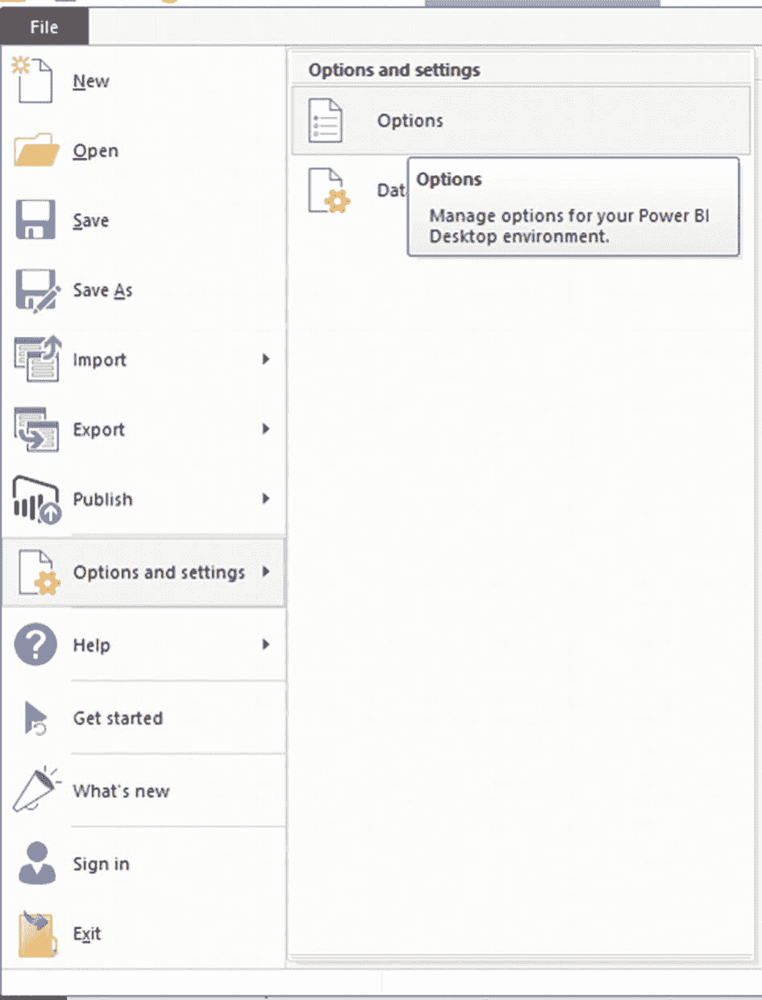

图 4-3

在 Power BI 中设置 R 环境

如第 3 章所述，R 基于包。每当您使用特定的包时，必须首先在您的机器上安装它。（如果您使用的是 Power BI Desktop，大多数包已安装在服务中。）您可以使用 R IDE（例如 R Studio）安装包。然后，在 Power BI R 编辑器中，您必须引用该包。此外，请确保您使用的是已安装的 R 包的正确版本（图 4-4）。

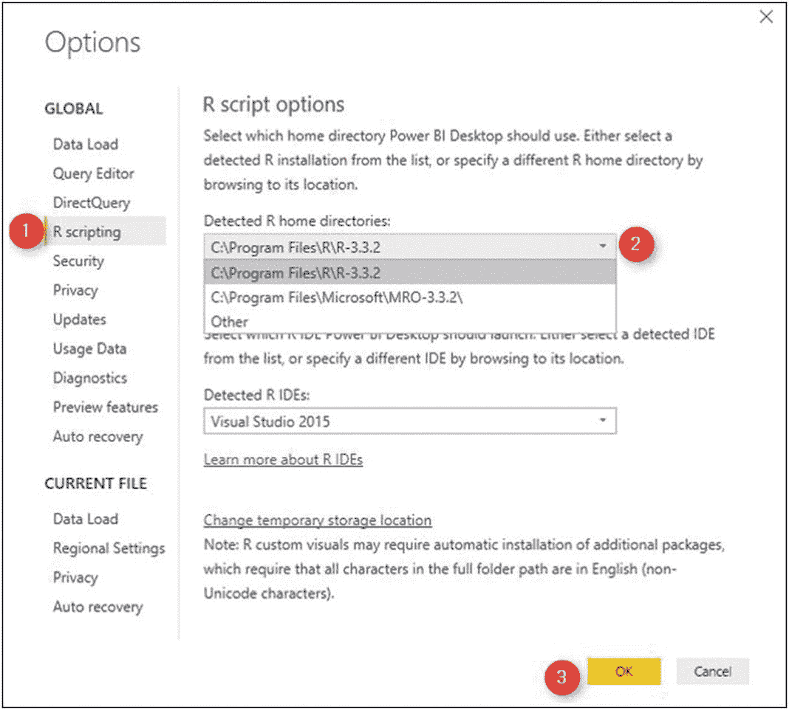

图 4-4

在 Power BI 中指定 R 版本和环境


### 在 Power BI 中编写 R 代码

可以在 Power BI 的报表区域编写 R 代码。为此，我们必须先将数据导入 Power BI 报表。

一个包含汽车规格（如市区和高速公路速度、气缸数等）的数据集，可从 [`https://forge.scilab.org/index.php/p/rdataset/source/tree/master/csv/ggplot2/mpg.csv`](https://forge.scilab.org/index.php/p/rdataset/source/tree/master/csv/ggplot2/mpg.csv) 下载。该数据集是免费的，名为“mpg.csv”。我将使用这个数据集，在一张图中展示汽车在高速公路和市区的速度、气缸数、生产年份以及驱动类型（前轮、后轮等）。如图 4-1 所示，要展示不同项目之间的数据对比，我们必须使用表格图。我们将通过“获取数据”选项将数据导入 Power BI Desktop，并导入一个 CSV 文件（图 4-5）。

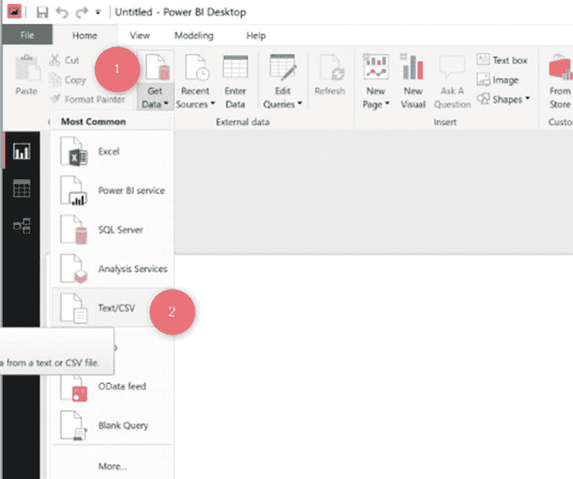

图 4-5

将 CSV 文件导入 Power BI Desktop

导入数据后，您应该能在“字段”下看到它。单击 R 并将其拖到空白区域（图 4-6）。

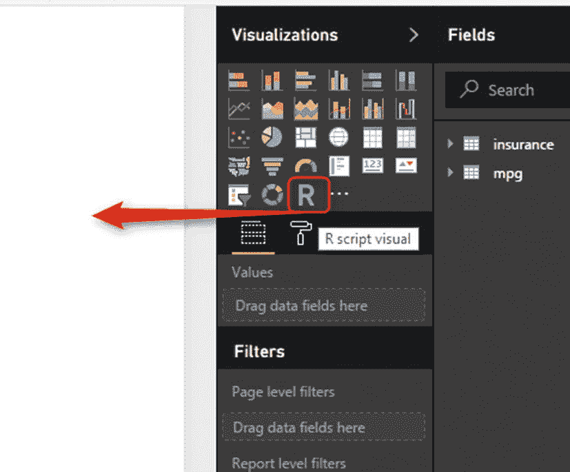

图 4-6

将 R 放入空白区域

展开 mpg 数据集（图 4-7），并选择 cty（市区速度）、hwy（高速公路速度）和 cyl（气缸数）选项。

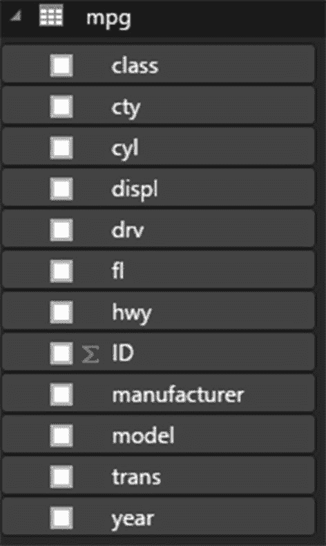

图 4-7

从 mpg 文件中选择相关数据

R 脚本编辑器将被启用。在 R 脚本编辑器下，您会看到一些 R 代码。井号（#）是在 R 中用于注释的符号，不会作为脚本执行。Power BI 会自动将选定的字段放入一个名为 `dataset` 的变量中，因此所有字段（cty、hwy 和 cyl）都将存储在一个数据集变量中，相当于使用了 `<-` 语法。此外，Power BI 会自动删除任何重复的行。这在 R 脚本编辑器区域中有说明（图 4-8）。

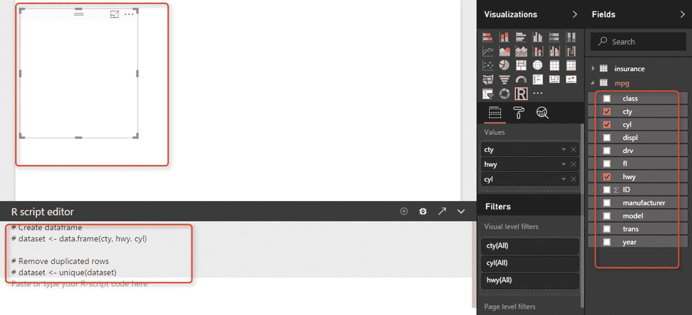

图 4-8

Visual Studio 2017 中的活动 Python 环境

接下来，我们将放置用于在 Power BI 中绘制二维图形的 R 代码。在 Power BI 中，要使用任何 R 脚本，都需要使用 `install.package()` 函数在 R 中安装该包。在我们的例子中，必须安装 ggplot2。我们使用函数 `library(ggplot2)` 来引用这个包。R 编辑器中的第一行代码是 `library(ggplot2)`。这个包包含一些用于绘制图表的重要函数。

为了绘制图表，我首先使用 `ggplot` 函数来配置一个二维图表。第一个参数是 `dataset`，它包含我们的三个字段。然后，在 ggplot2 中还有另一个名为 `aes` 的函数，它用于标识哪个字段应位于 x 轴或 y 轴上。最后，在图表中，我还想指示汽车的气缸数。这可以通过在 `aes` 函数中添加另一个图层来实现：Size。因此，气缸数更多的汽车将显示为更大的点（见图 4-9）。

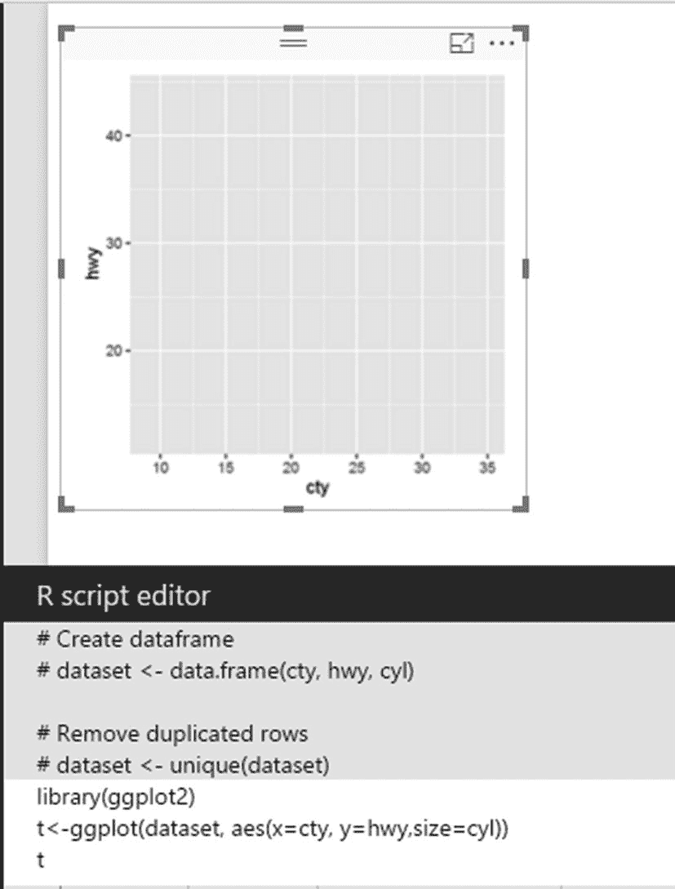

图 4-9

R 脚本编辑器

```
t←ggplot(dataset, aes(x=cty, y=hwy,size=cyl))
```

然而，上图显示的是没有任何特定图表的图形区域。我们需要一个散点图来在 x 轴和 y 轴上指示市区和高速公路速度。ggplot2 的 `geom_point` 函数用于绘制散点图。该函数有一个值为 pch=21 的参数，这与图表中点的形状有关。例如，如果我将此值设置为 20，它会变成一个实心圆；值为 23 则变成菱形。要运行代码，请单击运行选项（图 4-10）。

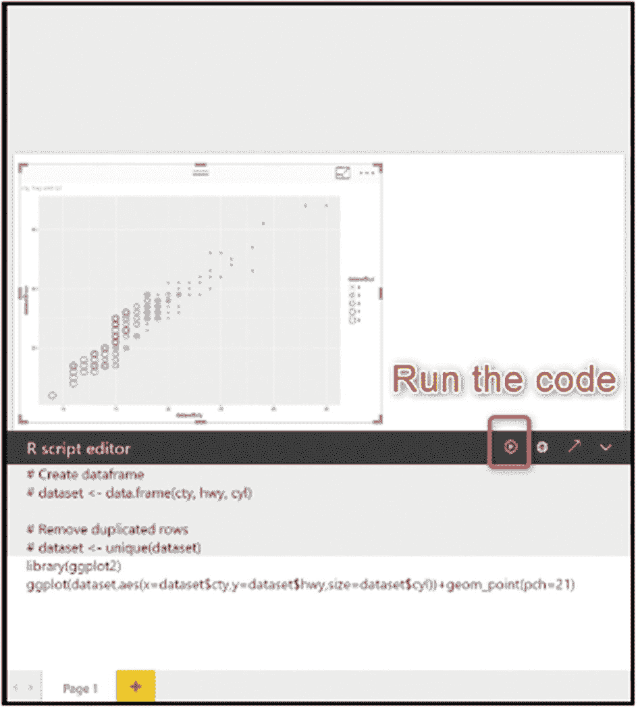

图 4-10

如何运行 R 代码

单击运行代码选项后，图表将显示在 R 可视化对象中（图 4-11）。

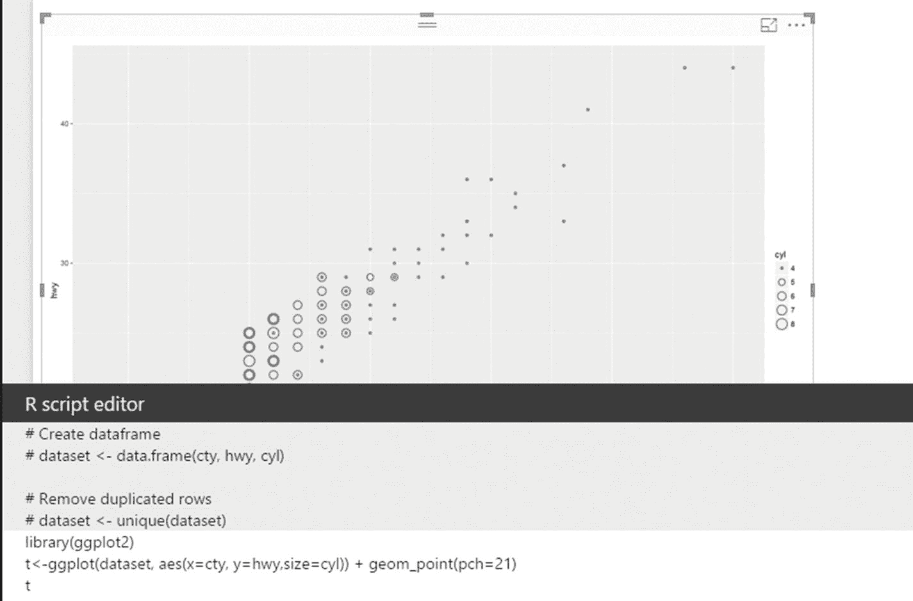

图 4-11

使用 `ggplot` 函数绘制图表

在图 4-11 中，您可以看到我们有三个不同的字段：高速公路速度和市区速度，分别位于 y 轴和 x 轴上。汽车的气缸变量显示为不同的圆点大小。但是，您可能需要更大的圆点，以区分 8 缸和 4 缸的汽车。我们通过添加另一个图层，即添加一个函数名来满足这一需求，如下所示：

```
scale_size_continuous(range=c(1,5))
```

以下是完整的代码：

```
t<-ggplot(dataset, aes(x=cty, y=hwy,size=cyl)) + geom_point(pch=23)+scale_size_continuous(range=c(1,5))
in the scale_size_continues(range=c(1,5))
```

指定的最小值和最大值之间的差值为 5。我可以通过将其从 5 改为 10 来增加这个差值。生成的散点图如图 4-12 所示。

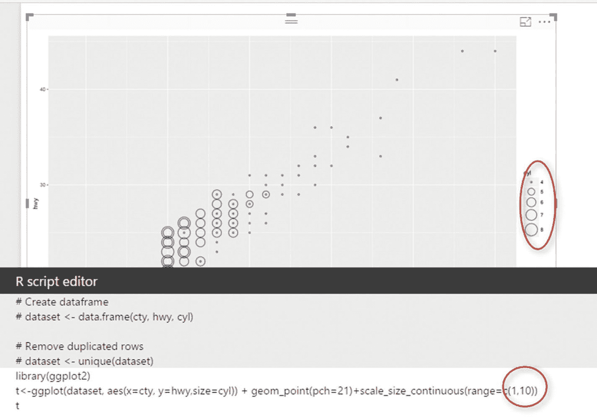

图 4-12

显示市区和高速公路速度以及气缸数的散点图

在下一个示例中，我将 `pch` 值更改为 24，并在 `aes` 函数名中添加了另一行代码：`fill=Red`。这意味着图表将显示实心的红色矩形（图 4-13）。

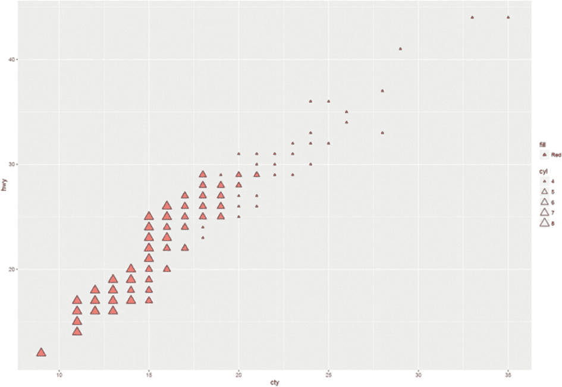

图 4-13

最终图表

```
t<-ggplot(dataset, aes(x=cty, y=hwy,size=cyl,fill="Red")) + geom_point(pch=24)+scale_size_continuous(range=c(1,5))
```

通过使用 R 中的 `facet` 命令，可以在一个图表中显示五个不同的变量。这有助于我们在图表中获得更多维度。为此，我们将展示汽车的生产年份及其驱动类型。因此，我们必须更改代码，如下所示：

```
t← ggplot(dataset, aes(x=cty, y=hwy,color = factor(cyl))) + geom_point(size=4)
```

通过更改 `aes` 函数参数，我们用 `color` 参数替换了 `size` 参数。这表明我想区分汽车的气缸值，不仅通过圆点大小，还要通过为它们分配不同的颜色来显示。因此，我按照上面的代码片段更改了 `aes` 函数。

我们必须更改代码，如下所示：

```
library(ggplot2)
t<-ggplot(dataset, aes(x=cty, y=hwy,color = factor(cyl))) + geom_point(size=4)
t<-t + facet_grid(year ~ drv)
```

现在，您可以在 y 轴和 x 轴上看到汽车在高速公路和市区的速度。此外，我们还将气缸数显示为颜色，将驱动类型和生产年份显示为分面（图 4-14）。

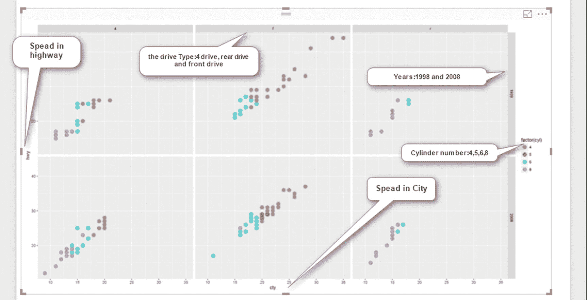

图 4-14

绘制显示五个变量的表格图

## Power BI 中的 R 功能

R 脚本编辑器具有一些功能，可帮助我们更好地使用 Power BI Desktop，例如切片和切块以及编辑 R 代码。


### 切片与切块

R 可视化具有交互性，可以对它们进行切片和切块。我们将使用一个切片器来切分分面图。同时，我们还会在报表区域插入一个年份切片器，以筛选 R 可视化对象（图 4-15）。

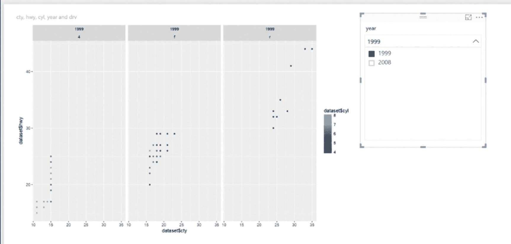

图 4-15

对 R 可视化对象进行切片和切块

### 在 RStudio 中编辑 R 代码

可以在 RStudio 中打开包含数据的代码。此外，还可以选择使用我们已有的数据在 RStudio 中运行 R 代码（图 4-16）。

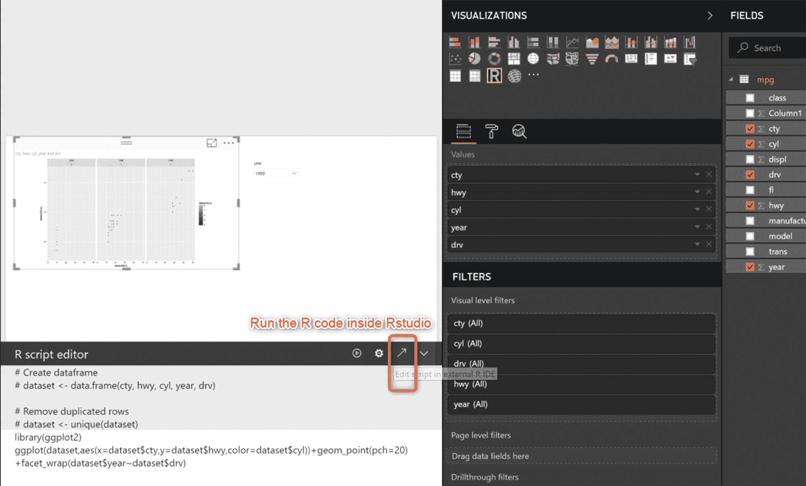

图 4-16

运行 R 代码

点击“运行”选项后，RStudio 中将打开一个包含汽车相关数据的页面。导入的数据集包含了数据的所有变更（图 4-17）。

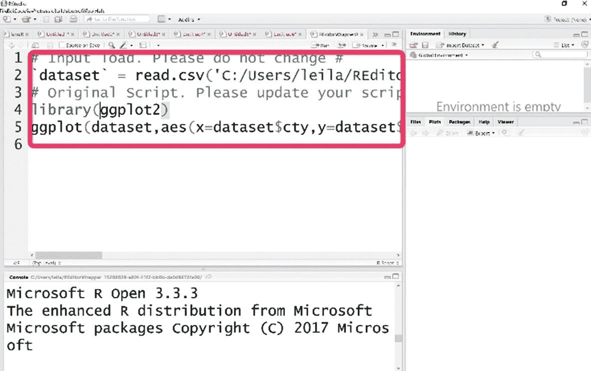

图 4-17

在 RStudio 中打开 R 代码

## 自定义可视化对象

使用自定义可视化对象是扩展 Power BI 可视化能力的另一种方式。有两种方法可以访问自定义可视化对象：

1.  使用 Office 商店中已有的自定义可视化对象

2.  创建自定义可视化对象

### Power BI Office 商店中的自定义可视化对象

Office 商店为 Power BI 用户提供了多种自定义可视化对象。要访问它们，您必须首先登录您的工作账户（图 4-18）。

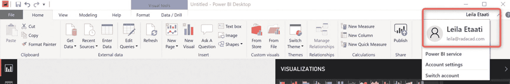

图 4-18

登录 Power BI 账户

然后，在 Power BI 可视化窗格中，点击三个点，选择“从商店导入”选项（图 4-19）。

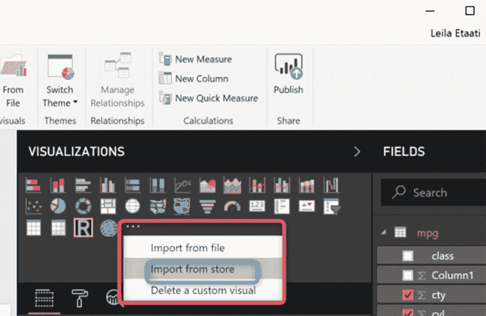

图 4-19

从 Power BI 商店导入可视化对象

接下来，您将看到一个标题为“Power BI 自定义可视化对象”的页面。这里列出了许多类别，例如筛选器、KPI、地图、高级分析、时间、仪表、信息图和数据可视化（图 4-20）。

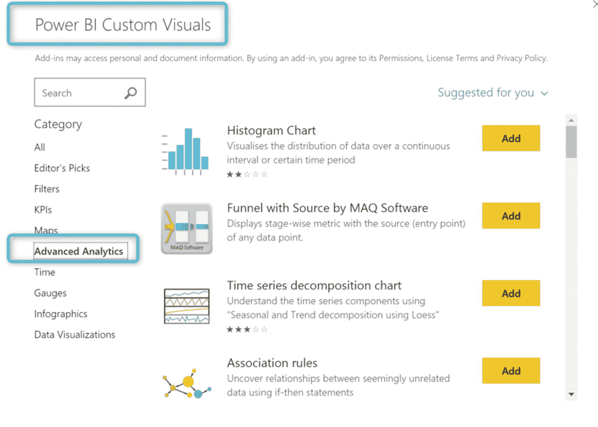

图 4-20

Power BI 自定义可视化对象窗格

如前所述，Power BI 自定义可视化对象包含一个“高级分析”类别。点击它，您将看到诸如时间序列、关联规则、聚类等高级分析功能。我将使用其中一个自定义可视化对象来预测牛奶产量。

第一步是将牛奶数据集导入 Power BI Desktop。该数据包含两列：牛奶生产日期和牛奶产量值（图 4-21）。

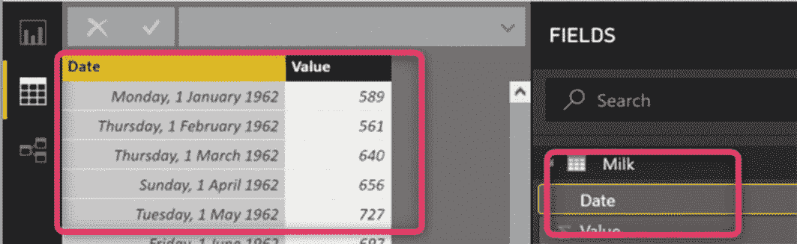

图 4-21

牛奶产量数据

现在，我们必须从 Power BI 自定义可视化对象中导入自定义可视化对象，以预测牛奶产量（图 4-22）。

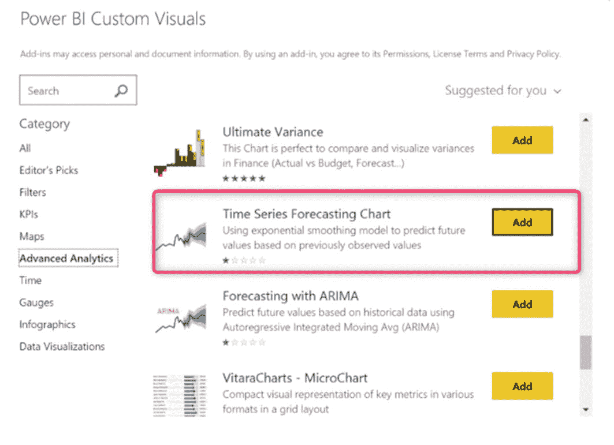

图 4-22

高级分析时间序列自定义可视化对象

导入自定义可视化对象后，您会看到它已添加到标准可视化面板中（图 4-23）。

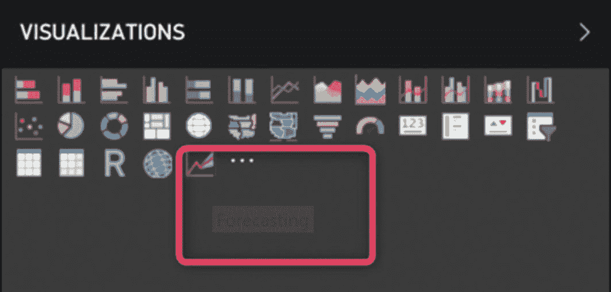

图 4-23

预测自定义可视化对象

导入预测自定义可视化对象后，我们现在必须为数据字段选择日期和值。

此自定义可视化对象使用指数平滑算法来预测未来十个月的牛奶产量（图 4-24）。

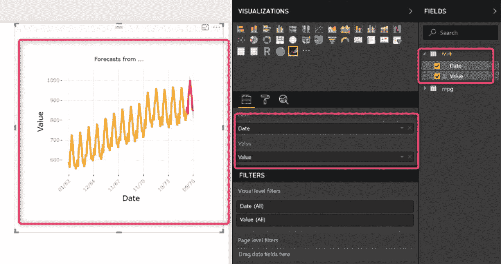

图 4-24

预测牛奶产量

预测图表中，黄色部分表示前几个月的实际牛奶产量数据，红色部分表示后十个月的预测数据。

背后的算法是不可访问的，我们只能更改参数（图 4-25）。

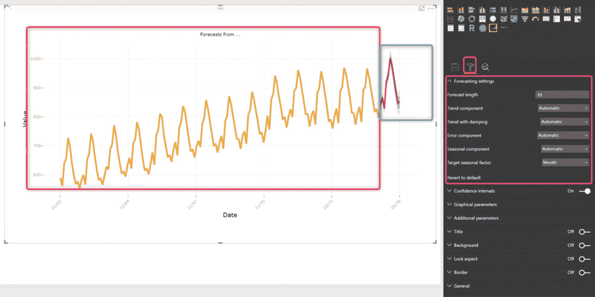

图 4-25

预测未来十个月的牛奶产量

Power BI 中的自定义可视化对象扩展了使用不同图表的可能性。然而，由微软团队创建的自定义可视化对象数量是有限的。为了扩展可视化能力，有一种方法可以通过使用 R 脚本来创建自定义可视化对象。在下一节中，我将解释创建自定义可视化对象的过程。


### 创建自定义视觉对象

Power BI Desktop 中的一些主要 Power BI 标准视觉对象被广泛使用。然而，如前一节所述，可以通过自定义视觉对象来扩展这些功能。要访问自定义视觉对象，您必须在 Power BI Desktop 中单击“市场”。有两种方法可以使用 Java 脚本或 R 代码创建自定义视觉对象。

我将简要解释使用 R 代码创建自定义视觉对象的过程。

1.  第一步是从 [`https://nodejs.org/`](https://nodejs.org/) 安装 NodeJS。

2.  接下来，使用命令提示符安装 Power BI 视觉对象工具（图 4-26）：

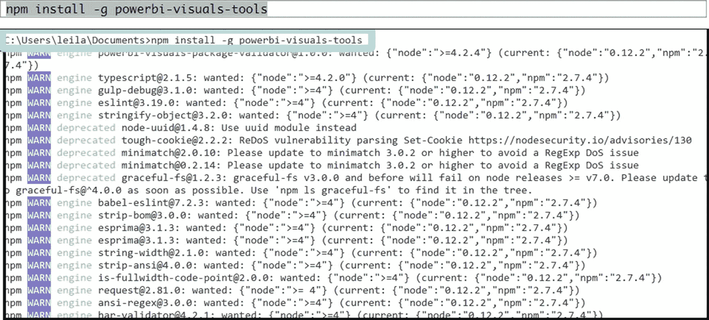

图 4-26

通过命令提示符安装 Power BI 自定义视觉对象

```
npm install -g powerbi-visuals-tools
```

1.  安装 Power BI 自定义视觉对象后，为确保它们已正确安装，我们必须运行 `pbiviz` 命令。运行此命令后，Power BI 自定义视觉对象工具的相关信息将显示在命令提示符控制台中（图 4-27）。

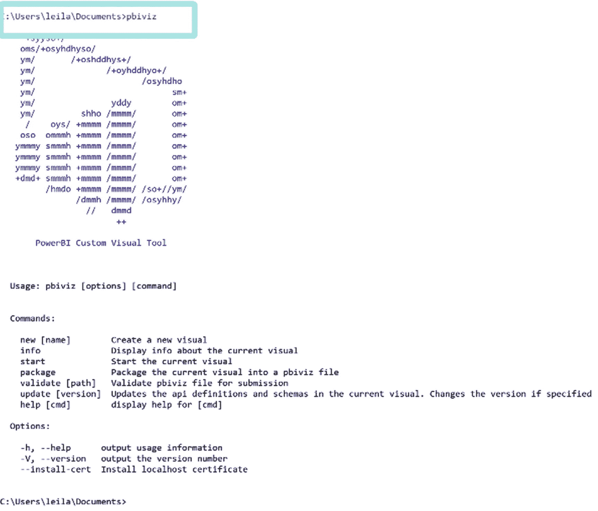

图 4-27

确认 Power BI 自定义视觉对象

2.  接下来，我们必须创建一个 `rhtml` 模板。要创建模板文件夹，我们首先必须在 C 盘中创建一个空文件夹。在 C 盘中创建一个名为 `CustomVisual` 的新文件夹后，然后，使用命令提示符，我们必须将目录更改为 `C:\ CustomVisual`。在命令提示符中，我们运行以下代码：

```
pbiviz new sampleRHTMLVisual -t rhtml
```

通过运行该代码，将在 `CustomVisual` 文件夹中创建一个名为 `sampleRHTMLVisual` 的文件夹。在此文件夹中，有一个名为 `script.r` 的 R 文件（图 4-28）。

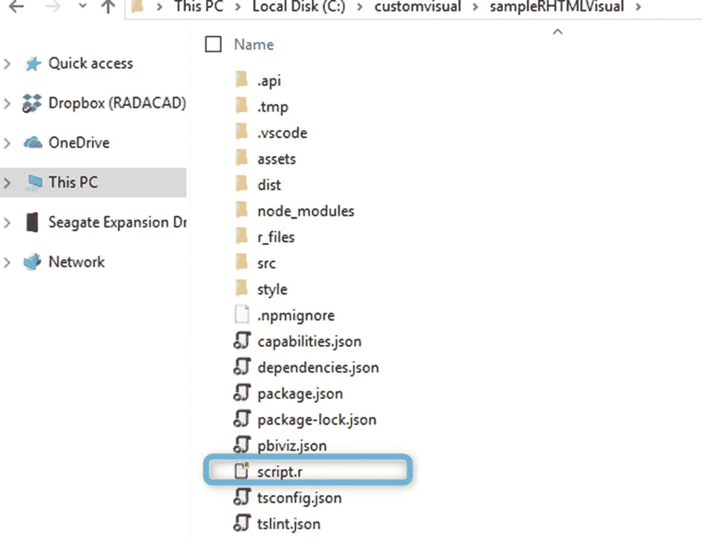

图 4-28

自定义视觉对象的示例文件夹

这是一个提供模板的文件夹，用于创建其他 R 自定义视觉对象。检查文件夹内的 `script. R` 文件（图 4-29）。

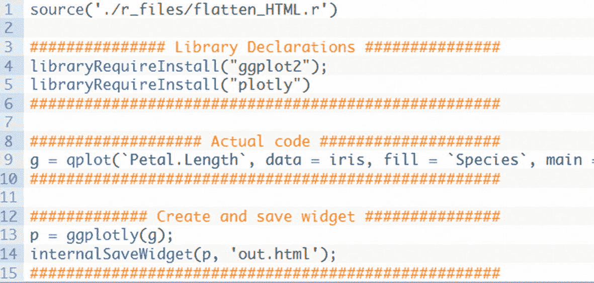

图 4-29

脚本文件中的 R 代码

现在，如图 4-29 中的代码所示，我们需要两个库，Plotly 和 ggplot2，以便使用 Plotly 绘制一个简单的 ggplot2 图表。

这里，数据集已硬编码为 `iris`，这是 R 中的一个开源数据集。该图从 `iris` 数据集中获取数据，并显示花瓣、长度和花的种类。然后我们使用 `ggplotly` 函数来显示数据。

因此，我们有了一个 R 脚本。现在我将首先从中创建一个包，然后编写我的代码来创建不同的图表。因此，我返回命令提示符，并在该文件夹中键入 `pbiviz package`（图 4-30）。

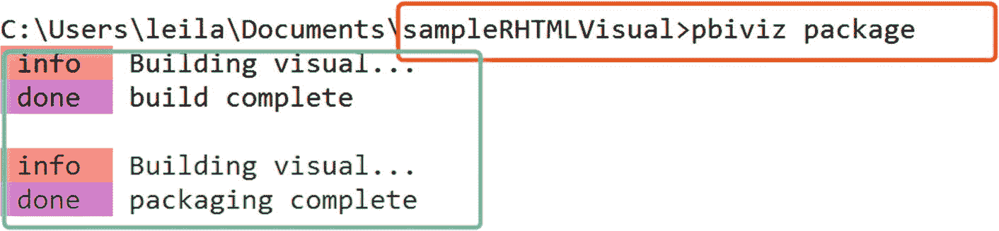

图 4-30

在命令提示符中创建自定义视觉对象

1.  在 Power BI 文件中打开自定义视觉对象。为此，我们必须选择“可视化”标准面板中的“从文件导入”选项（图 4-31）。

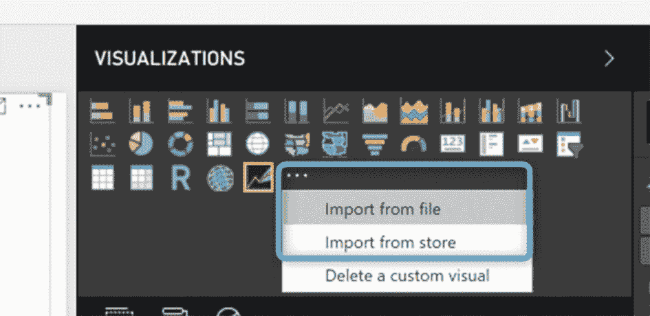

图 4-31

将自定义视觉对象导入 Power BI

2.  选择“从文件导入”选项后，我们必须浏览 `sampleRHTMLVisual` 文件夹并查找 `dist` 文件夹。在此文件夹中，有一个以文件夹名称命名的 `pbiviz` 文件。我们必须将此文件导入 Power BI 可视化面板（图 4-32）。

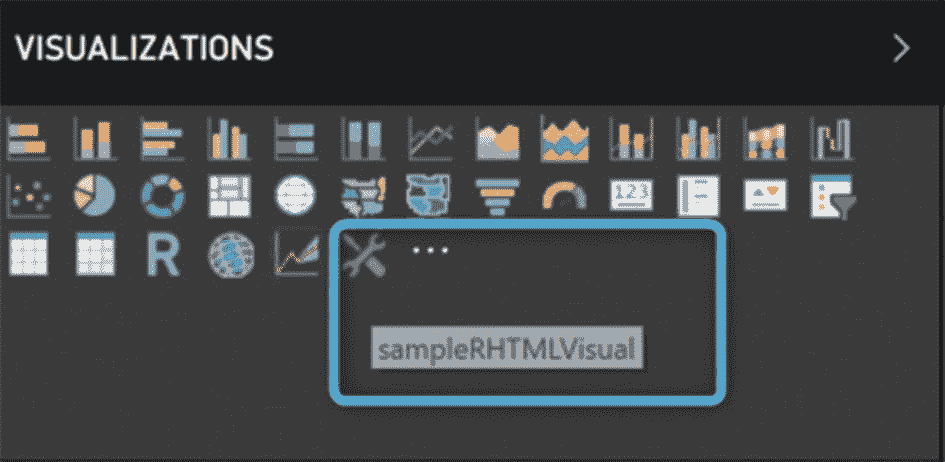

图 4-32

已导入的自定义视觉对象

3.  最后一步是将自定义视觉对象拖放到 Power BI 报表区域（图 4-33）。该视觉对象与特定数据无关。

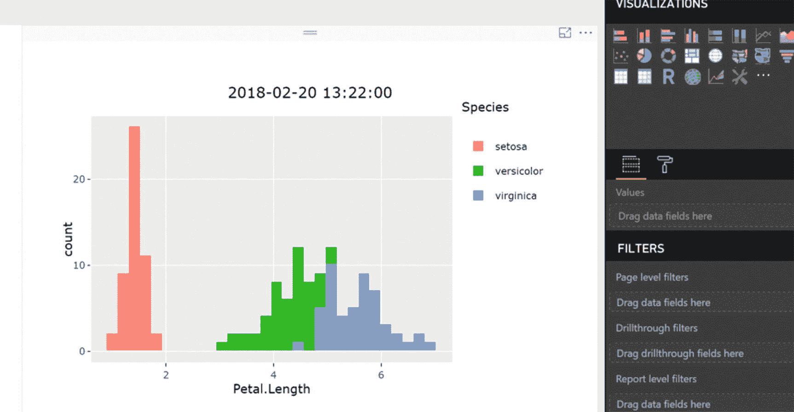

图 4-33

带有 R 代码的自定义视觉对象

我们可以更改 R 代码，并使用不同的名称和图标创建自定义视觉对象。在另一个示例中，我将创建一个表格图表。（我已在本章前面解释过相关的 R 代码。）

首先，我们必须返回到我们从示例 Power BI 包中获得的 `sampleRHTMLVisual` 文件夹，然后复制该文件夹，以创建一个新的自定义视觉对象。我们将文件夹名称更改为 `TableChart`。这里有一个 `pbiviz` 文件，其中包含自定义视觉对象的名称、图标等信息。我们必须更改 `pbiviz.json` 文件的内容。

1.  将自定义视觉对象的名称更改为“TableChart”。

2.  为自定义视觉对象创建一个尺寸为 20×20 的图标，并将其放入 `assets` 文件夹中。

3.  更改 JSON 文件中图标的地址（图 4-34）。

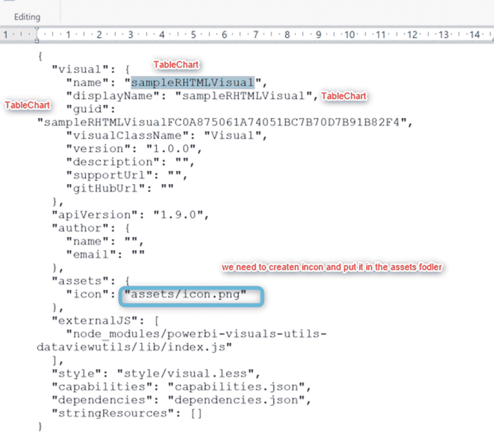

图 4-34

必须更改 JSON 文件名

4.  更改名称并为自定义视觉对象创建新图标后，我们必须保存 JSON 文件，并将创建的图标放入 `assets` 文件夹中。

5.  接下来，我们必须更改 `scripts. R` 文件中的 R 脚本。在 `actual code` 部分，将现有代码替换为以下代码。

```
    if(ncol(Values)==5)
    {
    names(Values)[1]<-paste("X")
    names(Values)[2]<-paste("Y")
    names(Values)[3]<-paste("Z")
    names(Values)[4]<-paste("W")
    names(Values)[5]<-paste("M")
    g=ggplot(Values,aes(x=X,y=Y,color=Z))+geom_jitter()+facet_grid( M ~  W,scales = "free")
    }
    ```

6.  保存文件。

7.  我们现在必须返回到命令提示符环境，并将目录更改为 `sampleRHTMLVisual` 文件夹，通过键入 `pbiviz package`（图 4-35）。

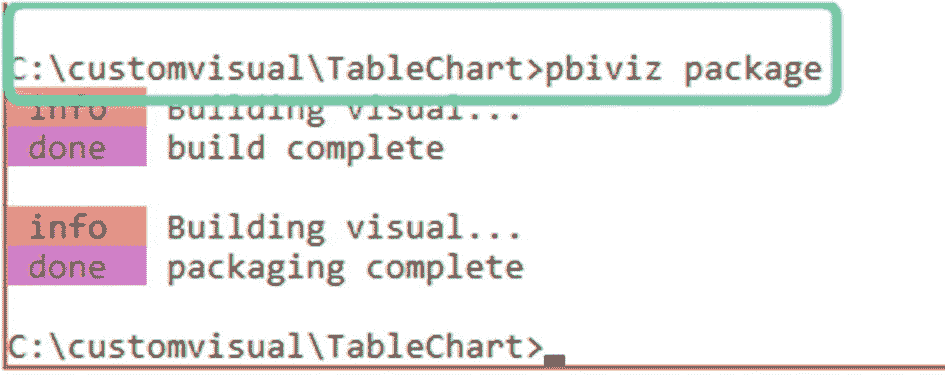

图 4-35

命令提示符中的 `pbiviz` 命令

8.  运行代码后，我们应该能够在 `dist` 文件夹中看到一个名为 `TableChart` 的新 `pbiviz` 文件（图 4-36）。

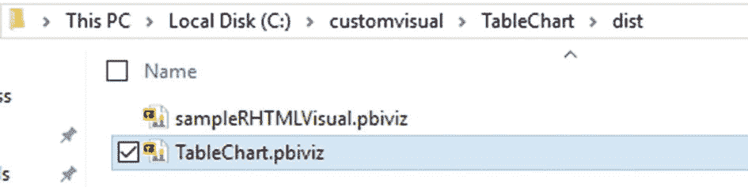

图 4-36

表格图表的自定义视觉对象

9.  最后，我们必须将创建的自定义视觉对象导入 Power BI Desktop，并将数据字段传递给该视觉对象。

如前所述，我们必须更改代码，如下所示：

```
if(ncol(Values)==5)
{
names(Values)[1]<-paste("X")
names(Values)[2]<-paste("Y")
names(Values)[3]<-paste("Z")
names(Values)[4]<-paste("W")
names(Values)[5]<-paste("M")
g=ggplot(Values,aes(x=X,y=Y,color=Z))+geom_jitter()+facet_grid( M ~  W,scales = "free")
}
```

主要数据集是 `Values`。`Values` 数据集中的第一项与 x 轴相关，第二项与 y 轴相关，依此类推。

因此，在 Power BI Desktop 中，请注意您在 R 代码中指定的轴。


如图 4-37 所示，导入的视觉对象包含名称和图标。此外，在数据字段中，我们将 `Values` 作为主数据集，并且我们放入其中的变量顺序与为每个变量指定的代码一致。例如，`cty` 字段将位于 x 轴上，`hwy` 位于 y 轴上（第二个值），以此类推。

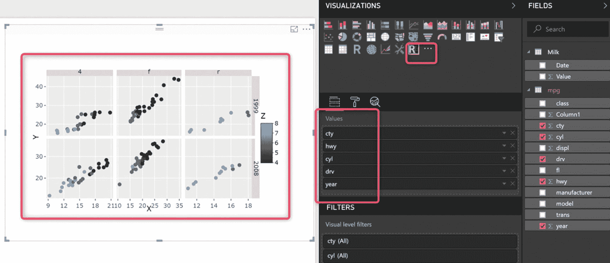

图 4-37

具有特定 R 代码、名称和图标的自定义视觉对象

可以更改 `Value` 字段，使其拥有独立的 x、y、图例、行和列数据字段。这可以通过 `capabilities.JSON` 实现。有关如何更改数据字段以及如何添加更多设置的更多信息，可通过其他 Microsoft 来源和 RADACAD 网站获取。

## 总结

本章解释了如何设置 Power BI Desktop 以编写 R 代码。还描述了如何在 Power BI 内部使用 R 包（例如 ggplot2 和 Plotly）绘制简单图表。简要介绍了 Power BI 中可用于高级分析的自定义视觉对象。最后，简要介绍了如何通过编写 R 和 JSON 脚本来创建 R 自定义视觉对象的过程。下一章将解释企业在开始机器学习之前需要理解的主要概念。

## 参考

1.  Dr. Abela，《极致演示™方法：复杂信息的高效沟通》，“选择恰当的图表”，[`http://extremepresentation.typepad.com/blog/2006/09/choosing_a_good.html`](http://extremepresentation.typepad.com/blog/2006/09/choosing_a_good.html)，2006 年 9 月 6 日。

