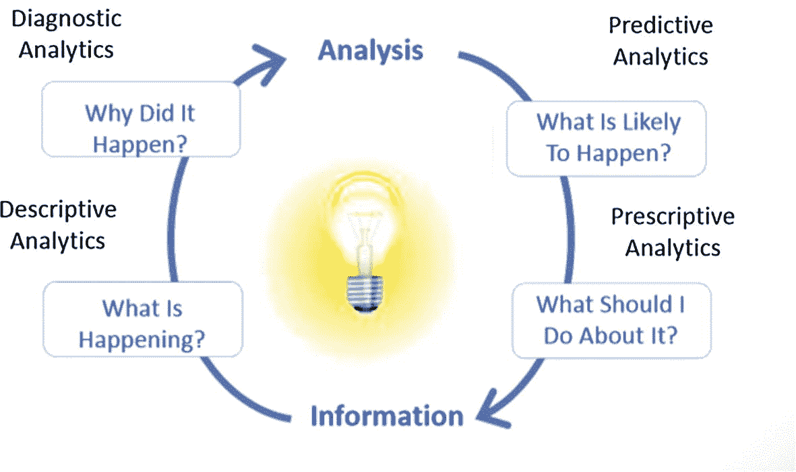
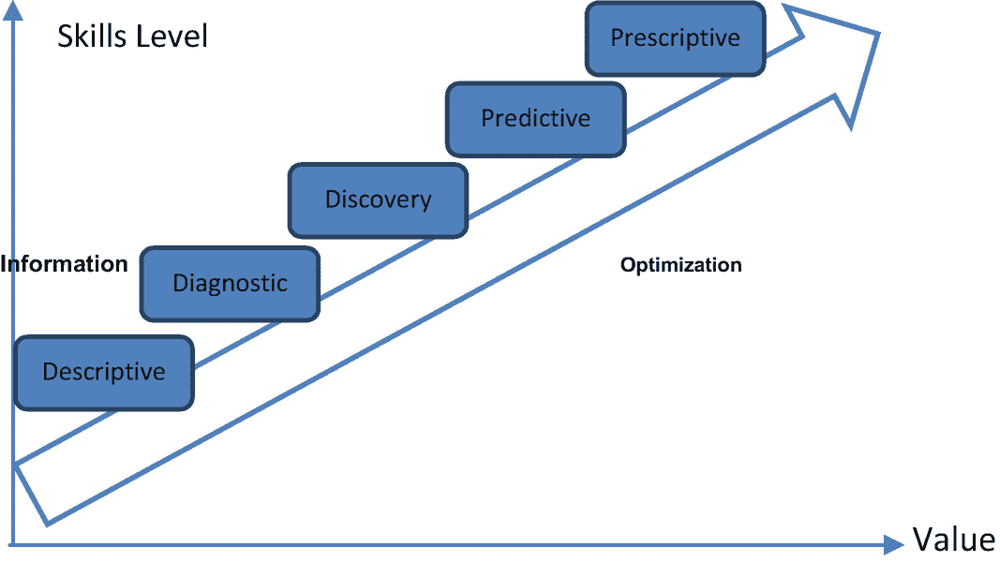
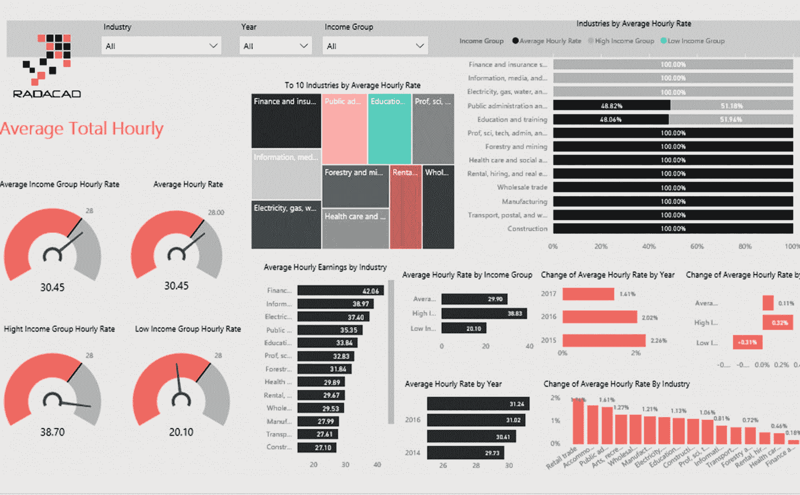
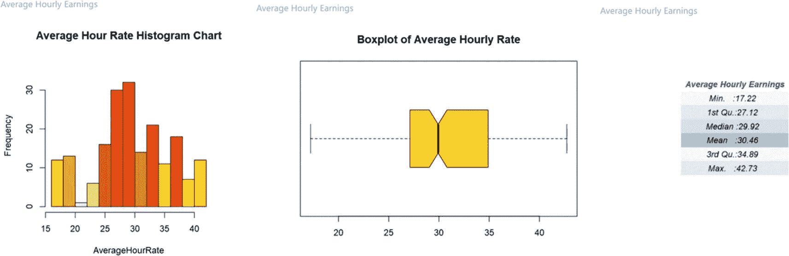
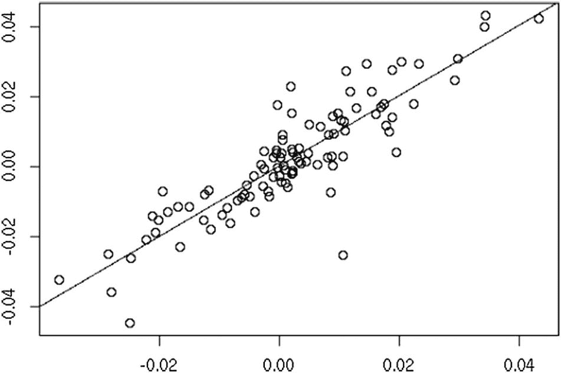
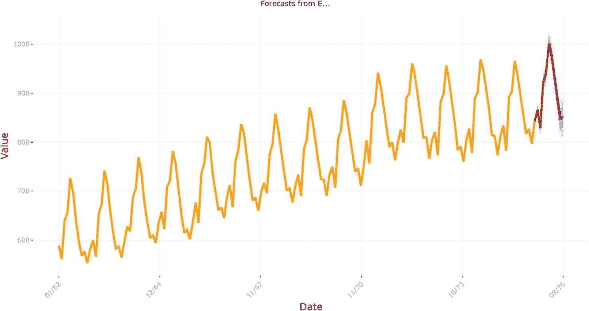
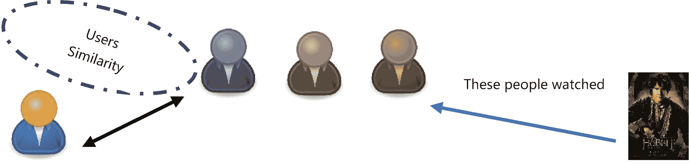
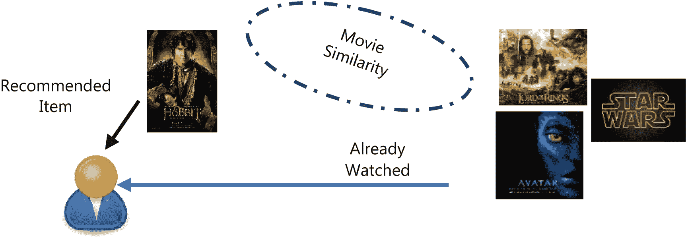

# 5. 业务理解

业务理解是在任何平台或语言中开展机器学习的主要且首要的步骤。并非所有业务问题都能通过机器学习方法解决。机器学习分为几个基本类别，包括监督学习和无监督学习。

监督学习是指输入和输出变量都已确定的情况。无监督学习是指只有输入数据，而没有相应输出变量的情况。

另一种机器学习分类由三大类组成：

*   描述性分析
*   预测性分析
*   规范性分析

描述性分析主要使用无监督学习方法进行总结、分类和提取规则，以回答已经发生的事情。预测性分析是关于基于过去数据进行预测的机器学习方法。最后，规范性分析使用优化和推荐算法来最大化预期结果。

然而，还有其他分析类型，例如诊断分析，也有助于更好地理解业务。根据 Gartner [1] 的说法，这四种分析方法有助于组织中的决策者做出更好的决策。

这些方法中的每一种（图 5-1）都能为公司提供一些价值，并且实施它们需要一定程度的技能。描述性分析是最简单的方法。它不需要高水平的技能，并且可以使用不同的工具完成。诊断和发现分析能提供对数据更深入的洞察，并且需要更高的技能。

图 5-1

分析与信息 [1]

如图 5-2 所示，接下来的两种分析，即预测性分析和规范性分析，能提供对数据更深入的洞察，更好地理解未来可能发生的事情，此外还能提供一些规范性建议。这些分析为公司带来的价值比其他三种分析更大，并且它们需要更高的技能水平。

图 5-2

高级分析 [1]

在本章中，我将解释每种分析类型的主要概念，以及我们可以针对每种分析采取的不同方法。

## 描述性分析

描述性分析是理解数据和现有模式的主要方法。描述性分析可用于理解数据的结构、现有规则或数据中的模式等。描述性分析可分为三大类。

*   运营报告
*   统计分析
*   数据挖掘方法

运营报告主要是侧重于分析过去数据的传统报告。这些报告主要用于判断公司的绩效。图 5-3 展示了这样一份报告，说明了不同行业和收入群体的平均总小时工资率。

图 5-3

使用 Power BI 生成的每小时平均总工资报告

这份报告简要描述了不同行业工人的小时工资率。其他类型的报告则涉及数据的统计事实。

统计分析是进行描述性分析的另一种方式，它使我们能够更好地理解数据的统计行为。统计分析有多种类型，例如单变量分析，其中每一列数据被单独考虑，例如数据摘要和数据分布（图 5-4）。从上图可以看出，员工的平均小时工资率以直方图的形式呈现，以显示其分布。此外，我们还可以看到最小值、最大值和平均分布。这些数据的中位数以箱线图或表格形式绘制。箱线图显示数据在中位数（中点）处分布平滑，这与数据平均值相同。

图 5-4

统计分析——单变量分析

其他形式的统计分析涉及两个不同数据列之间的双变量相关性和回归。

另一种形式是关于寻找规则、数据的自然聚类和现有模式，这可以通过数据挖掘方法（在第 8 章中简要说明）来完成。在第 8 章中，我将解释一些旨在进行描述性分析的算法（如聚类、购物篮分析和决策树）的代码和概念。

## 预测分析

另一种与机器学习相关的分析类型是预测分析。预测分析属于监督学习，意味着我们希望从过去的数据中学习，以预测未来的趋势。预测分析基于某种概率来预测未来。没有任何方法能以 100%的概率预测未来。预测分析主要基于统计学的概率。我们可以将预测分析分为两种主要方法：

*   回归

*   分类

回归方法预测一个数值，例如，未来三个月的销售额，或未来三年网站关注者的数量。

分类分析则关注对群体进行预测。分类预测某个人或事物属于哪个或哪些类别。例如，在分析客户流失问题时，分类分析可以预测一个新客户属于可能离开还是留下的群体。

对于回归和分类这两种方法，都有许多相关的算法可以帮助我们。在第 7 章中，我们将探讨其中一些算法。

对于回归分析，有几种相关的算法，例如线性回归、逻辑回归、多项式回归、逐步回归、岭回归、套索回归和弹性网络回归。此外，还有一些其他技术，如神经网络、决策树等（图 5-5）。

图 5-5

回归分析 [2]

对于分类分析，也有许多相关算法，包括支持向量机（SVM）、决策树和 K 近邻（KNN）（参见第 7 章）。第 7 章将介绍一个使用 Power BI 进行分类分析的示例。

时间序列预测是预测分析的一个子领域，与回归算法有一些相似之处。时间序列分析预测的值是基于时间的。时间序列数据可能与趋势和/或季节性相关（图 5-6）。

图 5-6

牛奶产量的时间序列预测

## 规范分析

规范分析是关于推荐系统的。推荐系统预测用户对某个项目的评分或偏好。推荐系统可以分为两大类：

图 5-8

协同过滤 [4]

*   *基于内容的系统*：这些系统寻找项目之间的相似性。基于内容的推荐系统分析项目描述，并推荐与用户兴趣相似度更高的项目 [3]。例如，如果我们想向客户推荐新电影，基于内容的过滤会检查新提供的电影与客户已看过的电影之间的相似性（图 5-7）。

    

    图 5-7

    基于内容的过滤

*   *协同过滤*：这种方法用于根据相似用户对项目的喜好来推荐项目（图 5-8）。

## 业务理解

如前所述，业务理解是关于确定我们可以将业务问题归入哪个类别。重要的是，要确定我们的问题适合特定的类别，例如预测分析、描述性分析或规范分析。业务理解需要与业务专家和业务利益相关者进行互动。此外，我们要解决的业务问题会影响算法选择过程、数据收集和数据清洗。第 6 章至第 8 章提供了一些针对不同业务问题的机器学习示例。

## 总结

本章简要介绍了不同的数据分析和机器学习方法，包括描述性分析、预测分析和规范分析。Power BI 是一个全面的数据驱动分析工具，为进行任何高级分析提供了基础设施。在下一章中，我将讨论如何在 Power BI 中使用 R 进行数据整理。

