# 6. 预测分析的数据整理

在机器学习过程中，业务理解之后，下一步是收集正确的数据、特征选择和数据整理。数据整理包括数据清洗、连接不同数据源、质量控制、数据集成、数据转换和数据缩减过程（图 6-1）。

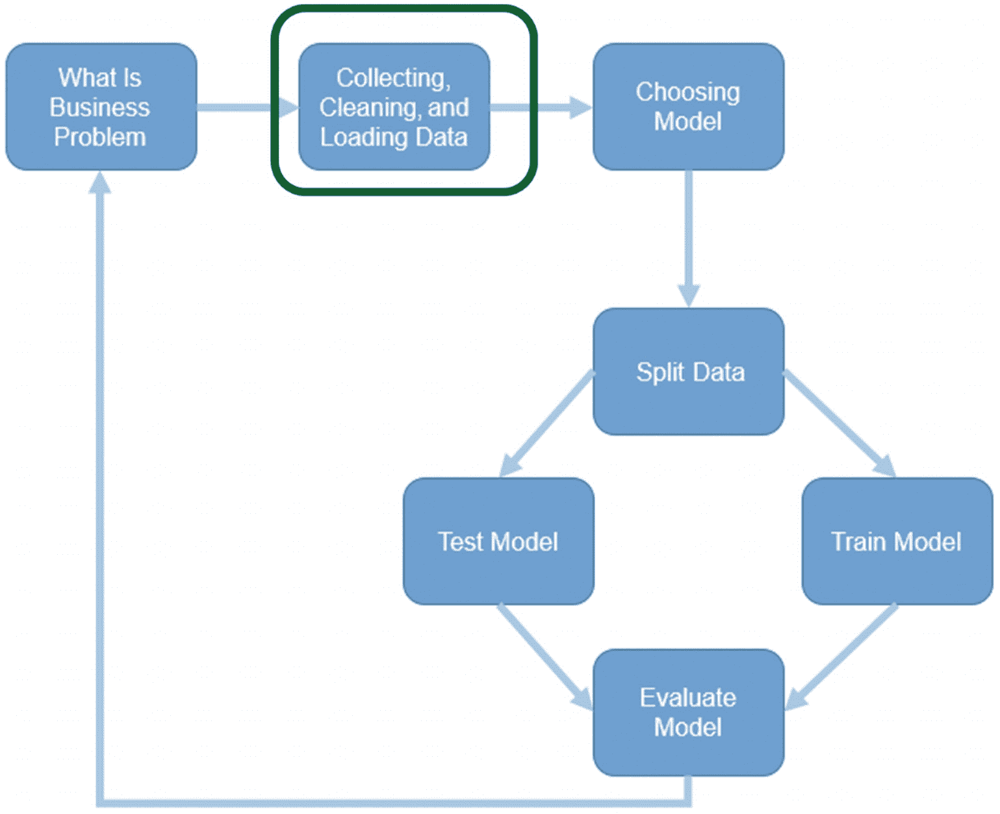
图 6-1

在本章中，我将向您展示如何在 Power BI Desktop 查询编辑器内执行数据清洗。将简要介绍 `Power Query` 编辑器，包括如何从不同资源导入数据，如何使用 `Power Query` 编辑器进行数据清洗，以及如何在其中编写 R 脚本。

## Power Query 编辑器

`Power Query` 编辑器是 Power BI 的数据转换工具。它是一个用于获取数据、数据清洗、数据建模以及编写 M、R 或 Python 脚本的综合工具。要访问 Power BI 中的 `Power Query` 编辑器，您必须单击“编辑查询”图标（图 6-2）。

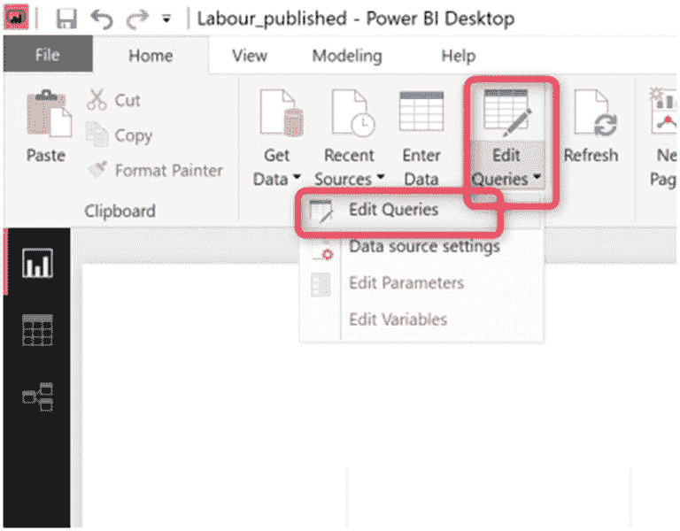
图 6-2

`Power Query` 编辑器提供不同的数据转换选项。您可以从各种不同的资源获取数据，例如 Excel、CSV、XML、JSON、文件夹、SharePoint、SQL Server、SAP、MySQL、Oracle、Azure、Azure Blob、Azure SQL、Azure HDInsight、Google Analytics、Dynamics、Facebook、MailChimp 等（图 6-3）。

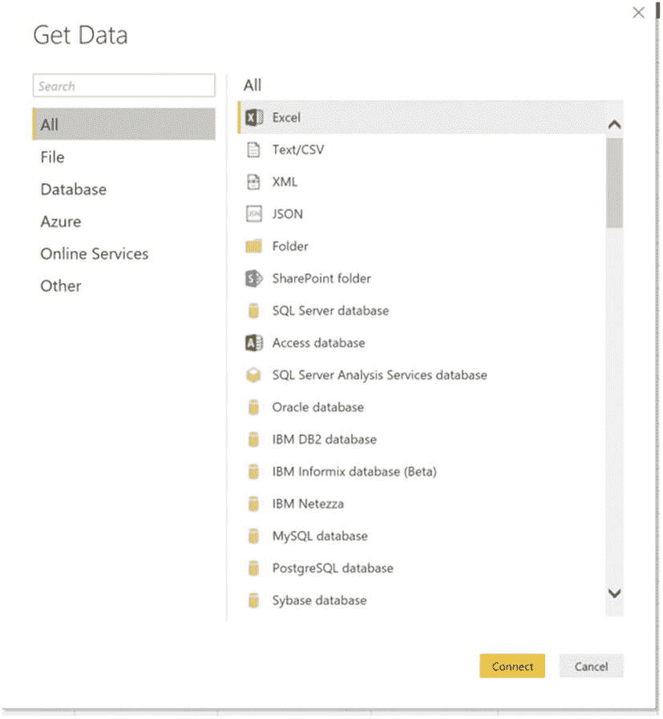
图 6-3

`Power Query` 编辑器有不同的组件。“主页”选项卡包含用于从不同资源获取数据、执行一些简单数据转换的组件，以及用于编写 M 语言的高级编辑器。使用 `Power Query`，我们可以在一个小窗口中查看应用于数据转换的步骤（图 6-4）。

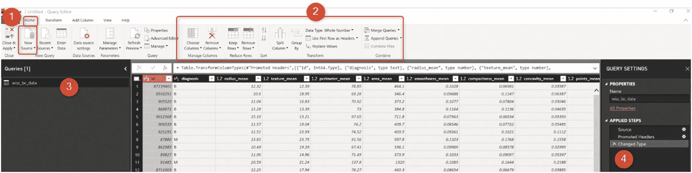
图 6-4

`Power Query` 中的另一个组件是“转换”选项卡。它提供了一些数据转换所需的工具，例如更改日期和时间列、统计转换等（图 6-5）。

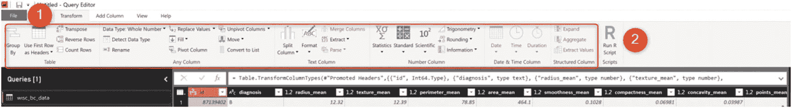
图 6-5

此外，还有一个名为“运行 R 脚本”的组件，允许用户在 `Power Query` 内部编写相关的 R 代码。在下一节中，我将向您展示如何使用 `Power Query` 进行一些旨在进行机器学习和数据分析的数据转换。

## Power Query 中的数据整理

在进行机器学习之前，我们必须经历两个主要过程：数据准备和数据整理。数据准备涉及从资源中收集数据、整合数据并将其加载到一个资源中，类似于 ETL（提取、转换和加载）过程。

数据整理则是在应用层加载数据，并执行数据清洗、格式化和集成。

Python 语言包含一些流行的数据整理过程，例如重塑数据、选择数据和合并数据。

### 重塑数据

重塑数据的主要方法之一是`数据透视`。这涉及将列数据转换为列名，如图 6-6 所示。

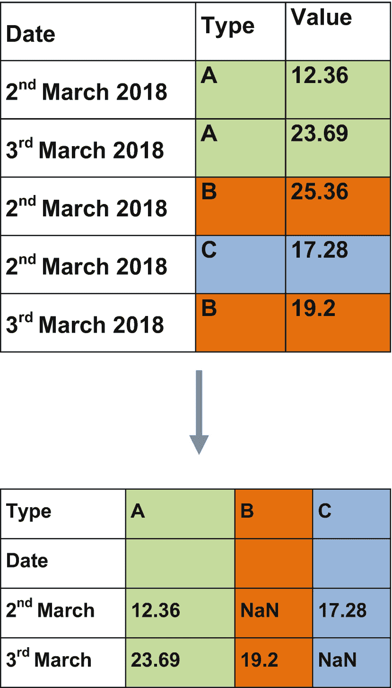
图 6-6

在 Python 中创建数据的相关代码（图 6-7）如下：

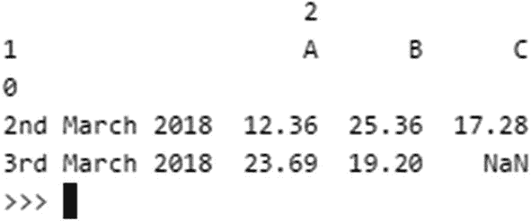
图 6-7

```python
data=[["2nd March 2018","A",12.36], ["3rd March 2018","A",23.69], ["2nd March 2018","B",25.36], ["2nd March 2018","C",17.28], ["3rd March 2018","B",19.2]]
# using package pandas
import pandas as pd
df=pd.DataFrame(data)
# pivot table
df=pd.pivot_table(df,index=[df[0]],columns=df[1])
```

在 R 中，我们可以通过以下代码实现：

```r
install.packages("tidyr")
date=c("2nd March 2018","2nd March 2018","2nd March 2018","2nd March 2018","2nd March 2018")
Type=c("A","A","B","C","B")
index=c(0,1,2,3,4)
Value=c(12.36,23.69,25.36,17.28,19.2)
df=data.frame(index,date,Type,Value)
library("tidyr")
spread(df,Type,Value)
# and the result is the same (a bit different out put)
```

现在，我们将了解如何在 `Power Query` 中无需编写任何代码即可启动此过程。要使用 `Power Query` 进行`数据透视`，我们必须通过使用“输入数据”选项（图 6-8）来输入数据。

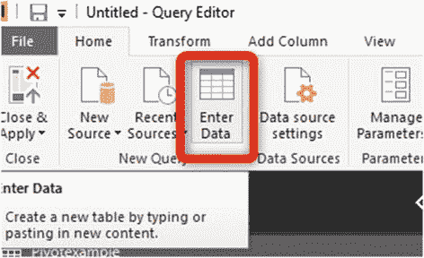
图 6-8

通过单击“输入数据”，我们能够手动将数据放入 `Power Query` 中（图 6-9）。

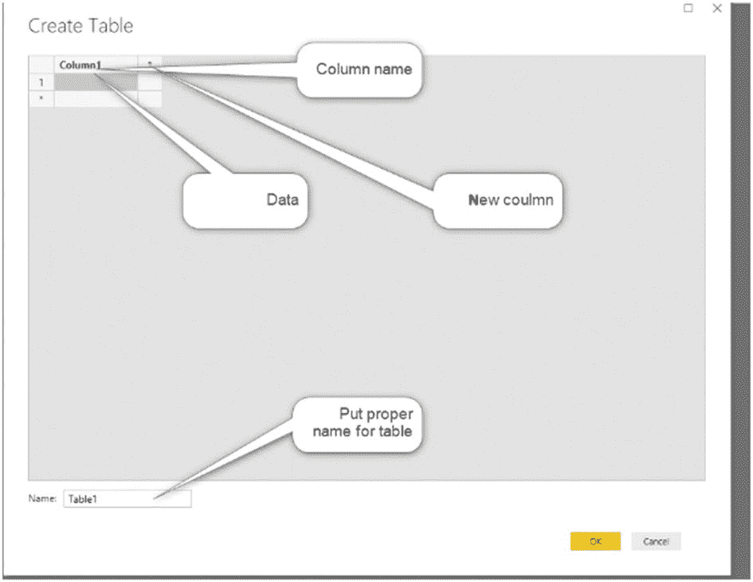
图 6-9

我们拥有与 Python 中相同的数据（图 6-10）。

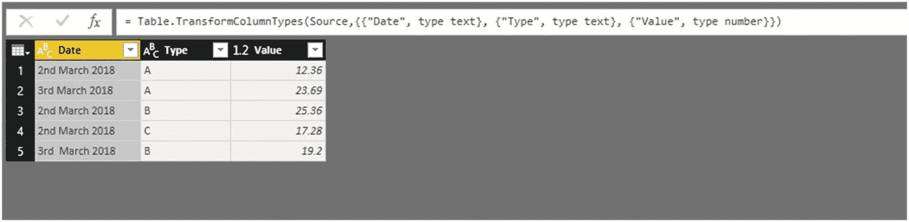
图 6-10

现在我们只需单击“类型”列（图 6-11）。然后在“转换”选项卡下单击“`透视列`”。

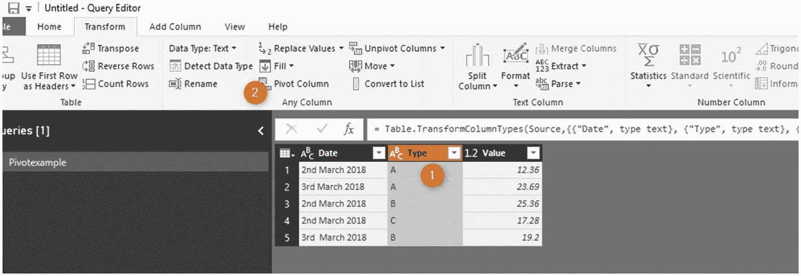
图 6-11

接下来，我们指定要将值放入哪一列以及值的类型（图 6-12）。

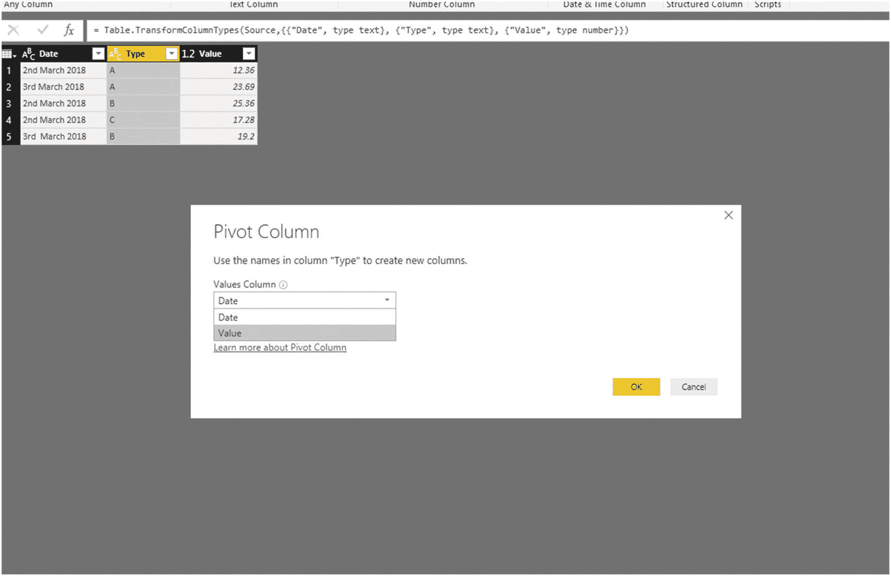
图 6-12

`数据透视`的结果如图 6-13 所示。

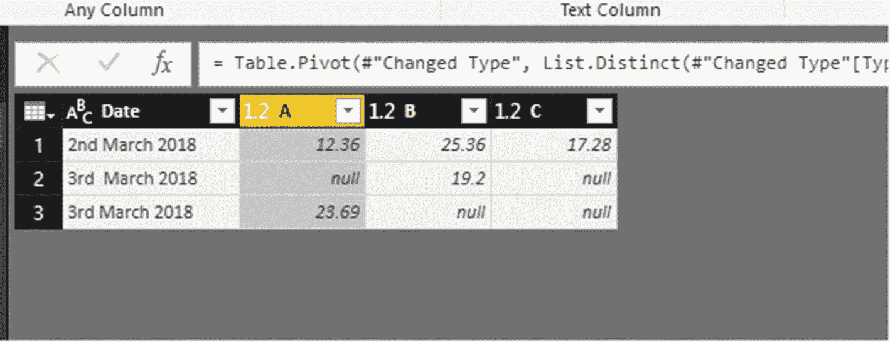
图 6-13

还有其他重塑数据的例子，例如`逆透视`、融合和迭代，这些都可以在 `Power Query` 中完成。此外，在 `Power Query` 中，选择和设置条件来检查数据的过程也可以非常轻松地完成。

### 选择数据

要在 Python 中根据条件选择值，我们使用 `where` 函数，如下所示：

```python
df.where(df[2]>17)
```

在 `df` 数据集中，我们将选择大于 17 的值（图 6-14）。

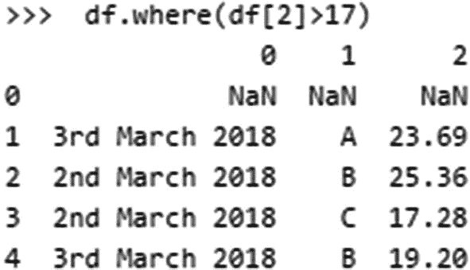
图 6-14

在 Power Query 中，您必须单击要筛选的列，然后选择筛选选项、数字筛选器和“大于或等于”选项（图 6-15）。

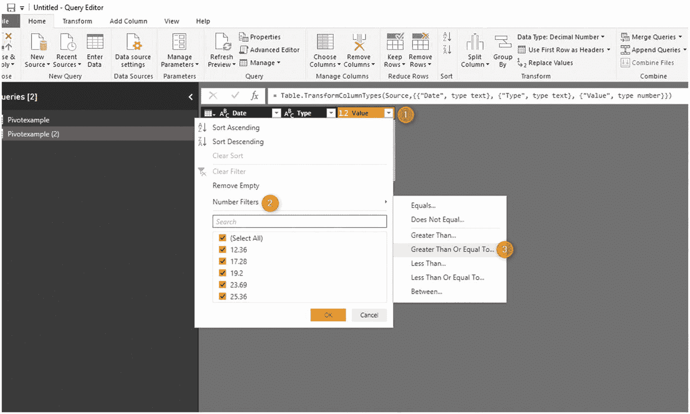
图 6-15 Power Query 选择值

然后，在 Power Query 中，只需将列筛选为 17（图 6-16）。

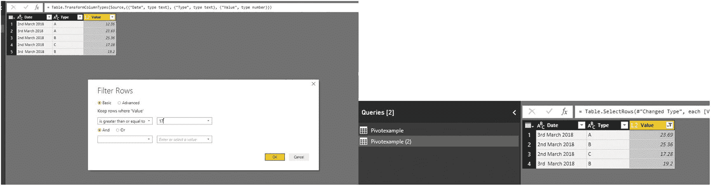
图 6-16 Power Query 筛选值

## 合并数据

另一种流行的数据准备形式是合并数据，例如，连接两个可能来自不同数据源的表。在 Python 中，如果我们想这样做，有一个 `merge` 函数可以用来连接两个不同的数据集。例如，考虑以下数据集：

```
data1=[["a",11],["b",1],["c",99]]
data2=[["a",20],["b",0],["d",21]]
data1=pd.DataFrame(data1)
data1.columns=["Type","Value"]
data2.columns=["Type","Value"]
data2=pd.DataFrame(data2)
merg=pd.merge(data1,data2,how='left',on="Type")
```

如前面的代码所示，我们可以指定连接类型和连接列。我们可以将 `how` 属性更改为 `left`、`right`、`inner` 和 `outer`（图 6-17）。

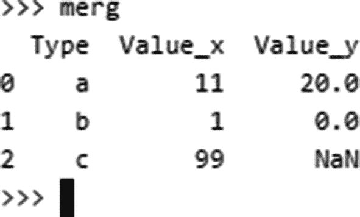
图 6-17 使用 Python 合并数据

同样的过程也可以在 Power Query 中执行。我在 Power Query 中创建了两个不同的数据集 `Data1` 和 `Data2`（图 6-18）。

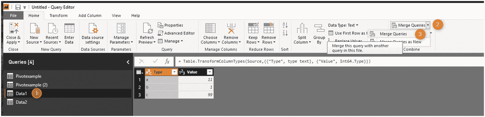
图 6-18 在 Power Query 中创建数据集

创建数据集后，您必须单击“合并”列，以将 `Data1` 与 `Data2` 合并（图 6-18）。

在“合并”窗口中，我们可以指定要基于哪一列进行合并，以及我们感兴趣的合并类型（图 6-19）。

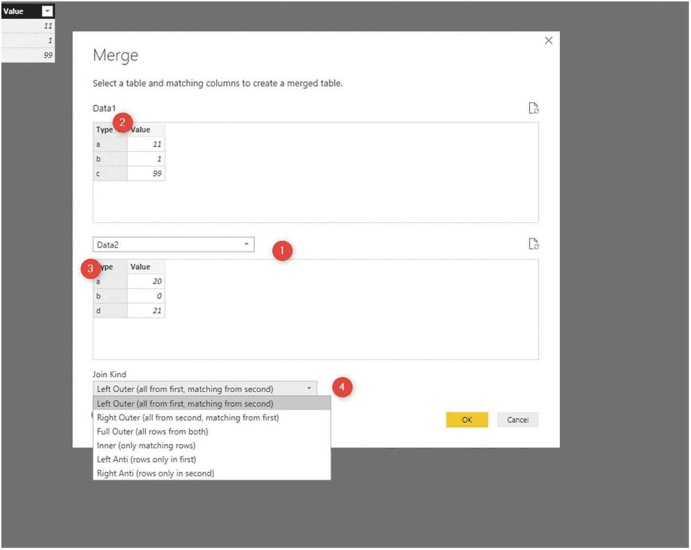
图 6-19 基于“类型”列和左外部连接合并数据

合并后，我们必须指定要向用户显示哪些列（图 6-20）。

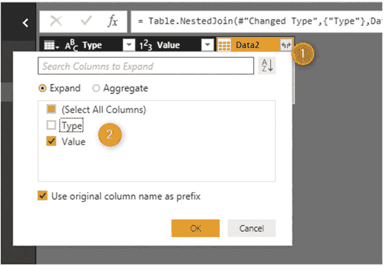
图 6-20 列选择

然后输出就会出现，我们将能够看到结果（图 6-21）。

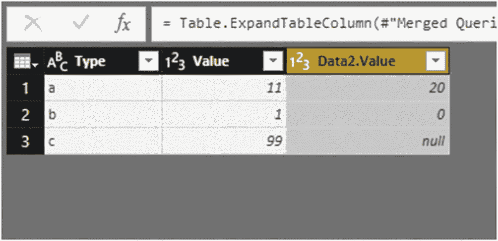
图 6-21 合并 Data1 和 Data2 的结果

这些是您可以在 Power Query 中执行的一些基本数据转换。您还可以使用 Power Query 菜单或 M 或 R 语言执行更复杂的过程。

## 使用 R 脚本进行数据转换

并非所有数据转换都能通过 Power Query 中的现有菜单轻松完成。为了提升数据转换能力，我们可以在 Power Query 内部使用 R 语言。Kaggle 网站（[`https://www.kaggle.com/lbronchal/breast-cancer-dataset-analysis`](https://www.kaggle.com/lbronchal/breast-cancer-dataset-analysis)）上有一个关于女性乳腺癌的数据集。该数据集包含 569 行和 32 列。第一列是患者 ID，第二列是诊断结果。其余列与癌细胞的规格相关。

第 2 列到第 32 列包含一些数值，但这些数值不在同一范围内。例如，“radius_mean”列的值范围是 6.9 到 22，而“compactness_mean”列的值范围是 0.019 到 0.34。还有另一种数据准备过程，称为归一化，用于将数据统一到同一尺度。这个过程对某些算法（如 lKNN）很有用；但并非总是推荐使用（见图 6-22）。

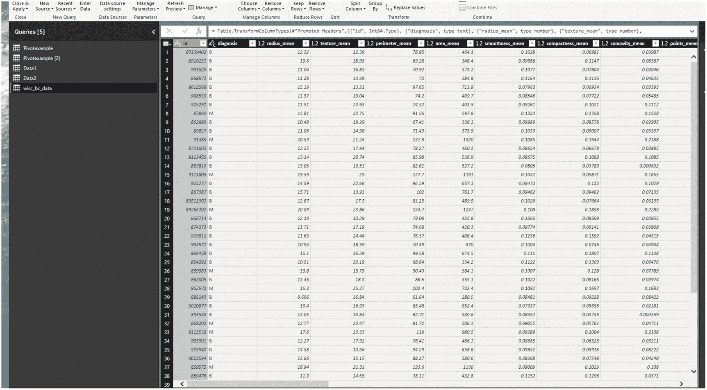
图 6-22 与女性乳腺癌相关的数据集

### 归一化

数据归一化意味着将数据调整到特定范围内，例如 0 到 1。我将使用一种遵循“MinMax”方法的公式来归一化名称。在此示例中，我将把癌症数据集中所有列的数据（患者 ID 和诊断列除外，因为它们包含文本）调整到 0 到 1 的范围内。

首先，对于每一列，我们必须找到最小值和最大值。对于每个值，我们必须按如下公式进行计算：


我们可以使用 Power Query 中的 R 语言将此转换应用于数据。

在 Power Query 中，有一个用于编写 R 代码的选项：运行 R 脚本（图 6-23）。

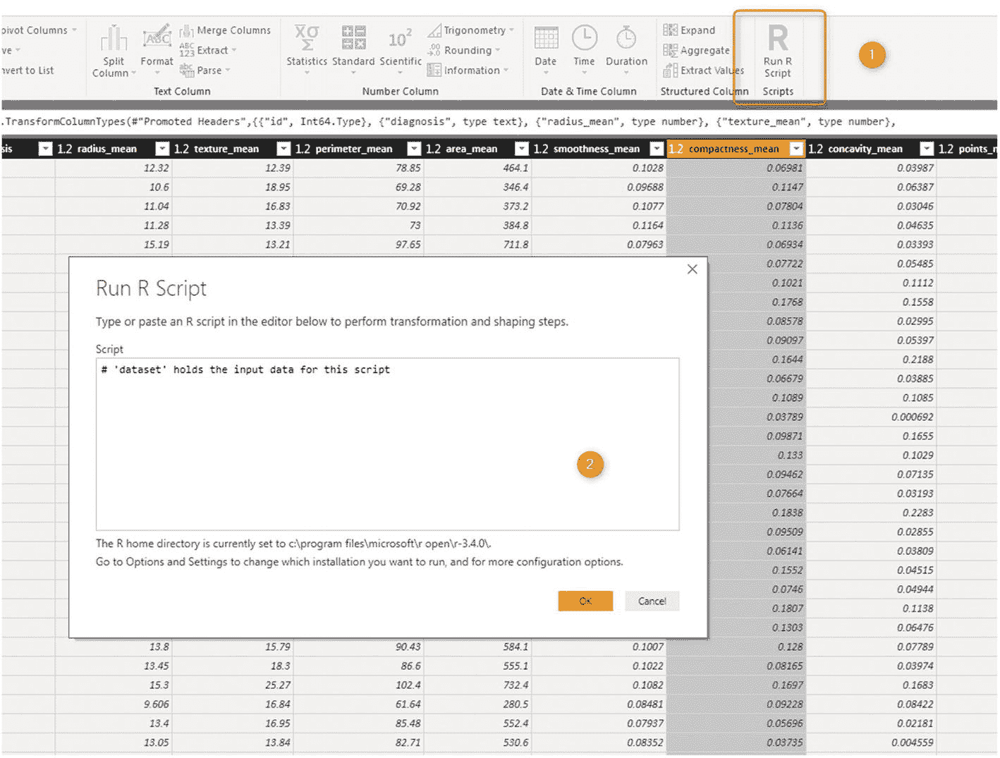
图 6-23 在 Power Query 中运行 R 脚本

“运行 R 脚本”编辑器并非十分高级。您想要转换的数据存储在变量名 `dataset` 下。因此，我们将使用 `dataset` 变量和归一化数据的公式。

在 R 中，我将编写一个函数来放置 MinMax 公式。

```
Normalize<- function (x)
{
return ((x-min(x))/(max(x)-min(x)))
}
```

然后，我必须将此函数应用于数据集。为此，我必须使用 R 中的另一个函数，名为 `lapply`。`lapply` 函数接收数据集和归一化函数的名称。然后，它将函数应用于数据集。在我的示例中，您不需要对第一列和第二列应用 MinMax 归一化，因此只需使用 `dataset[3:32]` 而不是 `dataset`。

```
NormalizedData<-as.data.frame(lapply(dataset[3:32],Normalize))
```

如图 6-24 所示，编写代码后，我们需要按下“确定”按钮。Power Query 将对数据应用归一化转换。

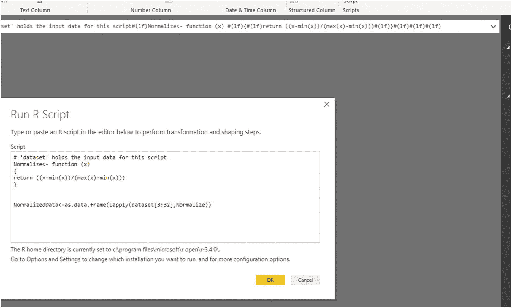
图 6-24 R 脚本编辑器

运行代码后，数据转换的结果如图 6-25 所示。您可以在“运行 R 脚本”中看到已应用的步骤。

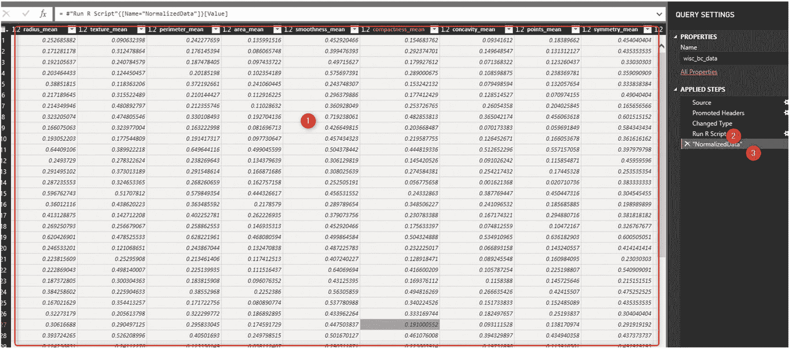
图 6-25 归一化后的数据

## 其他数据转换

还有其他使用 Power Query 转换数据的方法。

### 更改数据类型

要更改 Power Query 中的数据类型，请单击“数据类型”选项并选择正确的数据类型。同样，您也可以通过单击每列旁边的图标来更改数据类型（图 6-26）。

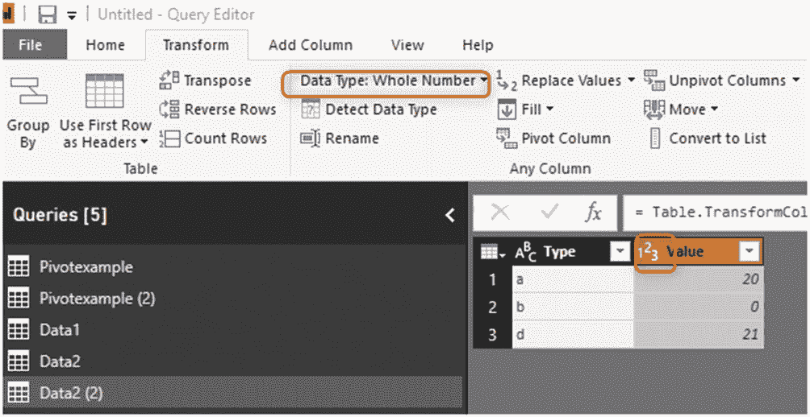
图 6-26 更改数据类型

### 分组依据

在 Power Query 中，我们还可以通过特定的聚合选项对数据进行分组。首先，我们必须单击要按其分组数据的列。然后，我们单击菜单中的“分组依据”图标（图 6-27）。在“分组依据”窗口中，我们在“操作”下选择所需的分组依据选项和聚合类型。接下来，我们选择“求和”作为聚合选项。

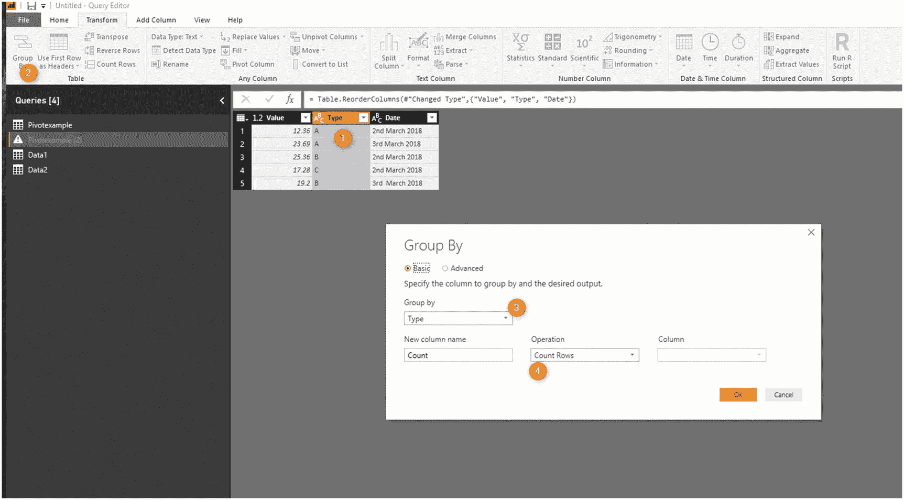
图 6-27

# 使用特定聚合进行分组

最后，数据将按类型值进行分组（图 6-28）。

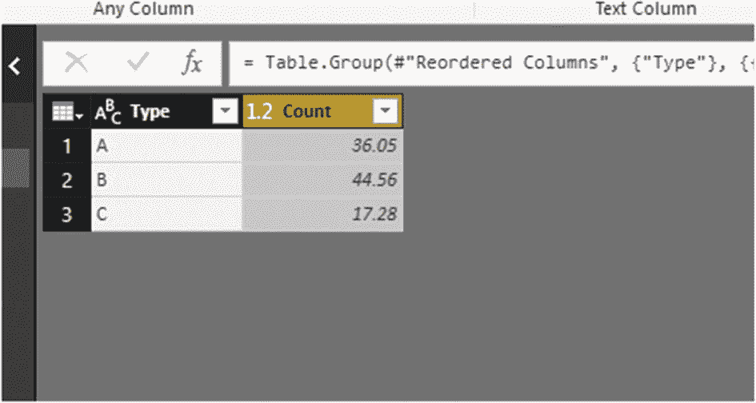
图 6-28

聚合后的结果数据

还有许多其他类型的数据转换，例如基于分隔符拆分列、转置行、更改数据类型、添加日期或时间列、包含一些统计计算、合并列等等。在“添加列”选项卡下，可以添加自定义列、从示例创建列、创建函数、格式化数据列、添加日期、月份、天数、时间等列。此外，还可以使用 M 语言转换数据，但这超出了本书的范围。

## 总结

本章简要介绍了如何在 Power Query 编辑器中使用 R 语言。它解释了我们如何使用它来重塑数据、选择数据、使用 R 代码编写数学函数并将其应用于数据集等。在 Power Query 编辑器中，R 或 Python 还有其他用途，例如使用 R 进行正则表达式处理，或使用 R 和 Python 进行机器学习。下一章将介绍更多在 Power Query 编辑器中使用 R 的示例。