# 7. 在 Power Query 中使用 R 进行预测分析

本章将解释如何通过编写 R 代码在 Power BI Query 编辑器中进行机器学习。主要目的是提供一些示例，说明我们如何使用 R 代码进行预测分析（分类和回归）。将提供与某些算法相关的概念和代码。此外，还将讨论通过 Power BI Query 编辑器中的参数自动化预测的过程。


## 神经网络

我们对计算机的期望是，输入一些内容，然后得到符合需求的输出。科学家们试图通过创造一种智能机器来模仿人脑——一种能够像人类一样进行推理的机器。

人脑最重要的组成部分是神经元。人脑由 7500 万个神经元组成。每个神经元通过突触与其他神经元相连。因此，神经网络中的结构就是一些相互连接的节点。在人体中，如果一个神经元被某些外部因素触发，它就会通过突触将信息从接收节点传递到其他节点（图 7-1）。

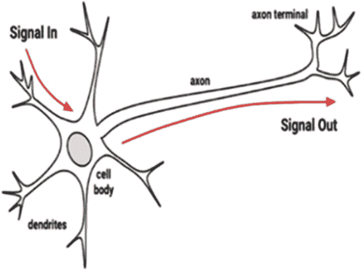

图 7-1

神经系统

神经网络模仿了与人脑相同的概念。一个节点从环境中获取一些输入，然后神经网络模型产生输出，就像计算机系统一样产生结果（图 7-2）。

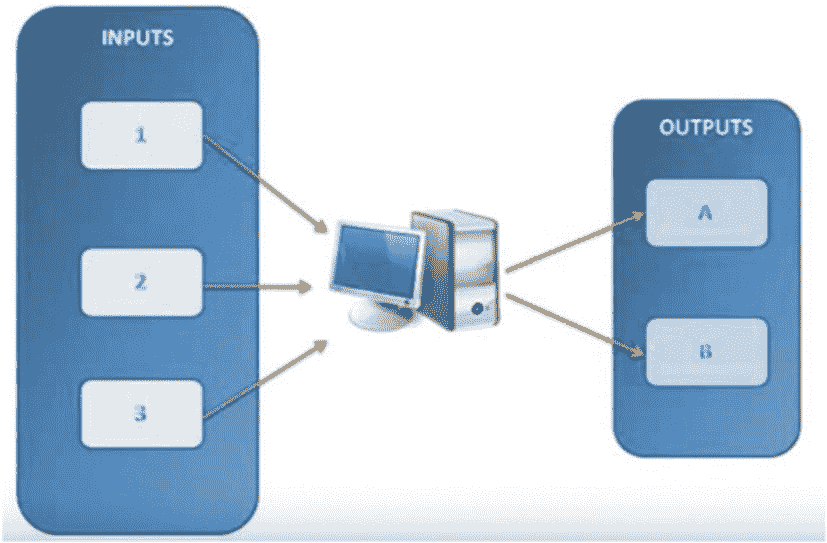

图 7-2

计算机系统架构

在神经网络中，存在：

*   一组输入节点
*   一组输出节点
*   中间的一些处理过程，以获得良好的结果
*   信息流
*   节点之间的连接

某些连接比其他连接更重要，这意味着它们对结果的影响更大。在神经网络中，我们将这种重要性称为连接的*权重*。

另一个能更好地表达神经网络目标的类比是登山后的下山过程。当我们到达山顶且天气有雾时，我们只能看到前方一米。我们必须在一米能见度下决定选择哪个方向。我们根据当前位置迈出第一步，再次决定跟随哪个方向并迈出下一步。因此，每一步我们都在评估路线，并选择下山的最佳方式（图 7-3）。

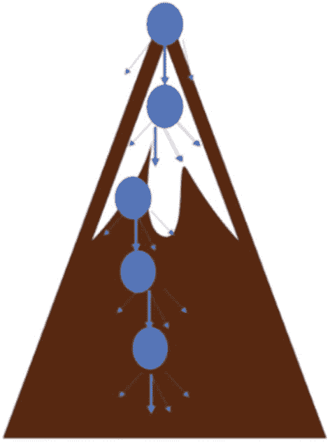

图 7-3

神经网络与登山的类比

每个决策都可以看作是一个节点，它引导我们走向更好、更快的解决方案。在神经网络中，有一些隐藏节点执行主要任务。它们在使用称为激活函数的函数时，为输出找到最佳值。

在本节中，我将引用一个来自 *Machine Learning with R* [1] 的示例。该示例是关于预测混凝土的强度。混凝土已被用于许多不同的结构，例如桥梁、公寓、道路等。为了安全起见，混凝土的强度至关重要。混凝土的强度取决于用于制造它的材料，例如水泥、矿渣、粉煤灰、水等等。我们有一个混凝土成分的数据集（图 7-4）。你可以从“Machine Learning with R datasets” [2] 下载它。

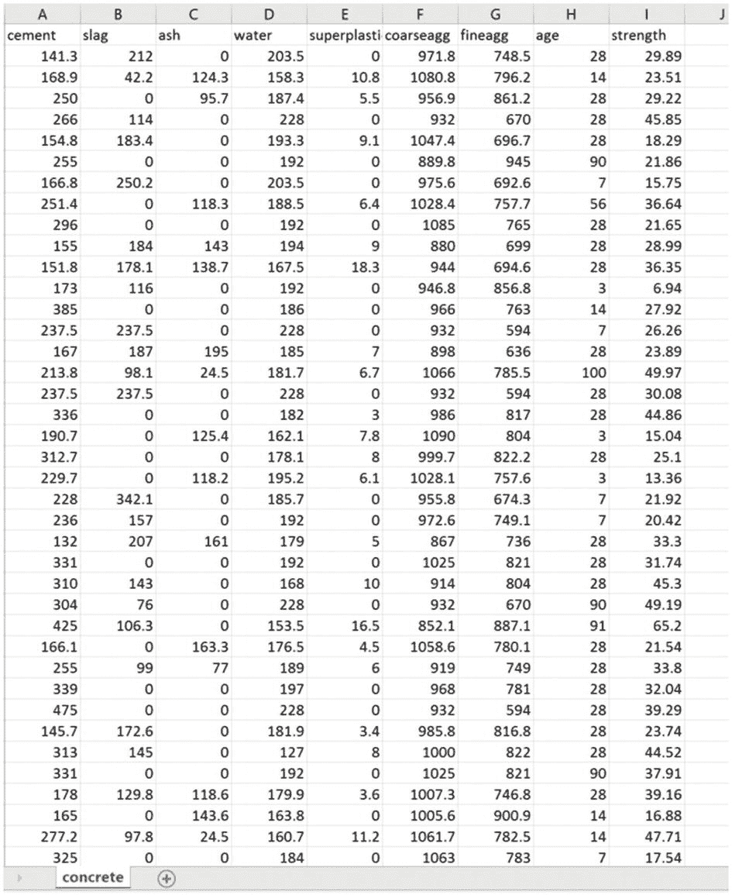

图 7-4

混凝土数据集

神经网络可用于预测一个值或类别，也可用于预测多个事物。在我们的示例中，我们将预测一个值，即混凝土的强度。首先，我们将数据加载到 Power BI 中，并在查询编辑器中编写一些 R 代码。然后我们必须进行一些数据转换（图 7-5）。

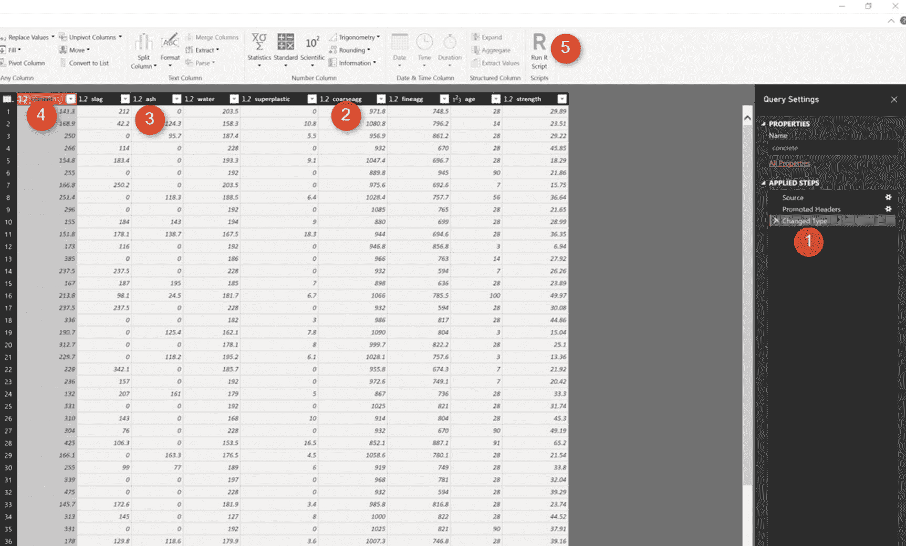

图 7-5

使用 Python 代码进行数据透视

如图 7-5 所示，在标记为 2、3 和 4（红色圆圈内）的部分，数据不在同一尺度上。在应用任何机器学习之前，我们必须进行一些数据归一化。数据归一化的过程在第 6 章中解释。这里使用相同的代码来归一化数据。

```
normalize <- function(x) {
return((x - min(x)) / (max(x) - min(x)))
}
concrete_norm <- as.data.frame(lapply(dataset, normalize))
```

在数据清洗和数据转换之后，我们必须将数据集分成一部分用于训练，一部分用于测试。这个过程帮助模型从数据中学习并模仿数据的行为。因此，我们必须将超过 70% 的数据用于训练，其余用于测试。为了避免偏差，我们必须打乱数据。R 中的 `sample` 函数已被用于为数据集创建随机行号。此外，80% 的数据被放入训练数据集，其余保留用于测试。

```
nrows<-nrow(dataset)
sampledata<-sample(nrows,0.8∗nrows)
concrete_train <- concrete_norm[sampledata,]
concrete_test <- concrete_norm[-sampledata,]
```

在 R 中有许多用于神经网络算法的包和算法。其中一个包是 `neuralnet`。这个包包含一个用于神经网络算法的函数。要使用这个包，我们必须先在 RStudio 中使用 `install.packages()` 安装它。安装包后，我们只需引用 `vis` 包的 `library` 命令。

```
library("neuralnet")
```

下一步是使用训练数据集创建一个训练模型，并确定我们要预测哪一列。

```
concrete_model <- neuralnet(strength ~ cement + slag
+ ash + water + superplastic + coarseagg + fineagg + age,
data = concrete_train)
```

现在模型已创建，我们可以测试其准确性。我们将针对所有八个属性对训练数据集运行该模型。

```
model_results <- compute(concrete_model, concrete_test[1:8])
predicted_strength <- model_results$net.result
```

并且我们必须创建一个输出数据集来展示给用户。

```
output<-dataset[-sampledata,]
output$Pred<-predicted_strength∗100
```

结果将存储在一个数据框结构的输出变量中。另一个重要的考虑因素是，Power Query 只识别 `data.frame` 格式。因此，其他数据结构，如向量、列表和矩阵，无法在 Power Query 编辑器中显示（图 7-6）。

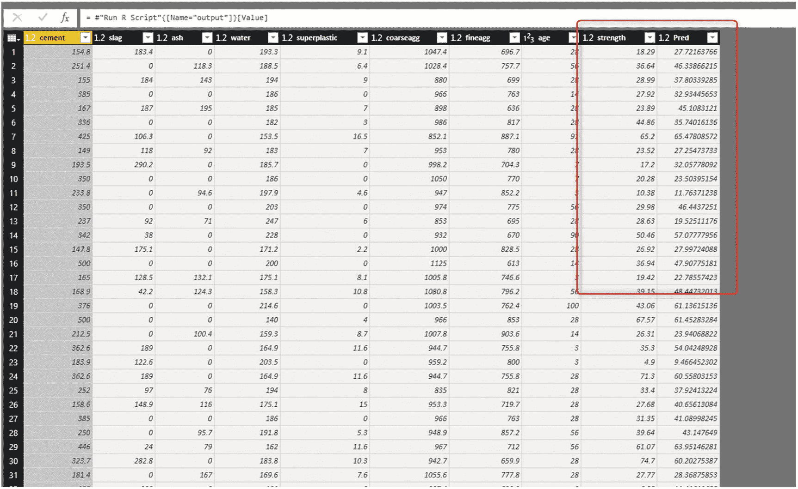

图 7-6

预测结果

可以在可视化区域中查看神经网络结构，以查看隐藏节点、层等。因此，我们必须使用 R 自定义视觉对象，在 Power BI 报表中复制混凝土数据集，如图 7-7 所示。接下来，我们必须编写相同的神经网络预测代码，并添加另一行代码来绘制模型。运行代码，你将看到刚刚出现在图层上的神经网络结构，误差为 3.001。

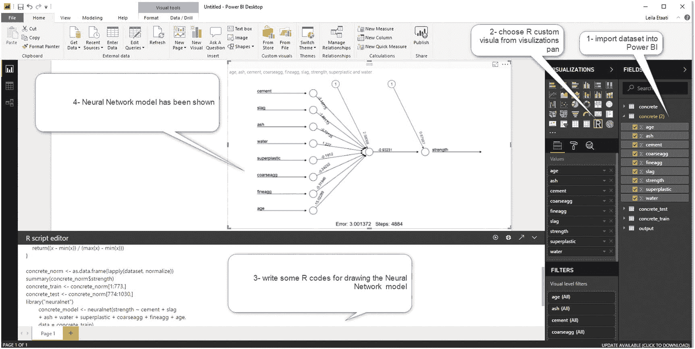

图 7-7

Power BI 报表中的神经网络模型结构

```
normalize <- function(x) {
return((x - min(x)) / (max(x) - min(x)))
}
concrete_norm <- as.data.frame(lapply(dataset, normalize))
summary(concrete_norm$strength)
concrete_train <- concrete_norm[1:773,]
concrete_test <- concrete_norm[774:1030,]
library("neuralnet")
concrete_model <- neuralnet(strength ~ cement + slag
+ ash + water + superplastic + coarseagg + fineagg + age,
data = concrete_train)
plot(concrete_model)
```

我们可以通过改变隐藏节点和层的数量来减小误差。


## 决策树

决策树是一种常见的机器学习方法。该工具可用于预测、描述性分析和特征选择。决策树遵循我们做出决策的方式。想象一位求职者需要在多个不同的工作中做出选择。他或她为选择设定了一些标准，例如：工作职责是什么？年薪或时薪是多少？最后，每年需要出差多少次？我们可以模拟求职者的决策过程，如图 7-8 所示。树的根节点是主要的决策点，即对工作说“是”或“否”。然后，最重要的标准是职位名称是否与求职者的专业领域匹配。第二重要的标准是薪资。最后，如果还没有到达叶节点，第三个标准是检查每年所需的出差天数。决策树使用信息增益理论来确定树分支的主要标准。关于其工作原理的详细信息，请访问 [`http://radacad.com/decision-tree-conceps-part-1`](http://radacad.com/decision-tree-conceps-part-1) [3]。

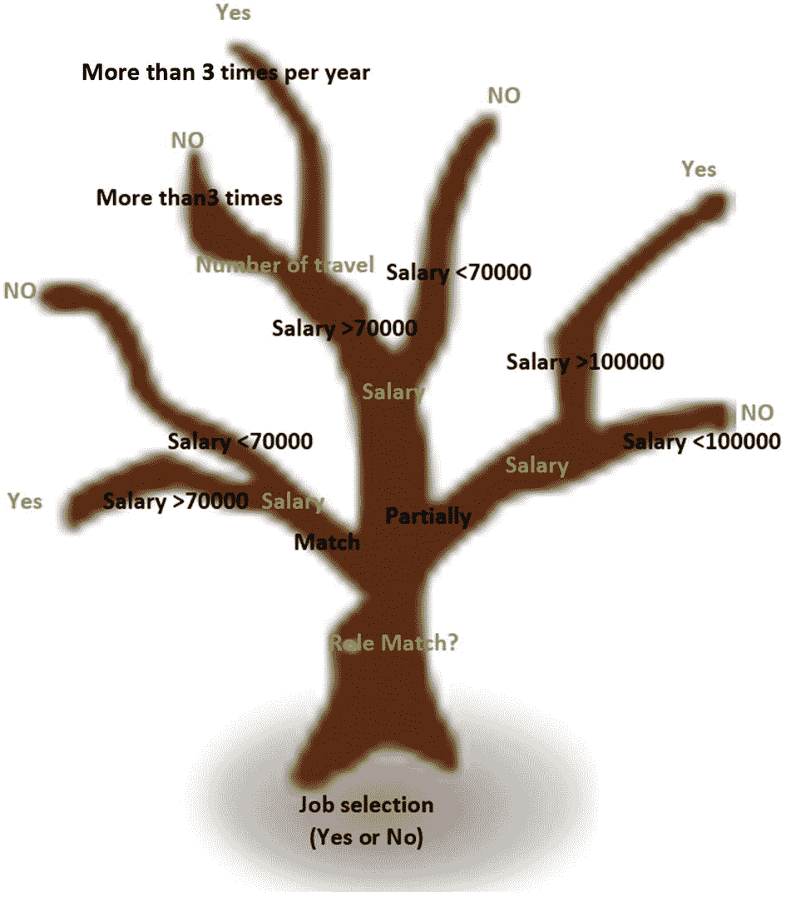

图 7-8

求职决策树

在 Power BI 中使用决策树有多种方法。其中一种方法是使用 Power BI 自定义可视化。

要访问此功能，首先必须登录 Power BI 账户（图 7-9）。


图 7-9

Power BI 账户

我们必须通过单击“可视化”面板中的三个点，然后选择“从商店导入”选项来检索可视化效果（图 7-10）。


图 7-10

从商店导入可视化效果

在 Power BI 自定义可视化页面上，有不同类别的可视化效果，包括筛选器、KPI、地图、高级分析等（图 7-11）。

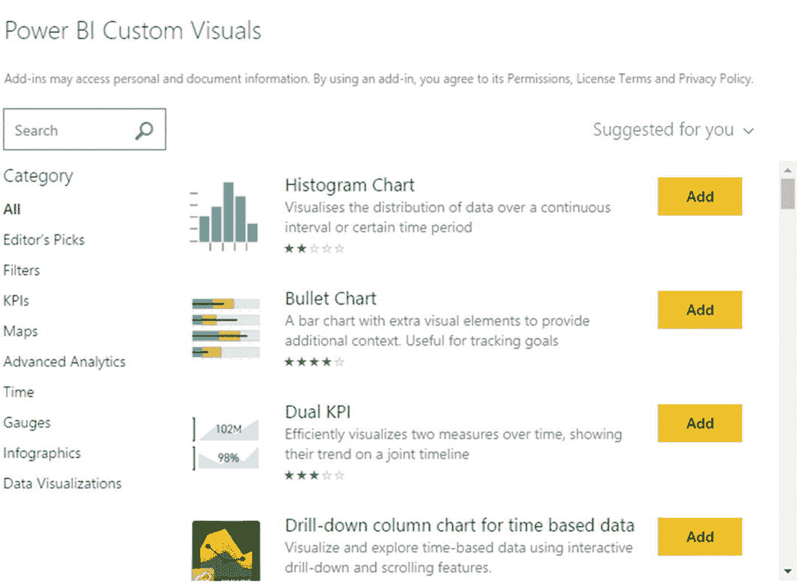

图 7-11

Power BI 自定义可视化效果

您只需单击“高级分析”选项，然后选择“决策树图”（图 7-12）。单击“添加”按钮将该图表添加到 Power BI 可视化效果中。

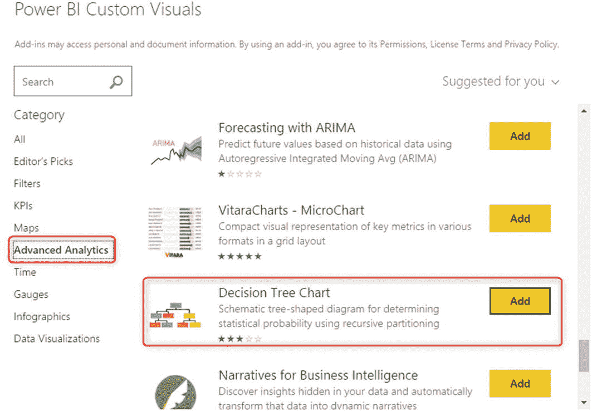

图 7-12

Power BI 商店中的决策树自定义可视化效果

### 注意

首次添加此图表时，必须确保您的机器上已安装 RStudio 或任何 R 版本。Power BI 将开始安装一些必需的包，例如将 `rpart` 安装到您本地的 R 版本中。只需允许 Power BI 安装所有包即可。下一步，一个新的自定义可视化效果将出现在 Power BI 的“可视化”面板中（图 7-13）。

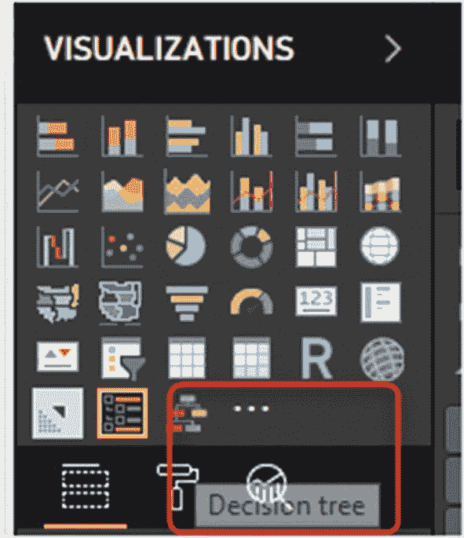

图 7-13

“可视化”面板中的决策树自定义可视化效果

为了测试自定义可视化效果，我们必须将一些数据导入 Power BI Desktop 以进行预测性分析。该数据是关于*泰坦尼克号*灾难的免费数据集 [4]。我们必须选择用于决策的字段。主要目标（目标变量）是预测人们是否幸存。为此，首先我们必须选择几个可能影响乘客生存的列，例如年龄、性别和乘客等级。然后，将“幸存”列作为目标变量放入相关的数据字段中（图 7-14）。

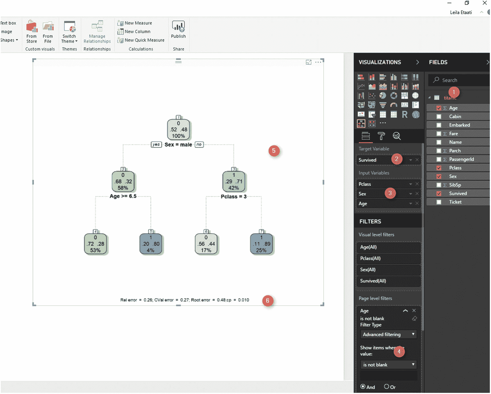

图 7-14

Power Query 筛选值

下一步是从年龄列中移除缺失值（“空白”）。最后，相关的决策树图会出现在 Power BI 报表中（图 7-14）。

在树的根节点处，有四个带编号的标签。0 代表无法幸存的乘客。此外，这些人由绿色标签标识。“100%”表示所有数据都在根节点。“0.52”和“0.48”表示大约 0.52 是男性，0.48 是女性。换句话说，决策树决定分析的第一个属性（基于熵理论）是乘客的性别（图 7-15）。

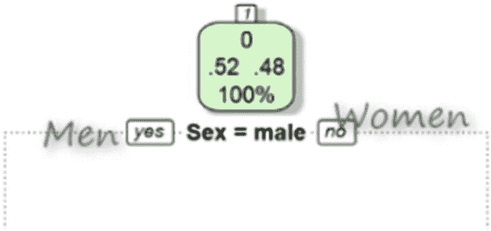

图 7-15

决策树中的根节点

在下一层，左侧的标签是绿色的，并且已经分支以代表男性乘客。基于该分支，我们可以总结出大多数男性乘客未能幸存（0）。然而，如图 7-16 所示，对于女性（右侧的分支），将要分析的属性是乘客等级。

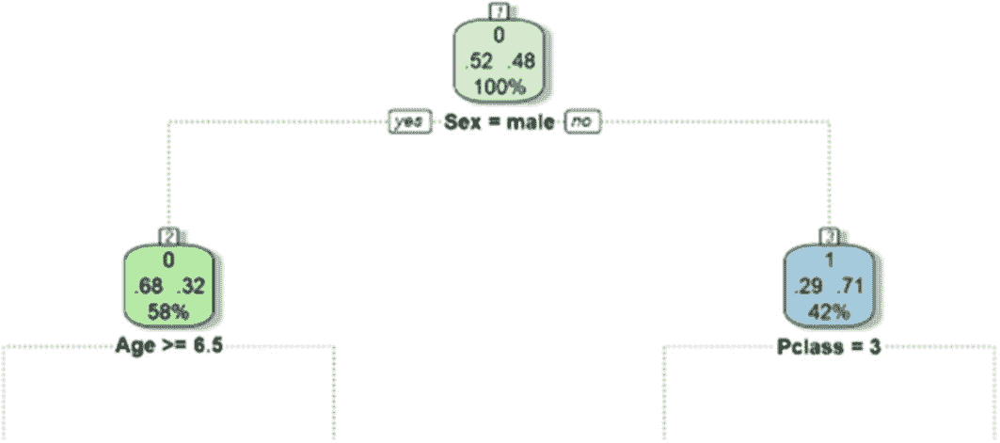

图 7-16

树分析的第二层

对于年龄超过七岁（第二个节点）的男性（根节点），他们有 58% 的可能性无法幸存（绿色标签和 0）（图 7-17）。

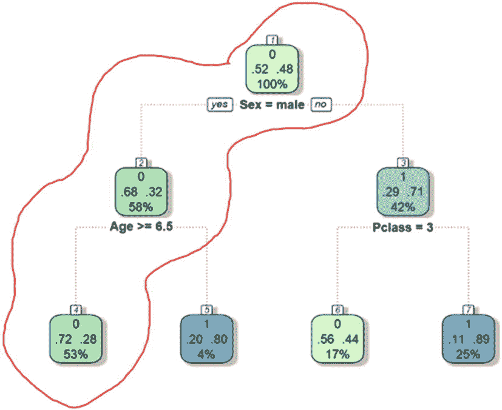

图 7-17

针对男性的决策树分析

年龄超过七岁（第二个节点）的男性（根节点）将无法幸存（绿色标签和 0），可能性为 53%。此外，年龄小于七岁的男性将幸存。

Power Query 内部的决策树可用于执行机器学习，并在 Power BI 报表中显示结果（与“神经网络”部分中解释的过程相同）。

在下一节中，我将为 Power Query 内部的决策树编写 R 代码，并展示如何向其传递参数。


## Power Query 中的自动化机器学习

在上一节中，我解释了如何使用决策树进行预测分析。现在，我们将在 Power Query 中使用它，无需特定图表即可进行预测。

首先，我们必须点击页面顶部的 Power Query 编辑器，导航到 Power Query 环境。在 Power Query 中，你必须先从 [`www.kaggle.com/c/titanic`](http://www.kaggle.com/c/titanic) [4] 下载*泰坦尼克号*数据集。然后，点击新建源，选择文本/CSV 选项导入数据集，并点击确定（图 7-18）。

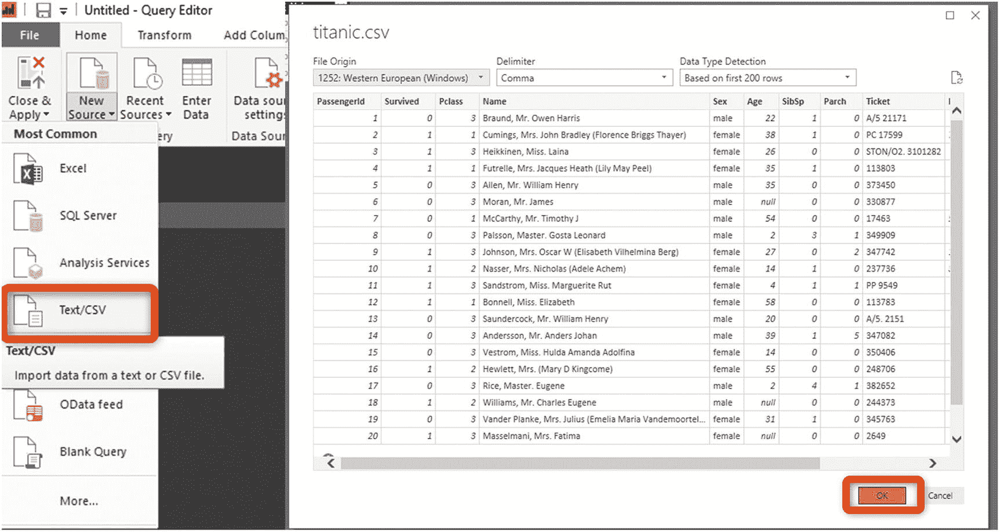

图 7-18

将泰坦尼克号数据集导入 Power Query

将数据集导入 Power Query 后，我们必须导航到“转换”选项卡，然后点击“运行 R 脚本”。在 R 编辑器中，我们将能够编写 R 代码。代码的第一行引用了一个名为 `rpart` 的库。`rpart` 包必须首先安装在你的 RStudio 中。安装前，请先使用以下命令确认你尚未安装它：

```
Library("rpart")
```

否则，在 RStudio 中，使用以下代码查看你的机器上已安装了哪些库。

```
packagematrix <- installed.packages();
NameOnly <- packagematrix[,1];
OutputDataSet <- as.data.frame(NameOnly);
OutputDataSet
```

首先，我们必须确保 `rpart` 已安装到我们的机器上。然后，我们在 R 编辑器中编写以下代码（就像本章前面为神经网络所做的那样）。现在，我们必须引用 `rpart` 库，并将数据分为训练集和测试集。

```
library(rpart)
numrows<-nrow(dataset)
sampledata<-sample(numrows,0.8∗numrows)
train<-dataset[sampledata,]
test<-dataset[-sampledata,]
```

创建模型是下一步。这涉及到我们想要预测的属性，并基于训练数据集为其创建模型。此外，我们必须有一个 `Survived ~` 的公式。这表明我们想要根据年龄、性别和乘客等级来预测幸存列。`predict` 函数将用于预测分析中的生存情况。

```
DT<-rpart(Survived~ Age+Pclass+Sex,data=train,method= ="class")
prediction<-predict (DT,test)
rpartresult<-data.frame(prediction,test)
```

因此，预测结果将以名称 `rpartresult` 显示在 Power Query 中。结果将包含两个不同的附加列。“X0”代表乘客未幸存的概率，“x1”代表乘客幸存的概率。现在想象一下，我们想要使用 `rpart` 算法对另一个数据集进行分类，例如第 6 章讨论的与癌症相关的数据。可以对 R 代码进行参数化，以便将所需的数据集、预测列等传递给 R 代码。为此，我们必须复制该数据集（图 7-19）。

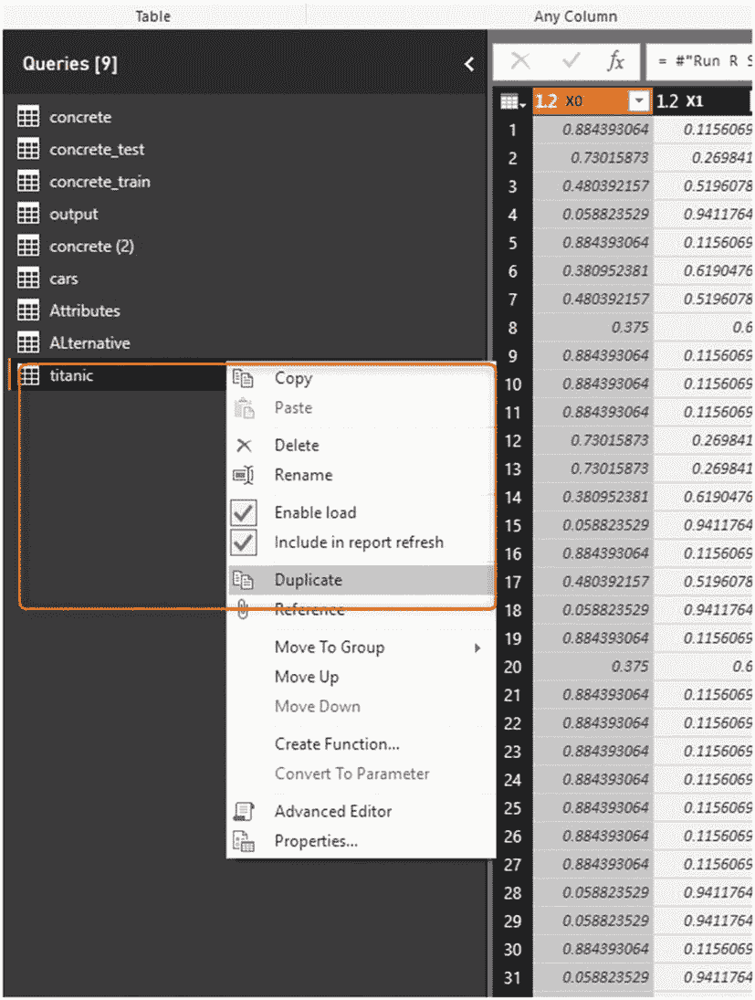

图 7-19

复制泰坦尼克号数据集

现在只需右键单击新数据集，从中创建一个函数。需要从新复制的数据集中创建一个函数（图 7-20）。

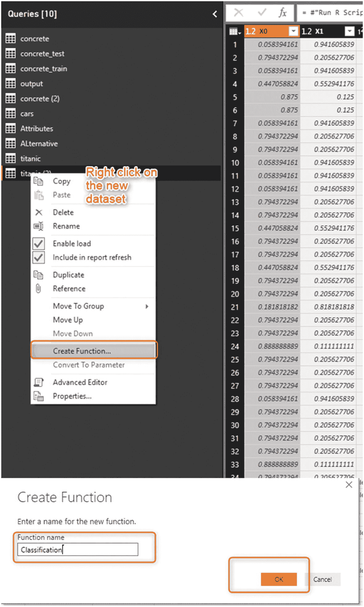

图 7-20

在 Power Query 中创建函数

创建函数后，我们必须通过传递参数来自定义它。为此，我们必须导航到高级编辑器（图 7-21）。

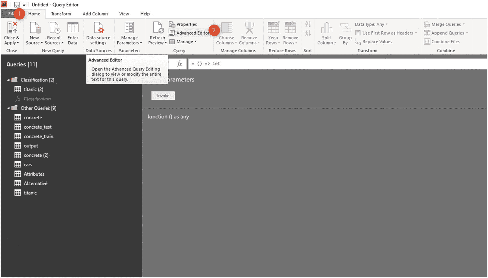

图 7-21

Power Query 中的高级编辑器


在高级编辑器中，可以查看之前应用于泰坦尼克数据集并以 M 语言编写的步骤。如图 7-22 所示，数据集的来源已从本地计算机中识别出来。

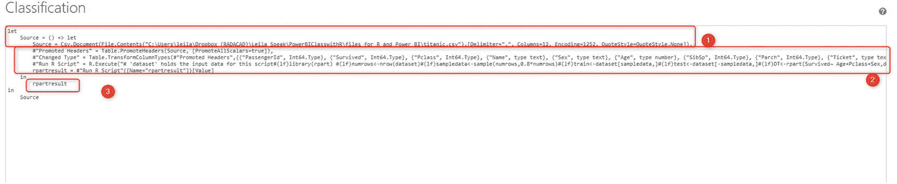

图 7-22

用于编写 M 语言的高级编辑器

前三行应替换为以下一行：

```
(#"Source Table" as table) as table=>
let
Source = #"Source Table",
```

在第一行中，我们定义了一个名为 `Source Table` 的变量，并在第三行中将其赋值给 `Source` 变量。下一步，我们将删除一些以 `Promoted Headers` 和 `Changed Type` 开头的行。这些行仅用于特定数据集（`titanic`）的转换。现在我们有了以下几行，仍需进行一些转换：

```
(#"Source Table" as table) as table=>
let
Source = #"Source Table",
#"Run R Script" = R.Execute("# 'dataset' holds the input data for this script#(lf)library(rpart) #(lf)numrows<-nrow(dataset)#(lf)sampledata<-sample(numrows,0.8∗numrows)#(lf)train<-dataset[sampledata,]#(lf)test<-dataset[-sampledata,]#(lf)DT<-rpart(Survived~ Age+Pclass+Sex,data=train,method=""class"")#(lf)prediction<-predict (DT,test)#(lf)rpartresult<-data.frame(prediction,test)",[dataset=#"Changed Type"]),
rpartresult = #"Run R Script"{[Name="rpartresult"]}[Value]
in
rpartresult
in
Source
```

如上述代码所示，我们有一个标题行 `#"Run R Script" =`，其中包含一个函数 `R.Execute`。该函数包含我们编写的所有 R 代码。在 M 语言中，一个函数的输出将传递给下一个函数。前一个函数是用于更改类型 `Changed Type`，我们已将其删除。现在我们必须修改 `Run R Script` 中的代码，如下所示：

```
#"Run R Script" = R.Execute("# 'dataset' holds the input data for this script#(lf)library(rpart) #(lf)numrows<-nrow(dataset)#(lf)sampledata<-sample(numrows,0.8∗numrows)#(lf)train<-dataset[sampledata,]#(lf)test<-dataset[-sampledata,]#(lf)DT<-rpart(Survived~ Age+Pclass+Sex,data=train,method=""class"")#(lf)prediction<-predict (DT,test)#(lf)rpartresult<-data.frame(prediction,test)",[dataset=#"Changed Type"]),
```

`Changed Type` 应替换为 `Source`，如下列代码所示：

```
let
Source = #"Source Table",
#"Run R Script" = R.Execute("# 'dataset' holds the input data for this script#(lf)library(rpart) #(lf)numrows<-nrow(dataset)#(lf)sampledata<-sample(numrows,0.8∗numrows)#(lf)train<-dataset[sampledata,]#(lf)test<-dataset[-sampledata,]#(lf)DT<-rpart(Survived~ Age+Pclass+Sex,data=train,method=""class"")#(lf)prediction<-predict (DT,test)#(lf)rpartresult<-data.frame(prediction,test)",[dataset=Source]),
rpartresult = #"Run R Script"{[Name="rpartresult"]}[Value]
in
rpartresult
in
Source
```

我们仍需进行一些额外的修改。这些修改将应用于我们想要预测的 Name 列。目前，它是“Survived~ Age+Pclass+Sex”，但我们希望将 Survived 列替换为用户提供的参数。此外，我们不想使用另一列作为输入，而是考虑所有列。因此，我们必须修改代码，如下所示：

```
(#"Source Table" as table, #"Prediction Column"as text) as table=>
let
Source = #"Source Table",
#"Run R Script" = R.Execute("# 'dataset' holds the input data for this script#(lf)library(rpart) #(lf)numrows<-nrow(dataset)#(lf)sampledata<-sample(numrows,0.8∗numrows)#(lf)train<-dataset[sampledata,]#(lf)test<-dataset[-sampledata,]#(lf)DT<-rpart( "&#"Prediction Column"&"~ .,data=train,method=""class"")#(lf)prediction<-predict (DT,test)#(lf)rpartresult<-data.frame(prediction,test)",[dataset=Source]),
rpartresult = #"Run R Script"{[Name="rpartresult"]}[Value]
in
rpartresult
in
Source
```

我们需要对代码稍作优化，删除最后一行 `in Source`。因此，最终的代码将是：

```
(#"Source Table" as table,#"Prediction Column"as text) as table=>
let
Source = #"Source Table",
#"Run R Script" = R.Execute("# 'dataset' holds the input data for this script#(lf)library(rpart) #(lf)numrows<-nrow(dataset)#(lf)sampledata<-sample(numrows,0.8∗numrows)#(lf)train<-dataset[sampledata,]#(lf)test<-dataset[-sampledata,]#(lf)DT<-rpart( "&#"Prediction Column"&"~ .,data=train,method=""class"")#(lf)prediction<-predict (DT,test)#(lf)rpartresult<-data.frame(prediction,test)",[dataset=Source]),
rpartresult = #"Run R Script"{[Name="rpartresult"]}[Value]
in
rpartresult
```

运行代码后，我们将得到一个带有输入变量的函数（图 7-23）。

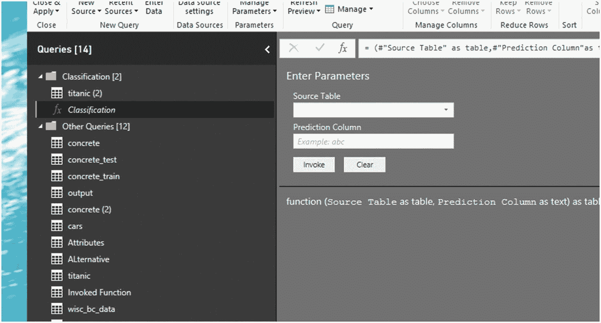

图 7-23

创建具有两个输入的分类函数

为了测试该函数，我们必须创建一个数据集传递给函数。导入新的泰坦尼克数据集，然后按住 Ctrl 键并单击四个主要列：Survived、Pclass、Age 和 Sex。接下来，右键单击并选择“删除列”选项（图 7-24）。

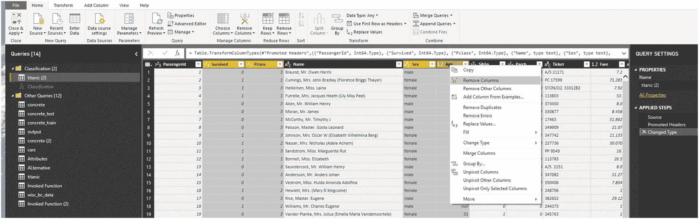

图 7-24

选择列

最后，得到一个包含四列的数据集，可以传递给函数。在函数中，对于第一个参数，我们必须选择泰坦尼克数据集；对于第二个参数，选择名为 Survived 的预测列（图 7-25）。

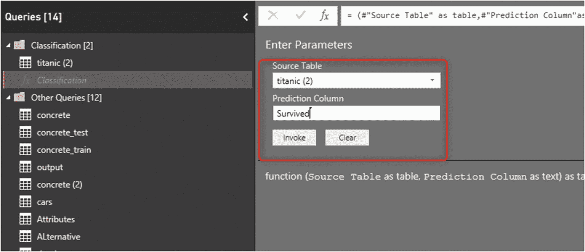

图 7-25

调用函数

接下来，我们可能会收到一条关于“编辑权限”的消息，该消息涉及授予在查询上运行外部脚本的权限（图 7-26）。

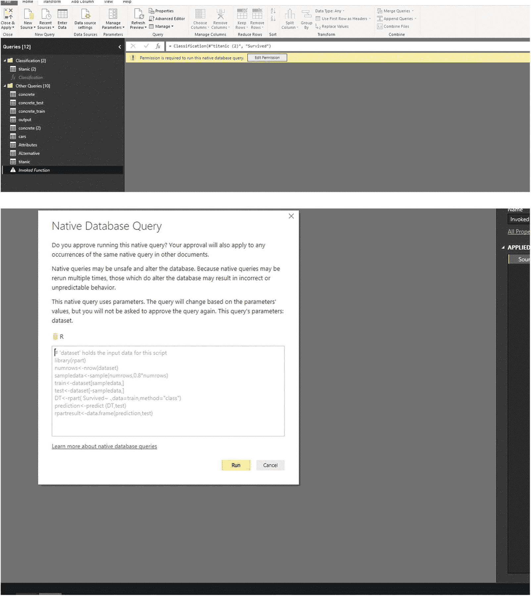

图 7-26

权限请求

接受权限后，我们现在可以看到结果，如图 7-27 所示。

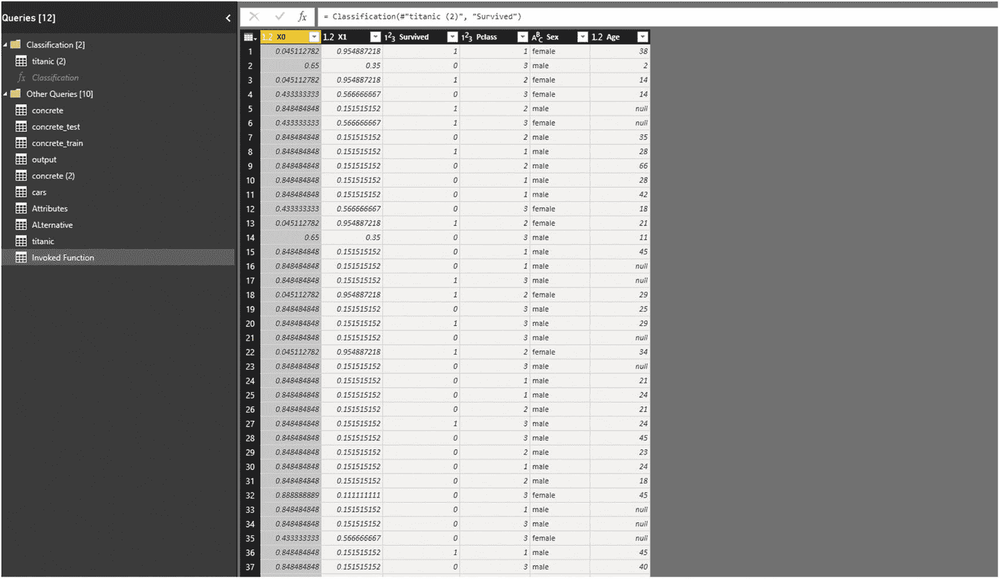

图 7-27

泰坦尼克数据集的函数结果

为了测试该函数，我导入了另一个数据集 [5]，该数据集在第 6 章中介绍过。这是一个与乳腺癌患者相关的数据集。我想预测患者的诊断结果：患者的癌症是否会变为恶性“M”或良性“B”。我们对此新数据集遵循与之前相同的过程。首先，导入它，然后将数据集的名称和列传递给函数（图 7-28）。

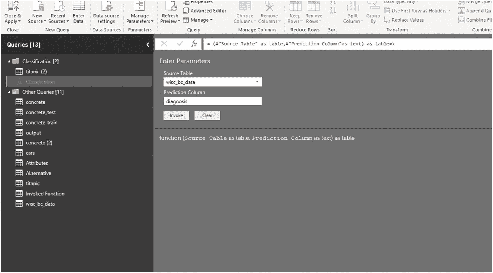

图 7-28

为癌症数据集调用分类函数

调用函数后，预测结果将显示为一个新查询（图 7-29）。

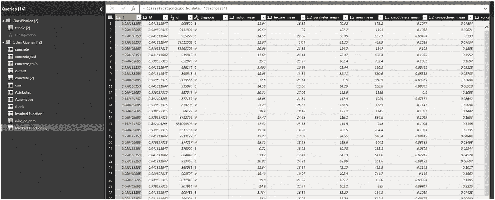

图 7-29

癌症诊断数据集的预测结果

## 总结

本章的主要目的是展示如何通过 R 代码在 Power Query 编辑器内部执行机器学习。介绍了两种不同的算法：神经网络和决策树。我讨论了如何设置参数以使机器学习更加灵活。在下一章中，我将讨论使用 Power BI 进行描述性分析。


