# 8. 在 Power Query 中使用 R 进行描述性分析

本章重点介绍 Power BI 中的描述性分析。首先简要说明如何利用描述性分析辅助决策。接着简要介绍聚类分析、如何在 Power BI 报表中执行聚类，以及如何在 Power Query 编辑器中进行聚类。最后，我将介绍如何在 Power BI 中进行购物篮分析。

## K-Means 聚类

聚类分析是将相似对象归入同一组或同一簇的任务。聚类后的对象彼此之间的相似度高于其他对象。例如，我们可能希望根据客户的购买行为或人口统计信息对客户进行分组 [1]。或者，举一个科学领域的例子，我们可能希望将过去十年新西兰发生的地震次数和震级进行聚类。出于医疗目的，我们可能希望根据实验室结果对癌症患者进行分类。

在机器学习中，有许多不同的算法可以帮助我们进行聚类。其中一些算法是基于质心的，例如 `k-means`、`GMM`、模糊 `c-means` 等。其他算法则基于连通性 [2]，例如层次聚类。还有一些算法是基于密度、概率、降维以及神经网络/深度学习的。

在本章中，我将向您展示如何使用 `k-means` 算法对数据进行分类。有一个家庭用电数据集，可以从 UCI 机器学习库免费获取 [3]。该数据集记录了某个家庭在近四年时间内的电力消耗情况。该数据集包含日期、时间、全局有功功率、无功功率、平均电压、平均电流强度以及厨房、洗碗机、烤箱、热水器等设备的瓦时数等属性。您将看到如何使用 Power BI 中的两种不同方法自然地对这些数据进行分类。

## 聚类自定义视觉对象

第一种也是简单的聚类数据方法是使用 Power BI 商店中的自定义视觉对象：聚类。要访问它，您首先必须登录 Power BI 帐户。在“可视化”面板中，单击三个点，然后选择“从商店获取”选项。在“高级分析”下，您将找到用于自定义视觉对象的“聚类”选项（图 8-1）。

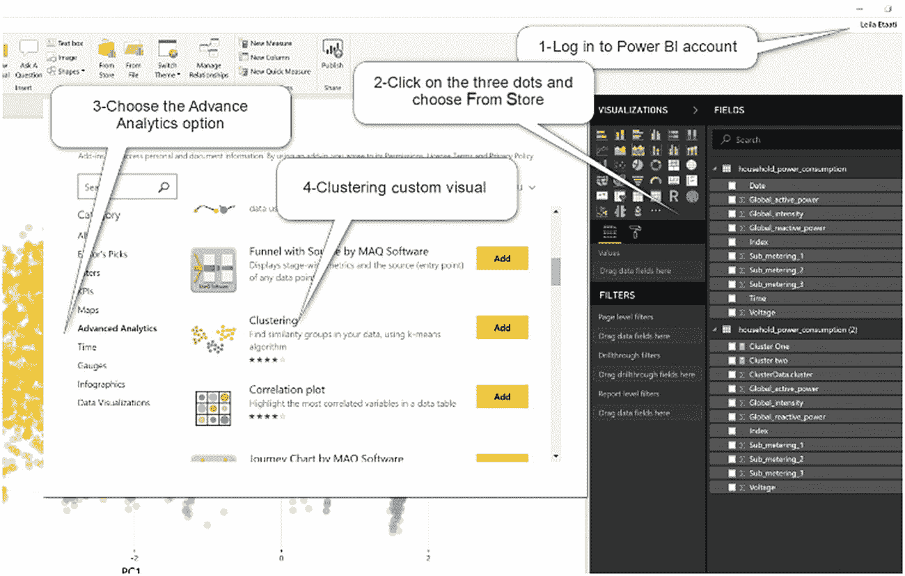

图 8-1

聚类自定义视觉对象

将自定义视觉对象添加到 Power BI 环境。如果这是您第一次添加 Power BI 自定义视觉对象，则会安装一些包，例如 `Plotly`、`XML` 等。接下来，您必须从字段区域中选择四个不同的列。如图 8-2 所示，已选择了一些列，例如电压、全局强度（家庭全局分钟平均电流强度）、子计量 3 和 1（厨房、洗碗机、热水器等设备的瓦时活动能量）。

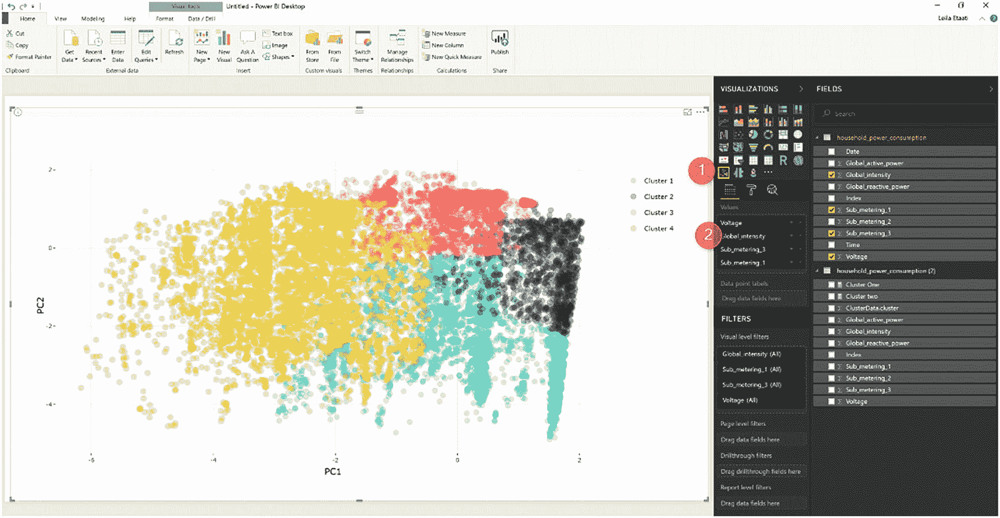

图 8-2

选择用于聚类的列

选择参数后，您必须对其进行设置。单击格式图标，然后缩放数据以进行归一化。如果您想指定簇的数量，可以应用 `PCA`，或者保留默认设置（将自动选择簇）。

如图 8-3 所示，聚类结果显示在聚类图中。`K-means` 聚类发现了大约四个主要簇。如图所示，簇 4 包含更多项目，而簇 1 包含的项目比其他簇少。然而，此可视化的局限性在于我们无法看到具体数字，也无法根据其属性比较每个簇。

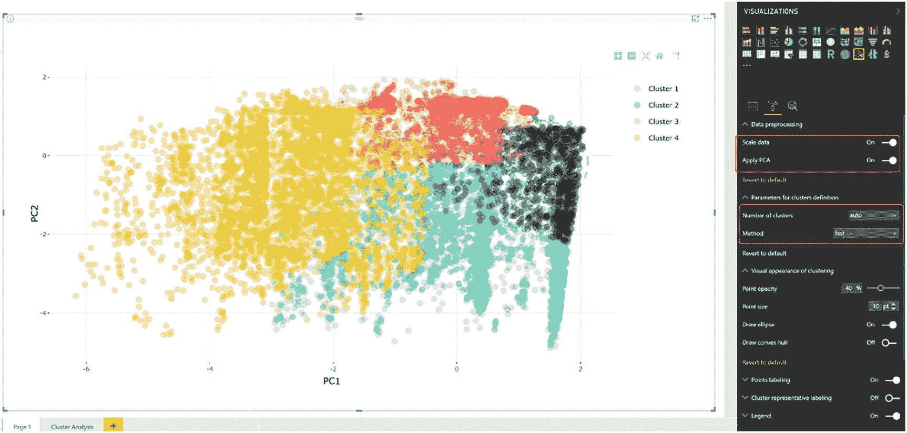

图 8-3

聚类参数和结果

在下一节中，将展示在 Power Query 内部执行聚类分析的过程，以及如何使用 Power BI 可视化来展示结果。

## Power Query 中的聚类分析

如前面章节所述，可以在 Power Query 内部使用 R 代码进行机器学习。本节将解释如何在 Power Query 中使用 R 代码进行数据聚类，并展示如何利用 Power BI 可视化来更好地描述按相关聚类分组的数据。

首先，我们需要进入查询编辑器，然后右键点击数据集并选择“复制”选项，来复制当前的数据集（如图 8-4 所示）。

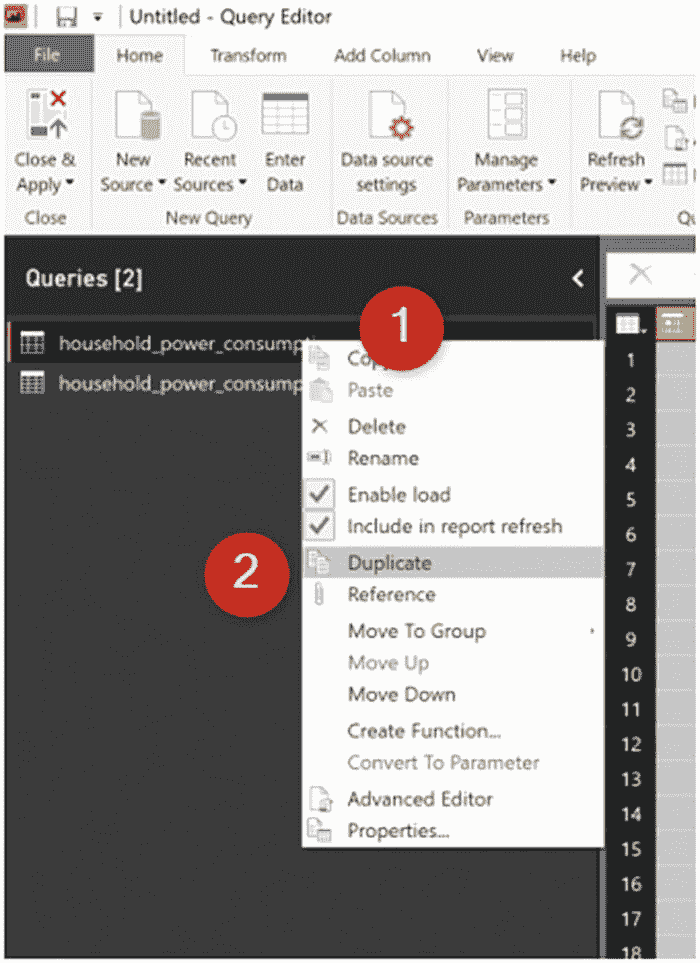

图 8-4

复制家庭用电数据集

复制数据集后，你将获得一份家庭用电数据的副本，在应用 R 代码之前，需要先对其进行转换。

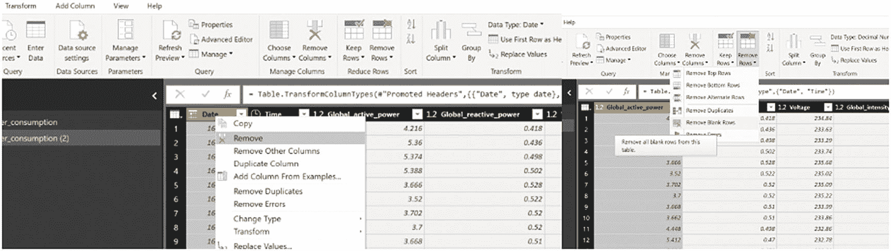

图 8-5

数据清洗

1.  删除日期和时间列。点击每一列，然后右键选择“删除”。

2.  删除错误。数据中可能存在一些错误，因此需要设定处理规则，例如，点击“删除行”并选择“删除错误”、“删除空行”或“删除缺失值”（图 8-5）。

数据清洗完成后，点击“转换”选项卡并选择“运行 R 脚本”选项来执行 R 脚本。在 R 编辑器中，首先需要使用 R 中的归一化函数将数据统一到同一尺度，如下所示：

```
normalize <- function(x) {
return ((x - min(x)) / (max(x) - min(x))) }
NormalizedData <- as.data.frame(lapply(dataset, normalize))
```

`kmeans` 函数使用 k-means 聚类算法对数据进行聚类。该算法需要一个数据集和聚类数量。

```
ClusterData<-kmeans(NormalizedData ,4)
```

数据聚类后，我们需要创建一个输出数据集。为此，我们利用 `data.frame` 函数，从原始数据集和聚类编号创建一个数据框数据集。

```
PowerConsumption<-data.frame(dataset,ClusterData$cluster)
```

运行代码后，数据集现在包含原始数据以及一个显示聚类编号的新列。此外，我们需要为当前数据集添加一个索引列，作为后续分析的主键。要添加新列，请点击顶部菜单中的“添加列”选项卡，然后点击“索引列”，默认从 0 开始，但你可以通过选择其他选项将其改为从 1 开始。

如图 8-6 所示，我们的数据现在已准备好进行可视化和进一步分析。此时，只需关闭并应用更改即可。

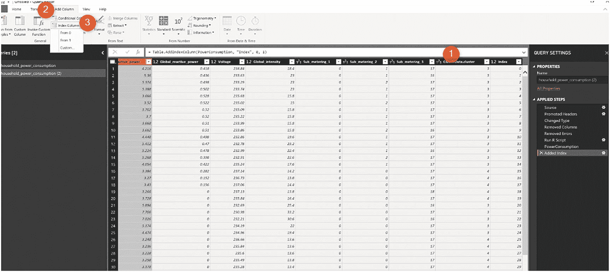

图 8-6

在 Power Query 中对数据进行聚类

在可视化窗格中，我们将使用一些简单的可视化图表来比较各个聚类（图 8-7）。第一个图表显示每个聚类中的项目数量。我们可以看出每个聚类包含多少个项目。

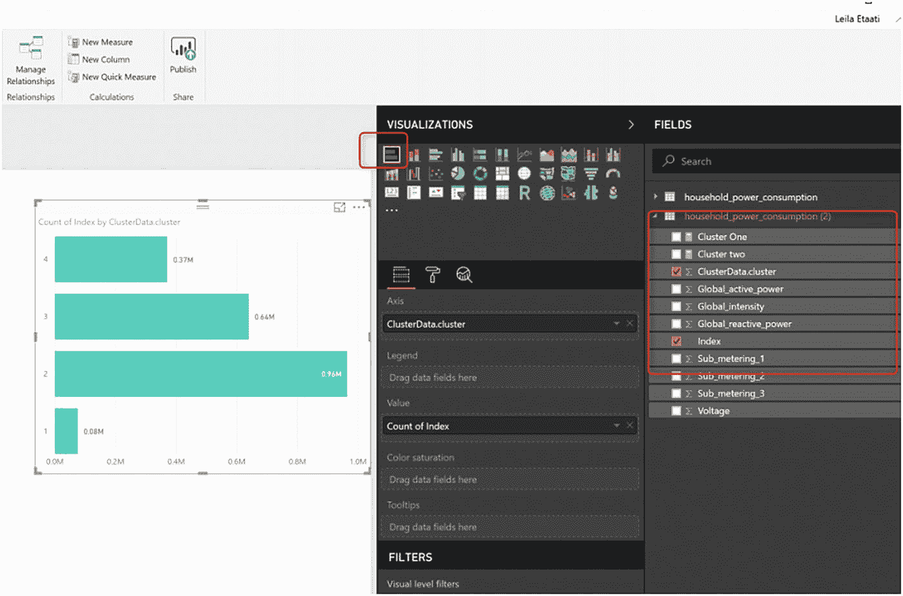

图 8-7

每个聚类中的项目数量

此外，你还可以使用漏斗图选项来显示某个聚类中某个属性的平均值（图 8-8）。

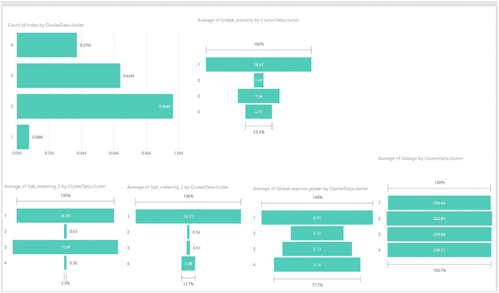

图 8-8

聚类比较数据

还可以进行假设分析。例如，如果电压从 244 变为 254，我们可以检查哪些聚类主要包含该范围，以及哪些其他属性与该子集共同出现。如图 8-9 所示，聚类 2 和聚类 3 主要覆盖了 244 到 254 的电压范围。

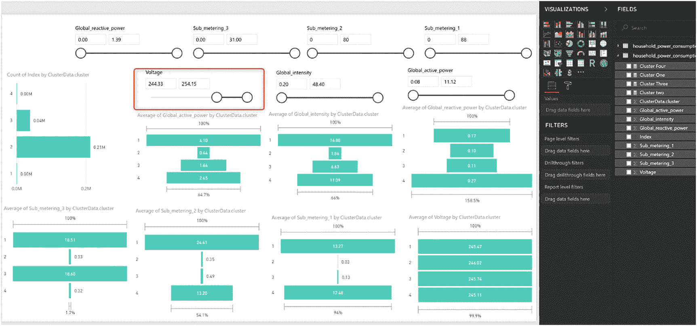

图 8-9

聚类结果的假设分析

## 购物篮分析（关联规则）

另一种描述性分析和数据挖掘的方法是购物篮分析，或称关联规则。购物篮（关联规则）分析用于发现商店中客户的购买行为，以确定哪些相关商品被一起购买。这种方法不仅用于优化产品布局和营销投入，还用于确定医疗保健、政府政策、活动管理等方面的规则 [5]。

在本节中，我将解释如何使用购物篮分析，如何用 R 语言编写代码，以及如何得出有效的规则。

### 什么是购物篮分析？

这种分析用于研究客户的购买行为。例如，对于一家美容用品店，这种分析可能会揭示顾客同时购买洗发水和护发素的频率之间的关联。从营销角度来看，或许推广洗发水会促使顾客也购买护发素。从销售角度来看，将洗发水放在商店货架上护发素的旁边，会鼓励顾客同时购买这两样商品 [4]。

如前所述，“关联规则”是购物篮分析的另一种说法。关联规则的形式是“如果 X，那么 Y”。例如，购买人寿保险的人中有 60% 可能会接着购买健康保险。再举一个例子，在线购书的人中有 80% 可能也会在线购买音乐。此外，患有高血压且超重的人中有 50% 可能胆固醇也高 [3]。

关联规则的其他例子包括：在癌症数据中搜索 DNA 和蛋白质序列中有趣且频繁出现的模式；在购买记录或医疗索赔中寻找与欺诈性信用卡或保险索赔同时发生的模式；以及识别导致客户取消手机服务或升级有线电视套餐的行为组合。可以看出，关联规则不仅适用于购物，还可以应用于医疗保健、保险和其他行业。该方法的数学计算原理在此处说明：[http://radacad.com/make-business-decisions-market-basket-analysis-part-1](http://radacad.com/make-business-decisions-market-basket-analysis-part-1)。

购物篮分析有三个主要属性。

*   **支持度**：一个项集或规则的支持度衡量其在数据中出现的频率。

*   **置信度**：置信度是关于规则的概率。例如，如果一位顾客购买了鲜花，那么他们购买一张早日康复卡片的概率是多少。

*   **提升度**：规则的重要性，即它能解释多少方差。

每次分析的第一步是确定主要的业务问题。在本书中，我遵循了 Lantz [6] 提供的示例，这些示例识别了顾客最常一起购买的购物清单项目。第二步是将数据导入 Power BI。你可以从 GitHub [7] 下载数据。该数据集包含超过 9,000 条客户交易信息。要在 R 中进行购物篮分析，我们必须安装 `arules` 包。此外，我们还必须在 RStudio 中安装与 `arules` 相关的另外两个包：`Matrix` 和 `Methods`。要安装这些包，你的机器上必须有一个 R 版本，例如 RStudio 或 Microsoft R Open。要安装这些包，请打开 R IDE，点击“新建 R 脚本”，然后输入 `install.packages(<package_name>)`。

我们按照前面章节描述的相同步骤，在 Power Query 中加载数据并运行 R 脚本（图 8-10）。

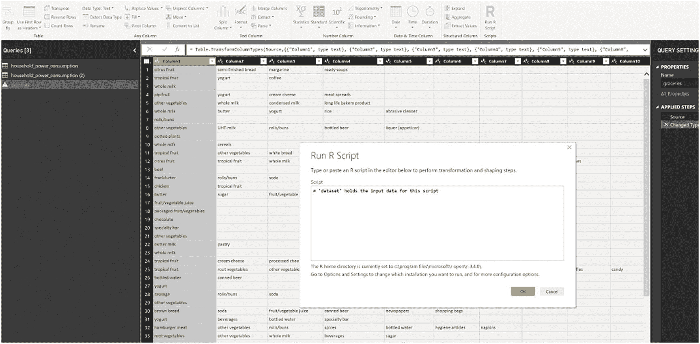

图 8-10 将数据集导入 Power BI 并运行 R 脚本

然后，你必须将以下代码放入 R 脚本编辑器中：

```
library(Matrix)
library(arules)
library(methods)
groceries <- read.transactions("[your local address]/groceries.csv", sep = ",")
Temp<-apriori(groceries, parameter = list(support = 0.006, confidence = 0.25, minlen = 2))
output<-inspect(Temp[1:100])
```

在这段代码中，使用了来自 `arules` 包的 `apriori` 函数。

在客户行为中发现关联规则的结果如图 8-11 所示。第一列 (`lhs`) 列出了人们购买的主要商品；第三列 (`rhs`) 列出了与 `lhs` 商品相关的商品。支持度、置信度和提升度度量分别显示在第四到第六列。总共提取了 100 条规则。最后，点击左上角的“关闭并应用”。现在，我们可以在 Power BI 中创建一个可视化来展示一个商品及其相关商品。

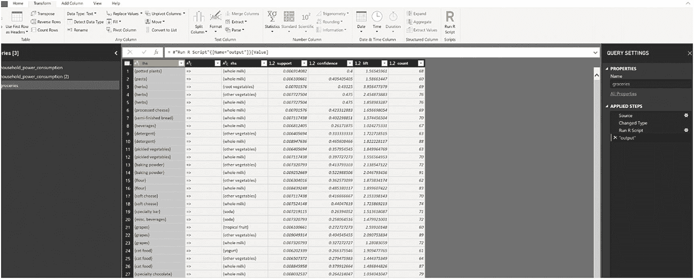

图 8-11 购物篮分析的结果

现在，我们可以在 Power BI 中创建一个可视化来展示一个商品及其相关商品。我们使用来自 Power BI 网站的一个特定自定义可视化“力导向图”来展示商品之间的关系。要获取此可视化，请点击“可视化”选项卡顶部的“市场”，然后搜索“力导向图”。

导入自定义可视化后，还应导入相关列（图 8-12）。对于源，我们放入 `lhs`。对于目标，应使用 `rhs`。对于权重，我们使用 `lift` 属性。

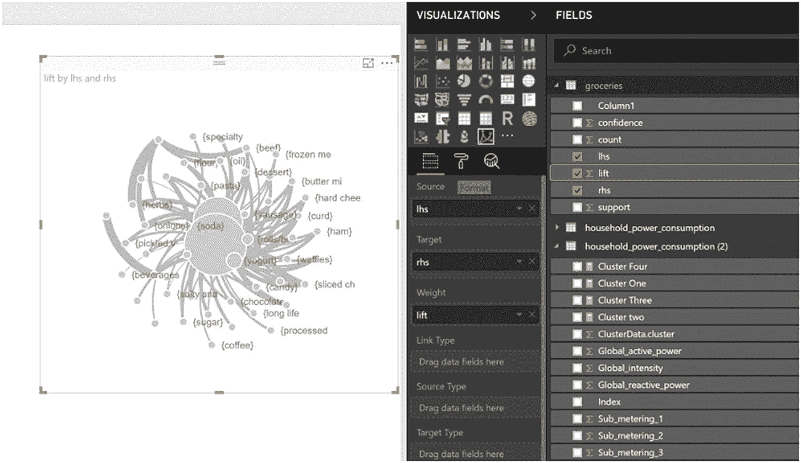

图 8-12 导入自定义可视化及相关列

如图 8-13 所示，必须更改一些可视化参数，以便更好地查看可视化效果（图 8-14）。

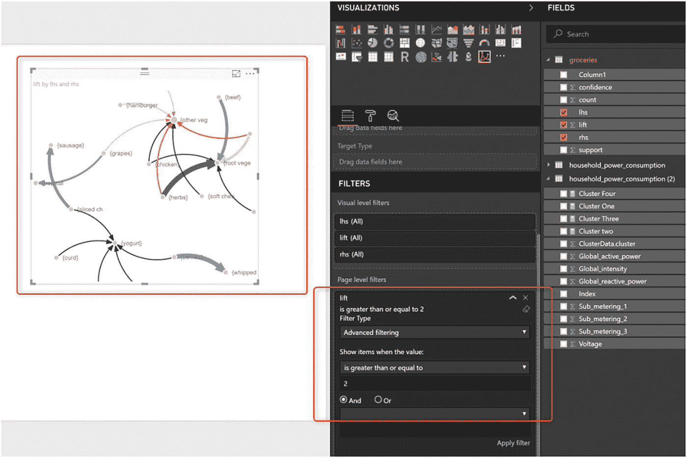

图 8-14 自定义可视化参数设置

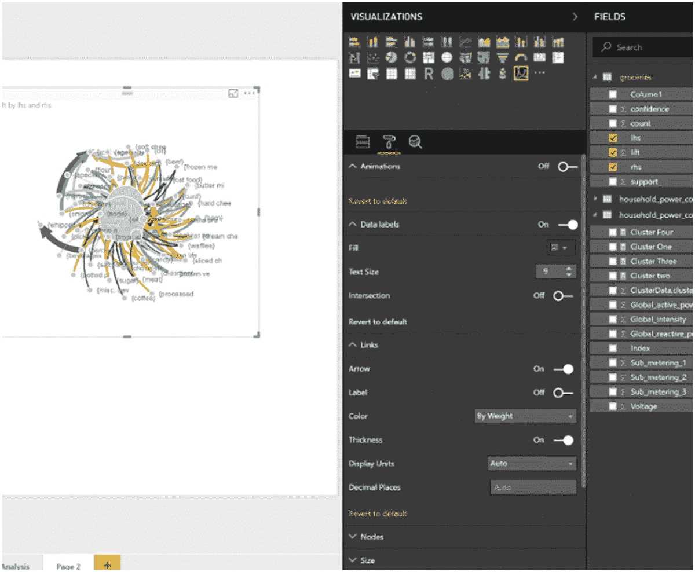

图 8-13 Power Query 筛选值

我们需要另一个来自 Power BI 商店的自定义可视化：Chiclet Slicer。这个自定义可视化是一个特定的切片器，可用于使用特定图像对图表进行切片和切块。如前所述，点击“市场”，然后搜索“Chiclet Slicer”。导入可视化后，选择值 `rhs`，复制切片器，并设置值 `lhs`（图 8-15）。

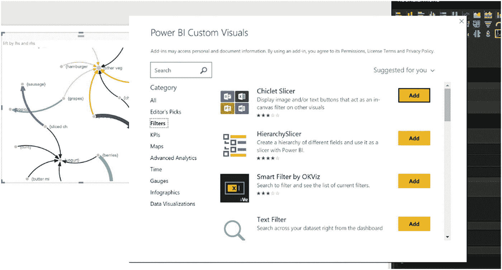

图 8-15 导入 Chiclet Slicer

你将看到一个报告，如图 8-16 所示。

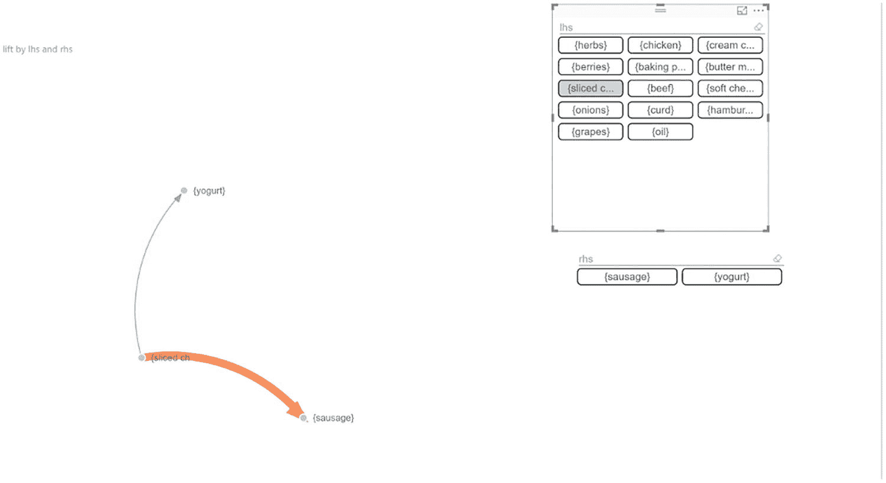

图 8-16 购物篮分析报告

通过在切片器中选择一个商品（例如切片奶酪）及其 `rhs` 值，图表会向我们展示顾客最常与该商品一起购买的相关商品，例如香肠和酸奶。

## 总结

本章简要介绍了描述性分析。首先，解释了聚类。然后，说明了如何在 Power BI 可视化中使用 K 均值聚类，以及在 Power Query 编辑器中进行聚类的过程。最后，介绍了购物篮分析。