# 9. 在 SQL Server 2016 和 2017 中使用 R

2016 年，微软宣布可以在 `SQL Server Management Studio` 中编写 R 代码。为了能在 `SQL Server 2016` 中编写 R 代码，我们必须先安装 R 服务。2017 年，微软提供了在 `SQL Server 2017` 中编写 Python 代码的能力。开发者可以使用机器学习服务器，并访问不同的 R 或 Python 包，在 `SQL Server Management Studio` 中编写 R 和 Python 代码。在 2017 版本中，我们不再使用 R 服务，而是使用机器学习服务，它允许我们将 R 或 Python 代码嵌入到 SQL 脚本中。本章将解释如何设置 `SQL Server Management Studio` 以编写 R 或 Python 脚本的过程。同时也会简要介绍一些必要的包。此外，还会解释如何创建模型并将其复用于其他数据集的最佳实践。

## SQL Server 2016 和 2017

在 `SQL Server 2016` 中使用 R 的第一步是安装 `SQL Server 2016` [1]。你可以选择 `SQL Server` 的任一版本，例如免费的 Enterprise、Standard 或 Express 版本。安装时，你必须拥有管理员账户。

1. 要启动 `SQL Server 2016` 的安装向导，请从“安装”选项卡中选择“新的 SQL Server 独立安装”或“向现有安装添加功能”（图 9-1）。

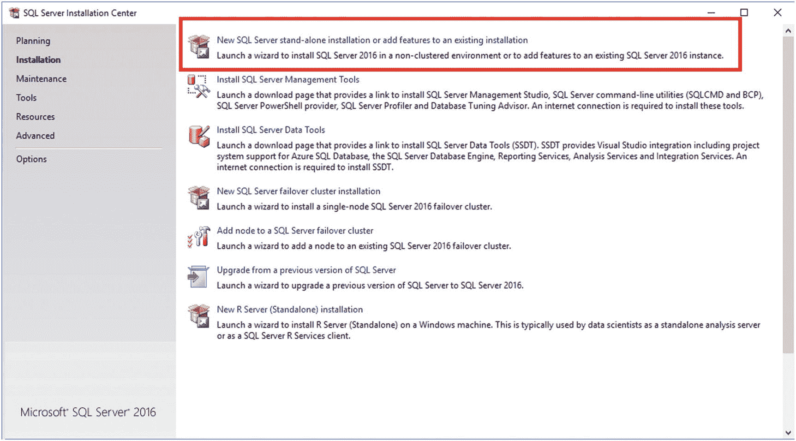

图 9-1

`SQL Server` 安装

2. 在功能选择页面上，选择`R 服务（数据库内）`。如图 9-2 所示，`SQL Server` 复制和`R 服务（数据库内）`已安装。

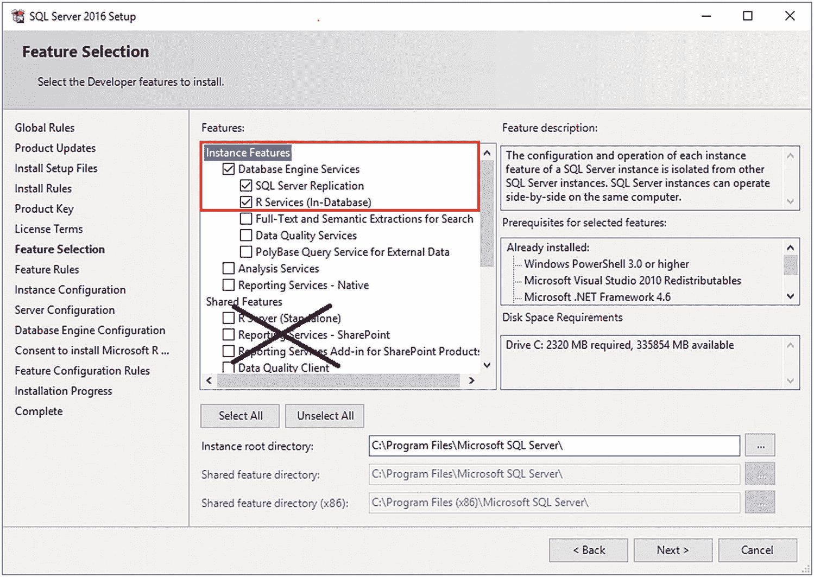

图 9-2

`SQL Server` 功能选择

3. 最后一步是同意安装 `Microsoft R Open`。安装完成后，你必须重新启动计算机并以管理员身份运行 `SQL Server`。有关安装过程的更多信息，请参考微软关于如何在 `SQL Server 2016` 中安装 R 服务的链接 [1]。

在 `SQL Server 2017` 中设置机器学习服务的过程与 2016 版本相同。唯一的区别在于功能选择中，我们可以同时使用 R 和 Python 语言。此外，我们必须同意安装 `Microsoft R` 服务和 `Python`（图 9-3）。

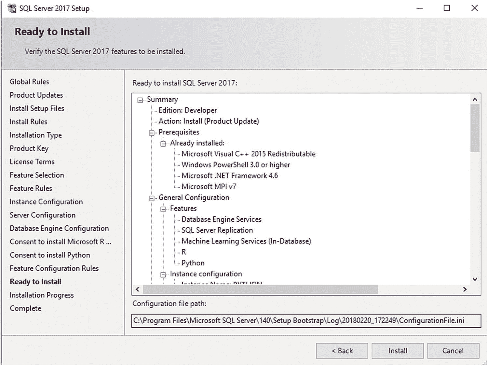

图 9-3

为 `SQL Server 2017` 安装机器学习服务

`SQL Server 2017` 中的机器学习服务可在本地和云中运行。该服务包含丰富的算法集，例如 `RevoScaleR`、`Revoscalepy` 和 `MicrosoftML`。此外，它还支持多种微软自定义的 R 和 Python 包。在本章中，我将解释如何简化在 `SQL Server 2016` 和 2017 中编写 R 脚本的过程（两者相同）。此外，还将解释如何使用 R 进行机器学习，什么是 `RevoScaleR`，以及如何支持特定算法。同时也会涵盖一些功能，例如如何使用预训练模型进行视觉分析和情感分析，以及如何将解决方案部署为 Web 服务。

## 运行 R 脚本

在 `SQL Server`（2016 或 2017）中安装 R 服务后，你必须通过特定的存储过程启用 `SQL Server Management Studio` 中的外部脚本编写功能。首先，请确保你已经下载并安装了 `SQL Server Management Studio` [2]。

以“以管理员身份运行”方式运行 `Management Studio`，然后点击“新建查询”打开查询窗口，并运行以下代码：

```
sp_configure
```

运行上述代码后，你将获得一个用于配置选项的存储过程列表（图 9-4）。

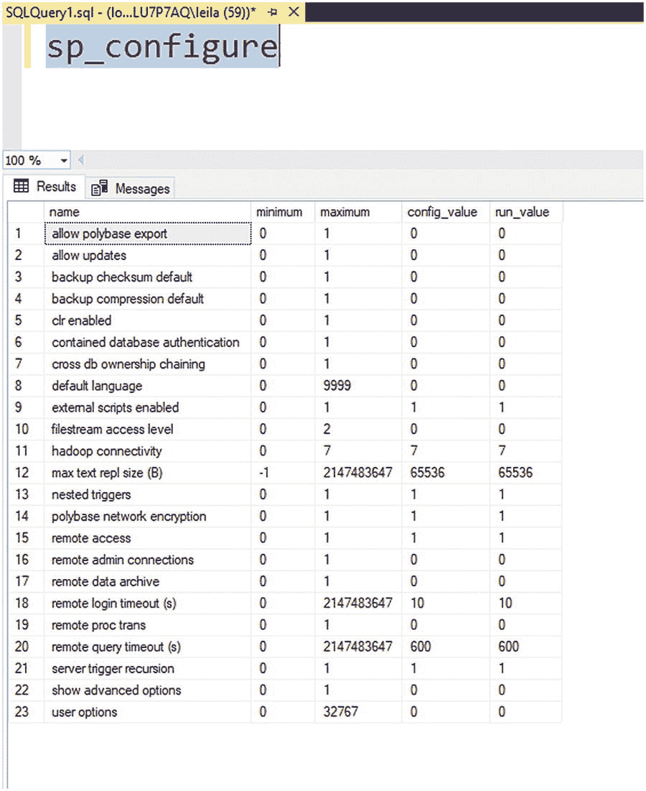

图 9-4

`SQL Server` 中可用的配置选项

在第 9 行，有一个名为`external scripts enabled`的配置存储过程，包含四列。该存储过程使我们能够编写 R 代码。它有两个主要属性：`config_value` 和 `run_value`。当你运行以下代码时：

```
sp_configure 'external scripts enabled'.
```

`config` 和 `run` 的初始值为零（图 9-5）。

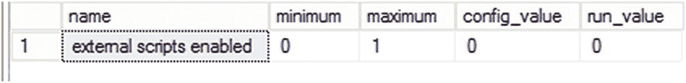

图 9-5

运行外部脚本存储过程

要在 `SQL Server 2017/2016` 中运行 R 代码，我们必须将`run_value`更改为 1。

```
Exec sp_configure 'external scripts enabled' ,1 Reconfigure with override
```

现在，如果我们再次运行图 9-5 中的代码，我们将得到另一个结果（图 9-6）。

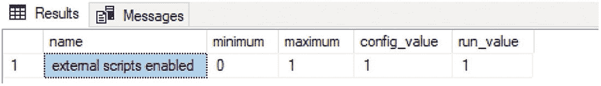

图 9-6

在 `SQL Server` 中启用 R 脚本的运行

`run_value` 可能尚未更改为 1，因此你必须重新启动 `SQL Server Management Studio`。

在`run_value`更改为 1 之后，可以检查 R 脚本是否已启用。我们执行一个具有三个主要输入的存储过程：

* `@language` 获取脚本语言的名称。
* `@script` 存储相关的 R 脚本。在以下示例中，我们将输入变量分配给输出变量 `OutputDataSet<-InputDataSet`。
* `@input_data_1` 存储供 R 脚本使用的相关数据。在以下示例中，它是一个非常简单的 SQL 代码：`select 1 as hello`。

```
exec sp_execute_external_script  @language =N'R',
@script=N'OutputDataSet<-InputDataSet',
@input_data_1 =N'select 1 as hello'
with result sets (([hello] int not null));
go
```

如果你运行上述代码，你将看到输出是 `hello`，值为 `1`（图 9-7）。存储过程的输出可以通过 `with result sets` 来标识。输出中显示的列名是 `hello`，输出值是一个整数（1），并且不应为空。因此，我们有 `[hello] int not null`。

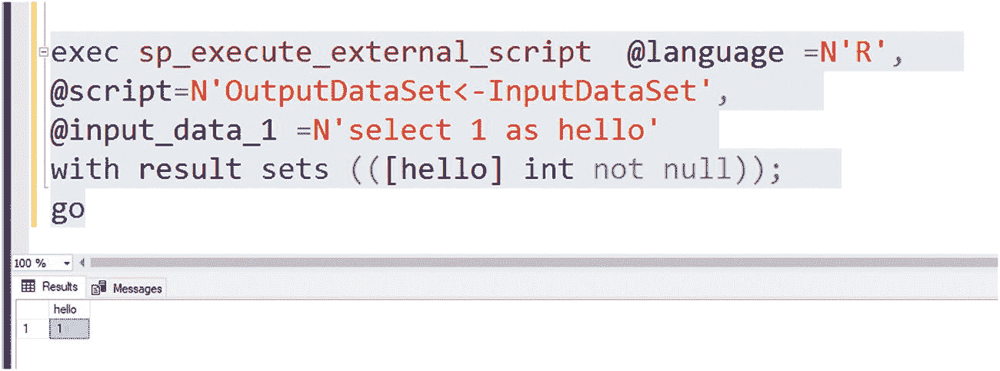

图 9-7

启用 R 脚本

## R 语言中的包

可以检查 R 服务的路径。获取 R 语言库路径的代码如下：

```
OutputDataSet <- data.frame(.libPaths())
```

要运行存储过程，我们将语言参数设置为 R。

```
@language = N'R'
```

输入的 R 脚本是：

```
@script = N'OutputDataSet <- data.frame(.libPaths());'.
```

因此，完整的代码如下：

```
EXECUTE sp_execute_external_script  @language = N'R'
, @script = N'OutputDataSet <- data.frame(.libPaths());'
WITH RESULT SETS (([DefaultLibraryName] VARCHAR(MAX) NOT NULL));
GO
```

运行代码后，R 的库路径将显示在输出窗口中（图 9-8）。

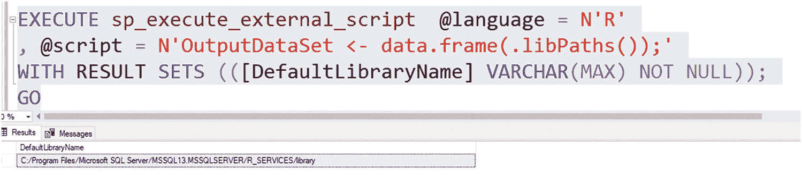

图 9-8

# R 库路径

你可以检查机器学习服务中已安装的包。用于检查已安装包的 R 代码如下：

```r
packagematrix <- installed.packages();
NameOnly <- packagematrix[,1];
OutputDataSet <- as.data.frame(NameOnly)
```

由于我们没有从用户那里获取任何输入值，因此存储过程没有任何输入（图 9-9）。

```sql
EXECUTE sp_execute_external_script @language=N'R'
,@script = N'str(OutputDataSet); packagematrix <- installed.packages();
NameOnly <- packagematrix[,1]; OutputDataSet <- as.data.frame(NameOnly);'
,@input_data_1 = N'SELECT 1 as col'
WITH RESULT SETS ((PackageName nvarchar(250) ))
```

运行代码后，你可以看到 SQL Server 中现有的 R 包。

如图 9-9 所示，显示了 R 包的列表。这里有来自 Microsoft 的各种库，以及其他一些开源或第三方包。在下一节中，我将介绍其中的两个。

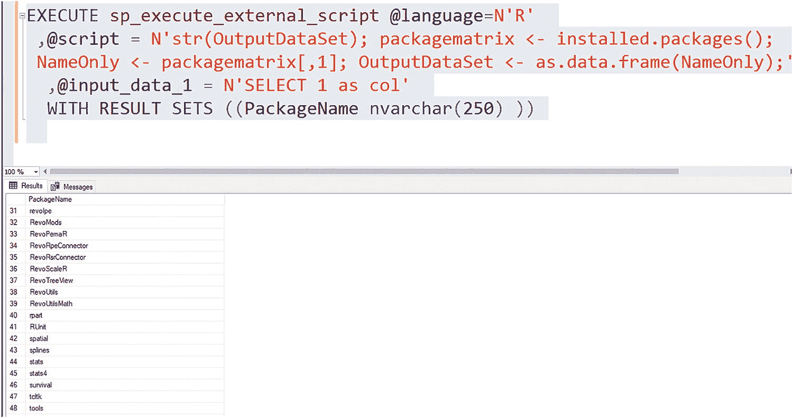

**图 9-9 SQL Server 机器学习服务中的 R 包**

## RevoScaleR 包

`RevoScaleR` 是由 Revolutionary Analytics（现归 Microsoft 所有）创建的一个包，旨在大规模地导入、转换和分析数据。该包提供了不同类别的函数，涵盖数据存储、导入与另存为、数据转换、绘制图表（如直方图、折线图等）、描述性分析、预测分析、包管理等 [3]。

在本节中，我将介绍一些你可能用于机器学习目的的函数。示例将在 SQL Server 2017 中展示。

### rxLinMod

`rxLinMode` 用于对数据拟合线性模型。在下面的示例中，我将向你展示如何使用此函数创建一个模型，用于预测混凝土强度与用水量、水泥用量、粉煤灰用量和龄期等输入变量的关系。`rxLinMode` 函数基于一个公式和一个训练数据集创建模型。

正如你在以下代码中看到的，第一行是 `EXECUTE sp_execute_external_script @language=N'R'`，它调用了一个存储过程，允许用户在 SQL Server 内部编写 R 脚本。该存储过程负责在 SQL Server 代码中使用 R 或 Python 等外部脚本。

```sql
EXECUTE sp_execute_external_script @language=N'R'
,@script = N'require("RevoScaleR")
formula=strength~cement+ash+age+water
Model_1=rxLinMod(formula,data=inputDataSet)
Model=data.frame(payload = as.raw(serialize(Model_1, connection=NULL)))'
,@input_data_1 = N'Select strength,cement,ash,age,water from [dbo].[concrete]; '
, @output_data_1_name = N'Model'
,@input_data_1_name = N'inputDataSet'
WITH RESULT SETS (([concreteModel] varbinary(max) NOT NULL  ));
```

代码中的第二行包含了存储在 `@script` 参数中的相关 R 代码。该代码通过使用 `require` 函数引用了 `RevoScaleR` 包。无需安装此包，因为它已存在于机器学习/R 服务中。第二行 R 代码是关于创建公式的。我们的任务是根据其他一些变量（如用水量、水泥用量等）来预测混凝土强度。允许我们执行此操作的公式是 `strength~cement+ash+age+water`，它将公式存储在一个名为 `formula` 的变量中。第三行包含 `rxLinMod` 函数，该函数根据公式创建一个线性模型。最后，代码的最后一行将公式存储在一个名为 `Model` 的输出变量中。

`@input_data_1` 使用 SQL 查询 `N'Select strength,cement,ash,age,water from [dbo].[concrete]'` 存储从 SQL 数据库收集的数据。最后，输出变量 `Model` 将存储线性模型。

创建模型后，我想将其存储起来，用于预测新的数据系列。要存储模型，请使用以下代码：

```sql
IF NOT EXISTS (SELECT 1 FROM sys.objects
WHERE object_id = OBJECT_ID(N'[dbo].[LinearModel]')
AND [type] IN (N'U'))
BEGIN
CREATE TABLE [dbo].LinearModel NULL
);
END
```

接下来，我们必须将模型插入到表中。以下代码将模型插入到 `LinearModel` 表中。

```sql
Insert into [dbo].[LinearModel]
EXECUTE sp_execute_external_script @language=N'R'
,@script = N'require("RevoScaleR")
formula=strength~cement+ash+age+water
Model_1=rxLinMod(formula,data=inputDataSet)
Model=data.frame(payload = as.raw(serialize(Model_1, connection=NULL)))'
,@input_data_1 = N'Select strength,cement,ash,age,water from [dbo].[concrete]; '
, @output_data_1_name = N'Model'
,@input_data_1_name = N'inputDataSet'
```

模型已经存储在数据库中。现在，在另一个存储过程中，我们将使用该模型来预测数据。

```sql
declare @rx_model varbinary(max) = (select [Model] from [dbo].[LinearModel] );
exec sp_execute_external_script
@language = N'R'
, @script = N'
require("RevoScaleR");
cdr_model<-unserialize(rx_model);
predictions <- rxPredict(modelObject = cdr_model,
data = PredictionData)
prediction <-as.data.frame(predictions);'
, @input_data_1 = N'Select strength,cement,ash,age,water from [dbo].[concrete]'
, @input_data_1_name = N'PredictionData'
, @output_data_1_name=N'prediction'
, @params = N'@rx_model varbinary(max)'
, @rx_model = @rx_model
with result sets (("prediction" float not null ))  ;
```

存储过程还有另一个输入，它不仅仅是一个数据集。它包含我们已经存储在数据库中的模型的输入。

通过运行存储过程，将显示以下预测结果（图 9-10）。

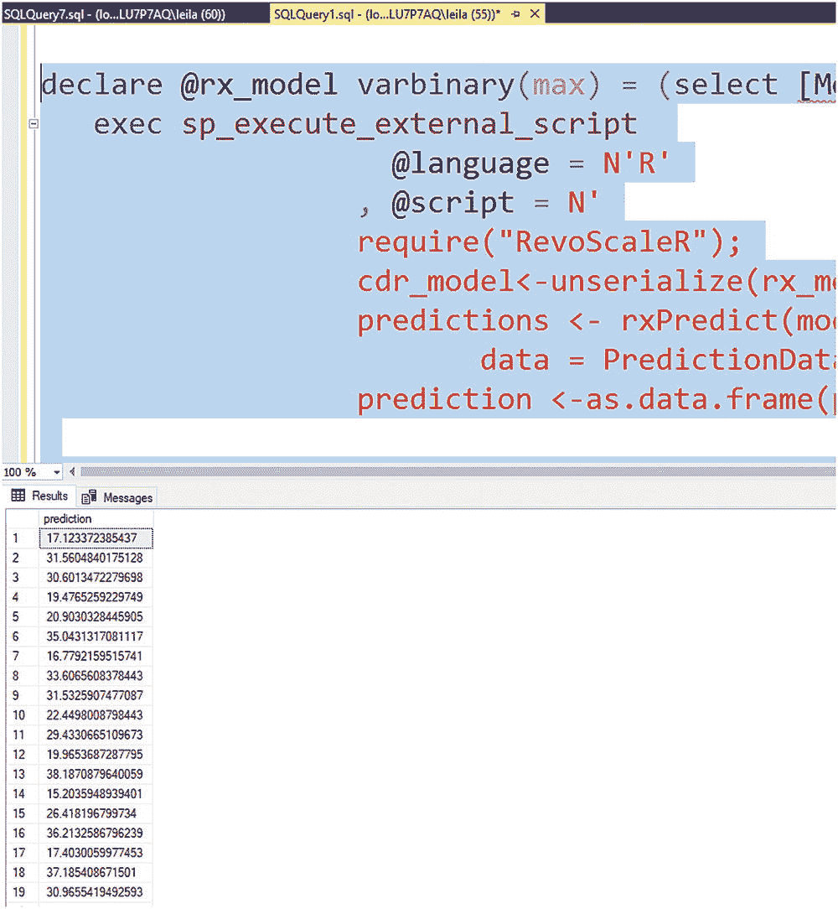

**图 9-10 混凝土强度预测的线性模型**

还有其他用于回归分析的模型。这些包括用于逻辑回归的 `rxLogit`；用于将线性模型推广到数据的 `rxGlm`；以及其他模型。此外，对于其他类型的分析，例如群体预测（分类），还有诸如 `rxDTree`、`rxBTree`、`rxDForest` 和 `rxNaiveBayes` 等算法 [3]。

## Azure ML 包

# Azure ML 与 SQL Server 中的 R 可视化

Azure ML 是另一个用于管理在 Azure ML Studio 中创建的实验的包（参见第 12 章）。该包包含一些常用函数，并允许用户从 R 函数创建 Web 服务。该包还允许 R 用户探索 Azure ML 数据集、浏览现有数据集等。有关如何使用此包的详细信息，请参阅第 12 章，该章在解释 Azure 机器学习工作室之后提供。

## 在 SQL Server Reporting Services 中创建 R 可视化图表

可以在 SQL Server 中生成 R 图表，并在 SQL Server Reporting Services (SSRS) 中显示该图表。第一步是将所需的包安装到机器学习服务中。为此，我们可以在外部脚本存储过程中使用 `install.packages()` 命令，如下所示：

```
EXECUTE sp_execute_external_script @language=N'R'
,@script = N' install.packages("ggplot2");'
,@input_data_1 = N'SELECT 1 as col'
WITH RESULT SETS ((PackageName nvarchar(250) ))
```

上述代码可能有效，但有时由于管理员权限问题，它可能无法工作。你可能会在 `install.packages("arules")` 中收到类似以下警告的消息：

```
'lib = "C:/Program Files/Microsoft SQL Server/MSSQL14.ML2017/R_SERVICES/library"' is not writable
Error in install.packages("ggplot2") : unable to install packages
Calls: source -> withVisible -> eval -> eval -> install.packages
```

要解决此问题，我们必须以管理员身份运行 `Rugi.exe` 来安装包。此外，我们必须指定包的安装位置。因此，需要 SQL Server 中 R 的机器学习服务的路径。R 中有一个函数 `.libPaths()`，它可以显示已安装包的位置。所以，我们必须在 SQL Server 2017 中运行此代码，以找出 R 库路径。

```
EXECUTE sp_execute_external_script  @language = N'R'
, @script = N'OutputDataSet <- data.frame(.libPaths());'
WITH RESULT SETS (([DefaultLibraryName] VARCHAR(MAX) NOT NULL));
GO
```

运行代码后，机器学习服务库路径将显示在 SQL Server 输出窗口中（图 9-11）。

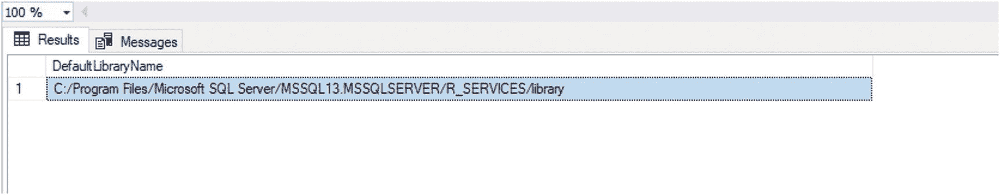

图 9-11 机器学习服务的库路径

安装 `ggplot2` 时，可能会收到另一条消息，要求安装其他包。安装 `ggplot2` 库后，我们可以编写 R 代码来创建图表并将其存储在 SQL Server 中。我将使用以下 SQL 代码绘制图表：

```
exec sp_execute_external_script @language =N'R', @script=N'library("ggplot2") fields<-inputDataSet fields<-na.omit(fields) image_file = tempfile(); jpeg(filename = image_file, width=1000, height=1000); print(ggplot(fields,aes(x=fields$TaxAmt,y=fields$TaxAmt))+geom_boxplot()+facet_grid(fields$Color~.) ) dev.off(); OutputDataset <- data.frame(data=readBin(file(image_file,"rb"),what=raw(),n=1e6)) ',@input_data_1 =N'select Color,Size,class,TaxAmt,SalesAmount from [dbo].[FactInternetSales] FIS inner join [dbo].[DimProduct] DP on FIS.ProductKey=dp.ProductKey' ,@input_data_1_name = N'inputDataSet' ,@output_data_1_name = N'OutputDataset' WITH RESULT SETS ((plot varbinary(max)));
```

### R 代码部分

```
library("ggplot2")
fields<-inputDataSet
fields<-na.omit(fields)
image_file = tempfile();
jpeg(filename = image_file, width=1000, height=1000);
print(ggplot(fields,aes(x=fields$TaxAmt,y=fields$TaxAmt))+geom_boxplot()+facet_grid(fields$Color~.)
)
dev.off();
OutputDataset <- data.frame(data=readBin(file(image_file,"rb"),what=raw(),n=1e6
```

以下是对上述代码的简要说明：

`library("ggplot2")`：引用该包。

`fields<-inputDataSet`：获取数据。

```
image_file = tempfile();
```

`jpeg(filename = image_file, width=500, height=500);`：从 `ggplot2` 包创建图像文件。

`ggplot(fields,aes(x=fields$TaxAmt,y=fields$TaxAmt))+geom_boxplot()+facet_grid(fields$Color~.)`：指代之前文章中已解释过的代码。

```
dev.off();
OutputDataset <- data.frame(data=readBin(file(image_file,"rb"),what=raw(),n=1e6
```

此代码创建一个 `Var` 二进制变量，用于将绘图转换为二进制类型的变量。上述代码创建了一个带有箱线图的表格图表。

下一步是从 SQL Server 获取数据。

### 输入数据

```
@input_data_1 =N'select Color,Size,class,TaxAmt,SalesAmount from [dbo].[FactInternetSales] FIS inner join [dbo].[DimProduct] DP on FIS.ProductKey=dp.ProductKey' ,@input_data_1_name = N'inputDataSet' ,@output_data_1_name = N'OutputDataset'
```

相关的数据集 `AdventureWorks*` 可以从 [www.microsoft.com/en-us/download/details.aspx?id=49502](http://www.microsoft.com/en-us/download/details.aspx%253Fid%253D49502) [4] 下载。

### 返回数据

```
WITH RESULT SETS ((plot varbinary(max)));
```

最后，我们必须以二进制变量的形式返回绘图。

运行代码后，我们可能会得到如图 9-12 所示的结果。

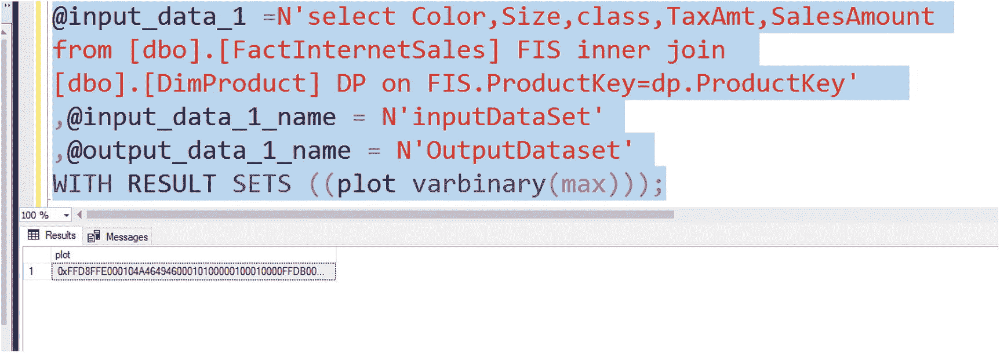

图 9-12 为图表创建二进制值

现在我们必须将数据存储在表中。首先，我们使用以下代码在 SQL Server 中创建一个名为 `ggplot` 的表：

```
IF NOT EXISTS (SELECT 1 FROM sys.objects WHERE object_id = OBJECT_ID(N'[dbo].[ggplot]') AND [type] IN (N'U')) BEGIN alter TABLE [dbo].ggplot NULL ); END
```

然后，通过插入以下命令将绘图输入到表中：

# R脚本集成与图表显示

```sql
insert into [dbo].[ggplot] exec sp_execute_external_script @language =N'R', @script=N'library("ggplot2") fields<-inputDataSet fields<-na.omit(fields) image_file = tempfile(); jpeg(filename = image_file, width=1000, height=1000); print(ggplot(fields,aes(x=fields$TaxAmt,y=fields$TaxAmt))+geom_boxplot()+facet_grid(fields$Color~.) ) dev.off(); OutputDataset <- data.frame(data=readBin(file(image_file,"rb"),what=raw(),n=1e6)) ', @input_data_1 =N'select Color,Size,class,TaxAmt,SalesAmount from [dbo].[FactInternetSales] FIS inner join [dbo].[DimProduct] DP on FIS.ProductKey=dp.ProductKey' ,@input_data_1_name = N'inputDataSet' ,@output_data_1_name = N'OutputDataset'
```

现在，我们已经在数据库中创建并存储了一个图表。

## 在 SSRS 中显示图表

要在`SQL Server 数据工具`中显示图表，我们必须创建一个新的`SSRS`项目（图 9-13）。

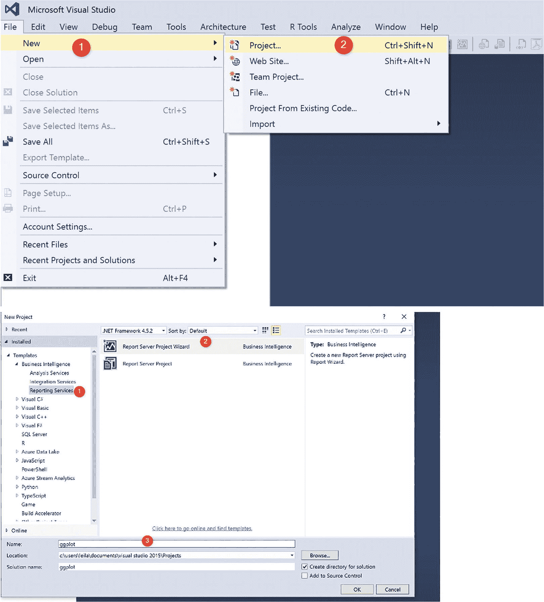

图 9-13

在`SQL Server 数据工具`中创建`SSRS`项目

接下来，我们按照创建`SSRS`报表所需的步骤进行操作（图 9-14）。

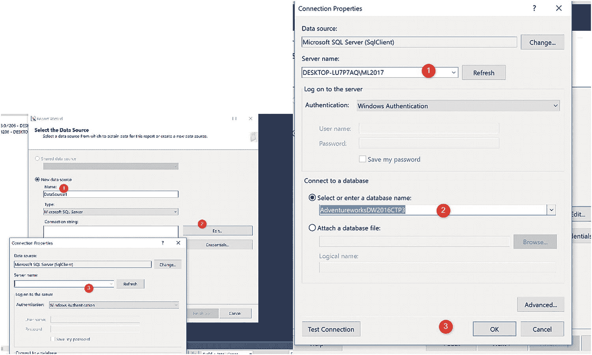

图 9-14

使用数据工具创建`SSRS`项目

然后必须创建一个查询，从`ggplot`表中获取绘图（图 9-15）。

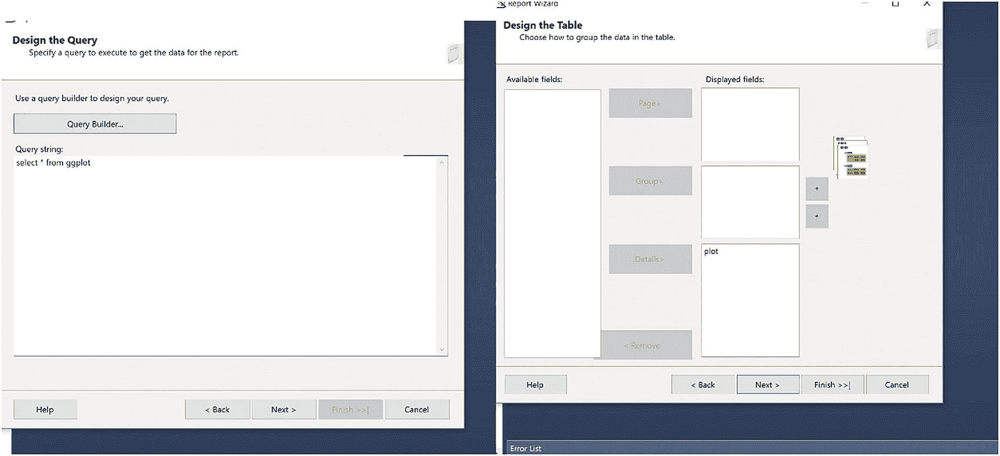

图 9-15

在`SSRS`中从`SQL Server`表获取数据

接下来，我们必须将图像插入到报表区域，并查看预览选项卡（图 9-16）以检查图表。

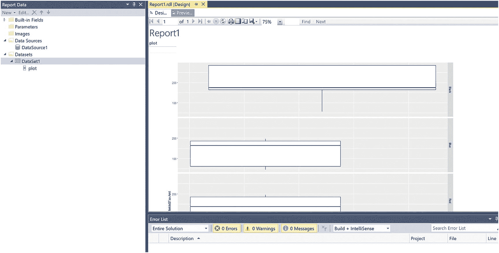

图 9-16

`SSRS`中的箱线图

## 总结

本章简要说明了如何在`SQL Server 2016`和`2017`中运行`R`脚本。它概述了如何通过外部脚本和存储过程运行必要的代码。此外，还讨论了如何使用`RevoScaleR`和`Azure ML`等包来访问额外的机器学习和`R`服务。此外，通过一个示例解释了如何进行预测分析的过程。下一章将概述如何在`Azure Databricks`中进行机器学习。