# 10. Azure Databricks

Databricks 是一项基于 Apache Spark 开源项目的分析服务。Apache Spark 是一个批处理和实时处理环境。Apache Spark 因其能够分析海量数据、具备流处理能力、图计算、机器学习以及交互式查询引擎，而在数据科学家中颇受欢迎。Spark 提供内存集群计算。Databricks 是 Spark 上用于大数据分析的流行工具之一。Databricks 已被用于摄取大量数据、清洗数据、应用机器学习等场景。2018 年 2 月，Microsoft Azure 与 Databricks 进行了集成，为数据工程师、数据科学家和数据分析师提供了更好的协作。此次集成为数据科学和数据工程团队在 Azure 中提供了一个快速、简单且基于 Spark 的协作平台 [1]。Azure Databricks 是一个用于大数据分析和机器学习的新平台。Azure Databricks 中的笔记本使数据工程师、数据科学家和业务分析师能够使用单一工具进行协作。本章概述了 Azure Databricks 是什么、它所处的环境及其在数据科学中的应用。

## Databricks 环境

要在 Azure 环境中创建 Azure Databricks，请登录你的一个 Azure 账户。然后，创建一个 Azure Databricks 模块（图 10-1）。

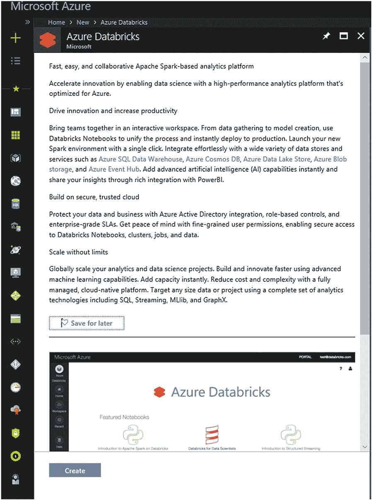

图 10-1 Azure Databricks 环境

创建 Azure Databricks 模块后，Azure 将导航到一个新页面。要访问 Azure Databricks，请单击“`启动工作区`”（图 10-2）。

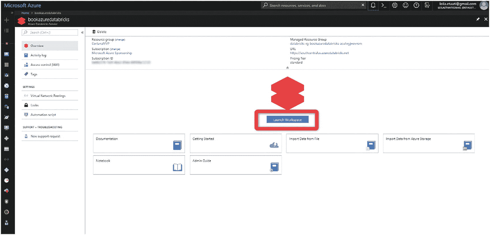

图 10-2 启动工作区

如图 10-3 所示，Azure Databricks 环境包含不同的组件。主要组件是工作区和集群。启动后的第一步是创建一个集群。Databricks 中的集群为 `ETL`（提取、转换、加载）、流分析和机器学习提供了一个统一平台。集群分为两种类型：交互式集群和作业集群。笔记本集群用于协作分析数据。而作业集群则用于使用 API 快速、稳健地运行自动化工作负载。集群页面可能包含这两种集群类型。每个集群可以有不同的节点。首先，你必须创建一个集群。单击“`创建集群`”选项（图 10-3）。

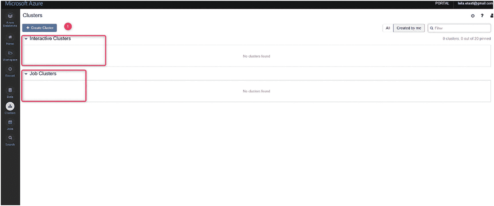

图 10-3 在 Databricks 中创建集群

在“`创建集群`”页面（图 10-4）上，输入相关信息，例如集群名称、版本（默认）、Python 版本、最小和最大工作节点数等。

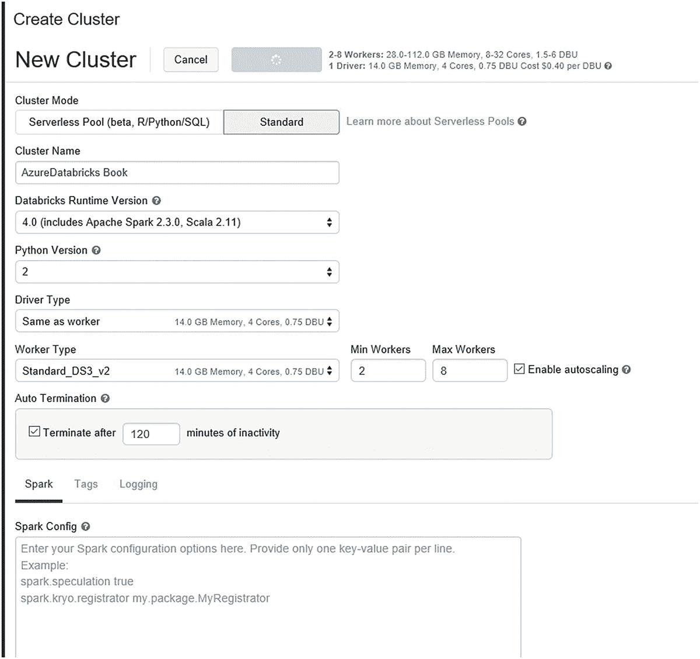

图 10-4 Azure Databricks 中的“`创建集群`”页面

如图 10-4 所示，我们有一个驱动节点和一个工作节点。工作节点用于分配你的工作负载。驱动节点负责维护 `SparkContext`。可以自动调整和自动缩放集群的大小。通过启用自动缩放，可以在集群的生命周期内限制最小和最大工作节点数。

要使用集群，你应该等待状态变为“`正在运行`”（图 10-5）。通过创建交互式集群，你可以创建一个笔记本，在其中编写代码并快速获取结果。

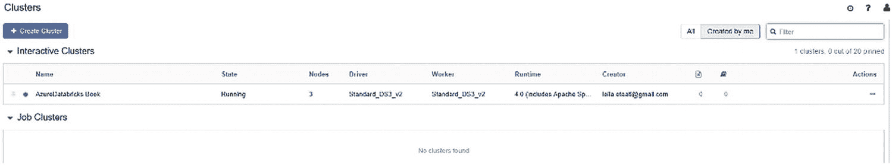

图 10-5 正在运行的集群

要创建笔记本，请单击“`工作区`”选项并创建一个新笔记本（图 10-6）。

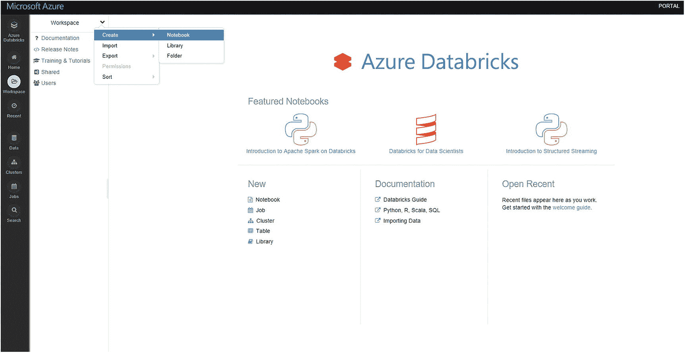

图 10-6 在 Databricks 中创建笔记本

通过创建新笔记本，你可以指定该笔记本属于哪个集群，以及笔记本的主要语言（Python、Scala、R 和 SQL）是什么。在此示例中，`R` 语言已被选为默认语言。但是，你仍然可以在笔记本中使用其他语言编写，方法是在脚本前写入 `%scala`、`%python`、`%sql` 或 `%r`（图 10-7）。

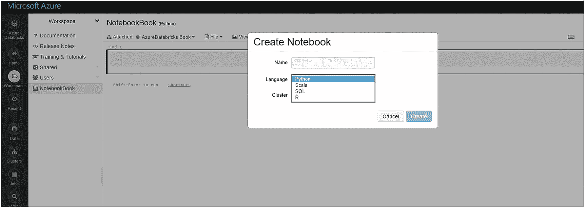

图 10-7 在 Databricks 中创建 `R` 笔记本

默认情况下，笔记本中有一个用于编写代码的区域。如图 10-8 所示，有一个名为 `Cmd1` 的编辑器节点，您可以在其中编写代码并一次性运行所有代码。在我们的示例中，只有一个节点，编写代码的主要语言是 `R`。此外，我们通过编写以下代码，使用了 `gpplot2` 包中名为 `mpg` 的现有数据集：

```r
library(ggplot2)
display(mpg)
```

`display` 命令用于在 Databricks 中显示数据集。要运行代码，请点击节点右侧的箭头，然后选择“`运行单元格`”（图 10-8）。

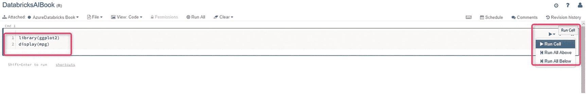

图 10-8 在 Databricks 中编写 `R` 笔记本

运行代码后，结果将以表格形式显示在单元格末尾。如图 10-9 所示，初始结果以表格形式呈现；不过，也可以将结果显示为与其他图表相同的格式。

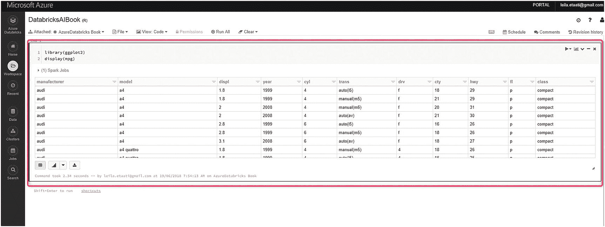

图 10-9 运行 `R` 代码

要显示图表，您必须点击单元格底部的图表图标（图 10-10）。

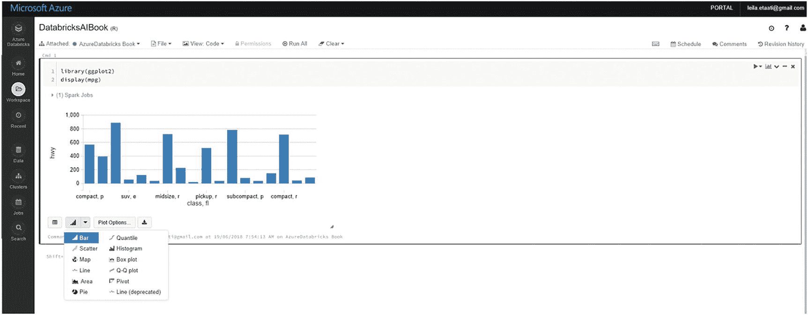

图 10-10 在 Databricks 中显示图表

您可以通过点击“`绘图选项`”来更改要在图表中显示的项目（图 10-11）。

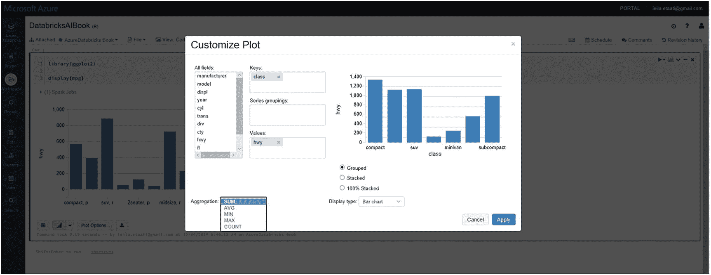

图 10-11 Databricks 中的图表选项

可以创建新的单元格来编写更多 `R` 或 `Scala` 代码。在我们的示例中，我们必须将一个名为 `Titanic` 的数据集上传到 Azure Databricks。

要导入数据，请点击窗口左侧的“`数据`”选项（图 10-12），然后点击“`添加数据`”。这将导航到一个新页面（图 10-12）。然后点击“`上传文件`”。只需浏览并上传 `titanic` 文件。如果您需要此文件，可以从 [`www.kaggle.com/c/titanic`](http://www.kaggle.com/c/titanic) 获取。

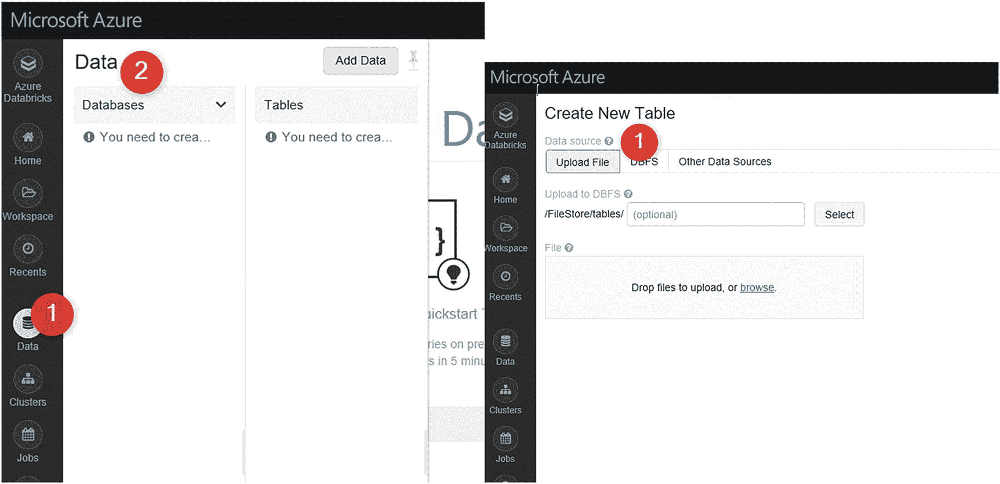

图 10-12 使用“`数据`”选项导入数据

如图 10-13 所示，我们必须使用用户界面 (`UI`) 创建一个表，并选择要上传到的相关集群。

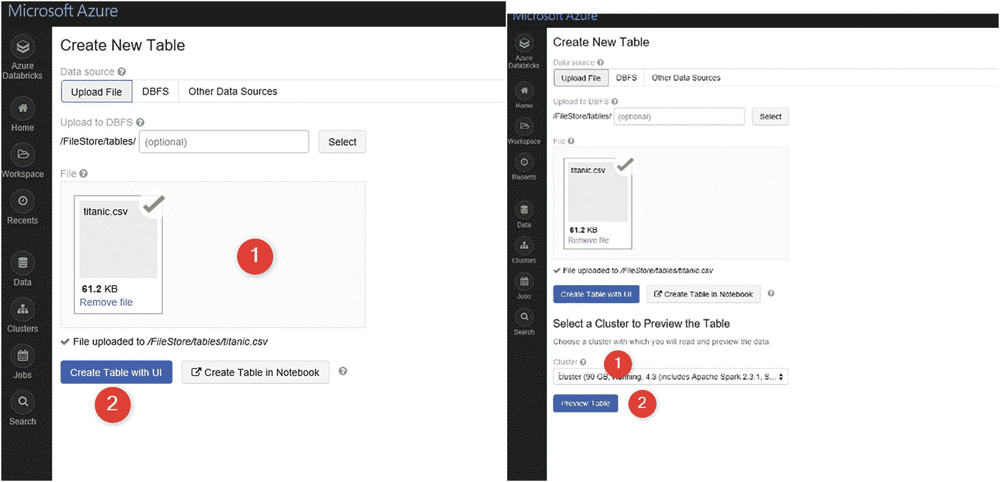

图 10-13 将数据导入 Azure Databricks

我们现在创建一个新的工作区，命名为：

```scala
val titanic = spark.table("titanic")
display(titanic.select("∗"))
```

为了处理 `Titanic` 数据集，我们只需要选择 `Survived`、`Sex`、`Age` 和 `PClass` 列（见图 10-14）。

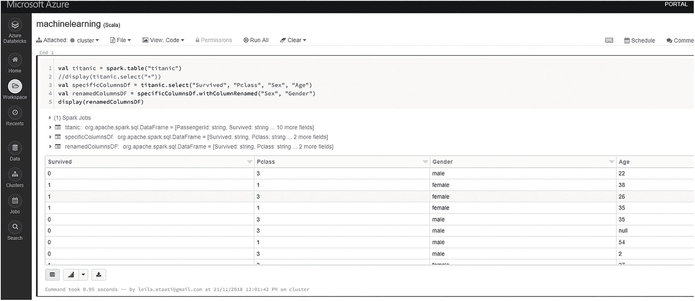

# 在 Azure Databricks 中使用 Scala 和 R 进行机器学习

## 从 Azure Data Lake Store 获取数据

图 10-14 展示了运行 Scala 语言从 Azure Data Lake Store 获取数据的过程。

```scala
val specificColumnsDf = titanic.select("Survived", "Pclass", "Sex", "Age")
val renamedColumnsDF = specificColumnsDf.withColumnRenamed("Sex", "Gender")
display(renamedColumnsDF)
```

现在，出于机器学习的目的，我们将预测特定年龄、性别和乘客等级的新乘客是否幸存。为此，我们必须在另一个单元格中对该数据运行 R 代码，以创建一个模型并预测特定年龄、性别和乘客等级的乘客是否幸存。我们必须将数据从 Scala 传递到 R。为此，我们必须创建一个临时表，将该表提供给 R 代码，使用以下代码：

```scala
renamedColumnsDF.createOrReplaceTempView("TempTable")
```

我们通过点击最新单元格下方的加号来添加一个新单元格。在新单元格中，我们必须编写 R 代码。因此，我们必须通过在代码开头放置 `%r` 来指明语言。此外，我们使用了 `SparkR` 中的一些包，因此我们使用 `SQL` 函数从上一个 Scala 单元格中获取数据。最后，我们将数据存储在一个 `dataset` 变量中。

```r
%r
library(SparkR)
sql("REFRESH TABLE TempTable")
df <- sql("SELECT ∗ FROM TempTable")
dataset<-as.data.frame(df)
display(df)
```

## 在 R 中进行机器学习预测

在同一个单元格或新单元格中，您可以编写一些用于机器学习的代码。在我们的示例中，我们旨在检查特定乘客等级、年龄和性别的乘客是否幸存。`rpart` 包可用于创建决策树。该包帮助我们预测生存概率。

```r
%r
library(SparkR)
sql("REFRESH TABLE TempTable")
df <- sql("SELECT ∗ FROM TempTable")
dataset<-as.data.frame(df)
library(rpart)
DT<-rpart(Survived~.,data=dataset,method="class")
test<-dataset[,2:4]
Prediction<-predict(DT,test)
output<-data.frame(test,Prediction)
display(output)
```

运行该单元格后，将显示输出（图 10-15）。

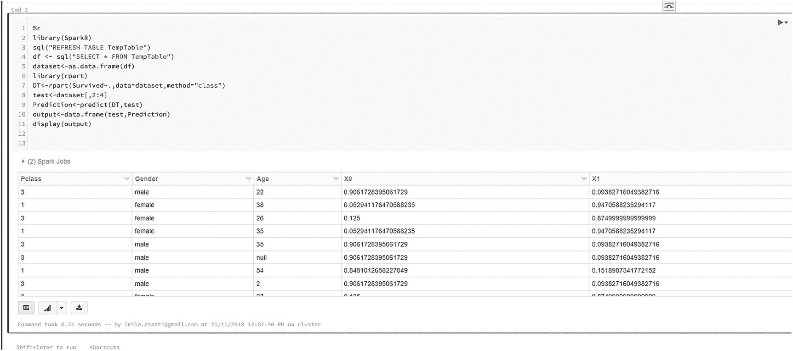

图 10-15

## 使用 ggplot2 可视化结果

也可以使用诸如 `ggplot2` 之类的 R 包来绘制图表。例如，如果我们想查看带有特定图例的散点图中的 `Pclass`、年龄和性别，我们可以利用以下代码。

```r
%r
display(output)
library(ggplot2)
ggplot(output,aes(x=output$Age,y=output$Pclass, color=output$Gender))+geom_jitter()
```

如图 10-16 所示，将生成一个带有图例 `output$Gender` 的散点图。

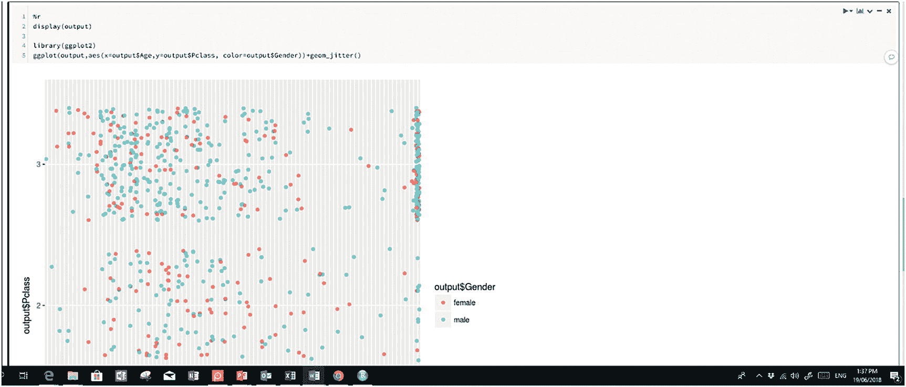

图 10-16

## 数据流程与可视化

Azure Databricks 不仅用于机器学习。它还可以从不同资源检索数据，对其应用更改，然后在某些可视化工具（如 Power BI）中显示结果。此外，还可以安排该过程（图 10-17）。

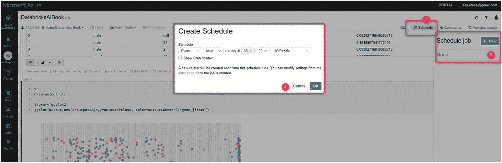

图 10-17

有多种从 SQL 数据库获取数据的方法，包括诸如 Azure Blob、Data Lake Store、Azure Cosmos 等 Azure 服务 [2]。

## 总结

本章简要概述了如何使用 Azure Databricks 进行机器学习。它讨论了如何使用 Databricks 环境编写 R 和 Scala 脚本，以及如何将数据从 Databricks 环境中的一个单元格传递到另一个单元格。最后，您了解了如何应用 R 代码来训练模型并将其用于预测。还解释了如何导入数据以及如何进行机器学习的过程。下一章将概述如何在 Azure Data Lake 中进行机器学习。