# 11. Azure Data Lake 中的 R

Azure Data Lake Store 是 Microsoft Cloud 的组件之一，可帮助开发人员、数据科学家和分析师存储任意规模和形状的数据。Azure Data Lake 针对处理大量数据进行了优化。它提供具有最佳性能的并行处理。在 Azure Data Lake 中，我们可以创建分层的数据文件夹结构。凭借这些能力，Azure Data Lake 使数据科学家能够以高可扩展性和成本效益轻松应用高级分析和机器学习建模。Azure Data Lake Analytics 包含 U-SQL，这是一种类似 SQL 的语言，可让你处理非结构化数据 [1]。可以在 Azure Data Lake 内部执行机器学习，并从 RStudio 探索 Azure Data Lake，以在 RStudio 环境中创建模型。此外，还可以通过 Hive 查询从 Azure Data Lake 获取数据，并在 Azure Machine Learning 中使用这些数据。在本章中，你将了解如何使用 Azure Data Lake 中的 U-SQL 语言与 R 来写入和处理数据，以及如何将数据从 Azure Data Lake 导入到 RStudio，或从 RStudio 导入到 Azure Data Lake。

## Azure Data Lake 环境

Azure Data Lake 是 Microsoft Cloud 的组件之一，旨在存储数据。如图 11-1 所示，Azure Portal 中的第二个组件是关于数据存储的。Azure Data Lake Store 可以存储任意大小或格式（结构化和非结构化）的数据。它也用于进行分析（第三个组件）。Azure Data Lake Analytics 可用于数据分析（使用 U-SQL）和机器学习。

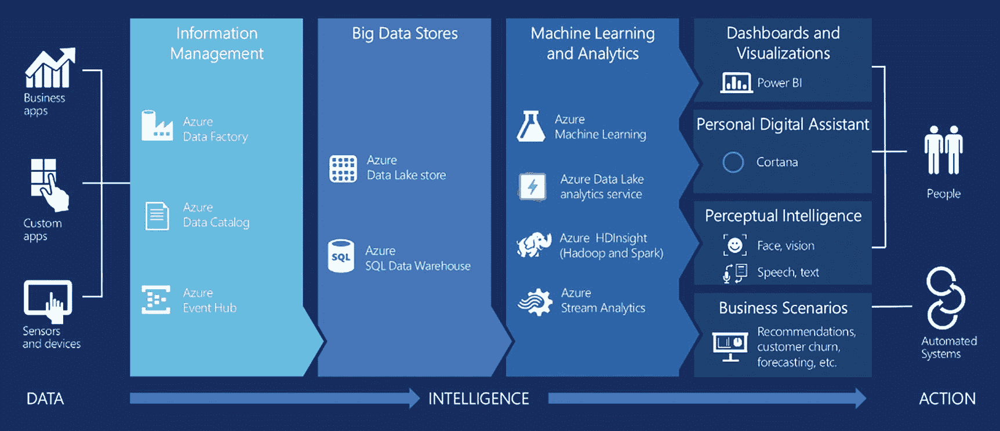

图 11-1

Microsoft Cloud 组件

要访问 Azure Data Lake Store 和 Data Lake Analytics，你必须拥有一个 Azure 帐户。你可以通过访问以下链接创建一个：[`https://tsmatz.wordpress.com/2017/06/08/azure-data-lake-r-extension/`](https://tsmatz.wordpress.com/2017/06/08/azure-data-lake-r-extension/)。登录“Portal.Azure.com”，然后点击门户左侧的“创建资源”图标（图 11-2）。通过输入“data lake”，将出现两个不同的 Azure Data Lake 组件。首先，我们将创建 Azure Data Lake Store。

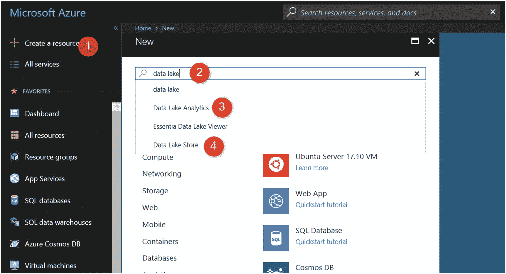

图 11-2

创建 Azure Data Lake Store 和 Data Lake Analytics

点击“创建”选项后，首先需要提供一些信息，例如服务名称、订阅、资源组和服务器位置（图 11-3）。

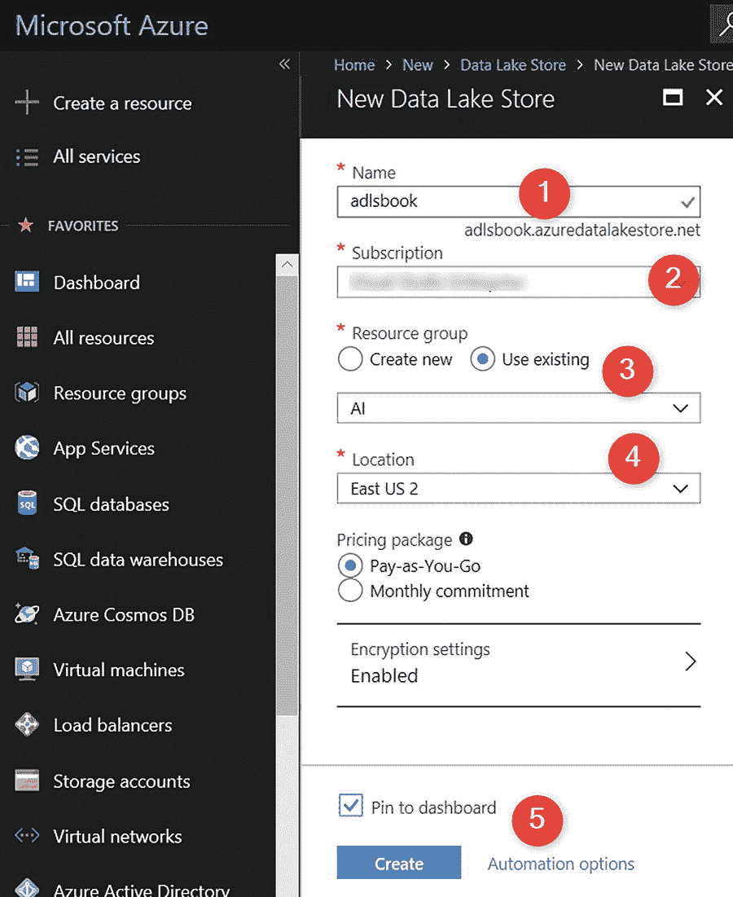

图 11-3

创建 Azure Data Lake Store

创建组件需要一些时间。如图 11-4 所示，Azure Data Lake Store 已创建完成。创建 Azure Data Lake Store 后，我们可以将新数据上传到其中。

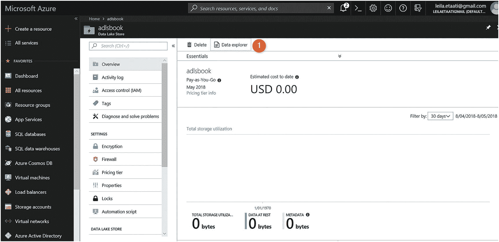

图 11-4

创建 Azure Data Lake Store

通过点击“数据资源管理器”选项，可以查看数据和结构。从这里，如图 11-5 所示，可以上传数据、创建文件夹、定义访问级别等。

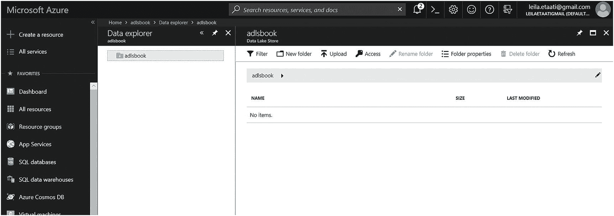

图 11-5

Azure Data Lake Store 中的数据资源管理器

目前，Azure Data Lake Store 中没有数据。可以从其他 Azure 组件将数据导入到 Data Lake Store。在本节中，为了机器学习的目的，我们首先将通过 Azure Data Lake Analytics 创建一个数据样本。

为此，我们必须创建一个 Data Lake Analytics 资源（图 11-6）。我们遵循与创建 Data Lake Store 相同的过程。但是，我们必须指定要使用哪个 Data Lake Store。请注意：你必须始终先创建 Data Lake Store，然后再创建 Data Lake Analytics。

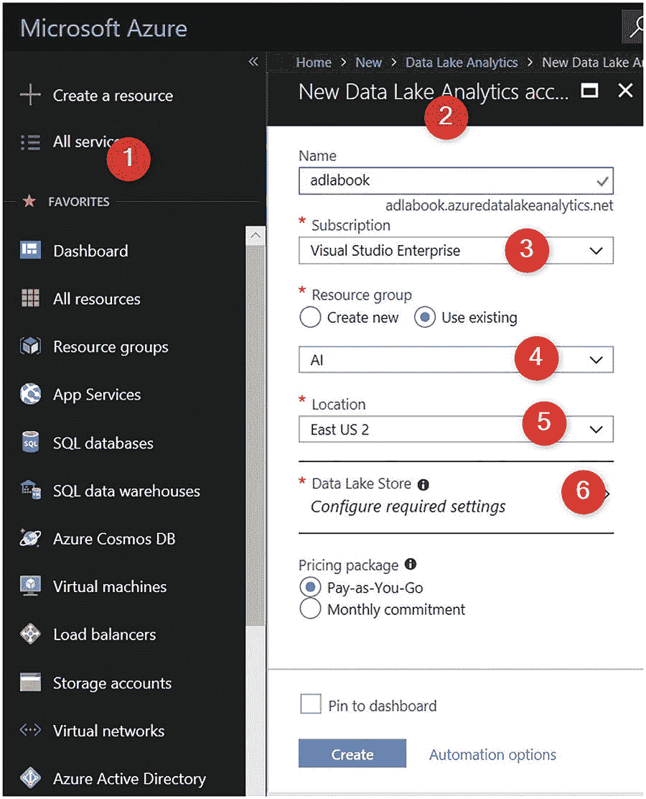

图 11-6

创建 Azure Data Lake Analytics 资源

在指定名称、位置、相关的 Data Lake Store、订阅等信息后，你必须等待组件创建完成并显示在 Azure Dashboard 上（图 11-7）。

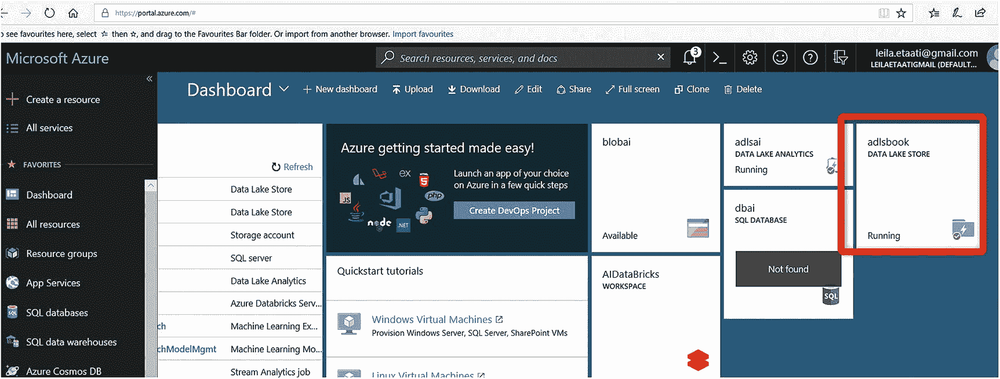

图 11-7

在 Azure Dashboard 上创建的 Data Lake Store


只需点击已创建的 Azure Data Lake Analytics。Data Lake Analytics 可用于开发和运行大规模并行数据，以及使用 U-SQL、R、Python 和 .NET 转换和处理数据。首先，我们将导入一些示例数据和代码。在页面顶部，点击 **Sample scripts** 选项（图 11-8）。

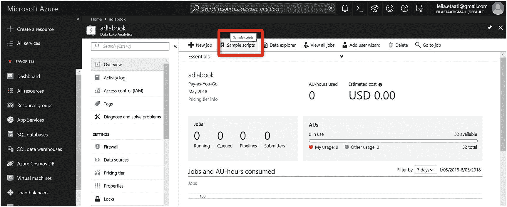

**图 11-8**

Data Lake Analytics 示例脚本

在 **Sample scripts** 页面中，有两个主要的示例数据：**Sample data missing** 和 **U-SQL Advanced Analytic…**。我们需要后者来访问示例数据和代码。示例数据将存储在 Data Lake Store 中（图 11-9）。

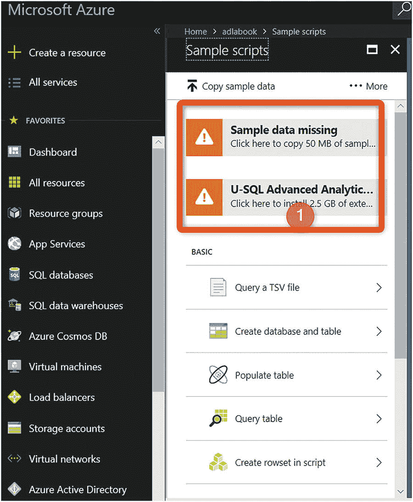

**图 11-9**

Data Lake Analytics 中的示例数据

要编写 U-SQL 并导入一些示例数据和代码，请点击 **U-SQL Advanced Analytics** 选项。随后，大约 2.5GB 的数据将被下载到 Azure Data Lake Store 中。下载开始后，您将在 **Install U-SQL Extensions** 页面上看到启用 U-SQL 和导入数据的过程。安装过程以管道形式显示，可能需要大约两分钟才能运行完成（图 11-10）。

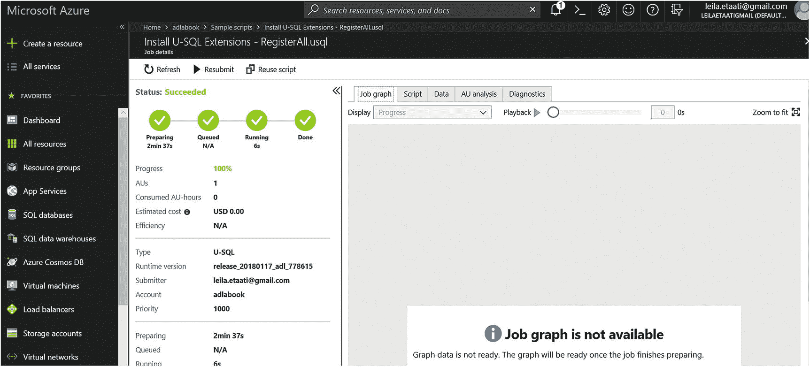

**图 11-10**

安装 U-SQL 扩展的过程

接下来，关闭页面，点击 **adlsbook**，然后点击页面顶部的 **Data explorer**（图 11-11）。

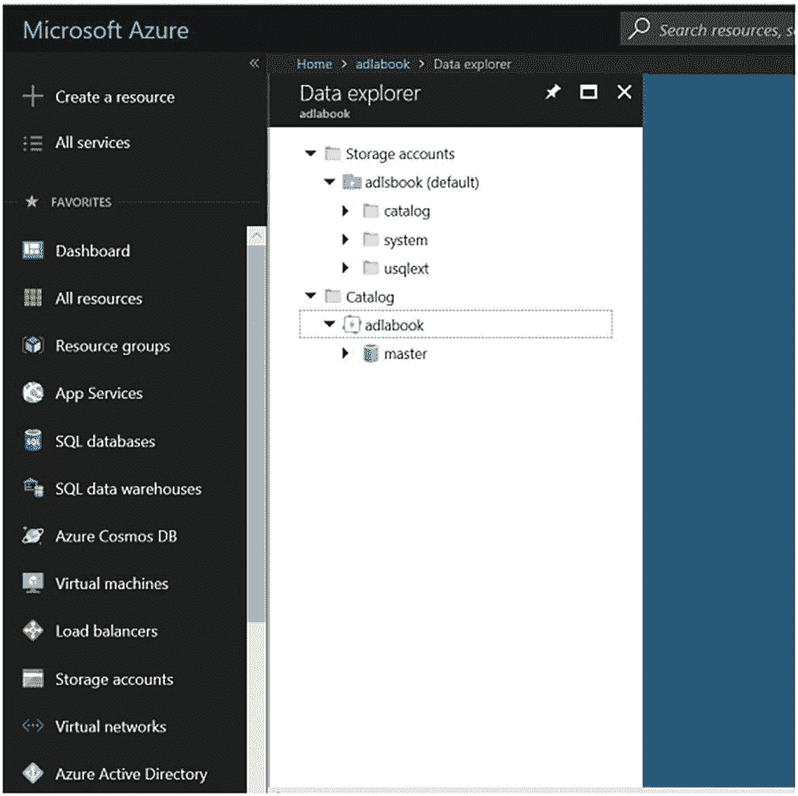

**图 11-11**

Azure Data Lake Store 中已导入的数据

您可以浏览 Data Lake Store 文件夹。在 **adlsbook** 下列出的文件夹中，有两个分别名为 **R** 和 **Python**。点击 **R** 文件夹，可以看到合并的数据、U-SQL 文件、zip 文件等（图 11-12）。

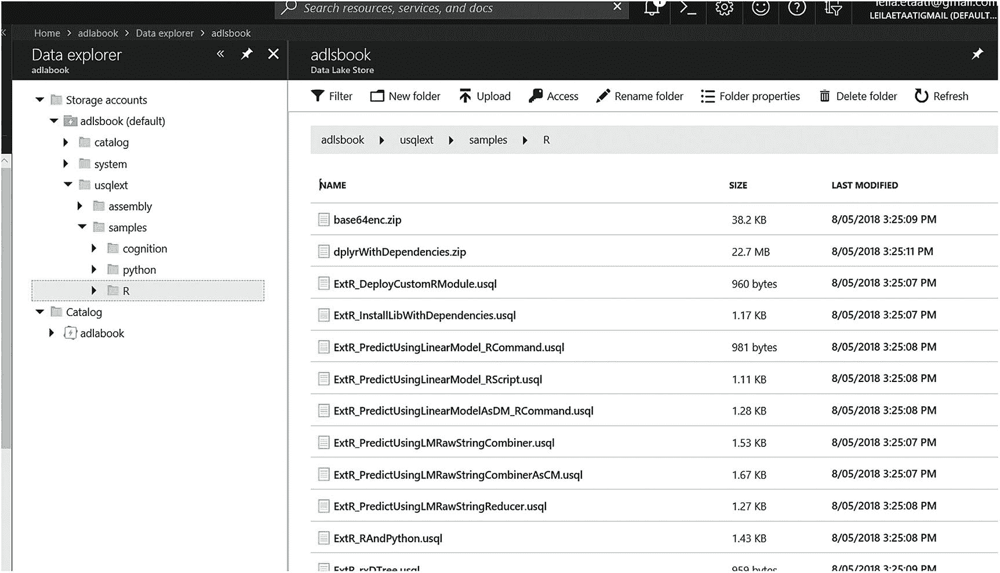

**图 11-12**

Data Explorer — R 和 Python 示例文件

点击 **R** 文件夹中的一个 U-SQL 文件，例如 `ExtR_PredictUsingLinearModel_RScript.usql`*。* 点击文件后，您可以在单独的页面中看到相关的 U-SQL 文件内容，如图 11-13 所示。如图所示，U-SQL 脚本与 SQL 语言类似。您可以检查文件格式、下载代码、重命名文件、通过 **Access** 撤销或授予文件访问权限等。在下一节中，我将解释 U-SQL 语言以及如何在其中编写 R 代码或 Python 代码。

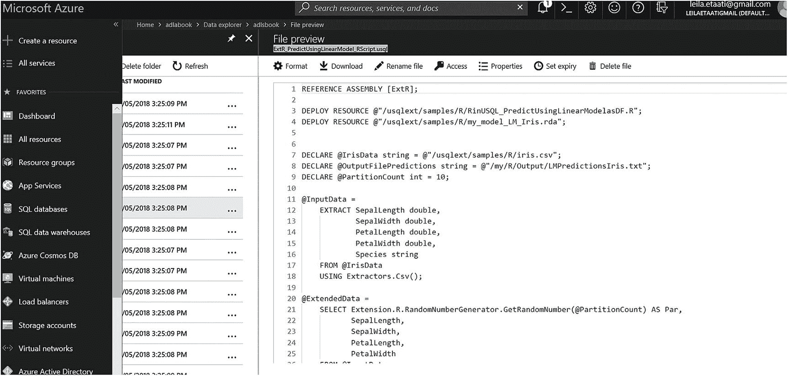

**图 11-13**

R 脚本中用于预测模型的 U-SQL 文件

## 在 U-SQL 中运行 R 脚本

要了解 U-SQL 语言的工作原理，请点击 **R** 文件夹中的一个代码示例。然后点击 `ExtR_rxDTree.usql`。在此示例中，我们将根据鸢尾花的花萼长度预测其种类。首先，我们必须从某个资源获取数据。在代码中，数据已从 `/usqlext/samples/R/iris.csv` 中提取。该数据集位于 Azure Data Lake Store 中 **usqlext** 文件夹下的 **samples** 子文件夹中，位于 R 代码目录下。复制整个代码，返回 Azure Data Lake Analytics 主页面，然后点击页面顶部的 **New job**（图 11-14）。

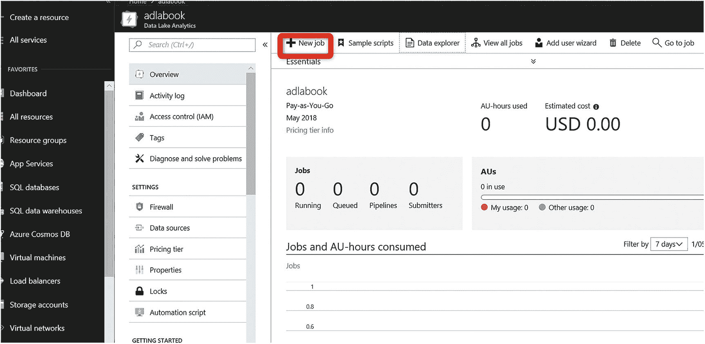

**图 11-14**

复制代码并点击 **New job**

在 **New job** 页面中，有一个编辑器允许您将代码放入其中（图 11-15）。

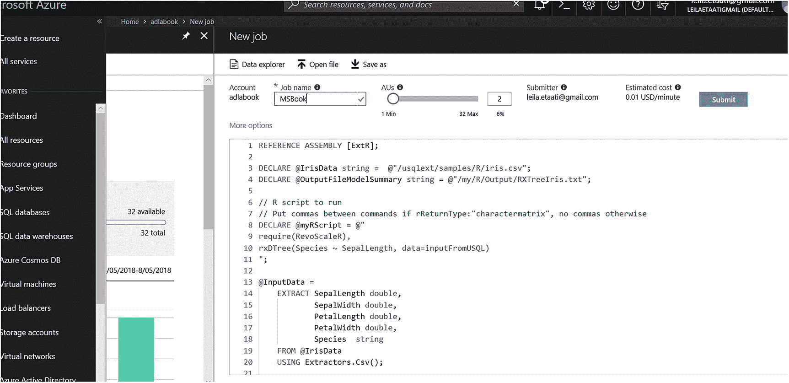

**图 11-15**

在 Azure Data Analytics 中从 **New job** 页面传递 U-SQL 代码

将代码插入编辑器后，在页面顶部的 **Job name** 框中可以输入“MSBook”。

我们可以提交代码来运行它，但我们将修改代码。在接下来的段落中，我将解释这段代码。

这段代码是一个简单的预测分析。有一个名为 **iris** 的免费数据集，它包含花卉的规格信息。该数据集有五列：种类类型以及花萼和花瓣的长度与宽度。我们的分析将根据花萼长度预测花卉的种类。第一步是确定如何访问输入数据（iris 数据集）。该数据集已导入到 Data Lake Store 的 **R** 文件夹下。要在 U-SQL 脚本中使用数据，我们必须将其存储在一个变量中。

```
DECLARE @IrisData string =  @"/usqlext/samples/R/iris.csv";
```

此外，我们想将预测结果写回到另一个位置。因此，在路径中，我们定义一个新路径，并将输出链接存储在一个单独的变量中，如下所示：

```
DECLARE @OutputFileModelSummary string = @"/usqlext/MSBook/RXTreeIris.txt";
```

下一部分是关于 R 脚本定义的，使用以下代码：

```
DECLARE @myRScript = @"
require(RevoScaleR),
rxDTree(Species ~ SepalLength, data=inputFromUSQL)
";
```

`@myRScript` 变量将存储我们下一步要运行的 R 代码。上述代码使用了 R 中的 `RevoScaleR` 包。该包包含一个 `rxDTree` 函数，这是一个决策树算法，用于根据花萼长度预测花卉的种类。

现在我们可以使用一些 U-SQL 语言，通过以下代码将输入链接中的数据提取到一个名为 `@InputData` 的变量中：

```
@InputData =
EXTRACT SepalLength double,
SepalWidth double,
PetalLength double,
PetalWidth double,
Species  string
FROM @IrisData
USING Extractors.Csv();
@ExtendedData =
SELECT 0 AS Par,
∗
FROM @InputData;
```

U-SQL 代码使用 `Extractors.Csv()` 函数从 CSV 文件中获取数据。下一步，我们将使用 `Extension.R.Reducer()` 函数来运行代码。

```
@RScriptOutput = REDUCE @ExtendedData ON Par
PRODUCE Par, RowId int, ROutput string
READONLY Par
USING new Extension.R.Reducer(command:@myRScript, rReturnType:"charactermatrix", stringsAsFactors:true);
OUTPUT @RScriptOutput TO @OutputFileModelSummary USING Outputters.Tsv();
```

现在您可以使用 **Submit** 按钮提交代码。提交代码后，MSBook 作业将开始运行（图 11-16）。

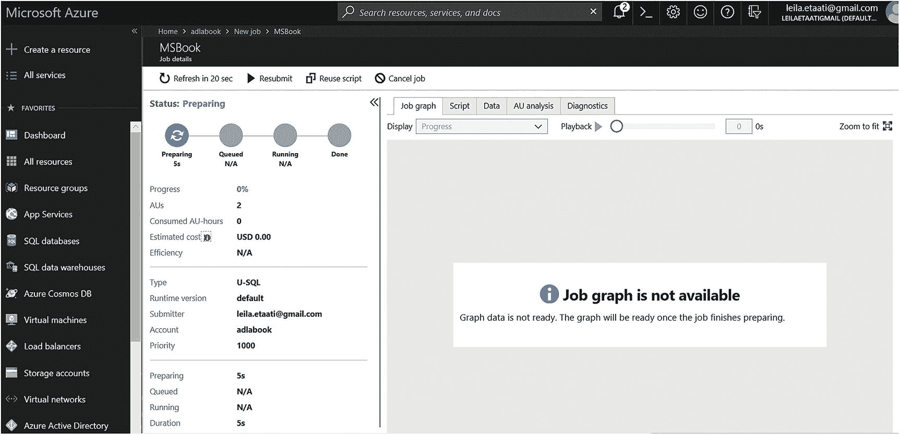

**图 11-16**

运行 MSBook 作业的过程

运行代码后，您必须检查输出文件夹，以确认模型是否以文本文件形式存储在那里（图 11-17）。

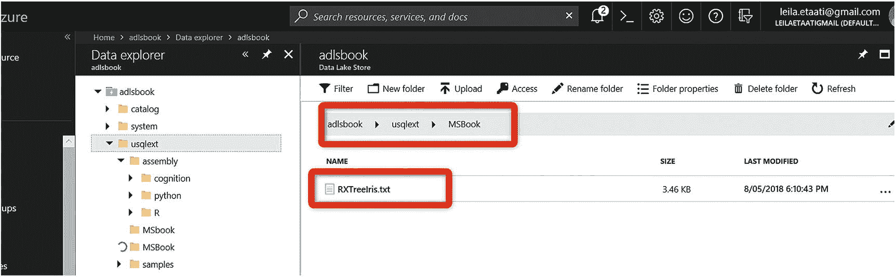

**图 11-17**

保存决策树模型的输出文件夹

我们在第 9 章中为机器学习执行的相同过程，也可以在这里应用。我们可以创建一个模型，并将其作为文本文件存储在 Azure Data Lake Store 中。然后，我们可以在另一个作业中使用该模型来评估模型，或使用它来预测一系列新数据。上一阶段创建的模型可以在另一个作业中使用。


## 通过 RStudio 管理文件夹

可以将 Azure Data Lake Store (ADLS) 中的数据加载到 RStudio 中，用于机器学习。此外，我们还可以使用 R 脚本，在 RStudio 环境中管理 ADLS。因此，无需访问 ADLS 门户，我们就能管理门户，并将数据从 ADLS 带到 RStudio 中进行机器学习实践。然而，在确保我们的代码足够完善后，我们可以在 ADLS 内部使用 U-SQL，将 R 代码嵌入到 ADLS 环境中（如上一节所述）。本节将解释从 RStudio 环境访问文件的过程。

在上一节中，我们已经创建了一个 ADLS。但是，我们必须创建一个从 Azure 到外部应用程序（此处为 RStudio）的连接。为此，我们必须创建一个用于服务到服务身份验证的 Azure Active Directory。

在 Azure 门户页面的左侧，点击 **Azure Active Directory**（图 11-18）。

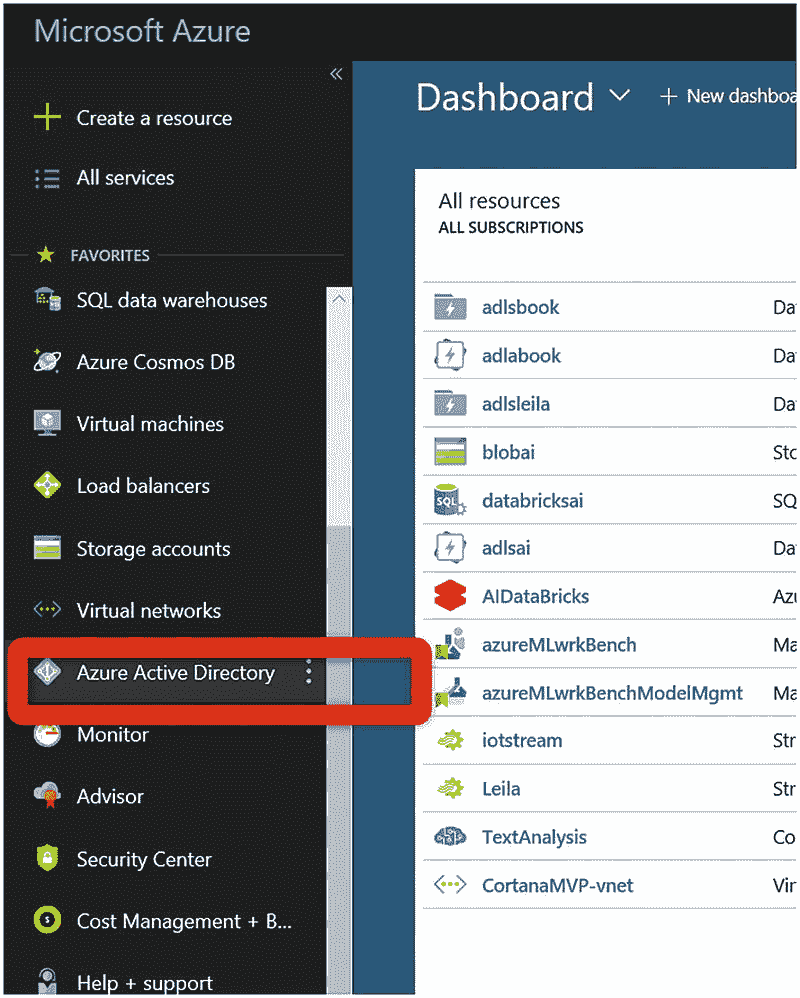

**图 11-18**
Azure 中的 Azure Active Application

接下来点击 **应用注册**，然后点击 **新应用程序注册**（图 11-19）。

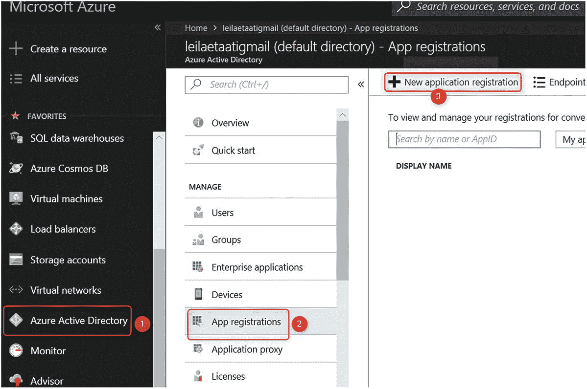

**图 11-19**
Azure Active Directory 中的应用程序注册

现在，你只需提供一些常规信息，例如名称、应用程序类型和登录 URL。

登录 URL 以后可以更改，所以现在，我输入了一个随机 URL（网站地址 [`http://radacad.com`](http://radacad.com)）（图 11-20）。

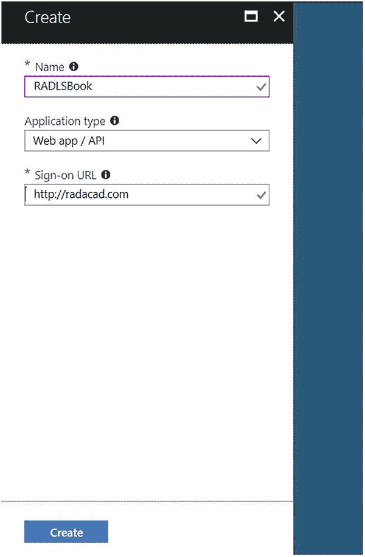

**图 11-20**
Azure Active Directory 中的应用程序注册

创建完成后，创建的应用程序不会显示在页面上，因此你必须点击 **查看所有应用程序**（图 11-21）。这将刷新页面并显示应用程序注册列表。

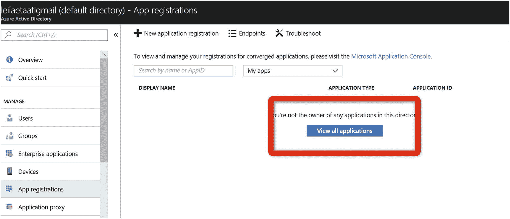

**图 11-21**
应用程序注册

现在，你可以在页面上看到应用程序注册列表（图 11-22）。

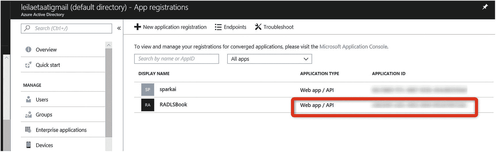

**图 11-22**
应用程序注册中的应用程序 ID

要访问 ADLS，我们需要三个不同的标识，例如应用程序 ID（客户端 ID）、租户 ID 和客户端密钥 ID。

客户端 ID，即应用程序 ID，可以从应用注册中获取（图 11-22）。对于租户 ID，你必须返回 Active Directory 并点击 **属性**，然后将目录 ID 复制为租户 ID（图 11-23）。

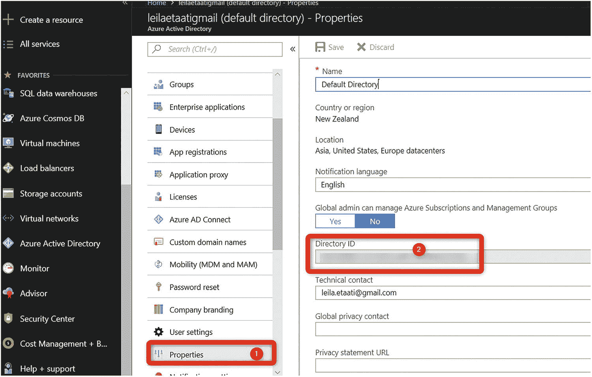

**图 11-23**
目录 ID（租户 ID）

我们需要从 Azure 获取的最后一个令牌是客户端密钥 ID。要获取密钥 ID，你必须转到 Azure Active Directory，然后转到应用注册，并选择你创建的应用程序。现在只需点击创建的应用程序（图 11-24）。

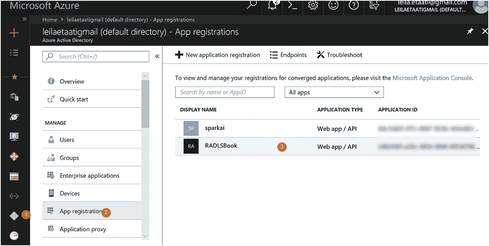

**图 11-24**
从 Azure Active Directory 获取客户端密钥 ID——第 1 部分

现在你必须点击 **RADLSBook**，进入主页面。在 RADLSBook 中点击 **设置**（图 11-25）*。*

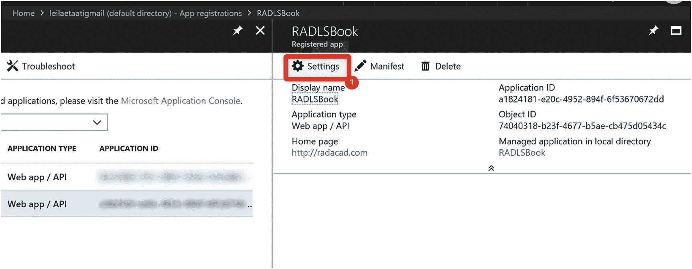

**图 11-25**
从 Azure Active Directory 获取客户端密钥 ID——第 2 部分

在设置页面上，点击 **密钥** 选项。在密钥页面上，你将能够创建一个密码。我们必须创建一个新密码。点击 **密钥描述** 并输入一个名称（图 11-26）。

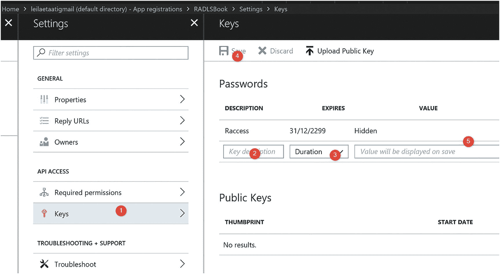

**图 11-26**
从 Azure Active Directory 获取客户端密钥 ID——第 3 部分

接下来，你必须指定密码的持续时间。最后，保存密钥，以便能够看到代码。保存代码后，你会收到一条消息，提示你必须复制该代码，并且如果你离开此页面，代码将隐藏。因此，一旦你创建了代码，就必须立即复制它（图 11-27）。

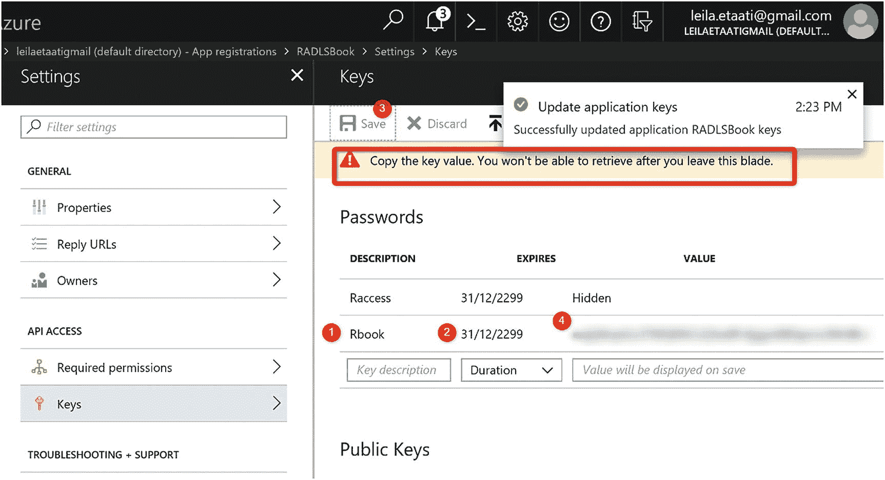

**图 11-27**
从 Azure Active Directory 获取客户端密钥 ID——第 4 部分

现在你拥有了身份验证令牌。下一步是打开 RStudio，编写一些 R 脚本，用于从 Azure Data Lake 获取数据、将数据上传到 Azure Data Lake、列出文件夹等。这有助于我们首先轻松调试 R 代码，然后在 U-SQL 中使用这些代码。

在你的机器上打开 RStudio，然后打开一个空的 R 脚本。要处理 Azure 中的数据，我们必须安装一些库，如下所列：

```
install.packages("httr")
install.packages("jsonlite")
install.packages("curl")
```

安装库后，为了确保它们已安装并检查包依赖关系，请编写以下代码：

```
library(httr)
library(jsonlite)
library(curl)
```

现在，我们必须通过以下代码创建到 Azure Active Directory 的连接：

```
h ",
"client_secret"=""
)
```

然后，要获取 Azure Data Lake Store 中的文件夹列表，请使用以下代码。你必须使用租户 ID（图 11-22）和你的 Azure Data Lake Store 名称（例如，`adlsbook`）。

```
req /oauth2/token", handle = h)
res .azuredatalakestore.net/webhdfs/v1/?op=LISTSTATUS",
add_headers(Authorization = paste(res$token_type, res$access_token)))
```

现在，我们可以使用以下代码浏览 Azure Data Lake Store 主目录中的文件夹：

```
nlite::toJSON(jsonlite::fromJSON(content(r,"text")), pretty = TRUE)
```

请确保你没有输入任何拼写错误，并且正确复制粘贴了代码。如图 11-28 所示，`adlsbook` 中已有三个文件夹：`catalog`、`system` 和 `usqlext`。这些文件夹显示在 R 输出控制台中。

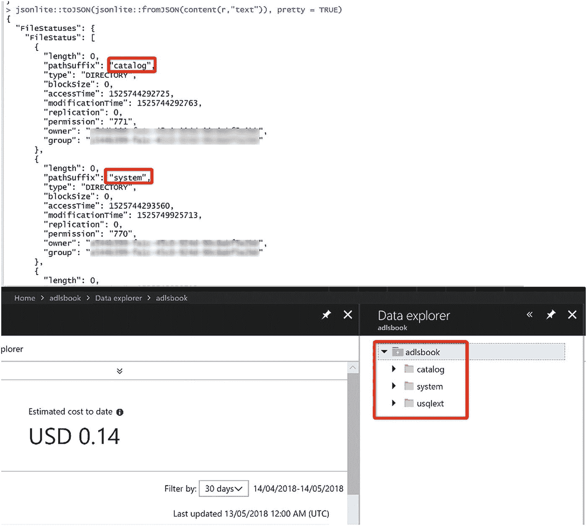

**图 11-28**
Azure Data Lake Store (adlsbook) 中列出的文件夹

图 11-28 显示了文件夹列表、目录类型、访问时间、创建时间、所有者等信息。

要访问数据，我们必须提供要访问的文件的路径。例如，我们想要从 `adlsbook` 中获取 `usqlext`、`samples`、`R` 和 `iris.csv` 中的数据（图 11-29）。

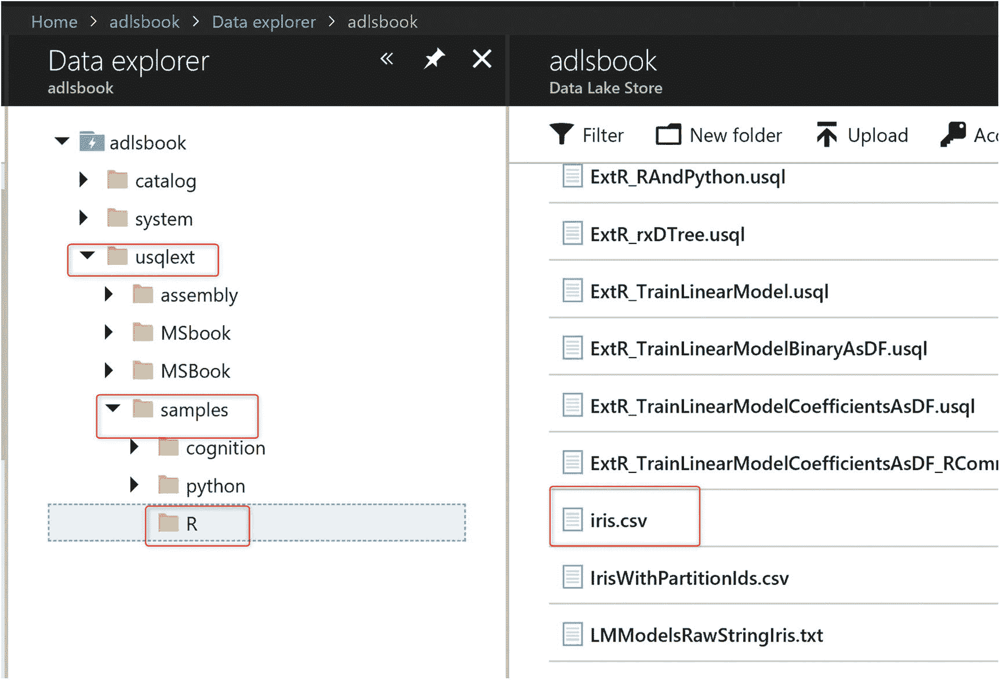

**图 11-29**
adlsbook 中的 iris 数据

路径如下：[`https://adlsbook.azuredatalakestore.net/webhdfs/v1/usqlext/samples/R/iris.csv?op=OPEN&read=true`](https://adlsbook.azuredatalakestore.net/webhdfs/v1/usqlext/samples/R/iris.csv%253Fop%253DOPEN%2526read%253Dtrue)

注意：连接可能会断开，因此你必须重新运行我们用于创建连接的代码。


```
h ",
"client_secret"=""
)
req /oauth2/token", handle = h)
res <- fromJSON(rawToChar(req$content))
r <- httr::GET("https://adlsbook.azuredatalakestore.net/webhdfs/v1/usqlext/samples/R/iris.csv?op=OPEN&read=true",
add_headers(Authorization = paste(res$token_type,res$access_token)))
```

要访问数据，您可以轻松下载以下内容并访问数据。

```
writeBin(content(r), "C:/pbi/iris.csv")
irisDownloaded <- read.csv("C:/pbi/iris.csv")
head(irisDownloaded)
```

也可以将数据从 RStudio 上传到 Azure Data Lake 或创建一个文件夹。请访问 [`https://blogs.msdn.microsoft.com/microsoftrservertigerteam/2017/03/14/using-r-to-perform-filesystem-operations-on-azure-data-lake-store/`](https://blogs.msdn.microsoft.com/microsoftrservertigerteam/2017/03/14/using-r-to-perform-filesystem-operations-on-azure-data-lake-store/) 查看所有可能性。

您也可以在 Visual Studio 中运行 U-SQL。为此，您的机器上必须安装 Visual Studio 2015 或 2017。关于如何在 Visual Studio 中运行 U-SQL 语言，网上有很多博客文章 [2]。

## 总结

本章解释了如何应用 Azure Data Lake 来实践机器学习。您了解了我们如何在 Azure Data Lake Analytics 中运行 R 代码并将结果存储在其中。此外，还简要说明了如何通过 R Studio 访问 Azure Data Lake Store 数据，以及如何使用 U-SQL 语言。如何在 Visual Studio 中运行 U-SQL 语言超出了本书的讨论范围。

