# 12. Azure Machine Learning Studio

Azure Machine Learning (ML) Studio 是一个云机器学习平台。它提供了一个易于使用的拖放式环境。该平台包含超过 20 种预定义的机器学习算法。借助 Azure ML Studio，可以从不同资源导入数据，设计机器学习实验，并根据模型创建 Web 服务。此外，还可以在 Azure ML Studio 环境中运行 R 或 Python 代码。在本章中，我将首先介绍该环境以及如何在其中制定实验，如何创建简单的机器学习模型，如何测试和评估模型，以及如何从本地机器或其他 Azure 组件导入数据。同时，我还将讨论从模型创建 Web 服务的过程。将探讨如何在 Azure ML Studio 中运行 R 代码。此外，还将详细阐述如何在 R Studio 中探索 Azure ML 实验。

## Azure Machine Learning 环境

要使用 Azure ML Studio，您必须登录 [`https://studio.azureml.net/`](https://studio.azureml.net/)。登录时，您可以使用 Google、Yahoo 或公司账户（图 12-1）。Azure ML 有两种订阅方式：一种是免费的，另一种是标准版。

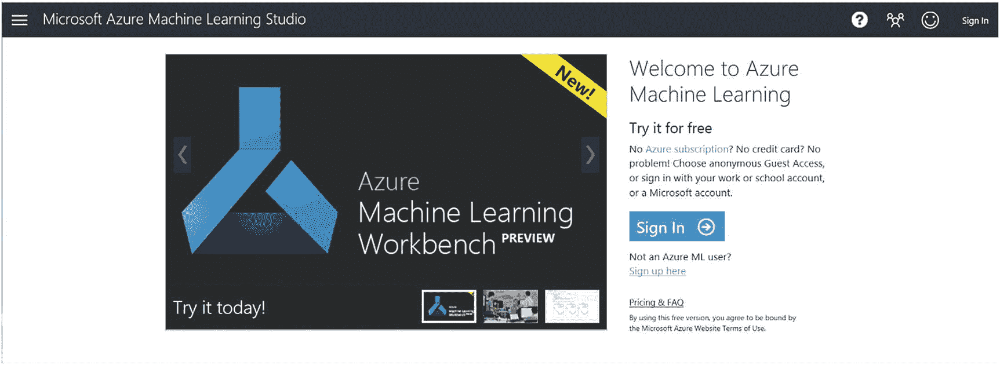
图 12-1 Machine Learning Studio 登录界面

登录门户后，会看到一个空的环境。如图 12-2 所示，屏幕左侧有七个不同的选项：项目、实验、Web 服务、笔记本、数据集、已训练模型和设置。实验是创建模型的主要场所。如图所示，首次使用时实验区是空的。

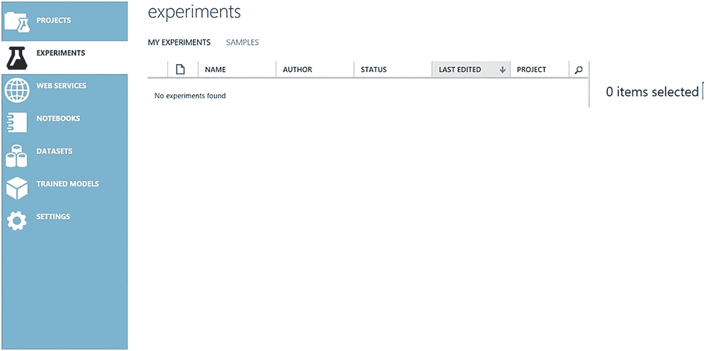
图 12-2 Azure ML Studio 环境

可以拥有多个不同的工作区，结合免费或标准订阅。如图 12-3 所示，用户可以在这些环境之间切换。

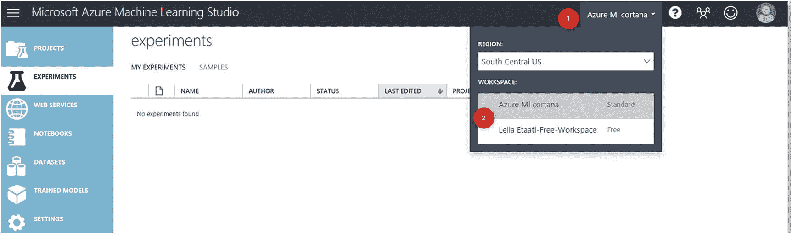
图 12-3 Azure ML 工作区

在接下来的章节中，将简要介绍 Azure ML 的不同组件。

## Azure Machine Learning 实验

实验是创建机器学习模型的主要载体。如图 12-3 所示，我们有两个主要的实验区：我的实验和示例。我的实验是创建新机器学习模型和存储所有用户创建实验的地方。示例实验包含微软预定义的示例。

要创建新实验，请点击屏幕左侧的“实验”，然后点击页面左下角的“新建”选项，再选择“空白实验”（图 12-4）。

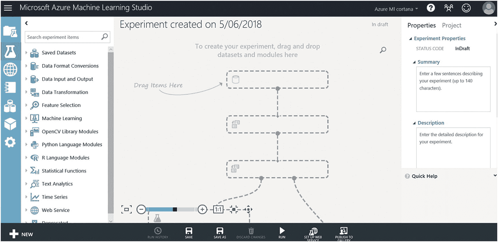
图 12-4 设置实验

如图 12-4 所示，实验处于拖放式环境中。屏幕左侧有一些组件，如已保存数据集、数据转换、机器学习等，可帮助我们创建 ML 模型。

要创建实验，您必须获取数据。导入数据主要有两种方式：从本地机器导入数据（图 12-5）或使用内置数据组件。在我们的示例中，首先我将从本地机器导入数据。数据集是泰坦尼克号数据集，可从 [`http://web.stanford.edu/class/archive/cs/cs109/cs109.1166/stuff/titanic.csv`](http://web.stanford.edu/class/archive/cs/cs109/cs109.1166/stuff/titanic.csv) 获取 [1]。要导入数据，我们必须点击屏幕左侧的“数据集”选项，然后点击“新建”选项。

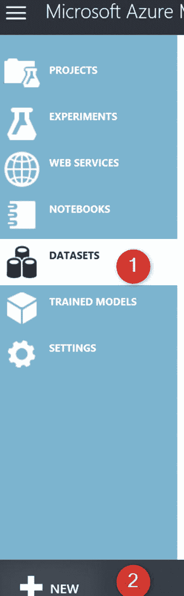
图 12-5 从本地机器导入数据

导入数据集后，我们能够创建一个实验，目标是预测特定年龄、性别和乘客舱位的乘客是否幸存。要创建新实验，您必须首先点击屏幕左侧的“实验”选项。Azure ML 由不同的模块（节点）组成，每个活动都显示为单独的节点。在搜索区域中，输入“Titanic”。然后将该节点拖放到白色设计图面区域，如图 12-6 所示。如图 12-6 所示，泰坦尼克号数据集显示为一个只有单个输出的独立节点。要查看数据集，您必须右键单击输出节点，然后点击“可视化”选项。这将允许您查看数据以及一些额外的有用信息，例如 PassengerID、Survived、Pclass、Name 等列。

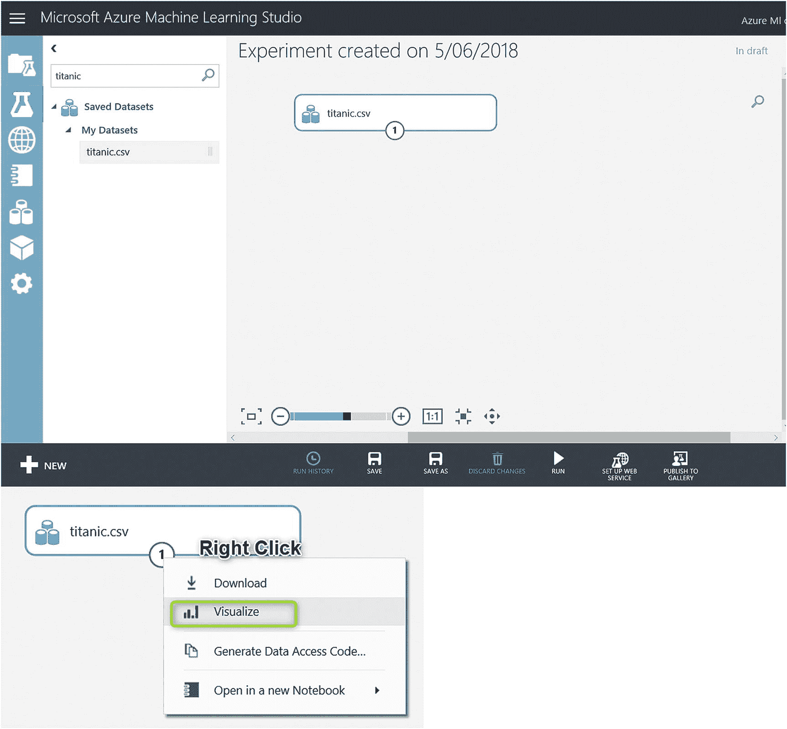
图 12-6 导入和可视化数据

此外，在每个列名下方有一个小的直方图，指示每列的值频率（图 12-7）。同时，通过点击每一列，您可以在页面右侧看到统计摘要，如图 12-7 所示。

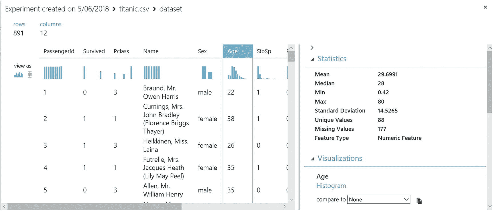
图 12-7 可视化数据集

下一步是清洗数据。如图 12-7 所示，对于*泰坦尼克号*上乘客的年龄数据，有 177 行存在缺失值。创建模型前的主要工作之一就是移除或替换这些缺失值。有一个名为“清理缺失数据”的模块可以完成此操作。搜索该模块，将其拖放到实验区域。如图 12-8 所示，该模块有一个输入端口和两个输出端口。将泰坦尼克号数据集的输出连接到缺失值模块的输入。然后，通过点击缺失值模块，指定您希望如何解决缺失值问题。该模块有一个属性页面，您可以在其中选择要移除缺失值的列。接着指定清理模式，例如用平均值、中位数或自定义值进行替换。也可以选择移除整个缺失数据行，或使用 PCA 算法[2]进行替换。如图 12-8 所示，已选择了“年龄”列，清理模式设置为“移除整行”。

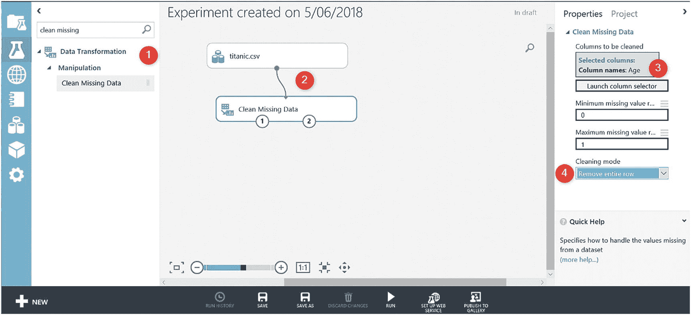
图 12-8 *从数据中移除缺失值*

另一个我们应该执行的数据转换是移除对“幸存”列没有影响的列，例如乘客 ID、姓名等。我们运行机器学习所需的列只有年龄、性别、船舱等级和幸存。数据集中还有另一个名为“选择列”的模块。将此模块拖放到实验中，然后将“清理缺失数据”的第一个输出连接到“选择列”的输入。接着，在属性面板中，选择所需的列（图 12-9）。至此，该数据集的主要数据清洗和整理工作已完成。下一步是选择相关算法。

此处机器学习的主要目的是预测一位新乘客是否幸存。根据第 4 章的讨论，我们预测的是一个类别，而非连续值。使用分类方法进行预测分析可以解决这个问题。在 Azure ML 中，大约有 25 种主要算法，被分为四大场景：异常检测、分类、聚类和回归*。* 针对我们的场景，必须使用分类算法。展开分类算法列表，可以看到根据要预测的类别数量进行了进一步分组。如果是二分类问题，则必须使用带有“二类”标识的算法。该问题正是预测人员幸存与否的情况。

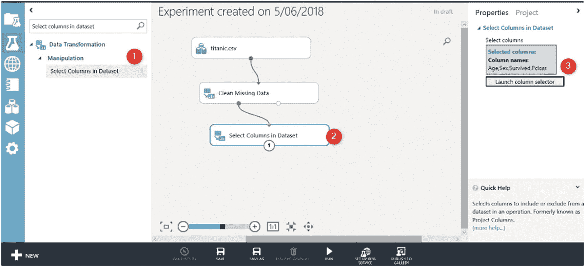
图 12-9 在数据集中选择列

如图 12-10 所示，在“分类”下，我们有九种不同的算法可用于预测幸存或未幸存者。每种算法都可用于不同的场景和不同的数据类型。微软提供了一份用于选择最佳算法的速查表[3]。对于*泰坦尼克号*问题，我们的列数不超过 100 列，数据是非线性的，并且需要高精度和快速训练。因此，我选择了“二类提升决策树”算法。不过，最佳实践是选择不同的算法，然后比较它们的准确率。

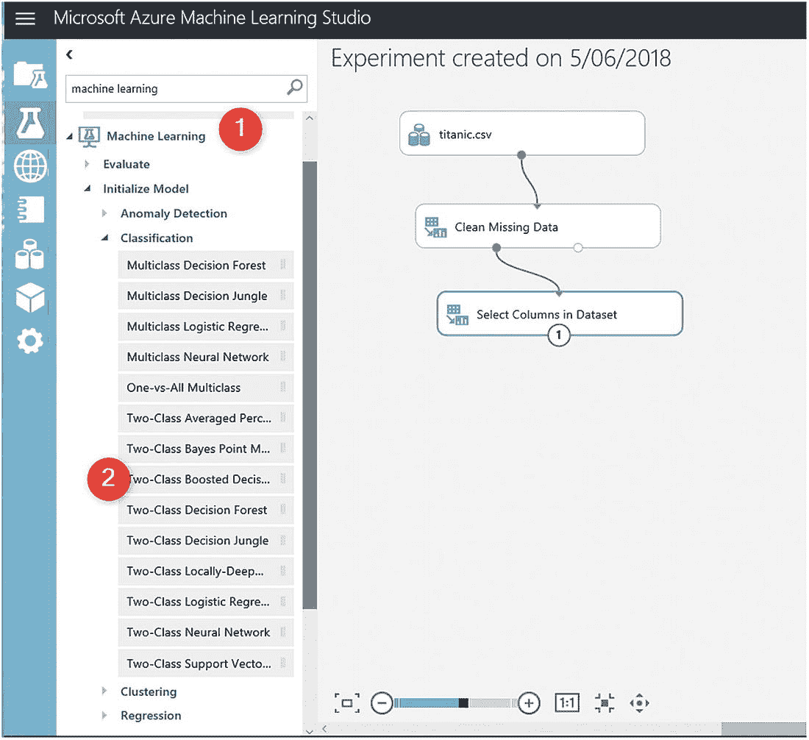
图 12-10 Azure ML 中的机器学习算法

# Azure ML 中的模型拆分、训练、测试与部署

按照第 4 章介绍的机器学习生命周期，我们必须拆分数据，一部分用于训练，其余部分用于测试。在 Azure ML 中，有三个不同的模块用于拆分数据、训练模型和测试模型：`拆分数据`、`训练模型`和`评分模型`。首先，我拖放“`拆分数据`”模块（图 12-11）。“`拆分数据`”允许我们指定多少数据用于训练，多少用于测试。如图 12-11 所示，“`拆分数据`”已连接到“`选择列`”模块的输出。拆分比例设置为 `0.7`（30%用于测试，70%用于训练）。其中一个输出节点用于训练，另一个用于测试。

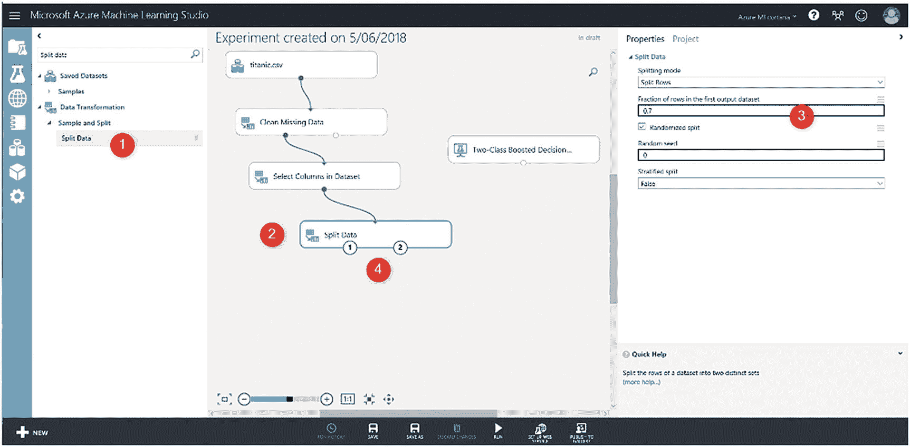
图 12-11 用于机器学习目的的拆分数据

我们必须将用于训练和测试的相关模块拖放到实验中。如图 12-12 所示，`拆分`模块的右侧输出已连接到“`训练模型`”，而“`拆分数据`”的另一个输出已连接到“`评分模型`”。此外，在“`训练模型`”属性下，已选择了“`幸存`”列。

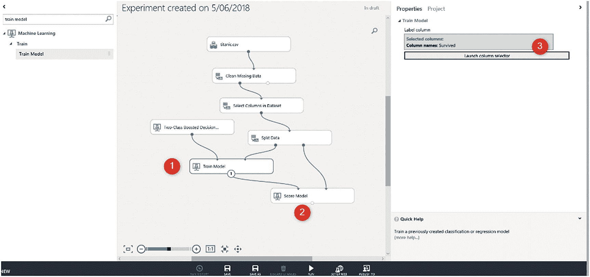
图 12-12 将训练模型和评分模型拖放到实验中

现在我们可以运行代码，查看`评分模型`输出的预测结果。要运行它，请点击页面底部的“运行”按钮。运行实验后，我们将能够在`评分模型`模块的输出中看到测试数据预测的结果。右键单击输出并可视化数据（图 12-13）。

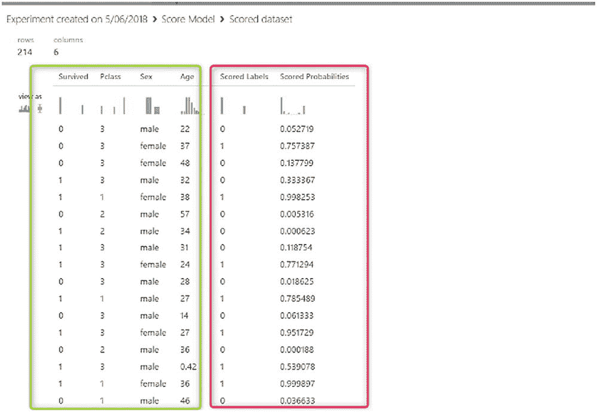
图 12-13 “泰坦尼克号”示例的预测结果

可以使用“`评估模型`”来评估模型，以检查所创建模型的准确率。下一节将解释创建应用程序编程接口（`API`）的过程。

## 创建 Web 服务

评估模型后的下一步是可选的：创建一个 `API`，以便每个人都能通过提供数据来使用该模型。要创建 `Web 服务`，您必须先运行实验，然后点击“设置 `Web 服务`”（建议使用预测 `Web 服务`）。如图 12-14 所示，已为 `Web 服务` 创建了输入和输出链接。

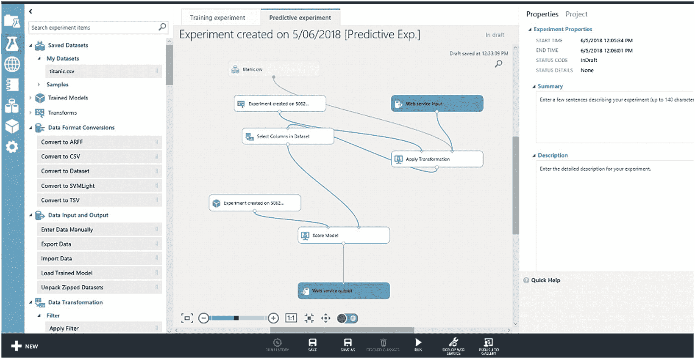
图 12-14 从机器学习模型创建 Web 服务

再次运行实验，然后点击页面底部的“部署 `Web 服务`”。部署 `Web 服务` 后，将显示一个新页面。在此页面上，您可以查看 `API` 的详细信息，包括用于单次处理和批量处理数据的 `API`。

如图 12-15 所示，有一个 `API` 密钥，您可以共享该密钥以允许其他人使用 ML 模型。此外，对于 `API URL`，主要有两种使用 `API` 的方式：请求-响应方法和批量处理方法。

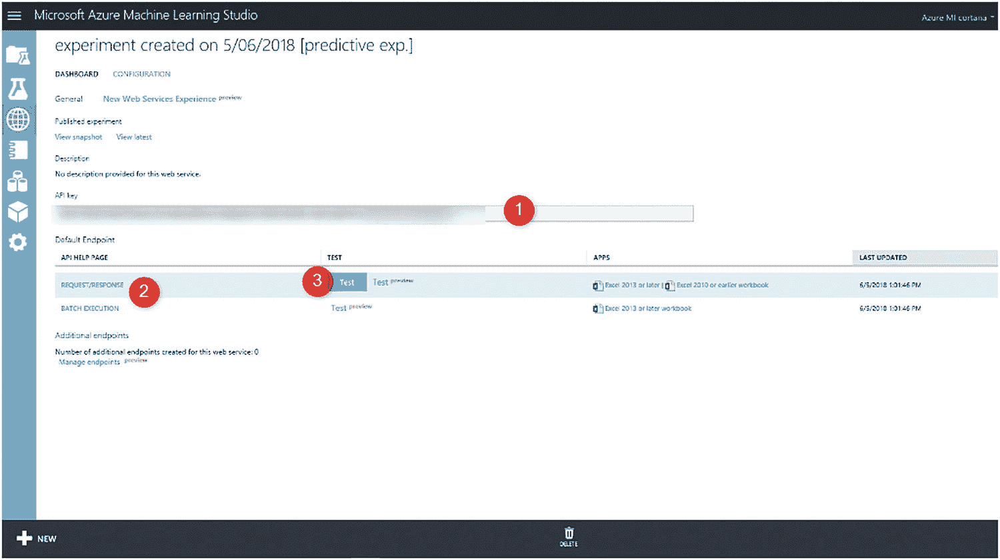
图 12-15 为“泰坦尼克号”问题创建 Web 服务

点击“批量执行”选项，导航至包含 `API` 信息的新页面（图 12-16）。如图所示，页面显示了用于请求信息的 `Web 服务 URL`。

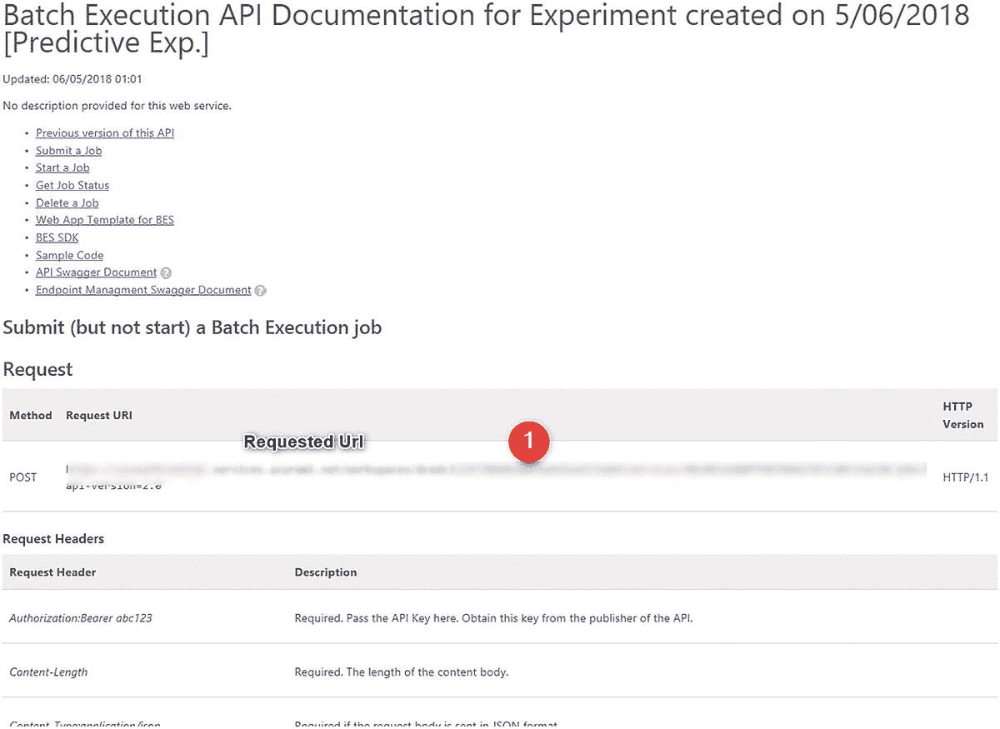
图 12-16 Web 服务信息页面

此外，还可以将创建的模型嵌入到其他应用程序中，例如 `Web` 应用程序、报表等，并利用任何语言（如 `C#`、`Python` 和 `R`）。在 `Web 服务` 信息页面上，转到“示例代码”部分。如图 12-17 所示，其中有 `C#`、`Python` 和 `R` 的示例代码，使用户能够将代码嵌入到应用程序中。但是，您必须更改 `Web 服务` 的输入和输出，以便最终用户能够提供正确的信息并获得相关的预测。例如，在图 12-15 创建的 `Web 服务` 中，服务的输入也获取了用户的乘客 ID、姓名和其他无关数据，我们必须对这些数据进行精炼，以便只接收诸如年龄、性别和乘客等级等信息。再举一个关于输出的例子，用户可能只对获取预测结果和概率感兴趣，而不需要所有其他输入列。

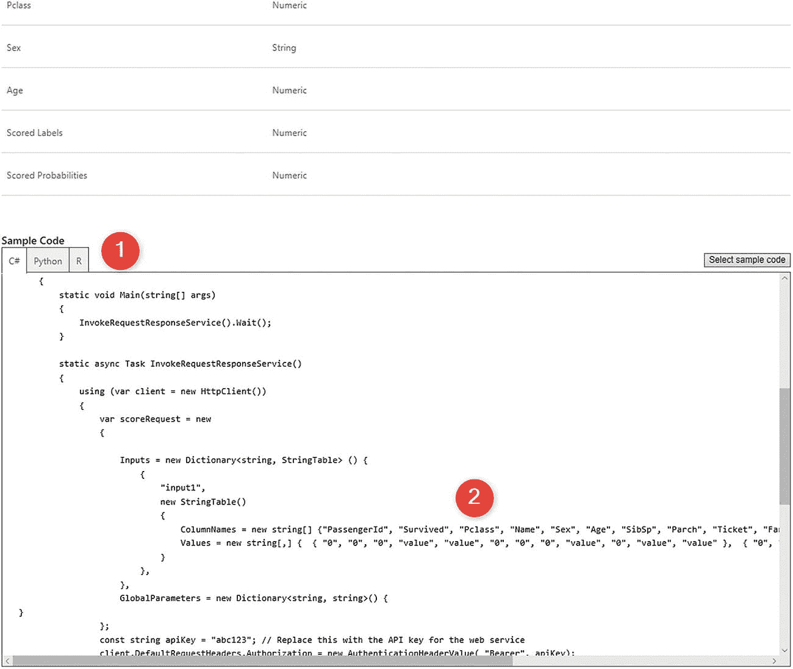
图 12-17 Web 服务示例代码

下一步，我将通过为输出添加“`数据集中的选择列`”模块，并更改 `Web 服务` 输入的选定列，来精炼 `Web 服务` 的输入和输出（图 12-18）。

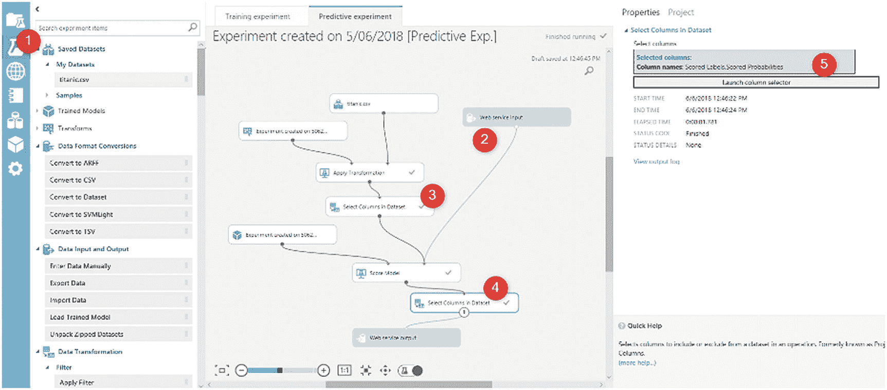
图 12-18 更改 Web 服务的输入和输出

如图 12-18 所示，对于 `Web 服务` 输入，我们断开链接并将其连接到“`评分模型`”的输入，并且在“`数据集中的选择列`”模块中（图 12-18，3），仅选择了年龄、性别和乘客等级。类似地，对于 `Web 服务` 输出，拖放“`数据集中的选择列`”模块以仅选择“`评分标签`”和“`评分概率`”。接下来，我们将 `Web 服务` 输出连接到“`数据集中的选择列`”模块。最后，我们运行实验并再次部署。会出现一条关于覆盖 `Web 服务` 的消息，我们需要确认。再次部署后，在 `Web 服务` 页面上，点击“测试”按钮（图 12-19，1）。之后，我们就可以测试 `API` 了。

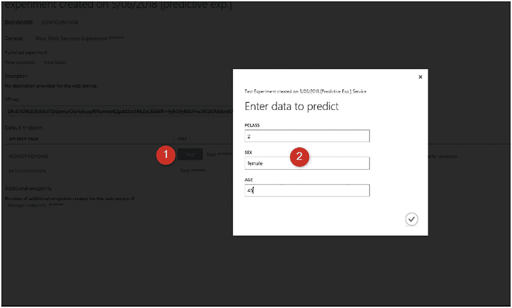
图 12-19 测试 Web 服务

如图 12-19 所示，通过向 `API` 输入三个参数：年龄、性别和乘客等级，该特定行的机器学习结果将显示在页面底部（图 12-20，1）。

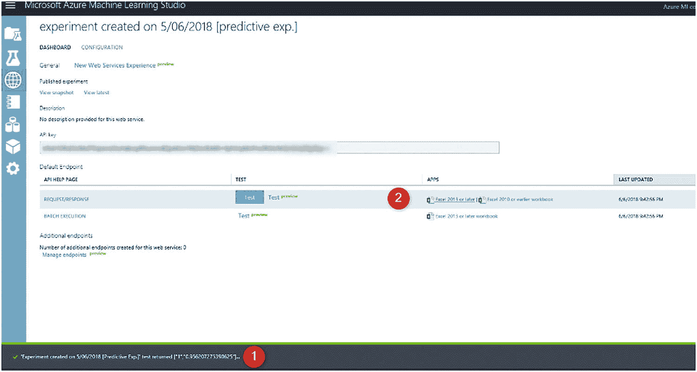
图 12-20 API 结果及对 Excel 的调用

下一步允许我们在 `Excel` 中分析 `API`。我们只需导航到“应用”（图 12-20）并点击“`Excel 2013` 或更高版本”（图 12-20，2）。点击 `Excel` 图标后，会出现一条“下载示例数据”的消息。保存 `Excel` 文件并打开它，然后启用 `Excel`（图 12-21）。

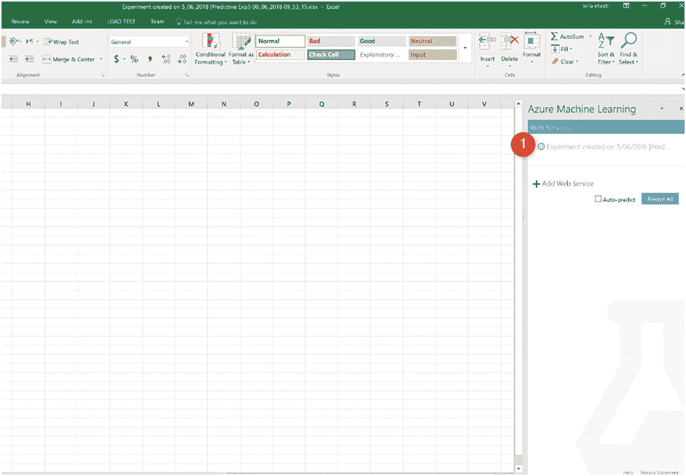
图 12-21 在 Excel 中启用 Azure ML API

接下来，将出现一个新窗口。使用示例数据（图 12-22，1），然后在“输入”字段下，选择输入数据范围（图 12-22，2）。然后，在“输出”字段下，写入输出单元格编号（图 12-22，3）。然后点击“预测”选项。

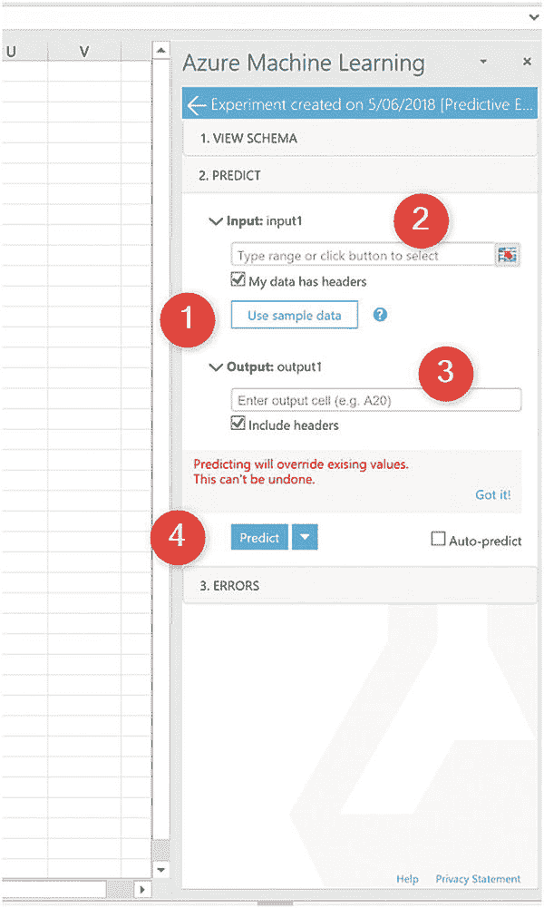
图 12-22 在 Excel 中启用 Azure ML API

通过运行代码并选择“自动预测”选项，预测结果将显示在输出单元格中（图 12-23）。

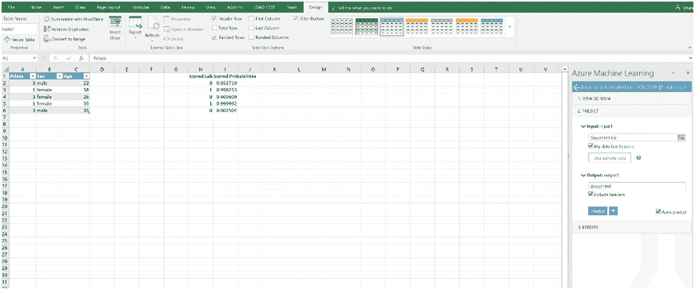
图 12-23 在 Excel 中调用 API

可以添加更多输入行以进行更多预测。

## R 与 Azure ML Studio

`Azure ML Studio` 内置了 25 种算法。然而，在某些情况下，用户可能希望使用自己的算法。在 `Azure ML Studio` 中编写 `R` 或 `Python` 代码是可行的。在本节中，你将看到如何可视化图表并查看数据输出。

在 `Azure ML Studio` 中创建一个新实验。使用相同的数据集（泰坦尼克号）。将“`Titanic`”拖放到实验区域。然后，在搜索区域中，输入“`Execute R Scripts`”。将该模块拖放到实验区域（图 12-24）。

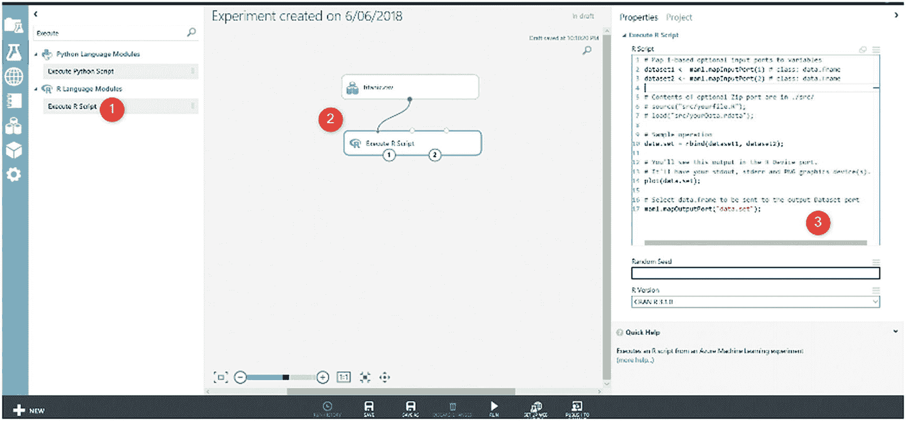
图 12-24

在 Azure ML 中执行 R 脚本

如图 12-24 所示，有一个用于编写 R 脚本的编辑器。`Execute R Scripts` 模块有三个输入节点。左侧的前两个用于数据集，最后一个用于 zip 文件。点击此模块，我们可以编写代码。如图 12-24 所示，来自节点 1 的输入数据已通过以下代码检索并存储在 `dataset1` 中。

```
dataset1 <- maml.mapInputPort(1) # class: data.frame
```

在此示例中，输入节点包含泰坦尼克号数据集（图 12-24）。因此，我将按如下方式更改代码：

```
Titanic<- maml.mapInputPort(1) # class: data.frame
```

下一步，我们将使用以下代码根据泰坦尼克号乘客的年龄创建一个箱线图：

```
boxplot(titanic$Age)
```

接下来，我们创建数据的统计摘要。

```
output<-data.frame(titanic$Age,titanic$Pclass,titanic$Sex)
summary(output)
```

最后，我们希望在输出节点中仅显示年龄、性别和乘客等级。最终代码将如图 12-25 所示。

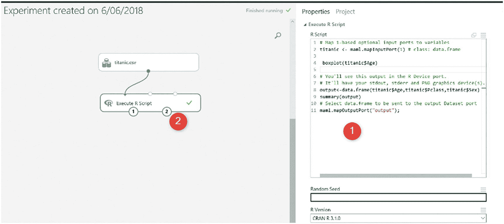

图 12-25：Azure ML Studio 中的 R 脚本

现在我们必须运行实验。`Execute R Script` 有两个输出节点。左侧的输出节点保存了包含三个主要列的输出变量（图 12-26）。

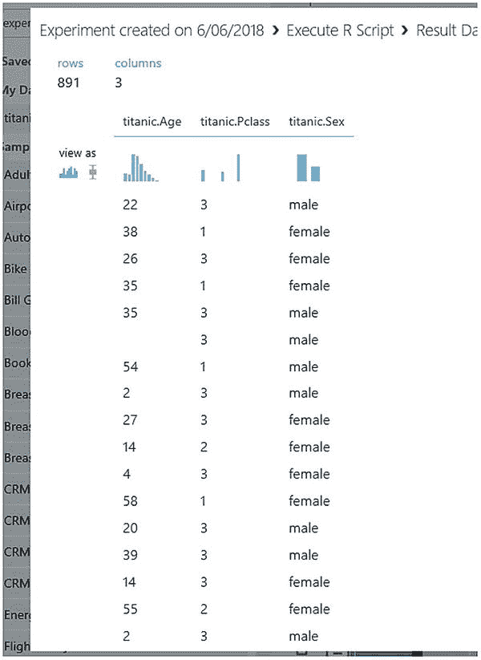

图 12-26：Azure ML Studio 中 `Execute R Scripts` 的第一个输出

另一个输出包含有关 R 图表及其统计摘要的一些信息。要查看输出，请右键单击右侧输出节点并可视化该节点（图 12-27）。

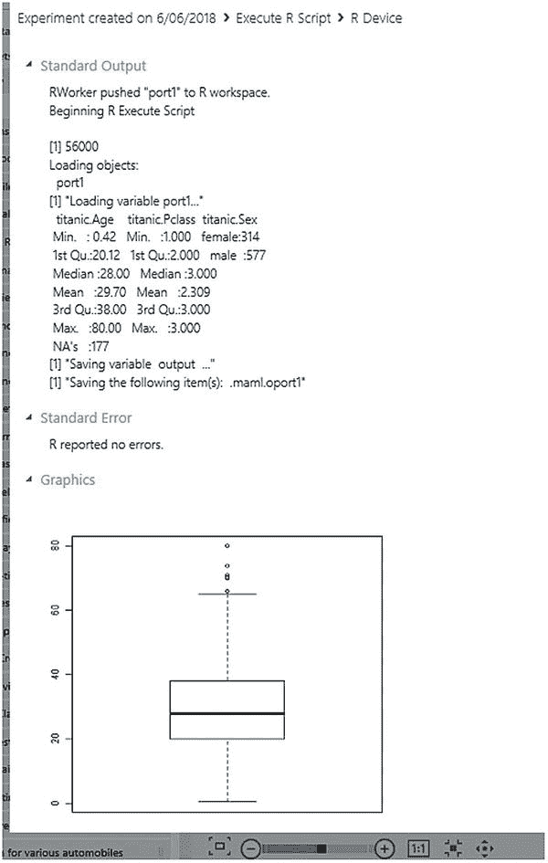

图 12-27：`Execute R Scripts` 的第二个输出

可以从 RStudio 探索 Azure ML 数据集和实验。此外，R 用户可以在 RStudio 中编写一个函数，然后从中创建一个 API。

为此，首先，你必须使用以下命令在 RStudio 中安装 Azure ML 包：

```
install.package("AzureML")
```

第二步是从 Azure ML Studio 获取一些标识密钥。导航到 `studio.azureml.net`，在你的 Azure ML 环境中，单击“设置”，复制工作区 ID（图 12-28），并将其存储在 RStudio 的一个变量中，如下所示：

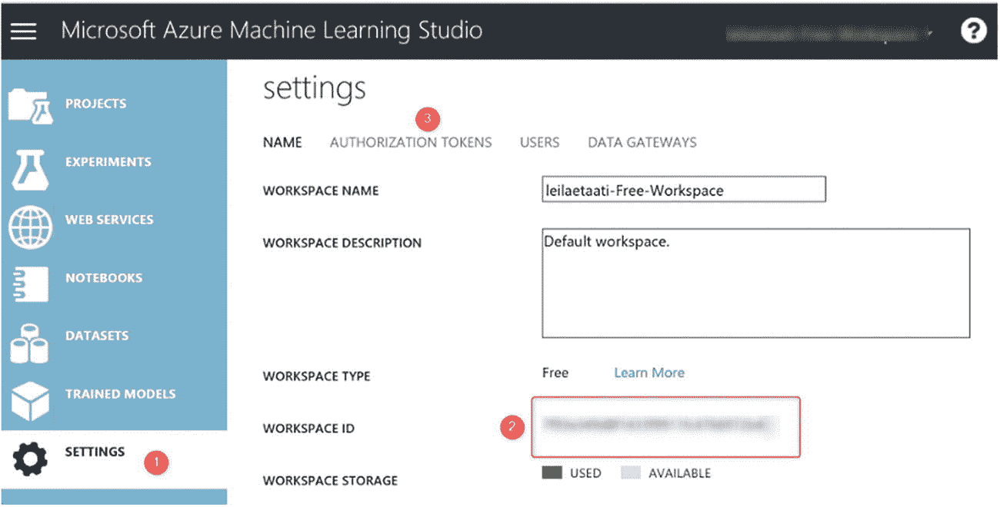

图 12-28：来自 Azure ML 环境的工作区 ID

```
id<- "your workspace ID"
```

导航到“设置”菜单中的另一个选项卡，然后选择“身份验证令牌”。复制主身份验证令牌并将其分配给 RStudio 中的一个变量。

```
auth<-"your authorization token"
```

Azure ML 包中有一个 `workspace` 函数，它通过获取身份验证令牌和工作区 ID 来创建对 Azure ML Studio 工作区的引用。

```
ws <- workspace( id , auth  )
```

可能会收到缺少 R 工具软件的错误。因此，你必须从 [4] 安装最新版本的 R 工具，并将其存储在 RStudio 的同一根目录下。

最后，为了探索 Azure ML 中的所有实验，有一个 `experiments` 函数，它接收 `ws` 对象作为输入以连接到 Azure ML 环境。

```
experiments(ws, filter = "all")
```

使用 `experiments` 函数可以让你筛选要查看详细信息的 Azure ML 实验。你可以将筛选值设置为 `all`、`samples` 和 `my datasets`。在此示例中，我将筛选器设置为 `all`。通过在 RStudio 中应用 `names` 函数来检查详细信息，你可以看到列，例如实验名称、版本、所有者等（图 12-29）。

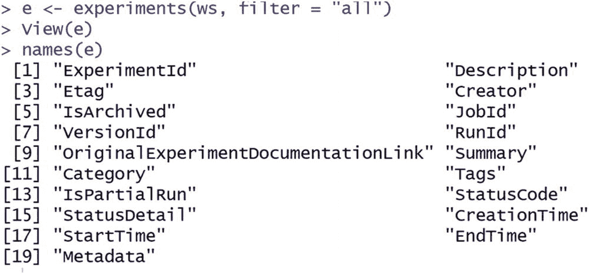

图 12-29：探索我们能够从 Azure ML 实验中看到的属性

可以使用 `upload.dataset` 命令将数据集从 RStudio 上传到 Azure ML。

`ggplot2` 包中有一个数据集，我将把它上传到 Azure ML Studio。

```
library(ggplot2)
upload.dataset(mpg,ws,"mpg")
```

你必须提供数据集、工作区对象（`ws`）以及要在 Azure ML 环境中保存数据集的名称。现在，如果你在 Azure ML 中探索数据集，你将能够看到新上传的数据集。

## 总结

本章简要介绍了 Azure ML Studio。首先，实现了一个用于预测泰坦尼克号乘客生存情况的简单机器学习模型。下一步是从该模型创建一个 API，对其进行分析，并在 Excel 中显示结果。此外，还解释了如何使用 `Execute R Scripts` 模块在 Azure ML 内部编写 R 代码。本章的最后部分解释了如何通过 R 代码探索 Azure ML Studio，以及如何将数据集从 RStudio 上传到 Azure ML 数据集。