# 13. Azure Stream Analytics 中的机器学习

Azure Stream Analytics 是一个事件处理引擎，允许用户分析来自设备、传感器和应用程序的高容量流数据。Azure Stream Analytics 可用于物联网 (IoT) 实时分析、远程监控和数据库存控制。然而，Azure Stream Analytics 是 Azure 中另一个我们可以运行机器学习的组件。可以在 Azure Stream Analytics 内部使用在 Azure ML Studio 中创建的机器学习模型 API，以便将机器学习应用于来自传感器、应用程序和实时数据库的流数据。在本章中，我将解释如何在 Azure Stream Analytics 内部使用机器学习。首先，对 Azure Stream Analytics 进行一般性介绍，然后，给出一个将应用于流数据的 Azure ML Studio API 的简单示例。

## Azure Stream Analytics 环境

Azure Stream Analytics 是 Azure 环境中的一个事件处理组件。要创建 Azure Stream Analytics，你必须登录 Azure 账户并创建一个 Stream Analytics 作业（图 13-1）。

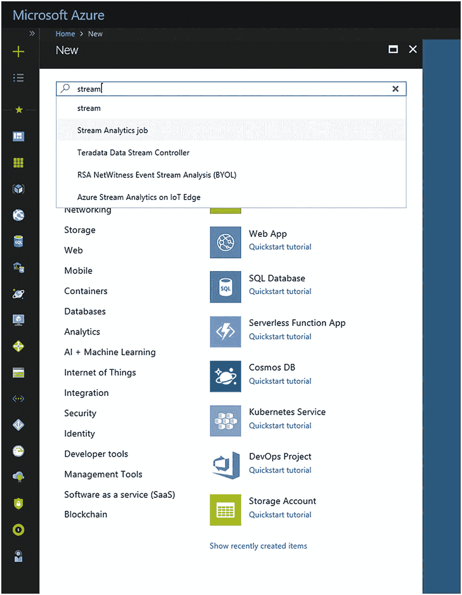
**图 13-1：在 Azure 环境中创建 Stream Analytics 作业**

在 Azure 中创建 Stream Analytics 作业后，你必须设置一些预定义参数，例如作业名称、订阅、资源组等（图 13-2）。

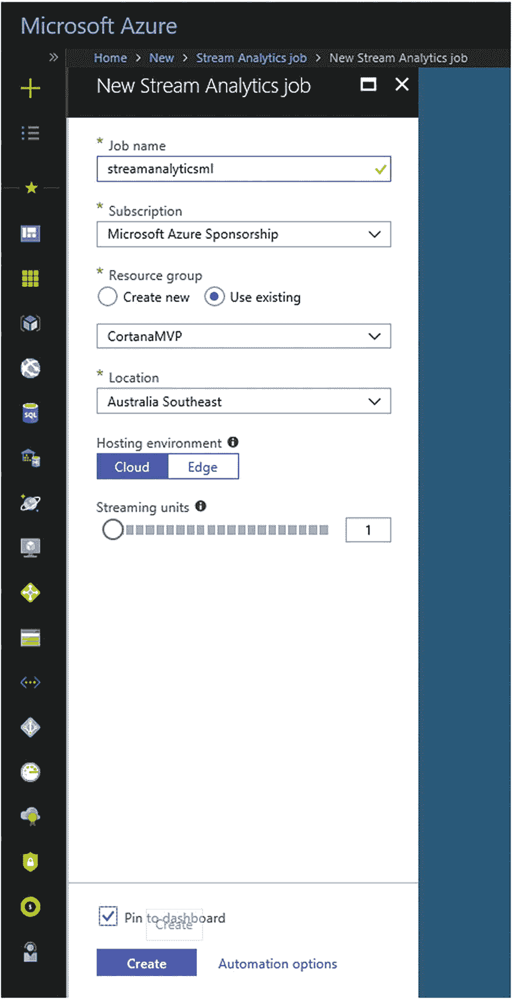
**图 13-2：Stream Analytics 作业初始化**

Stream Analytics 类似于 Azure 内部的服务总线，能够从某些组件获取数据，对接收到的数据进行分析，并将其传递给其他组件。因此，Stream Analytics 环境包含三个主要组件：输入、输出和查询。Stream Analytics 只能从三个主要组件获取数据：事件中心、IoT 中心和 Blob 存储。这三个组件主要用于从外部传感器、应用程序和实时 API 收集数据。Stream Analytics 可以将数据传递给其他 Azure 组件，例如 Blob 存储、Azure SQL 数据库、Power BI 等（图 13-3）。

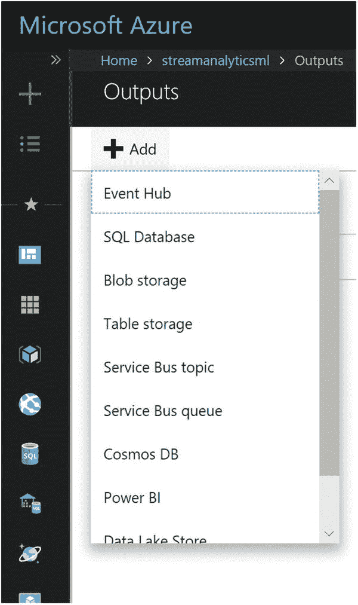
**图 13-3：Stream Analytics 输出**

最后，另一个重要组件是查询编辑器，它帮助用户在将数据发送到输出之前对接收到的数据进行分析（图 13-4）。

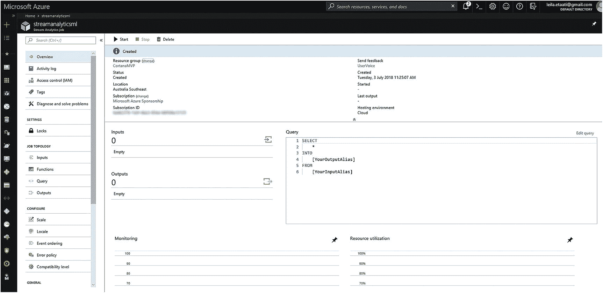
**图 13-4：Stream Analytics 主要组件（输入、输出和查询）**

Stream Analytics 使用的语言是 Stream Analytics 查询语言，它与 SQL 脚本语言非常相似。

## 案例研究

在我们的案例研究中，我将演示如何通过事件中心从应用程序获取数据，然后将收集到的数据传递到 Stream Analytics，应用机器学习，最后在 Power BI 服务中展示实时结果。

该过程在图 13-5 中进行了说明。如图所示，有一个应用程序将实时数据发送到事件中心。Stream Analytics 接收实时数据，对接收到的数据应用 Azure ML API 模型，然后将其发送到 Power BI。在 Power BI 报表中，最终用户除了可以看到应用的机器学习结果外，还可以看到实时数据。

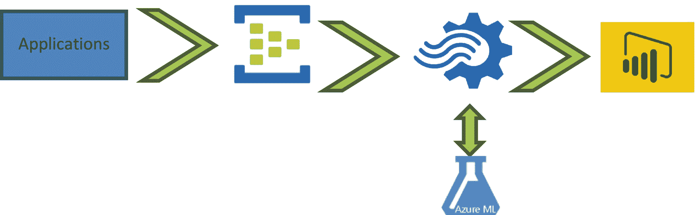
**图 13-5：获取数据、应用机器学习并在 Power BI 中显示结果的案例研究**

### 事件中心

第一步是在云中创建事件中心服务。创建事件中心服务的步骤与创建 Stream Analytics 相同。创建一个新服务并提供相关信息（图 13-6）。

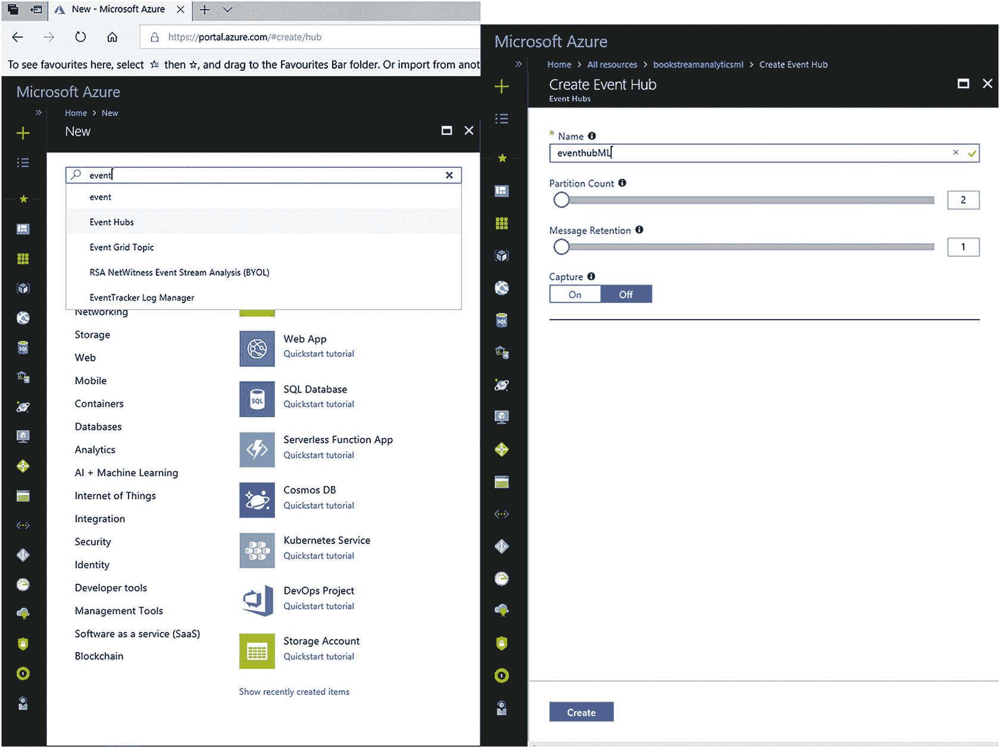
**图 13-6：在 Azure 中创建事件中心**

有了事件中心服务，你可以向你的服务添加一个新的事件中心（图 13-7）。

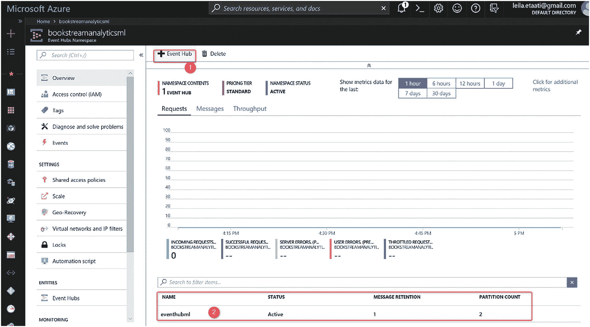
**图 13-7：创建新的事件中心**

### 应用程序

第二步是创建一个生成一些示例数据的应用程序。该应用程序是一个示例 .NET 框架应用程序，可以自动生成一些随机数据。（该应用程序已包含在第 13 章的书籍材料中。）打开包含该应用程序的文件夹（图 13-8）。

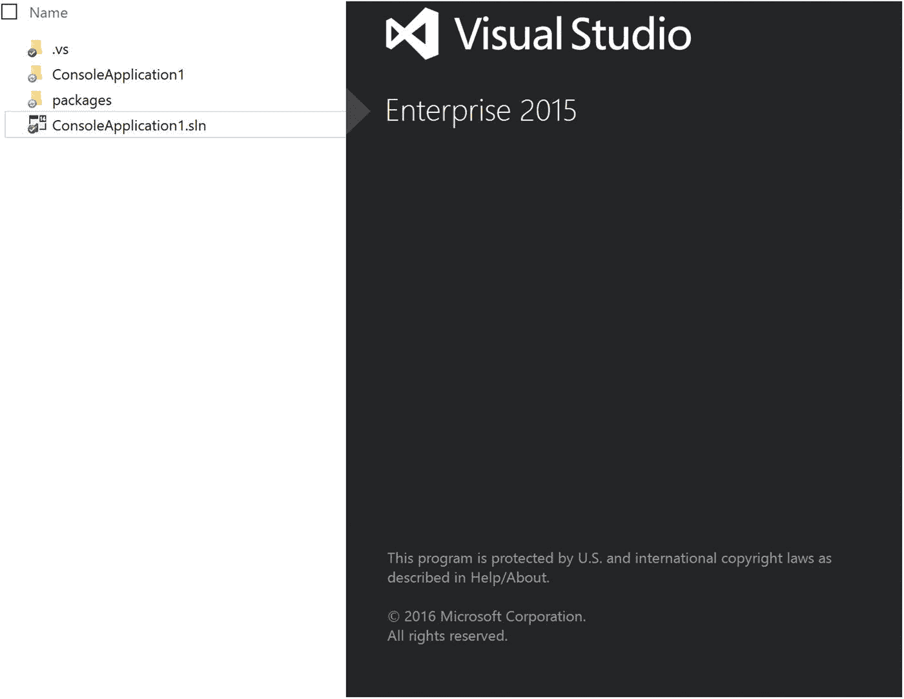
**图 13-8：生成随机实时数字的应用程序**

正如我本章前面提到的，我将使用一个 .NET C# 控制台应用程序将数据传递到事件中心。该应用程序由 Reza Rad [1] 创建。在他的博客文章“推送数据应用程序”部分中，Rad 逐步解释了创建此应用程序的过程。

但是，对于包含在本章相关材料中的应用程序，你必须使用 Visual Studio 打开它，然后打开解决方案资源管理器，转到引用，右键单击并选择管理 NuGet 包。接下来，单击浏览，选择 `WindowsAzure.ServiceBus`，然后安装它（图 13-9）。

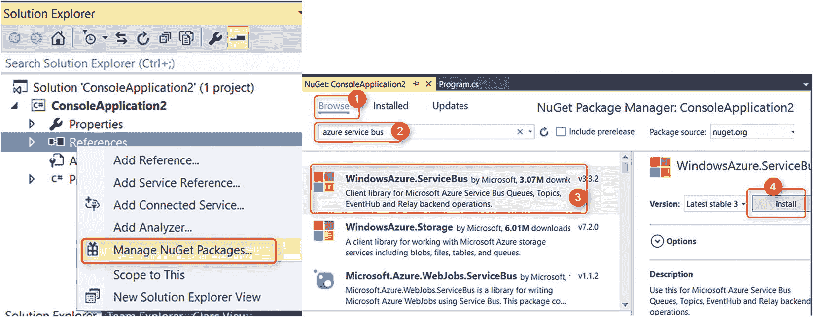
**图 13-9：在 Visual Studio 中安装 Azure 服务总线**

安装 Azure 服务总线后，你必须设置配置。单击 `App.config`，然后在键部分的代码中（图 13-10），更改端点 URL 名称和密钥（来自下一节中创建的 Stream Analytics）。

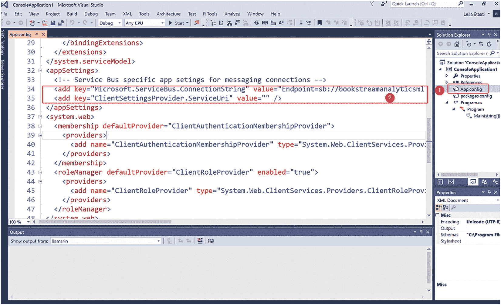
**图 13-10：设置配置**

最后，你必须在程序的主代码部分输入事件中心的名称（图 13-11）。

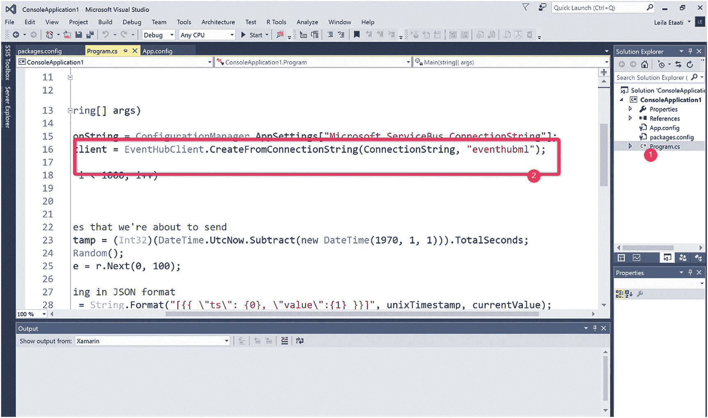
**图 13-11：在代码中更改事件中心名称**

现在代码已准备就绪。在运行代码之前，你必须设置 Stream Analytics。

## Azure Stream Analytics

第一步是在 Azure 中创建一个 Stream Analytics 作业（图 13-12）。

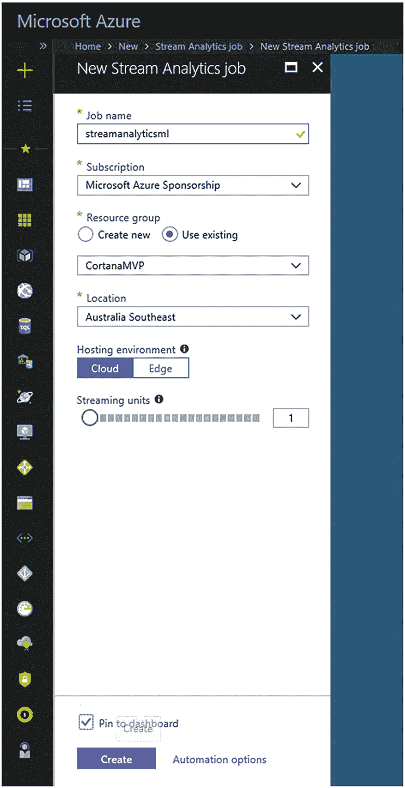
**图 13-12：在 Azure 中创建新的 Stream Analytics 作业**

创建 Stream Analytics 后，必须设置输入、输出和查询。如前所述，Stream Analytics 能够从其他 Azure 组件检索数据。如图 13-13 所示，Stream Analytics 可以从三个主要的 Azure 组件获取数据，然后将流数据传递给其他资源，例如 Power BI、SQL 数据库等。转换查询利用了一种类似 SQL 的查询语言，用于在一段时间内对流数据进行筛选、排序、聚合和联接 [2]。

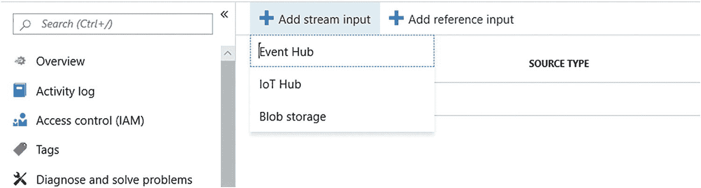
**图 13-13：为 Stream Analytics 输入数据**

# 案例研究：Azure Stream Analytics 与 Power BI 集成

在我们的案例研究中，我们将从事件中心获取数据，对其应用机器学习，然后将其传递给 `Power BI`，以查看应用了分析后的实时数据。

要创建输入，请单击 `Stream Analytics` 主页上的“输入”选项（图 13-14）。

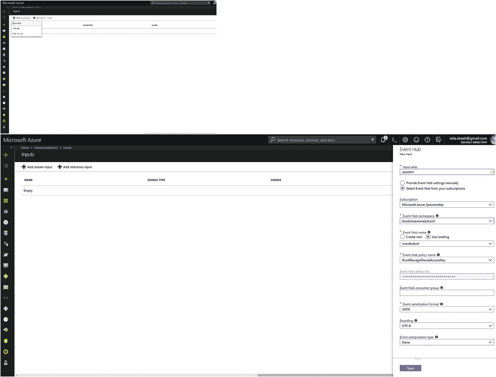
图 13-14 为 `Azure Stream Analytics` 创建输入

为 `Stream Analytics` 创建输入后，我们必须按照与输入相同的过程创建输出（图 13-15）。

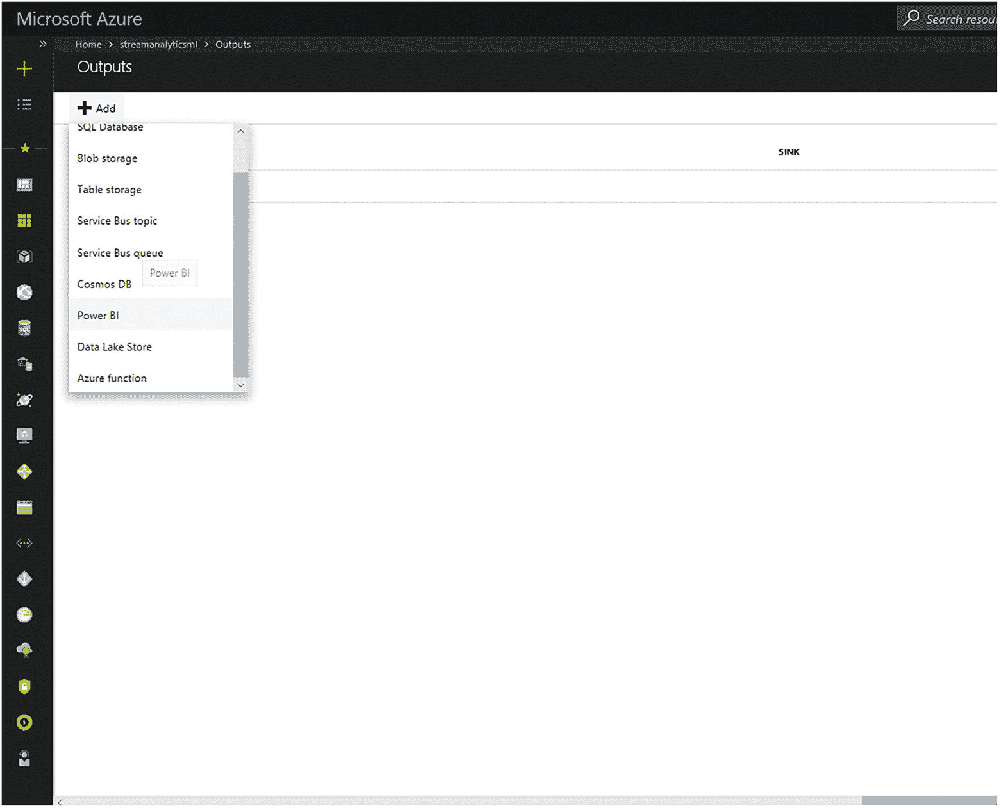
图 13-15 在 `Stream Analytics` 中为 `Power BI` 创建输出

创建 `Stream Analytics` 输入和输出后，在创建查询之前，我们必须在 `.NET` 代码中设置一些密钥和名称。单击 `Stream Analytics` 组件，然后选择“共享访问策略”。单击 `RootManageSharedAccessKey`，然后复制主密钥（图 13-16）。

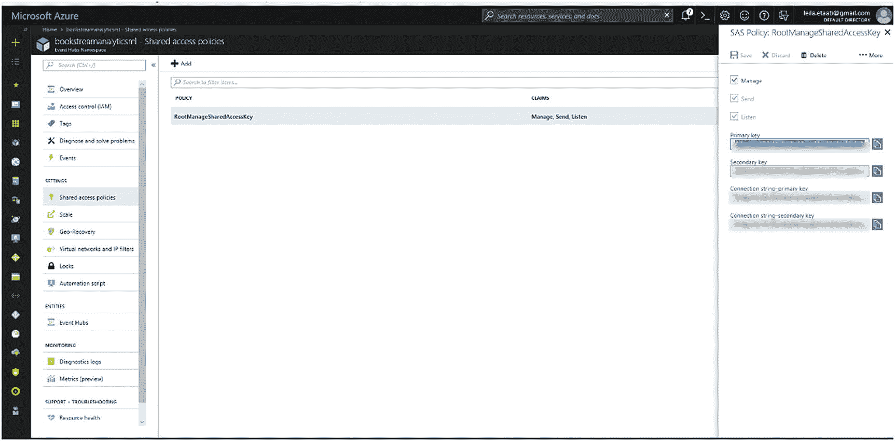
图 13-16 共享访问密钥

复制数据，然后将其粘贴到图 13-11 所示的主代码部分。

## Azure ML

在 `Azure ML Studio` 中，我创建了一个用于数据分组的简单模型。该模型的主要目的是从应用程序获取数据，然后将其分为四个主要组。接下来，我创建一个 API，以便 `Stream Analytics` 能够将数据传递给它，并获取组号和实际值。导入应用程序将要生成的示例数据（图 13-17）。示例数据已包含在第 13 章的书籍材料中。然后将“选择数据集中的列”组件拖放到选定的值列上。最后，利用另一个名为“将数据分组到箱中”的组件。

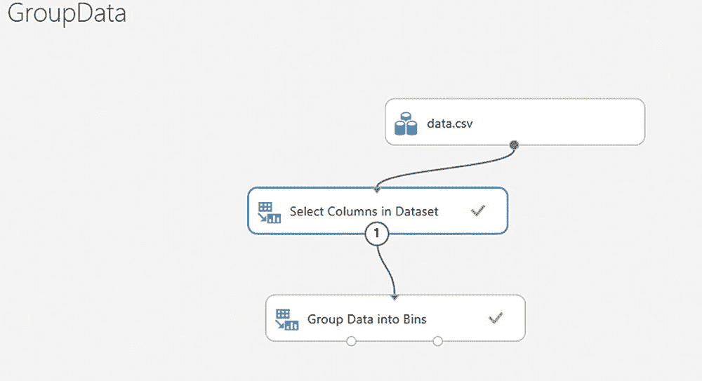
图 13-17 `Azure ML` 模型

请按照以下步骤为此模型生成 API。

1. 使用页面底部的“运行”选项运行模型。
2. 单击“设置页面”，为 API 创建输入和输出（图 13-18）。
3. 然后，再次运行模型并单击“部署 Web 服务”。

创建 Web 服务后，将显示一个新页面。在新页面的中间位置，会显示该 Web 服务的 API 密钥。

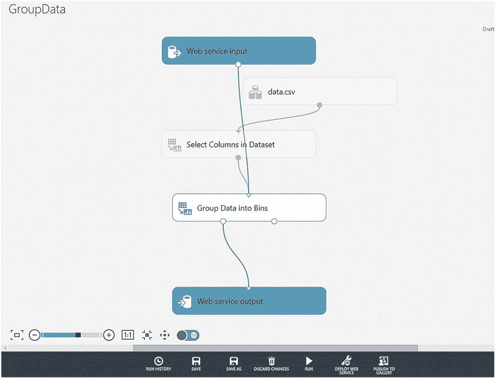
图 13-18 创建 `Azure ML` Web 服务

要从 `Stream Analytics` 连接到 `Azure ML` API，我们必须单击“应用程序”（位于页面底部），然后单击“`Excel` 2010 或更早版本的工作簿”（图 13-19）。将下载一个新的 `Excel` 工作簿。打开 `Excel` 文件，然后在页面顶部，您将看到 Web 服务 URL 和访问密钥。

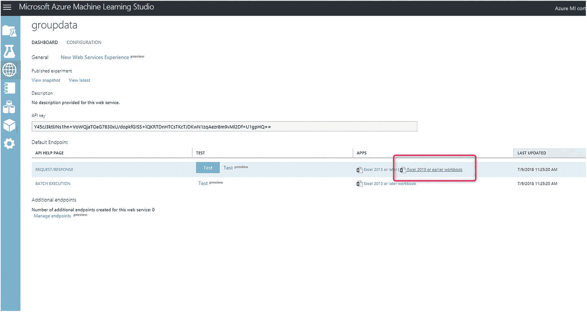
图 13-19 创建 `Azure ML` Web 服务

复制 Web 服务 URL 和访问密钥的代码（图 13-20）。

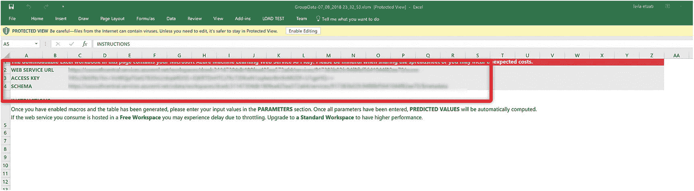
图 13-20 `Excel` 文件中的访问密钥和 URL

现在我们有了密钥和 URL，必须在 `Stream Analytics` 中设置一个函数，以访问在 `Azure ML Studio` 中创建的模型。

## Stream Analytics 函数

在此阶段，我们已经创建了一个用于生成随机数的事件中心应用程序、`Stream Analytics`，以及一个用于对流数据进行分组的 `Azure ML` 模型和 API。

在本节中，我们必须在 `Stream Analytics` 内部创建一个函数，以调用在 `Azure ML` 中创建的 API。单击 `Azure Stream Analytics` 作业，然后单击“函数”（图 13-21）。

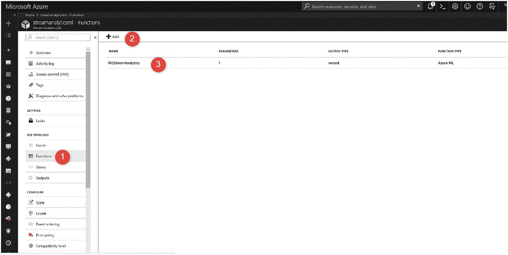
图 13-21 在 `Azure Stream Analytics` 中创建函数

在“函数”页面上，选择订阅名称、从 `Excel` 文件中提取的密钥和 URL（图 13-22）。

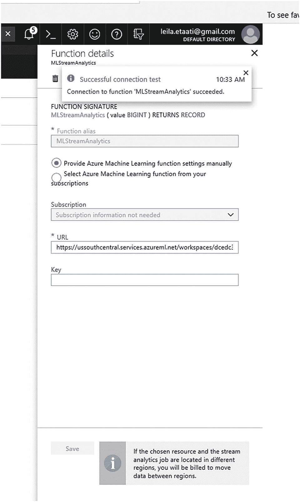
图 13-22 创建函数

在 `Stream Analytics` 主页上，我们必须在查询编辑器中添加一些代码来调用该函数。单击“编辑查询”，然后在编辑器中粘贴以下代码：

```
WITH MLStreamAnalytics AS (
SELECT value, MLStreamAnalytics(value) as result
FROM azureml
)
SELECT
value, result.[value_quantized]
INTO
MLoutput
FROM
MLStreamAnalytics
```

代码的第一部分用于调用函数并从中获取结果。如图 13-23 所示，代码的第一部分是关于创建一个临时表来调用 `MLStreamAnalytics(value)`。下一步是从事件中心组件（来自 `Azure ML`）获取数据。

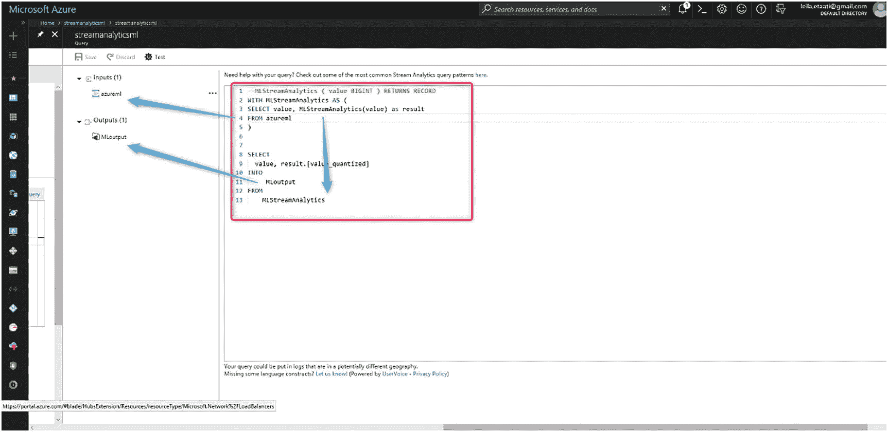
图 13-23 在 `Stream Analytics` 中编辑查询

代码的第二部分从 `Azure Stream Analytics` 中的函数获取数据，并将数据传递给 `Power BI` 组件（`MLoutput`）。

## 流数据的实时分析

最后一步是运行代码。首先，我们必须通过点击“启动”按钮来运行流分析作业（图 13-24）。

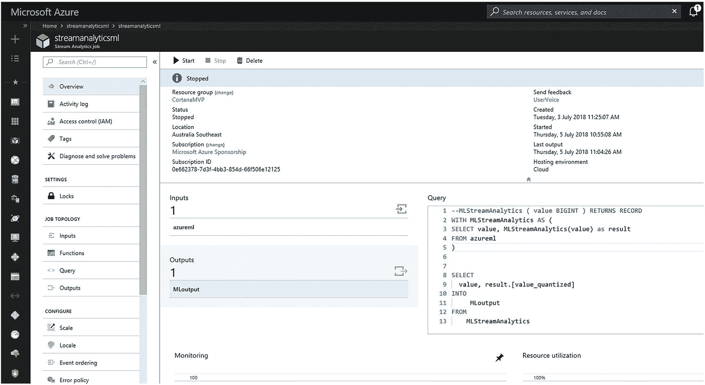
图 13-24 运行流分析作业

运行流分析作业后，从 [`powerbi.microsoft.com`](http://powerbi.microsoft.com) 打开你的 `Power BI` 服务。如图 13-25 所示，`Power BI` 中已创建了一个流式数据集。要使用它，请点击报表图标并创建一个空白报表。

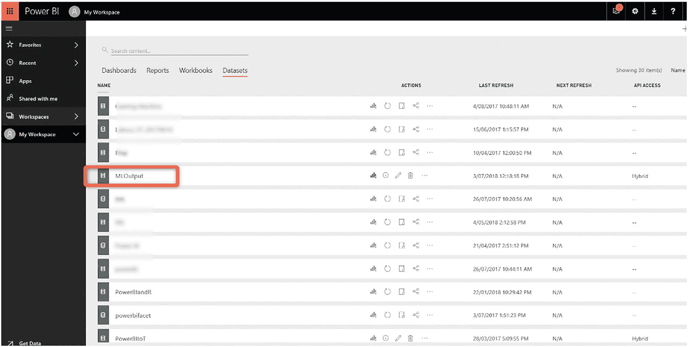
图 13-25 在 `Power BI` 中创建流式数据集

在报表页面上，会显示一个新的 `Power BI` 报表，其中包含一个具有两个字段的数据集：`Value` 和 `Value_quantized`（图 13-26）。

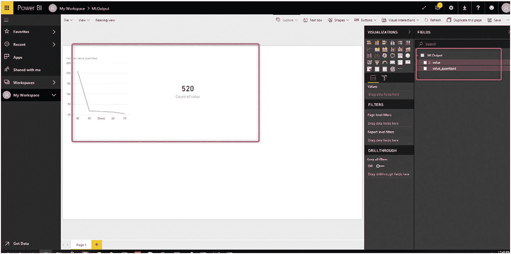
图 13-26 包含流分析的 `Power BI` 报表

现在，我们必须运行 `.NET` 应用程序中的代码，并将报表添加到新的工作区。运行代码并检查工作区后，除了使用 `Azure ML` 模型分配给每个值的组名和编号之外，你还可以看到来自应用程序的实时数据以及 `Power BI` 中的流式数据（图 13-27）。

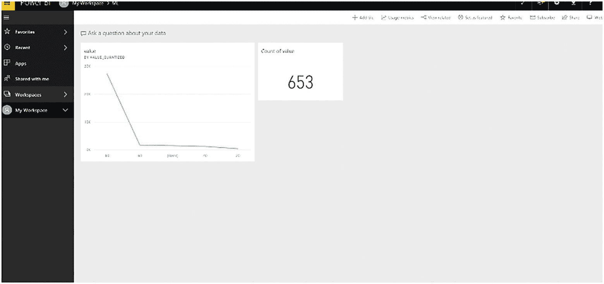
图 13-27 `Power BI` 中的流式实时数据

## 总结

本章概述了 Azure 流分析，并简要解释了其不同组件。一个用例演示了如何使用 Azure ML 模型和 API 将流分析用于实时分析。创建了一个用于生成随机数的示例应用程序，然后回顾了如何将事件中心、流分析、Azure ML 和 Power BI 结合使用，以展示流式实时数据分析。