# 14. Azure 机器学习 (ML) Workbench

Azure ML Workbench 是微软在 2017 年推出的另一个工具。Azure 机器学习服务（预览版）将端到端数据科学与高级分析工具集成在一起。它们帮助专业数据科学家准备数据、开发实验并在云规模上部署模型 [1]。在本章中，首先简要介绍 Azure ML Workbench，然后对 Azure ML Studio 和 Azure ML Workbench 进行比较。接下来将介绍安装 Azure ML Workbench 的过程。之后，将讨论数据的加载、准备和可视化。

## Azure ML Workbench

Azure ML Workbench 是一个集成的、端到端的数据科学和高级分析解决方案。它是一个用于准备数据、开发模型和实验，并最终在云规模上进行部署的工具。Azure ML Workbench 是 Azure ML 的一个新版本，与 Azure ML Studio 有一些不同之处。在表 14-1 中，我总结了 Azure ML Workbench 和 Azure ML Studio 之间的主要区别。

表 14-1

Azure ML Workbench 与 Azure ML Studio 对比

|  | Azure ML Workbench | Azure ML Studio |
| --- | --- | --- |
| 用户视角 | 适合专业数据科学家。 | 对于非机器学习专家用户来说，这是一个很好的工具。 |
| 部署 | 可以在云端部署模型、管理模型并跟踪其部署。 | 在 Azure ML Studio 中，模型通过创建 API 进行部署。 |
| 开发语言 | 唯一的开发语言是 Python。 | 除了使用一些现有模型和转换组件外，还可以使用 R 或 Python 代码开发模型。 |
| 可访问性 | 本地平台 | 基于云的平台 |

Azure 机器学习的五个主要组件是：

*   Azure 机器学习 Workbench

*   Azure 机器学习实验服务

*   Azure 机器学习模型管理服务

*   用于 Apache Spark 的 Microsoft 机器学习库（`MMLSpark` 库）

*   用于 AI 的 Visual Studio Code 工具

Azure ML Workbench 是一个桌面应用程序，也是一个命令行工具。它支持 Windows 和 MacOS。使用它，可以管理机器学习解决方案。

### Azure ML Workbench 安装

安装 Azure ML Workbench 的第一步是为 Azure 机器学习服务创建服务帐户 [2]。登录 Azure 门户 (`portal.azure.com`) 并选择“机器学习实验”（图 14-1）。

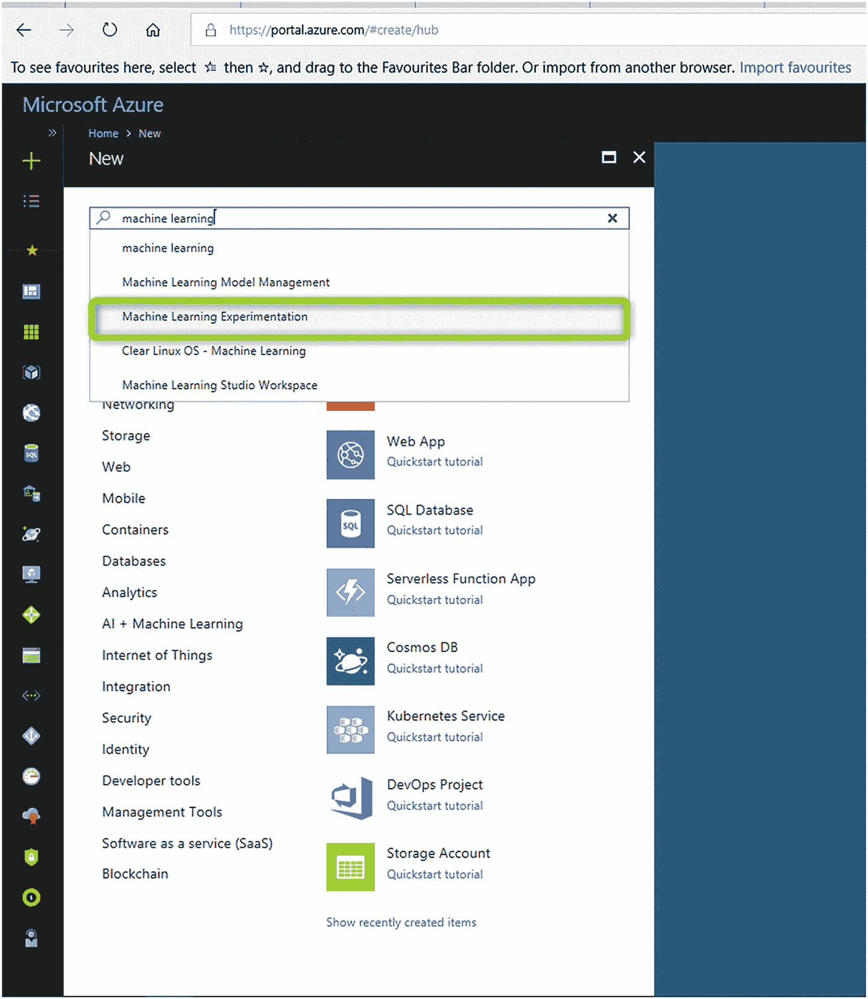

图 14-1

创建 Azure ML 模型实验

接下来，我们必须设置参数，如图 14-2 所示。

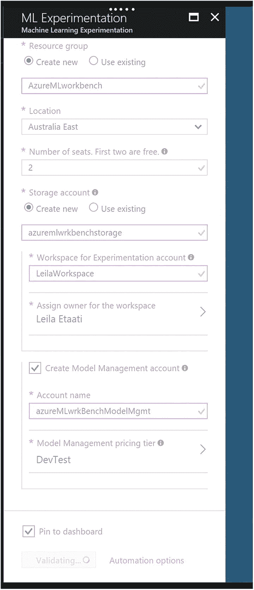

图 14-2

为 Azure ML 模型实验设置参数

可以从概览页面下载 Azure ML Workbench。如图 14-3 所示，我创建了机器学习模型管理。

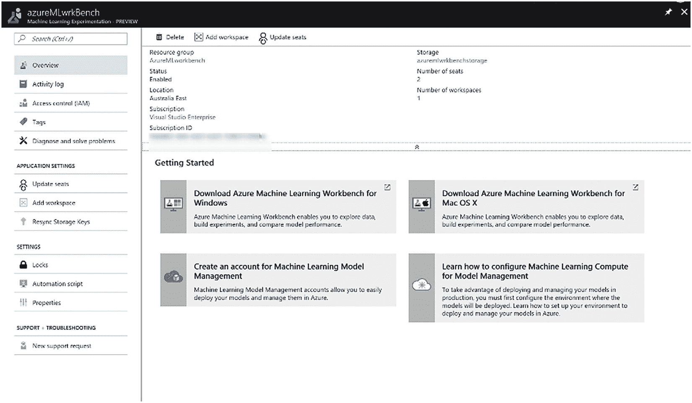

图 14-3

Azure ML 模型和实验管理

从 Azure 门户下载 Azure ML Workbench。初始安装过程可能需要几分钟。

### Azure ML Workbench 环境

安装 Azure ML Workbench 后，打开它。如图 14-4 所示，开始时，Azure ML Workbench 中没有列出任何项目。

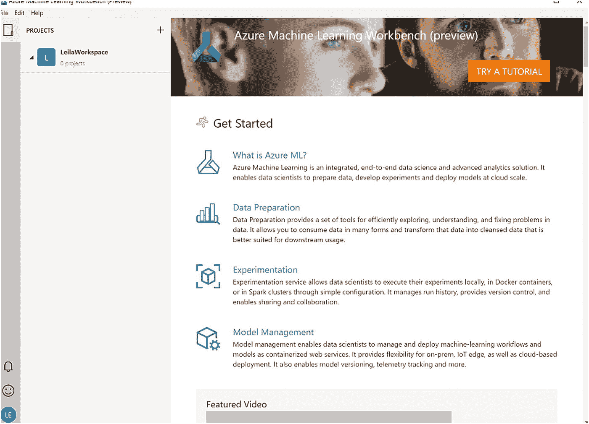

图 14-4

Azure ML 模型主页

要开始使用 Azure ML Workbench，有一些示例项目可以帮助用户了解更多信息。首先，你必须创建一个空的工作区。要创建新工作区，请单击加号 (+)，然后单击“新建工作区”（图 14-5）。

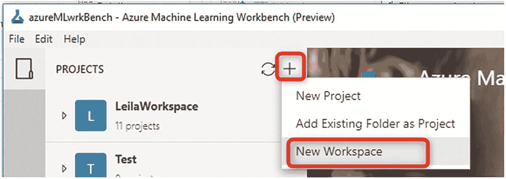

图 14-5

创建新的 Azure 工作区

如图 14-6 所示，要创建新工作区，我们必须提供有关工作区的一些详细信息，例如名称和描述。

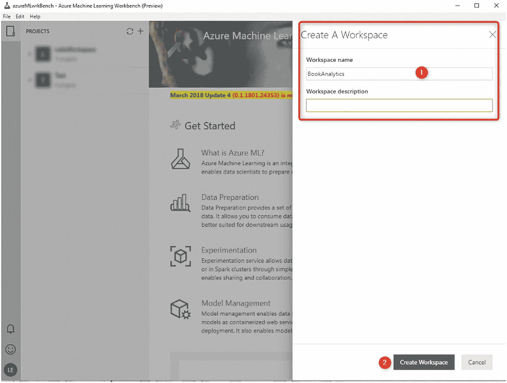

图 14-6

提供有关新 Azure 工作区的详细信息

在新工作区下创建一个新项目。在最后一个文本框“搜索项目模板”下，搜索“鸢尾花分类”（图 14-7）。

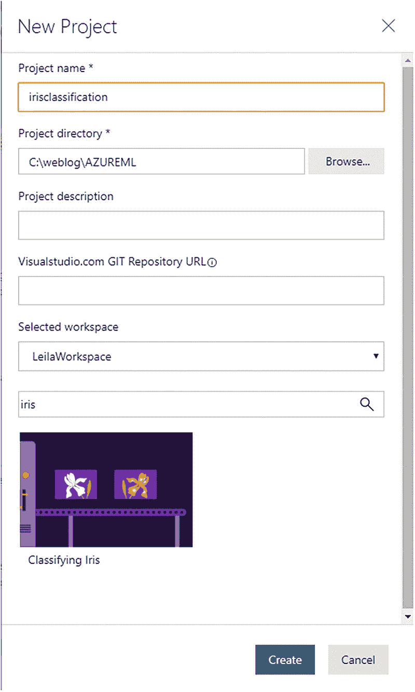

图 14-7

鸢尾花分类项目

创建鸢尾花分类项目。创建项目后，将显示项目环境。有五个主要选项卡（图 14-8）。在下一节中，将解释每个组件。

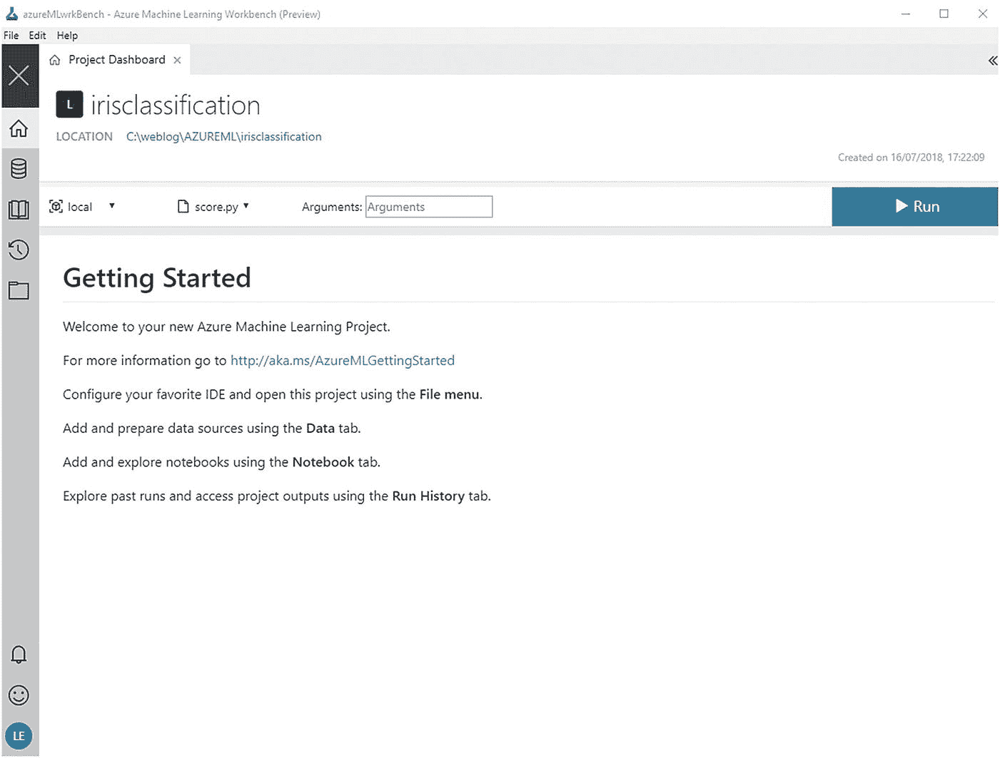

图 14-8

Azure ML Workbench 中的鸢尾花项目

### Azure ML Workbench 导入数据

第一步是将数据导入 Azure ML Workbench。点击“数据”选项。其中包含两个主要部分。“数据源”存储原始数据源。“数据准备”选项存储经过准备和清理的数据。要将数据导入 Azure ML Studio，必须点击页面顶部的加号 (+)，如图 14-9 所示。

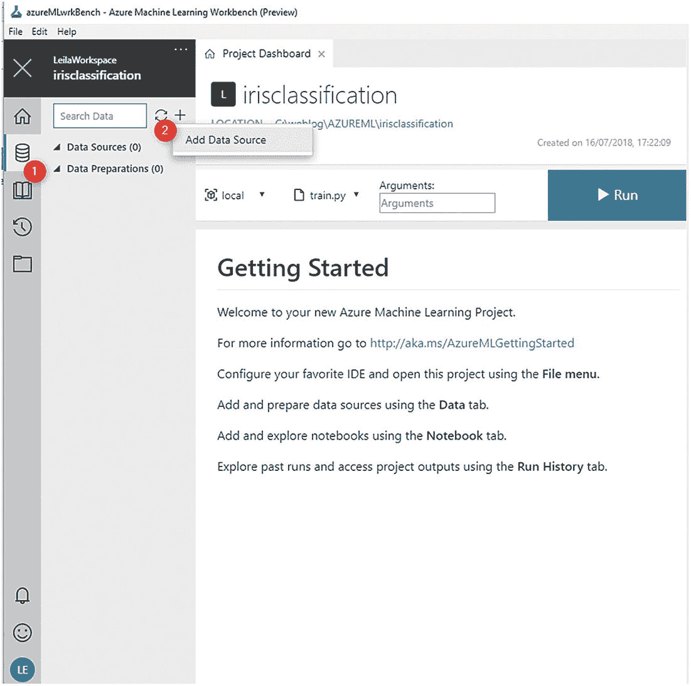

图 14-9

导入数据

点击“添加数据源”，其中有四个主要选项用于导入数据，如图 14-10 所示：

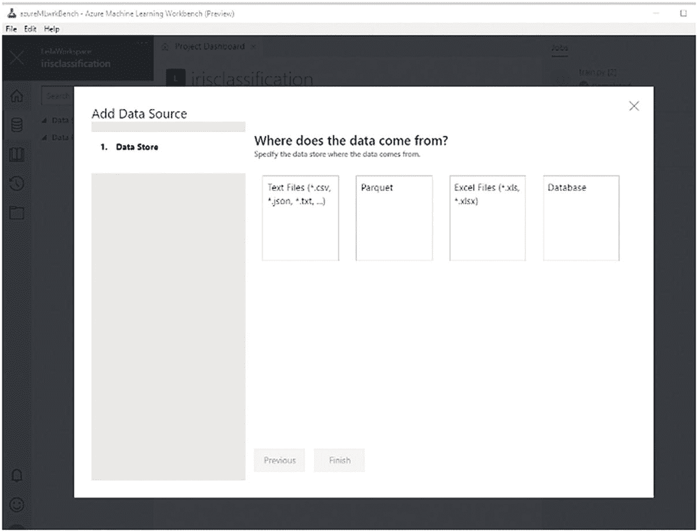

图 14-10

添加数据源选项

*   文本文件

*   Parquet

*   Excel 文件

*   数据库

在此示例中，鸢尾花数据（文本文件）将从本地 PC 导入 Azure ML Workbench 环境。选择“文本文件”并将数据导入 Azure ML Workbench（你可以从 [`www.kaggle.com/uciml/iris`](http://www.kaggle.com/uciml/iris) 下载鸢尾花数据集文件）。

如图 14-11 所示，鸢尾花数据集已导入。“数据源”部分中的数据集存储原始数据。它还显示了缺失的行数、有效行数等信息。

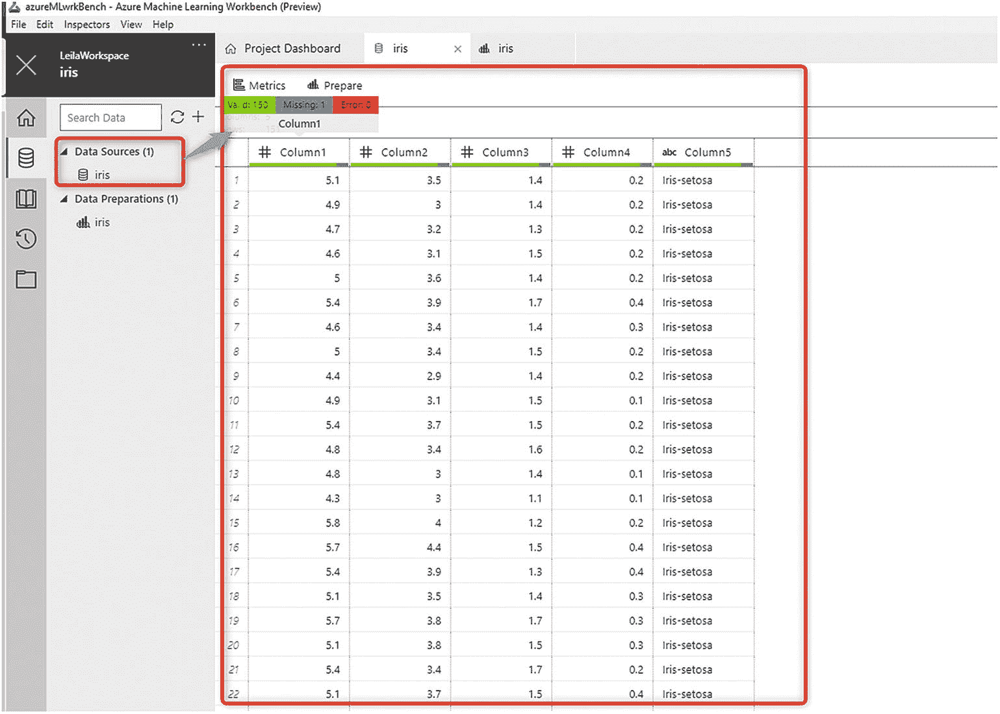

图 14-11

将数据导入 Azure ML Workbench

要准备数据，请点击窗口顶部的“准备”选项，并为新数据集指定一个合适的名称。然后，在“数据准备”部分，将显示一个新数据，如图 14-12 所示。

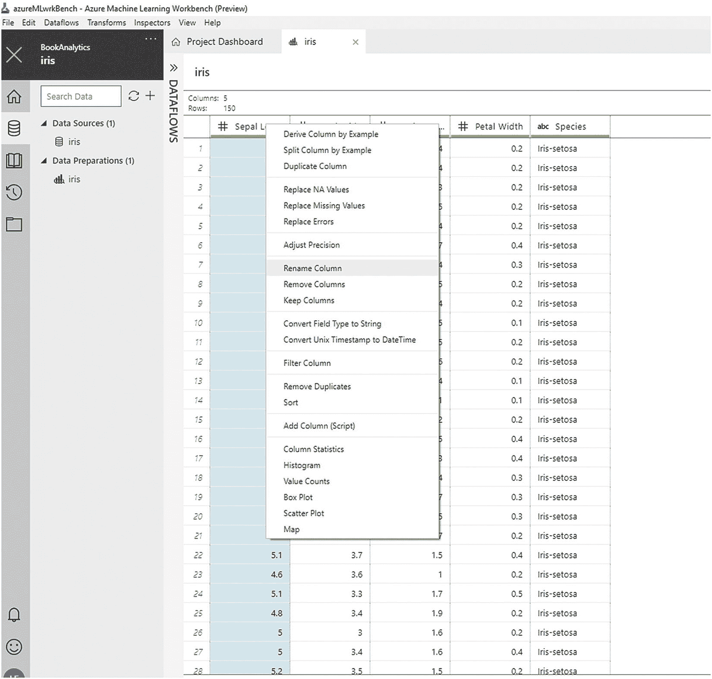

图 14-12

准备数据

右键单击第一列。有一些用于数据清理的选项，例如“替换 NA 值”、“替换缺失值”等。将列重命名为“花萼长度”、“花萼宽度”、“花瓣长度”和“花瓣宽度”。可以创建图表，以便更好地理解数据。如图 14-13 所示，在右键菜单的底部，有一些图表选项，例如“列统计信息”、“直方图”、“值计数”等。

对于我们的示例，我们可以通过选择直方图来查看数据的分布情况。

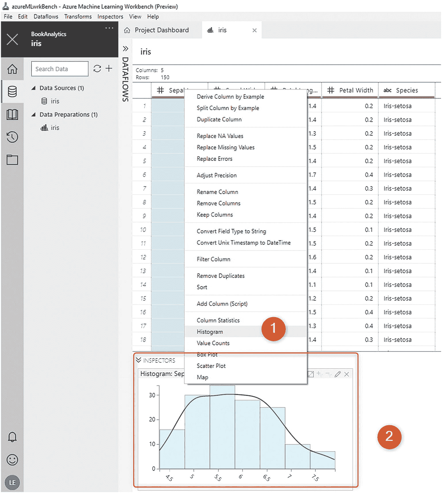

图 14-13 鸢尾花花萼长度直方图

此编辑器为数据科学家提供了一种手段，可以更好地分析数据并更深入地了解数据特征，例如分布、异常值等。Azure Machine Learning Workbench 通过与 Jupyter Notebook 集成，支持交互式数据科学实验。导入并清理数据后，必须运行并训练模型。如图 14-14 所示，有一个用于运行代码和测试模型的笔记本编辑器。点击窗口左侧的“笔记本”选项。那里会出现一个笔记本。（在第 19 章中，将对 Jupyter Notebook 进行简要介绍。）

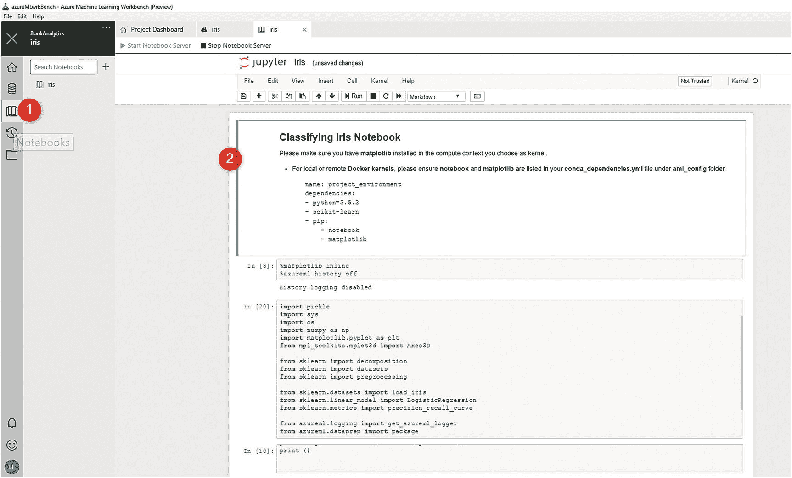

图 14-14 Azure ML Workbench 中的 Jupyter Notebook

窗口左侧有一个名为“运行”的选项。它显示运行模型的历史记录。开始时，没有运行历史记录。

鸢尾花项目的相关文件已加载到窗口左侧的最后一个选项中。如图 14-15 所示，所有与鸢尾花分类相关的文件都位于此处。

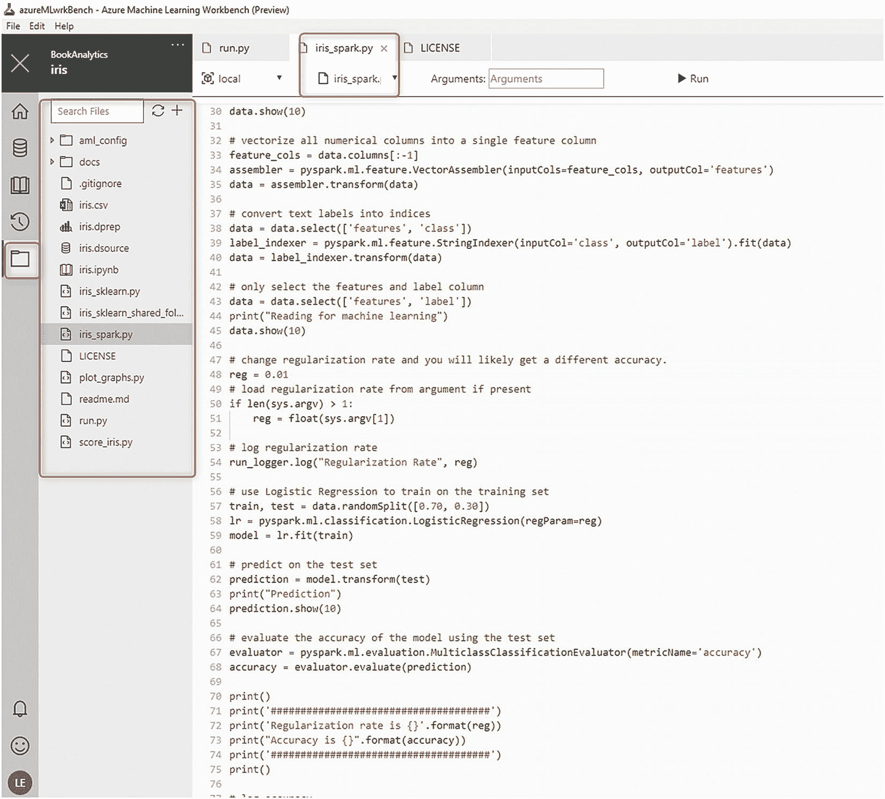

图 14-15 鸢尾花文件

如图 14-15 所示，列出了与鸢尾花项目相关的所有文件。其中一个文件是 `iris_sklearn.py`。此文件包含用于鸢尾花分类的模型和数据。可以在本地 Docker 上运行代码，如图 14-16 所示。

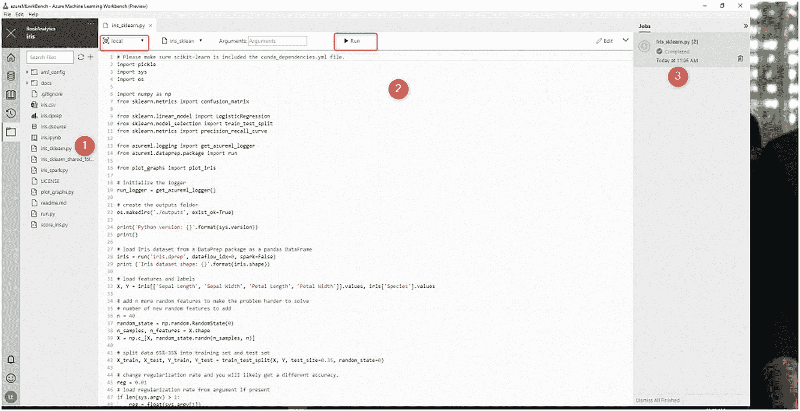

图 14-16 运行 Python 代码

点击“运行”选项并运行模型。运行模型后，点击窗口右侧的“运行”。你将能够看到运行的详细信息，包括状态、运行开始时间、持续时间、准确率等，如图 14-17 所示。

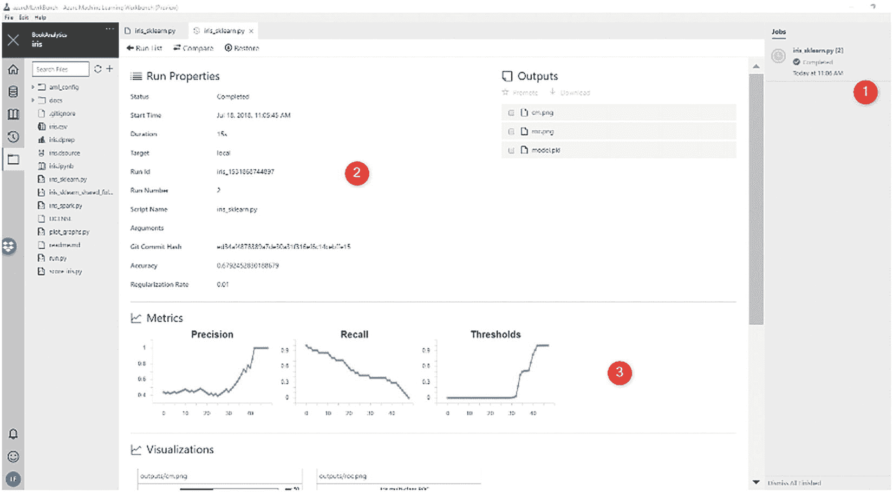

图 14-17 鸢尾花运行详情

运行 Python 代码的详细信息已显示在图 14-16 中。鸢尾花分类的评估结果显示在图 14-18 中。

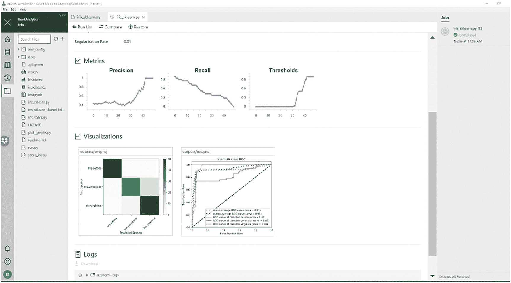

图 14-18 鸢尾花分类结果

## 总结

本章简要介绍了 Azure ML Workbench 环境，包括如何安装和访问该环境的说明。在下一章中，你将了解如何从 SQL Server 数据库导入数据，然后将其加载到 Azure ML Workbench，以及如何在 Docker 上的 Spark 中运行它。