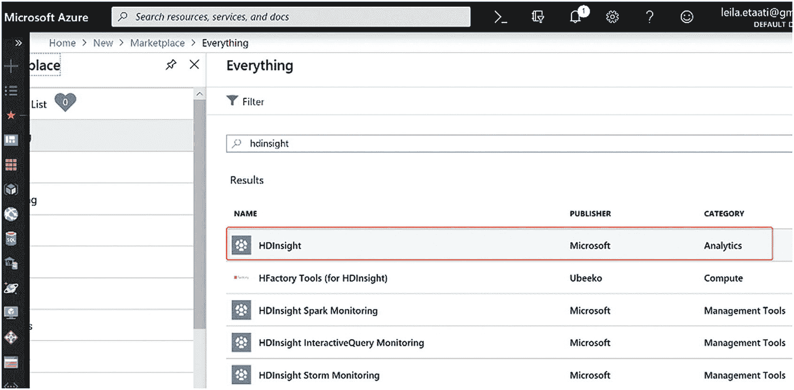
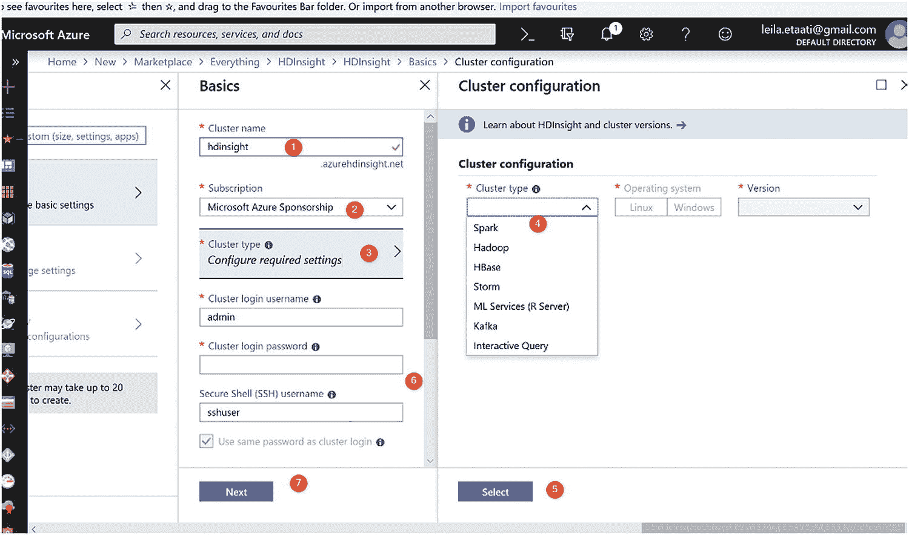
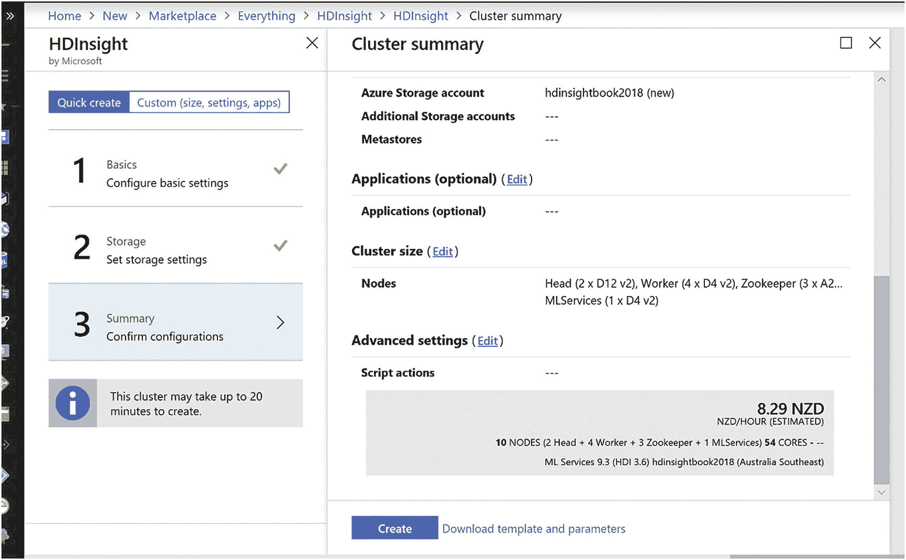
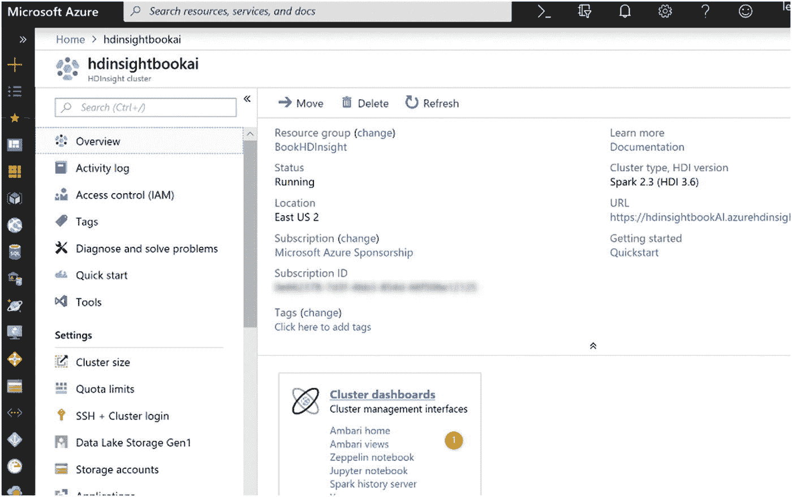
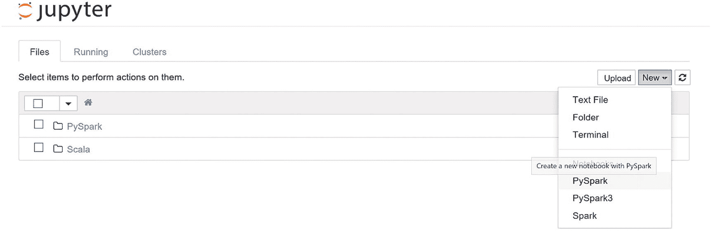
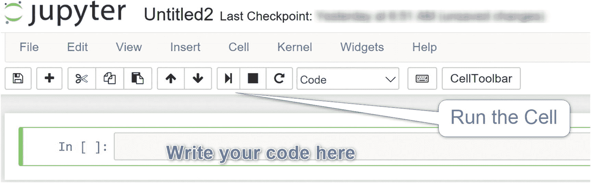
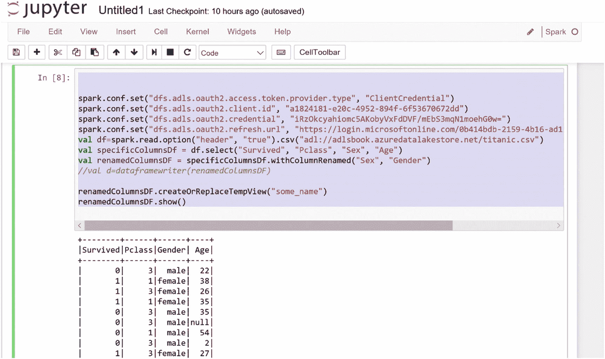

# 15. HDInsight 上的机器学习

本章将概述如何使用 HDInsight 进行机器学习。HDInsight 基于 Apache Spark，用于内存集群处理。在内存中处理数据比基于磁盘的计算快得多。Spark 还支持 Scala 语言，该语言支持分布式数据集。在 Spark 中创建集群非常快，并且它能够使用 Jupyter Notebook，这使得数据处理和可视化更加容易。Spark 集群还可以与 Azure Event Hub 和 Kafka 集成。此外，还可以设置 Azure 机器学习 (ML) 服务来运行分布式 R 计算。下一节将讨论在 HDInsight 中设置 Spark 的过程。

## HDInsight 概述

HDInsight 是一种开源分析和基于云的服务。与 Azure HDInsight 集成对于处理海量数据来说简单、快速且经济高效。HDInsight 有许多不同的用例场景，例如 ETL（提取、转换和加载）、数据仓库、机器学习、物联网 (IoT) 等。

使用 HDInsight 进行机器学习的主要好处是可以访问基于内存的处理框架。HDInsight 帮助开发人员使用一些优秀的开源框架（例如 Hadoop、Spark、Hive、LLAP、Kafka、Storm 和 Microsoft Machine Learning Server [1]）来处理和分析大数据并开发解决方案。


## 在 HDInsight 中设置集群

第一步是在 Azure 中设置 HDInsight。登录你的 Azure 账户，并在 Azure 中创建一个 HDInsight 组件（图 15-1）。如图 15-1 所示，HDInsight 有不同的模块，例如 HDInsight Spark 监控和 HDInsight InteractiveQuery 监控。在这些模块中，选择 **HDInsight 分析** 选项。



图 15-1

在 Azure 中设置 HDInsight

创建 HDInsight 时，必须遵循一些步骤来设置集群并确定其大小。第一步是为集群设置名称、设置订阅并选择集群类型（图 15-2）。可用的集群类型有多种，包括 Spark、Hadoop、Kafka、ML Services 等。



图 15-2

在 Azure 中创建 HDInsight

下一步是确定集群的大小并查看摘要（图 15-3）。



图 15-3

设置 HDInsight

创建 HDInsight 可能需要一些时间。创建 HDInsight 组件后，在主页的“概述”部分，选择“集群仪表板”（图 15-4）。



图 15-4

HDInsight 环境

接下来，选择 **Jupyter Notebook**。在新页面上，选择“新建”选项（图 15-5）。



图 15-5

Jupyter Notebook 环境

如图 15-5 所示，有多个环境选项，例如 PySpark、PySpark3 和 Spark。你可以在所有这些环境中编写 Python 代码。

为 Spark 创建新页面后，你必须使用创建 HDInsight 组件时提供的用户名和密码登录。Jupyter 环境类似于笔记本，因此也类似于 Azure Databricks 环境。如图 15-6 所示，你可以在其中编写代码并运行整个单元格来查看结果。



图 15-6

Jupyter Notebook 环境

还可以从其他 Azure 组件（例如 Azure Data Lake Store Gen1）获取数据（图 15-7）。为此，你必须运行以下代码（在 Databricks 中，运行相同的代码）。



图 15-7

从 Azure Data Lake Store Gen1 获取数据

```
spark.conf.set("dfs.adls.oauth2.access.token.provider.type", "ClientCredential")
spark.conf.set("dfs.adls.oauth2.client.id", "a1824181-e20c-4952-894f-6f53670672dd")
spark.conf.set("dfs.adls.oauth2.credential", "iRzOkcyahiomc5AKobyVxFdDVF/mEbS3mqN1moehG0w=")
spark.conf.set("dfs.adls.oauth2.refresh.url", "https://login.microsoftonline.com/0b414bdb-2159-4b16-ad13-b2d54a1781da/oauth2/token")
val df=spark.read.option("header", "true").csv("adl://adlsbook.azuredatalakestore.net/titanic.csv")
val specificColumnsDf = df.select("Survived", "Pclass", "Sex", "Age")
val renamedColumnsDF = specificColumnsDf.withColumnRenamed("Sex", "Gender")
renamedColumnsDF.createOrReplaceTempView("some_name")
renamedColumnsDF.show()
```

也可以在 Jupyter Notebook 中使用 Spark 执行机器学习。有关示例，请参阅 [`https://docs.microsoft.com/en-us/azure/hdinsight/spark/apache-spark-ipython-notebook-machine-learning`](https://docs.microsoft.com/en-us/azure/hdinsight/spark/apache-spark-ipython-notebook-machine-learning) 上的教程。

## 总结

本章概述了 HDInsight 及其设置方法。简要说明了如何将 HDInsight 用于不同目的，以及如何在 Azure 环境中设置 HDInsight，并介绍了如何访问 Jupyter Notebook 以在 PySpark、Spark 或 PySpark3 环境中编写代码。还展示了一个如何连接到 Azure Data Lake Store Gen1 以获取数据的示例。

## 参考

1.  Microsoft Azure，“Azure HDInsight 文档”，[`https://docs.microsoft.com/en-us/azure/hdinsight/`](https://docs.microsoft.com/en-us/azure/hdinsight/) ，2019 年。

