# 16. 数据科学虚拟机和 AI 框架

数据科学虚拟机（DSVM）是 Azure 云上专为进行数据科学而定制的一台虚拟机。DSVM 拥有一些预配置和预安装的工具，可帮助用户构建人工智能（AI）应用程序。DSVM 有助于数据科学团队获得一致的设置环境。本章将简要介绍 DSVM 及其安装方法，并概述其预安装的工具。

## 数据科学虚拟机概述

数据科学虚拟机是一种预安装和预配置的工具，能够促进数据科学团队之间的协作。在云中安装一组所需的工具，可以减少维护软件的需求以及相关的时间和成本。

DSVM 可以帮助培训师和教育工作者使用一致的设置环境来教授数据科学。拥有一个预构建的设置环境非常适合短期培训。DSVM 可用于学习和比较不同的机器学习工具，例如 Microsoft ML Server、SQL Server、Visual Studio、Jupyter、深度学习工具等。DSVM 包含许多不同的数据科学和深度学习工具，包括：

*   预装了流行包的 Microsoft R Open
*   Microsoft ML Server（R、Python）开发者版
*   Microsoft Office 专业增强版
*   Anaconda Python 2.7、3.5
*   关系数据库
*   数据库工具
*   支持 R、Python、Julia、PySpark、Sparkmagic 和 SparkR 的 Jupyter Notebook Server
*   开发工具，例如 `Visual Studio 2017`、`RStudio Desktop` 和 `Server`、`PyCharm Community` 等
*   Power BI Desktop
*   数据移动和管理工具，例如 Azure Storage Explorer 和 Microsoft Data Management Gateway
*   机器学习工具，例如 Azure Machine Learning、`Weka`、`Rattle` 和 `H2O`
*   深度学习工具，例如 Microsoft Cognitive Toolkit、TensorFlow 和 Keras
*   大数据平台，例如 Spark 和 Hadoop [1]

## 设置数据科学虚拟机

要设置 DSVM，首先必须登录 Azure 门户。选择“AI + 机器学习”，然后点击“数据科学虚拟机 – Windows 2016”（图 16-1）。

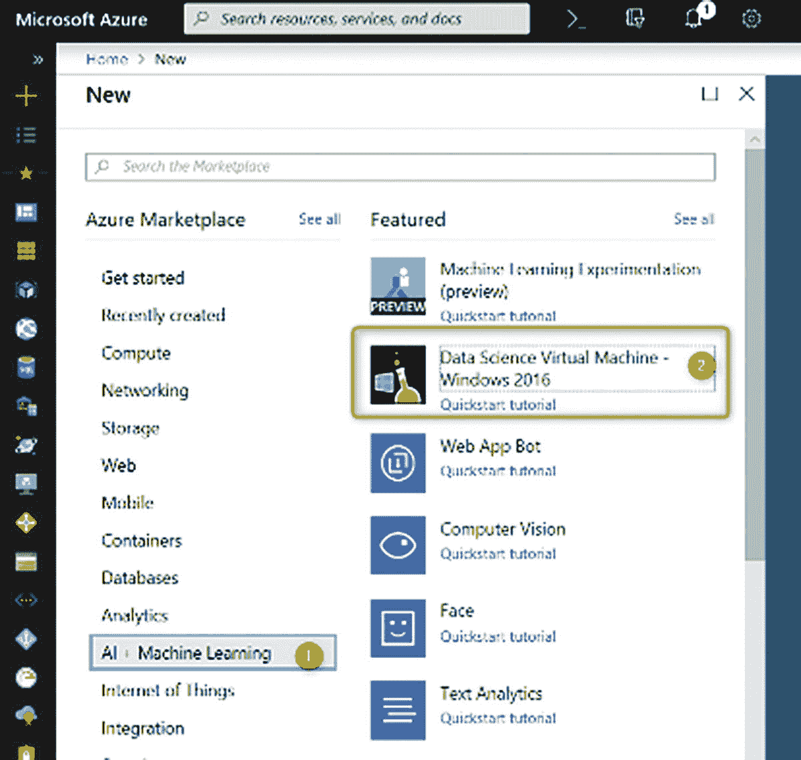

图 16-1 数据科学虚拟机设置

下一步是设置大小并选择合适的配置。出于数据科学的目的，虚拟机 CPU 应具有四个以上内核以及 14GB 或更大的 RAM [2]（图 16-2）。所需服务旁边会有一个星号（如图 16-2 所示）。

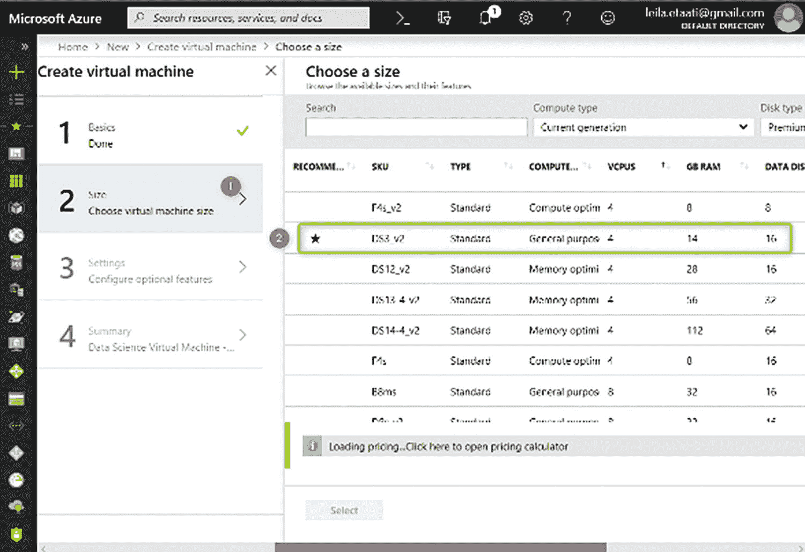

图 16-2 选择数据科学虚拟机大小

下一步是配置设置，以确定位置和名称。最后一步将显示 DSVM 的摘要。部署 DSVM 大约需要五分钟来创建服务（图 16-3）。创建资源后，点击“转到资源”。

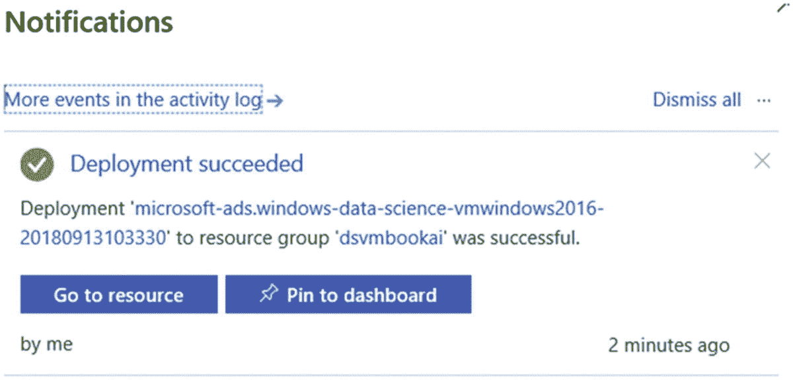

图 16-3 DSVM 创建

最终用户将看到 DSVM 的概览（图 16-4）。如图所示，其中包含 DSVM 的位置、虚拟机大小等概览信息。

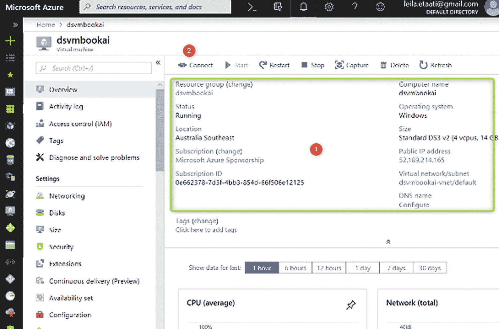

图 16-4 DSVM 概览

要连接到 DSVM，请点击窗口顶部的“连接”选项。相关的远程桌面协议 (RDP) 文件将从 Azure 下载（图 16-5）。

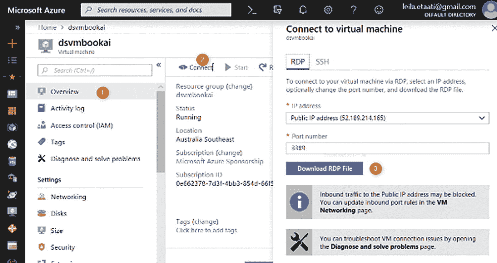

图 16-5 下载 RDP 文件

下载 RDP 文件后，打开虚拟机并检查环境（图 16-6）。

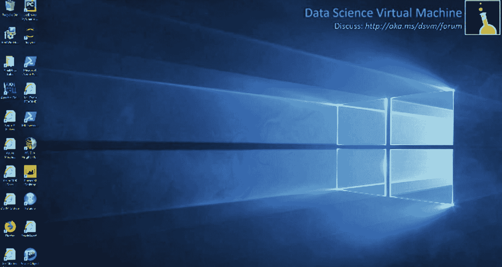

图 16-6 DSVM 环境

在 DSVM 中，已预装带有 R 和 Python 工具的 Visual Studio（RTVS 和 PTVS）。如图 16-7 所示，您可以通过 Visual Studio 检查最近的更新 [2]。

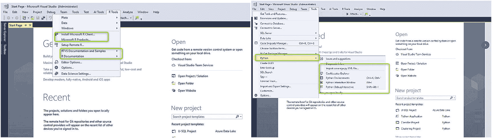

图 16-7 Visual Studio 2017 中的 R 和 Python 工具

`RStudio` 已安装在 DSVM 中。您必须在 `RStudio` 中安装所有必需的包，并且所有用户都能访问这些包（图 16-8）。

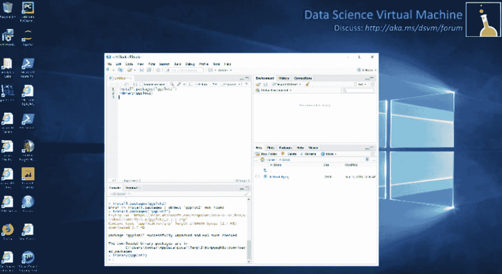

图 16-8 DSVM 中的 `RStudio`

## 案例研究

您可以运行不同的机器学习场景。本节将解释在 DSVM 的 Jupyter Notebook 中运行的一个机器学习场景。要访问 `Jupyter Notebook`，请点击 DSVM 桌面上的快捷方式。然后，在 `Jupyter` 中编写代码并运行（图 16-9）。在示例中，我运行了以下代码：

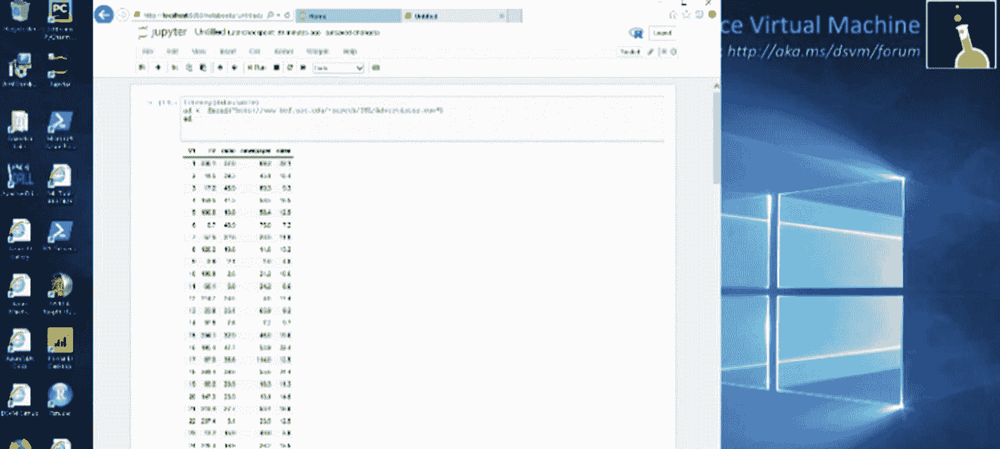

图 16-9 在 `Jupyter Notebook` 中运行 R 代码

```r
library(data.table)
ad <- fread("http://www-bcf.usc.edu/~gareth/ISL/Advertising.csv")
```

该数据集涉及电视、广播和报纸上的广告成本以及产生的销售额。

下一步，我们将根据电视、广播和报纸影响的人数等变量来预测销售额。使用线性回归，创建一个基于电视、广播和报纸广告数量预测销售额的模型。使用以下代码创建模型（图 16-10）：

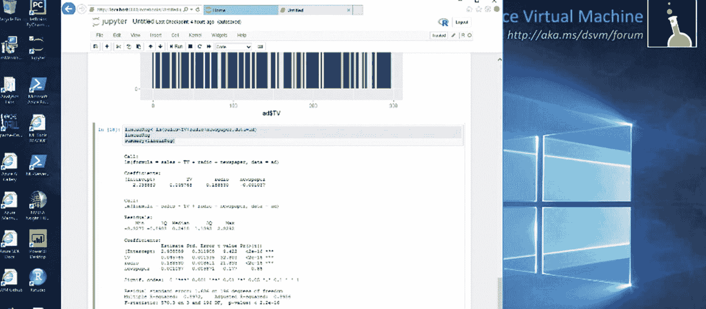

图 16-10 在 `Jupyter Notebook` 中创建模型

```r
linearReg<-lm(sales~TV+radio+newspaper,data=ad)
linearReg
summary(linearReg)
```

接下来，我们必须创建一个函数，该函数从用户处获取新数据并对其应用线性回归。首先，我们必须为此创建一个函数。

```r
newdata<-adv[1:5,]
library(AzureML)
predictfunction <-function(newdata)
{predict(linearReg,newdata)} [2]
```

此函数根据电视、广播和报纸上的广告数量预测销售额。上述函数基于前面代码中创建的模型预测新的数据集。现在，下一步，我们必须从 `Azure ML Studio` 环境中获取一些工作区 ID 和身份验证 ID。要获取数据，请登录 `Azure ML Studio`，然后点击“设置”以获取信息，例如工作区 ID（图 16-11）。

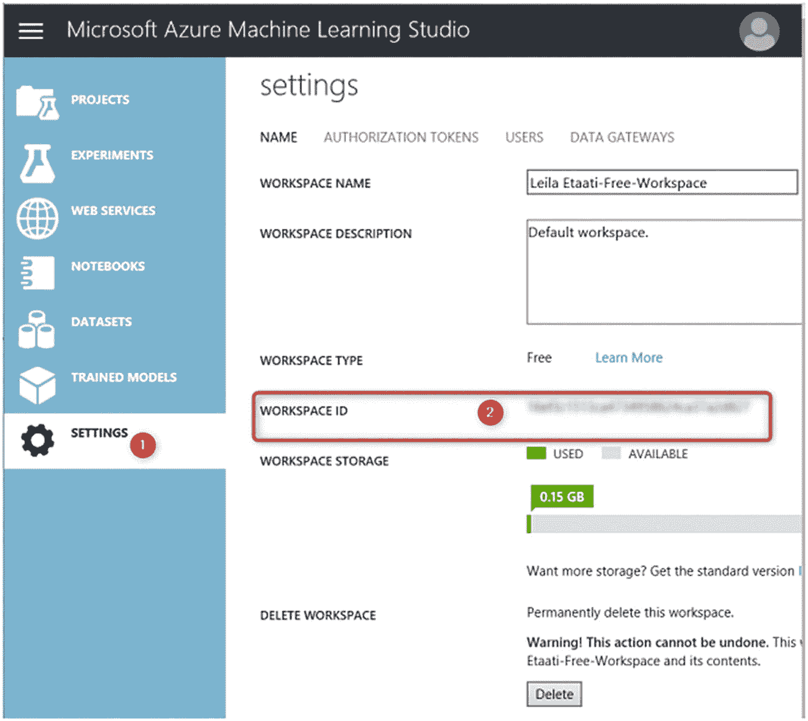

图 16-11 从 `Azure ML Studio` 获取工作区 ID

我们需要的另一个信息是身份验证令牌，来自主要授权令牌（图 16-12）。

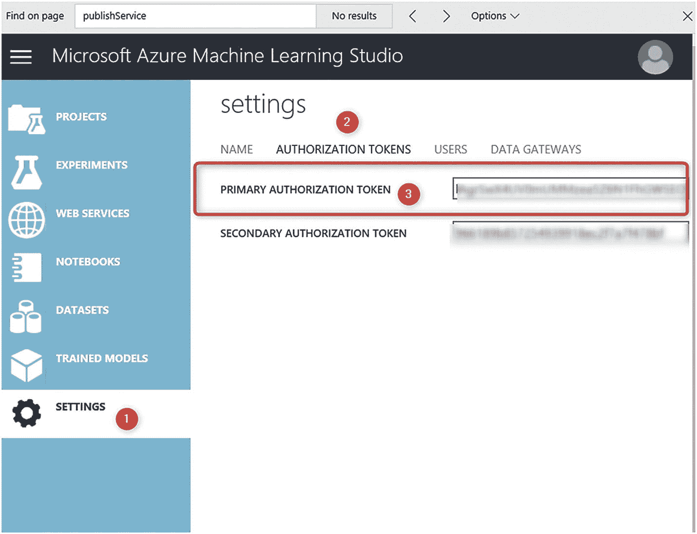

图 16-12 从 `Azure ML Studio` 获取身份验证密钥

复制这些密钥并将标识信息放入以下代码中。`Workspace` 函数是一个 Azure ML 函数，用于在 R 语言和 Azure ML Studio 之间创建连接。

```r
workspace_id<-"Workspace ID"
Authenticationid<-"Authentication Token"
ws<-workspace(workspace_id,Authenticationid)
newdata<-adv[2:5,]
```

下一步是调用另一个函数 `publishWebservice`，以根据创建的函数在 Azure ML 中生成一个 Web 服务。

```r
data.frame(actual=newdata$sales,prediction=predictfunction(newdata))
ep<-publishWebService(ws=ws,fun=predictfunction,name="SalesPredictionAdvertisement",inputSchema=newdata)
```

在 Jupyter 环境中运行整个代码（图 16-13）。

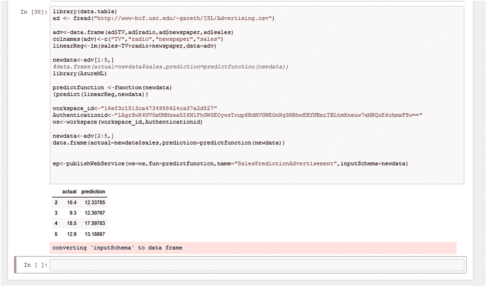
图 16-13

将 R ML 代码发布到 Azure ML Web 服务

运行代码后，检查 Azure ML Studio 中的 Web 服务，以查看在 Azure ML Studio 中创建的 API（图 16-14）。

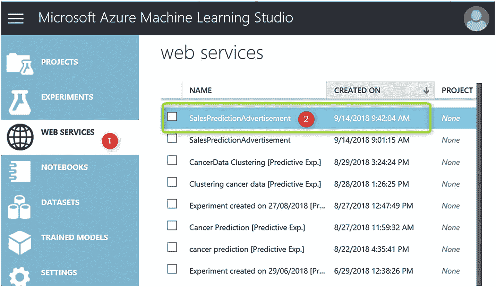
图 16-14

在 Azure ML 中创建的 Web 服务

通过点击“测试”按钮测试 API（图 16-15）。

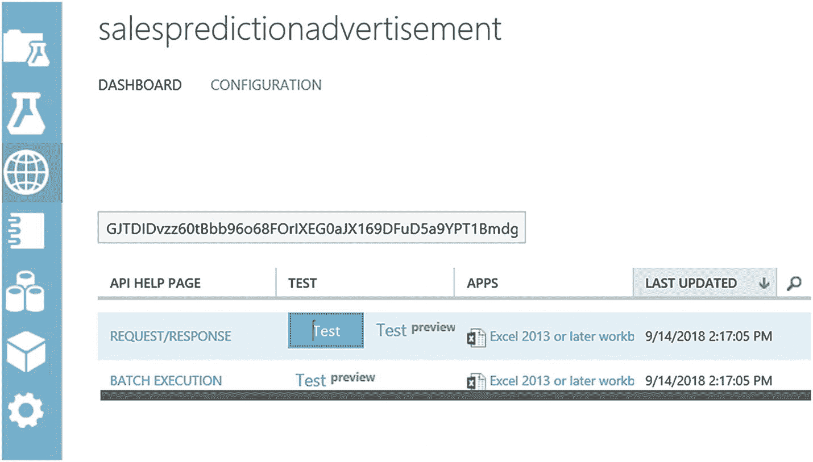
图 16-15

在 Azure ML Studio 中测试 Web 服务

## 总结

本章简要介绍了 DSVM。解释了如何设置 DSVM 以及如何设置相关参数的过程。此外，还简要介绍了哪些应用程序已预装。最后，展示了一个在 Jupyter Notebook 中进行机器学习，然后部署到 Azure ML Studio 的场景。