# 17. 使用认知工具包 (CNTK) 的深度学习工具

微软认知工具包 (CNTK) 是一个开源的深度学习工具 [1]。本章将首先介绍神经网络和深度学习的基本概念。接着，介绍什么是 CNTK，以及如何获取和安装它。最后，将详细阐述一个使用 CNTK 解决简单问题的基本案例研究。

## 神经网络概念

我们对计算机的期望是，根据我们的输入，得到符合我们需求的输出。科学家们试图通过智能机器来模仿人脑。当然，机器的推理方式与人类不同。人脑的主要元素是神经元。人脑由 7500 万个神经元组成。每个神经元通过突触与其他神经元相连（图 17-1）。神经网络由相互连接的节点组成。在人体中，如果一个神经元被某些外部触发（如高温）激活，它将通过突触将信息从接收节点传递到其他节点 [2]。

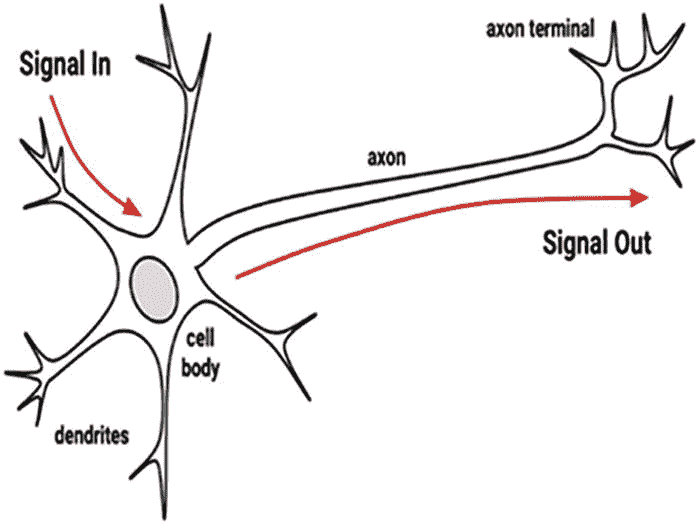
图 17-1 神经网络突触 [2]

神经网络模仿了与人脑相同的概念。一个节点接收来自用户的输入，然后神经网络模型创建输出，产生类似于计算机系统的结果。一个神经网络具有：
*   一组输入节点
*   一组输出节点
*   两者之间的一些处理过程，以获得良好结果
*   信息流
*   节点之间的连接

为了更好地理解这个过程，想象我们正站在山顶上，想要下山。天气有雾。在这种情况下，我们只能看到前方一米。因此，我们决定只走下可见的这一米。我们根据当前位置迈出第一步，然后决定下一步的方向。我们重复这个过程，直到到达无法继续前进的点。如果那个点就是目的地，过程就完成了；如果不是，我们必须返回并尝试其他方向。因此，对于每一步，我们都会评估路径并选择最佳路线，直到我们下山。

在神经网络中，我们经历相同的过程。我们有输入节点、一些隐藏节点（到达输出的途径）和输出节点。每个隐藏节点都有一个激活函数，用于处理输入或其他隐藏节点的输出结果（图 17-2）。

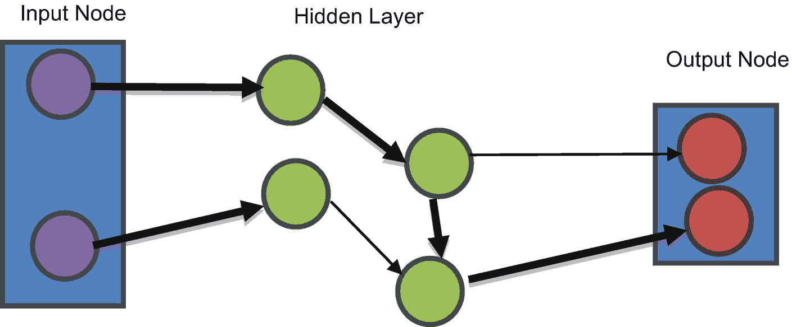
图 17-2 一个简单的神经网络

为了更好地理解这个概念及其工作原理，让我们想象一下，我们想根据客户是否会将其支持转向另一家公司来对其进行分类。该问题如图 17-3 所示。如图所示，有两组人（客户）。一组用蓝点表示，另一组用绿点表示。主要目标是根据其中一种颜色对人进行分组。

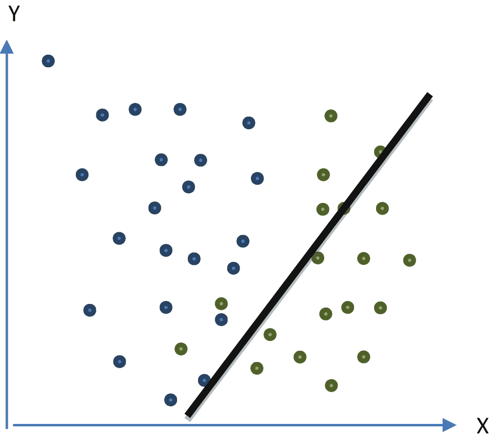
图 17-3 使用 `2*x + y = 2` 进行分类

如图所示，我们可以用一条线部分地隔离（分类）蓝点和绿点。所使用的相关方程是 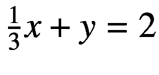。这个方程不能完全对这些点进行分类，所以我们必须尝试另一个方程。下一个方程是 `x = 4`。如图 17-4 所示，新方程仍然不能产生完整或准确的分类。

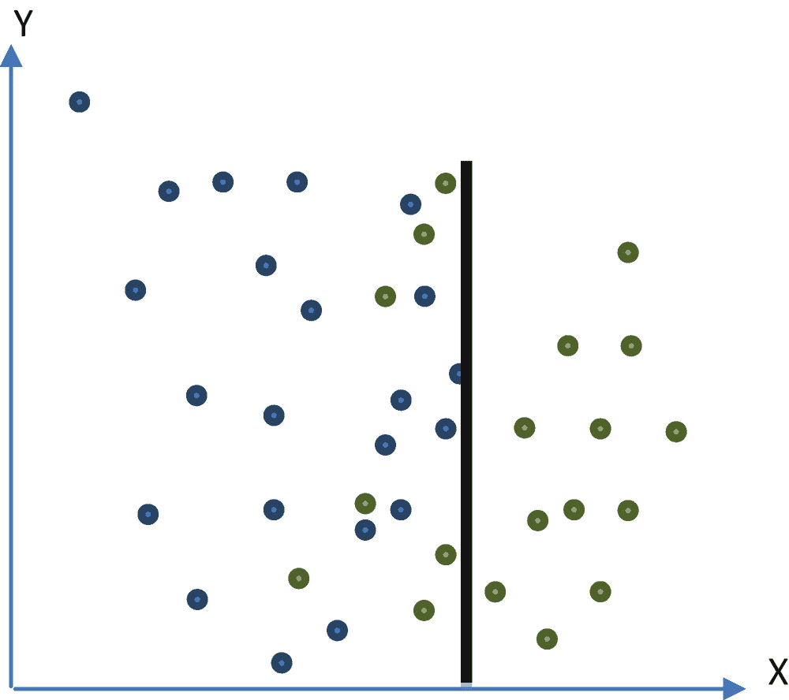
图 17-4 尝试使用 `x = 4` 进行分类

这两个公式都不擅长对数据进行分类。然而，如果我们先应用第一个函数，再应用第二个函数，我们可以相对较好地对这些点进行分类。如图 17-5 所示，我们取得了比以前更好的结果。

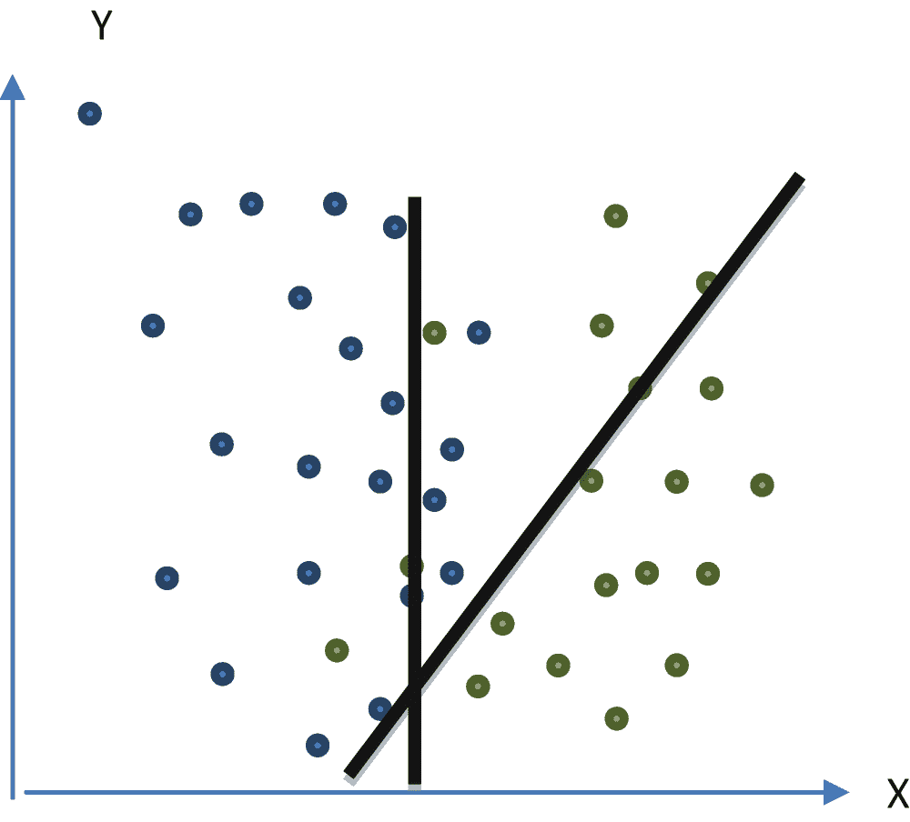
图 17-5 对数据进行分类

因此，如果我们想将这个流程说明为神经网络结构，我们将得到类似于图 17-6 所示的结构。

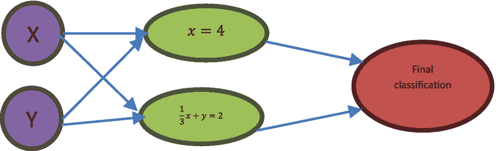
图 17-6 数据科学虚拟机 (DSVM) 环境

隐藏层（绿色节点）可以有不同的函数来帮助对数据进行分类（图 17-7）。这些被称为激活函数。

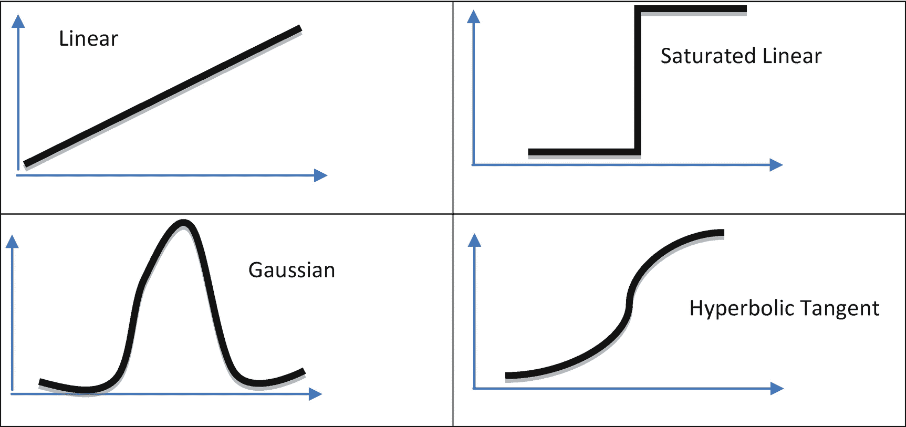
图 17-7 激活函数

神经网络有不同的拓扑结构，例如单输出（图 17-8）或多输出。

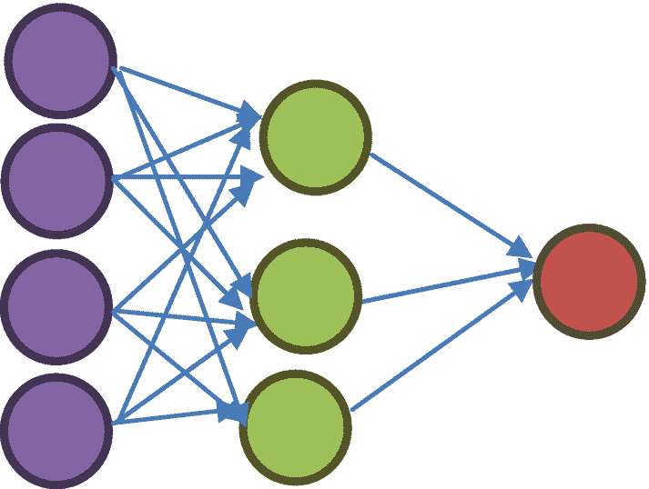
图 17-8 单输出神经网络

神经网络也可以有多个层和多个输出（图 17-9）。具有多个层的神经网络反映了所谓的`深度学习` [2]。

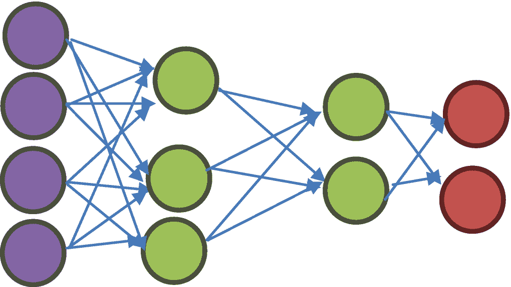
图 17-9 具有多个输出和多个隐藏层的神经网络

神经网络有不同的类型，例如前馈深度神经网络 (DNN) 和卷积神经网络 (CNN) 等。

## 微软认知服务工具包

CNTK 是一个易于使用的工具包，可以轻松解决问题。该工具包可以处理大量数据，并且易于扩展。CNTK 是一个完全开源的产品。它允许在多个 GPU（图形处理单元）上进行处理。该工具包已用于许多微软产品，例如认知服务、Cortana、必应搜索、Skype、Skype Translator 等。根据许多用户的经验，CNTK 速度很快，并且使用相关的 Python 语言 API 非常直观。

### CNTK 安装

安装 CNTK [3] 有多种方式。CNTK 支持 64 位 Windows 和 Linux 操作系统。要在 Windows 上为 Python 安装 CNTK，首先必须以管理员身份打开命令提示符并运行。在命令提示符中，输入以下代码：

```
pip install cntk
```

安装 CNTK 后，所需的包将被安装，并会显示 CNTK 版本（图 17-10）。

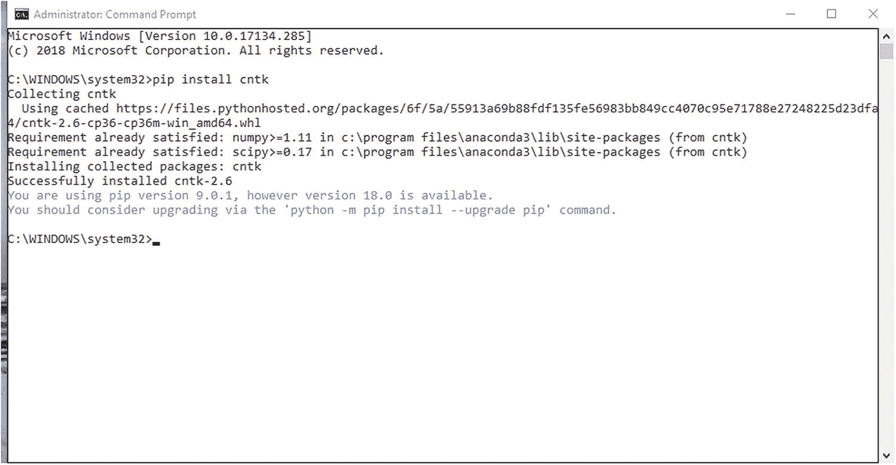
图 17-10 安装 CNTK

安装完成后，你可以通过以下代码检查 CNTK 版本：

```
python -c "import cntk; print(cntk.__version__)"
```

你可以通过安装一些示例来访问一些示例和教程。首先，必须进入 C 盘并运行以下代码：

```
python -m cntk.sample_installer
```

然后检查以下文件夹以获取一些示例和教程（图 17-11）：

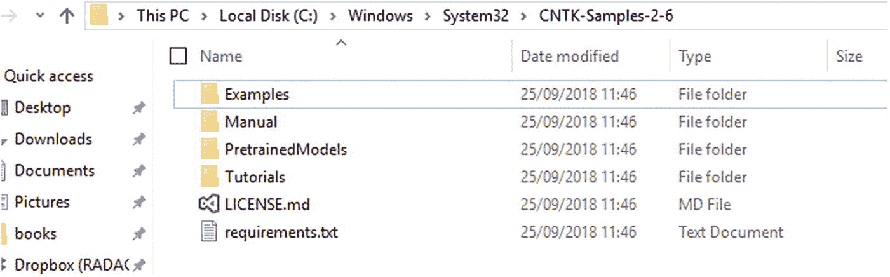
图 17-11 CNTK 示例

```
C:\Windows\System32\CNTK-Samples-2-6
```

在示例文件夹下，你将找到示例、手册等。安装 CNTK 后，在 Python 环境中，你可以通过以下代码访问 CNTK 库：

```
import cntk
```

使用 CNTK 的另一种方式是通过 Azure 环境。同样，CNTK 已预装在 DSVM 中，因此你可以直接使用。在下一节中，我将提供一个来自 [`www.cntk.ai/pythondocs/CNTK_101_LogisticRegression.html`](http://www.cntk.ai/pythondocs/CNTK_101_LogisticRegression.html) [4] 的示例，说明如何使用 CNTK 进行分类。

## 案例研究

为了继续我们的案例研究，首先必须按照第 16 章所述设置 DSVM，然后启动虚拟机（图 17-12）。

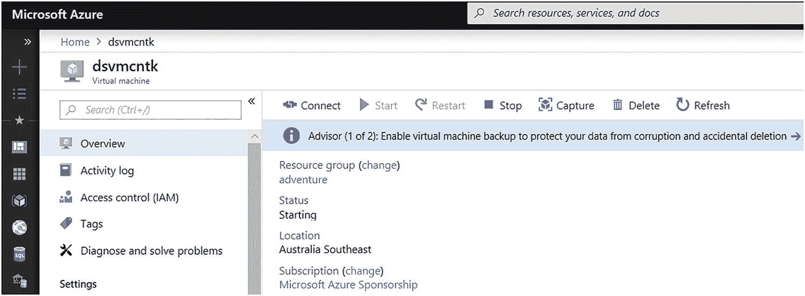
图 17-12 启动 DSVM

接下来，通过下载 RDF 文件（图 17-13）打开 DSVM，并启动虚拟机。

# 第17章 在DSVM上使用CNTK

## 17.1 打开DSVM与Jupyter Notebook

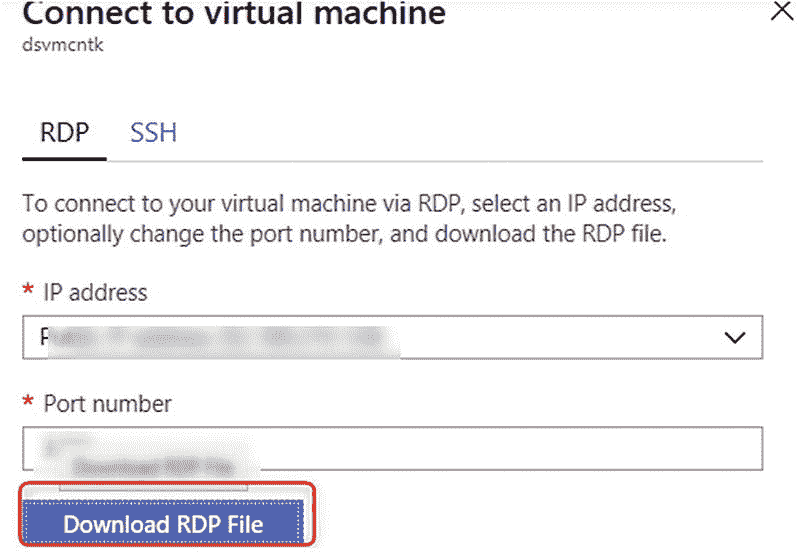

图 17-13 DSVM 文件与激活

打开`DSVM`后，在任务栏中打开`Jupyter Notebook`，这将导航到一个基于Web的`Jupyter Notebook`网站（图 17-14）。

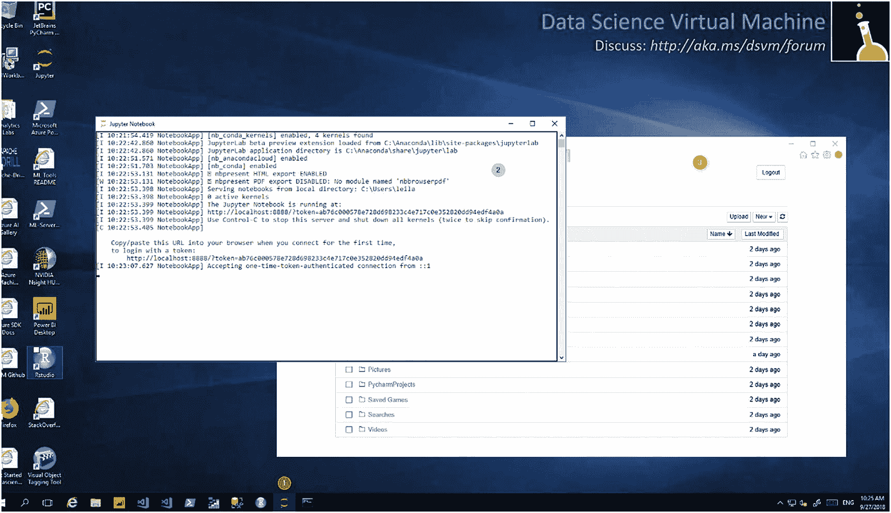

图 17-14 DSVM 中的 Jupyter Notebook

在`Jupyter Notebook`环境中，选择`Python [conda env:Anaconda]`（图 17-15）。

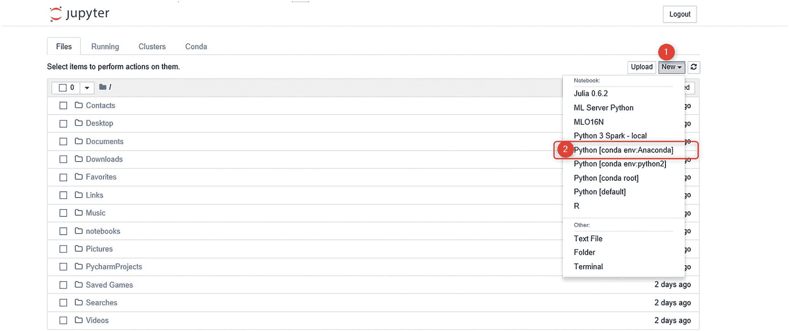

图 17-15 Jupyter Notebook

## 17.2 运行示例代码

下一步，我们将运行来自 [`www.cntk.ai/pythondocs/CNTK_101_LogisticRegression.html`](http://www.cntk.ai/pythondocs/CNTK_101_LogisticRegression.html) [4] 的一个示例。在此示例中，目标是基于患者的年龄和癌细胞大小，预测癌症患者的肿瘤是良性（蓝色）还是恶性（红色）。因此，我们的神经网络有两个输入和两个输出（图 17-16）。

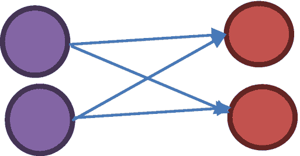

图 17-16 神经网络结构

### 17.2.1 导入库

第一步是导入用于显示结果的适当库（`print_function`）、数组计算（`numpy`）和`CNTK`（`cntk`），以及用于文件名、文件路径和目录的库（`sys` 和 `os`）。

```
from __future__ import print_function
import numpy as np
import sys
import os
import cntk as C
import cntk.tests.test_utils
cntk.tests.test_utils.set_device_from_pytest_env() # （仅对我们的构建系统需要）
C.cntk_py.set_fixed_random_seed(1) # 固定随机种子，使逻辑回归示例可重复 [4]
```

### 17.2.2 获取数据与生成函数

现在我们必须获取数据。首先，我们需要使用以下代码确定输入和输出的数量：

```
input_dim = 2
num_output_classes = 2
```

然后我们创建一个函数来生成一些随机数据。该函数获取样本大小以及输入和输出的数量（参见以下与 [`www.cntk.ai/pythondocs/CNTK_101_LogisticRegression.html`](http://www.cntk.ai/pythondocs/CNTK_101_LogisticRegression.html) [4] 相关的代码）。

```
np.random.seed(0)
# 辅助函数，用于生成随机数据样本
def generate_random_data_sample(sample_size, feature_dim, num_classes):
    # 使用 NumPy 创建合成数据。
    Y = np.random.randint(size=(sample_size, 1), low=0, high=num_classes)
    # 确保数据是可分离的
    X = (np.random.randn(sample_size, feature_dim)+3) ∗ (Y+1)
    # 指定数据类型以匹配稍后教程中使用的输入变量
    # （默认类型为 double）
    X = X.astype(np.float32)
    # 将类别 0 转换为向量 "1 0 0"，
    # 类别 1 转换为向量 "0 1 0"，...
    class_ind = [Y==class_number for class_number in range(num_classes)]
    Y = np.asarray(np.hstack(class_ind), dtype=np.float32)
    return X, Y
```

然后我们使用以下代码调用该函数：

```
mysamplesize = 32
features, labels = generate_random_data_sample(mysamplesize, input_dim, num_output_classes)
```

### 17.2.3 可视化数据

你可以使用 Python 的 `matplotlib` 库绘制输入数据。

```
import matplotlib.pyplot as plt
%matplotlib inline
# let 0 represent malignant/red and 1 represent benign/blue
colors = ['r' if label == 0 else 'b' for label in labels[:,0]]
plt.scatter(features[:,0], features[:,1], c=colors)
plt.xlabel("Age (scaled)")
plt.ylabel("Tumor size (in cm)")
plt.show()
```

运行代码后，你将获得数据的二维表示（图 17-17）。

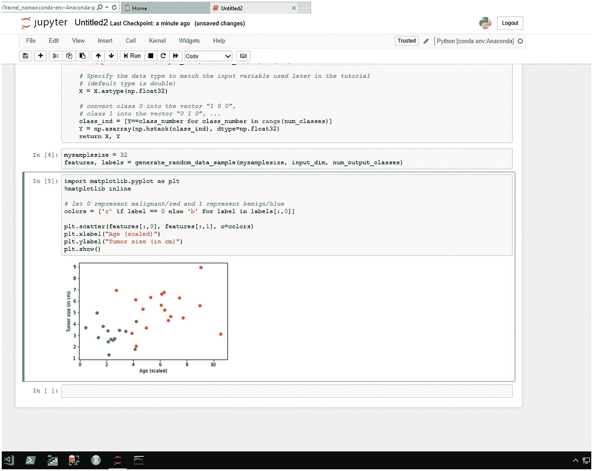

图 17-17 实际数据表示

### 17.2.4 构建神经网络模型

下一步是创建一个神经网络模型。要创建模型，首先必须识别输入变量并将其赋值给 `feature` 变量，同时指定数据类型。

```
feature = C.input_variable(input_dim, np.float32)
```

下一步是设置网络。我们将使用逻辑回归作为激活函数（公式）来对数据进行分类（图 17-5 和图 17-4）。为此，我们必须定义一个函数来识别神经网络结构的各层。如图 17-4 及相关讨论所示，我们需要一个用于数据分类的方程。

形式参数可以如下所示：

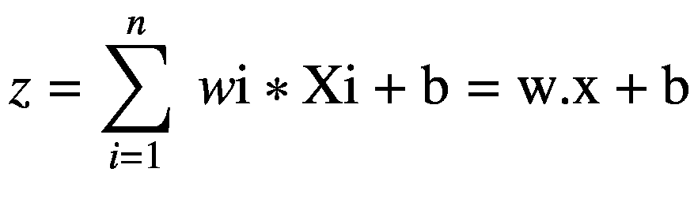

或

```
Z=W∗X+b
```

所使用的方程与图 17-3 中所示的相同：`2x+y=2`。

```
mydict = {}
def linear_layer(input_var, output_dim):
    input_dim = input_var.shape[0]
    weight_param = C.parameter(shape=(input_dim, output_dim))
    bias_param = C.parameter(shape=(output_dim))
    mydict['w'], mydict['b'] = weight_param, bias_param
    return C.times(input_var, weight_param) + bias_param
```

因此，输出将如下所示：

```
output_dim = num_output_classes
z = linear_layer(feature, output_dim)
```

### 17.2.5 训练与评估模型

创建网络结构后的下一步是根据数据行为和概率来训练数据，使其尽可能接近观测数据。有一个名为`熵` [5] 的概念用于训练数据，示例如下：

```
label = C.input_variable(num_output_classes, np.float32)
loss = C.cross_entropy_with_softmax(z, label)
```

创建模型后，我们必须通过以下代码对其进行评估：

```
eval_error = C.classification_error(z, label)
```

有关更多示例，请查看微软网站上的相关示例和资源。

## 总结

本章旨在介绍神经网络及相关深度学习概念。随后讨论了如何在`DSVM`上设置和运行`CNTK`。接着对神经网络相关概念、其结构等进行了详细阐述。然后介绍了如何在 Windows 上为 Python 语言设置`CNTK`。最后，简要说明了如何使用`CNTK`库进行预测。