# 18. 认知服务工具包

微软认知服务是一系列 API 和服务的集合，可帮助开发人员创建更智能的应用程序和报告。通过使用认知服务，开发人员可以在其应用程序中添加诸如人脸识别、情感识别、文本分析等智能功能。本章首先概述认知服务，然后解释如何在 Power BI 报表中使用它们进行文本分析。最后，简要探讨了如何在 Windows 应用程序中使用认知服务。

## 认知服务概述

你可以通过获取 Web 服务 URL 和密钥来使用不同的认知服务。要查看可用的服务，你必须导航到认知服务网站 [1]。如图 18-1 所示，有五个主要类别用于解决业务问题：视觉、知识、语言、语音和搜索。

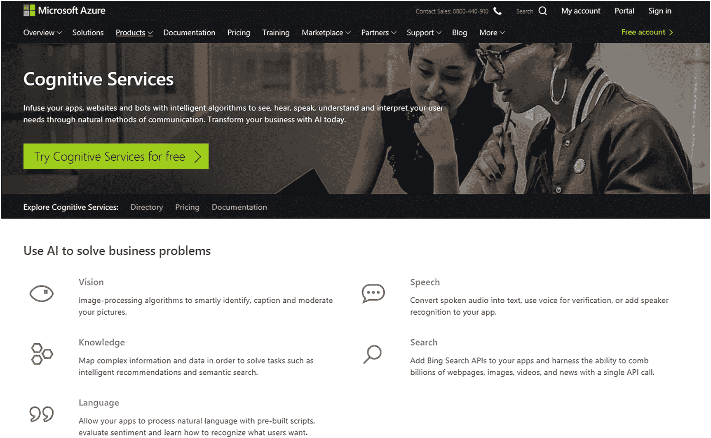

图 18-1 主要认知服务类别

如图 18-2 所示，有五种不同的 API 用于解决业务语言问题。文本分析是最受欢迎的功能之一，用于语言检测、识别文本中的主要关键词、主题提取以及检查文本在上下文中的正面或负面程度（情感分析）。

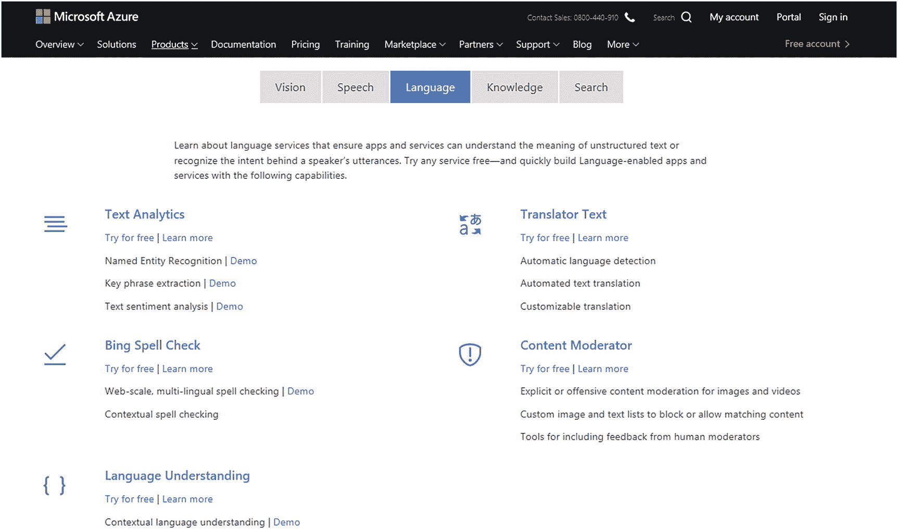

图 18-2 认知服务中的语言类别

语言类别中的其他服务涉及文本翻译、识别对话和文本中的主要意图和目标。

这些功能可以组合使用。例如，可以将语言理解服务与语音服务集成，实现即时的语音到意图处理，并结合机器人应用程序（第 19 章）开发更复杂的应用程序。

在本章中，你将了解如何使用文本分析服务，在 Power BI 中执行文本分析，以检测客户反馈中的主要关键词、反馈的正面程度以及检测语言。

首先，我们必须设置使用认知服务的环境。要使用认知服务，你可以注册免费试用。试用服务免费提供七天，无需信用卡。另一种访问认知服务的方式是使用一个月的免费 Azure 账户，该账户提供 280 美元的 Azure 信用额度，并且所有数据和自定义设置都将被保存。最后一种方法是使用现有的 Azure 账户（图 18-3）。

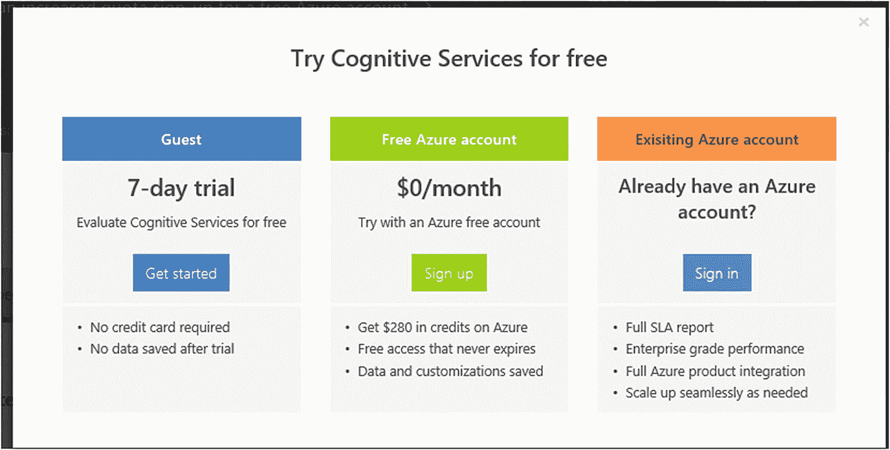

图 18-3 不同的认知服务账户

要在 Azure 中设置认知服务，你必须登录你的 Azure 账户并搜索你需要的服务。登录 Azure 门户后，你必须创建一个文本分析服务。要创建文本分析服务，你必须在 Azure 中创建一个新服务，方法是点击页面左上角。在“新建”页面中，将显示主要服务类别（图 18-4）。AI + 机器学习是 Azure 中的主要服务之一。点击它以查看可用选项。如图 18-4 所示，计算机视觉、人脸（识别）、文本分析、语言理解、翻译器语音、必应搜索和 Azure 搜索是 AI + 机器学习下的主要主题。

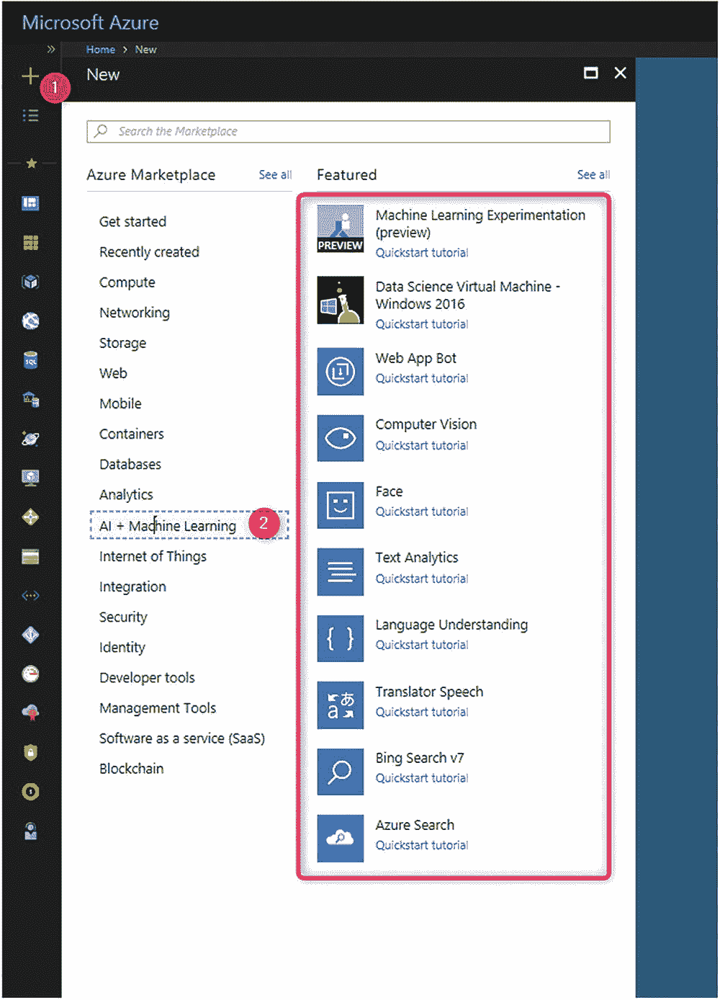

图 18-4 不同的认知服务功能

## 文本分析服务

并非所有收集的数据都是数字和结构化数据。为了更全面地了解客户、产品等，可以收集和分析文本，以提升公司绩效。文本分析是将非结构化文本数据转换为有意义数据的过程，用于理解客户需求和反馈 [2]。

本节将介绍一个案例研究，说明如何在 Power BI 中使用文本分析 API，并将其应用于客户反馈。

第一步是在 Azure 门户中设置文本分析服务（图 18-5）。

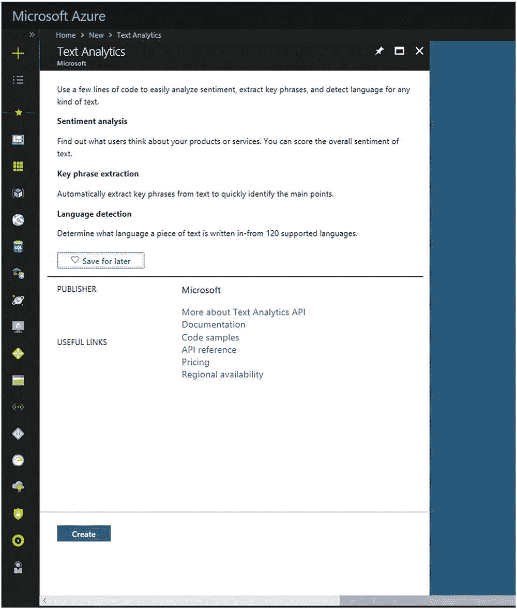

图 18-5 在 Azure 门户中设置文本分析

此服务有不同的定价层。第一个是免费层，允许用户每月对 5K 行数据应用文本分析服务（图 18-6）。

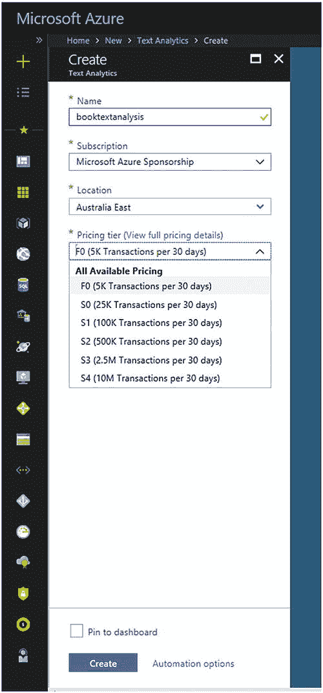

图 18-6 文本分析的定价层

创建文本分析服务后，我们从创建的服务中获取 API URL 和密钥访问权限。图 18-7 显示了如何在文本分析服务中访问 URL 和访问密钥。

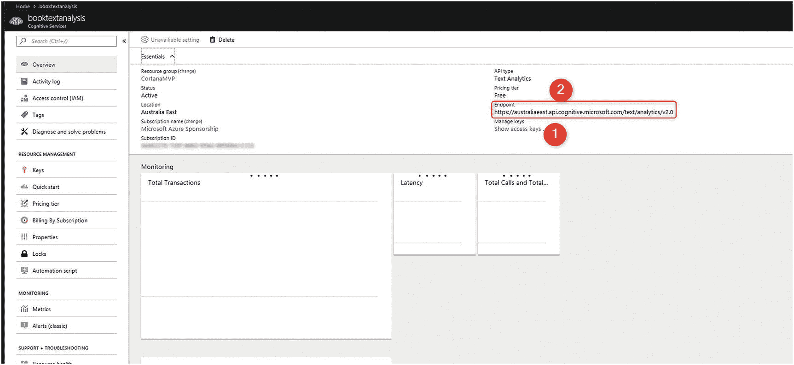

图 18-7 访问 URL 和密钥

从 Azure 门户创建服务后，我们必须在 Power BI Desktop 中调用它，并将其应用于其中的可用数据。

### 数据集

Fabrikam 是一家模拟生产公司。它收到了客户关于运输、技术支持和其他问题的电子邮件。商业智能（BI）经理希望对公司收到的客户电子邮件进行一些分析，以更好地理解客户邮件的要点，并确定他们是否对公司的服务感到满意。你可以从 [`https://github.com/Kaiqb/KaiqbRepo0731190208/blob/master/CognitiveServices/TextAnalytics/FabrikamComments.csv`](https://github.com/Kaiqb/KaiqbRepo0731190208/blob/master/CognitiveServices/TextAnalytics/FabrikamComments.csv) 下载数据集 [3]。

第一步是打开 Power BI Desktop，并将数据集作为文本/CSV 文件加载到 Power BI 中（图 18-8）。

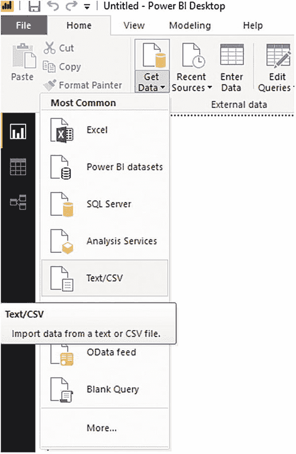

图 18-8 从 Power BI 获取 CSV 文件

然后，不要加载数据，而是点击“编辑”选项，导航到 Power Query 环境进行数据转换（图 18-9）。如图 18-9 所示，显示了数据集的概览。大约有 20 行数据，涉及客户电子邮件、姓名和 ID、电子邮件主题以及评论。

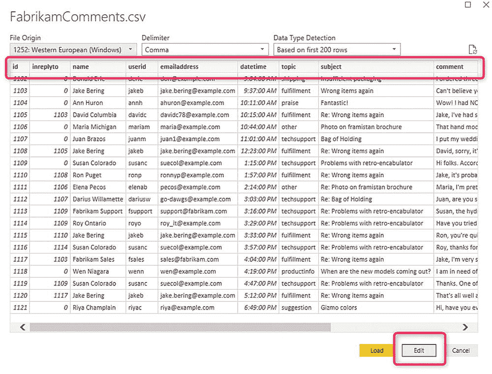

图 18-9 在 Power Query 中编辑数据

首先，我们将在 Power Query 中，使用“添加列”选项卡下的“合并列”功能，合并“主题”和“评论”列。一般步骤如图 18-10 所示。

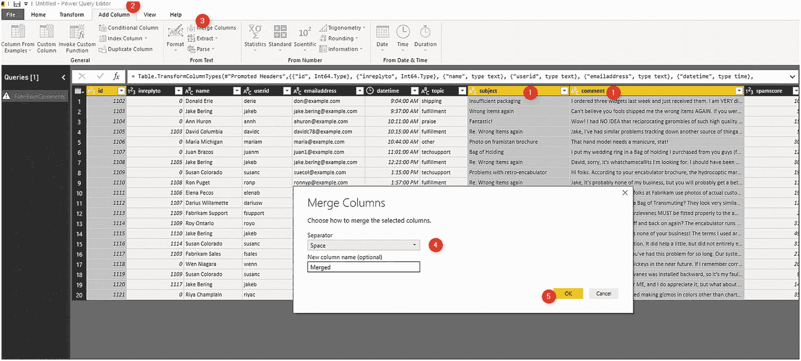

图 18-10 合并主题和评论列

创建新列后，我们必须将其重命名为“客户反馈”。

### 创建文本分析函数

可以在 Power Query 中创建一个函数，将文本分析应用于 Power Query 中的特定列。要创建函数，我们必须点击主页面左侧查询中的空白区域，然后选择“空白查询”选项（图 18-11）。

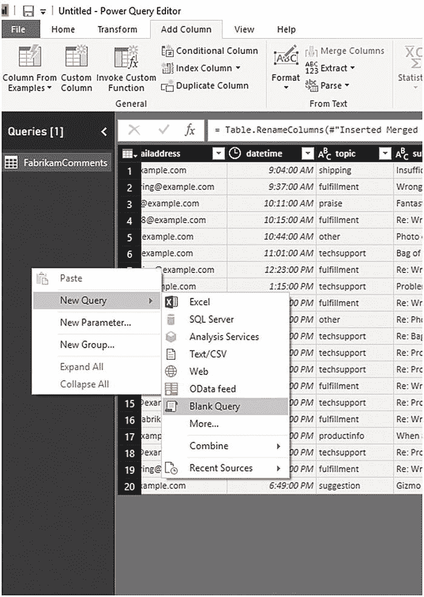

图 18-11 创建空白查询

将创建的查询重命名为“情感分析”。下一步是将空白查询转换为函数。为此，我们必须访问所创建查询背后的 M 查询，方法是点击“主页”选项卡，然后点击“高级编辑器”（图 18-12）。这里有一个编辑器，我们将使用它来编写一些 M 脚本，并将查询更改为函数。

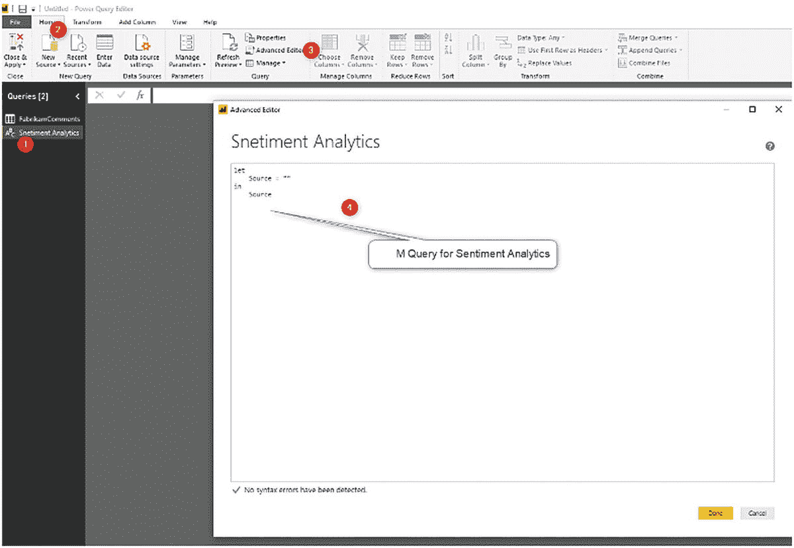

图 18-12 Power BI 查询编辑器

下一步是添加以下代码：

```
# 在 Power BI 和 Windows 应用程序中使用认知服务

本节介绍如何在 Power BI 的 Power Query 中使用认知服务进行情感分析，以及如何在 Windows 应用程序中集成人脸（面部识别）API。

## 在 Power BI 中进行情感分析

你可以使用以下 M 语言函数在 Power Query 中调用文本分析 API。

```powerquery-m
(text) => let
apikey      = "",
endpoint    = "https://.api.cognitive.microsoft.com/text/analytics/v2.0/sentiment",
jsontext    = Text.FromBinary(Json.FromValue(Text.Start(Text.Trim(text), 5000))),
jsonbody    = "{ documents: [ { language: ""en"", id: ""0"", text: " & jsontext & " } ] }",
bytesbody   = Text.ToBinary(jsonbody),
headers     = [#"Ocp-Apim-Subscription-Key" = apikey],
bytesresp   = Web.Contents(endpoint, [Headers=headers, Content=bytesbody]),
jsonresp    = Json.Document(bytesresp),
sentiment   = jsonresp[documents]{0}[score]
in  sentiment
```

如上述代码所示，第一行是关于函数输入，即 `text`。在第 2 行，必须粘贴从 Azure 服务收集的 API 密钥。在第 3 行，必须提供连接到 API 所需的 URL。正如你在 URL 末尾所见，显示了我们将要使用的认知服务。在此示例中，我们使用的是情感分析。第 4 到 11 行指示了连接到认知服务并以 JSON 格式获取结果所需的代码。最后一行是结果列，显示每条评论的情感得分。

现在，用上述代码替换之前的代码，然后点击“确定”。空白查询将更改为函数类型，并出现一个带有文本框的页面。你可以通过写一个句子（例如“今天天气真好”）来测试它，然后点击“调用”按钮查看结果。

如图 18-13 所示，情感分析的结果是 0.92。

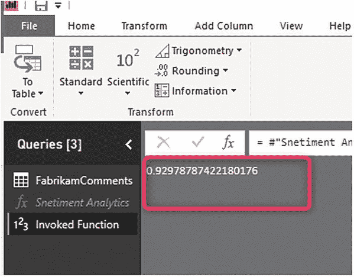

**图 18-13** 在 Power Query 中测试文本分析函数

情感分析的输出是一个从 0 到 1 的数字。数字越接近 1 表示评论是正面的，越接近 0 表示反馈是负面的。

最后一步，我们可以将函数应用于客户反馈（评论）列。点击 Fabrikam 数据集，选择“添加列”选项卡，然后点击“调用自定义函数”。在新页面上，为新列选择一个合适的名称，然后在下拉菜单中选择该函数。从最后一个下拉项中，选择要应用该函数的列（图 18-14）。

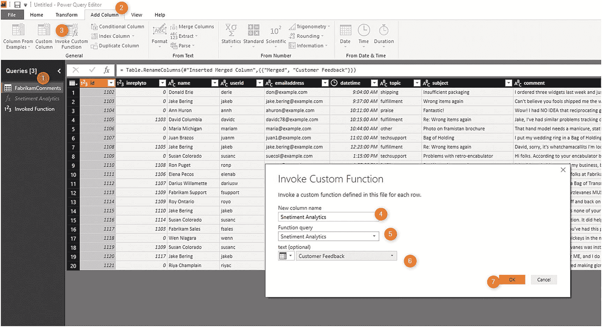

**图 18-14** 调用自定义函数进行情感分析

数据集概览的末尾将显示一个新列，其中包含情感分析的数值结果。如图 18-15 所示，该数字在 0 到 1 之间变化。你可以点击“主页”选项卡，然后点击“关闭并应用”，在 Power BI Desktop 中查看结果。

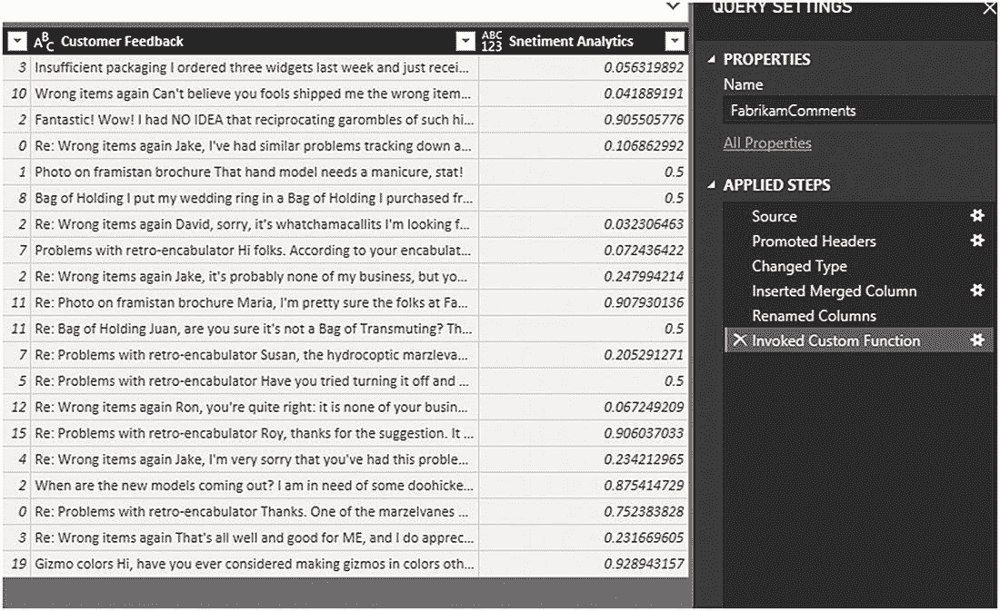

**图 18-15** Power BI Desktop 中的情感分析结果

使用其他功能（如语言检测和关键短语提取）的过程与此相同，仅端点 URL 会略有变化。对于语言检测，端点 URL 将变更为：

```powerquery-m
endpoint    = "https://.api.cognitive.microsoft.com/text/analytics/v2.0/languages",
```

对于关键短语提取，端点 URL 将变更为：

```powerquery-m
endpoint    = "https://.api.cognitive.microsoft.com/text/analytics/v2.0/keyPhrases"
```

此外，代码的最后一行将更改为显示不同的变量。对于语言检测，代码如下：

```powerquery-m
language    = jsonresp[documents]{0}[detectedLanguages]{0}[name]
in  language
```

对于关键短语，代码如下：

```powerquery-m
keyphrases  = Text.Lower(Text.Combine(jsonresp[documents]{0}[keyPhrases], ", "))
in  keyphrases
```

前面的示例是关于在 Power BI 中使用认知服务。在下一节中，我将展示如何在 Windows 应用程序中使用人脸（即面部识别）服务。

## 智能应用：面部识别服务

认知服务的另一个功能是人脸（面部识别）API。该 API 除了能检测情绪以及找出两张图片中人脸的相似面部特征外，还能从图像中执行人脸检测。

在应用程序中使用人脸 API 之前，可以先试用一下。要查看演示，请导航至认知服务网站，然后进入视觉类别（图 18-16）。在视觉类别下，点击“图像中的情绪识别”演示。要测试该 API，请浏览并选择一张图片，然后提交。上传图片后，点击“提交”按钮。

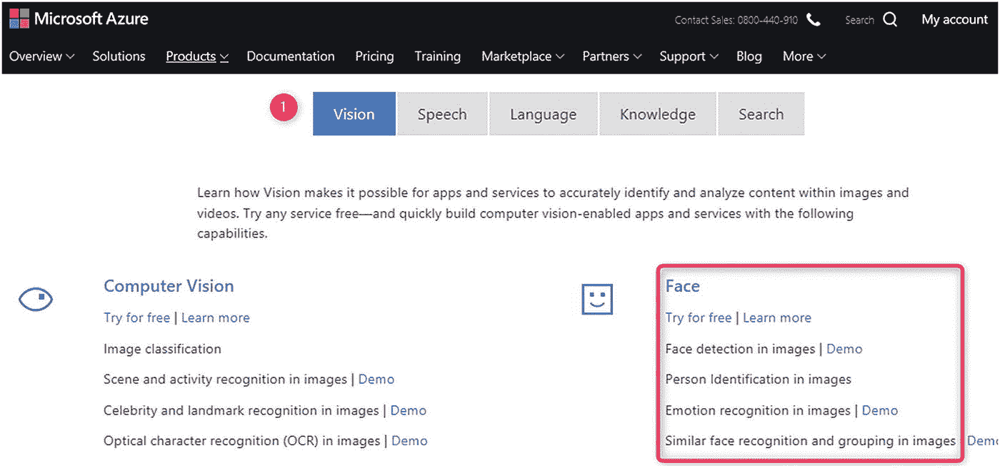

**图 18-16** 认知服务面部识别

如图 18-17 所示，上传图片后，API 会显示情绪，例如愤怒、轻蔑、厌恶、恐惧、快乐、中性、悲伤和惊讶，并用 0 到 1 之间的数字表示。如图 18-17 所示，唯一数值较高的度量是快乐，而图片中的人物正在微笑。

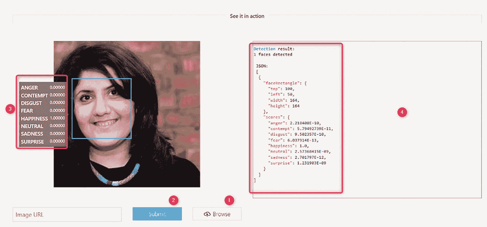

**图 18-17** 图像情绪检测演示

我们将创建一个能够使用认知服务中的人脸 API 进行图像检测的 Windows 应用程序。

创建人脸 API 的过程与文本分析类似。首先，我们必须登录 Azure 门户，然后在 *AI + 机器学习* 下搜索人脸 API（图 18-18）。

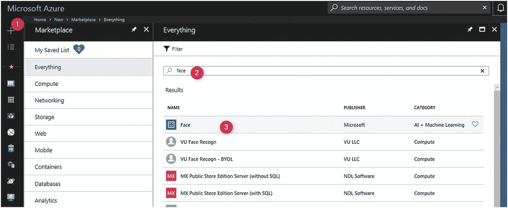

**图 18-18** Azure 中的面部识别功能

创建服务后，点击页面左侧的“密钥”选项卡并获取密钥（图 18-19）。

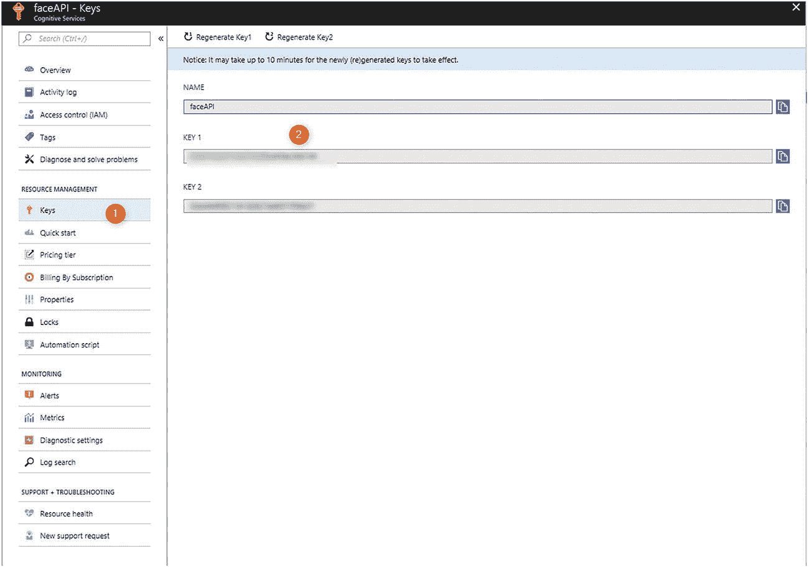

**图 18-19** 获取人脸 API 密钥

我们将创建一个使用面部识别功能的 Windows 应用程序 [4]。要编写代码，您必须首先下载 Visual Studio 2015 或 2017 的免费版本之一 [5]。然后，您必须创建一个 Windows 应用程序（图 18-20）。在本案例中，我使用的是 Visual Studio 2015。

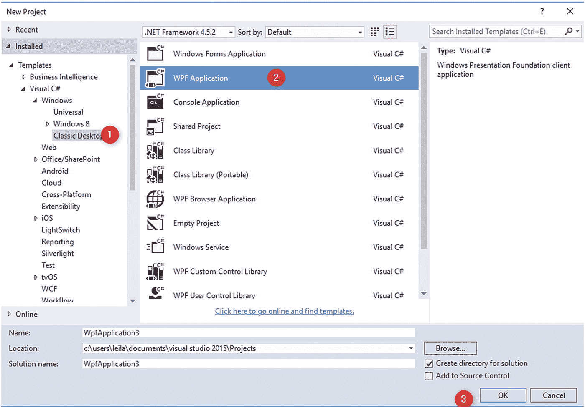

**图 18-20** 创建 Windows 应用程序

下一步是在 Windows 应用程序中安装 Microsoft Azure 认知服务人脸 API。要安装它，我们必须导航到“工具”选项卡，然后导航到“NuGet 包管理器”，并选择“包管理器控制台”。接下来，我们必须在控制台编辑器中输入以下代码（图 18-21）。

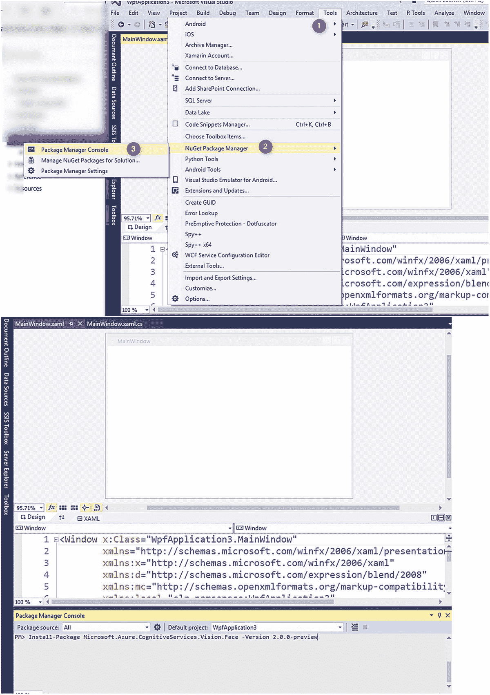

**图 18-21** 在 Windows 中安装人脸 API

```powershell
Install-Package Microsoft.Azure.CognitiveServices.Vision.Face -Version 2.0.0-preview
```

然后，我们必须为应用程序创建界面。我们需要在屏幕上添加一个按钮。为此，我们修改代码。右键单击 `MainWindow.xaml` 页面，选择“视图设计器”，并将代码更改为以下内容（图 18-22）：

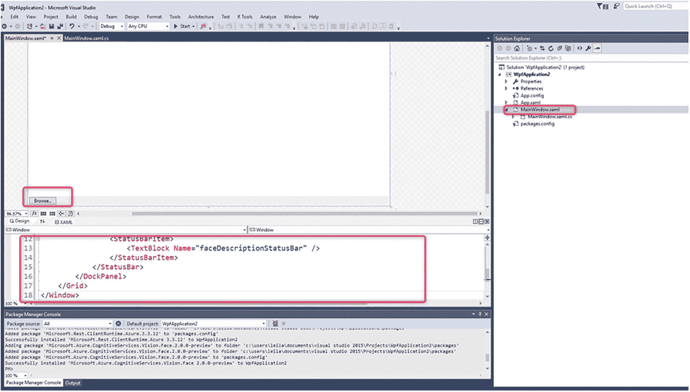

**图 18-22** 修改代码
```

修改代码后，可视化效果将随之改变。我们必须修改 C# 代码以访问人脸 API。首先，需要添加对 Azure 认知服务中人脸 API 的引用。

```
using Microsoft.Azure.CognitiveServices.Vision.Face;
using Microsoft.Azure.CognitiveServices.Vision.Face.Models;
```

要修改代码，请单击 `MainWindows.xaml.cs`，然后将上述代码添加到引用部分（图 18-23）。

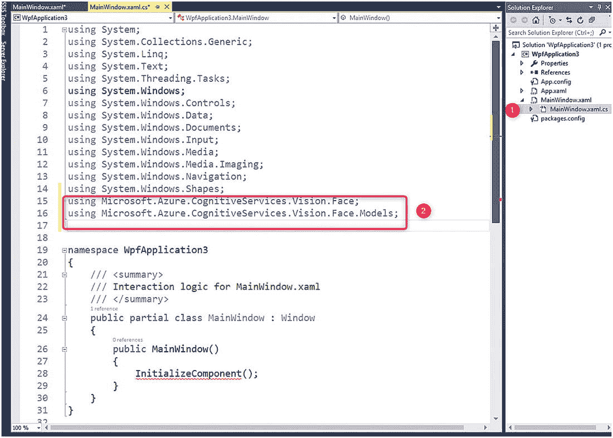

图 18-23

添加人脸识别库

现在，我们必须按如下方式修改代码：

```
namespace FaceTutorial
{
    public partial class MainWindow : Window
    {
        private const string subscriptionKey = "";
        private const string baseUri =
            "https://.api.cognitive.microsoft.com/face/v1.0";
        private readonly IFaceClient faceClient = new FaceClient(
            new ApiKeyServiceClientCredentials(subscriptionKey),
            new System.Net.Http.DelegatingHandler[] { });
        IList faceList;   // 检测到的人脸列表。
        String[] faceDescriptions;      // 检测到的人脸描述列表。
        double resizeFactor;            // 显示图像的缩放因子。

        public MainWindow()
        {
            InitializeComponent();
            if (Uri.IsWellFormedUriString(baseUri, UriKind.Absolute))
            {
                faceClient.BaseUri = new Uri(baseUri);
            }
            else
            {
                MessageBox.Show(baseUri,
                    "Invalid URI", MessageBoxButton.OK, MessageBoxImage.Error);
                Environment.Exit(0);
            }
        }

        // 显示图像并调用 UploadAndDetectFaces 方法。
        private async void BrowseButton_Click(object sender, RoutedEventArgs e)
        {
            // 从用户处获取要扫描的图像文件。
            var openDlg = new Microsoft.Win32.OpenFileDialog();
            openDlg.Filter = "JPEG Image(∗.jpg)|∗.jpg";
            bool? result = openDlg.ShowDialog(this);
            // 如果取消则返回。
            if (!(bool)result)
            {
                return;
            }
            // 显示图像文件。
            string filePath = openDlg.FileName;
            Uri fileUri = new Uri(filePath);
            BitmapImage bitmapSource = new BitmapImage();
            bitmapSource.BeginInit();
            bitmapSource.CacheOption = BitmapCacheOption.None;
            bitmapSource.UriSource = fileUri;
            bitmapSource.EndInit();
            FacePhoto.Source = bitmapSource;
        }

        // 当鼠标悬停在人脸矩形上时显示人脸描述。
        private void FacePhoto_MouseMove(object sender, MouseEventArgs e)
        {
        }
    }
}
```

现在，我们必须更改订阅密钥和 API 的位置。为了检测并上传图像，我们编写一个函数，如下所示：

```
private async Task> UploadAndDetectFaces(string imageFilePath)
{
    // 要返回的人脸属性列表。
    IList faceAttributes =
        new FaceAttributeType[]
        {
            FaceAttributeType.Gender, FaceAttributeType.Age,
            FaceAttributeType.Smile, FaceAttributeType.Emotion,
            FaceAttributeType.Glasses, FaceAttributeType.Hair
        };
    // 调用人脸 API。
    try
    {
        using (Stream imageFileStream = File.OpenRead(imageFilePath))
        {
            // 第二个参数指定返回 faceId，
            // 第三个参数指定不返回人脸特征点。
            IList faceList =
                await faceClient.Face.DetectWithStreamAsync(
                    imageFileStream, true, false, faceAttributes);
            return faceList;
        }
    }
    // 捕获并显示人脸 API 错误。
    catch (APIErrorException f)
    {
        MessageBox.Show(f.Message);
        return new List();
    }
    // 捕获并显示所有其他错误。
    catch (Exception e)
    {
        MessageBox.Show(e.Message, "Error");
        return new List();
    }
}
```

我们可以在图片中每个人物的脸部周围绘制一个矩形。在 `BrowseButton` 函数中，编写以下代码：

Title = "Detecting...";
faceList = await UploadAndDetectFaces(filePath);
Title = String.Format(
"Detection Finished. {0} face(s) detected", faceList.Count);
if (faceList.Count > 0)
{
    // 准备在人脸周围绘制矩形。
    DrawingVisual visual = new DrawingVisual();
    DrawingContext drawingContext = visual.RenderOpen();
    drawingContext.DrawImage(bitmapSource,
        new Rect(0, 0, bitmapSource.Width, bitmapSource.Height));
    double dpi = bitmapSource.DpiX;
    resizeFactor = (dpi > 0) ? 96 / dpi : 1;
    faceDescriptions = new String[faceList.Count];
    for (int i = 0; i < faceList.Count; ++i)
    {
        DetectedFace face = faceList[i];
        // 在人脸上绘制矩形。
        drawingContext.DrawRectangle(
            Brushes.Transparent,
            new Pen(Brushes.Red, 2),
            new Rect(
                face.FaceRectangle.Left ∗ resizeFactor,
                face.FaceRectangle.Top ∗ resizeFactor,
                face.FaceRectangle.Width ∗ resizeFactor,
                face.FaceRectangle.Height ∗ resizeFactor
            )
        );
        // 存储人脸描述。
        faceDescriptions[i] = FaceDescription(face);
    }
    drawingContext.Close();
    // 显示带有脸部矩形的图像。
    RenderTargetBitmap faceWithRectBitmap = new RenderTargetBitmap(
        (int)(bitmapSource.PixelWidth ∗ resizeFactor),
        (int)(bitmapSource.PixelHeight ∗ resizeFactor),
        96,
        96,
        PixelFormats.Pbgra32);
    faceWithRectBitmap.Render(visual);
    FacePhoto.Source = faceWithRectBitmap;
    // 设置状态栏文本。
    faceDescriptionStatusBar.Text =
        "Place the mouse pointer over a face to see the face description.";
}
```

人脸描述必须显示在图像底部。通过使用以下函数，您可以在页面底部显示人脸描述，例如根据不同的情绪。

```
private string FaceDescription(DetectedFace face)
{
    StringBuilder sb = new StringBuilder();
    sb.Append("Face: ");
    // 添加性别、年龄和微笑。
    sb.Append(face.FaceAttributes.Gender);
    sb.Append(", ");
    sb.Append(face.FaceAttributes.Age);
    sb.Append(", ");
    sb.Append(String.Format("smile {0:F1}%, ", face.FaceAttributes.Smile ∗ 100));
    // 添加情绪。显示所有超过 10% 的情绪。
    sb.Append("Emotion: ");
    Emotion emotionScores = face.FaceAttributes.Emotion;
    if (emotionScores.Anger >= 0.1f)
        sb.Append(String.Format("anger {0:F1}%, ", emotionScores.Anger ∗ 100));
    if (emotionScores.Contempt >= 0.1f)
        sb.Append(String.Format("contempt {0:F1}%, ", emotionScores.Contempt ∗ 100));
    if (emotionScores.Disgust >= 0.1f)
        sb.Append(String.Format("disgust {0:F1}%, ", emotionScores.Disgust ∗ 100));
    if (emotionScores.Fear >= 0.1f)
        sb.Append(String.Format("fear {0:F1}%, ", emotionScores.Fear ∗ 100));
    if (emotionScores.Happiness >= 0.1f)
        sb.Append(String.Format("happiness {0:F1}%, ", emotionScores.Happiness ∗ 100));
    if (emotionScores.Neutral >= 0.1f)
        sb.Append(String.Format("neutral {0:F1}%, ", emotionScores.Neutral ∗ 100));
    if (emotionScores.Sadness >= 0.1f)
        sb.Append(String.Format("sadness {0:F1}%, ", emotionScores.Sadness ∗ 100));
    if (emotionScores.Surprise >= 0.1f)
        sb.Append(String.Format("surprise {0:F1}%, ", emotionScores.Surprise ∗ 100));
    // 添加眼镜。
    sb.Append(face.FaceAttributes.Glasses);
    sb.Append(", ");
    // 添加头发。
    sb.Append("Hair: ");
    // 如果秃头置信度超过 1%，则显示。
    if (face.FaceAttributes.Hair.Bald >= 0.01f)
        sb.Append(String.Format("bald {0:F1}% ", face.FaceAttributes.Hair.Bald ∗ 100));
    // 显示所有超过 10% 的头发颜色属性。
    IList hairColors = face.FaceAttributes.Hair.HairColor;
    foreach (HairColor hairColor in hairColors)
    {
        if (hairColor.Confidence >= 0.1f)
        {
            sb.Append(hairColor.Color.ToString());
            sb.Append(String.Format(" {0:F1}% ", hairColor.Confidence ∗ 100));
        }
    }
    // 返回构建的字符串。
    return sb.ToString();
}
```

最后一段代码是关于当鼠标悬停在图片上时显示人脸描述。

```csharp
private void FacePhoto_MouseMove(object sender, MouseEventArgs e)
{
    // 如果 REST 调用尚未完成，则返回。
    if (faceList == null)
        return;
    // 查找鼠标相对于图像的位置。
    Point mouseXY = e.GetPosition(FacePhoto);
    ImageSource imageSource = FacePhoto.Source;
    BitmapSource bitmapSource = (BitmapSource)imageSource;
    // 实际尺寸与显示尺寸之间的缩放调整。
    var scale = FacePhoto.ActualWidth / (bitmapSource.PixelWidth / resizeFactor);
    // 检查此鼠标位置是否位于人脸矩形上方。
    bool mouseOverFace = false;
    for (int i = 0; i < left && mouseXY.X = top  && mouseXY.Y <= top + height)
    {
        faceDescriptionStatusBar.Text = faceDescriptions[i];
        mouseOverFace = true;
        break;
    }
    }
    // 当鼠标不在人脸矩形上方时显示的字符串。
    if (!mouseOverFace)
        faceDescriptionStatusBar.Text =
            "将鼠标指针放在人脸上以查看人脸描述。";
}
```

如果确保所有库和引用工作正常，您将能够在`.NET`应用程序中正确访问`Azure 认知服务库`。

现在，您必须运行代码：单击“开始”按钮，然后单击“浏览”按钮并导入一张图片，即可在页面底部看到图像描述（图 18-24）。如您所见，该软件会提供描述，例如我的年龄、情绪、发色等。

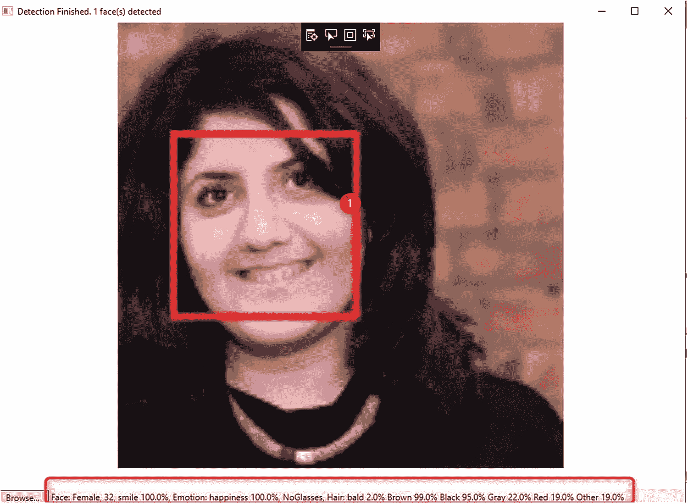

图 18-24

人脸情绪检测

## 总结

本章简要介绍了 Microsoft 认知服务中易于使用的 AI 工具。首先对认知服务及其访问方式进行了简要说明，然后解释了如何在其他 Microsoft 工具（如`Power BI`）中使用认知服务文本分析 API。接着，讨论了在 Windows 应用程序中使用认知 API 的过程，并展示了所有相关代码。下一章将探讨用于创建智能应用程序的另一个工具——`Bot Framework`。