# 19. Bot Framework

机器人是一种能够以对话方式与用户交互的应用程序 [1]。它可以是一个非常简单的、支持对话和基本问题的应用程序，也可以是能够理解语言的复杂应用程序。在 Microsoft Azure 中，可以使用 C# 或 Node.js 创建机器人。您可以使用 .NET SDK [2] 创建机器人，并通过模拟器 [3] 等工具进行测试。此外，一些机器人组件可帮助您添加更多功能 [4]。本章将介绍一个使用 Azure 组件的非常简单的机器人。首先，将展示如何在 Azure 中创建机器人服务，然后介绍如何创建一个用于问答的简单机器人，以及一个更复杂的机器人。

## 在 Azure 中创建机器人

登录您的 Azure 帐户并创建一个新服务名称：Web 应用机器人（图 19-1）。

创建新的机器人服务时，您必须提供一些信息，例如机器人名称、订阅、资源组、位置等。您需要在开始时选择的主要字段之一是机器人模板。默认选项是基本 (C#)。在我们的场景中，我们将把默认选项更改为“表单”，这有助于我们创建一个引导最终用户的机器人应用程序。

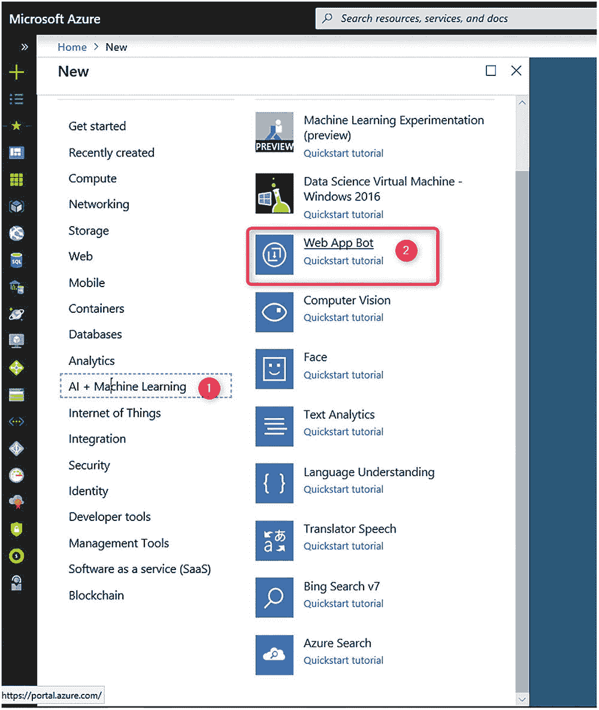

图 19-1

Azure 中的 Web 应用机器人服务

如图 19-2 所示，应选择“表单”选项。

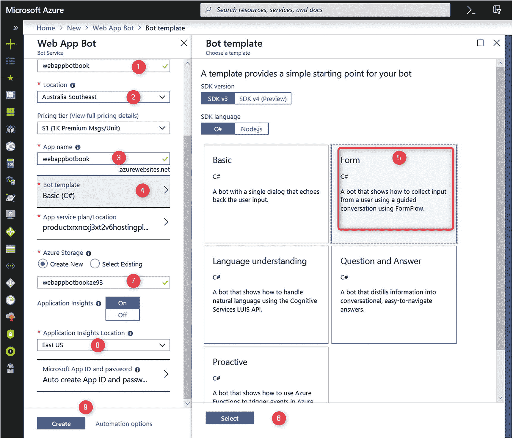

图 19-2

用于问答的 Bot Framework

完成机器人应用程序后，生成的服务包含三个主要类别：机器人管理、应用服务设置以及支持和故障排除。首先，检查所创建机器人的输出。转到“机器人管理” ➤ “在网络聊天中测试”。

要查看 Bot Framework 的默认结果，请单击“在网络聊天中测试”并输入“Hi”。结果将显示为“欢迎使用简单的三明治点单机器人！”，然后列出三明治选项（图 19-3）。

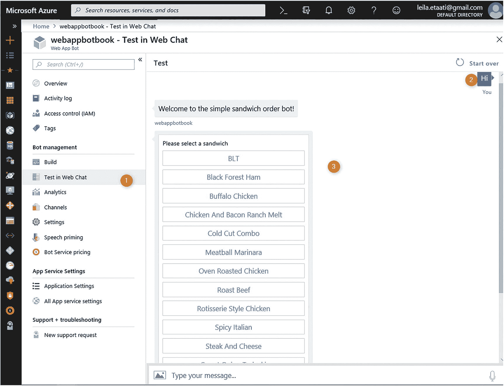

图 19-3

Bot Framework 测试

在“机器人管理”部分下，第一个选项是“生成”，它提供了创建机器人框架的所有源代码。第一个选项是“打开在线代码编辑器”。使用此选项，开发人员可以在在线代码编辑器中查看代码。

如图 19-4 所示，在“在线代码编辑器”下，显示了机器人背后的代码。

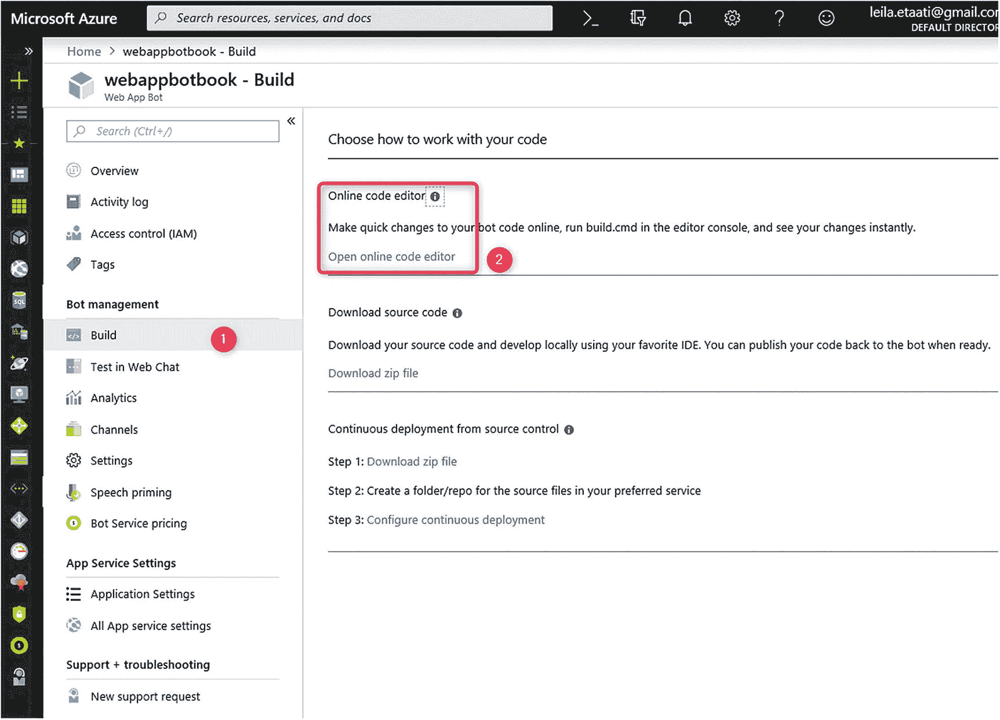

图 19-4

Bot Framework 的“生成”部分

要查看代码，请单击“打开在线代码编辑器”。将显示 Web 应用机器人框架的代码（图 19-5）。如图 19-5 所示，在“模型”文件夹下的 `Sandwiches` 文件中，显示了用户可能询问的对话框列表。

此外，在图 19-5 中，每个问题和可能性都按照*枚举*数据结构表示。每个枚举定义了在与最终用户的对话中可能出现的不同问题。您可以在线更改代码中的问题和产品类型。例如，您可以将三明治选项更改为鸡肉、火腿、羊肉、猪肉或素食。

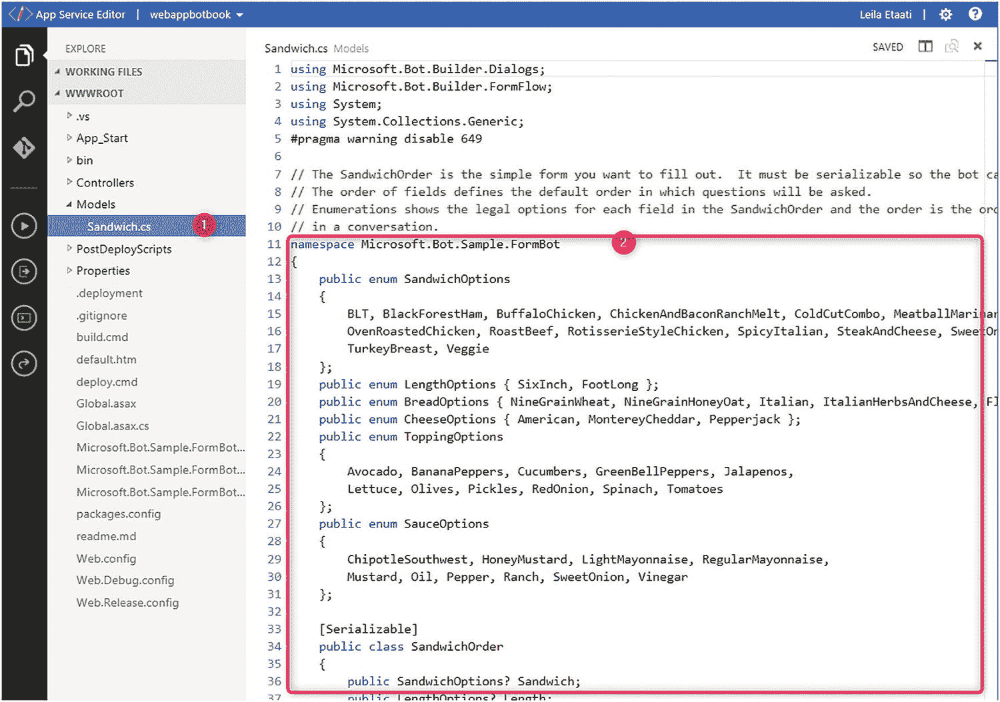

图 19-5

对话框机器人框架的在线编辑器

对文件的更改将被保存。您必须在 .NET 应用程序中构建和编译它们。要构建文件，请单击“打开控制台”并输入“build.cmd”（图 19-6）。

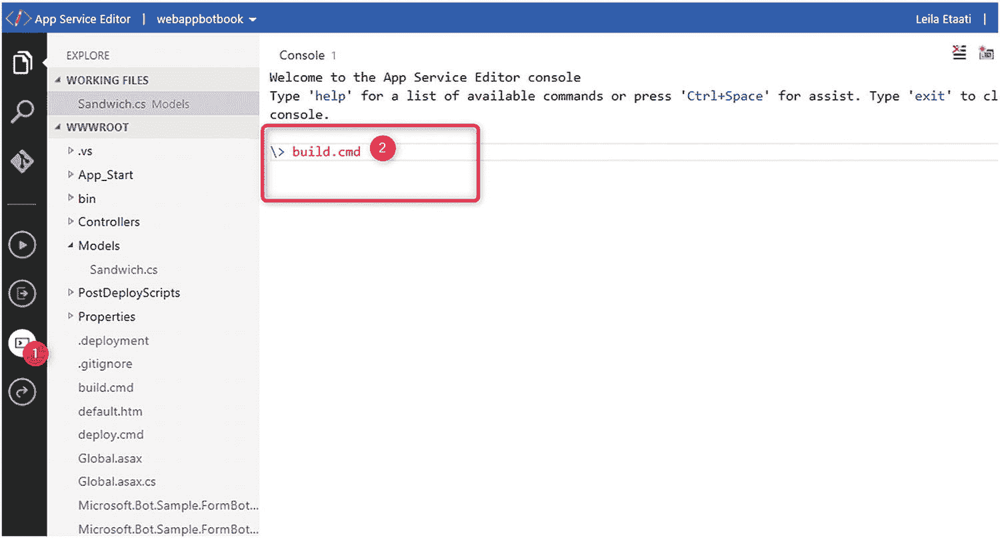

图 19-6

构建机器人在线编辑器

现在，我们必须在“在网络聊天中测试”中测试并检查更改。在构建框架后，首次输入“Hi”。如图 19-7 所示，关于三明治类型的第一个选项已更改。

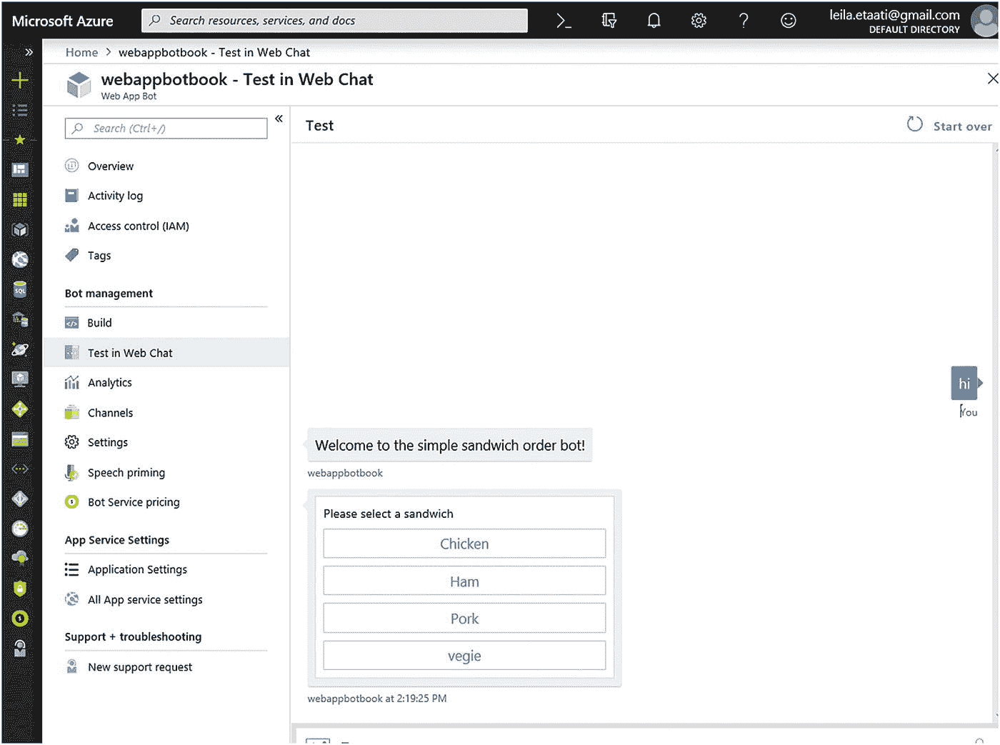

图 19-7

机器人框架更改的结果
```


现在，当你选择“火腿”选项时，下一个三明治选项将会显示，这是一个关于选择三明治长度的问题。可以将代码嵌入到频道中，例如 Facebook、Telegram、Skype 等（图 19-8）*。*

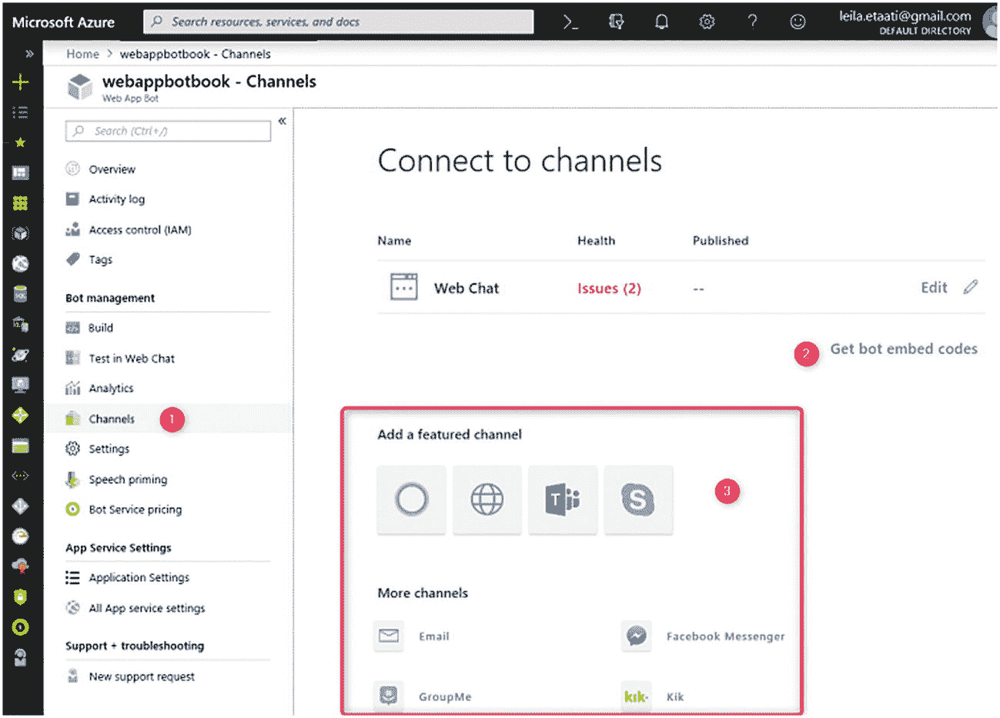

图 19-8
聊天机器人中的频道

点击“频道”，注意在不同频道中嵌入机器人的不同方式。其中一种方式是在 Web 应用程序中嵌入机器人，即使用“获取机器人嵌入代码”。如果你想将代码嵌入到 HTML 页面中，必须复制嵌入代码，并用上方窗口中显示的密钥替换掉秘密代码（图 19-9）。

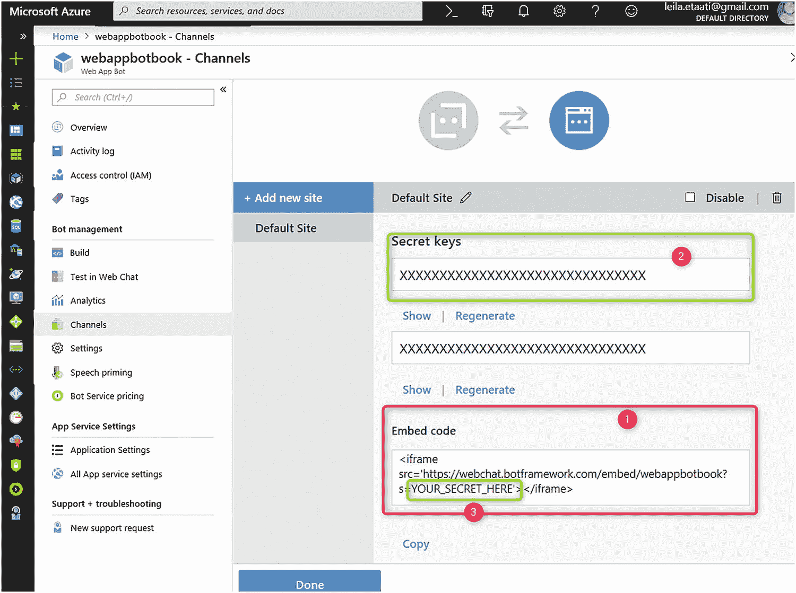

图 19-9
频道中的嵌入代码

现在你有了一个使用密钥的代码，如下所示。

```
Now you can embed the code in any web site. In the following section
I will show how to create a question-and-answer chatbot and embed it in
another web site.
```

问答聊天机器人

问答（QnA）聊天机器人可用于任何网站，以引导用户。创建聊天机器人的步骤与上一节相同。首先，我们创建一个 Web 应用机器人服务，并选择“问答机器人”模板（图 19-10）。

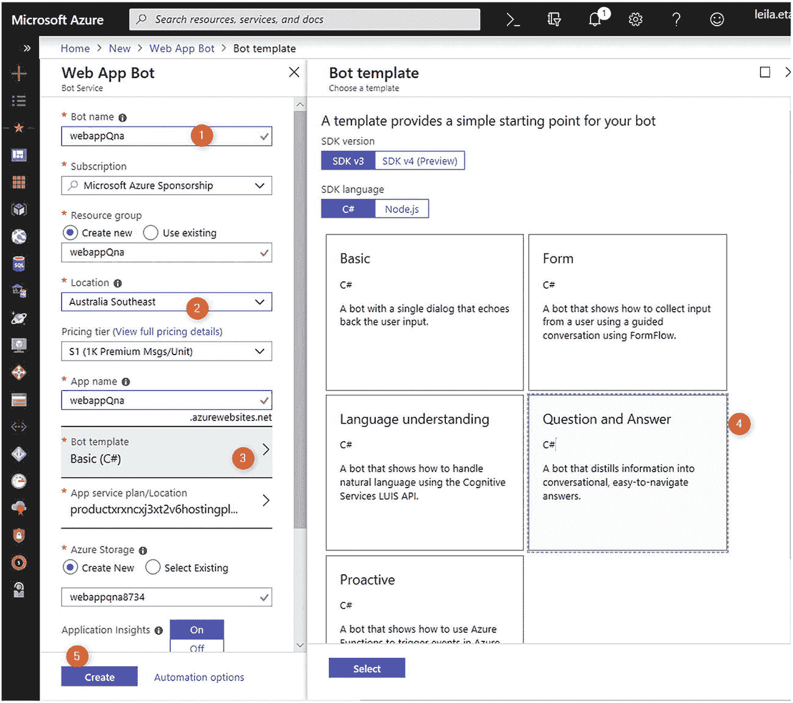

图 19-10
用于 QnA 聊天机器人的 Web 应用机器人

创建 QnA 聊天机器人后，如图 19-10 所示，我们必须在“Web 聊天中测试”中进行测试。测试聊天机器人时，你会收到一条错误消息（图 19-11），要求你设置一些参数，例如 `QnAKnowledgebaseId`、`QnAAuthKey` 和 `QnAEndpointHostName`*。*

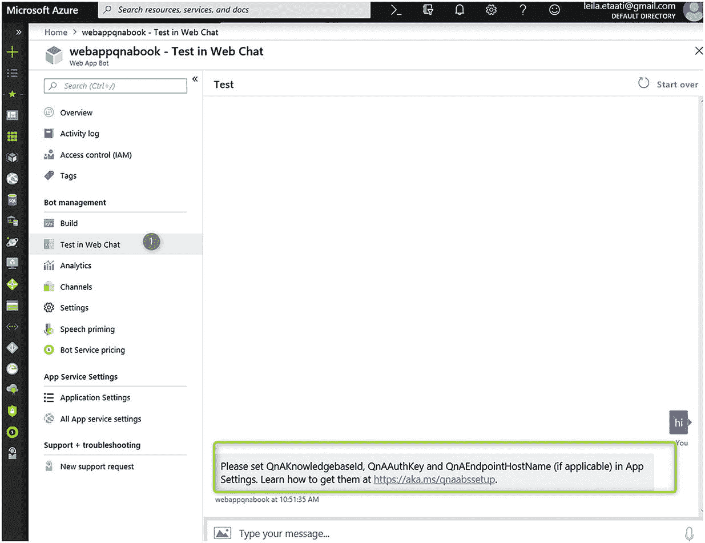

图 19-11
测试 Web QnA 聊天机器人

要设置这些参数，我们必须在 Azure 中创建一个 QnA Maker 服务。在你的 Azure 账户中，设置 QnA Maker 服务（图 19-12）。

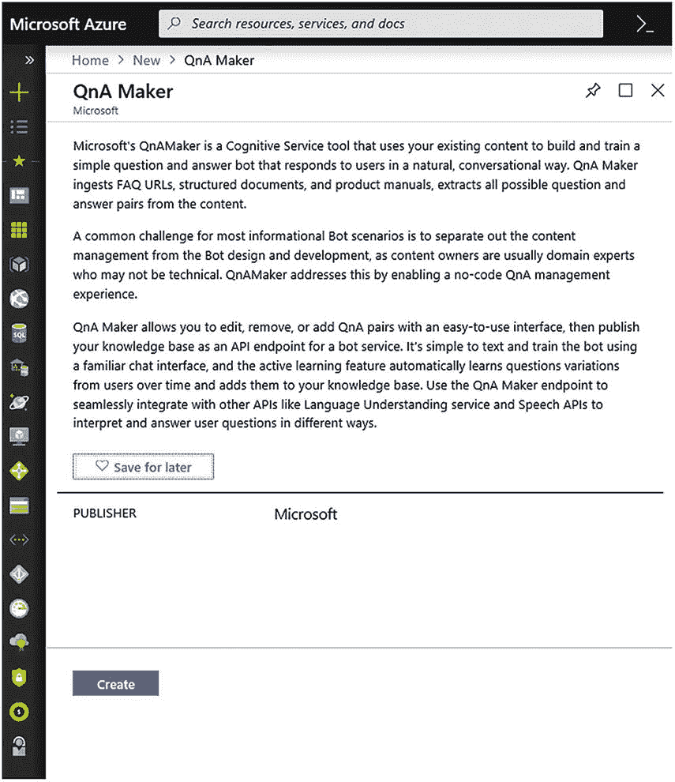

图 19-12
QnA Maker

在 Azure 中创建 QnA Maker 后，你必须设置一个知识数据库 [5]。使用你的 Azure 账户，登录到 qnmaker.ai 网站（图 19-13）。

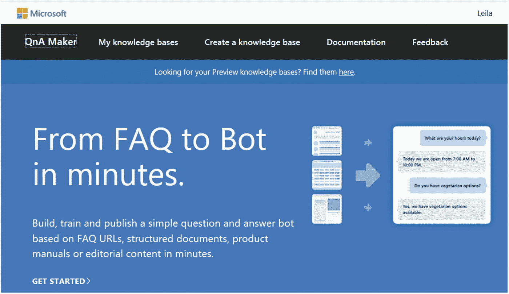

图 19-13
QnA Maker 网站

点击页面顶部的“创建知识库”（图 19-13）。第一步是创建一个 QnA 服务（与上一节相同）。第二步是将知识服务连接到 Azure 中的 QnA 组件。第三步是选择相关的 Azure 目录 ID、Azure 订阅名称和 Azure QnA 服务。然后，你必须为知识库选择一个名称（图 19-14）。

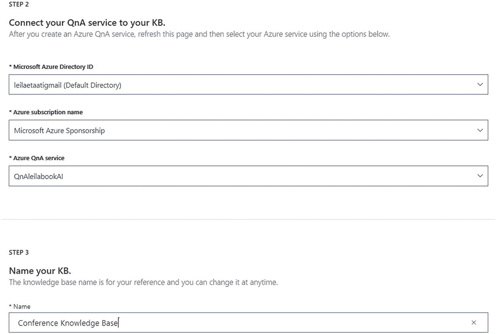

图 19-14
将知识库（KB）与 Azure 连接

接下来，我们必须以 URL 或文件格式（`.et`、`.pdf`、`.doc`、`.docx`、`.xlsx`）上传一些知识库。该文件包含一些常见问题解答（FAQ）。我创建了一个包含某会议常见问题解答的 Word 文件（图 19-15）。


图 19-15
常见问题解答

现在，你必须将文件上传到网站并创建知识库（图 19-16）。

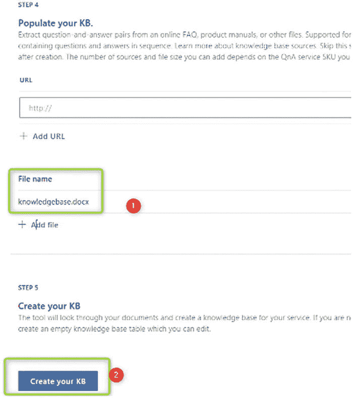

图 19-16
创建知识库

创建知识库后，你可以通过点击`添加` `QnA 对`来扩展知识库问题（图 19-17）。此外，还可以添加更多的问题和答案。

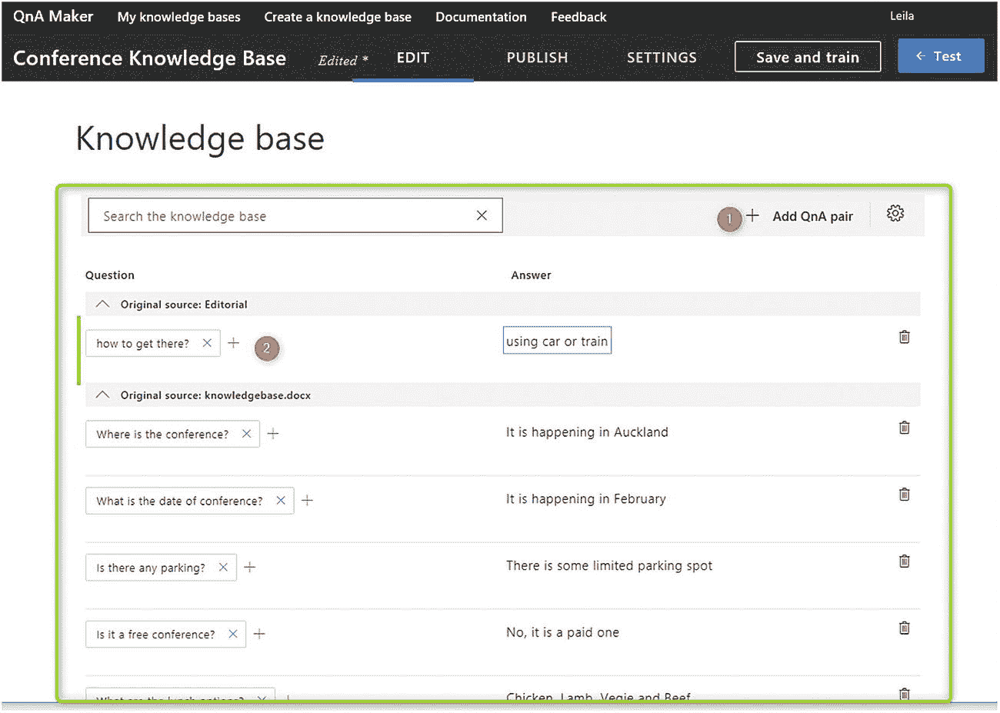

图 19-17
添加 QnA 对

上传并添加问题后，你必须“保存并训练”知识库。训练模型后，点击“测试”。输入“Conference”，知识库将返回结果（图 19-18）。

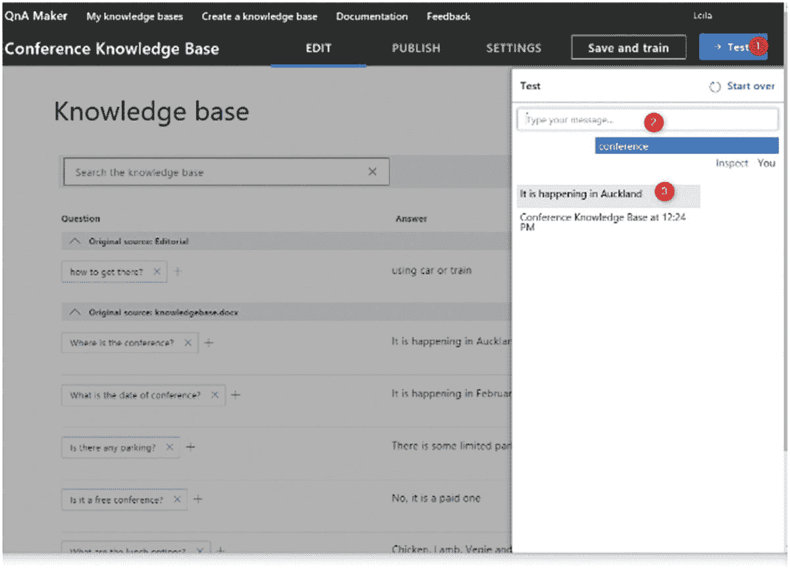

图 19-18
测试知识库

测试知识库后，我们必须将其发布。发布知识库后，将构建一个 HTTP 请求。创建的请求包含所有必需的信息，例如知识库 ID、终结点链接和身份验证密钥（图 19-19）。

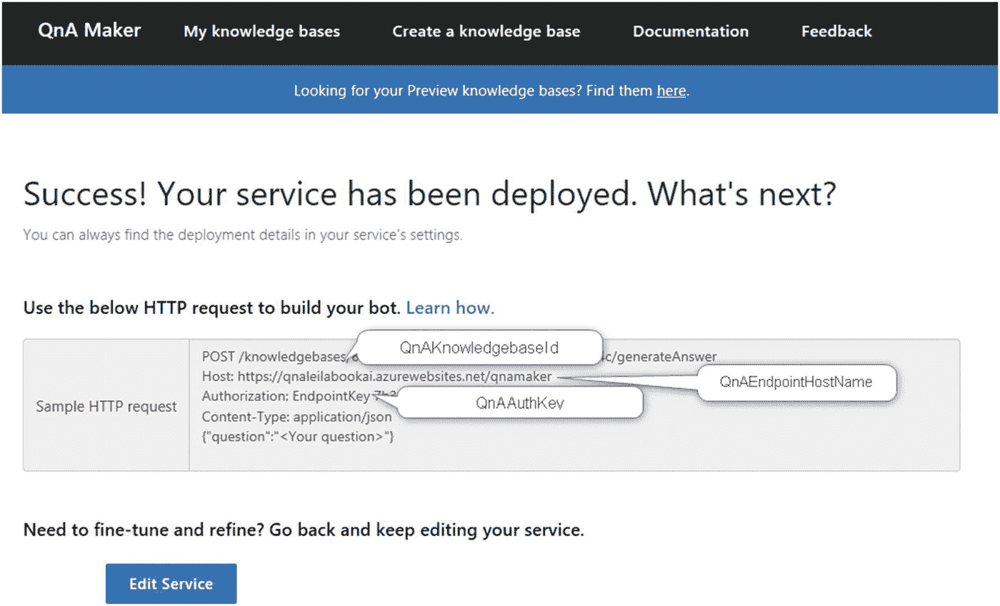

图 19-19
创建 HTTP 请求

这些参数可以在图 19-11 中查看。在 webappqnabook（图 19-20）中，点击“应用程序设置”，并使用 HTTP 请求参数填充这些参数（图 19-20）。

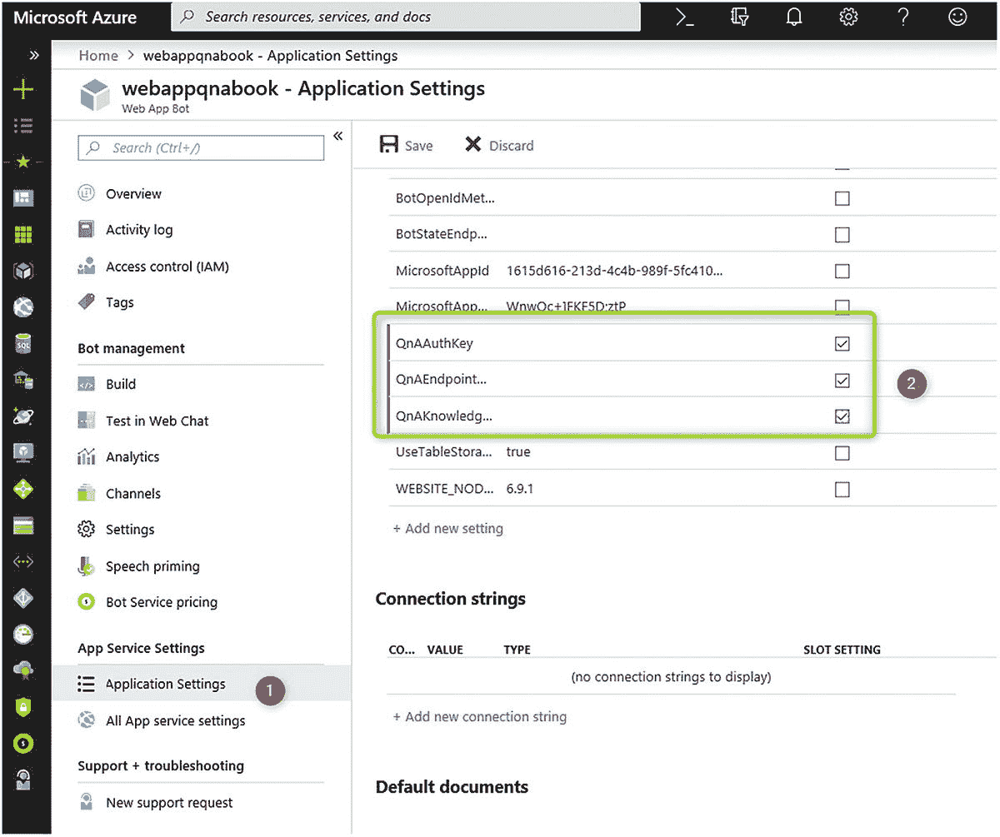

图 19-20
应用程序设置参数

现在，我们必须测试聊天机器人。在 Web Chat 中点击“测试”，然后输入“Conference”。输出将显示在测试窗口中（图 19-21）。

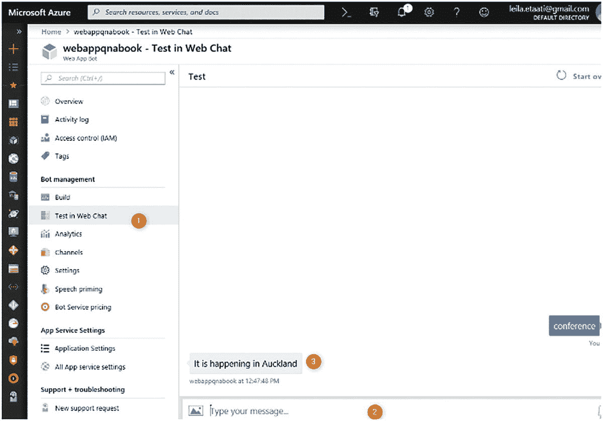

图 19-21
测试聊天机器人

你可以将问题和答案嵌入到任何页面和渠道中。在此示例中，该聊天机器人已嵌入到会议网站中，以引导用户。要将聊天机器人嵌入网站，我们必须获取嵌入代码。要获取嵌入代码，请遵循与图 19-9 相关的相同步骤。

接下来，复制代码并将其放入网页中（图 19-22）。

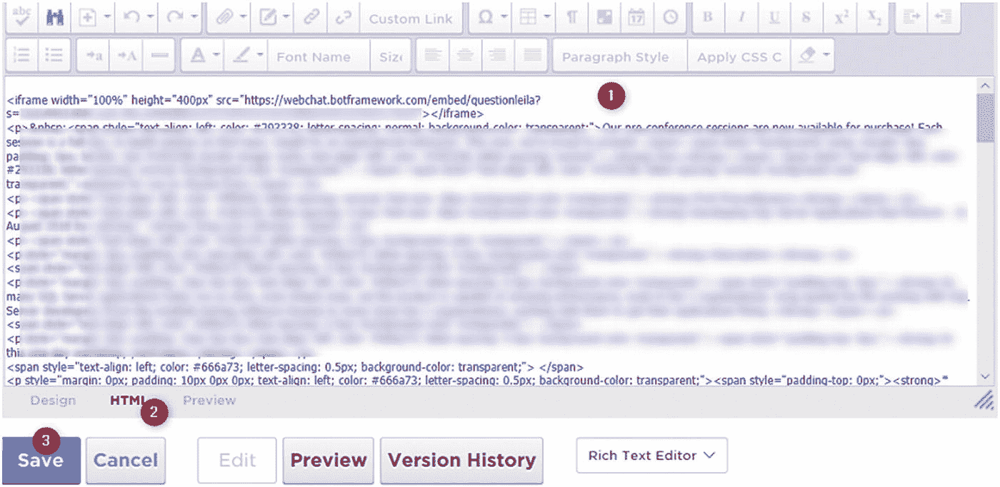

图 19-22
在网页中复制嵌入代码

测试代码，你将看到网页上的聊天机器人（图 19-23）。

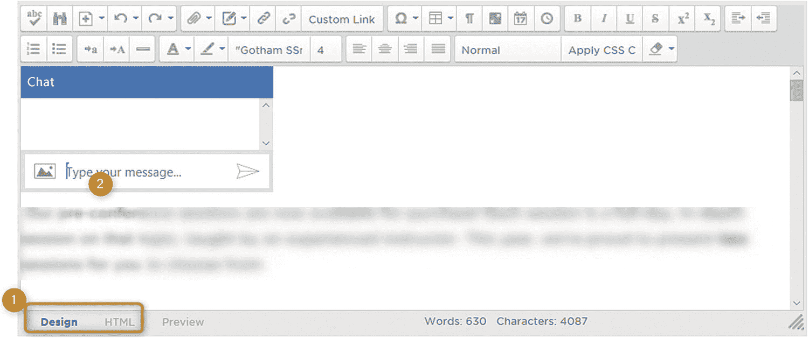

图 19-23
嵌入网页的聊天机器人

总结
本章解释了创建聊天机器人的一般步骤。

参考文献

1.  Kamran Iqbal 等，“关于 Azure 机器人服务”，Microsoft Azure，
    [`https://docs.microsoft.com/en-us/azure/bot-service/bot-service-overview-introduction?view=azure-bot-service-3.0`](https://docs.microsoft.com/en-us/azure/bot-service/bot-service-overview-introduction%253Fview%253Dazure-bot-service-3.0)，2019 年 4 月 17 日。

2.  Bot Builder，[`https://marketplace.visualstudio.com/items?itemName=SkillBotBuilder.SkillBotBuilder`](https://marketplace.visualstudio.com/items%253FitemName%253DSkillBotBuilder.SkillBotBuilder)。

3.  Tony Anziano，“Bot Framework-Emulator”，GitHub，[`https://github.com/Microsoft/BotFramework-Emulator/releases`](https://github.com/Microsoft/BotFramework-Emulator/releases)，2019 年。

4.  Microsoft Visual Studio，下载，[`https://visualstudio.microsoft.com/downloads/`](https://visualstudio.microsoft.com/downloads/)，2019 年。

5.  Microsoft QnA Maker，[`www.qnamaker.ai/`](http://www.qnamaker.ai/)，2019 年。

20. Microsoft 机器学习工具概述

前 19 章概述了如何使用不同的 Microsoft 产品进行机器学习。首先，介绍了机器学习方法，例如描述性分析、预测性分析和规范性分析。然后讨论了作为机器学习主要语言之一的 R 语言。接着简要说明了如何使用 Power BI、Azure ML Studio、SQL Server 等工具进行机器学习。本章总结了机器学习技术以及使用特定方法时的最佳实践。

Microsoft 机器学习技术概述
人工智能（AI），特别是机器学习，可以为企业带来诸多好处。多年来，许多人一直在使用 Microsoft 数据平台工具。Microsoft 运用机器学习创建了 Xbox、必应搜索等产品。然而，从 2014 年开始，Microsoft 开始为高级用户和最终用户提供将机器学习嵌入其报告和软件的功能。

前面的章节根据机器学习的使用方式对相关的 Microsoft 工具进行了分类。在本章中，技术根据以下内容进行分类：

*   是否需要编写 R 或 Python 代码
*   云计算还是本地计算

第一种分类基于这些工具的易用性和准确性程度。

我们可以将相关产品分为两大类：

*   *预构建 AI*：无需编写任何 R 或 Python 代码即可生成机器学习场景的 Microsoft 机器学习工具。
*   *自定义 AI*：需要了解如何编写 R 或 Python 代码的 Microsoft 机器学习工具。

第一组易于使用，你只需遵循提供的说明即可。使用预构建 AI 工具的主要好处是无需了解机器学习概念，或者至少了解一些概念，大多数人都能够创建 AI 应用程序。预构建 AI 工具可以解决一般问题，但对于某些业务问题，其他类别的工具（例如，用于编写 R 或 Python 代码的工具）更有效。在本书中，认知服务（第 18 章）和机器人框架（第 19 章）是你可以嵌入到 Power BI、Windows 或其他 Web 应用程序中而无需编写任何 R 或 Python 代码的工具。正如相关章节所述，没有直接方法可以访问预构建自定义 AI 工具背后的代码，因此无法更改该代码和算法。

相比之下，使用自定义 AI 工具需要了解如何编码以及如何为机器学习目的编写代码。然而，对于某些工具，例如 Azure ML Studio，可以在不编写 R 或 Python 代码的情况下进行机器学习，尽管至少需要对机器学习的工作原理有一定的了解。一些自定义 AI 工具涉及在其他 Microsoft 工具内部编写 R 或 Python 代码，例如在以下工具中使用 R 或 Python：

*   Power BI（第 6、7 和 8 章）
*   SQL Server 2016 的 R Services 和 SQL Server 2017 的机器学习（ML）Services（第 9 章）
*   Azure Data Lake Analytics（第 11 章）
*   Azure Databricks（第 10 章）
*   Azure HDInsight（第 15 章）


*   .NET 应用程序（第 13 章）

*   以及其他

对于 Azure 机器学习工具，也可以编写 R 或 Python 代码。此外，拖放式环境也非常易于使用。
第二种分类是关于云端与本地 AI 工具。许多公司仍然倾向于将工具保留在本地，而另一些公司则更愿意将所有业务产品迁移到云端。介于两者之间，有些公司同时拥有云端和本地工具。
如果一家公司的主要策略是将所有内容保留在本地，那么使用 Power BI 或 SQL Server 来编写 R 或 Python 可能更合适。然而，如果倾向于在云端进行机器学习，那么 Azure ML Studio（第 12 章）、用于在 Databricks 上编写 R 或 Python 的工具以及 Azure Data Analytics 将最有帮助。

第三类工具旨在解决业务问题。在选择特定工具时，问题的性质以及我们希望用 AI 增强的场景也很重要，例如：

*   在物联网（IoT）用例场景中应用机器学习
*   使用文本分析、语音、图像等进行分析
*   将机器学习应用于 ETL（提取、转换、加载）项目
*   使用 Azure Machine Studio 为客户快速构建原型

物联网场景
分析实时数据的需求已由诸如事件中心、流分析（第 13 章）、Databricks（第 10 章）等 Microsoft 工具解决。借助 Power BI，可以根据来自传感器、应用程序等的真实数据创建实时流报告。
在此类场景中，大多数情况下需要识别数据中的异常或将预期数据分类到不同的组中。通过将 Azure 机器学习与流分析或 Databricks 结合使用，我们可以将机器学习应用于物联网场景。

图像、文本和语音分析
在 Microsoft 技术栈中，有用于图像、文本和语音分析的不同工具。认知服务（第 18 章）是用于文本、语音和图像分析的流行工具之一，它提供了可在其他应用程序中使用的 API。
然而，也可以使用 CNTK 平台进行图像处理和语音识别，这将在第 17 章中介绍。这些 Microsoft 包和库为开发人员提供了便利，使他们能够采用深度学习方法执行机器学习。

ETL 上的机器学习
另一个可能的需求是将机器学习应用于已加载和转换的数据，以实现可视化和创建报告。在将数据展示给最终用户之前，通常需要对其应用一些描述性或预测性分析。因此，使用 Power BI 自助式 BI 的用户可以利用机器学习，使用 R 和 Python 脚本使报告更具洞察力。
另一种方法是在 SQL Server 2016 或 2017 中使用 R 或 Python。此外，如果数据在云端，则可以同时使用 Databricks 进行 ETL 和机器学习。

机器学习原型
对于首次希望在其数据上使用机器学习的公司来说，Azure 机器学习工作室是一个很好的工具，它展示了从收集数据到训练和测试模型的完整机器学习过程。此外，管理人员和利益相关者能够快速跟进机器学习过程，并了解它如何作为 API 在其他应用程序或简单的 Excel 文件中使用。
总而言之，机器学习工具的选择取决于所使用的架构、愿意在编程上投入多少精力以及将要实施的具体场景。与第一个需求相关的工具基于预构建 AI 和自定义 AI。与第二个需求相关的工具取决于当前的架构（本地或云端）。最后，需要考虑的最后一个需求是与要实施的特定场景（例如物联网、ETL 或原型创建）相关的合适工具。

索引

A

激活函数

Apache Spark

应用程序编程接口 (API)

人工智能 (AI)

自动化机器学习

高级编辑器

关联规则

属性

癌症数据集

调用分类函数

预测结果

已更改类型

Chiclet 切片器

创建函数，Power Query

客户购买行为

数据集，转换

重复数据集

最终代码

导入数据集

参数设置

权限请求

Power Query 编辑器

Power Query 筛选值

预测分析

报告

结果分析

rpart 库

R 脚本编辑器

RStudio

运行 R 脚本

选择列

泰坦尼克号数据集

Azure Databricks

图表选项

集群页面

环境模块

导入数据

启动工作区

创建新单元格

创建 R 笔记本

运行代码

Scala 语言

调度进程

Azure Data Lake

分析示例脚本

创建资源

创建分析资源

数据资源管理器选项

定义

Microsoft 云组件

U-SQL 语言中的 R 脚本

导入 RStudio

Active Directory，创建连接

Azure Active Directory，应用程序注册

Azure Active Directory，创建

Azure Active Directory，目录 ID（租户 ID）

Azure Active Directory，获取客户端密钥 ID

adlsbook 中的鸢尾花数据

U-SQL

Azure Data Lake Analytics

Azure Data Lake Store (ADLS)，*参见* Azure Data Lake

Azure 机器学习 (AML)

API 模型

包

Azure ML Studio

创建 Web 服务

Excel 中的 API

信息页面

输入和输出

示例代码

测试

泰坦尼克号问题

环境

执行 R 脚本

实验

算法

清理缺失数据

创建

导入数据

评分模型输出

设置

拆分数据

可视化数据集

特性

Azure ML workbench

*对比* Azure ML Studio

组件

创建工作区

定义

导入数据

鸢尾花分类结果

鸢尾花数据（文本文件）

Jupyter Notebook

选项

安装

鸢尾花分类项目

模型主页

Azure SQL 数据库

Azure 存储资源管理器

Azure 流分析

分析作业

应用程序

Azure ML

访问密钥和 URL

模型

创建 Web 服务

组件

创建函数

创建

定义

事件中心服务

初始化

Power BI 中的实时数据

输出

设置配置

共享访问策略

Visual Studio

B

Blob 存储

机器人创建，Azure

构建部分

频道

表单选项

.NET 应用程序

在线代码编辑器

测试更改

Web 应用机器人

Web 聊天

商业智能 (BI)

业务问题

分析与信息

机器学习（*参见* 机器学习 (ML)）

C

聚类分析

聚类

自定义视觉对象

k-means

Power Query

比较数据

数据清洗

漏斗图选项

家庭用电数据集

可视化窗格

认知服务

Azure 账户

类别

特性

语言类别

协同过滤

基于内容的系统

自定义视觉对象，Power BI

创建命令提示符

JSON 文件

pbiviz 命令

在 Power BI 中

账户登录

分析时间序列

预测

导入数据

导入视觉对象

RADACAD 网站

R 代码

脚本文件

D

数据采集

Databricks 环境，Azure，*参见* Azure Databricks

数据挖掘方法

数据科学虚拟机 (DSVM)

创建

环境

Jupyter Notebook

身份验证密钥，Azure ML Studio

获取工作区 ID

模型创建

R 代码

R ML 代码发布

Web 服务


概述

R 与 Python 工具

RDP 文件

RStudio

设置

大小

数据集变量

数据转换，Power Query

更改数据类型

分组依据

使用 R 脚本

数据仓库

数据整理

ETL

合并

重塑

选择

决策过程

决策树

分析

自定义视觉对象，Power BI

Power BI 账户

Power Query 筛选值

预测分析

根节点

树分支

可视化面板

深度学习

部署

描述性分析

数据挖掘方法

运营报告

统计分析

离散类标签

拖放环境

E

模拟器

事件中心

提取、转换和加载 (ETL)

F, G

人脸识别

API 密钥

Azure

BrowseButton 函数

代码，更改

人脸描述

人脸情绪

图像情绪

安装人脸 API

视觉类别

Windows 应用程序

力导向图

H

HDInsight

基于云的服务

集群

Azure Data Lake Store Gen1

创建

环境

Jupyter Notebook

设置

I, J

集成开发环境 (IDE)

物联网 (IoT)

K

关键绩效指标 (KPI)

K 近邻算法 (KNN)

L

lapply 函数

M

机器学习 (ML)

人工智能

方法

监督学习

无监督学习

描述性分析

语言与平台

生命周期

预测分析

规范性分析

Matplotlib

merge 函数

微软认知工具包 (CNTK)

案例研究

实际数据

DSVM

Jupyter Notebook

随机数据

定义

神经网络

激活函数

数据分类

深度学习

DSVM 环境

模型

突触

拓扑结构

设置

微软机器学习

自定义 AI 工具

数据平台工具

ETL

物联网

预构建 AI 工具

原型

语音分析

N, O

神经网络

计算机系统架构

具体数据集

包库命令

使用 R 进行机器学习

登山，比较

归一化

输出数据集

Power BI 报表

预测结果

Python 代码，数据透视

结构

训练数据集

归一化

MinMax 方法

归一化数据

R 脚本

NuGet 包

P

包，R

安装

机器学习

Power BI

数据可视化

R 代码

CSV 文件，导入

ggplot 函数

mpg 数据集

Python 环境

散点图结果

脚本编辑器

空白区域

设置 R

Power Query 编辑器

数据资源

数据转换

主页选项卡

Power BI

R 脚本

Power Query 筛选值

预测分析

分类分析

回归分析

时间序列预测

规范性分析

PyCharm

Python

维度

IDE

机器学习

包安装

统计分布

可视化

Q

查询编辑器

问答聊天机器人

嵌入代码

常见问题解答

HTTP 请求

知识库

Maker 服务

问答对

qnmaker.ai 网站

测试

Web 应用机器人服务

R

RADACAD 网站

R，数据结构

数据框

列表

向量——C()

回归方法

远程桌面协议 (RDP)

重塑数据

数据表，创建

手动输入数据

数据透视

数据透视表

指定类型/值

类型列透视选项

RevoScaleR 包

Rodeo

rpart 包

R 脚本

配置选项

创建视觉对象

SSRS 中的图表

输入数据

库路径

R 代码部分

返回数据

SSRS

包

Azure ML

RevoScaleR

rxLinMode

运行

在 SQL Server 2016 中

在 SQL Server 2017 中

RStudio，安装

R 可视化

自定义视觉对象（*参见* 自定义视觉对象，Power BI）

功能

RStudio

切片和切块

Power BI

rxLinMode 包

S

切片和切块

Spyder

SQL 脚本语言

SQL 服务器

SQL Server Reporting Services (SSRS)

统计分析，R

监督学习

支持向量机 (SVM)

T

团队数据科学过程 (TDSP)

文本分析

创建函数

空白查询

Power BI 查询编辑器

情感分析

数据集

定价层

设置

URL 和密钥

U

UCI 机器学习库

用户界面 (UI)

V, W, X, Y, Z

可视化，R

```
```