# 1. 树莓派（RasPi）机器学习（ML）入门

本章将向您介绍树莓派和机器学习。首先讨论树莓派，这将帮助您了解用于运行本书所有演示的硬件平台。随后是机器学习的入门讨论，这将为您提供一个框架，以理解机器学习的本质，以及为什么它是一个如此令人兴奋且快速发展的研究领域。

## 树莓派简介

您需要使用树莓派来运行本书的演示。在接下来的几节中，我将向您展示如何将树莓派 3 Model B 或 B+ 设置并配置为工作站，以运行各种机器学习演示所需的脚本和程序。图 1-1 展示了本书中使用的树莓派 3 Model B+。


图 1-1

树莓派 3 Model B+

树莓派 3 Model B 和 B+ 之间存在一些差异。它们基本相同，只是 B+ 的处理器时钟速度略有提升，并且与 B 型号相比，无线功能有所改进。如果您使用 B 型号而不是 B+ 型号，这些改进都不会对运行本书的项目产生重大影响。

我不会讨论树莓派单板计算机的构成，因为许多现有的书籍和博客已经充分涵盖了这一点。如前所述，我在工作站配置中使用了树莓派 3 Model B+。这种设置是将树莓派与 USB 键盘、USB 鼠标和 HDMI 显示器连接。在我的设置中，树莓派由 2.2A、5V 电源供电，并带有微型 USB 连接器。

树莓派不使用机械磁盘驱动器来实现包含操作系统（OS）的文件系统。所有最近的树莓派版本都依赖可插拔的微型 SD 卡作为辅助存储。虽然可以将传统磁盘驱动器连接到树莓派，但它只能作为辅助存储设备，而不能作为操作系统的主存储或可引导分区。接下来，我将向您展示如何下载操作系统并将其安装到微型 SD 卡上，以使树莓派能够作为功能性的机器学习微控制器。

毫无疑问，启动和运行的最简单方法是购买预编程的微型 SD 卡。此类卡即插即用，只需进行配置以匹配您的特定工作站配置，包括您的 WiFi 网络。WiFi 配置过程将在后面的章节中讨论，但首先，如果您愿意，我想讨论如何创建您自己的微型 SD 卡。

要加载的微型 SD 卡软件称为 Raspbian 镜像，可从许多在线网站免费获取，我推荐的网站是树莓派基金会网站 [raspberrypi.​org](http://raspberrypi.org/)。最新的操作系统镜像始终可从网站的“下载”部分获取。您可以下载两种类型的操作系统镜像。第一种类型名为 NOOBS，是“全新开箱即用软件”的缩写。NOOBS 有两个版本可用。一个版本名为 NOOBS，另一个版本名为 NOOBS Lite。在撰写本文时，这两个版本均标识为 v3.0.0。NOOBS 有一个易于使用的操作系统安装程序，其中包含 Raspbian 操作系统以及另一个名为 LibreELEC 的流行操作系统。此外，NOOBS 版本还提供了一系列备选操作系统，这些系统随后会从互联网下载并安装。NOOBS Lite 包含相同的操作系统安装程序，但没有预装 Raspbian，也没有 LibreELEC 选项。但是，此版本提供相同的操作系统选择菜单，允许下载和安装 Raspbian 及其他操作系统镜像。

NOOBS 和 NOOBS Lite 镜像只是文件和子目录的集合，可以使用 BitTorrent 应用程序下载，也可以直接作为原始 Zip 文件下载。BitTorrent 和 Zip 下载的大小约为 1.2 GB。解压后的镜像大小为 1.36 GB，但最终安装后的大小超过 4 GB。这意味着您至少需要使用 8 GB 的微型 SD 卡来容纳最终的镜像。但是，为了复现本书中的所有机器学习演示，我强烈建议您至少使用 16 GB、Class 10 的微型 SD 卡，以确保有充足的存储空间，并最大化运行中树莓派的数据吞吐量。

第二种镜像类型是直接的操作系统下载。当前可用的镜像是代号为 Stretch 的 Raspbian Linux 发行版。此 Raspbian 版本可以使用 BitTorrent 或作为 Zip 文件下载，最终镜像大小与 NOOBS 镜像相似。

下载镜像后，必须配置微型 SD 卡。我将只讨论直接的 Raspbian 下载类型，因为我相信本书的读者在基本计算机操作以及树莓派方面都有足够的经验，因此他们会绝大多数选择使用直接下载的方法。


### 将 Raspbian 镜像写入 micro SD 卡

在写入镜像之前，无需格式化 micro SD 卡。这部分流程由将镜像写入存储卡的应用程序自动完成。你只需根据主机电脑设置合适的应用程序即可。对于 Windows 机器，我强烈推荐使用 Win32DiskImager，可从以下地址获取：

[`https://sourceforge.net/projects/win32diskimager/files/latest/download`](https://sourceforge.net/projects/win32diskimager/files/latest/download)

下载的是一个 Zip 文件，使用前需要解压。然后运行该应用程序，选择磁盘镜像所在位置，并选择 micro SD 卡的逻辑盘符。图 1-2 展示了我在 Windows 机器上将 Raspbian Stretch 版本写入 micro SD 卡时的配置界面。

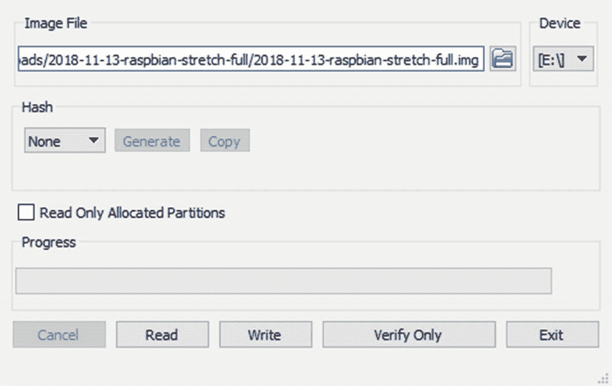

图 1-2

Win32DiskImager 截图

如果你使用的是 Mac，我推荐使用 Etcher 程序来写入磁盘镜像。可从 [`https://etcher.io/`](https://etcher.io/) 获取。该应用程序的功能与 Win32DiskImager 类似。图 1-3 是在我的 MacBook Pro 上运行该程序的截图。


图 1-3

Etcher 截图

将操作系统镜像写入 micro SD 卡后，接下来必须进行配置。我将配置过程分为两个部分。第一部分涉及我认为是强制性的配置，即如果不进行这些配置，操作系统就无法按你期望的方式运行。第二部分配置涉及对已进行广泛调整的操作系统进行“微调”，以满足你的特定需求。

### 注意

RasPi 的配置过程是动态且不断演进的。这句话的意思是，以下说明虽然在撰写本文时适用，但当你尝试复现这些步骤时可能不再适用。这仅仅是由开源软件的性质决定的。不过，我相信无论采用何种流程，它们都会清晰且易于遵循。

#### 强制配置

图 1-4 显示了 RasPi 启动后的初始屏幕。

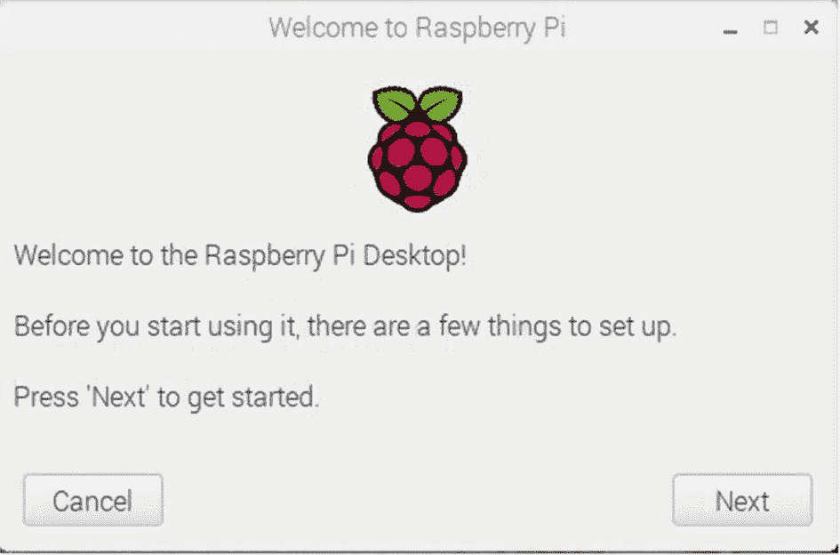

图 1-4

初始配置截图

你必须按照图中的提示点击“下一步”按钮开始配置过程。随后会立即出现图 1-5，显示国家、语言和时区的默认设置。

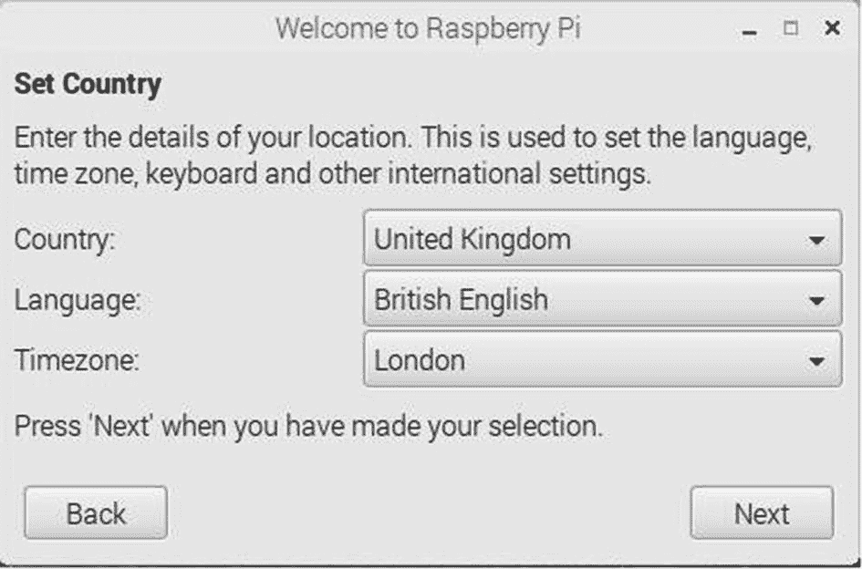

图 1-5

默认的***设置国家***对话框

至少选择正确的国家和语言对你来说非常重要，否则由于物理键盘的设置方式与你想要输入的字符之间存在冲突，你将很难输入任何脚本或程序。时区菜单也会自动调整，以反映所选国家可用的时区。

图 1-6 显示了我做出特定选择后的对话框。

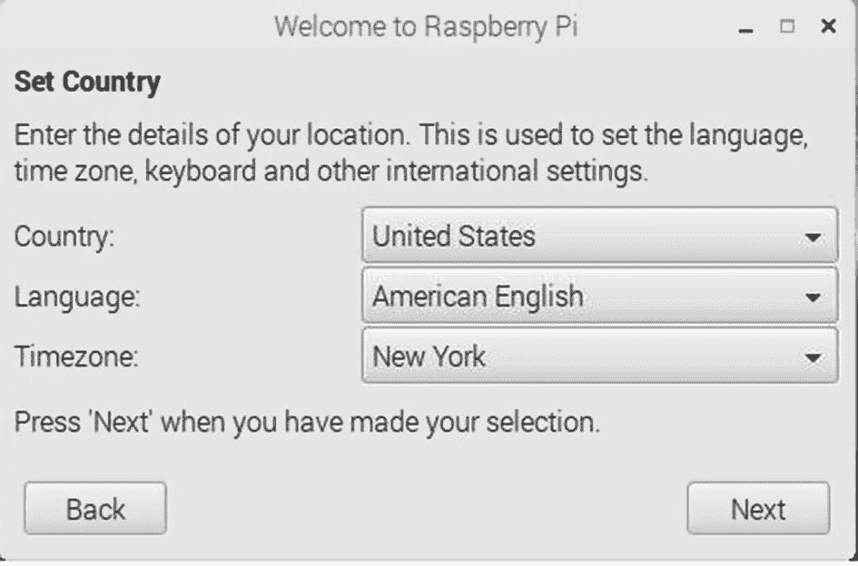

图 1-6

自定义的***设置国家***对话框

点击“下一步”按钮将弹出**更改密码**对话框，如图 1-7 所示。

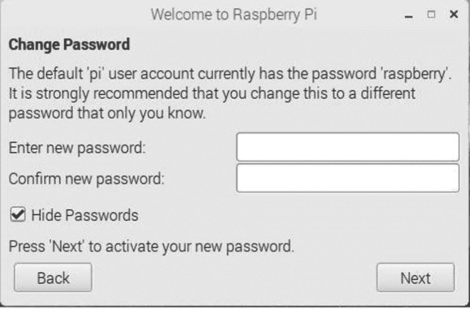

图 1-7

***更改密码***对话框

更改默认密码 `raspberry`（这很可能广为人知）应能提高你系统的安全性。这个选择完全取决于你，坦白说，这对复现本书的任何演示都没有影响。你只需要记住密码，否则你将需要重新安装一个新的镜像。我认为在 Raspbian 操作系统中没有简单的方法来恢复遗忘的密码。如果你选择不更改密码，只需点击“下一步”按钮，**选择 WiFi 网络**对话框就会出现。图 1-8 显示了我点击按钮后出现的对话框。

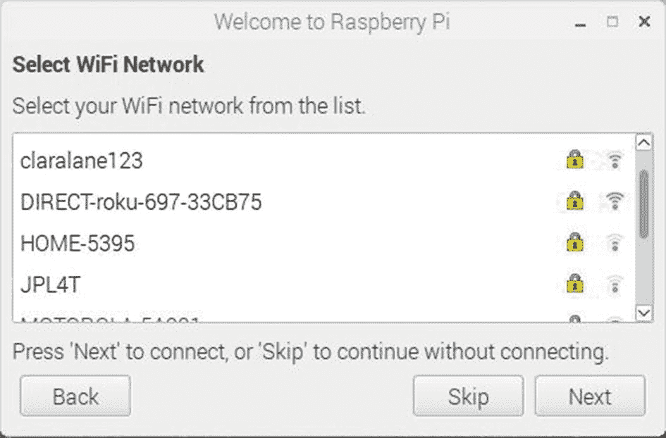

图 1-8

***选择 WiFi 网络***对话框

你需要点击相应的 WiFi 网络 SSID 以建立 WiFi 通信链路。另一个对话框会出现，提示你按下物理路由器上的按钮或输入与所选 WiFi SSID 关联的密码。出于明显的安全原因，我选择不显示这个特定的对话框。点击“下一步”按钮将弹出**检查更新**对话框，如图 1-9 所示。

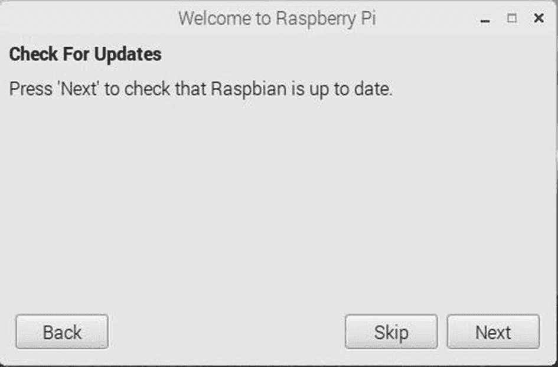

图 1-9

***检查更新***对话框

如果你没有设置 WiFi 连接，则无法检查更新。我实际上不确定如果没有建立可用的 WiFi 链路，这个对话框是否会出现。假设你确实设置了 WiFi 链路，那么点击“下一步”按钮将导致 RasPi 连接到互联网，并检查新镜像中包含的当前已安装软件的状态。但是，你不需要在配置的这个阶段运行检查，因为我稍后会向你展示如何使用终端窗口命令进行更新。选择权在你。实际上，两者都做也无害，只是会在配置过程中花费你一些额外时间。如果你想使用手动更新过程，只需点击“跳过”按钮；否则，点击“下一步”按钮。图 1-10 显示了我点击“下一步”按钮后**检查更新**对话框的变化。

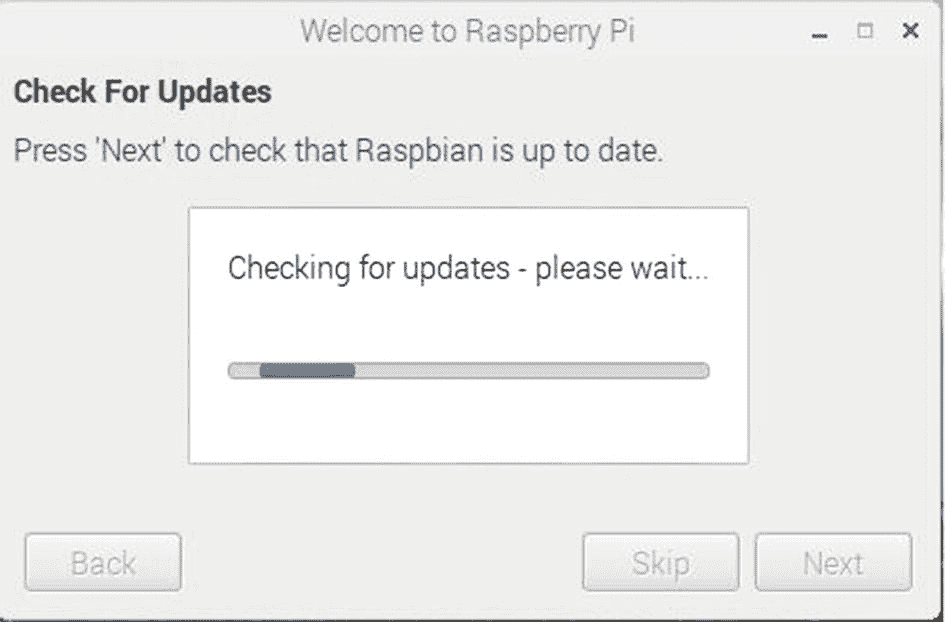

图 1-10

活跃的***检查更新***对话框

活动条将保持活跃状态几分钟，具体取决于检测到多少更新。一旦更新完成，你会看到一个信息框，告知你配置过程已接近完成，你需要点击“重启”按钮来完成该过程。我建议你这样做，并且如果你更改了密码，不要忘记输入你的新密码。

我现在建议你在终端窗口中输入以下命令来检查你的 WiFi 连接状态：

```
Ifconfig
```

图 1-11 显示了在我的 RasPi 系统上输入此命令的结果。

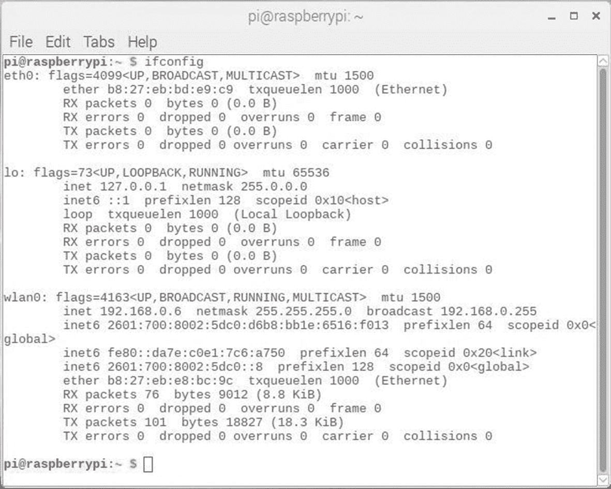

图 1-11

ifconfig 命令显示

你应该能在 `wlan0` 部分看到，家庭 WiFi 路由器为 RasPi 分配了一个本地 IP 地址 `192.168.0.6`。此分配确认了 RasPi 能够连接到互联网。检查你的家庭路由器是否设置为 DHCP，以防你看到的 IP 地址与图中所示不同。


#### 可选配置

可选配置过程使用一个名为 `raspi-config` 的实用工具。该工具已包含在初始下载的镜像中。您可以通过打开终端窗口并输入以下命令来运行 `raspi-config` 实用工具：

```
sudo raspi-config
```

图 1-12 展示了 `raspi-config` 实用工具的启动界面。

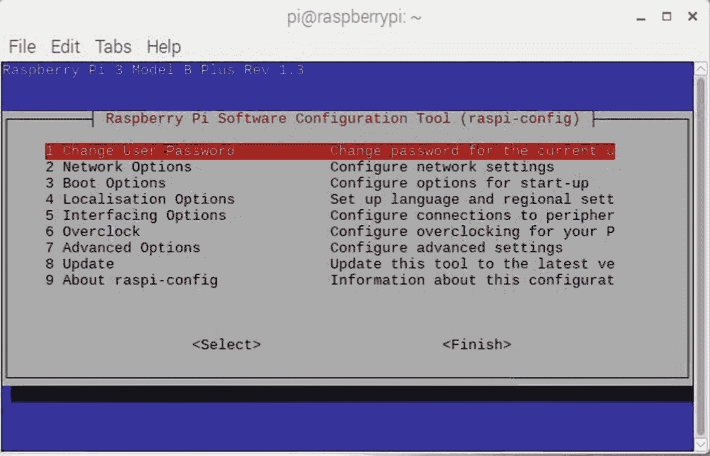

图 1-12

`raspi-config` 启动界面

从菜单中选择“接口选项”（Interfacing Options）后，将出现如图 1-13 所示的子菜单。

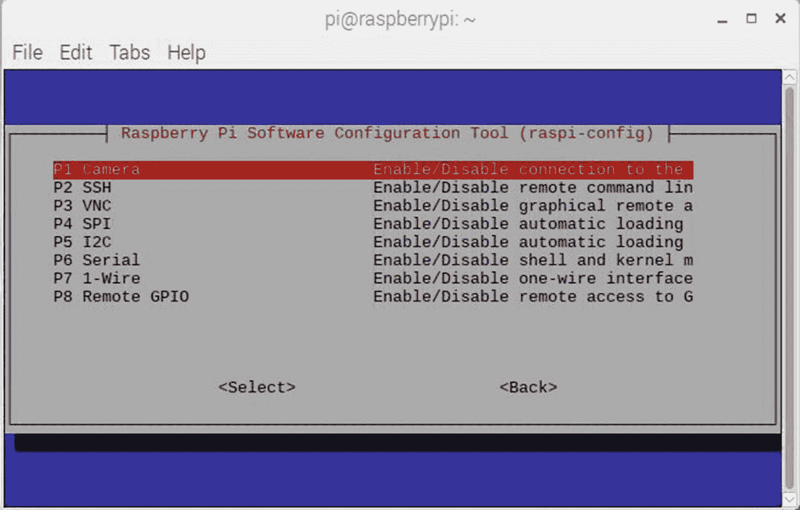

图 1-13

接口选项菜单

如图所示，该菜单包含八个选项。您需要启用哪些选项，取决于您在 RasPi 系统中使用的设备类型。我建议启用以下选项，以匹配本书中讨论的演示和步骤：

*   摄像头（Camera）
*   SSH
*   SPI
*   I2C
*   串口（Serial）
*   单总线（1-Wire）

您可以随时通过重新运行 `raspi-config` 实用工具来轻松添加或删除接口选项。无论如何，添加一个接口选项只会略微增加整个操作系统的大小。另请注意，启用某个接口仅会调用该特定设备的相关驱动程序。

您需要再次重启 RasPi 以完成这些可选配置的选择。在终端窗口中输入以下命令来重启计算机：

```
sudo reboot
```

至此，您已成功设置并配置了您的 RasPi 系统。接下来，您需要更新和升级您的系统，以确保安装了最新的 Raspbian 操作系统软件。

### 更新和升级 Raspbian 发行版

如前所述，Raspbian Linux 发行版一直在不断改进。一旦建立互联网连接，确保您拥有最新更新和升级的发行版就变得非常简单。在终端窗口中输入以下命令来更新已安装的操作系统：

```
sudo apt-get update
```

更新操作会更改内部系统的软件包列表，使其与当前的在线软件包列表匹配。如果已安装的软件包已过时或陈旧，此操作实际上并不会更改它们。这些更改通过以下命令在终端窗口中执行：

```
sudo apt-get upgrade
```

如果最初安装的发行版不是太旧，更新过程会相当快。但是，如果已安装了大量过时的软件包，升级过程可能会花费相当长的时间。

请记住，务必先更新再升级。本书中的所有项目均使用已更新和升级的 Stretch Raspbian 发行版创建。我发现，如果不进行更新和升级，有时会导致一些奇怪的错误和系统故障，这些故障出乎意料且令人费解。

在安装和配置过程的这个阶段，您应该拥有一个功能完整的 RasPi 系统。在进入机器学习讨论之前，我需要在此介绍虚拟 Python 环境的概念。

#### Python 虚拟环境

本节回答两个问题：

什么是 Python 虚拟环境？

为什么需要它们？

我将先回答第二个问题。与许多类似的面向对象语言一样，Python 依赖许多支持库和例程才能运行。在 Python 中，这些库被称为依赖项，并根据其来源存储在两个目录之一中。来源是指那些被认为是 Linux 内核必需或核心的库存储在系统包（System-packages）目录中。所有其他库，尽管它们可能对 Python 的正常运行至关重要，但都存储在站点包（Site-packages）目录中。每当发布新的 Python 语言修订版时，系统包目录都会根据需要更新和修改，以支持最新的修订版。因此，该目录中只存储了每个必要系统库的一个版本。但站点包目录的情况并非如此。这是因为用户通常会安装所需的软件以及该软件所需的任何及所有库或依赖项。仅仅因为多次软件安装，站点包目录中完全可能存在同一个依赖项的一个或多个版本。由于 Linux 仅根据依赖项的名称进行安装，而忽略任何版本检查，因此问题很快就会出现。项目 A 可能需要软件库 X 的版本 1，而项目 B 可能需要软件库 X 的版本 2。Linux 无法消除版本不一致的问题，导致其中一个或两个项目都无法正常运行。Python 虚拟环境正是为了消除这个问题而设计的。

Python 虚拟环境的主要目的是为每个 Python 项目创建一个隔离的环境。这意味着每个项目都将拥有自己的依赖项，而与其他项目所需的依赖项无关。

为项目 A 和项目 B 分别创建独立的虚拟环境将消除版本不一致的问题。每个环境都可以独立于任何其他项目，依赖所需的任何版本的软件 X。

虚拟环境的一个优点是，除了物理内存的限制外，您创建的环境数量没有限制。回答前面提出的第一个问题很简单。Python 虚拟环境只是一组包含一些脚本和符号链接的层级目录，仅此而已。创建它们并不涉及任何黑魔法或巫术。我相信一旦您开始使用它们，就不会再回头。许多开发人员经常使用它们，从而为自己节省了在尝试排查由意外的依赖项问题引起的未知错误时可能浪费的大量时间和精力。


#### 安装 Python 虚拟环境

在按照以下说明操作之前，请确保 Python 3 已正确安装并正常运行。同时，请确保已按照本章前述内容更新并升级了 Raspbian Stretch Linux 发行版。

本过程包含六个步骤。请按顺序执行，以成功创建一个用于处理数据模型的 Python 虚拟环境：

1.  安装 pip，这是一个 Python 包管理器工具。该工具与高级打包工具（apt）非常相似，但使用独立的发行版仓库。输入以下命令：

    ```
    wget https://bootstrap.pypa.io/get-pip.py
    sudo python3 get-pip.py
    ```

    **注意** 在撰写本文时，最新的 pip 版本为 19.0.3。

2.  安装 `virtualenv` 和 `virtualenvwrapper` 工具。`virtualenv` 工具用于在 Python 3 中创建虚拟环境。`virtualenvwrapper` 工具则用于在 Python 语言与将在该环境中执行的 Python 代码之间建立链接。输入以下命令：

    ```
    sudo pip install virtualenv virtualenvwrapper
    sudo rm -rf ~/get-pip.py ~/.cache/pip
    ```

3.  必须编辑位于主目录中名为 .profile 的隐藏文件，以包含一些初始化数据。我建议你使用 nano 编辑器，并按照如下所示追加数据：

    ```
    cd ~
    sudo nano .profile
    ```

    要追加的数据应放在现有文件的最后一行之后：

    ```
    # virtualenv and virtualenvwrapper
    export WORKON_HOME=$HOME/.virtualenvs
    export VIRTUALENVWRAPPER_PYTHON=/usr/bin/python3
    source /usr/local/bin/virtualenvwrapper.sh
    ```

    或者，你也可以直接在命令行提示符下使用以下命令输入初始化数据：

    ```
    echo -e "\n# virtualenv and virtualenvwrapper" >> ~/.profile
    echo "export WORKON_HOME=$HOME/.virtualenvs" >> ~/.profile
    echo "export VIRTUALENVWRAPPER_PYTHON=/usr/bin/python3" >> ~/.profile
    echo "source /usr/local/bin/virtualenvwrapper.sh" >> ~/.profile
    ```

4.  现在必须加载 `~./profile` 文件。`source` 命令用于将指定文件中包含的函数加载到当前 shell 中执行。

    ```
    source ~/.profile
    ```

### 注意

首次运行上述命令后，你应该会看到如图 1-14 所示的文本。

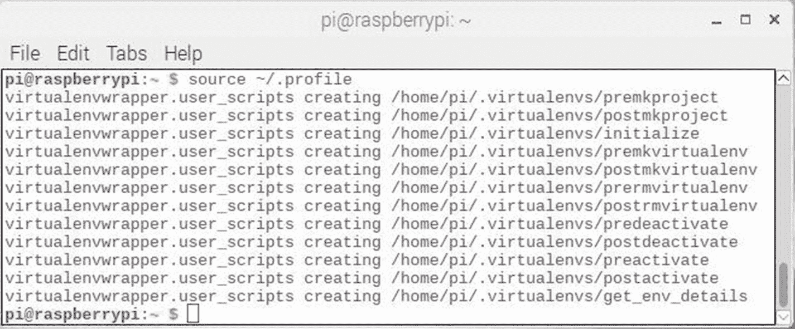

图 1-14

初始 source 命令结果

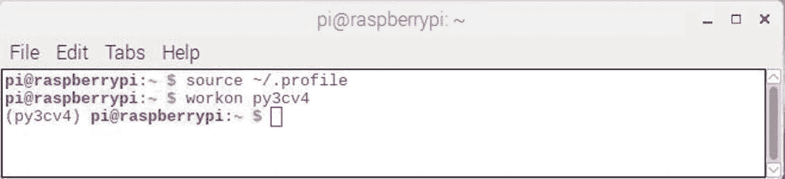

图 1-16

`workon` 命令结果

1.  这一步实际上是使用步骤 2 中安装的 `virtualenv` 和 `virtualenvwrapper` 工具来生成一个虚拟环境。你需要为环境提供一个唯一的名称。本示例中使用的名称是 py3cv4_1。如果你计划生成多个环境，则可以使用诸如 py3cv4_1、py3cv4_2、py3cv4_3 等命名方案。名称 py3cv4_1 表示该虚拟环境使用 Python 3，并且还包含 OpenCV 4 软件包。此外，强烈建议记录创建每个环境的原因，否则你很快就会感到困惑。输入以下命令以生成 py3cv4_1 Python 虚拟环境：

    ```
    mkvirtualenv py3cv4_1 -p python3
    ```

    创建虚拟环境大约需要 40 秒。图 1-15 显示了运行此命令的结果。你应该会注意到常规命令行提示符前添加了 `(py3cv4_1)`。这表明当前已激活一个虚拟环境。

    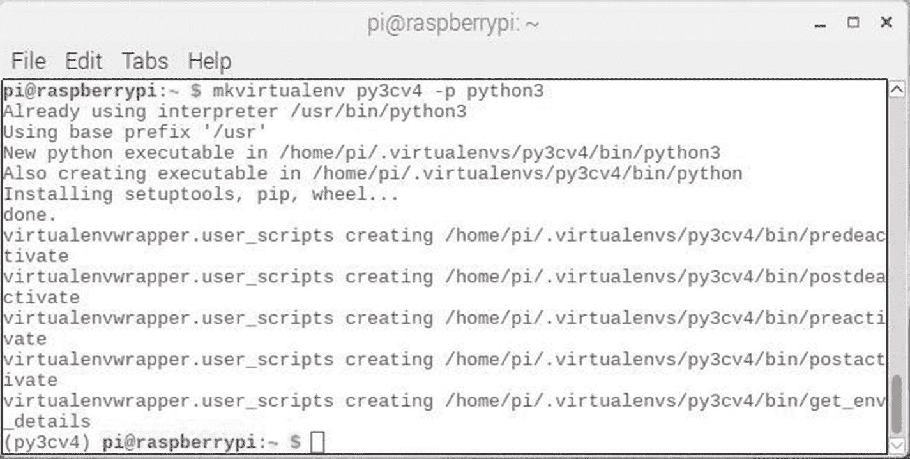

    图 1-15

    `mkvirtualenv` 命令结果

    你可以通过直接关闭终端窗口来轻松关闭 py3cv4_1 虚拟环境。我建议你这样做。

2.  打开一个新的终端窗口，以验证你可以启动 py3cv4_1 虚拟环境。输入以下命令：

    ```
    source ~/.profile
    workon py3cv4_1
    ```

    `workon` 命令包含在 `virtualenvwrapper` 软件包中。此命令允许轻松快速地启动任何 Python 虚拟环境。图 1-16 显示了上述命令的结果。

此图的出现将确认你已拥有一个可用的虚拟环境，并准备好继续执行创建数据模型框架的后续步骤。

#### 安装依赖项

下一个演示需要安装多个软件包作为支持。某些软件包已预装在原始下载的镜像中，而其他软件包则必须显式安装。以下命令将安装所有软件包。如果软件包已安装，你将收到一条信息提示；否则，将进行完整安装。这些命令需要一些时间，因为软件包可能很大且安装过程复杂：

```
pip install numpy
pip install scipy
pip install matplotlib
pip install pandas
sudo apt-get install libatlas-base-dev
pip install -U scikit-learn
```

以下 Python 脚本名为 checkLib.py，它将返回所有已加载软件包的版本号。我建议你运行它以确认所有依赖项均已安装。此脚本可从本书的配套网站获取：

```
# Check library versions
# Python version
import sys
print('Python: {}'.format(sys.version))
# scipy
import scipy
print('scipy: {}'.format(scipy.__version__))
# numpy
import numpy
print('numpy: {}'.format(numpy.__version__))
# matplotlib
import matplotlib
print('matplotlib: {}'.format(matplotlib.__version__))
# pandas
import pandas
print('pandas: {}'.format(pandas.__version__))
# scikit-learn
import sklearn
print('sklearn: {}'.format(sklearn.__version__))
```

图 1-17 显示了我运行该脚本后的结果。

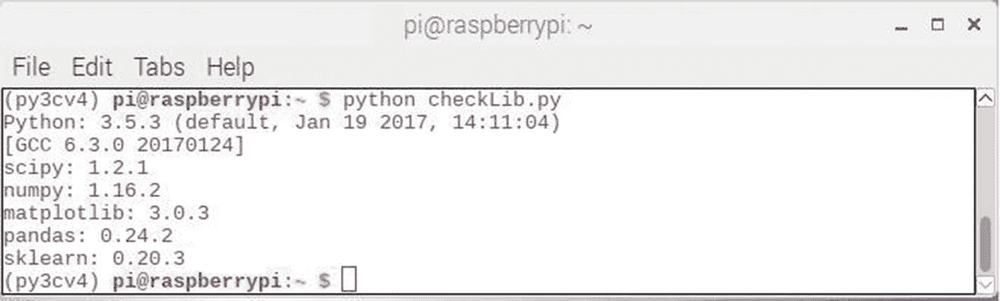

图 1-17

checkLib.py 脚本的结果

你显示的版本号可能与图中的版本号有所不同，因为开源软件在不断修订。但是，除非进行了某些根本性的、不可预见的大幅更改，否则这些软件包的功能应与早期版本相同。出于一致性的考虑，通常不会进行此类更改。

一旦所有依赖项安装完毕并正常运行，你就可以准备进行机器学习演示了。

### 机器学习事实

机器学习是人工智能（AI）母领域中的一个重要子主题。图 1-18 是一个维恩图，突出了人工智能、机器学习和深度学习（DL）之间的关系。

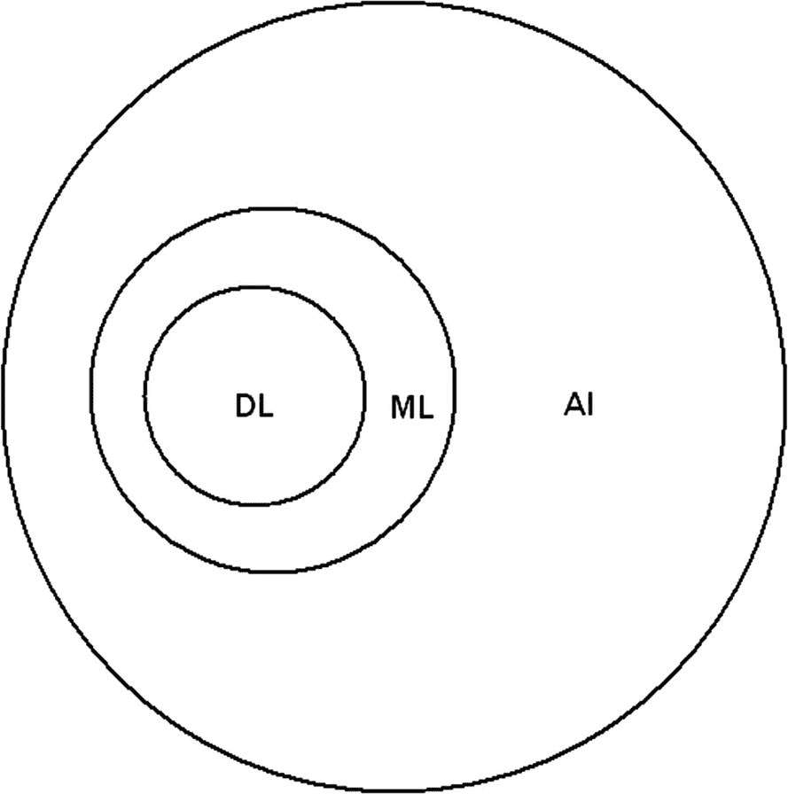

图 1-18

人工智能、机器学习和深度学习的维恩图

从图中可以清楚地看出，机器学习是人工智能的重要组成部分，而深度学习是机器学习的重要组成部分。就当前的关注度和发展而言，该图应该颠倒过来，深度学习获得最多关注，其次是机器学习，最后是广义的人工智能。本书也将遵循深度学习占据主要关注度的层级结构，仅仅因为深度学习是实现计算机视觉的基本要素，而计算机视觉是当前人工智能和机器学习中最热门的话题。我将在后续章节中深入探讨深度学习；然而，在尝试更复杂的深度学习问题之前，我必须首先探索一些基础的机器学习主题。


#### 机器学习基础

如果你向十几位人工智能/机器学习研究者询问什么是机器学习，你很可能会得到十几个略有不同但又有些相似的答案。我研究过许多定义，并认为我下面提出的这个定义，与我见过的其他任何定义一样恰当。

> *机器学习是创建算法，使计算机能够从数据中学习而无需进行显式编程的科学与艺术。*

有趣的是，我发现多个定义都使用了完全相同的短语“无需进行显式编程”，这印证了我的观点：任何纯粹的机器学习应用都必须排除所有封装了专家知识的算法或系统。请注意，专家系统是人工智能中非常重要的一部分，但不在机器学习范畴内。然而，很可能存在同时结合了机器学习和专家系统的混合系统，它们充分利用了这两种技术各自的最佳能力。

机器学习最早于 1959 年由麻省理工学院教授、公认为计算机科学和人工智能先驱的阿瑟·塞缪尔提出。塞缪尔教授的部分表述是：“……赋予计算机无需显式编程就能学习的能力。”他本质上想表达的是，计算机可以通过算法进行编程，这些算法既能从输入数据中学习，又能基于相同的数据做出相应的预测。这意味着这些学习算法可以完全脱离任何预编程或静态算法，并通过基于输入数据构建模型，自由地做出数据驱动的决策或预测。

机器学习模型主要用于预测和分类。在讨论更复杂的机器学习应用之前，有必要向你介绍一些关于这些操作的基本概念。这个介绍将以一个虽小但完整的机器学习项目的形式展开。

#### 线性预测与分类

本项目主要基于一篇 2016 年 6 月的博客文章，标题为“*你的第一个 Python 机器学习项目：逐步指南*”，作者是杰森·布朗利博士，他目前是居住在澳大利亚的一位活跃的机器学习研究者。我建议你查看他的博客[`MachineLearningMastery.com`](http://machinelearningmastery.com)，其中包含了丰富的机器学习信息和资源。杰森建议（我由衷赞同）你应该以结构化的方法启动所有机器学习项目，该方法包括以下步骤（我已对博客内容进行了转述）：

1.  定义问题。
2.  准备并清洗所有相关数据。
3.  评估所有适用的算法。
4.  持续改进结果，直至收益递减点。
5.  以尽可能清晰明确的方式呈现结果。

这个入门级的机器学习项目是一个关于鸢尾花分类的著名项目。鸢尾花数据集是一个多变量数据集，由英国统计学家和生物学家罗纳德·费希尔在他 1936 年的论文《分类学问题中多重测量的应用》中提出，作为线性判别分析的一个示例。该数据集有时也被称为安德森鸢尾花数据集，因为埃德加·安德森收集了这些数据，用于量化三种相关鸢尾花物种的形态变异。其中两个物种采集自加拿大魁北克的加斯佩半岛，“全部来自同一片牧场，在同一天采摘，并由同一个人使用同一设备在同一时间测量”，正如安德森论文中所引述。三种鸢尾花物种的照片如图 1-19 所示。

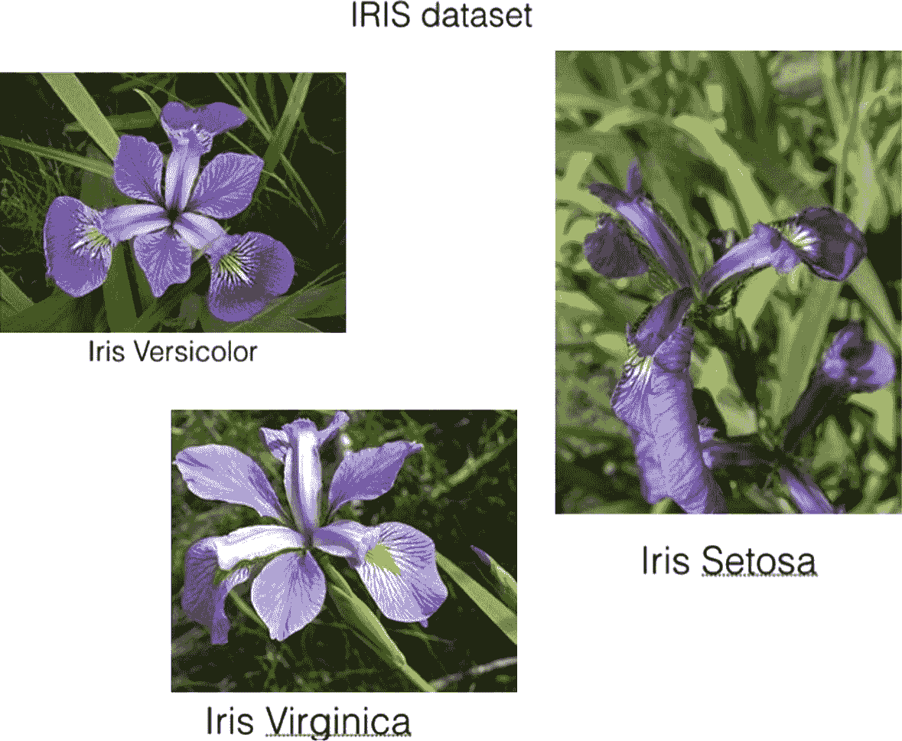

图 1-19
三种鸢尾花物种

该数据集包含来自三种鸢尾花（山鸢尾、维吉尼亚鸢尾和变色鸢尾）各 50 个样本。每个样本测量了四个特征：花萼和花瓣的长度与宽度，单位是厘米。费希尔基于这四个特征的组合开发了一个线性判别模型，用以区分不同的鸢尾花物种。花萼是被子植物花朵的一部分，通常呈绿色。花萼的主要功能是在花蕾期保护花朵，并在开花时为花瓣提供支撑。花瓣是围绕花朵生殖器官的变态叶片，它们通常颜色鲜艳或形状奇特，以吸引传粉者，例如蜜蜂。图 1-20 展示了一朵花（非鸢尾花），并标明了花萼和花瓣。

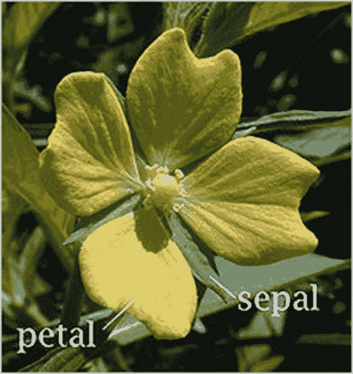

图 1-20
花萼与花瓣

问题解决方法的第 1 步相当简单：根据给定的四个维度（花萼高度和宽度，以及花瓣高度和宽度）来识别鸢尾花物种。所有维度应以厘米为单位，以匹配底层数据集中的单位。

解决过程的下一步是处理数据集。有几个在线资源可以下载 CSV 格式的原始鸢尾花数据集。我使用了杰森在 github.com 上提供的鸢尾花 CSV 数据集。本章演示的第一部分将侧重于熟悉该数据集。


#### 鸢尾花演示 – 第一部分

以下列出的 Python 脚本名为 irisDemo.py，旨在通过一系列步骤帮助您熟悉数据属性与特征。熟悉数据有助于您选择最适合需求的算法。这些步骤如下：

*   加载依赖项。
*   加载数据集。
*   显示数据集维度。
*   显示数据集中的前 20 条记录。
*   显示数据集统计信息。
*   显示数据集类别及对应数量。
*   单变量与多变量数据图。

以下完整脚本可从本书配套网站获取。我将在代码清单之后讨论整个脚本的结果。

```
# Usage
# python irisDemo.py
# Load libraries
import pandas
from pandas.plotting import scatter_matrix
import matplotlib.pyplot as plt
# Load dataset
url = "https://raw.githubusercontent.com/jbrownlee/Datasets/master/iris.csv"
names = ['sepal-length', 'sepal-width', 'petal-length', 'petal-width', 'class']
dataset = pandas.read_csv(url, names=names)
# Display the shape
print('Dataset dimensions')
print(dataset.shape)
# Display the first portion of the data
print('Head of the data')
print(dataset.head(20))
# Display data statistics
print('Statistics')
print(dataset.describe())
# Display class distribution
print('Class distribution')
print(dataset.groupby('class').size())
# Visualize data with box and whisker diagrams
dataset.plot(kind='box', subplot=True, layout=(2,2), sharex=False, sharey=False)
plt.show()
# Visualize data with histograms
dataset.hist()
plt.show()
# Visualize data with scatter plots
scatter_matrix(dataset)
plt.show()
```

图 1-21 展示了 irisDemo 脚本结果的第一部分。

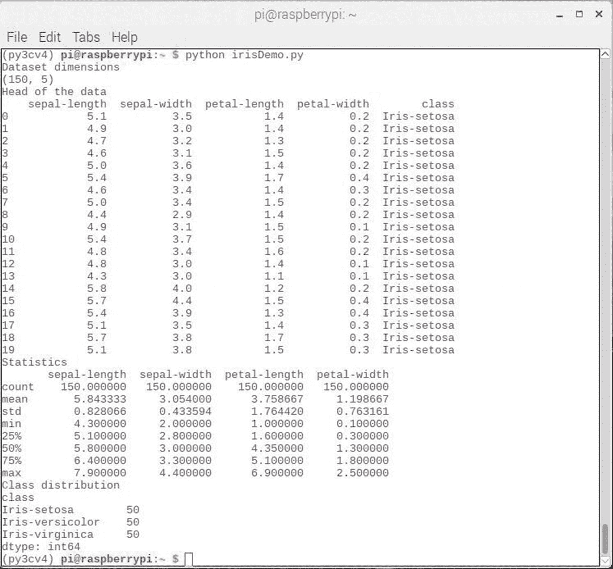

图 1-21

irisDemo 结果的初始部分

前两行显示数据集维度为 150 行、5 列。随后是数据集的前 20 行。列标题清晰可见，所有行数据以表格形式呈现。此列表应能让您对即将处理的数据有深入了解。

接下来是一个小型统计展示，显示数据集各列的经典统计指标，包括均值、标准差、最小值/最大值，以及 25%、50% 和 75% 分位数值。

最后，显示数据集中每个鸢尾花类别的计数结果。毫不意外，每个类别均报告有 50 个样本，与预期值完全吻合。

图 1-22 展示了四个类别属性的“箱线图”。

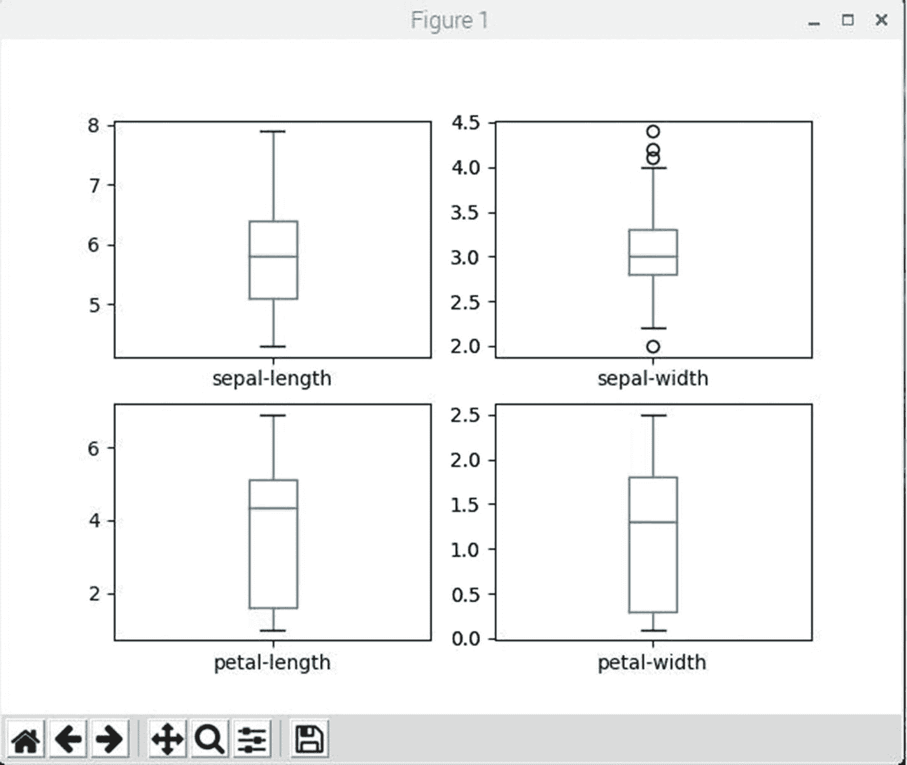

图 1-22

类别属性的箱线图

这些单变量图是帮助您理解每个属性数值分布的有用辅助工具。某些模型可能能够处理较宽的数值分布，而另一些模型则更为敏感，可能导致不理想的结果。查看图表发现，与萼片属性相比，花瓣长度和花瓣宽度属性的数值分布范围更广。此外，萼片宽度属性似乎存在一些数据异常值，这可能会给某些模型带来问题。这些图表旨在提供对数据的进一步洞察，以帮助解释任何异常的模型结果。

另一种可视化数据的方法是为每个输入变量创建直方图。图 1-23 展示了所有四个鸢尾花属性的直方图。

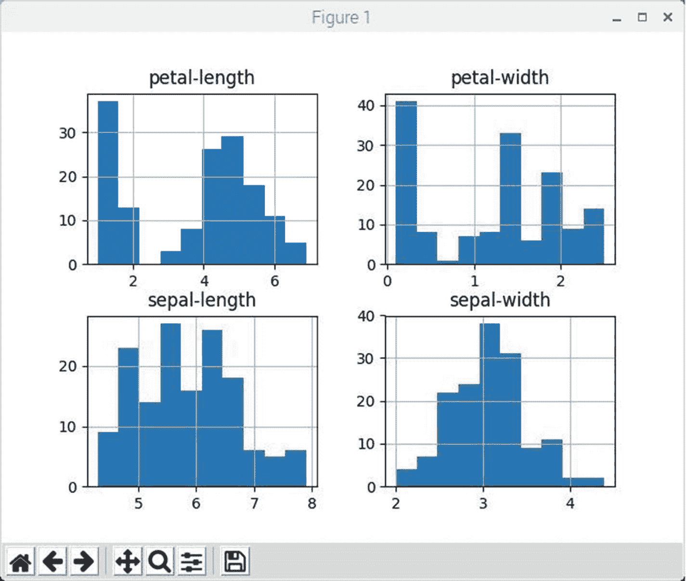

图 1-23

类别属性的直方图

两个萼片属性似乎具有高斯分布或近似高斯分布。这一信息有助于为预测目的选择合适的模型或算法。花瓣属性则呈现双峰直方图，这一有趣的事实可能有助于选择诸如大津二值化之类的算法。

另一种检查数据集的方法是查看属性之间的结构化关系。这种方法称为多变量分析。图 1-24 展示了所有类别属性对的散点图。

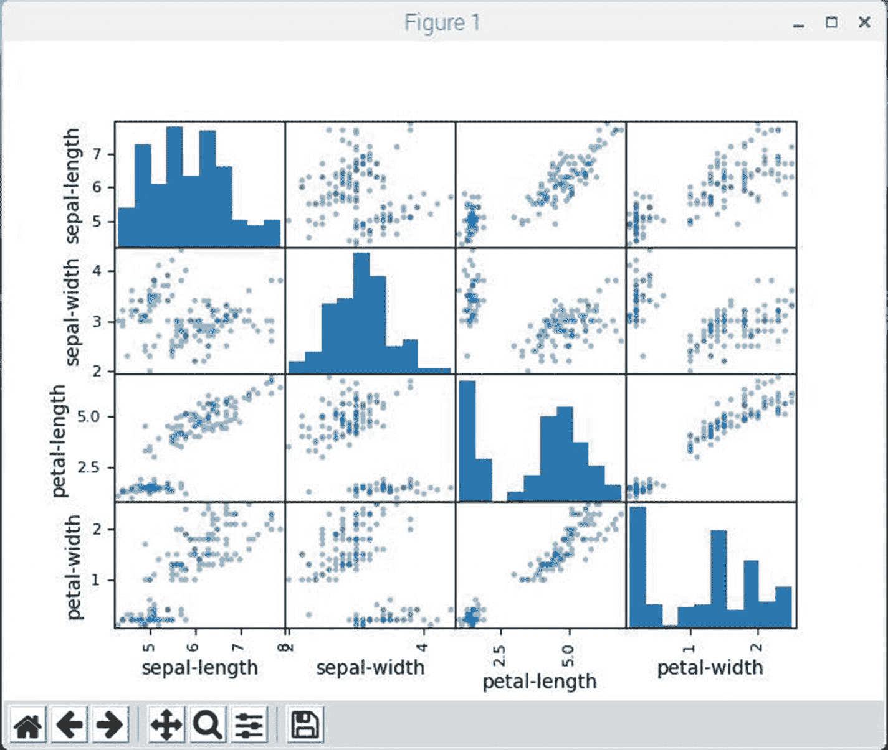

图 1-24

所有类别属性的散点图

这些图表有助于可视化在仅查看数值列表时不易察觉的关系。您应注意到图中某些属性对呈对角线状分布。这强烈表明属性之间存在高度相关性，并且可能存在可量化的关系。

演示的下一部分是将数据输入一系列模型并运行预测。我必须提醒您，我将犯下技术书籍写作中的大忌——在未事先介绍的情况下直接使用模型。请放心，我将在本章或后续章节中，作为本书机器学习基础部分的内容，详细讨论模型算法。


#### 鸢尾花演示 – 第二部分

以下列出的 Python 脚本名为 `irisDemoTest.py`，其创建目的是使用鸢尾花数据集测试多个模型，并确定它们在给定一组鸢尾花属性时描述鸢尾花种类的准确程度。测试将按照与第一部分类似的方式分步骤进行。这些步骤包括：

*   导入所有模型。
*   创建训练集和验证集。
*   使用十折交叉验证设置测试框架。
*   使用六种不同的模型根据属性测量值描述鸢尾花种类。
*   选择一个准确的模型。

以下列出的 Python 脚本名为 `irisDemoTest.py`，可从本书的配套网站获取。我将在代码清单之后讨论脚本中与各步骤相关的部分。

```
# Usage
# python irisDemoTest.py
# Load libraries
import pandas
from pandas.plotting import scatter_matrix
import matplotlib.pyplot as plt
from sklearn import model_selection
from sklearn.metrics import classification_report
from sklearn.metrics import confusion_matrix
from sklearn.metrics import accuracy_score
from sklearn.linear_model import LogisticRegression
from sklearn.tree import DecisionTreeClassifier
from sklearn.neighbors import KNeighborsClassifier
from sklearn.discriminant_analysis import LinearDiscriminantAnalysis
from sklearn.naive_bayes import GaussianNB
from sklearn.svm import SVC
# Load dataset
url = "https://raw.githubusercontent.com/jbrownlee/Datasets/master/iris.csv"
names = ['sepal-length', 'sepal-width', 'petal-length', 'petal-width', 'class']
dataset = pandas.read_csv(url, names=names)
# Create training and validation datasets
array = dataset.values
X = array[:,0:4]
Y = array[:,4]
validation_size = 0.20
seed = 7
X_train, X_validation, Y_train, Y_validation = model_selection.train_test_split(X, Y, test_size=validation_size, random_state=seed)
# Set the scoring criteria
scoring = 'accuracy'
# Build all the models
models = []
models.append(('LR', LogisticRegression(solver='liblinear', multi_class="ovr")))
models.append(('LDA', LinearDiscriminantAnalysis()))
models.append(('KNN', KNeighborsClassifier()))
models.append(('CART', DecisionTreeClassifier()))
models.append(('NB', GaussianNB()))
models.append(('SVM', SVC(gamma='auto')))
# Evaluate each model
results = []
names = []
for name, model in models:
kfold = model_selection.KFold(n_splits=10, random_state=seed)
cv_results = model_selection.cross_val_score(model, X_train, Y_train, cv=kfold, scoring=scoring)
results.append(cv_results)
names.append(name)
msg = "%s: %f(%f)" % (name, cv_results.mean(), cv_results.std())
print(msg)
```

与第一个脚本相比，导入列表发生了很大变化。现在它包含了来自 `sklearn` 包的六个模型。按字母顺序排列的模型列表如下：

*   `DecisionTreeClassifier`
*   `GaussianNB`
*   `KNeighborsClassifier`
*   `LinearDiscriminantAnalysis`
*   `LogisticRegression`
*   `SVC`

如前所述，我不会讨论模型功能的任何具体细节。

然后，数据集以与第一个脚本完全相同的方式加载。使用这个精确的数据集很重要，这是我尝试使用来自不同来源的鸢尾花数据集后发现的。我怀疑在使用新数据集时，格式上的微小变化是导致问题的原因。

脚本的下一部分涉及创建训练集和验证集的步骤。原始数据集的 80% 将用于模型训练，20% 将分配给验证。在验证过程中，原始数据的一小部分子集将被输入到尚未使用该子集进行训练的模型中。然后，将模型产生的输出与验证集中每条记录的物种标签进行比较。百分比准确率将计算为正确识别的物种数量与数据集中记录总数之间的简单比率。

测试过程的下一步是建立一个循环，为每个模型实现十折交叉验证过程。这意味着输入数据集最初被分成十份，其中九份用于训练，仅使用第十份进行验证。记录结果后，数据集再次被随机分成十份，该过程总共重复十次，因此得名“十折”。我确实想指出一点可能让读者感到困惑的地方。十折交叉验证过程中使用的数据集仅是训练数据集，而不是验证数据集。验证数据集将不会使用，直到讨论下一个脚本，其中将详细讨论模型的预测准确率。

脚本中的循环为每个模型运行交叉验证分数。结果如图 1-25 所示。

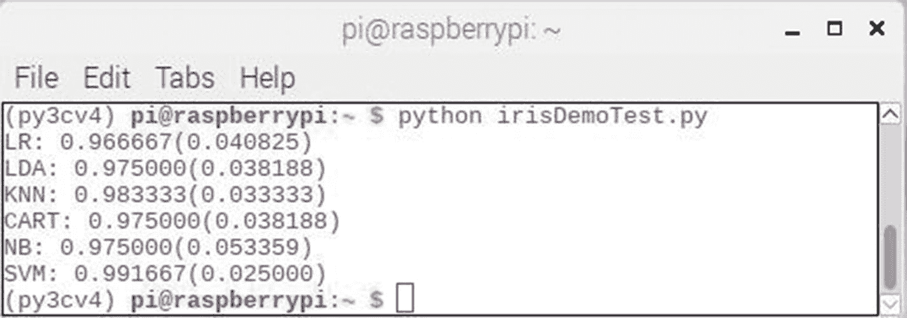

图 1-25

六个模型的交叉验证分数

你可以看到它们的分数都在 90 多分，这意味着在给定一组类别属性的情况下，它们很可能都是鸢尾花种类的良好描述器。括号中的数字是每个模型结果的标准差。你应该能够看到偏差相对较小，这意味着这些模型再次成为良好的描述器。查看该图，支持向量机（SVM）模型似乎取得了最佳结果，得分为 0.991667，标准差仅为 0.025。但它真的是最适合我们目的的模型吗？这将在本演示的第三部分中讨论。


#### 鸢尾花演示 – 第 3 部分

接下来的讨论通过箱线图比较了六种模型的准确率。所使用的脚本名为 `irisDemoSelection.py`，除了增加了绘图函数以及一些用于详细展示选定模型性能的算法外，该脚本与之前的脚本基本相同。脚本中还移除了六种模型的准确率显示：

```
# 加载库
import pandas
from pandas.plotting import scatter_matrix
import matplotlib.pyplot as plt
from sklearn import model_selection
from sklearn.metrics import classification_report
from sklearn.metrics import confusion_matrix
from sklearn.metrics import accuracy_score
from sklearn.linear_model import LogisticRegression
from sklearn.tree import DecisionTreeClassifier
from sklearn.neighbors import KNeighborsClassifier
from sklearn.discriminant_analysis import LinearDiscriminantAnalysis
from sklearn.naive_bayes import GaussianNB
from sklearn.svm import SVC
# 加载数据集
url = "https://raw.githubusercontent.com/jbrownlee/Datasets/master/iris.csv"
names = ['sepal-length', 'sepal-width', 'petal-length', 'petal-width', 'class']
dataset = pandas.read_csv(url, names=names)
# 创建训练集和验证集
array = dataset.values
X = array[:,0:4]
Y = array[:,4]
validation_size = 0.20
seed = 7
X_train, X_validation, Y_train, Y_validation = model_selection.train_test_split(X, Y, test_size=validation_size, random_state=seed)
# 设置评分标准
scoring = 'accuracy'
# 构建所有模型
models = []
models.append(('LR', LogisticRegression(solver='liblinear', multi_class="ovr")))
models.append(('LDA', LinearDiscriminantAnalysis()))
models.append(('KNN', KNeighborsClassifier()))
models.append(('CART', DecisionTreeClassifier()))
models.append(('NB', GaussianNB()))
models.append(('SVM', SVC(gamma='auto')))
# 评估每个模型
results = []
names = []
for name, model in models:
kfold = model_selection.KFold(n_splits=10, random_state=seed)
cv_results = model_selection.cross_val_score(model, X_train, Y_train, cv=kfold, scoring=scoring)
results.append(cv_results)
names.append(name)
# 绘制模型结果
figure = plt.figure()
figure.suptitle('Algorithm Comparison')
algPlot = figure.add_subplot(1, 1, 1)
plt.boxplot(results)
algPlot.set_xticklabels(names)
plt.show()
# KNN 预测
knn = KNeighborsClassifier()
knn.fit(X_train, Y_train)
predictions = knn.predict(X_validation)
print(accuracy_score(Y_validation, predictions))
print(confusion_matrix(Y_validation, predictions))
print(classification_report(Y_validation, predictions)
```

图 1-26 以箱线图的形式展示了所有模型的结果。

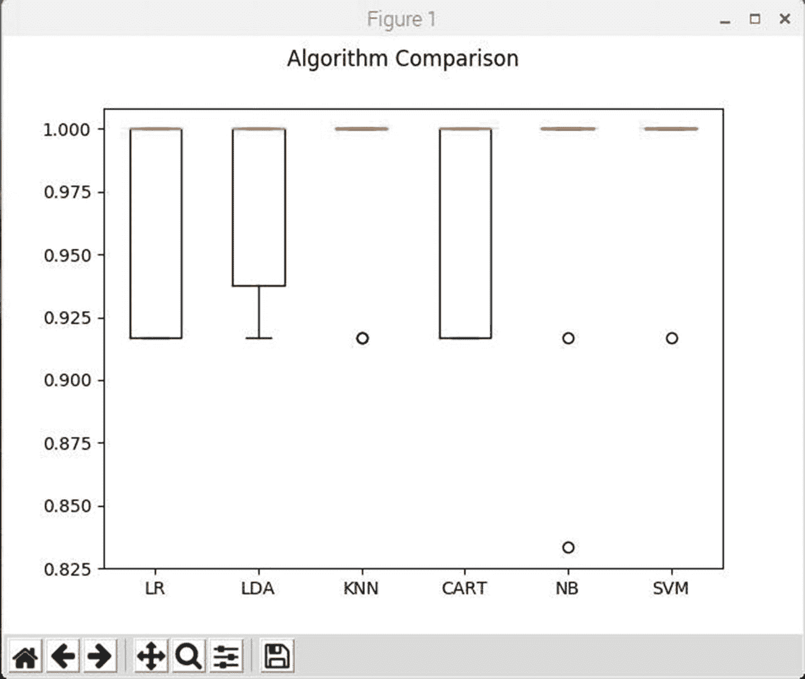

**图 1-26**

模型结果的箱线图

你可以观察到，箱线图在 y 轴范围的顶部被压缩，这表明有一半的模型达到了或接近 100% 的准确率。在这种情况下，选择表现最佳的模型几乎是不可能的；不过，我确实选择了 KNN 模型来更详细地检查其性能。KNN 是一个简单且准确的模型。KNN 模型的正式名称是 K-近邻算法，它是现有最简单的分类算法之一，并且很可能是使用最广泛的算法之一。KNN 是一种非参数、懒惰学习算法。它主要用于数据点被分成多个类别的数据集，以预测新数据点或样本的分类。简单来说，KNN 被描述为一种实现“告诉我你的邻居是谁，我就告诉你你是谁”这句口号的算法。

我将 KNN 描述为非参数模型，这意味着该模型不对底层数据分布做任何假设。换句话说，模型结构是由数据决定的。鉴于此，当你对数据分布知之甚少或一无所知时，KNN 可能应该是你进行分类研究的首选之一。

KNN 也是一种懒惰算法，与急切算法相对。这意味着它不使用训练数据点进行任何泛化。换句话说，没有明确的训练阶段，或者训练阶段非常少。这意味着任何训练阶段的持续时间都可能很短，这对于大型数据集来说是一个重要的点。缺乏泛化也意味着 KNN 会保留所有训练数据。更准确地说，没有泛化意味着在验证/测试阶段会使用大部分（如果不是全部）训练数据。

KNN 算法基于特征相似性。这意味着样本外特征与训练集的相似程度决定了给定数据点如何被分类。通过查看图 1-27（一个 KNN 分类的图形示例），这个过程应该会更清晰。

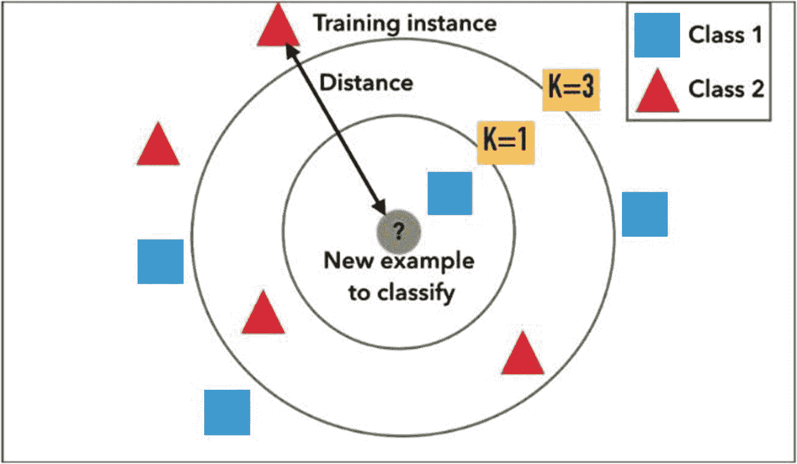

**图 1-27**

KNN 分类

测试样本（内圈内）可以被分类到第一类（蓝色方块）或第二类（红色三角形）。如果 k = 3（外圈），它被分配到第二类，因为内圈内有 2 个三角形和只有 1 个方块。例如，如果 k = 5，新样本将被分配到第一类（外圈外有 3 个方块 vs. 2 个三角形）。

脚本的最后一部分直接使用验证数据集运行 KNN 模型。最终准确率得分、混淆矩阵和分类报告的汇总结果如图 1-28 所示。

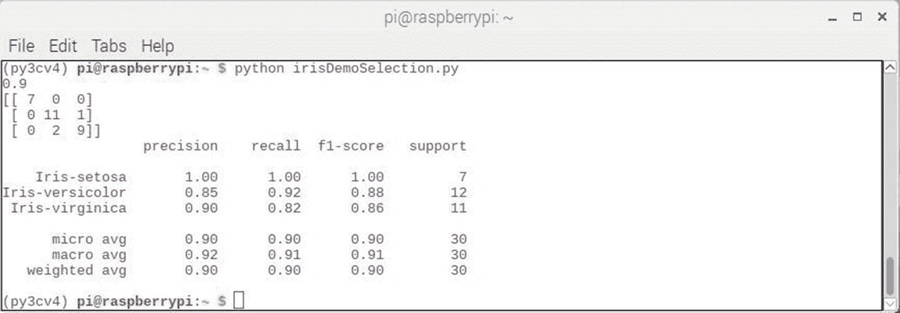

**图 1-28**

KNN 模型验证结果

第一行显示准确率得分为 0.9 或 90%。这个准确率得分是一个汇总评级，显示了正确预测数量与整个数据集大小的比率。在这种情况下，数据集有 30 条记录，正确预测的数量是 27，从而产生了 0.9 的结果。回想一下，这个准确率得分是基于使用验证数据集（占原始鸢尾花数据集的 20%）得出的。图 1-28 中显示的准确率得分由于十折交叉验证测试的性质而被人为地提高了。这个较低的准确率得分反映了真实世界的情况，应该被认为更可信。

混淆矩阵（误差矩阵）指出了三个错误发生的位置。表 1-1 详细列出了实际类别与预测类别的对比。

**表 1-1**

实际类别与预测类别

|   | 实际类别 |
| --- | --- |
| 山鸢尾 | 变色鸢尾 | 维吉尼亚鸢尾 |
| --- | --- | --- |
| 预测类别 | 山鸢尾 | 7 | 0 | 0 |
| 变色鸢尾 | 0 | 11 | 1 |
| 维吉尼亚鸢尾 | 0 | 2 | 9 |

最后，由 sklearn 指标提供的分类报告按精确率、召回率、F1 分数和支持度对类别结果进行了细分。尽管验证数据集很小，但该报告显示的结果非常好甚至极好。我在表 1-2 中解释了每个指标。

**表 1-2**

sklearn 指标分析

| 指标 | 山鸢尾 | 变色鸢尾 | 维吉尼亚鸢尾 | 备注（参见注释） |
| --- | --- | --- | --- | --- |
| 精确率 | 1.00 | 0.85 | 0.90 | 精确率 = tp / (tp + fp) |
| 召回率 | 1.00 | 0.92 | 0.82 | 召回率 = tp / (tp + fn) |
| F1 分数 | 1.00 | 0.88 | 0.86 | 均值(精确率 + 召回率) |
| 支持度 | 7 | 12 | 11 | 类别大小 |


*注：tp = 真正例*

*fp = 假正例*

*fn = 假负例*

精确率直观上表示分类器不会将负样本错误标记为正样本的能力。

召回率直观上表示分类器找出所有正样本的能力。

F1 分数（F-beta）可以理解为精确率和召回率的加权调和平均值，F-beta 分数的最佳值为 1，最差值为 0。

关于微平均、宏平均和加权平均的更多内容，请参考 sklearn 文档。页面地址为：

[`https://scikit-learn.org/stable/modules/generated/sklearn.metrics.precision_recall_fscore_support.html`](https://scikit-learn.org/stable/modules/generated/sklearn.metrics.precision_recall_fscore_support.html)

