# 2. 机器学习数据模型探索：第一部分

本章主要讨论和演示机器学习中使用的基本数据模型。但在深入数据模型操作的核心之前，我需要先向你展示如何安装 `OpenCV 4` 和 `Seaborn` 软件包。这两个软件包都是正确支持基本数据模型运行和可视化所必需的。它们还将支持本书后续章节中介绍的其他演示。

## 安装 OpenCV 4

本节介绍如何安装开源 `OpenCV` 软件包。我将使用 `OpenCV` 进行各种机器学习演示，包括利用该软件包中包含的丰富可视化工具。`OpenCV 4` 是最新版本，目前还不能从任何主流仓库直接下载安装。必须以源代码格式加载并在本地构建。以下说明将指导你完成此任务。务必严格按照这些说明操作，否则 `OpenCV` 安装很可能不会成功。

第一步是安装 `CMake` 工具以及其他三个关键工具。输入以下命令：
```bash
sudo apt-get install build-essential cmake unzip pkg-config
```

接下来，安装三个支持最流行图像格式（jpeg、png 和 tiff）的图像和视频库。输入以下命令：
```bash
sudo apt-get install libjpeg-dev libpng-dev libtiff-dev
```

为了确保上述命令成功执行，请先根据以下命令更新 `apt-get`：
```bash
sudo apt-get update
```

现在安装三个用于常见视频处理功能的图像处理工具。输入以下命令。同样，请确保 `apt-get` 已更新。
```bash
sudo apt-get install libavcodec-dev libavformat-dev libswscale-dev
```

接下来安装两个补充视频处理库。输入以下命令：
```bash
sudo apt-get install libxvidcore-dev libx264-dev
```

下一条命令安装 `GTK` 库。`GTK` 将用于实现 `OpenCV` 的 `GUI` 后端。输入以下命令：
```bash
sudo apt-get install libgtk2.0-dev
```

下一条命令减少或消除不必要的 `GTK` 警告。命令中的“*”确保加载支持 `ARM` 处理器的正确模块。输入以下命令：
```bash
sudo apt-get install libcanberra-gtk*
```

接下来的两个软件包用于 `OpenCV` 的数值优化。输入以下命令：
```bash
sudo apt-get install libatlas-base-dev gfortran
```

一旦所有上述依赖项加载完毕，你就可以准备下载 `OpenCV 4` 源代码了。

### 下载 OpenCV 4 源代码

在开始下载之前，请确保你处于虚拟环境中，并且位于主目录下。如果你不在主目录，请输入以下命令前往：
```bash
cd ~
```

接下来，使用 `wget` 命令下载最新的 `OpenCV` 和 `opencv_contrib` 模块。在撰写本文时，最新版本是 4.0.1。当你尝试下载时，版本可能不同。只需将本文中出现的版本号替换为最新版本即可。`opencv_contrib` 模块包含开源社区贡献的补充函数，本书的项目和演示中将用到这些函数。输入以下命令从 GitHub 网站下载 `OpenCV` 压缩文件：
```bash
wget -O opencv.zip https://github.com/opencv/opencv/archive/4.0.1.zip
```

输入以下命令从 GitHub 网站下载 `opencv_contrib` 压缩文件：
```bash
wget -O opencv_contrib.zip https://github.com/opencv/opencv_contrib/archive/4.0.1.zip
```

现在需要使用以下命令解压并展开下载的文件：
```bash
unzip opencv.zip
unzip opencv_contrib.zip
```

接下来，将新生成的目录重命名为以下名称，以便于访问 `OpenCV` 包和函数，并确保目录名称符合 `CMake` 配置文件的预期。输入以下命令：
```bash
mv opencv-4.0.1 opencv
mv opencv_contrib-4.0.1 opencv_contrib
```

源代码下载完成后，你就可以开始构建 `OpenCV` 包了。

### 构建 OpenCV 软件

在开始构建之前，你需要确保已安装 `numpy` 库。我在第 1 章中讨论了如何安装 `numpy` 以及其他几个依赖项。如果你尚未安装 `numpy`，可以使用以下命令轻松安装：
```bash
pip install numpy
```

下一步是设置一个用于构建的目录。通过输入以下命令创建并进入构建目录：
```bash
cd ~/opencv
mkdir build
cd build
```

完成上述命令后，输入以下命令以运行带有多个构建选项的 `CMake` 命令。请注意，“\”符号（反斜杠）是必需的，以便命令行解释器（`CLI`）识别出单个命令跨越多行。不要忽略以下复杂命令末尾的两个句点。这两个句点指示 `CLI` 执行句点之前输入的所有内容。
```bash
cmake -D CMAKE_BUILD_TYPE=RELEASE \
-D CMAKE_INSTALL_PREFIX=/usr/local \
-D OPENCV_EXTRA_MODULES_PATH=~/opencv_contrib/modules \
-D ENABLE_NEON=ON \
-D ENABLE_VFPV3=ON \
-D BUILD_TESTS=OFF \
-D OPENCV_ENABLE_NONFREE=ON \
-D INSTALL_PYTHON_EXAMPLES=OFF \
-D BUILD_EXAMPLES=OFF ..
```

### 注意

选项 `OPENCV_ENABLE_NONFREE=ON` 确保在编译步骤中所有第三方功能均可用。图 2-1 结果屏幕中的一行 `"Non-free algorithms:   YES"` 确认了该条件已设置。

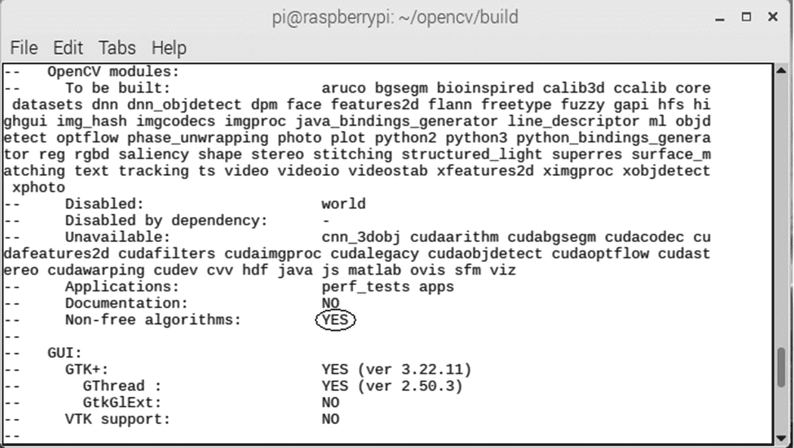

图 2-1 非自由算法可用性确认

拥有非自由算法适用于非商业应用。如果您打算开发用于销售或授权的应用程序，则必须遵守所有适用的许可协议。`OpenCV` 软件包中包含若干专利算法，未经支付版税不得用于商业开发。

您还应确认虚拟环境指向 `Python 3` 和 `numpy` 的正确目录。图 2-2 显示了 `cv` 虚拟环境中的正确目录。

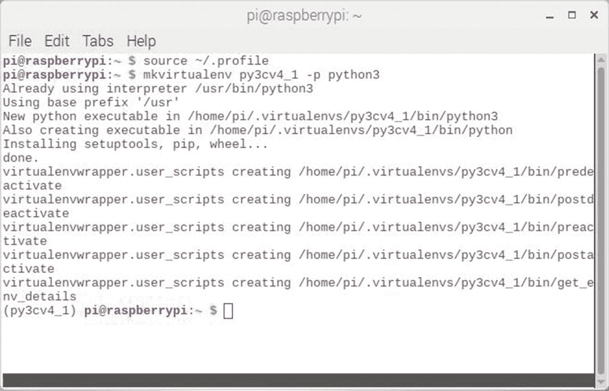

图 2-2 `py3cv4_1` 虚拟环境中 `Python 3` 和 `numpy` 目录的确认

默认的 100 MB 磁盘交换空间必须更改为 2048 MB 才能成功编译。编译完成后，交换空间将恢复为默认值。重要的是要认识到，交换空间大小对用作 `RasPi` 辅助存储器的 `micro SD` 卡的寿命有显著影响。这些卡在失效前具有有限的写入操作次数。写入操作次数会随着交换空间大小的增加而急剧增加。对于此一次性过程，更改交换空间大小不会对卡寿命产生影响。首先使用 `nano` 编辑器打开交换配置文件进行编辑，如下所示：
```bash
sudo nano /etc/dphys-swapfile
```

接下来注释掉 `CONF_SWAPSIZE=100` 这一行，并添加 `CONF_SWAPSIZE=2048` 这一行。重要的是添加额外的一行，而不是仅仅将 100 改为 2048。完成编译后，您将撤销此更改。文件修改后的部分如下所示：
```
# set size to absolute value, leaving empty (default) then uses computed value
# you most likely don't want this, unless you have a special disk situation
# CONF_SWAPSIZE=100
CONF_SWAPSIZE=2048
```

### 注意

未能更改交换空间大小可能会导致 `RasPi` 在编译期间“死机”。

进行编辑后，您需要使用以下命令停止并启动交换服务：
```bash
sudo /etc/init.d/dphys-swapfile stop
sudo /etc/init.d/dphys-swapfile start
```

下一步是从源代码编译为二进制文件。使用所有四个 `RasPi` 核心大约需要 1.5 小时。您应该注意一个称为竞态条件的问题，当特定核心需要另一个核心当前正在使用的资源时，该问题可能随机发生。该问题是由于非常严格的时序问题导致的，即使用中的核心无法释放资源，而请求核心也不放弃对该资源的请求。结果是处理器“永远”挂起。这是一个非常糟糕的情况。幸运的是，有一个解决方案，即不强制使用四个核心。我不知道完整编译需要多长时间，但怀疑至少需要 3 小时。使用四个核心编译的命令是

# OpenCV 4 安装与 Seaborn 数据可视化

## 编译与安装

执行编译：
```
make -j4
```

不使用任何特定核心数量进行编译的命令就是 `make`。

有个好消息是，如果初始编译在使用 `-j4` 选项时挂起，您可以仅使用 `make` 命令重新编译，系统会找到并使用所有已编译的代码。这将大大缩短编译时间。我知道这是真的，因为我亲身经历过。我的第一次编译在 100% 时挂起。我仅使用 `make` 命令重新启动编译，它在大约 15 分钟内成功完成。图 2-3 显示了成功编译后的屏幕。

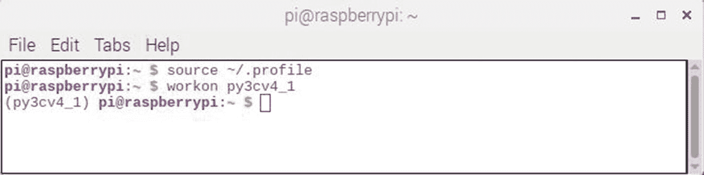

图 2-3 成功编译

通过输入以下命令完成 OpenCV 4 的安装：
```
sudo make install
sudo ldconfig
```

这是最后一步，包含一些收尾和验证操作。首先，通过取消注释以下行将交换空间大小恢复为原始的 100 MB：
```
CONF_SWAPSIZE=100
```

并注释掉新添加的行：
```
# CONF_SWAPSIZE=2048
```

接下来，为 OpenCV 创建一个符号链接，以便虚拟环境中创建的新 Python 脚本可以使用它。输入以下命令：
```
cd ~/.virtualenvs/py3cv4_1/lib/python3.5/site-packages/
ln -s /usr/local/lib/python3.5/site-packages/cv2/python-3.5/cv2.cpython-35m-arm-linux-gnueabihf.so  cv2.so
cd ~
```

未能创建符号链接意味着您将无法访问任何 OpenCV 函数。

最后，通过输入以下命令测试您完成的安装：
```
source ~/.profile
workon cv
python
>>> import cv2
>>> cv2.__version__
'4.0.1'
>>> exit()
```

前两个命令启动 `py3cv4_1` 虚拟环境。下一个命令启动与此环境关联的 `Python` 解释器，即 `Python 3`。接下来的命令使用您刚刚创建的符号链接导入 OpenCV。这一行应能说明符号链接的重要性。再下一个命令请求 OpenCV 版本，返回结果为 `4.0.1`，如版本请求的下一行所示。最后一个命令退出 Python 解释器。图 2-4 显示了 `py3cv4_1` 版本验证。

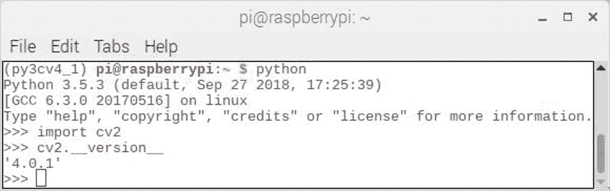

图 2-4 py3cv4_1 版本验证

至此，您应该拥有一个在 Python 虚拟环境中运行且功能完备的 OpenCV 软件包。要退出 OpenCV，只需关闭终端窗口即可。

## Seaborn 数据可视化库

正如我在前一章所讨论的，在处理机器学习模型时，数据可视化是一个重要步骤。有许多有用的 Python 兼容工具和软件包可以帮助你完成这项任务。希望你已经在上一章描述的依赖加载过程中安装了 Matplotlib 库。OpenCV 包也包含有用的可视化例程和算法。在本节中，我将介绍 Seaborn 库，这是另一个有用的数据可视化工具，被认为是 Matplotlib 和 OpenCV 中数据可视化功能的补充。

Seaborn 专门针对统计数据可视化。它使用的参数集也与 Matplotlib 不同。

本节需要的第一步是安装 Seaborn 软件包。只需输入以下命令即可轻松完成：
```
pip install seaborn
```

图 2-5 显示了安装 Seaborn 软件包的结果。你应该从图中注意到，Seaborn 包需要相当多的依赖项，包括 numpy、Pandas、Matplotlib、scipy、kiwisolver 以及其他几个 Python 工具。

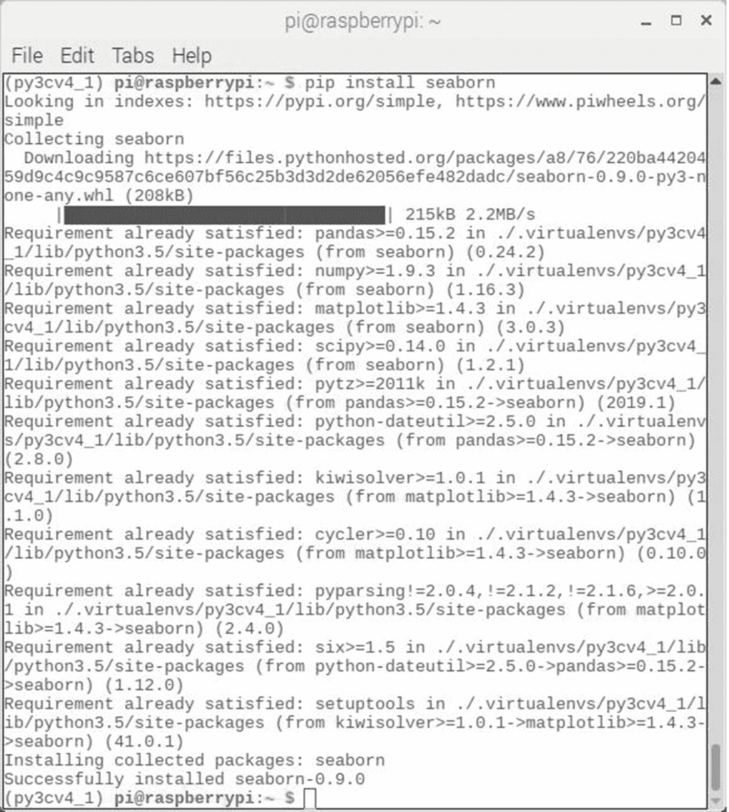

图 2-5 Seaborn 包安装结果

安装完成后，我认为解释 Seaborn 最简单的方法是使用它来可视化第 1 章中介绍的鸢尾花数据集。Seaborn 一个非常方便的特性是，该包中直接包含有限数量的数据集。鸢尾花数据集就是这些原生数据集之一（并非双关语）。要使用鸢尾花数据集，你只需在脚本中加入以下语句：
```python
import seaborn as sns
iris = sns.load_dataset("iris")
```

其中 `sns` 是对 Seaborn 导入的引用。

Seaborn 包中有 15 个可用数据集。现列出如下供你参考：

*   `anscombe`
*   `attention`
*   `brain_networks`
*   `car_crashes`
*   `diamonds`
*   `dots`
*   `exercise`
*   `flights`
*   `fmri`
*   `gammas`
*   `iris`
*   `mpg`
*   `planets`
*   `tips`
*   `titanic`

从名称来看，Seaborn 数据集多种多样且有些不同寻常。它们显然是为了展示 Seaborn 包在分析和可视化方面的能力而选择的。除了鸢尾花数据集之外，我将在数据模型讨论中使用其中一些数据集。

表 2-1 显示了鸢尾花数据集的前五条记录，该表由以下命令生成：

**表 2-1 鸢尾花数据集的 head 命令结果**

| 记录编号 | 花萼长度 | 花萼宽度 | 花瓣长度 | 花瓣宽度 | 物种 |
| :--- | :--- | :--- | :--- | :--- | :--- |
| 0 | 5.1 | 3.5 | 1.4 | 0.2 | Setosa |
| 1 | 4.9 | 3.0 | 1.4 | 0.2 | Setosa |
| 2 | 4.7 | 3.2 | 1.3 | 0.2 | Setosa |
| 3 | 4.6 | 3.1 | 1.5 | 0.2 | Setosa |
| 4 | 5.0 | 3.6 | 1.4 | 0.2 | Setosa |

```
iris.head()
```

在选择最能处理数据集的数据模型时，数据可视化是一个重要的初始步骤。Seaborn 提供了多种数据可视化方式来帮助你完成这项关键任务。我将介绍一系列有助于你进行数据可视化的脚本。以下所有脚本都将使用多变量鸢尾花数据集。

### 散点图

从散点图开始数据可视化过程可能是处理数据可视化任务最简单的方法。散点图本质上是二维图，使用数据集的两个分量作为坐标对进行绘制。Seaborn 包使用 `jointplot` 方法作为绘图函数，以表明图的二维性质。我使用了以下名为 `jointPlot.py` 的脚本来创建花萼长度与花瓣高度的散点图。此脚本可从本书的配套网站获取：
```python
# 导入所需库
import matplotlib.pyplot as plt
import seaborn as sns
# 加载鸢尾花数据集
iris = sns.load_dataset("iris")
# 生成散点图
sns.jointplot(x="sepal_length",y="sepal_width", data=iris,size=6)
# 显示图形
plt.show()
```

通过输入以下命令运行脚本：
```
python jointPlot.py
```

图 2-6 显示了运行此脚本的结果。

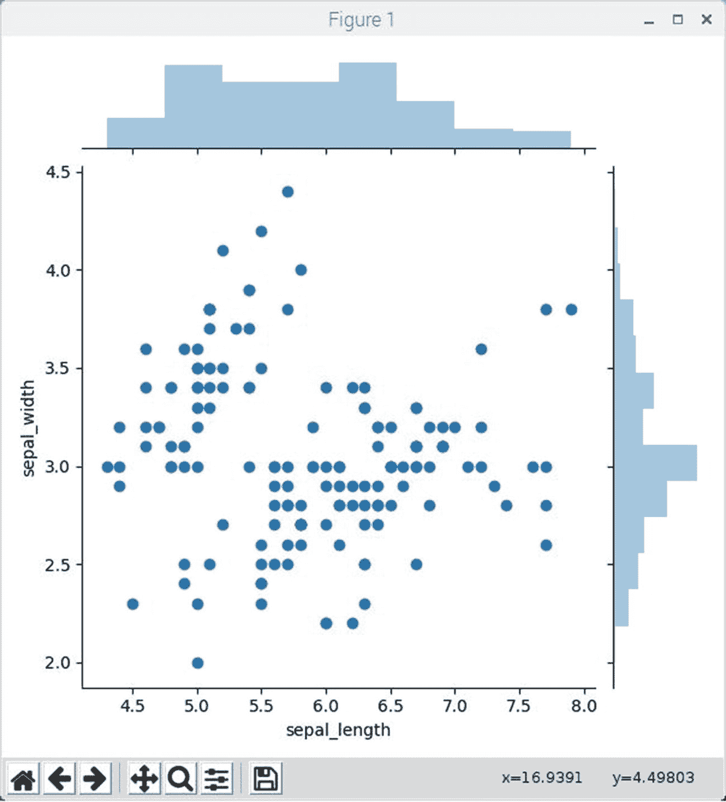

图 2-6 花萼长度与花萼高度的散点图（所有物种）

查看该图，你可以很容易地看到数据点散布在整个图中，这表明这两个数据集分量之间没有强相关性。顶部的花萼长度直方图显示值分布较广，而右侧的花萼宽度直方图则显示峰值中值约为 3.0。请注意，此图涵盖了所有鸢尾花物种，并且可能掩盖了一个或多个单个物种的现有数据关系。正如你稍后将看到的，其他可视化工具可以揭示隐藏的关系。

### 分面网格图

分面网格图是上一节中介绍的散点图的一种变体。然而，在分面网格图中，所有数据集分量都被清晰地标识出来，而不是像散点图中那样未分类且模糊不清。我使用了以下名为 `facetGridPlot.py` 的脚本来创建花萼长度与花瓣高度的分面网格图。此脚本可从本书的配套网站获取：

### 导入所需库
```python
import `matplotlib.pyplot` as `plt`
import `seaborn` as `sns`
```
# 加载鸢尾花数据集
`iris` = `sns`.load_dataset("iris")
# 生成分面网格图
`sns`.FacetGrid(`iris`, hue="species", size=6) \
.map(`plt`.scatter, "sepal_length", "sepal_width") \
.add_legend()
# 显示图形
`plt`.show()

通过输入以下命令运行脚本：
```
python `facetGridPlot.py`
```

图 2-7 显示了运行此脚本的结果。

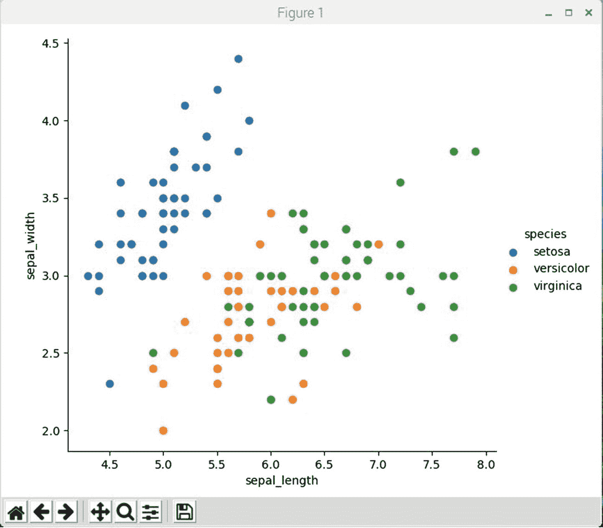

图 2-7
花萼长度与花萼高度的分面网格图

我承认，在出版的书中，灰度图可能难以辨认，但你应该能够辨别出图中左上角的一组点似乎形成了有意义的关系，其中可以画一条线性斜线穿过这组点来表示这种关系。这些点都来自山鸢尾物种。

同样的这组点也在图 2-6 中绘制过，但那里没有根据点所代表的物种进行区分，因此这种关系不容易被识别。可视化可能的关系是选择合适数据模型的重要第一步。在这种情况下，对此特定数据子集使用线性回归模型将是一个不错的选择。我将在本章后面讨论线性回归数据模型。

图 2-7 中剩余的点属于其他鸢尾花物种，据我所知，它们似乎没有任何明显的视觉关系。不过，我仍将继续向你展示一些可能有助于分析的附加图表。

### 箱线图

箱线图在前一章中首次被介绍；不过，当时我是用 Matplotlib 包来生成这些图的。下面的箱线图是通过一个名为 `boxplot` 的 Seaborn 方法生成的。实际上，我怀疑这个图很可能还是由 Matplotlib 软件创建的，因为 Seaborn 包与 Matplotlib 有着紧密的联系。

我使用了以下名为 `boxPlot.py` 的脚本来为所有鸢尾花种类的花萼长度属性创建箱线图。该脚本可从本书的配套网站获取：
```python
# 导入所需的库
import `matplotlib.pyplot` as `plt`
import `seaborn` as `sns`
# 加载鸢尾花数据集
`iris` = `sns`.load_dataset("iris")
# 生成箱线图
`sns`.boxplot(x="species", y="sepal_length", data=`iris`)
# 显示图形
`plt`.show()
```

通过输入以下命令运行该脚本：
```
python `boxPlot.py`
```

图 2-8 展示了运行此脚本的结果。

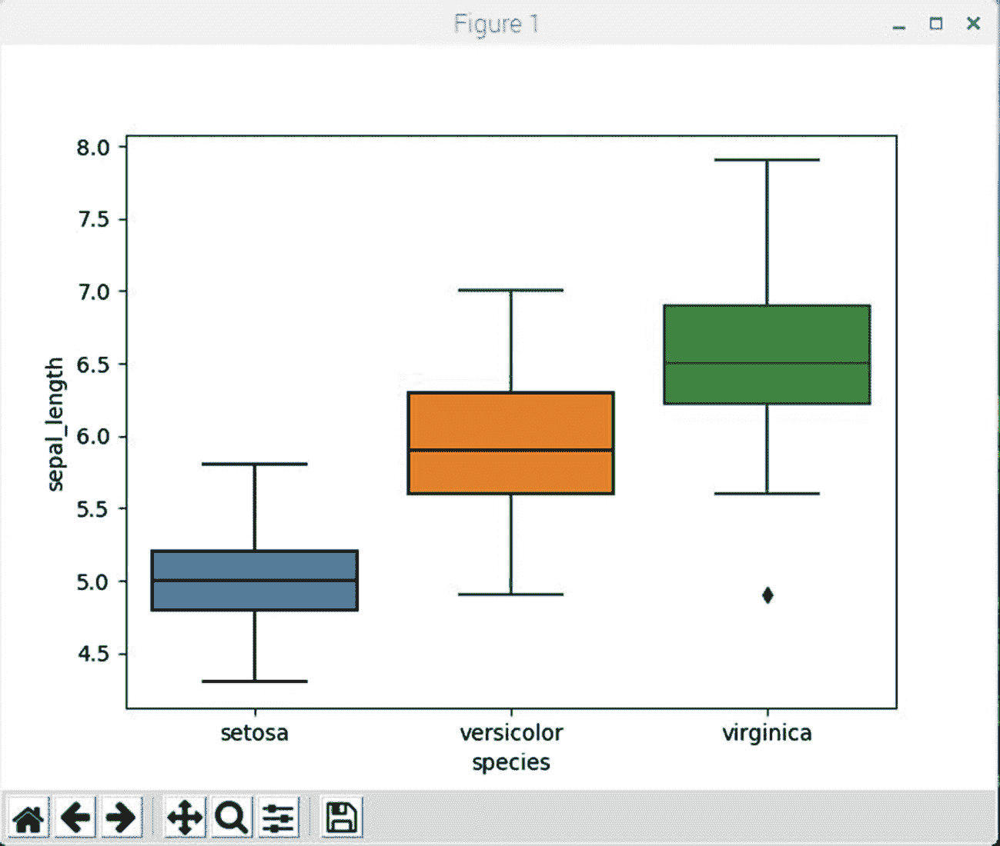

图 2-8
所有鸢尾花种类的花萼长度箱线图

箱线图本质上属于单变量图，因为它们仅基于单一数据集维度（即一维）创建。尽管如此，它们能提供关于数据集属性范围、方差和均值的重要见解。箱线图有助于识别数据异常值，这些异常值很容易干扰某些数据模型，进而导致在使用这些模型时，若无意中将具有破坏性的异常值作为输入，会产生不可预测和不确定的结果。

### 带状图

带状图可以被视为增强版的箱线图，因为它不仅包含底层的箱线图，还显示了构成该箱线图的实际数据点。通常情况下，这些数据点会沿着每个数据集类别的单条垂直线绘制；然而，Seaborn 的 `stripplot` 方法提供了一个抖动选项，可以将数据点随机偏离垂直线。这种随机抖动不会影响数据显示，因为纵轴是唯一用于识别数据点值的坐标轴。在研究了示例图之后，这个概念应该会变得清晰。

我使用了以下名为 `stripPlot.py` 的脚本来为所有鸢尾花种类的花萼长度属性创建带状图。该脚本可从本书的配套网站获取：
```python
# 导入所需的库
import `matplotlib.pyplot` as `plt`
import `seaborn` as `sns`
# 加载鸢尾花数据集
`iris` = `sns`.load_dataset("iris")
# 生成带状图
`ax` = `sns`.boxplot(x="species", y="sepal_length", data=`iris`)
`ax` = `sns`.stripplot(x="species", y="sepal_length", data=`iris`, jitter=True, edgecolor="gray")
# 显示图形
`plt`.show()
```

通过输入以下命令运行该脚本：
```
python `stripPlot.py`
```

图 2-9 展示了运行此脚本的结果。

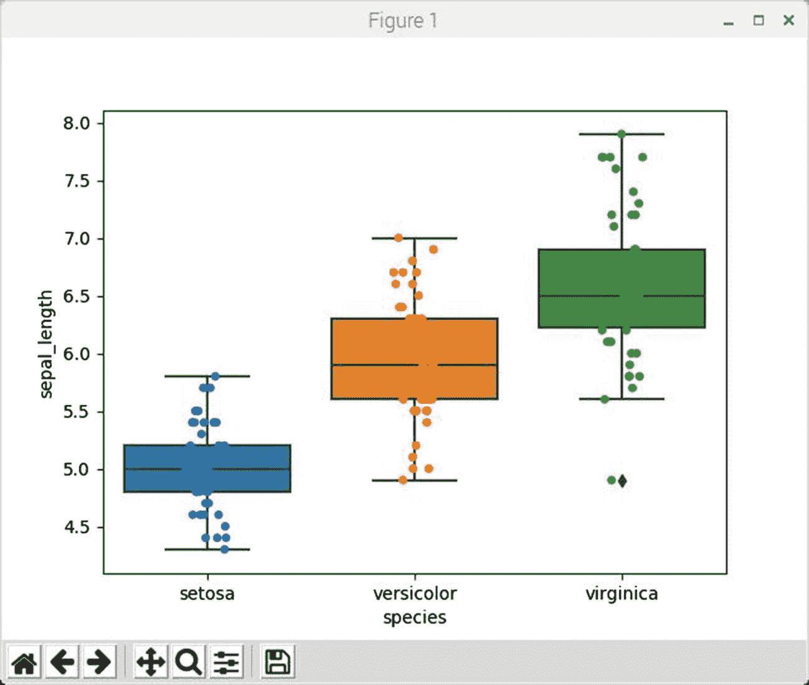

图 2-9
所有鸢尾花种类的花萼长度带状图

我之前关于箱线图的评论同样适用于此。带状图只是提供了一些额外的见解，展示了构成箱线图的数据点是如何在记录的数值范围内分布的。

### 小提琴图

小提琴图与箱线图类似，不同之处在于，代表数据集类别数据的垂直线两侧各有一个旋转的核密度图。这些核密度图表示数据在不同数值处的概率密度，并通过核密度估计函数进行平滑处理。在查看图形后，这个图奇特的名字应该就显而易见了。

我使用了以下名为 `violinPlot.py` 的脚本来为所有鸢尾花种类的花萼长度属性创建小提琴图。该脚本可从本书的配套网站获取：
```python
# 导入所需的库
import `matplotlib.pyplot` as `plt`
import `seaborn` as `sns`
# 加载鸢尾花数据集
`iris` = `sns`.load_dataset("iris")
# 生成小提琴图
`sns`.violinplot(x="species", y="sepal_length", data=`iris`, size=6)
# 显示图形
`plt`.show()
```

通过输入以下命令运行该脚本：
```
python `violinPlot.py`
```

图 2-10 展示了运行此脚本的结果。

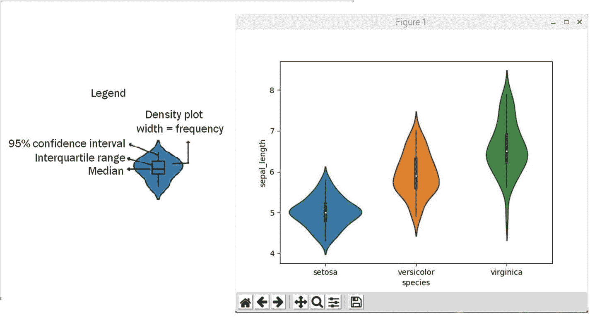

图 2-10
所有鸢尾花种类的花萼长度小提琴图

小提琴图克服了箱线图固有的一个大问题。箱线图可能会产生误导，因为它不受原始数据分布的影响。当底层数据集改变形状或本质上“变形”时，箱线图可以轻松地保持其先前的统计量，包括中位数和范围。而小提琴图则会在包含相同箱线图统计量的同时，反映任何新的形状或数据分布。

小提琴图的“小提琴”形状来源于类别数据集的密度图。密度图被旋转 90 度，并放置在箱线图的两侧，相互镜像。解读小提琴形状的方式与解读密度图完全相同。较厚的部分意味着小提琴图该区域的数值具有更高的出现频率或概率，而较薄的部分则意味着频率或概率较低。

小提琴图相对容易阅读。中间的圆点代表中位数。箱体代表四分位距。须线显示 95% 的置信区间。小提琴的形状展示了数值的频率。图 2-10 中显示的图例指出了这些特征。

### KDE 图

KDE 图仅显示数据集类别的密度图。KDE 是核密度估计（kernel density estimators）的缩写，它正是小提琴图中使用的相同图形。如果你只关注数据分布而非数据统计量（如箱线图或小提琴图的情况），那么 KDE 图最为有用。

我使用了以下名为 `kdePlot.py` 的脚本来为所有鸢尾花种类的花萼长度属性创建 KDE 图。该脚本可从本书的配套网站获取：
```python
# 导入所需的库
import `matplotlib.pyplot` as `plt`
import `seaborn` as `sns`
# 加载鸢尾花数据集
`iris` = `sns`.load_dataset("iris")
# 生成 KDE 图
`sns`.FacetGrid(`iris`, hue="species", size=6) \
.map(`sns`.kdeplot, "sepal_length") \
.add_legend()
# 显示图形
`plt`.show()
```

通过输入以下命令运行该脚本：
```
python `kdePlot.py`
```

图 2-11 展示了运行此脚本的结果。

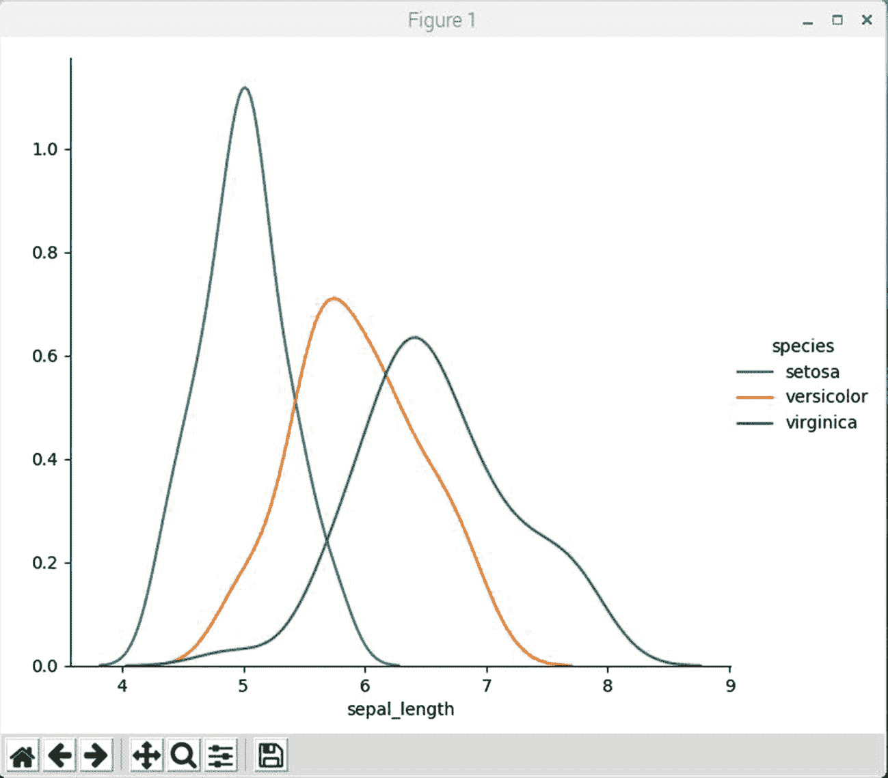

图 2-11
所有鸢尾花种类的花萼长度 KDE 图

数据分布图的结果之前已经讨论过了。

### 配对图

当联合图推广到高维数据集时，就生成了配对图。这些图是探索多维数据之间相关性的有用工具，因为所有数据配对值都会相互绘制。可视化鸢尾花数据集的多维关系非常简单，只需输入以下脚本（我将其命名为 `pairPlot.py`）。该脚本可从本书的配套网站获取：

# 导入所需库
import matplotlib.pyplot as plt
import seaborn as sns
# 加载鸢尾花数据集
iris = sns.load_dataset("iris")
# 生成配对图
sns.pairplot(iris, hue="species", size=2.5)
# 显示图形
plt.show()

图 2-12 展示了运行上述脚本的结果。

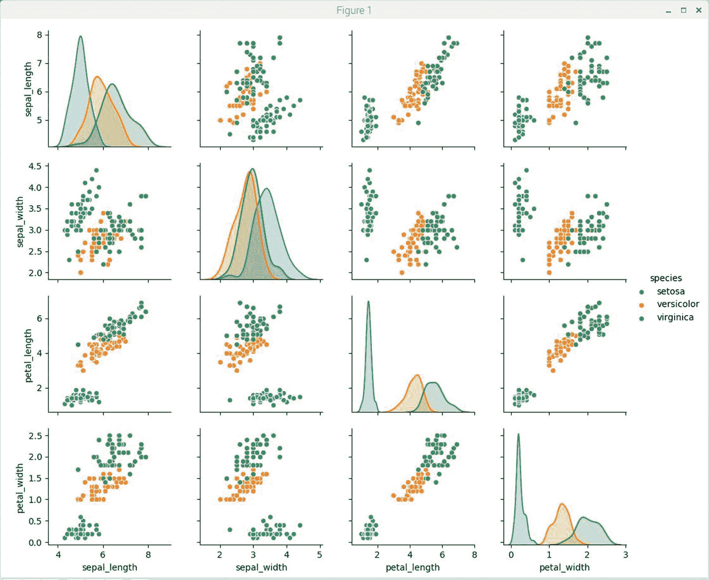

图 2-12 鸢尾花数据集配对图

乍一看，这张配对图似乎是目前展示的最全面、最复杂的图形。但仔细观察后，你会很快发现图中显示的各个图形要么是分面网格图，要么是核密度估计图，这些图形之前已经讨论过。从左上角到右下角的主对角线上的图形，都是针对相同交叉数据集类别的核密度估计图。而非交叉的图形（即 x 轴和 y 轴对应不同类别的图形）则都是分面网格图。当你审视各个图形时，类别属性之间的关系应该会很快显现出来。例如，在几乎所有配对图中，Setosa 的属性都明显与其他物种的属性区分开来。这表明聚类数据模型在这种情况下可能非常有效。我相信花大量时间研究配对图将有助于你深入理解底层数据集。

我认为，任何积极参与机器学习的人都应该对作为机器学习核心概念基础的底层基本模型有深入的了解，这至关重要。我在前一章中介绍了六个模型，但没有深入探讨这些模型的细节。这些模型（按字母顺序排列）包括：

- `决策树分类器`
- `高斯朴素贝叶斯`
- `K 近邻分类器`
- `线性判别分析`
- `逻辑回归`
- `支持向量机`

还有另外四个模型，也将在本书中介绍：

- `学习向量量化`
- `线性回归`
- `Bagging 与随机森林`
- `主成分分析`

（* 本章讨论）

经验丰富的数据科学家无法在不针对特定问题领域尝试所有这十个模型的情况下，告诉你哪个模型表现最佳。虽然还有许多其他机器学习模型和算法，但这十个通常被认为是最流行的。学习并使用这十个模型作为机器学习教育的坚实起点，将是明智之举。

## 底层大原则

所有用于预测建模的监督式机器学习算法都遵循一个共同原则。

机器学习算法最好被描述为学习一个目标函数`f()`，该函数能够最佳地将输入变量`x`映射到输出变量`y`，用方程形式表示即为：

`y = f(x)`

一个常见的问题是，当给定输入变量`x`的新输入值时，需要对某些`y`进行预测。然而，函数`f(x)`是未知的。如果已知，那么预测就可以说是解析性的，可以直接求解，也就无需使用机器学习算法从数据中“学习”它了。

最常见的机器学习问题类型可能就是学习映射关系`y = f(x)`，以便对新的`x`值预测`y`。这种方法正式名称为预测建模或预测分析，其目标是做出准确的预测。

我将从可能是预测中最常用的模型开始回顾数据模型。

### 线性回归

线性回归是一种在给定输入变量`x`值的情况下预测输出`y`的方法。这种方法背后的假设是，`x`和`y`之间必然存在某种线性关系。这种关系用数学术语表达为：

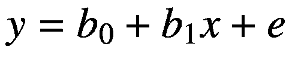

其中
`b[1]` = 直线的斜率
`b[0]` = y 轴截距
`e` = 估计误差

图 2-13 展示了一个简化案例，包含三个数据点以及一条在所有点之间最佳拟合的直线。 点是使用线性回归方程对给定`x[i]`计算出的估计值。`r[i]`值是真实数据点与对应 估计值之间的估计误差。

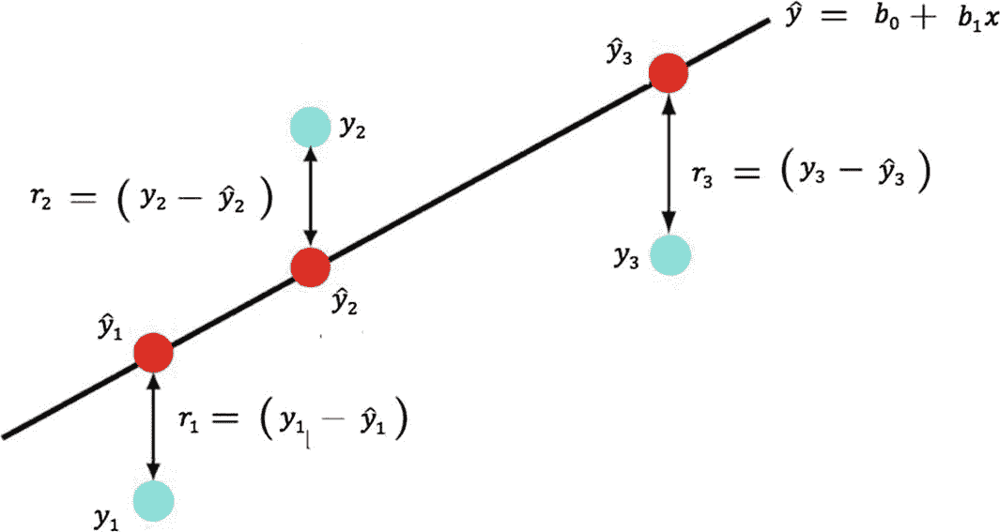

图 2-13 简单线性回归案例示例

创建线性回归方程的常规方法是使所有`r[i]`误差的总和最小化。可以使用不同的技术从数据中学习线性回归模型，例如用于普通最小二乘法的线性代数解法，以及使用梯度下降优化。

线性回归已有 200 多年的历史，并得到了广泛的研究。使用该技术时，两个有用的经验法则是移除非常相似的自变量，以及移除数据集中的任何噪声。这是一种快速简单的技术，也是一个很好的首选算法。

#### 线性回归演示

以下名为 `lrTest.py` 的 Python 脚本旨在围绕一条斜线创建一组伪随机点，该斜线的基础方程为

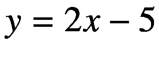

`scikit-learn` 包中包含的线性回归方法利用该伪随机数据集来重建基础方程。此脚本可从本书的配套网站获取：

```
# 导入所需库
import matplotlib.pyplot as plt
import seaborn as sns
import numpy as np
from sklearn.linear_model import LinearRegression
# 生成随机数据集
rng = np.random.RandomState(1)
x = 10*rng.rand(50)
y = 2*x -5 + rng.randn(50)
# 设置线性回归模型
model = LinearRegression(fit_intercept=True)
model.fit(x[:, np.newaxis], y)
# 生成估计值
xfit = np.linspace(0, 10, 1000)
yfit = model.predict(xfit[:, np.newaxis])
# 显示包含随机数据点和最佳拟合线的图表
ax = plt.scatter(x,y)
ax = plt.plot(xfit, yfit)
plt.show()
# 显示线性回归系数
print("模型斜率:      ", model.coef_[0])
print("模型截距:  ", model.intercept_)
```

通过输入以下命令运行脚本：

```
python lrTest.py
```

图 2-14 显示了运行此脚本的结果。

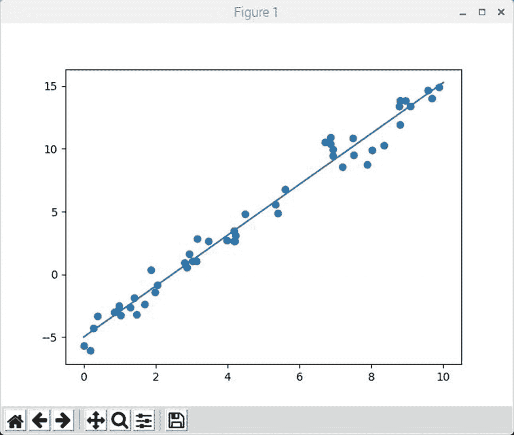

图 2-14 `lrTest` 脚本的结果

从图中可以明显看出，最佳拟合线完美地置于数据集中，这与数据生成方式所预期的结果一致。这是一个恰当的结果，因为本次演示的唯一目的是说明线性回归模型的工作原理。

图 2-15 显示了线性回归模型计算出的`b[0]`和`b[1]`系数。它们分别非常接近真实值 2 和 -5。

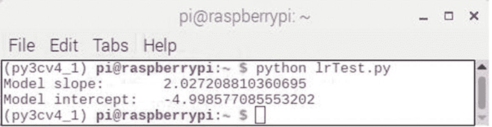

图 2-15 计算出的线性回归系数

### 逻辑回归

逻辑回归通常用于分类目的。它与线性回归的不同之处在于，因变量 (`x`) 只能取有限数量的值，而在线性回归中，值的数量是无限的。这是因为逻辑回归对因变量使用类别。当只有两个类别时，它就变成了二元逻辑回归。

在线性回归中，输出是输入的加权和。逻辑回归是线性回归的一种泛化，从某种意义上说，输入的加权和不是直接输出，而是通过一个函数，该函数将任何实数输入值映射到 0 到 1 之间的输出。在线性回归中，输出可以取任何值，但对于逻辑回归，值必须在 0 到 1 之间。

图 2-16 显示了映射加权输入和的函数。这被称为 Sigmoid 函数，也称为激活函数。

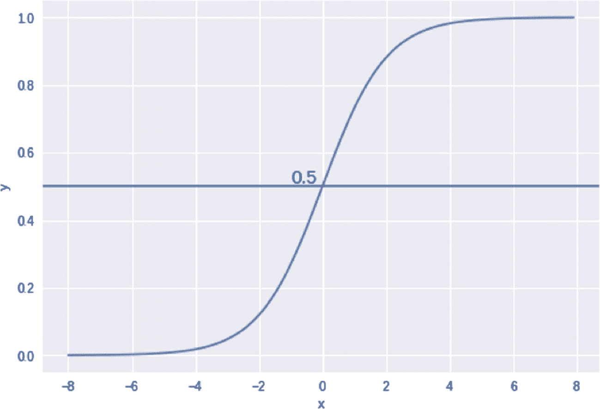

图 2-16 Sigmoid 函数

该图显示，Sigmoid 函数的输出值 (`y`) 始终介于 0 和 1 之间，并且当`x = 0`时，`y = 0.5`。在两个类别的情况下，如果`y >= 0.5`，则可以判定检测到类别 1；否则，它必须是类别 0。

在我深入探讨实际数据模型之前，有必要回顾一下应用逻辑回归必须满足的两个基本假设。它们是：

- 因变量必须是分类变量。
- 自变量（特征）必须相互独立。

我将使用吴恩达教授的数据集，该数据集涉及根据两次考试成绩决定是否被大学录取。完整数据集包含100条记录，包含两次考试成绩或分数（范围从0到100）。每条记录还包含一个1或0，其中1表示申请人被录取，0表示未被录取。该数据模型的目标是根据两次考试成绩预测申请人是否会被录取。原始数据来自一个名为`marks.txt`的CSV文件，可从以下网址获取：`https://github.com/animesh-agarwal/Machine-Learning/blob/master/LogisticRegression/data/marks.txt`。

数据使用`Pandas`软件作为`DataFrame`加载到以下脚本中。数据还被分为已录取和未录取两类，以帮助可视化数据并满足分类假设。这个名为`logRTest.py`的脚本用于生成原始数据集的图表。此脚本可从本书的配套网站获取：

```python
# 导入所需库
import matplotlib.pyplot as plt
import pandas as pd

def load_data(path, header):
    marks_df = pd.read_csv(path, header=header)
    return marks_df

if __name__ == "__main__":
    # 从文件加载数据
    data = load_data("marks.txt", None)
    # X = 特征值，除最后一列外的所有列
    X = data.iloc[:, :-1]
    # y = 目标值，数据框的最后一列
    y = data.iloc[:, -1]
    # 筛选已录取的申请人
    admitted = data.loc[y == 1]
    # 筛选未录取的申请人
    not_admitted = data.loc[y == 0]
    # 显示数据集图表
    plt.scatter(admitted.iloc[:, 0], admitted.iloc[:, 1], s=10, label="已录取")
    plt.scatter(not_admitted.iloc[:, 0], not_admitted.iloc[:, 1], s=10, label='未录取')
    plt.legend()
    plt.show()
```

通过输入以下命令运行脚本：

```
python logRTest.py
```

图2-17显示了运行此脚本的结果。

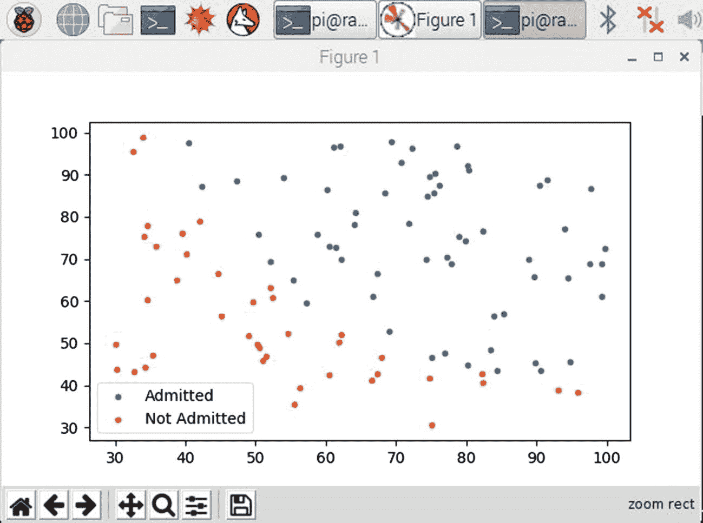

## LogR 模型开发

通过观察此图，您或许能想象出一条从左上到右下的直线，它将大部分数据点一分为二，被录取的学生位于右侧，未被录取的位于左侧。问题就变成了如何确定这样一条分类线的系数。LR无法确定这条线，但LogR数据模型可以。

此时，我将尝试解释LogR模型是如何开发的。然而，我必然要省略许多底层数学原理，否则会使讨论陷入过多细枝末节，从而偏离简单介绍LogR数据模型这一主要目的。请放心，网上有许多优秀的博客和教程，深入探讨了LogR的数学细节。

这个LogR示例的基本假设是确定“最佳拟合”以下方程的系数`θ[i]`：

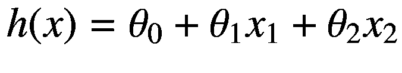

其中

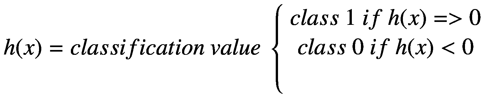

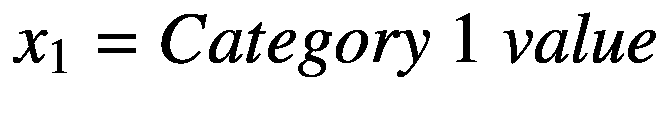

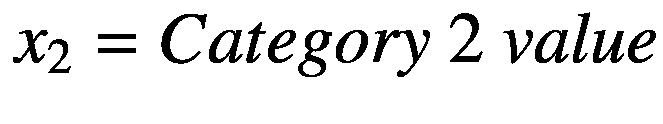

在这个二元LogR示例中，`x[1]`是考试1的分数，`x[2]`是考试2的分数。

必须为此假设分配一个成本函数，以便应用梯度法来最小化成本，进而确定最小成本解所需的系数。在此不提供证明或推导，我仅直接给出成本函数，如图2-18所示。

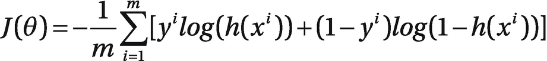

图中用`J(θ)`表示的所有训练样本的成本，可以通过计算训练数据集中所有100条记录的成本平均值来获得。

## LogR 演示

以下脚本名为`logRDemo.py`，将按前述方法计算所需的系数。此外，该脚本还会绘制分类线并与训练数据集叠加显示。最后，会显示系数，以便获得一个可用的分类器方程。我在脚本中添加了许多注释，以帮助您理解代码的运行逻辑。此脚本可从本书的配套网站获取：

# 逻辑回归与朴素贝叶斯

## 逻辑回归实现

```python
# 导入所需库
import numpy as np
import matplotlib.pyplot as plt
import pandas as pd
import scipy.optimize as so

def load_data(path, header):
    # 将 CSV 文件加载到 pandas 数据框中
    marks_df = pd.read_csv(path, header=header)
    return marks_df

def sigmoid(x):
    # 激活函数
    return 1/(1 + np.exp(-x))

def net_input(theta, x):
    # 通过 numpy 点积计算输入的加权和
    return np.dot(x, theta)

def probability(theta, x):
    # 返回应用 Sigmoid 函数后的概率
    return sigmoid(net_input(theta, x))

def cost_function(theta, x, y):
    # 计算成本函数
    m = x.shape[0]
    total_cost = -(1/m)*np.sum(y*np.log(probability(theta,x))+(1-y)*np.log(1-probability(theta,x)))
    return total_cost

def gradient(theta, x, y):
    # 计算成本函数的梯度
    m = x.shape[0]
    return (1/m)*np.dot(x.T,sigmoid(net_input(theta,x))-y)

def fit(x, y, theta):
    # 在此计算最优系数
    opt_weights = so.fmin_tnc(func=cost_function, x0=theta, fprime=gradient,args=(x,y.flatten()))
    return opt_weights[0]

if __name__ == "__main__":
    # 从文件加载数据
    data = load_data("marks.txt", None)
    # X = 特征值，除最后一列外的所有列
    X = data.iloc[:, :-1]
    # 保存副本用于输出绘图
    X0 = X
    # y = 目标值，数据框的最后一列
    y = data.iloc[:, -1]
    # 保存副本用于输出绘图
    y0 = y
    X = np.c_[np.ones((X.shape[0], 1)), X]
    y = y[:, np.newaxis]
    theta = np.zeros((X.shape[1], 1))
    parameters = fit(X, y, theta)
    x_values = [np.min(X[:,1]-5), np.max(X[:,2] + 5)]
    y_values = -(parameters[0] + np.dot(parameters[1], x_values)) / parameters[2]
    # 筛选被录取的申请者
    admitted = data.loc[y0 == 1]
    # 筛选未被录取的申请者
    not_admitted = data.loc[y0 == 0]
    # 绘制原始数据集及分类线
    ax = plt.scatter(admitted.iloc[:, 0], admitted.iloc[:, 1], s=10, label="已录取")
    ax = plt.scatter(not_admitted.iloc[:, 0], not_admitted.iloc[:, 1], s=10, label='未录取')
    ax = plt.plot(x_values, y_values, label='决策边界')
    ax = plt.xlabel('第一次考试分数')
    ax = plt.ylabel('第二次考试分数')
    ax = plt.legend()
    plt.show()
    print(parameters)
```

通过输入以下命令运行脚本：

```bash
python logRDemo.py
```

图 2-19 显示了运行此脚本的结果。

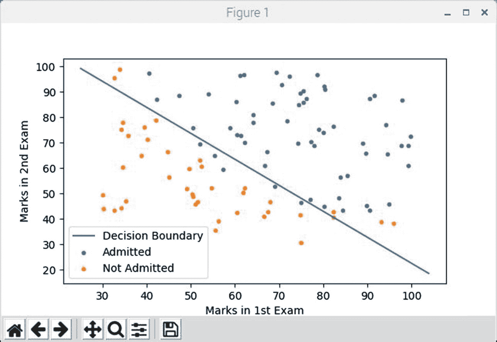

图 2-19 `logRDemo` 脚本的运行结果

## 模型结果分析

分类线似乎被恰当地放置在数据点之间，将已录取学生与未录取学生分开。然而，如果仔细检查分类线，您会发现有五个已录取学生的数据点位于分类线的左侧。如果使用 `LogR` 分类模型，这些点将导致假阴性，因为拥有这些考试分数的学生被拒绝录取，但实际上应该被录取。类似地，有六个未录取学生位于分类线上或右侧。如果使用 `LogR` 分类模型，这些点将导致假阳性，因为拥有这些考试分数的学生被录取了，但实际上应该被拒绝录取。总共有 11 个假阴性或假阳性点，这使得 `LogR` 模型的整体准确率为 89%。这并不算太差，并且很可能通过增加训练数据集的大小来改进。

图 2-20 显示了 `LogR` 模型计算出的 `θ[i]` 系数。

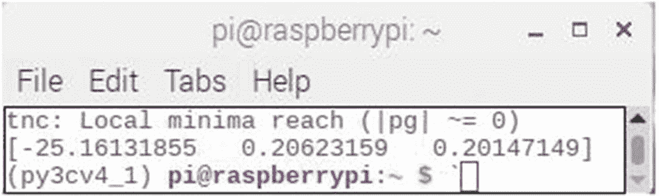

图 2-20 计算出的 `LogR` 系数

使用计算出的 `θ[i]` 系数得到的最终 `LogR` 分类器方程为：

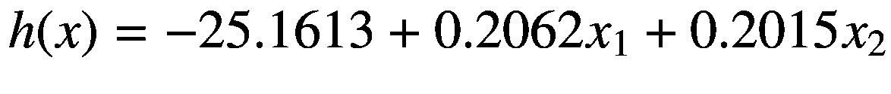

其中

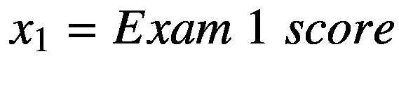

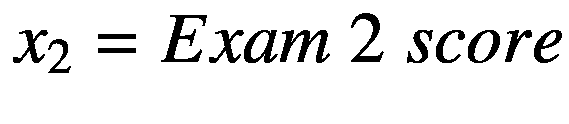

我尝试了一些随机分数来测试分类器方程。结果如表 2-2 所示。

表 2-2 `LogR` 分类器方程的随机测试

| 考试 1 | 考试 2 | 分类器值 | 已录取 | 未录取 |
| --- | --- | --- | --- | --- |
| 40 | 60 | –4.825 |   | x |
| 80 | 60 | 3.423 | x |   |
| 50 | 60 | –2.763 |   | x |
| 55 | 65 | –0.7245 |   | x |
| 60 | 65 | 0.3065 | x |   |
| 80 | 90 | 9.468 | x |   |
| 70 | 75 | 4.4835 | x |   |
| 60 | 65 | 0.3065 | x |   |
| 60 | 75 | 2.3215 | x |   |
| 60 | 60 | –0.701 |   | x |
| 62 | 63 | 0.3159 | x |   |
| 70 | 65 | 2.3685 | x |   |
| 65 | 70 | 2.1345 | x |   |
| 50 | 55 | –3.7705 |   | x |
| 70 | 48 | –1.057 |   | x |
| 56 | 59 | –1.7273 |   | x |

表中的最后一项并非随机，而是取自原始数据集的一个假阴性案例。我这样做是为了说明仅依赖分类器方程可能存在的潜在问题。

## 朴素贝叶斯

朴素贝叶斯是一种适用于二分类（二元）和多分类问题的分类算法。该技术最适合处理二元或类别型输入值。

它之所以被称为朴素贝叶斯，是因为对每个假设的概率计算被简化了，从而使其计算成为可能。该方法并非试图计算每个属性值 `P(d1, d2|h)` 的概率，而是假设它们在给定目标数据值的条件下是条件独立的，并计算为 `P(d1|h) * P(d2|h)`。

这是一个非常强的假设，对于现实世界的数据来说很可能不成立。该假设基于一个前提，即类别属性之间不存在相互作用。尽管如此，这种方法在基本假设不成立的数据上似乎也表现良好。

在进入实际演示之前，我认为先回顾一些关于贝叶斯逻辑的基本原理是明智的。

### 贝叶斯定理简要回顾

在分类问题中，一个假设 `(h)` 可以被视为要为每个新数据实例 `(d)` 分配的类别。在给定新数据的情况下，选择最可能假设的一种简单方法是利用关于该问题的任何先验知识。贝叶斯定理提供了一种在给定先验知识的情况下计算假设概率的方法。

贝叶斯定理表述如下：

`P(h|d) = (P(d|h) * P(h)) / P(d)`

其中：

*   `P(h|d)` 是在给定数据 `d` 的情况下假设 `h` 的概率。这被称为后验概率。
*   `P(d|h)` 是假设 `h` 为真时数据 `d` 的概率。
*   `P(h)` 是假设 `h` 为真的概率（不考虑数据）。这被称为 `h` 的先验概率。
*   `P(d)` 是数据的概率（不考虑假设）。

显而易见，目标是从先验概率 `P(h)` 出发，结合 `P(d)` 和 `P(d|h)` 来计算后验概率 `P(h|d)`。

# 最大后验概率（MAP）假设

在计算了多个不同假设的后验概率后，选择概率最高的假设。这个被选中的`h`就是最大可能假设，正式名称为最大后验概率（MAP）假设。它可以用几种形式表示：

`MAP(h) = max(P(h|d))`

或

`MAP(h) = max((P(d|h) * P(h)) / P(d))`

或

`MAP(h) = max(P(d|h) * P(h))`

`P(d)` 是一个归一化项，用于计算归一化概率。当只关心最可能的假设时，可以忽略它，因为该项是常数，仅用于归一化，这就引出了前面展示的最后一个 MAP 方程。

如果训练数据中每个类别的实例分布相等，则可以进一步简化。在这种情况下，每个类别（`P(h)`）的概率将相等。这会导致 MAP 方程中又出现一个常数项，该项也可以被去掉，最终得到方程：

`MAP(h) = max(P(d|h))`

## 为朴素贝叶斯模型准备数据

在应用朴素贝叶斯模型之前，需要计算类别概率和条件概率。顾名思义，类别概率是与训练集中每个类别相关的概率。条件概率是与给定类别下每个输入数据值相关的概率。

训练速度很快，因为只需要计算每个类别的概率以及给定不同输入值时每个类别的概率。与回归模型不同，这里不需要通过优化过程来拟合系数。

类别概率就是属于每个类别的实例频率除以实例总数。

例如，在一个二分类问题中，实例属于类别 1 的概率计算如下：

`P(class1) = count(class1) / (count(class0) + count(class1))`

在最简单的情况下，如果每个类别的实例数量相等，那么每个类别的概率将是 0.5 或 50%。

条件概率是给定类别值下每个属性值的频率除以具有该类别值的实例频率。

接下来的这个例子应该有助于阐明朴素贝叶斯模型的工作原理。

### 朴素贝叶斯模型示例

以下是一个关于天气的训练数据集以及相应的目标变量“Play”（表示玩耍的可能性）。

表 2-3 显示了天气状况和 Play 变量值的记录。

表 2-3 天气/Play 数据集

| 天气 | Play |
| --- | --- |
| 晴天 | 否 |
| 阴天 | 是 |
| 雨天 | 是 |
| 晴天 | 是 |
| 晴天 | 是 |
| 阴天 | 是 |
| 雨天 | 否 |
| 雨天 | 否 |
| 晴天 | 是 |
| 雨天 | 是 |
| 晴天 | 否 |
| 阴天 | 是 |
| 阴天 | 是 |
| 雨天 | 否 |

第一步是将训练数据集转换为频率表，如表 2-4 所示。

表 2-4 频率表

| 天气 | 否 | 是 |
| --- | --- | --- |
| 阴天 | | 4 |
| 雨天 | 3 | 2 |
| 晴天 | 2 | 3 |
| 总计 | 5 | 9 |

第二步是通过计算概率来创建似然表。例如，阴天的概率是 0.29，所有天气条件下总的玩耍概率是 0.64。表 2-5 显示了似然表。

表 2-5 似然表

| 天气 | 否 | 是 | | 天气概率 |
| --- | --- | --- | --- | --- |
| 阴天 | | 4 | 4/14 | 0.29 |
| 雨天 | 3 | 2 | 5/14 | 0.36 |
| 晴天 | 2 | 3 | 5/14 | 0.36 |
| 总计 | 5 | 9 | | |
| | 5/14 | 9/14 | | |
| 玩耍概率 | 0.36 | 0.64 | | |

下一步是使用朴素贝叶斯方程计算每个类别的后验概率。后验概率最高的类别即为预测结果。

**问题陈述：** 如果天气晴朗，玩家会玩耍。这个说法正确吗？

使用后验概率方法解决此问题。

*   `P(是 | 晴天) = P(晴天 | 是) * P(是) / P(晴天)`

代入实际概率得到：

*   `P(晴天 | 是) = 3/9 = 0.33`

*   `P(晴天) = 5/14 = 0.36`

*   `P(是) = 9/14 = 0.64`

因此：

*   `P(是 | 晴天) = 0.33 * 0.64 / 0.36 = 0.60`

接下来计算另一个 Play 类别值“否”的后验概率。

*   `P(否 | 晴天) = P(晴天 | 否) * P(否) / P(晴天)`

代入实际概率得到：

*   `P(晴天 | 否) = 2/5 = 0.40`

*   `P(晴天) = 5/14 = 0.36`

*   `P(否) = 5/14 = 0.36`

因此：

*   `P(否 | 晴天) = 0.40 * 0.36 / 0.36 = 0.40`

概率 `P(是 | 晴天)` 高于 `P(否 | 晴天)`，因此是 MAP 或预测结果。请注意，你可以简单地从 1.0 中减去 `P(是 | 晴天)` 来获得互补概率，这对于二元类别值总是成立的。然而，对于非二元类别值的情况，该操作并不成立。

## 优点与缺点

以下是使用朴素贝叶斯数据模型的一些优缺点。

**优点：**

*   从测试数据集预测类别值简单且快速。在多类别预测中表现同样出色。

*   当独立性假设成立时，朴素贝叶斯分类器比逻辑回归等其他模型表现更好，且所需的训练数据更少。

*   与数值型变量相比，它在处理类别型输入变量时表现更佳。对于数值型变量，通常假设其服从正态分布，这是一个较强的假设。

**缺点：**

*   如果测试数据集中某个类别变量包含训练数据集中未出现过的类别，模型将赋予其 0 概率，从而无法进行预测。这种情况通常被称为“零频率”。常使用一种称为拉普拉斯估计的平滑技术来解决此问题。

*   朴素贝叶斯也被认为是一个较差的估计器，因此其概率输出可能不准确。

*   朴素贝叶斯的另一个局限性是预测变量独立的假设。在现实世界中，几乎不可能得到一组完全独立的预测变量。

接下来将简要使用 `scikit-learn` 库在 Python 中构建一个朴素贝叶斯模型。`scikit-learn` 库提供了三种类型的朴素贝叶斯模型：

*   **高斯模型** – 用于分类，并假设特征服从正态分布。

*   **多项式模型** – 用于离散计数。将文本分类问题视为一个伯努利试验，本质上是“统计一个词在文档中出现的频率”。可以理解为“在 n 次试验中观察到结果 x[i] 的次数”。

*   **伯努利模型** – 当特征向量是二值（即 0 和 1）时，伯努利模型非常有用。一个应用场景是使用“词袋”模型进行文本分类，其中 1 和 0 分别表示“词出现在文档中”和“词未出现在文档中”。

你可以根据数据集选择上述任意一种模型。

### 高斯朴素贝叶斯

朴素贝叶斯可以扩展到实值属性，最常见的方式是假设其服从高斯分布。这种扩展被称为高斯朴素贝叶斯。虽然可以使用其他函数来估计数据分布，但高斯分布（或正态分布）是最容易处理的，因为它只需要从训练数据中计算均值和标准差。

每个类别值对应的每个输入变量 (`x`) 的均值和标准差通过以下公式计算：

`mean(x) = 1/n * sum(x)`

`standard deviation(x) = sqrt(1/n * sum((x[i] - mean(x))²))`

其中
*   `n` = 实例数量
*   `x` = 输入变量的值

新 `x` 值的概率通过高斯概率密度函数 (PDF) 计算。在进行预测时，可以将这些参数与 `x` 变量的新输入一起代入高斯 PDF，该函数将给出该新输入值属于该类别的概率估计。

`pdf(x, mean, sd) = (1 / (sqrt(2 * PI) * sd)) * exp(-((x-mean)²/(2*sd²)))`

其中 `pdf(x)` 是高斯 PDF，`sqrt()` 是平方根，`mean` 和 `sd` 分别是均值和标准差，`PI` 是数学常数，`exp()` 是数学常数 `e`（欧拉数）的幂，`x` 是输入变量的值。

下面的演示使用了上述公式，但这些公式是软件包的内置组成部分，会被单独调用。

### 高斯朴素贝叶斯 (GNB) 演示

以下名为 `gnbTest.py` 的 Python 脚本使用了 `scikit-learn` 软件包中的 `GNB` 模型。脚本中包含一个最小的训练数据集，用于让模型“学习”并进行预测。该数据集可以是完全任意的，也可以根据数据是否经过编码来代表实际的现实世界属性。无论如何，由于该预测器仅基于数值数据，它都能正常运行。最终结果的解码始终是用户的责任。此脚本可从本书的配套网站获取：

```python
# 导入高斯朴素贝叶斯模型库
from sklearn.naive_bayes import GaussianNB
import numpy as np
# 分配预测变量和目标变量
x= np.array([[-3,7],[1,5], [1,2], [-2,0], [2,3], [-4,0], [-1,1], [1,1], [-2,2], [2,7], [-4,1], [-2,7]])
y = np.array([3, 3, 3, 3, 4, 3, 3, 4, 3, 4, 4, 4])
# 创建一个高斯分类器
model = GaussianNB()
# 使用训练集训练模型
model.fit(x, y)
# 预测输出
predicted= model.predict([[1,2],[3,4]])
print(predicted)
```

通过输入以下命令运行脚本：

```
python gnbTest.py
```

图 2-21 显示了运行此脚本的结果。

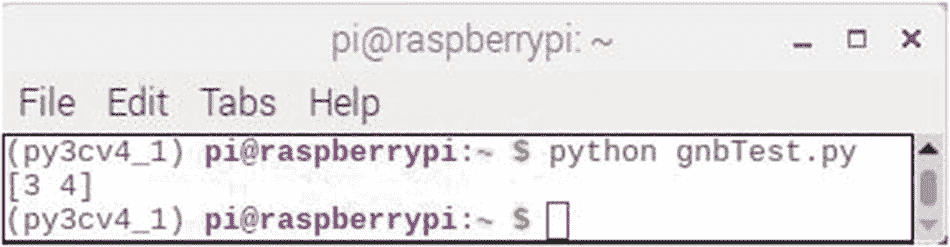

图 2-21

`gnbTest` 脚本的结果

最终结果显示预测值为 [3 4]。正如我之前提到的，这在现实世界中意味着什么，取决于数据集最初是如何编码的。

## k-近邻 (`k-NN`) 模型

我在前一章的鸢尾花演示（第 3 部分）中介绍了 `k-NN` 模型。但当时我没有提到使用该模型的两个主要缺点。如果这两个问题都不存在，那么 `k-NN` 模型绝对值得考虑使用，因为它是一个简单且稳健的分类器。

第一个问题是性能问题。由于它是一个懒惰模型，必须加载所有训练数据，并用于计算与所有训练样本的欧几里得距离。这可以通过朴素的方式完成，也可以使用更复杂的数据结构（如 `k-d` 树）。无论如何，当涉及大型训练集时，这可能会对性能造成很大影响。

第二个问题是距离度量。基本的 `k-NN` 模型使用欧几里得距离，当涉及高维数据时，这是一个有问题的距离度量。随着维度的增加，由于距离度量在数据维度显著增加时变得毫无意义，算法的性能会变差。另一个相关的问题是遇到噪声特征时。这个问题之所以发生，是因为模型对所有特征（无论是否为噪声）都应用相同的权重。此外，所有特征（无论其类型是类别型、数值型还是二值型）都被赋予相同的权重。

总之，如果一个系统需要用少量样本和维度来学习复杂的（即非线性的）模式，`k-NN` 模型通常是最佳选择。

### KNN 演示

本演示将使用加州大学欧文分校数据库中的汽车数据集。所需的两个 CSV 数据文件以及 `kNN.py` 类文件可以从以下地址下载：

`https://github.com/amallia/kNN`

### 注意

本网站还提供了一个 Jupyter notebook 文件。该文件不会被使用，因为我在下面提供了一个 Python 脚本，它实现了与 notebook 文件相同的功能。

问题陈述是：根据汽车的排量和马力，预测其每加仑英里数（mpg）。数据集中的每条记录对应一辆汽车。

`kNN` 类文件如下所示，其中包含初始化、计算和预测函数。该脚本名为 `kNN.py`，可从所列网站或本书的配套网站获取。我在脚本清单中添加了注释，以说明正在执行的功能。

```
#!/usr/bin/env python
import math
import operator
class kNN(object):
# 初始化
def __init__(self, x, y, k, weighted=False):
assert (k <= len(x)
), "k 不能大于训练集长度"
self.__x = x
self.__y = y
self.__k = k
self.__weighted = weighted
# 计算欧几里得距离
@staticmethod
def __euclidean_distance(x1, y1, x2, y2):
return math.sqrt((x1 - x2)**2 + (y1 - y2)**2)
# 计算概率密度函数
@staticmethod
def gaussian(dist, sigma=1):
return 1./(math.sqrt(2.*math.pi)*sigma)*math.exp(-dist**2/(2*sigma**2))
# 执行预测
def predict(self, test_set):
predictions = []
for i, j in test_set.values:
distances = []
for idx, (l, m) in enumerate(self.__x.values):
dist = self.__euclidean_distance(i, j, l, m)
distances.append((self.__y[idx], dist))
distances.sort(key=operator.itemgetter(1))
v = 0
total_weight = 0
for i in range(self.__k):
weight = self.gaussian(distances[i][1])
if self.__weighted:
v += distances[i][0]*weight
else:
v += distances[i][0]
total_weight += weight
if self.__weighted:
predictions.append(v/total_weight)
else:
predictions.append(v/self.__k)
return predictions
```

以下脚本名为 `knnTest.py`，其中从 `kNN` 类文件实例化了一个 `k-NN` 模型。针对 `k = 1`、`3` 和 `20` 的情况，分别对非加权和加权情况进行了系列预测。计算了所有情况下的结果误差。此脚本可从本书的配套网站获取：

```
# 导入所需库
import pandas
from kNN import kNN
from sklearn.metrics import mean_squared_error
# 读取训练 CSV 文件
training_data = pandas.read_csv("auto_train.csv")
x = training_data.iloc[:,:-1]
y = training_data.iloc[:,-1]
# 读取测试 CSV 文件
test_data = pandas.read_csv("auto_test.csv")
x_test = test_data.iloc[:,:-1]
y_test = test_data.iloc[:,-1]
# 显示每个 CSV 文件的前几行
print('训练数据')
print(training_data.head())
print('测试数据')
print(test_data.head())
# 计算 k = 1, 3, 20 且无加权时的误差
for k in [1, 3, 20]:
classifier = kNN(x,y,k)
pred_test = classifier.predict(x_test)
test_error = mean_squared_error(y_test, pred_test)
print('k={} 时的测试误差: {}'.format(k, test_error * len(y_test)/2))
# 计算 k = 1, 3, 20 且有加权时的误差
for k in [1, 3, 20]:
classifier = kNN(x,y,k,weighted=True)
pred_test = classifier.predict(x_test)
test_error = mean_squared_error(y_test, pred_test)
print('k={} 时的测试误差: {}'.format(k, test_error * len(y_test)/2))
```

通过输入以下命令运行脚本：

```
python knnTest.py
```

图 2-22 显示了运行此脚本的结果。

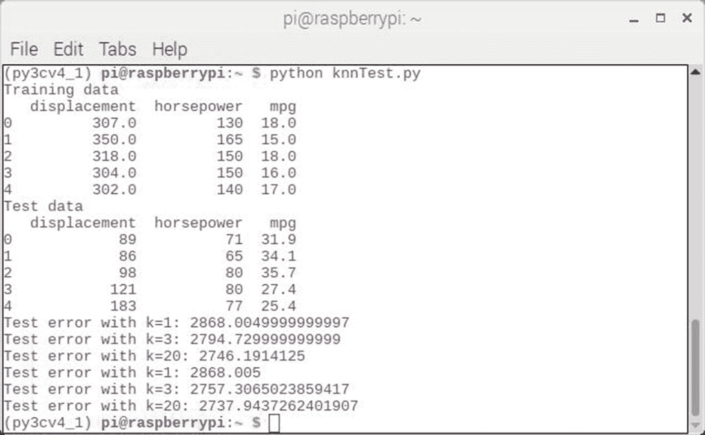

图 2-22

`knnTest` 脚本的结果

此图显示了每个 CSV 数据文件的前五条记录。接下来的三个测试误差结果分别是 `k` 等于 1、3 和 20 时的非加权预测结果。最后三个测试误差结果是相同 `k` 值下的加权预测结果。查看误差结果可以发现，随着 `k` 的增加，误差值略有减小，并且在应用加权的情况下，误差值甚至略低。

## 决策树分类器

这将是本章讨论的最后一个数据模型。决策树分类器数据模型是解决常见业务问题的一种巧妙方案。例如，如果您是银行贷款经理，您可以使用此模型根据客户的财务和信用记录，将其分类为安全或风险类别。分类通常分两步完成，第一步是学习，第二步是预测。学习步骤中的模型仅基于可用的训练数据进行开发和调优。然后，使用训练好的数据以及根据调优和用户经验输入的任何适当超参数，利用该模型预测未来结果。

### 决策树算法

决策树是一种类似流程图的树状结构，其中内部节点代表一个特征或属性，分支代表一个决策规则，每个叶节点代表一个结果。根节点是决策树中最顶层的节点。该模型学习如何根据属性值进行划分。树以递归方式进行划分，这种划分方式自然被称为递归划分。这种类似流程图的结构合理地类比了人类进行决策的过程。使用流程图来可视化此过程将有助于您理解此模型。图 2-23 显示了一个通用决策树的部分结构。

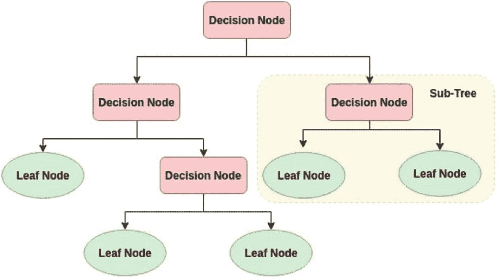

图 2-23

决策树的通用流程图

决策树算法的一个良好特性是其决策逻辑易于理解。该模型被称为白盒机器学习算法。将此开放性对比于黑盒模型，后者是人工神经网络（ANN）的典型特征，其任何决策逻辑通常都难以理解。此外，决策树算法的训练时间通常远快于ANN。决策树算法不依赖于任何特定类型的训练数据概率分布，这使其成为一种非参数方法。因此，决策树算法能够以良好的精度处理高维数据。

决策树算法遵循以下简单的三步流程：

1. 使用`属性选择度量（ASM）`选择最佳属性来分割记录。
2. 将该属性设为决策节点，并将数据集拆分为更小的子集。
3. 通过为每个子节点递归重复此过程来开始构建树，直到满足以下条件之一：
    * 所有元组都属于同一个属性值。
    * 没有更多剩余属性。
    * 没有更多实例。

`ASM`是一种启发式方法，用于选择以最优方式划分数据的分割标准。`ASM`也称为分割规则，因为它有助于确定给定节点上元组的分割点。`ASM`通过解释给定的数据集，为每个特征或属性提供排名。然后，得分最高的属性将被选为分割属性。对于连续值属性，还需要定义分支分割点。

以下补充内容详细讨论了信息熵、信息增益、基尼系数和增益比。虽然这不是运行决策树演示的先决条件，但我建议您花时间阅读一下。它肯定会加深您对该算法工作原理的理解。

## 信息增益

信息增益衡量一个特征为我们提供关于某个类别的“信息”量。任何能够完美划分的特征都应提供最大信息。同样，不相关的特征应不提供任何信息。信息增益衡量的是熵的减少，而熵是衡量任意样本集合中纯度或不纯度的指标。一个更正式的熵定义是：

> *数据*[*随机源*](https://en.wikipedia.org/wiki/Stochastic)*产生*[*信息*](https://en.wikipedia.org/wiki/Information)*的*[*平均*](https://en.wikipedia.org/wiki/Expected_value)*速率。*

与每个可能数据值相关的信息熵度量，是通过该值的[概率质量函数](https://en.wikipedia.org/wiki/Probability_mass_function)的负[对数](https://en.wikipedia.org/wiki/Logarithm)来计算的。

在深入探讨细节之前，先回顾一下信息增益背后的一些基本原理是明智的。

### 分裂准则

假设我们希望根据变量 (𝑥) 进行分裂：

* 1 2 3 4 5 6 7 8
* y 0 0 0 1 1 1 1 1

如果我们在 𝑥1 < 3.5 处分裂，会得到一个最优分裂。如果在 𝑥 < 4.5 处分裂，则会产生错误或误分类。其思想是将分裂点定位在能使样本变得“纯净”或同质的位置。当然，我们需要衡量分裂的效果，这可以通过信息增益、增益率或基尼指数等`ASM`来实现。上述所有讨论都基于如何衡量信息。实现这一点完全依赖于信息熵的概念，该概念由克劳德·香农在其1948年具有里程碑意义的论文《通信的数学理论》中提出。顺便提一下，香农博士因其在该领域的巨大贡献而被誉为“信息论之父”。

### 衡量信息

将图2-24中所示的条形图视为一个信息源，其中区域被数字编码。

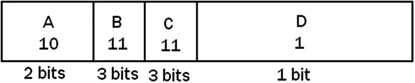

图2-24

数字编码的信息源

图中较大的区域用较少的比特编码，而较小的区域则需要更多的比特。该信息源的期望值是所有值的概率与该值本身乘积的总和。在此示例中，期望值计算如下：

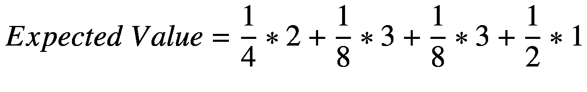

每当图中区域的大小减半时，比特数就增加一。当大小减半时，概率也减少0.5。从该图可以得出的结论是，随机事件 *x* 的信息量与该事件概率倒数的对数（以2为底）成正比。用公式表示即为：

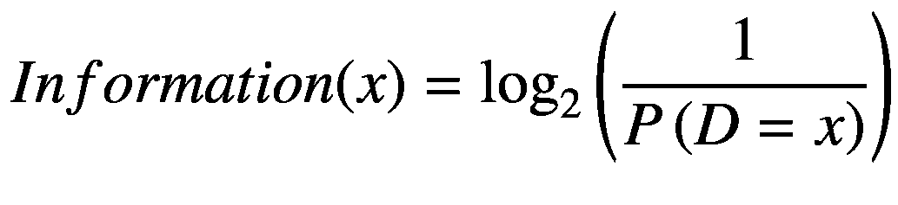

通常，随机变量的期望信息或“熵”与期望值相同，只是将值替换为信息：

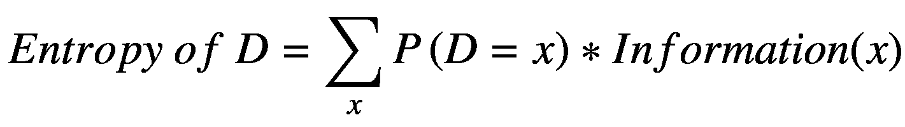

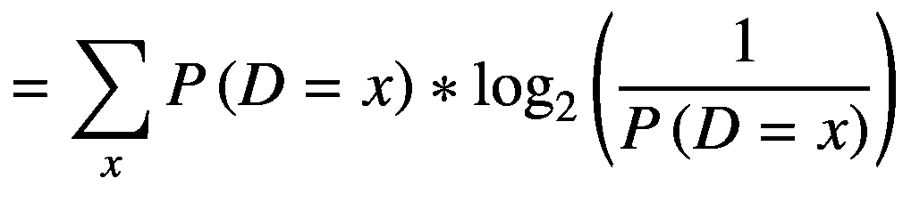

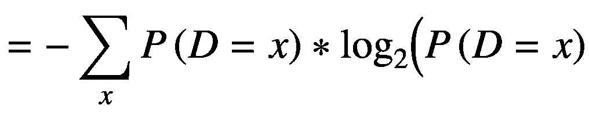

### 熵的性质

当组成元素异质（不纯）时，熵最大：如果

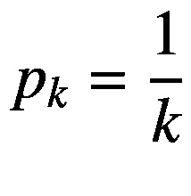

那么，

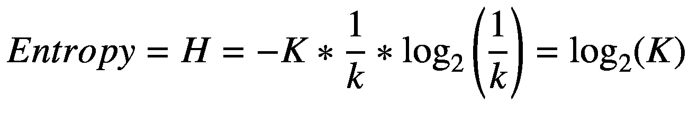

相反，当元素同质（纯净）时，熵最小：

如果 *p*[*i*] = 1 或 *p*[*i*] = 0

那么，

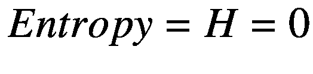

将熵定义为

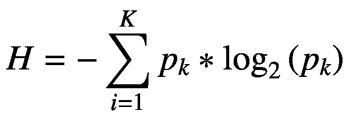

那么，熵的任何变化都被视为信息增益，并定义为

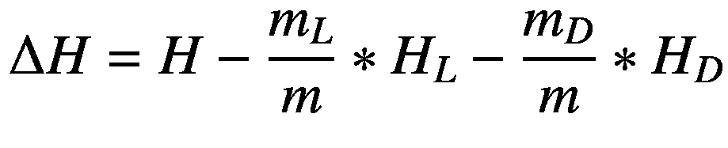

其中 𝑚 是实例总数，𝑚[𝑘] 是属于类别 𝑘 的实例数，𝐾 = 1, … , 𝑘。

### 信息增益示例

以下示例可视为朴素贝叶斯章节中示例的扩展。表2-6增加了若干特征，这些特征将用于计算在给定条件下是否进行活动的决策。

表2-6

活动决策

| 天气 | 温度 | 湿度 | 有风 | 活动 |
| --- | --- | --- | --- | --- |
| 晴 | 热 | 高 | 否 | 否 |
| 晴 | 热 | 高 | 是 | 否 |
| 阴 | 热 | 高 | 否 | 是 |
| 雨 | 温和 | 高 | 否 | 是 |
| 雨 | 凉爽 | 正常 | 否 | 是 |
| 雨 | 凉爽 | 正常 | 是 | 否 |
| 阴 | 凉爽 | 正常 | 是 | 是 |
| 晴 | 温和 | 高 | 否 | 否 |
| 晴 | 凉爽 | 正常 | 否 | 是 |
| 雨 | 温和 | 正常 | 否 | 是 |
| 晴 | 温和 | 正常 | 是 | 是 |
| 阴 | 温和 | 高 | 是 | 是 |
| 阴 | 热 | 正常 | 否 | 是 |
| 雨 | 温和 | 高 | 是 | 否 |

活动属性的信息值计算如下：

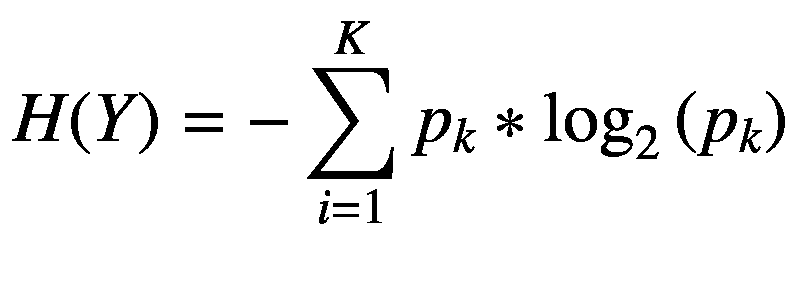

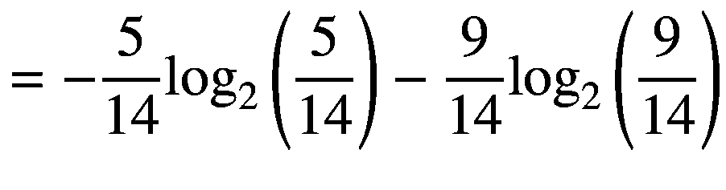

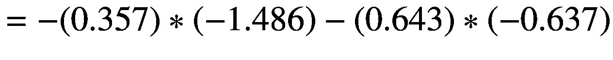

# 信息增益与基尼指数

## 信息增益计算

现在，考虑选择湿度属性时的信息增益。

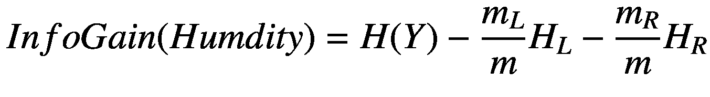

其中：

*   `m` = 湿度样本数量
*   `m[L]` = 湿度值为“正常”的样本数量
*   `m[R]` = 湿度值为“高”的样本数量
*   `H[L]` = 湿度值为“正常”的样本的信息值
*   `H[R]` = 湿度值为“高”的样本的信息值

代入后得到：

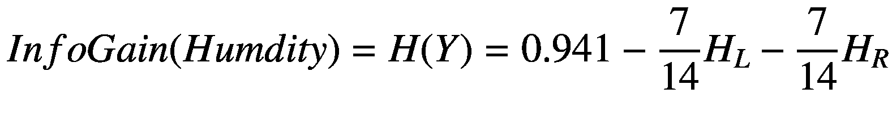

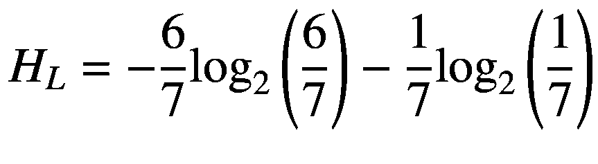

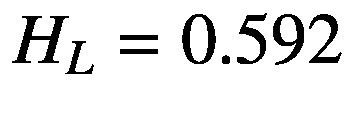


对剩余所有特征执行上述计算，得到：

*   天气 = 0.247
*   温度 = 0.029
*   湿度 = 0.152
*   有风 = 0.048

初始分裂将使用天气特征，因为根据属性选择度量（ASM）过程，它具有最高的信息增益值。

下一层的最优分裂如图 2-25 所示，图中附带了每次分裂所选的属性及其信息增益。


图 2-26 是最终的决策树。


请注意，并非所有叶节点都必须纯净；有时相似（甚至相同）的实例会属于不同类别。当数据无法进一步分裂时，分裂过程即停止。

## 基尼指数

决策树算法 CART（分类与回归树）使用基尼方法来创建分裂点。计算基尼指数的公式为：


其中 `p[i]` 是 `D` 中元组属于类别 `C[i]` 的概率。

基尼指数考虑每个属性的二元分裂。你可以计算每个分区不纯度的加权和。如果属性 `A` 上的二元分裂将数据 `D` 划分为 `D[1]` 和 `D[2]`，则 `D` 的基尼指数为：


对于离散值属性，选择使该属性基尼指数最小的子集作为分裂属性。对于连续值属性，策略是将每对相邻值作为可能的分裂点，并选择基尼指数较小的点作为分裂点。


基尼指数最小的属性被选为分裂属性。当元素异质（不纯）时，该指数最大。如果


那么


相应地，当元素同质（纯净）时，该指数最小。如果 `p[i] = 1` 或 `p[i] = 0`，那么 `Gini = 1 − 1 − 0 = 0`。

### 简单的基尼指数示例

我将从一个任意数据集开始，如表 2-7 所示，该数据集包含五个特征，其中特征 `E` 是预测特征。该特征有两个类别：正类或负类。为了简化计算，每个类别的实例数量恰好相等。

**表 2-7：任意数据集**

| 索引 | A    | B   | C   | D   | E   |
| :--- | :--- | :-- | :-- | :-- | :-- |
| 1    | 4.8  | 3.4 | 1.9 | 0.2 | 正类 |
| 2    | 5    | 3   | 1.6 | 1.2 | 正类 |
| 3    | 5    | 3.4 | 1.6 | 0.2 | 正类 |
| 4    | 5.2  | 3.5 | 1.5 | 0.2 | 正类 |
| 5    | 5.2  | 3.4 | 1.4 | 0.2 | 正类 |
| 6    | 4.7  | 3.2 | 1.6 | 0..2 | 正类 |
| 7    | 4.8  | 3.1 | 1.6 | 0.2 | 正类 |
| 8    | 5.4  | 3.4 | 1.5 | 0.4 | 正类 |
| 9    | 7    | 3.2 | 4.7 | 1.4 | 负类 |
| 10   | 6.4  | 3.2 | 4.7 | 1.5 | 负类 |
| 11   | 6.9  | 3.1 | 4.9 | 1.5 | 负类 |
| 12   | 5.5  | 2.3 | 4   | 1.3 | 负类 |
| 13   | 6.5  | 2.8 | 4.6 | 1.5 | 负类 |
| 14   | 5.7  | 2.8 | 4.5 | 1.3 | 负类 |
| 15   | 6.3  | 3.3 | 4.7 | 1.6 | 负类 |
| 16   | 4.9  | 2.4 | 3.3 | 1   | 负类 |

计算基尼指数的第一步是为每个特征或属性选择一些随机值进行分类（初始分割）。为该数据集选择的值如表 2-8 所示。

**表 2-8：初始分割属性值**

| A      | B      | C      | D      |
| :----- | :----- | :----- | :----- |
| >= 5.0 | >= 3.0 | >= 4.2 | >= 1.4 |
| < 5.0  | < 3.0  | < 4.2  | < 1.4  |

计算属性 `A` 的基尼指数：

*   值 >= 5
*   实例数量 = 12
*   值 >=5 且为正类的实例数量 = 5
*   值 >= 5 且为负类的实例数量 = 7


*   值：< 5
*   实例数量 = 4
*   值 >=5 且为正类的实例数量 = 3
*   值 >= 5 且为负类的实例数量 = 1

## 基尼指数与决策树分类器演示


加权求和得到


以类似方式计算其余属性得到


使用基尼指数时，初始分割点始终取最小值。基于计算出的指数得到的最终决策树如图 2-27 所示。


图 2-27 简单基尼指数示例的最终决策树

## 增益率

增益率是信息增益的一种改进，旨在减少其对高度分支特征的偏好。该算法在选择特征时会考虑分支的数量和大小。它通过将信息增益除以分割的“固有信息”来实现归一化，固有信息定义为确定实例所属分支所需的信息量。信息增益对具有较多结果的属性存在正向偏差，这意味着信息增益算法倾向于选择具有大量不同值的属性。

### 固有信息

固有信息表示将数据集分割成*K*个分区所产生的潜在信息：


具有高固有信息的分区在大小上应相似。少数分区包含大部分元组的数据集，其固有信息自然较低。

### 增益率的定义

增益率定义为


具有最大增益率的特征被选为分割特征。

`ID3` 是迭代二分器 3（Iterative Dichotomiser 3）的缩写，是由罗斯·昆兰发明的一种用于实现增益率属性选择度量（ASM）的算法。罗斯后来发明了 `C4.5` 算法，该算法是对 `ID3` 的改进，目前大多数使用增益率算法的机器学习系统都采用此算法。需要注意的是，在 `C4.5` 算法中，术语 `SplitInfo` 用于表示 `IntrinsicInfo`。除了这一术语上的差异外，基本的增益率算法保持不变。

此处不再提供增益率的示例，仅仅是因为这个补充说明已经过于冗长，而且如果你已经读到这里，很可能对属性选择度量（ASM）过程已经有了相当不错的理解。

### 使用 scikit-learn 进行决策树分类器演示

本次决策树演示将使用机器学习社区中一个经典的数据集，名为皮马印第安人糖尿病数据集。该数据集可以 CSV 格式从以下网址下载：

```
www.kaggle.com/uciml/pima-indians-diabetes-database#diabetes.csv
```

该数据集最初来自美国国立糖尿病、消化和肾脏疾病研究所。本次演示的目标是根据数据集中包含的某些诊断测量指标，对患者是否患有糖尿病进行诊断性预测。从更大的数据库中选取这些实例时，施加了若干限制条件。具体来说，这里的所有患者都是至少 21 岁的皮马印第安人血统的女性。

下载的 CSV 文件是压缩包，使用前必须解压。此外，你必须删除文件的第一行，因为它包含字符串类型的列标题描述。保留这一行会导致预测函数失败，因为字符串内容无法转换为浮点类型。我建议使用任何能够加载 CSV 文件的电子表格应用程序。我碰巧使用了微软的 Excel 程序，但任何开源的 Linux 应用程序可能也能正常工作。

我将分两个阶段开发 Python 脚本，同时讨论与决策树分类器模型相关的基础方法论。第一阶段将加载所有依赖项以及 CSV 文件。还会显示 CSV 文件的头部信息，以确认加载成功。第二阶段将是构建、训练和测试决策树模型。

第一步是加载所需的库，其中包括来自 `sklearn` 软件包的 `DecisionTreeClassifier` 数据模型。该数据模型默认使用基尼 ASM 过程，但如果需要其他 ASM 过程，可以更改此设置。

```
# 加载库
import pandas as pd
from sklearn.tree import DecisionTreeClassifier # 导入决策树分类器
from sklearn.model_selection import train_test_split # 导入 train_test_split 函数
from sklearn import metrics #导入 scikit-learn 的 metrics 模块用于计算准确率
col_names = ['pregnant', 'glucose', 'bp', 'skin', 'insulin', 'bmi', 'pedigree', 'age', 'label']
```

下一步是使用 Pandas 的 `read_csv` 函数加载所需的皮马印第安人糖尿病数据集。确保下载的数据集与脚本位于同一当前目录下。

```
# 加载数据集
pima = pd.read_csv("diabetes.csv", header=None, names=col_names)
pima.head()
```

图 2-28 显示了 CSV 文件的头部部分，包含前五条记录。


图 2-28 `diabetes.csv` 头部结果

下一步是将给定的列划分为两种类型的变量：因变量（目标）和自变量（特征）。

```
#将数据集拆分为特征和目标变量
feature_cols = ['pregnant', 'insulin', 'bmi', 'age','glucose','bp','pedigree']
X = pima[feature_cols] # 特征变量
y = pima.label # 目标变量
```

模型性能要求将数据集划分为训练集和测试集。可以使用函数 `train_test_split()` 来划分数据集。必须向此方法传递三个参数，即特征、目标和测试集大小。

```
# 将数据集拆分为训练集和测试集
# 70% 训练集，30% 测试集
X_train, X_test, y_train, y_test = train_test_split(X, y, test_size=0.3, random_state=1)
```

下一步是从 `sklearn` 软件包实例化一个决策树数据模型。该模型被命名为 `clf`，并使用从原始数据集中拆分出的 70% 的训练数据集进行训练。最后，使用模型的 `predict()` 方法，用剩余的 30% 数据集自动进行一系列预测。

在存储在 `X_test` 中的测试数据中，标签被视为要输入到 `predict()` 方法中的分类器的样本。该样本如下所示。将其作为字符串（而非浮点数）输入到 `predict()` 方法是无效的。为了移除它，使用了 `drop()` 函数。这就是 `X_test.drop(0)` 的返回结果，也是输入到 `predict()` 方法中的内容。

# 决策树分类

```python
['Pregnancies','Insulin','BMI','Age','Glucose','BloodPressure','DiabetesPedigreeFunction']
# 创建决策树分类器对象
clf = DecisionTreeClassifier()
# 训练决策树分类器
clf = clf.fit(X_train,y_train)
# 预测测试数据集的响应
y_pred = clf.predict(X_test.drop(0))
```

最后一步是衡量预测集的整体准确率。准确率是通过比较实际的测试集值与预测值来计算的。使用了 `scikit-learn` 包中的 `metrics` 模块来进行此准确率测量。

请注意，`y_test` 变量包含标签 `'Outcome'`，它是一个字符串。为了移除它，使用了 `drop()` 函数。

```python
# 模型准确率
print("Accuracy:",metrics.accuracy_score(y_test.drop(0), y_pred))
```

最终结果如下所示：

```
Accuracy: 0.6753246753246753
```

67.5% 是一个合理的准确率分数。然而，可以通过调整决策树算法使用的超参数来改进它，我将在后面的章节中演示这一点。

完整的脚本列表如下所示，并命名为 `diabetesDT.py`。该脚本可从本书的配套网站获取。

```python
# 加载库
import pandas as pd
from sklearn.tree import DecisionTreeClassifier # 导入决策树分类器
from sklearn.model_selection import train_test_split # 导入 train_test_split 函数
from sklearn import metrics #导入 scikit-learn 的 metrics 模块用于计算准确率
col_names = ['pregnant', 'glucose', 'bp', 'skin', 'insulin', 'bmi', 'pedigree', 'age', 'label']
# 加载数据集
pima = pd.read_csv("diabetes.csv", header=None, names=col_names)
print(pima.head())
#将数据集拆分为特征和目标变量
feature_cols = ['pregnant', 'insulin', 'bmi', 'age', 'glucose', 'bp', 'pedigree']
X = pima[feature_cols] # 特征
y = pima.label # 目标变量
# 将数据集拆分为训练集和测试集
# 70% 训练集，30% 测试集
X_train, X_test, y_train, y_test = train_test_split(X, y, test_size=0.3, random_state=1)
# 创建决策树分类器对象
clf = DecisionTreeClassifier()
# 训练决策树分类器
clf = clf.fit(X_train,y_train)
# 预测测试数据集的响应
y_pred = clf.predict(X_test.drop(0))
# 模型准确率
print("Accuracy:",metrics.accuracy_score(y_test.drop(0), y_pred))
```

## 可视化决策树

`scikit-learn` 的 `export_graphviz` 函数可用于显示决策树。此显示功能还需要 `pydotplus` 库。这些库通过以下命令安装：

```shell
pip install graphviz
pip install pydotplus
sudo apt-get install python-pydot
```

`export_graphviz` 函数将最终的决策树分类器文件转换为所谓的点文件（dot file）。然后，`pydotplus` 应用程序将此点文件转换为 `png` 格式的文件，该文件可以使用系统的图像查看器应用程序显示。

以下脚本名为 `diabetesDT.py`，可从本书的配套网站获取：

```python
# Load all required libraries
import pandas as pd
from sklearn.tree import DecisionTreeClassifier
from sklearn.model_selection import train_test_split
from sklearn.tree import export_graphviz
from sklearn.externals.six import StringIO
from sklearn import tree
import pydotplus
import collections
col_names = ['pregnant', 'glucose', 'bp', 'skin', 'insulin', 'bmi', 'pedigree', 'age', 'label']
# Load dataset
pima = pd.read_csv("diabetes.csv", header=None, names=col_names)
#split dataset in features and target variable
feature_cols = ['pregnant', 'insulin', 'bmi', 'age', 'glucose', 'bp', 'pedigree']
X = pima[feature_cols] # Features
y = pima.label # Target variable
# Split dataset into training set and test set
# 70% training and 30% test
X_train, X_test, y_train, y_test = train_test_split(X, y, test_size=0.3, random_state=1)
# Create Decision Tree classifer object
clf = DecisionTreeClassifier()
# Train Decision Tree Classifer
clf = clf.fit(X_train,y_train)
dot_data = tree.export_graphviz(clf, out_file=None, filled=True, rounded=True, special_characters=True, feature_names= feature_cols, class_names=['0','1'])
graph = pydotplus.graph_from_dot_data(dot_data)
colors = ('turquoise', 'orange')
edges = collections.defaultdict(list)
for edge in graph.get_edge_list():
edges[edge.get_source()].append(int(edge.get_destination()))
for edge in edges:
edges[edge].sort()
for i in range(2):
dest = graph.get_node(str(edges[edge][i]))[0]
dest.set_fillcolor(colors[i])
graph.write_png('tree.png')
```

您可以通过输入以下命令生成 `png` 格式的树图像：

```shell
python diabetesDT.py
```

请耐心等待，因为此命令大约需要 20 秒才能完成。脚本运行完成后，您将在显示器屏幕上看到提示符重新出现，除此之外没有任何其他内容。但是，主目录中会有一个名为 `tree.png` 的新图像。图 2-29 显示了此图像。


图 2-29

`tree.png`

我完全意识到无法阅读图像中显示的极小文本，这就是我放大了图像一小部分的原因。该部分如图 2-30 所示。


图 2-30

树图像的放大部分

在此决策树图中，每个内部节点都有一个用于分割数据的决策规则。基尼系数（Gini）指的是衡量节点不纯度的基尼比率，我在旁注中讨论过这一点。当一个节点的所有记录都属于同一类别时，该节点是纯的。这样的节点称为叶节点。

此脚本生成的树是未剪枝的。这种未剪枝的树基本上无法解释且不易理解。我将在下一节讨论如何通过剪枝来优化它。

## 优化决策树

# 决策树分类器的优化

有三个可用的超参数，可用于优化决策树分类器的性能。它们是：

*   `criterion`：可选（默认="gini"）或选择属性选择度量 – 此参数允许选择不同的 ASM。可用的标准是用于基尼指数的 `"gini"` 和用于信息增益的 `"entropy"`。

*   `splitter`：字符串，可选（默认="best"）或分割策略 – 此参数允许选择分割策略。可用的策略是 `"best"` 选择最佳分割，以及 `"random"` 选择最佳随机分割。

*   `max_depth`：整数或 `None`，可选（默认=`None`）或树的最大深度 – 此标准设置树的最大深度。如果为 `None`，则节点会一直扩展，直到所有叶子包含的样本数少于 `min_samples_split`。最大深度值较高可能会导致过拟合，而值较低则可能导致欠拟合。

在 `scikit-learn` 中，决策树分类器的优化是在实例化分类器时完成的。树的最大深度用于预剪枝。对 `pimaDiabetes.py` 脚本进行了修改，将树深度限制为 3，并将 ASM 更改为 `entropy`。为实现此优化，对脚本进行了以下代码更改：

```
# Create Decision Tree classifer object
clf = DecisionTreeClassifier(criterion="entropy", max_depth=3)
```

重新运行此脚本，获得了新的准确率分数 `0.7705627705627706`。这个 77% 的分数优于未输入任何性能参数时获得的 67.5% 的分数。

还使用这些新的性能参数重新运行了 `diabetesDT.py`。树图被重新标记为 `tree1.png`，以区别于初始版本。图 2-31 显示了使用优化后的超参数生成的新树图。


图 2-31 tree1.png

这个剪枝后的模型比之前的决策树图简单得多，也更容易理解。

#### 决策树的优缺点

##### 优点

*   决策树易于解释和可视化。
*   它们可以轻松捕获非线性模式。
*   它们需要用户进行较少的数据预处理。
*   它们可用于特征工程，例如预测适合变量选择的缺失值。
*   决策树对数据分布没有假设，因为它们是非参数模型。

##### 缺点

*   它们对噪声数据敏感。由于噪声数据，它们很容易过拟合。
*   数据中的微小变化（或方差）可能导致不同的决策树。
*   决策树可能会因不平衡的数据集而产生偏差。建议在创建决策树之前平衡数据集。