# 3. 机器学习数据模型探索：第二部分

本章是上一章开始的关于基本机器学习数据模型的讨论和演示的延续。我在上一章开头介绍了十种数据模型，它们是：

*   线性回归

*   逻辑回归

*   K-近邻分类器

*   高斯朴素[贝叶斯](http://scholar.google.com/scholar%253Fq%253DGaussian%252BNaive%252BBayesian%2526hl%253Den%2526as_sdt%253D0%2526as_vis%253D1%2526oi%253Dscholart)

*   决策树分类器

*   主成分分析

*   线性判别分析

*   支持向量机

*   学习向量量化

*   Bagging 和随机森林

前五种已在上一章中介绍，其余五种将在本章中介绍。请不要因为讨论顺序而推断模型之间的任何相对重要性。在每种情况下，我都会具体讨论何时以及如何使用每个模型。


## 主成分分析

主成分分析（PCA）是一种强大的算法，用于线性变换和降维。它广泛应用于许多领域，包括计算机视觉应用和金融交易。

使用 PCA 算法的主要目标是通过将大量变量转换成一个较小的变量集来降低数据维度，同时这个较小的变量集仍然包含原始大数据集中的大部分信息。简而言之，PCA 创建了更易于处理、便于数据分析且与其他机器学习算法兼容性更好的小数据集。总结来说，PCA 的核心思想是在保留尽可能多信息的同时，减少数据集中的变量数量。PCA 还执行数据压缩功能，我将在代码解释部分对此进行描述。

PCA 算法由于计算效率高，往往占用更少的内存。此外，PCA 具有良好的可视化功能，有助于用户理解最终结果。

执行 PCA 时应遵循六个步骤：

1.  对数据进行标准化。
2.  使用标准化后的数据创建协方差矩阵。
3.  利用得到的矩阵计算特征向量（主成分）及其对应的特征值。或者，也可以应用奇异值分解（SVD）。
4.  按降序排列特征值，并选择解释数据中最大方差的 *k* 个特征向量（特征值越大，表示该特征解释的方差越多）。
5.  创建一个新的投影矩阵 W。
6.  通过 W 变换原始数据集 X，以获得一个 k 维子空间 Y。

我意识到上述过程中存在一些陌生且未知的术语，可能会让一些读者感到困惑甚至害怕。别担心；这些内容将在接下来的讨论和演示中得到解释和澄清。

### PCA 脚本讨论

本演示的第一步是加载将要使用的数据集。我将使用的数据集是经典的鸢尾花数据集，在前一章中我也用过。该数据集可从以下网站获取。文件扩展名为 data。你只需将扩展名改为 csv 即可。

`https://archive.ics.uci.edu/ml/datasets/Iris`

下载文件后，请务必删除包含原始列标题的第一行。如果不这样做，脚本将运行失败。

这个鸢尾花数据集包含了来自三个不同物种的 150 朵鸢尾花的测量数据。

鸢尾花数据集中的三个类别是：

1.  山鸢尾 (n = 50)
2.  杂色鸢尾 (n = 50)
3.  维吉尼亚鸢尾 (n = 50)

每个类别中的四个特征是：

1.  花萼长度 (cm)
2.  花萼宽度 (cm)
3.  花瓣长度 (cm)
4.  花瓣宽度 (cm)

以下是一个名为 `pcaDemo.py` 的 Python 脚本的完整清单，该脚本将完成包含可视化的完整 PCA 分析。我还根据需要为这些代码部分提供了额外的解释性注释。此脚本可从本书的配套网站获取：

```
# 导入所需库
import matplotlib.pyplot as plt
import numpy as np
import pandas as pd
import seaborn as sns
from sklearn import decomposition
from sklearn.preprocessing import scale
from sklearn.decomposition import PCA
from sklearn.preprocessing import StandardScaler
df = pd.read_csv('iris.csv', header=None, sep=',')
df.columns=['sepal_length', 'sepal_width', 'petal_length', 'petal_width', 'class']
df.dropna(how="all", inplace=True) # 删除文件末尾的空行
# 显示前 5 条记录
print(df.head())
f, ax = plt.subplots(1, 4, figsize=(10,5))
vis1 = sns.distplot(df['sepal_length'],bins=10, ax= ax[0])
vis2 = sns.distplot(df['sepal_width'],bins=10, ax=ax[1])
vis3 = sns.distplot(df['petal_length'],bins=10, ax= ax[2])
vis4 = sns.distplot(df['petal_width'],bins=10, ax=ax[3])
plt.show()
# 将数据表拆分为数据 X 和类别标签 y
X = df.ix[:,0:4].values
y = df.ix[:,4].values
# 标准化数据
X_std = StandardScaler().fit_transform(X)
# 计算协方差矩阵
mean_vec = np.mean(X_std, axis=0)
cov_mat = (X_std -mean_vec).T.dot(X_std - mean_vec) / (X_std.shape[0] - 1)
print('协方差矩阵 \n%s' %cov_mat)
# 计算特征向量和特征值
cov_mat = np.cov(X_std.T)
eig_vals, eig_vecs = np.linalg.eig(cov_mat)
print('特征向量 \n%s' %eig_vecs)
print('特征值 \n%s' %eig_vals)
eig_pairs = [(np.abs(eig_vals[i]), eig_vecs[:,i]) for i in range(len(eig_vals))]
eig_pairs.sort()
eig_pairs.reverse()
print('降序排列的特征值:')
for i in eig_pairs:
print(i[0])
# 计算特征值比率
tot = sum(eig_vals)
var_exp = [(i / tot)*100 for i in sorted(eig_vals, reverse=True)]
cum_var_exp = np.cumsum(var_exp)
print('特征值比率:%s' %cum_var_exp)
# 创建 W 矩阵
matrix_w = np.hstack((eig_pairs[0][1].reshape(4,1),
eig_pairs[1][1].reshape(4,1)))
print('矩阵 W:\n', matrix_w)
# 将 X_std 数据集转换到子空间 Y
Y = X_std.dot(matrix_w)
features = ['sepal_length', 'sepal_width', 'petal_length', 'petal_width']
# 创建 PC1 与 PC2 的散点图
x = df.loc[:,features].values
x = StandardScaler().fit_transform(x)
pca = PCA(n_components=2)
principalComponents = pca.fit_transform(x)
principalDf = pd.DataFrame(data=principalComponents, columns=['主成分 1','主成分 2'])
finalDf = pd.concat([principalDf, df[['class']]], axis=1)
fig = plt.figure(figsize=(8,8))
ax = fig.add_subplot(1,1,1)
ax.set_xlabel('主成分 1', fontsize=15)
ax.set_ylabel('主成分 2', fontsize=15)
ax.set_title('2 分量 PCA', fontsize=20)
targets = ['setosa', 'versicolor', 'virginica']
colors = ['r', 'g', 'b']
for target, color in zip(targets, colors):
indicesToKeep = finalDf['class'] == target
ax.scatter(finalDf.loc[indicesToKeep, '主成分 1'], finalDf.loc[indicesToKeep, '主成分 2'], c=color, s=50)
ax.legend(targets)
ax.grid
plt.show()
```

以下讨论将详细说明此脚本各个部分所发生的事情。我没有对我认为你应该已经能够轻松阅读和理解的部分（例如库导入部分）进行注释。此外，为了节省篇幅，除非代码段不超过三行，否则我将只展示代码段的开头和结尾。不要忘记确保下载文件的扩展名为 csv。

```
df = pd.read_csv('iris.csv', header=None, sep=',')
.
.
print(df.head())
```

在这段代码中，首先从当前目录下的 CSV 文件创建了一个名为 `df` 的 Pandas DataFrame。然后初始化列名（属性），进行一些清理工作，接着显示前五条记录（即头部），以确保 DataFrame 已正确创建。

```
f, ax = plt.subplots(1, 4, figsize=(10,5))
.
.
plt.show()
```


这段代码为前四个属性创建了一系列单变量图。回顾原始数据分布以更深入地了解你所处理的数据，始终是一个好习惯。这些图表将在结果部分展示。

```
# 将数据表拆分为数据 X 和类别标签 y
X = df.ix[:,0:4].values
y = df.ix[:,4].values
```

在进行标准化之前，需要将数据拆分为名为 *X* 的属性集和名为 *y* 的类别标签集。

```
X_std = StandardScaler().fit_transform(X)
```

这段代码代表了 PCA 流程中的第一步，即对输入数据进行标准化。如果你回顾过输入数据集，你会很快意识到这些数据具有不同的量纲。标准化数据有助于最大化主成分（特征向量）的数据方差。如果不进行标准化，与取值范围为 0 到 10 的变量相比，取值范围为 0 到 100 的变量在计算协方差时会产生过大的影响。标准化可以减少分析中引入无意偏差的任何可能性。通用的标准化公式为：

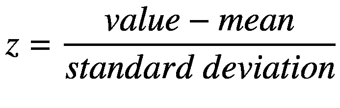

在这种情况下，所有数据都被转换到均值为 0、方差和标准差为 1 的单位尺度上。单位尺度变换通常有助于许多不同的机器学习算法获得最佳性能。

```
mean_vec = np.mean(X_std, axis=0)
cov_mat = (X_std -mean_vec).T.dot(X_std - mean_vec) / (X_std.shape[0] - 1)
print('Covariance matrix \n%s' %cov_mat)
```

PCA 流程的第二步是实例化一个协方差矩阵。协方差矩阵是一个 *n* × *n* 的对称矩阵（其中 *n* 是维度数），其条目包含了与初始变量所有可能配对相关的所有协方差。请注意，此计算中使用的是标准化后的数据集。顺便提一下，标准化数据集的协方差矩阵等同于该数据集的相关系数矩阵。这意味着在 PCA 流程中，可以使用数据集的相关系数矩阵来代替协方差矩阵。

关于协方差矩阵，有两个事实也有助于你的理解：

*   正值表示两个变量同增或同减。这也被称为正相关。

*   负值表示一个变量增加时，另一个变量减少。这也被称为负相关。

```
    cov_mat = np.cov(X_std.T)
    .
    .
    print('Eigenvalues \n%s' %eig_vals)
    ```

PCA 流程的第三步是计算与输入数据集相关的特征向量和特征值。这些计算可以通过以下三种方式之一完成：

*   使用协方差矩阵

*   使用相关系数矩阵

*   使用奇异值分解（SVD）

当属性值相似时，通常使用协方差矩阵；当属性值处于不同量纲时，则使用相关系数矩阵。然而，正如我之前解释的，标准化的协方差矩阵也等同于相关系数矩阵，所以基本上两者都可以使用。在这段代码中，使用了协方差矩阵，因为数据已经标准化，并且计算协方差矩阵比计算相关系数矩阵更容易。

NumPy 库使得计算特征向量和特征值变得容易。`np.linalg.eig(cov_mat)` 方法将结果作为两个列表返回，分别命名为 `eig_vecs` 和 `eig_vals`。特征向量和特征值总是成对出现的，意味着一个向量总是对应一个值。

需要认识到的一个关键点是，`eig_vecs` 就是主成分。主成分是作为原始变量的线性组合或混合而构建的新变量。这些新变量是不相关的，并且原始变量所包含的大部分信息都被压缩到了前几个主成分中。这就是为什么 PCA 常被描述为一种数据压缩算法。需要强调的重要一点是，主成分没有任何现实意义，因为它们是由原始数据集变量的线性组合构建的。从几何角度看待主成分，可以得到以下结论：

> *主成分代表了能够解释最大方差量的数据方向（即向量）。*

一个向量所承载的方差越大，数据点沿该向量的离散程度就越大。此外，沿一个向量的离散程度越大，它所携带的信息就越多。为了简化这个概念，只需将主成分视为新的坐标轴，它们提供了观察和评估数据的最佳角度，从而使观测值之间的差异更加明显。

按照特征值从高到低的顺序对特征向量进行排序，就能得到按重要性排序的主成分。

最后，SVD 算法是另一种计算特征向量和特征值的高效计算方法。

```
eig_pairs = [(np.abs(eig_vals[i]), eig_vecs[:,i]) for i in
.
.
for i in eig_pairs:
print(i[0])
```

这是 PCA 流程的第四步，它按照特征值从高到低的顺序对特征向量进行排序，从而得到按重要性排序的主成分。特征值最低的特征向量包含关于固有数据分布的信息量最少。

```
tot = sum(eig_vals)
.
.
print('Eigenvalue ratios:%s' %cum_var_exp)
```

这段代码创建了一个列表，列出了每个特征向量对总体方差的累积贡献。用户应使用此列表来确定最佳的 k 值。稍后你将在结果部分看到，k = 2 的值解释了数据集中超过 95% 的方差。这是一个很好的结果，因为数据可以很容易地进行可视化。

```
# 创建 W 矩阵
matrix_w = np.hstack((eig_pairs[0][1].reshape(4,1),
eig_pairs[1][1].reshape(4,1)))
print('Matrix W:\n', matrix_w)
```

这段代码是第五步，它创建了最后一步所需的 **W 矩阵**。

```
# 将 X_std 数据集转换到子空间 Y
Y = X_std.dot(matrix_w)
```

这是 PCA 流程的第六步，也是最后一步，其中标准化后的数据集被转换到一个名为矩阵 Y 的 k 维子空间中。

```
x = df.loc[:,features].values
.
.
plt.show()
```

这段代码创建了一个散点图，显示了数据点相对于主成分 1 和主成分 2 的分布。该图应为用户提供一种极佳的方式来可视化数据中任何潜在的、使用普通二维特征散点图无法观察到的数据模式。回想一下，原始数据集有四个特征，现在通过 PCA 算法已降维到二维，从而可以创建此图。像这样的图是使用 PCA 进行数据建模的关键原因之一。


#### PCA 演示

首先确保 `iris.csv` 文件与脚本位于同一目录，并且 CSV 文件中的第一条记录已按照我之前讨论的方式删除。通过输入以下命令运行脚本：

```
python pcaDemo.py
```

图 3-1 展示了运行此脚本后生成的单变量图。

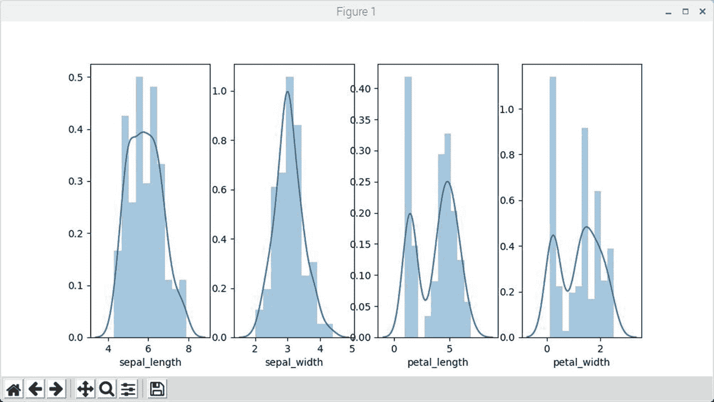

图 3-1

单变量图

这些图表清晰地表明，花萼值更倾向于高斯分布，而花瓣值则更倾向于多模态分布。在考虑针对该数据集使用何种合适的数据模型时，应牢记这些观察结果。这两种分布都与该 PCA 数据模型兼容。

图 3-2 展示了脚本输出的数值结果。

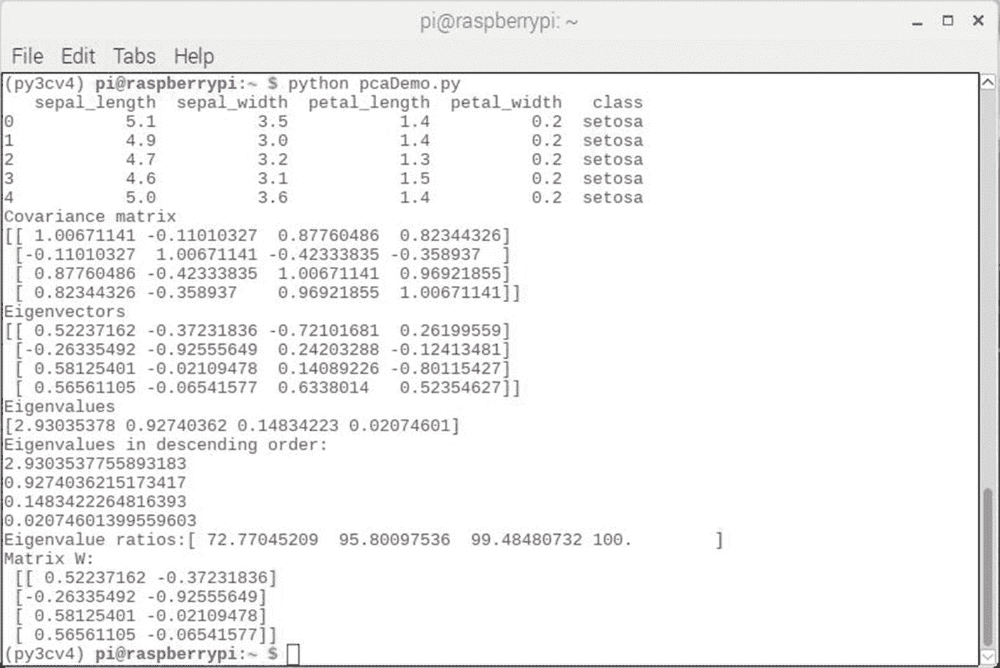

图 3-2

数值结果

虽然中间结果很有用，但需要仔细检查的关键结果是特征值比率列表。该列表显示了与四个主成分或特征向量相关的累积方差百分比。请注意，列表中的第二个值是 95.8%，这意味着前两个主成分解释了超过 95% 的测量方差。这也意味着只有两个向量承载了数据集的大部分信息。这转化为 k = 2。这是一个很好的结果，它将允许创建一个非常精简的矩阵，该矩阵仍然能够代表原始数据集中包含的大部分信息。

表 3-1 展示了图中的协方差矩阵，这让我可以就你应该了解的几个概念进行评论。

表 3-1

协方差矩阵

|  | 花萼长度 | 花萼宽度 | 花瓣长度 | 花瓣宽度 |
| --- | --- | --- | --- | --- |
| 花萼长度 | 1.00 | –0.11 | 0.88 | 0.82 |
| 花萼宽度 | –0.11 | 1.00 | –0.42 | –0.36 |
| 花瓣长度 | 0.88 | –0.42 | 1.00 | 0.97 |
| 花瓣宽度 | 0.82 | –0.36 | 0.97 | 1.00 |

首先要知道的是，表中的每个值也是交叉特征之间的相关系数。主对角线全部由 1 组成，因为这是自相关系数，即对同一变量计算相关性的结果。其次，相关性是一个分配函数，这意味着变量的顺序不影响结果。这导致了一个完全对称的矩阵，正如你通过检查表格所看到的那样。

表中存在一些高相关值（忽略对角线），这表明数据集中包含大量冗余信息。这个结果也意味着 PCA 可以进一步揭示数据集中存在的任何隐藏或潜在模式，这应该会引起用户的兴趣。

图 3-3 很重要，因为它确实展示了该数据集中的隐藏模式。

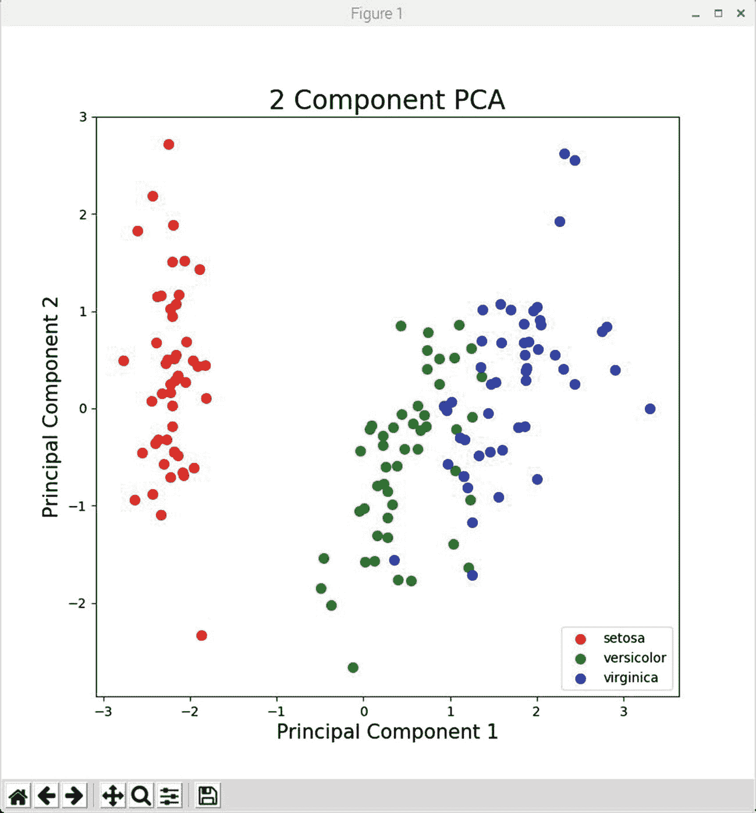

图 3-3

主成分散点图

该图是前两个主成分的散点图，它们贡献了数据集中近 96% 的信息。你应该很容易观察到，Setosa 鸢尾花物种与其他两个物种明显区分开来。其余两个物种的数据点簇是相邻的，但仍然可以相互区分。我知道在本书的灰度图像中观察到这一点几乎是不可能的，但请相信我的话，这些簇确实是相邻的。这些观察结果使用传统的二维散点图是无法实现的，你可以通过回顾第 2 章的鸢尾花数据集图来亲自验证。

#### 何时使用 PCA

我认为增加一个关于何时使用 PCA 的简短章节是个好主意。当有理由怀疑数据集中可能包含使用传统二维可视化技术不易观察到的隐藏或潜在模式时，PCA 将是一个合适的数据模型选择。

每当需要进行降维时，PCA 也很有帮助。这种降维与以下情况密切相关：

*   高维数据的可视化。
*   噪声降低。通常，高阶主成分仅负责数据中的微小变化。
*   用于预处理将与其他机器学习算法一起使用的数据。这些算法可以包括那些在较小维度数据集上表现更好的算法。
*   用于减少数据集内的相关性。相关数据对整体可用信息的贡献不大，但却会显著增加计算效率低下问题。

## 线性判别分析

线性判别分析（LDA）与我在上一节讨论的主成分分析（PCA）非常相似。一个主要区别在于，PCA 旨在确定那些最大化数据方差的轴或主成分，而 LDA 则旨在寻找那些最大化类别间分离度的轴。我强烈建议你在阅读 LDA 部分之前先阅读 PCA 部分，因为在 LDA 部分中，我将使用在 PCA 部分中首次引入和解释的术语，而不再另行说明。

LDA 与 PCA 一样，是一种降维算法，但它是监督式的。稍后我将解释在此上下文中“监督式”的含义。LDA 将数据集投影到较低维度的空间，同时增加类别可分性。增加的类别可分性降低了发生过拟合的概率。LDA 还提高了计算效率。限制过拟合的能力使 LDA 相对于 PCA 算法具有明显的优势。

由于 PCA 和 LDA 看起来非常相似，我加入了图 3-4，该图突出了这两种算法之间的一些显著差异。

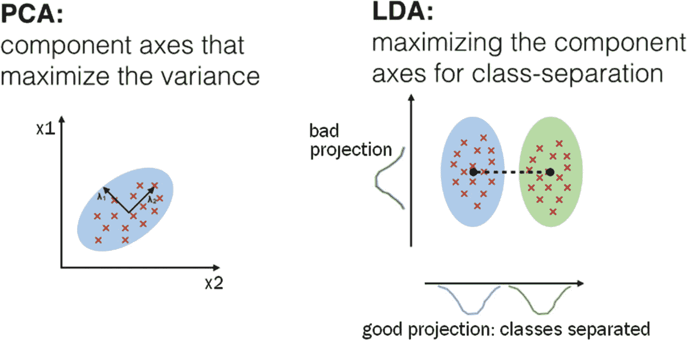

图 3-4

PCA 与 LDA 的区别

PCA 是一种“无监督”算法，因为它不使用类别标签，其主要目的是计算能够最大化数据集方差的轴或主成分。另一方面，LDA 是“监督式”的，它使用类别数据来计算能够最大化多个类别之间分离度的轴或线性判别式。

LDA 过程涉及五个步骤。它们是：

1.  从数据集中计算不同类别的 d 维均值向量，其中 d 是特征空间的维度。
2.  计算类间散度矩阵和类内散度矩阵。
3.  计算散度矩阵的特征向量和配对的特征值。
4.  选择与 top k 个特征值对应的 k 个特征向量，以形成一个维度为 d x k 的变换矩阵。
5.  通过变换矩阵将 d 维特征空间 X 变换为 k 维特征空间 X_lda。


### LDA 脚本讨论

本演示将使用与 PCA 演示中相同的鸢尾花数据集。不过，与 PCA 脚本相比，此脚本会自动加载数据集。

以下是一个名为 `ldaTest.py` 的 Python 脚本的完整清单，该脚本将完成一个完整的 LDA 并附带可视化效果。此脚本中有一个我希望指出的额外功能。在脚本接近结尾处，我演示了如何仅使用 sklearn 的 LDA 模块来执行 LDA，而无需像前面脚本部分那样经历所有步骤。

像往常一样，我也会根据需要为这些代码部分提供额外的解释性注释。此脚本可从本书的配套网站获取：

```
#导入所需库
import numpy as np
import pandas as pd
import matplotlib.pyplot as plt
import seaborn as sns
from sklearn.preprocessing import StandardScaler
from sklearn.discriminant_analysis import LinearDiscriminantAnalysis
np.set_printoptions(precision=4)
#读取数据集
file_path = "https://raw.githubusercontent.com/bot13956/linear-discriminant-analysis-iris-dataset/master/iris.data.csv"
df = pd.read_csv(file_path, header=None)
df.head()
#对分类标签进行编码
from sklearn.preprocessing import LabelEncoder
class_le = LabelEncoder()
y = class_le.fit_transform(df[4].values)
#标准化特征
stdsc = StandardScaler()
X_train_std = stdsc.fit_transform(df.iloc[:,range(0,4)].values)
# 构建类内协方差散度矩阵 S_W
S_W = np.zeros((4,4))
for i in range(3):
S_W += np.cov(X_train_std[y==i].T)
#构建类间散度矩阵 S_B
N=np.bincount(y) # 给定类别的样本数量
vecs=[]
[vecs.append(np.mean(X_train_std[y==i],axis=0)) for i in range(3)] # 类别均值
mean_overall = np.mean(X_train_std, axis=0) # 总体均值
S_B=np.zeros((4,4))
for i in range(3):
S_B += N[i]*(((vecs[i]-mean_overall).reshape(4,1)).dot(((vecs[i]-mean_overall).reshape(1,4))))
# 计算 inv(S_W)dot(S_B) 的排序后的特征值和特征向量
eigen_vals, eigen_vecs = np.linalg.eig(np.linalg.inv(S_W).dot(S_B))
eigen_pairs = [(np.abs(eigen_vals[i]), eigen_vecs[:,i]) for i in range(len(eigen_vals))]
eigen_pairs = sorted(eigen_pairs,key=lambda k: k[0], reverse=True)
print('按降序排列的特征值：\n')
for eigen_val in eigen_pairs:
print(eigen_val[0])
# 绘制主要的 LDA 成分
tot = sum(eigen_vals.real)
discr = [(i / tot) for i in sorted(eigen_vals.real, reverse=True)]
cum_discr = np.cumsum(discr)
plt.bar(range(1, 5), discr, width=0.2,alpha=0.5, align="center",label='单个“可判别性”')
plt.step(range(1, 5), cum_discr, where="mid",label='累积“可判别性”')
plt.ylabel('判别比率')
plt.xlabel('线性判别成分')
plt.ylim([-0.1, 1.1])
plt.legend(loc='best')
plt.show()
#将原始特征投影到新的特征空间
W=np.hstack((eigen_pairs[0][1][:, ].reshape(4,1),eigen_pairs[1][1][:, ].reshape(4,1))).real
X_train_lda = X_train_std.dot(W)
# 列出并绘制 LDA 子空间中的转换后特征
data=pd.DataFrame(X_train_lda)
data['class']=y
data.columns=["LD1","LD2","class"]
data.head()
markers = ['s', 'x','o']
sns.lmplot(x="LD1", y="LD2", data=data, markers=markers,fit_reg=False, hue="class", legend=False)
plt.legend(loc='upper center')
plt.show()
#使用 scikit-learn 实现 LDA
lda = LinearDiscriminantAnalysis(n_components=2)
X_train_lda = lda.fit_transform(X_train_std, y)
# 列出并绘制 scikit-learn 的 LDA 结果
data=pd.DataFrame(X_train_lda)
data['class']=y
data.columns=["LD1","LD2","class"]
data.head()
markers = ['s', 'x','o']
colors = ['r', 'b','g']
sns.lmplot(x="LD1", y="LD2", data=data, hue="class", markers=markers,fit_reg=False,legend=False)
plt.legend(loc='upper center')
plt.show()
```

以下是对前面脚本中引入 PCA 部分未涉及的新概念的各代码段的解释性讨论。此外，为了节省篇幅，除非代码段不超过三行，否则我将只展示代码段的开头和结尾。

```
from sklearn.preprocessing import LabelEncoder
class_le = LabelEncoder()
y = class_le.fit_transform(df[4].values)
```

类别字符串值被转换为数值，以便在脚本中更容易处理。sklearn 的 `LabelEncoder` 模块完成了此任务。

```
S_W = np.zeros((4,4))
for i in range(3):
S_W += np.cov(X_train_std[y==i].T)
```

创建了一个 4 x 4 的矩阵 S_W，它代表了类内协方差。

```
N=np.bincount(y) # 给定类别的样本数量
.
.
mean_overall).reshape(4,1)).dot(((vecs[i]-mean_overall).reshape(1,4))))
```

创建了一个 4 x 4 的矩阵 S_B，它代表了类间协方差。

```
eigen_vals, eigen_vecs = np.linalg.eig(np.linalg.inv(S_W).dot(S_B))
.
.
for eigen_val in eigen_pairs:
print(eigen_val[0])
```

计算并排序特征向量和特征值。排序后的特征值也会显示在屏幕上。

```
tot = sum(eigen_vals.real)
.
.
plt.show()
```

绘制主要的 LDA 成分。

```
W=np.hstack((eigen_pairs[0][1][:, ].reshape(4,1),eigen_pairs[1][1][:, ].reshape(4,1))).real
X_train_lda = X_train_std.dot(W)
```

将原始特征投影到新的特征空间。

```
data=pd.DataFrame(X_train_lda)
.
.
plt.show()
```

将转换后的特征绘制到 LDA 子空间中。

```
lda = LinearDiscriminantAnalysis(n_components=2)
X_train_lda = lda.fit_transform(X_train_std, y)
```

使用 scikit-learn 实现 LDA。

```
data=pd.DataFrame(X_train_lda)
.
.
plt.show()
```

绘制 scikit-learn 的 LDA 结果。


#### LDA 演示

通过输入以下命令来运行脚本：

```
python ldaTest.py
```

图 3-5 展示了运行此脚本后得到的排序特征值。你可以清晰地看到，只有前两个特征值是显著的，这也印证了鸢尾花数据集的 PCA 结果。

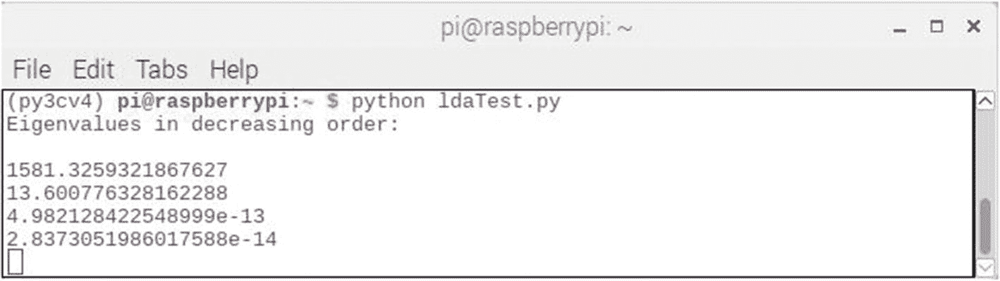

图 3-5

排序后的特征值

图 3-6 是线性判别式相对大小的示意图。

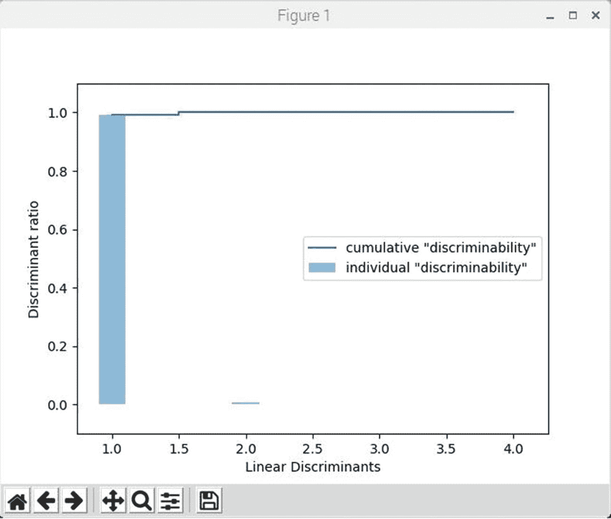

图 3-6

线性判别式相对大小示意图

由于第一个线性判别式的值远大于其他三个，该图显得非常倾斜。它比第二个线性判别式大 99% 以上，因此在图中以线条而非条形显示。剩下的一个判别式小到可以忽略不计，正如你通过检查图 3-5 中的特征值所能辨别的那样。

图 3-7 是变换后的鸢尾花数据集相对于前两个线性判别式的示意图。

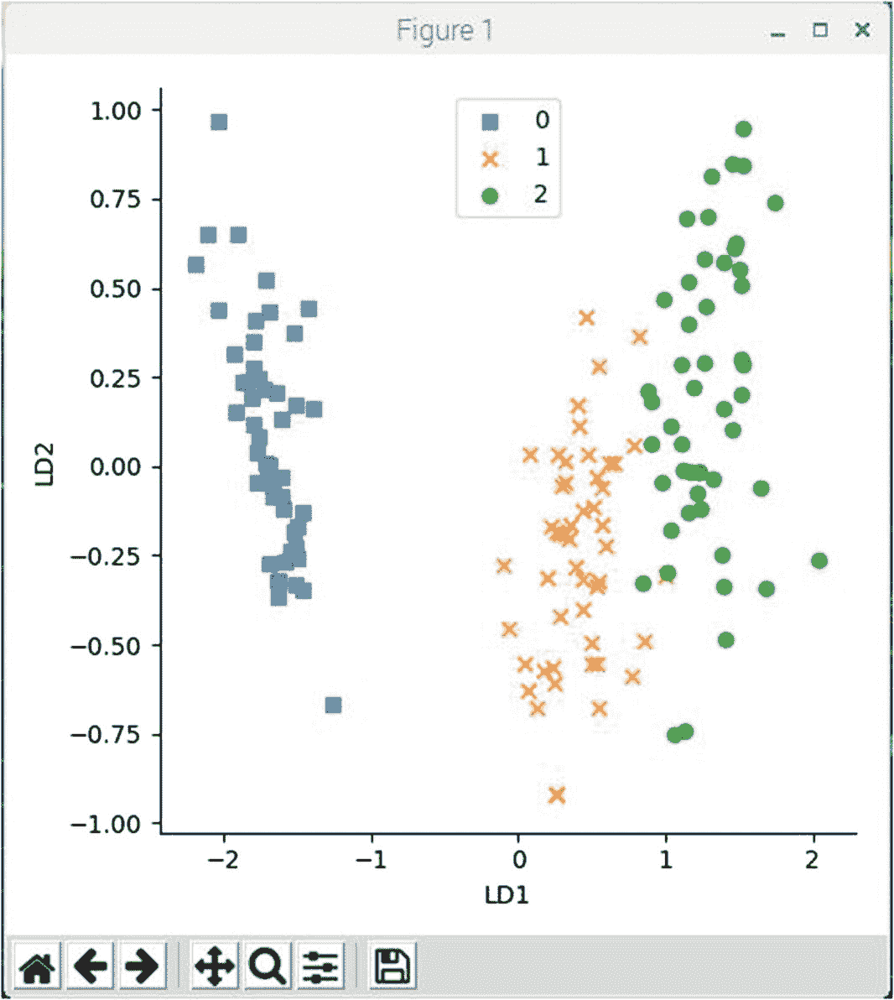

图 3-7

变换后的鸢尾花数据集示意图

此图的重要启示在于，图中现在用数字表示的每个鸢尾花类别都沿着线性判别式 1 (LD1) 轴清晰地分离开来。这在使用 LDA 算法时始终是一个最优结果。你应该将此图与 PCA 部分的图 3-3 进行比较，看看它们彼此有多接近。根据我的视觉判断，我认为 LDA 图显示的类别间分离程度比 PCA 图更大，但两者非常接近。

图 3-8 是使用 sklearn LDA 模块的结果示意图。

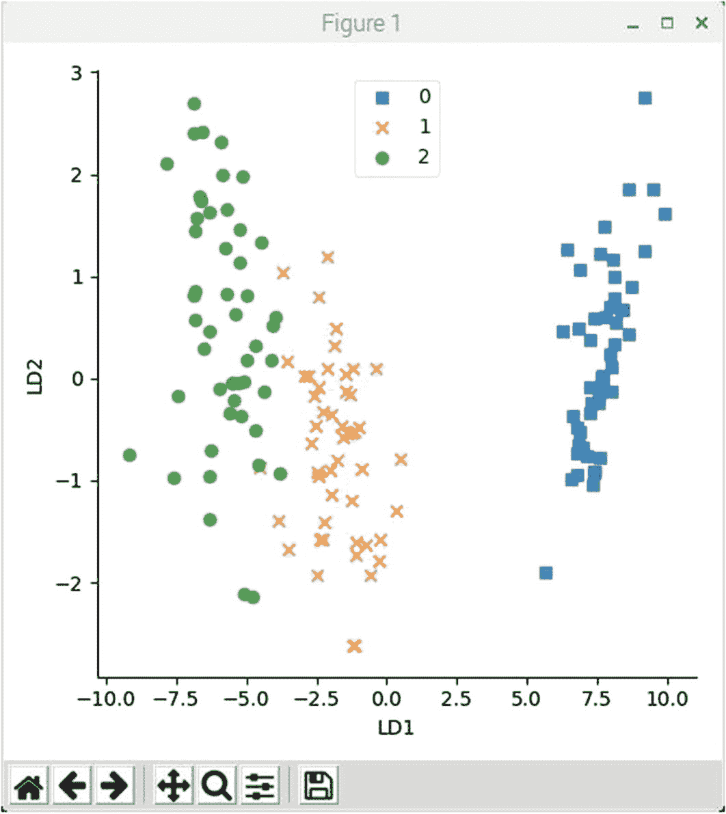

图 3-8

sklearn LDA 模块结果示意图

你可能会考虑将此模块作为一个一步式流程来使用，因为所有中间结果并非直接可得。尽管如此，绘制出的结果相当令人满意，并且与通过逐步流程获得的结果非常接近。

#### PCA 与 LDA 的比较

我创建了图 3-9，这是一个组合图，将图 3-3 和图 3-7 并排放置，以突出显示这两种算法之间的异同。

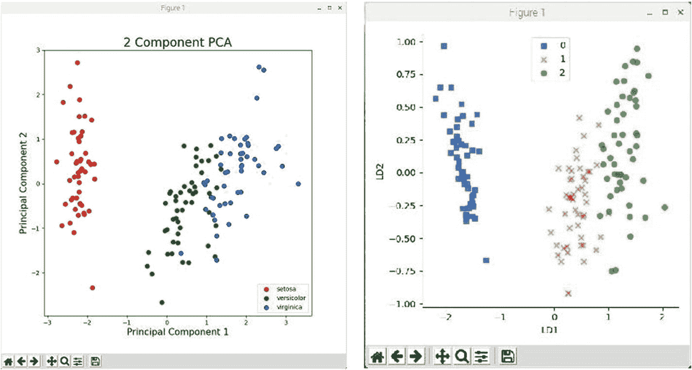

图 3-9

PCA 与 LDA 对比图

图 3-9 证实了之前讨论的内容。PCA 解释了整个数据集中的最大方差，而 LDA 则为我们提供了能解释各个类别间最大方差的轴。

## 支持向量机

支持向量机 (SVM) 数据模型主要关注分类，其次才是预测。SVM 的首要目标是确定能够将数据分割成至少两个维度 (2D) 的最佳或最优边界。当处理超过 2D 的情况时，这个分割边界被称为分离超平面。“最佳”超平面是指能在支持向量之间创建最宽间隔的超平面。超平面通常也被称为决策边界。

我认为传达 SVM 基本概念的最佳方式是将直观讨论与图形相结合。SVM 可以用纯数学术语来描述，但数学很快就会变得复杂且显然不直观。

此处的初步讨论仅涉及线性 SVM 数据模型。我将在演示的第一部分之后介绍非线性 SVM 模型。

我将从一个包含六个数据点的简单图开始，这些点被分成两类，每类三个点。图 3-10 展示了这些数据点。

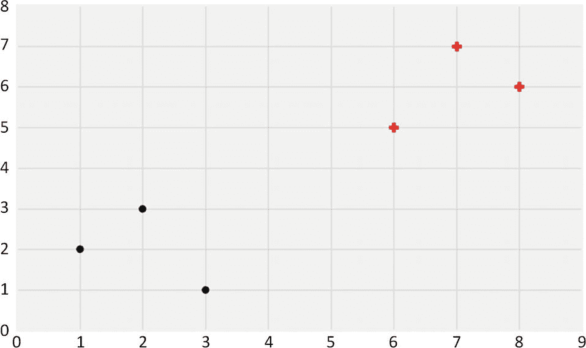

图 3-10

示例数据点

如果向图中添加一个新的数据点，直观上它会根据距离最近的类别进行分类。当然，应用 KNN 数据模型可以轻松完成此任务。使用 KNN 模型的问题在于，必须为每个数据点计算欧几里得距离。对于这个小型数据集来说这不是问题；然而，尽管 KNN 相当可靠和准确，但在处理大型数据集时，它的扩展性并不好。SVM 改变了整个视角，因为它能最佳地拟合一个超平面来分割数据集。一旦计算出决策边界，任何新数据都会根据其位于边界的哪一侧而被自动分类。除非重新训练数据集，否则决策边界保持不变。这一切意味着，与 KNN 模型不同，SVM 可以轻松扩展以适应新数据。

现在自然产生的问题是，如何确定最佳的分割超平面？可以像图 3-11 所示那样进行“目测”。

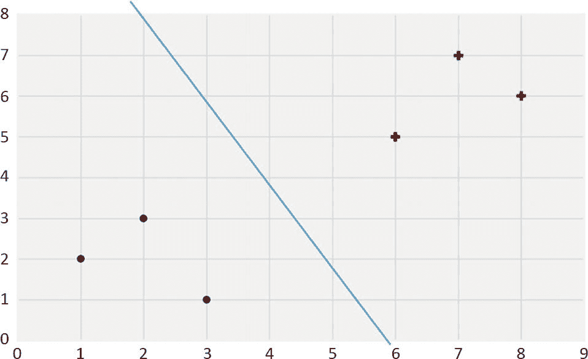

图 3-11

“目测”超平面

这条分割线（技术上来说是超平面的 2D 投影）看起来大致正确。然而，新的问题是如何找到支持向量？找到支持向量的关键在于，认识到距离决策边界最近的类别数据点也将是支持向量的一部分。图 3-12 展示了本例中 SVM 支持向量的图形化呈现。

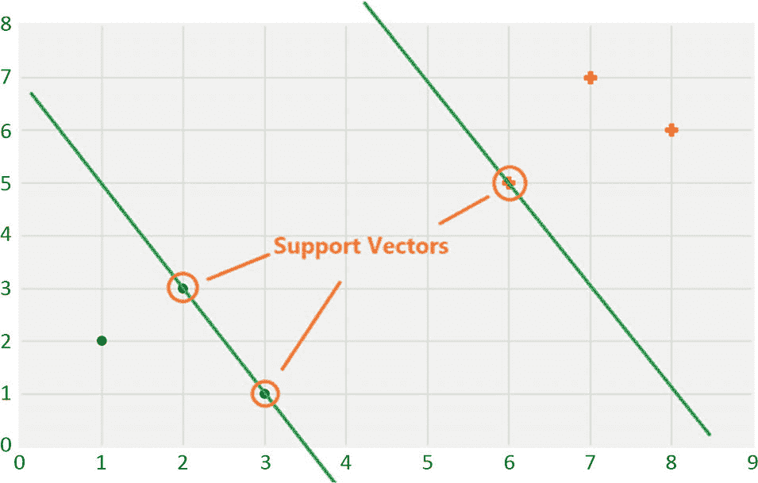

图 3-12

支持向量

接下来，创建穿过支持向量数据点的最大间隔分离线。决策边界的位置由总宽度 *W* 决定，如图 3-13 所示。

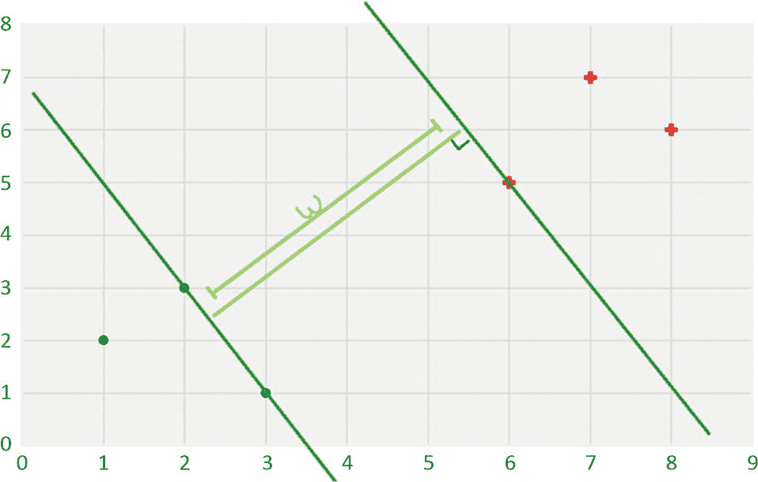

图 3-13

总宽度确定

现在，只需将 *W* 除以 2，决策边界的位置就固定了。如图 3-14 所示。

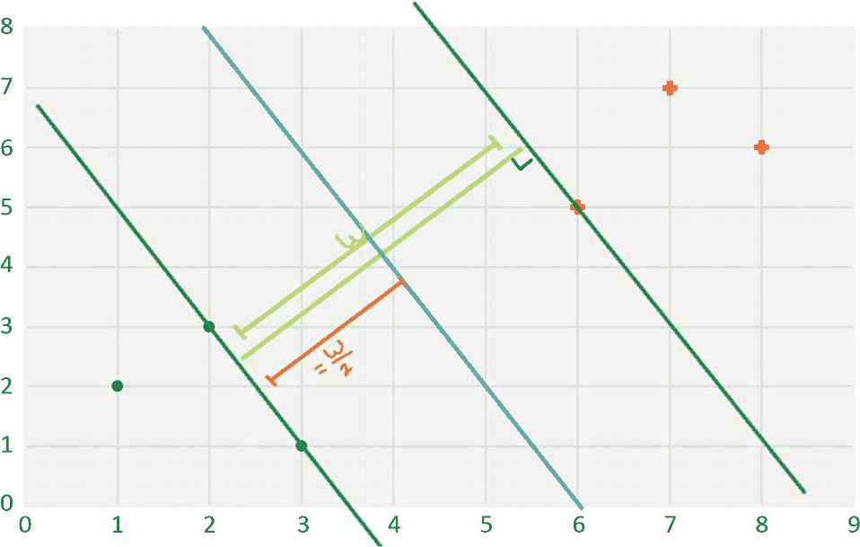

图 3-14

确定决策边界的位置

图 3-15 是 SVM 模型的直观图示，展示了支持向量与决策边界之间需要最大化的距离。

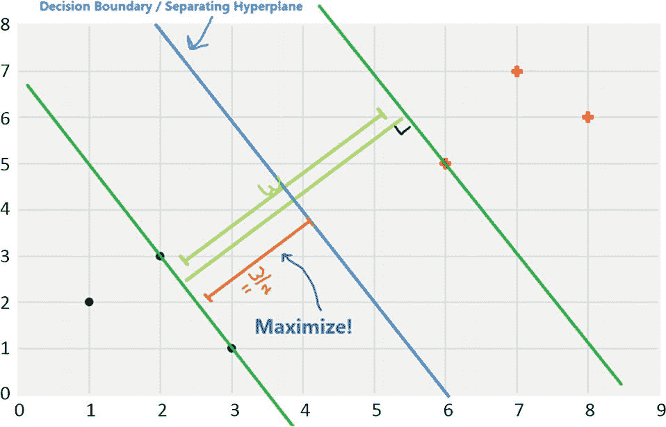

图 3-15

直观图，展示了需要最大化的距离

观察此图，现在可以这样说：任何位于决策边界/分离超平面左侧的点都属于黑点类别，而任何位于右侧的数据点都属于红加号类别。

以上是不使用数学或代码对 SVM 进行的简单介绍。接下来的演示将展示如何以有益的方式使用 SVM。


### SVM 演示 – 第一部分

本演示使用了 sklearn 的 SVM 模块。因此，无需像本章之前的数据模型那样逐步开发代码。此代码使用了另一个经典数据集，名为“威斯康星州乳腺癌（诊断）数据集”。它是一个多变量数据集，包含从 569 例乳腺癌针吸活检中提取的 30 个属性。这些属性是对健康细胞和恶性细胞的细胞学描述。本质上，该数据集涉及两个类别：患有恶性细胞的患者和未患有恶性细胞的患者。该数据集是 sklearn 自带数据集的一部分，无需显式下载。该数据集可直接在脚本中导入。

此 SVM 演示的最终目标是，根据一组特定的属性，确定一条测试记录是健康还是不健康的概率。

此脚本名为 `svmDemo1.py`，可从本书的配套网站获取。我没有添加额外的注释，因为脚本很短，并且我认为已有的注释足以解释代码。

```
# 导入所需库
import pandas as pd
import numpy as np
import matplotlib.pyplot as plt
import seaborn as sns
from sklearn.model_selection import train_test_split
from sklearn.svm import SVC
from sklearn.metrics import classification_report
# 将数据集导入名为 'cancer' 的变量中
from sklearn.datasets import load_breast_cancer
cancer = load_breast_cancer()
# 将输入特征加载为 DataFrame
df_features = pd.DataFrame(cancer['data'], columns = cancer['feature_names'])
# 将输出变量 'target' 添加到 DataFrame 中
df_target = pd.DataFrame(cancer['target'], columns = ['Cancer'])
# 显示前 5 条记录
print(df_features.head())
# 分割数据集，70% 用于训练，30% 用于测试
X_train, X_test, y_train, y_test = train_test_split(df_features, np.ravel(df_target), test_size=0.30, random_state=101)
# 实例化 SVC 模型。SVC 是 sklearn 中的分类器名称。
model = SVC()
# 使用 fit 方法训练模型
model.fit(X_train, y_train)
# 使用测试数据集测试模型
predictions = model.predict(X_test)
# 显示预测结果
print(classification_report(y_test, predictions))
```

通过输入以下命令来运行脚本：

```
python svmDemo1.py
```

图 3-16 显示了运行脚本的结果。

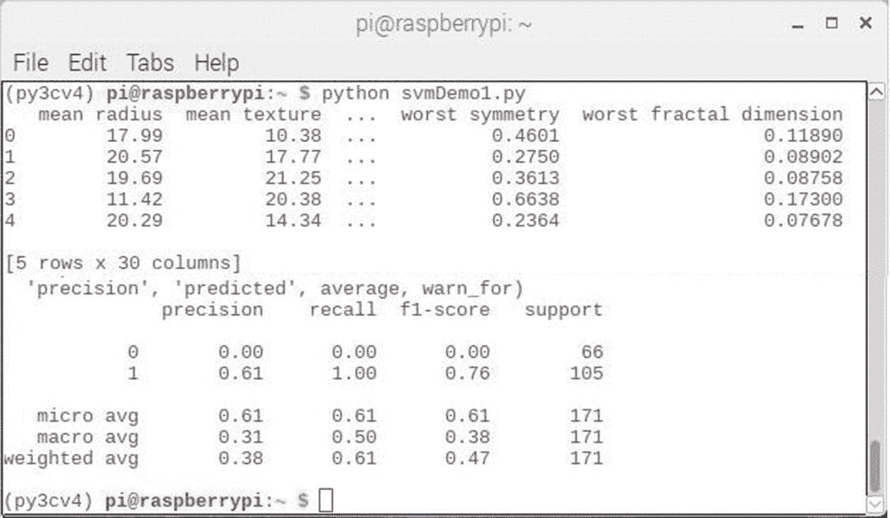

**图 3-16**

svmDemo1 结果

你首先应该注意到的是 `head` 的结果，它显示了数据集中前五条记录的部分内容。共有 30 个属性，这意味着这是一个高维数据集，线性超平面试图对其进行分割。仅此一点就应该为你敲响警钟。几乎不可能想象出任何一个能够有效分离这么多数据点的平面，尤其是当许多数据点具有相似尺度时。这一现实在预测结果中得到了证实，其加权平均值为 0.38。这是一个糟糕的结果，意味着只有 38% 的测试数据被正确预测。从长远来看，你简单地抛硬币都可能做得更好。如何改进这个结果？答案包含在下面的讨论中。

### SVM 演示 – 第二部分

SVM 中有一项技术被称为核“技巧”，它是为处理高维数据集而开发的，例如本演示中使用的乳腺癌数据集。这个技巧实际上并非“卑鄙”或“阴险”意义上的技巧，而仅仅是为了适应高维数据集。当数据点在 p 维或有限空间中不是线性可分时，有人提出将这个空间映射到一个更高维的空间。然后，可以使用核技巧构建定制的非线性超平面。每个 SVM 核都包含一个非线性核函数。这个函数有助于构建一个高维特征空间。已经开发了许多核函数，并且目前还有其他核函数正在研究中。这是一个极其活跃的研究领域。

我将像解释基本 SVM 概念时那样，采用直观/图形化的方法来解释非线性核，因为该主题的基础数学过于复杂和详细，不适合包含在本书中。

在图 3-17 中，左侧有 *x* 和 *o* 数据点，对于二维情况，它们显然无法被一个线性平面或直线分开。然而，如果数据点通过某个函数 ∅ 进行变换，它们就可以很容易地被分开，如图右侧所示。

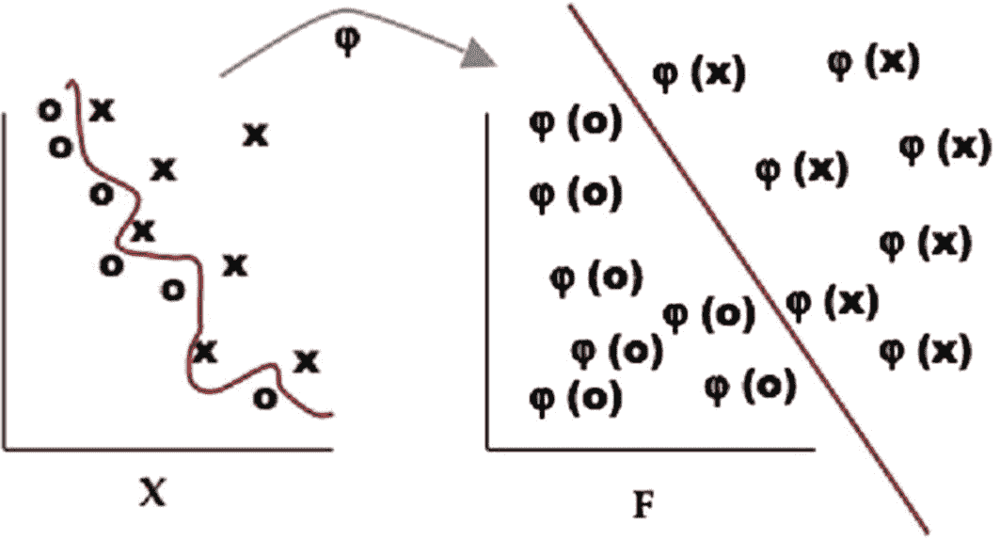

**图 3-17**

变换后的数据集

主要思想是通过将原始数据集映射到更高维的空间来改善类别的线性可分性。在图 3-18 中，图左上方的原始数据点无法被线性函数分开。在通过二次函数映射后，它们可以被分开，如右侧的图所示。

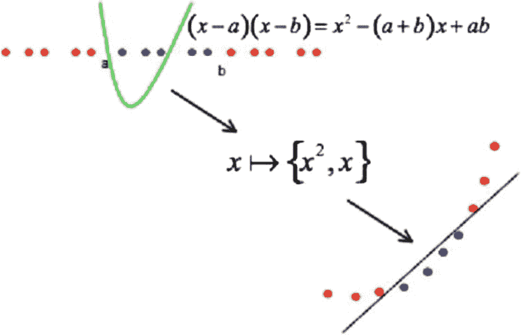

**图 3-18**

通过二次函数变换的数据集

图 3-19 展示了另一个问题，其中决策边界并不明显。问题是，可以使用什么决策函数来分离这些数据点？

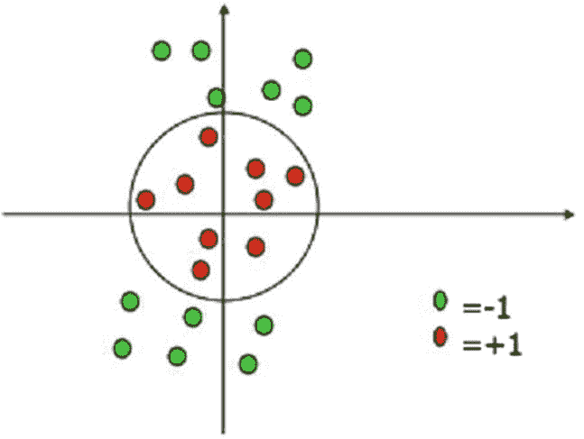

**图 3-19**

有问题的数据集

这个问题的答案是使用极坐标，如图 3-20 所示。

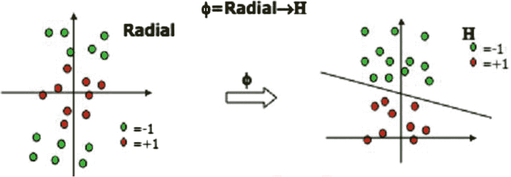

**图 3-20**

已解决的有问题数据集

SVM 拥有以下核函数来解决非线性数据集问题：

**多项式核** – 该核实现以下方程

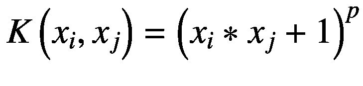

其中 *p* = 可调参数。另请注意，计算 *K* 只需要在原始点积的基础上进行 1 次加法和 1 次幂运算。

**径向基函数 (rbf)** – 该核实现以下方程

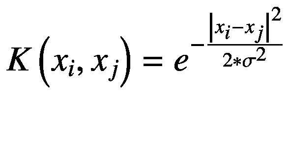

rbf 也称为高斯函数。图 3-21 展示了高斯函数在示例数据集上的应用。

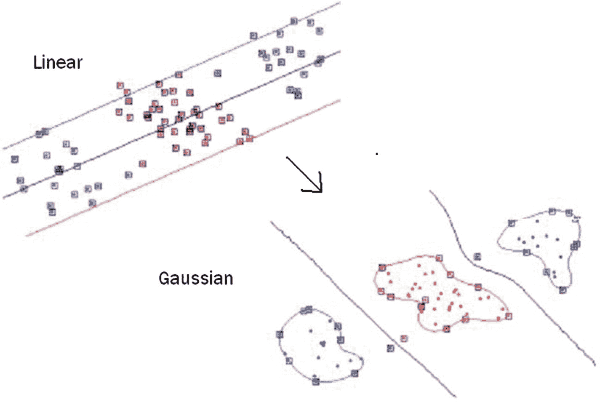

**图 3-21**

高斯函数应用

**Sigmoid 函数** – 这是 sigmoid 函数，它也在其他数据模型中用作激活函数。


以下脚本名为 svmDemo2.py，可从本书的配套网站获取。此处仅列出新增代码，这些代码必须追加到现有的 svmDemo1.py 脚本中。我在代码后附上了一些解释性注释。

```
# 网格搜索
param_grid = {'C':[0.1, 1, 10, 100, 1000], 'gamma':[1, 0.1, 0.01, 0.001, 0.0001], 'kernel':['rbf']}
from sklearn.model_selection import GridSearchCV
grid = GridSearchCV(SVC(), param_grid, refit=True, verbose=3)
grid.fit(X_train, y_train)
print('\n')
print('最佳参数为 ', grid.best_params_)
grid_predictions = grid.predict(X_test)
from sklearn.metrics import classification_report
print(classification_report(y_test, grid_predictions))
```

以下是对该脚本中包含的新代码的解释性注释。

```
param_grid = {'C':[0.1, 1, 10, 100, 1000], 'gamma':[1, 0.1, 0.01, 0.001, 0.0001], 'kernel':['rbf']}
```

该语句设置了三个重要的 SVM 参数：`kernel`、`C` 和 `gamma`。`kernel` 参数有以下选项：

*   linear – 当数据集适合线性超平面分割时使用
*   rbf – 非线性超平面
*   poly – 非线性超平面

`C` 参数在训练阶段用于指定在计算支持向量时，对数据异常值的考量程度。`C` 值较低会使决策面更平滑，而高值则允许 SVM 模型选择更多样本作为支持向量。

`gamma` 参数定义了单个训练样本的影响范围，低值表示“远”，高值表示“近”。`gamma` 参数可以解释为模型选为支持向量的样本影响半径的倒数。

选择合适的参数主要基于数据集的性质。在本例中，对于高维数据集，rbf 是一个不错的选择。为 `C` 和 `gamma` 选择合适值则是一个棘手的问题。幸运的是，sklearn 提供了一种迭代方法来选择这些参数。

```
from sklearn.model_selection import GridSearchCV
grid = GridSearchCV(SVC(), param_grid, refit=True, verbose=3)
grid.fit(X_train, y_train)
print('\n')
print('最佳参数为 ', grid.best_params_)
grid_predictions = grid.predict(X_test)
```

`GridSearchCV` 模块生成一个带有交叉验证的网格搜索对象。这段代码对数据集执行了两项任务：交叉验证和（超）参数调优。交叉验证是模型使用一组数据进行训练，并使用另一组数据进行测试的过程。参数调优是为模型参数选择能最大化模型准确率的值的过程。名为 `grid` 的对象现在包含了通过迭代网格搜索过程得到的 `C` 和 `gamma` 参数的最优值。会显示最优参数值，并使用优化后的参数生成一组新的预测结果。

```
from sklearn.metrics import classification_report
print(classification_report(y_test, grid_predictions))
```

预测的准确性通过从 sklearn 的 `metrics` 库导入的 `classification_report` 模块来确认。回想一下，我之前在其他演示中使用过这个模块。

通过输入以下命令来运行脚本：

```
python svmDemo2.py
```

图 3-22 显示了运行脚本的结果。

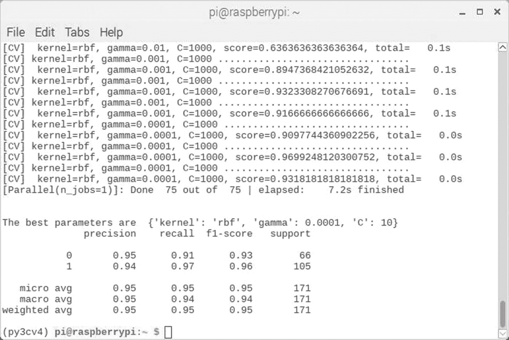

图 3-22

svmDemo2 运行结果

你在这张图中首先注意到的可能是顶部滚动显示的中间结果。这仅仅是计算最终优化参数所执行的 75 个步骤中的一小部分。滚动条的最后一行显示最终值为：

kernel = rbf, gamma = 0.0001 且 C = 1000。

显然，内核规范在迭代过程中没有改变，但其他两个参数确实发生了变化。我确实查看了这个滚动条，并确定 gamma 值似乎对最终准确率影响最大。它最终是一个很小的值，这意味着模型选为支持向量的样本的影响半径很大，也就是说，在确定支持向量时包含了最大数量的数据点。

结果最后一行显示的加权平均准确率为 0.95，即 95% 的准确率。这是一个很好的结果，相比演示第一部分糟糕的 38% 结果有了巨大提升。这个结果恰恰证明了使用仅“适合”原始数据集的适当数据模型，并且必须对任何调优参数进行优化调整是极其重要的。

## 学习向量量化

在开始讨论之前，我首先要感谢 Jason Brownlee 博士在 2018 年 8 月发表的一篇优秀博客，题为“How to Implement Learning Vector Quantization from Scratch with Python”，本节中的大部分代码和关键概念都基于此。我之前在讨论中引用过 Jason 的博客，我发现他的教程非常清晰且富有启发性。我强烈建议你查看他的博客、文章和电子书。

学习向量量化（LVQ）与 k-NN 算法类似，都是通过寻找与现有数据模式最接近的匹配来进行预测。两者之间的显著区别在于，k-NN 使用实际的训练模式，而 LVQ 则从训练数据中创建一个模式库。

这个模式库被称为向量码本，库中的每个模式称为一个码本向量。码本向量被初始化为从训练数据集中随机选择的值。然后，经过多个周期或训练轮次，通过使用学习算法对它们进行修改，以最优地总结训练数据。该学习算法一次处理一条训练记录，在码本向量中找到最佳匹配。如果训练记录与码本向量属于同一类别，则对其进行修改使其“更接近”码本向量；如果属于不同类别，则使其“更远离”。我稍后会解释距离这个比喻，以帮助阐明数据项之间“更接近”或“更远离”的概念。

只有在所有码本向量都处理完毕后，才开始进行预测。预测使用 k-NN 算法，其中 k = 1。

### LVQ 基本概念

首先需要讨论的是将在以下所有部分（包括演示）中使用的数据集。该数据集是地球大气层雷达“探测”产生的数值记录集合。每条记录描述了返回雷达信号的属性，其中可能包含电离层的重要测量值。数据模型的目的是预测特定记录是否包含任何重要的电离层测量值。

数据集中有 351 条记录，每条记录包含 34 个数值数据点。这些点被分成 17 对，对应每个雷达返回信号，每个数值的范围为 0 到 1。目标类别的属性值为“g”（表示良好）或“b”（表示不良）。

该数据集名为 inosphere.csv，可以从以下网址下载：

`https://archive.ics.uci.edu/ml/datasets/Ionosphere`


#### 欧几里得距离

接下来要讨论的概念是欧几里得距离。我意识到在之前的讨论中已经使用过这个术语，而它有时会根据上下文的不同而具有不同的含义。在此案例中，电离层数据集由多行数字组成。欧几里得距离定义为两个向量（由行数据构成）之间差值的平方和的平方根。该距离度量的方程如下：

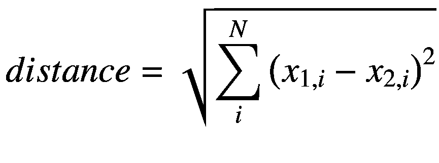

其中

*   *x*[*1*] = 第一行数据
*   *x*[*2*] = 第二行数据
*   *i* = 列索引
*   *N* = 列数（属性）

欧几里得距离越小，两条数据记录越相似。反之，距离越大，记录越不相似。如果距离为 0，则记录完全相同。

#### 最佳匹配单元

最佳匹配单元（BMU）是与新数据记录最相似的码本向量。为新记录定位 BMU 需要计算新记录与每个码本向量之间的欧几里得距离。这需要使用前面讨论过的距离度量方法来完成。计算完成后，对所有距离进行排序，与最小距离值关联的码本向量就是与新记录最相似的。

上述描述的过程与使用 LVQ 进行预测的方式相同。使用 k=1 的 KNN 算法来定位与未知记录最相似的码本向量。然后返回关联的类别值“g”或“b”。

#### 训练码本向量

训练码本向量的第一步是使用从训练数据集中随机选取的特征构建的模式来初始化所有向量。初始化完成后，必须修改这些向量以最优地概括训练数据集。这些修改以迭代方式进行。在顶层，使用完整的训练集重复该过程固定数量的轮次。在每个轮次内，每个训练模式仅使用一次来更新码本向量。为每个训练模式检测一个 BMU 并进行更新。计算训练模式与 BMU 之间的任何差异，并将其记录为误差。然后比较 BMU 和训练模式的类别值，如果发现匹配，则会将记录的误差加到 BMU 上，使其“更接近”训练模式。反之，如果类别值不匹配，则减去误差，导致 BMU 被“推离”训练模式。

学习率（LR）参数控制 BMU 的调整幅度。该参数是一个权重因子，影响应用于所有 BMU 的变化量。例如，如果 LR 为 0.20 或 20%，这意味着只有 20%的检测误差会被应用于 BMU。此外，LR 本身也会被调整，使其在第一个轮次中效果最大，而在后续轮次中效果递减。这种递减效果称为线性衰减学习率调度，也广泛用于人工神经网络。

### LVQ 演示

在开始我惯常的演示之前，我认为有必要介绍一下零规则算法。在实际尝试各种模型之前，通常无法确定哪种数据模型最适合你的特定问题领域。因此，在开始处理问题时，建立一个性能基线非常重要。基线性能提供了一个参考，可用于与应用于该问题的任何数据模型进行比较。没有基线，就无法了解特定模型取得了多好的效果。分类和回归的基线均由零规则算法创建，该算法也称为 ZeroR 或 0-R。

分类预测模型预测的是类别值。零规则算法预测训练数据集中观测数量最多的类别值。我将演示如何使用怀卡托知识分析环境（*Weka*）机器学习软件套件将零规则算法应用于电离层数据集。主用户界面称为*Explorer*。Weka 是一个基于 Java 的应用程序，可以在 RasPi 上作为 jar 文件运行。Weka 可以从以下地址下载：

`https://sourceforge.net/projects/weka/`

要使用电离层数据集，它必须是 arff 格式。名为 ionosphere.arff 的数据集可以从这个页面下载：

`https://github.com/renatopp/arff-datasets/find/master`

在运行应用程序之前，请确保 ionosphere.arff 与 Weka jar 文件位于同一目录中。然后通过输入以下命令启动应用程序。请注意，Weka 也提供 Windows 的 exe 扩展名下载，因此你可以使用安装程序来安装 Weka。

```
java -jar weka.jar
```

应按照以下七个步骤来获取基线结果：

1.  启动 Weka GUI 选择器。
2.  点击“Explorer”按钮打开 Weka Explorer 界面。
3.  加载电离层数据集 *ionosphere.arff* 文件。
4.  点击“Classify”选项卡打开分类选项卡。
5.  选择 ZeroR 算法（默认应已选中）。
6.  选择“Cross-validation”测试选项（默认应已选中）。
7.  点击“Start”按钮评估算法在数据集上的表现。

Weka Explorer 的结果如图 3-23 所示。

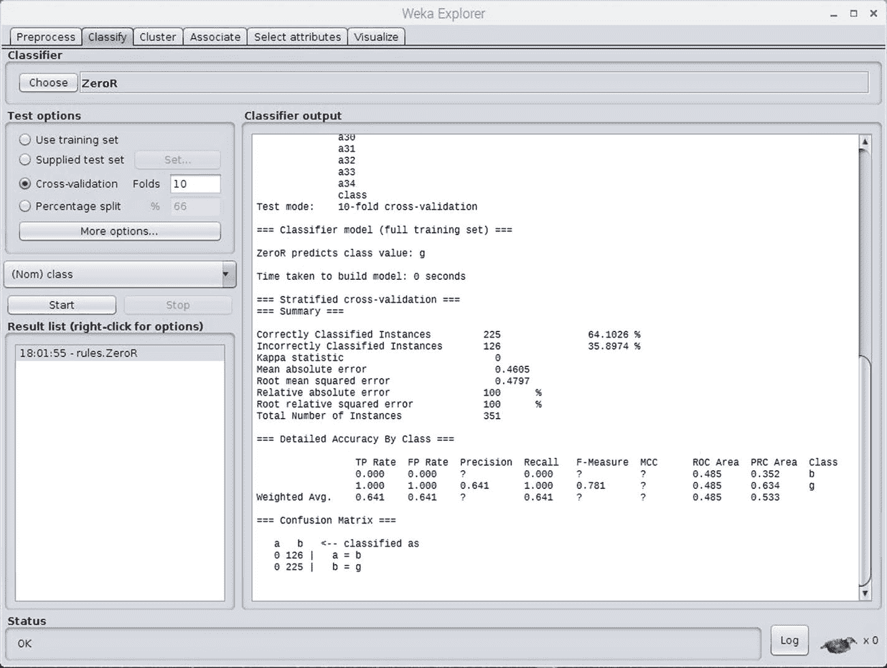

图 3-23

Weka Explorer 结果

零规则算法对所有实例预测“*g”*值，因为它是多数类，并达到了 64.1%的准确率。任何机器学习算法要证明其在此问题上具有更好的性能，必须达到高于此值的准确率。

以下脚本实现了基础概念部分中介绍的所有概念。它名为 lvqDemo.py，可从本书的配套网站获取。我还在代码清单之后提供了额外的解释性注释。请确保数据集以 csv 扩展名提供，以便与代码兼容。


```
# 针对电离层数据集的 LVQ 算法
from random import seed
from random import randrange
from csv import reader
from math import sqrt
# 加载 CSV 文件
def load_csv(filename):
dataset = list()
with open(filename, 'r') as file:
csv_reader = reader(file)
for row in csv_reader:
if not row:
continue
dataset.append(row)
return dataset
# 将字符串列转换为浮点数
def str_column_to_float(dataset, column):
for row in dataset:
row[column] = float(row[column].strip())
# 将字符串列转换为整数
def str_column_to_int(dataset, column):
class_values = [row[column] for row in dataset]
unique = set(class_values)
lookup = dict()
for i, value in enumerate(unique):
lookup[value] = i
for row in dataset:
row[column] = lookup[row[column]]
return lookup
# 将数据集拆分为 k 折
def cross_validation_split(dataset, n_folds):
dataset_split = list()
dataset_copy = list(dataset)
fold_size = int(len(dataset) / n_folds)
for i in range(n_folds):
fold = list()
while len(fold) < fold_size:
index = randrange(len(dataset_copy))
fold.append(dataset_copy.pop(index))
dataset_split.append(fold)
return dataset_split
# 计算准确率百分比
def accuracy_metric(actual, predicted):
correct = 0
for i in range(len(actual)):
if actual[i] == predicted[i]:
correct += 1
return correct / float(len(actual)) * 100.0
# 使用交叉验证拆分评估算法
def evaluate_algorithm(dataset, algorithm, n_folds, *args):
folds = cross_validation_split(dataset, n_folds)
scores = list()
for fold in folds:
train_set = list(folds)
train_set.remove(fold)
train_set = sum(train_set, [])
test_set = list()
for row in fold:
row_copy = list(row)
test_set.append(row_copy)
row_copy[-1] = None
predicted = algorithm(train_set, test_set, *args)
actual = [row[-1] for row in fold]
accuracy = accuracy_metric(actual, predicted)
scores.append(accuracy)
return scores
# 计算两个向量之间的欧几里得距离
def euclidean_distance(row1, row2):
distance = 0.0
for i in range(len(row1)-1):
distance += (row1[i] - row2[i])**2
return sqrt(distance)
# 定位最佳匹配单元
def get_best_matching_unit(codebooks, test_row):
distances = list()
for codebook in codebooks:
dist = euclidean_distance(codebook, test_row)
distances.append((codebook, dist))
distances.sort(key=lambda tup: tup[1])
return distances[0][0]
# 使用码本向量进行预测
def predict(codebooks, test_row):
bmu = get_best_matching_unit(codebooks, test_row)
return bmu[-1]
# 创建随机码本向量
def random_codebook(train):
n_records = len(train)
n_features = len(train[0])
codebook = [train[randrange(n_records)][i] for i in range(n_features)]
return codebook
# 训练一组码本向量
def train_codebooks(train, n_codebooks, lrate, epochs):
codebooks = [random_codebook(train) for i in range(n_codebooks)]
for epoch in range(epochs):
rate = lrate * (1.0-(epoch/float(epochs)))
for row in train:
bmu = get_best_matching_unit(codebooks, row)
for i in range(len(row)-1):
error = row[i] - bmu[i]
if bmu[-1] == row[-1]:
bmu[i] += rate * error
else:
bmu[i] -= rate * error
return codebooks
# LVQ 算法
def learning_vector_quantization(train, test, n_codebooks, lrate, epochs):
codebooks = train_codebooks(train, n_codebooks, lrate, epochs)
predictions = list()
for row in test:
output = predict(codebooks, row)
predictions.append(output)
return(predictions)
# 在电离层数据集上测试 LVQ
seed(1)
# 加载并准备数据
filename = 'ionosphere.csv'
dataset = load_csv(filename)
for i in range(len(dataset[0])-1):
str_column_to_float(dataset, i)
# 将类别列转换为整数
str_column_to_int(dataset, len(dataset[0])-1)
# 评估算法
n_folds = 5
learn_rate = 0.3
n_epochs = 50
n_codebooks = 20
scores = evaluate_algorithm(dataset, learning_vector_quantization, n_folds, n_codebooks, learn_rate, n_epochs)
print('得分: %s' % scores)
print('平均准确率: %.3f%%' % (sum(scores)/float(len(scores))))
```

以下是对前述代码中不易理解部分的补充说明。此外，在讨论代码内部逻辑之前，我只会展示不超过三行代码（主代码部分除外）。

```
# 将数据集拆分为 k 折
def cross_validation_split(dataset, n_folds):
.
.
return dataset_split
```

该方法实现了我在第 1 章中已讨论过的 n 折交叉验证过程。请回顾该章节以重温此过程。

```
# 使用交叉验证拆分评估算法
def evaluate_algorithm(dataset, algorithm, n_folds, *args):
.
.
return scores
```

将 LVQ 算法应用于 n 折交叉验证后的数据集。该方法设计为也可按需使用其他算法。

```
# 定位最佳匹配单元
def get_best_matching_unit(codebooks, test_row):
.
.
return distances[0][0]
```

为`test_row`参数找到最佳匹配单元（BMU）。该方法实现了 BMU 部分所述的过程。

```
# 训练一组码本向量
def train_codebooks(train, n_codebooks, lrate, epochs):
.
.
return codebooks
```

训练码本向量。该方法实现了训练码本向量部分所述的过程。

```
# LVQ 算法
def learning_vector_quantization(train, test, n_codebooks, lrate, epochs):
.
.
return(predictions)
```

这是实际的 LVQ 算法。从某种意义上说，它并不复杂，只是调用了实现基本 LVQ 概念的其他方法。在调用此方法之前，需要对数据集进行预处理，码本向量也是如此。

```
# 在电离层数据集上测试 LVQ
seed(1)
# 加载并准备数据
filename = 'ionosphere.csv'
dataset = load_csv(filename)
.
.
print('得分: %s' % scores)
print('平均准确率: %.3f%%' % (sum(scores)/float(len(scores))))
```

这是主代码部分，处理执行完整 LVQ 数据模型所需的所有步骤。此部分之前的所有代码都是实现 LVQ 过程中各个步骤的函数定义。主代码体按处理 LVQ 算法并显示最终结果所需的顺序调用这些方法。

通过输入以下命令运行脚本：

```
python lvqDemo.py
```

图 3-24 显示了运行此脚本的结果。

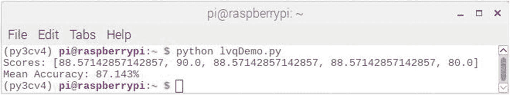

图 3-24

lvqDemo 运行结果

该图显示，此 LVQ 数据模型的平均准确率为 87.1%，相比零规则估计的 64.1%有显著提升。这一结果证实，LVQ 模型适用于电离层数据集，并且能够做出相当准确的预测。

## Bagging 与随机森林

在开始讨论之前，我再次感谢 Jason Brownlee 博士撰写了一系列关于 Bagging 和随机森林的优秀博客。这些博客包括 2016 年 4 月的《Bagging 与随机森林集成算法在机器学习中的应用》、2016 年 11 月的《如何用 Python 从零实现 Bagging》以及 2016 年 11 月的《如何用 Python 从零实现随机森林》。本节中的大部分代码和关键概念均基于上述博客；不过，我在需要的地方添加了自己的注释和详细解释，相信这对经验不足的读者会有所帮助。


### Bagging（自助聚合）与随机森林简介

随机森林是一种流行的算法，属于集成机器学习算法的一种，称为自助聚合（Bootstrap Aggregation），简称 Bagging。我将首先讨论“自助法”（Bootstrap）一词的含义。它是一种统计过程，旨在从数据集中估计某个测量值或指标。一个简单的例子有助于阐明这个概念。

如果数据集包含某个变量 *x* 的 100 个样本值，那么均值很容易计算为：

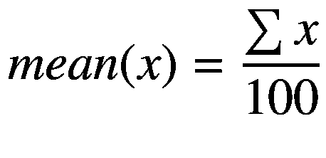

然而，这个计算中可能存在一些估计误差，可以通过以下列出的自助法过程来改进：

1.  从数据集中创建许多（例如 1000 个）有放回的随机子样本（意味着同一个值可以被多次使用）。
2.  计算每个新子样本的均值。
3.  计算所有这些新均值的平均值，并将其用作数据集新的估计均值。

这个过程也可以扩展到估计其他指标，例如标准差。

#### 自助聚合（Bagging）

Bagging 是一种集成过程，它将从多个机器学习算法收集到的预测结果组合成一个比任何单个机器学习预测都更准确的预测。它基本上是一种协同预测方法，其中一组算法比该组中的任何单个成员都更强大。使用 Bagging 可以减少那些易受方差影响的算法（如分类与回归树，CART）的方差。例如，决策树对用于创建树的数据选择很敏感。一棵在某个数据子集上训练的特定树，如果在另一个不同于原始数据子集的数据子集上训练，很容易提供不同的预测结果。以下通用的 Bagging 过程可用于提高 CART 的预测准确性：

1.  从数据集中创建许多（例如 100 个）有放回的随机子样本。
2.  在每个新样本上训练一个 CART 模型。
3.  给定一个新数据集，计算每个模型预测的平均值。

与 Bagging 过程一起使用的决策树必然很深，这意味着每个叶节点上只附着少量训练样本。这样的树会有高方差但低偏差。请参考我之前在第 2 章中关于决策树的讨论，以重温这些术语。需要牢记的关键点是，Bagging 只关心样本数量，以及在此情况下的树的数量。这个过程对过拟合也相当宽容，即使运行大量模型，也几乎不会引入太多误差。唯一的问题将是准备模型和执行计算所需的时间。

#### 随机森林

随机森林是为了提高决策树 Bagging 的性能而开发的。CART 生成的决策树的一个大问题是，它们在选择分裂变量时是贪婪的，使用一种试图最小化误差的贪婪算法。这对 CART 算法本身完全合理，但对 Bagging 过程来说却是个问题。决策树通常可能包含相似的数据结构，这会导致后续预测之间存在高度相关性。如果预测来自相对不相关的子集（子树），Bagging 的效果会更好。随机森林改变了学习子集的方式，以提高预测准确性。使所有子集的相关性降低是实现这一目标的必要条件。

随机森林对 CART 算法的修改相当简单。在未经修改的 CART 算法中，学习部分被允许测试所有变量（特征），以便选择最佳分裂点。随机森林改变了这一过程，使得学习部分现在仅限于测试变量的随机样本。在每个分裂点可以测试的变量数量也被设置为学习算法的一个参数 *m*。对于随机森林分类问题，建议将 *m* 设置为 *p* 的平方根，其中 *p* 是数据集中的特征数量。

#### 性能估计与变量重要性

当创建自助样本时，会有一些数据样本被排除在子集之外。这些样本被称为袋外（OOB）样本。如果对 OOB 样本的预测结果进行平均，就可以对 Bagging 模型的准确性进行估计。这种估计的性能通常被称为 OOB 性能估计。这种性能度量是可靠的测试误差估计，并且与交叉验证估计值相关性良好。

在构建 Bagging 决策树时，可以计算每个额外变量在每个分裂点处使误差函数下降了多少。在回归问题中，这可能是平方误差和的下降；在分类问题中，这可能是基尼系数的下降。

这些误差下降值可以在所有决策树中取平均并输出，以提供每个输入变量重要性的估计。当变量被选中时，误差下降越大，其重要性就越高。这些输出有助于识别与问题最相关的输入变量子集，以及可能从数据集中移除（最不相关）的候选变量。

### 自助法重采样演示

本演示将展示自助法过程是如何运作的。首先创建一个由随机数组成的人造数据集，然后从中衍生出各种大小的子集。接着计算每个子集的均值，然后将子集均值的平均值与原始数据集的总体均值进行比较。

此测试的完整脚本名为 bootstrapDemo.py，可从本书的配套网站获取。脚本代码简单明了，除了已包含的注释外，无需额外说明。

```
# 导入所需库
from random import seed
from random import random
from random import randrange
# 从数据集中有放回地创建一个随机子集。
def subsample(dataset, ratio=1.0):
sample = list()
n_sample = round(len(dataset) * ratio)
while len(sample) < n_sample:
index = randrange(len(dataset))
sample.append(dataset[index])
return sample
# 计算一个数字列表的均值。
def mean(numbers):
return sum(numbers) / float(len(numbers))
seed(1)
# 计算真实均值。
# 原始数据集有 20 行，每行包含一个 0 到 9 的随机数。
dataset = [[randrange(10)] for i in range(20)]
print('真实均值: %.3f' % mean([row[0] for row in dataset]))
# 计算并显示来自不同大小子集的估计均值。
ratio = 0.10
for size in [1, 10, 100]:
sample_means = list()
for i in range(size):
sample = subsample(dataset, ratio)
sample_mean = mean([row[0] for row in sample])
sample_means.append(sample_mean)
print('样本数=%d, 估计均值: %.3f' % (size, mean(sample_means)))
```

通过输入以下命令来运行脚本：

```
python bootstrapDemo.py
```

图 3-25 显示了运行此脚本的结果。

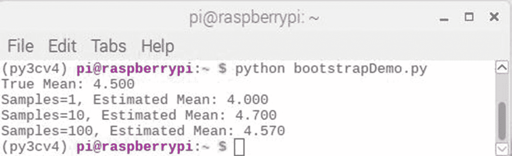

图 3-25

bootstrapDemo 结果

您应该能够看到，随着每个子集中样本数量的增加，估计的均值开始向真实均值收敛。


### Bagging（自助聚合）演示

本演示的脚本中包含了决策树数据模型。为了提升整体预测精度，对该模型应用了自助数据聚合（Bagging）方法。

所使用的数据集名为 sonar-data.csv，是海洋环境中经过处理的声纳“探测”数据所生成的数值记录集合。每条记录描述了声纳系统啁啾信号回波的属性。共有 60 个输入变量（即特征），它们是在不同发射角度下对回波信号强度的测量值。这是一个二分类问题，因为模型旨在区分岩石（R）和水雷（M）。该数据集包含 208 条记录。所有变量都是连续的，名义范围在 0 到 1 之间。输出变量（类别）要么是代表水雷的“M”，要么是代表岩石的“R”。脚本会将这些变量分别转换为整数 1 或 0。

该数据集名为 sonar.all-data.csv，可以从 `https://archive.ics.uci.edu/ml/datasets/Connectionist+Bench+(Sonar,+Mines+vs.+Rocks)` 下载。请务必将下载文件的扩展名改为 csv。

我将脚本命名为 baggingDemo.py，可从本书的配套网站获取。此外，为了换换节奏，我决定不再添加任何进一步的解释性注释，因为该脚本已超过 200 行，而且其中的许多代码段，你应该已经从本章前面的讨论以及第 2 章关于决策树的详细讨论中熟悉了。

```
# Bagging Algorithm on the Sonar dataset
# Import required libraries
from random import seed
from random import randrange
from csv import reader
# Load a CSV file
def load_csv(filename):
dataset = list()
with open(filename, 'r') as file:
csv_reader = reader(file)
for row in csv_reader:
if not row:
continue
dataset.append(row)
return dataset
# Convert string column to float
def str_column_to_float(dataset, column):
for row in dataset:
row[column] = float(row[column].strip())
# Convert string column to integer
def str_column_to_int(dataset, column):
class_values = [row[column] for row in dataset]
unique = set(class_values)
lookup = dict()
for i, value in enumerate(unique):
lookup[value] = i
for row in dataset:
row[column] = lookup[row[column]]
return lookup
# Split a dataset into k folds
def cross_validation_split(dataset, n_folds):
dataset_split = list()
dataset_copy = list(dataset)
fold_size = int(len(dataset) / n_folds)
for i in range(n_folds):
fold = list()
while len(fold) = max_depth:
node['left'], node['right'] = to_terminal(left), to_terminal(right)
return
# process left child
if len(left) <= min_size:
node['left'] = to_terminal(left)
else:
node['left'] = get_split(left)
split(node['left'], max_depth, min_size, depth+1)
# process right child
if len(right) <= min_size:
node['right'] = to_terminal(right)
else:
node['right'] = get_split(right)
split(node['right'], max_depth, min_size, depth+1)
# Build a decision tree
def build_tree(train, max_depth, min_size):
root = get_split(train)
split(root, max_depth, min_size, 1)
return root
# Make a prediction with a decision tree
def predict(node, row):
if row[node['index']] < node['value']:
if isinstance(node['left'], dict):
return predict(node['left'], row)
else:
return node['left']
else:
if isinstance(node['right'], dict):
return predict(node['right'], row)
else:
return node['right']
# Create a random subsample from the dataset with replacement
def subsample(dataset, ratio):
sample = list()
n_sample = round(len(dataset) * ratio)
while len(sample) < n_sample:
index = randrange(len(dataset))
sample.append(dataset[index])
return sample
# Make a prediction with a list of bagged trees
def bagging_predict(trees, row):
predictions = [predict(tree, row) for tree in trees]
return max(set(predictions), key=predictions.count)
# Bootstrap Aggregation Algorithm
def bagging(train, test, max_depth, min_size, sample_size, n_trees):
trees = list()
for i in range(n_trees):
sample = subsample(train, sample_size)
tree = build_tree(sample, max_depth, min_size)
trees.append(tree)
predictions = [bagging_predict(trees, row) for row in test]
return(predictions)
# Test bagging on the sonar dataset
seed(1)
# load and prepare data
filename = 'sonar.all-data.csv'
dataset = load_csv(filename)
# convert string attributes to integers
for i in range(len(dataset[0])-1):
str_column_to_float(dataset, i)
# convert class column to integers
str_column_to_int(dataset, len(dataset[0])-1)
# evaluate algorithm
n_folds = 5
max_depth = 6
min_size = 2
sample_size = 0.50
for n_trees in [1, 5, 10, 50]:
scores = evaluate_algorithm(dataset, bagging, n_folds, max_depth, min_size, sample_size, n_trees)
print('Trees: %d' % n_trees)
print('Scores: %s' % scores)
print('Mean Accuracy: %.3f%%' % (sum(scores)/float(len(scores))))
```

通过输入以下命令来运行脚本：

```
python baggingDemo.py
```

图 3-26 显示了运行此脚本的结果。

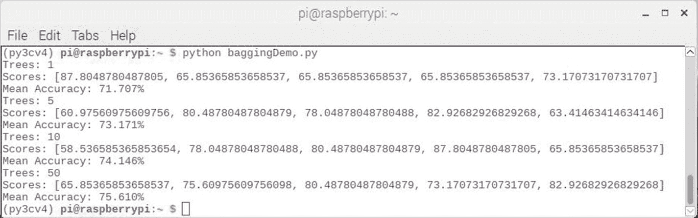

图 3-26

baggingDemo 结果

图中显示了五折数据集的中间精度分数以及总体聚合精度值。你可以看到，总体精度值从使用 1 棵树时的 71.7% 缓慢提升到使用 50 棵树时的 75.6%。虽然表现并非卓越，但通过使用 bagging 方法，整体上还是取得了一点改进。

使用 bagging 方法的一个难点在于，即使构建了很深的树，这些经过 bagging 的树也彼此相似。因此，使用这些树做出的任何预测也会相似。原本期望基于不同样本训练出的树之间应存在的高方差，也因此被削弱了。这完全归因于我先前讨论过的决策树分裂算法中使用的贪婪算法。本脚本试图通过限制训练过程中使用的样本大小来增加方差，但收效甚微。真正能增加子集方差的方法是使用随机森林算法，这将是下一个演示的主题。


### 随机森林演示

决策树通常具有高方差，这使得任何预测结果都高度依赖于训练数据。通过一种称为装袋（bagging）的技术，从训练数据的样本中构建多个模型，有助于降低这种方差，但树之间仍然高度相关。

随机森林是装袋的一种扩展，它除了基于训练数据的多个样本构建树之外，还限制了可用于构建树的特征，从而迫使树之间产生差异。这种构建决策树的修改通常会带来性能上的提升。

本演示使用了与之前装袋演示相同的数据集。实际上，除了计算决策分割点的方式不同之外，脚本几乎与之前的脚本完全相同。随机森林的修改使得算法会搜索输入属性的一个样本，而不是搜索使总成本函数最小化的那个属性。这个属性样本可以随机选择且不放回，这意味着在搜索使成本最小化的分割点时，每个输入属性只需被考虑一次。

基尼指数用于评估潜在分割点的成本。你可以参考决策树章节中关于基尼指数的讨论来复习这个函数。

我将此脚本命名为 `randomForestDemo.py`，它可以在本书的配套网站上找到。与之前的脚本一样，我选择不添加任何进一步的解释性注释，因为这个脚本已经超过 200 行，并且许多代码段与 `baggingDemo` 脚本相同。

```
# 在声纳数据集上实现随机森林算法
# 导入所需库
from random import seed
from random import randrange
from csv import reader
from math import sqrt
# 加载 CSV 文件
def load_csv(filename):
dataset = list()
with open(filename, 'r') as file:
csv_reader = reader(file)
for row in csv_reader:
if not row:
continue
dataset.append(row)
return dataset
# 将字符串列转换为浮点数
def str_column_to_float(dataset, column):
for row in dataset:
row[column] = float(row[column].strip())
# 将字符串列转换为整数
def str_column_to_int(dataset, column):
class_values = [row[column] for row in dataset]
unique = set(class_values)
lookup = dict()
for i, value in enumerate(unique):
lookup[value] = i
for row in dataset:
row[column] = lookup[row[column]]
return lookup
# 将数据集分割成 k 折
def cross_validation_split(dataset, n_folds):
dataset_split = list()
dataset_copy = list(dataset)
fold_size = int(len(dataset) / n_folds)
for i in range(n_folds):
fold = list()
while len(fold) < fold_size:
index = randrange(len(dataset_copy))
fold.append(dataset_copy.pop(index))
dataset_split.append(fold)
return dataset_split
# 计算准确率百分比
def accuracy_metric(actual, predicted):
correct = 0
for i in range(len(actual)):
if actual[i] == predicted[i]:
correct += 1
return correct / float(len(actual)) * 100.0
# 使用交叉验证分割评估算法
def evaluate_algorithm(dataset, algorithm, n_folds, *args):
folds = cross_validation_split(dataset, n_folds)
scores = list()
for fold in folds:
train_set = list(folds)
train_set.remove(fold)
train_set = sum(train_set, [])
test_set = list()
for row in fold:
row_copy = list(row)
test_set.append(row_copy)
row_copy[-1] = None
predicted = algorithm(train_set, test_set, *args)
actual = [row[-1] for row in fold]
accuracy = accuracy_metric(actual, predicted)
scores.append(accuracy)
return scores
# 根据基尼指数分割数据集
def test_split(index, value, dataset):
left, right = list(), list()
for row in dataset:
if row[index] < value:
left.append(row)
else:
right.append(row)
return left, right
# 计算分割点的基尼指数
def gini_index(groups, classes):
# 计算所有样本点的数量
n_instances = float(sum([len(group) for group in groups]))
# 计算每组中每个类别的加权基尼指数
gini = 0.0
for group in groups:
size = float(len(group))
# 避免除以零
if size == 0:
continue
score = 0.0
# 根据每个类别对组进行评分
for class_val in classes:
p = [row[-1] for row in group].count(class_val) / size
score += p * p
# 通过组内概率加权组间基尼指数
gini += (1.0 - score) * (size / n_instances)
return gini
# 选择最佳分割点
def get_split(dataset, n_features):
class_values = list(set(row[-1] for row in dataset))
b_index, b_value, b_score, b_groups = 999, 999, 999, None
features = list()
while len(features) < n_features:
index = randrange(len(dataset[0])-1)
if index not in features:
features.append(index)
for index in features:
for row in dataset:
groups = test_split(index, row[index], dataset)
gini = gini_index(groups, class_values)
if gini < b_score:
b_index, b_value, b_score, b_groups = index, row[index], gini, groups
return {'index':b_index, 'value':b_value, 'groups':b_groups}
# 创建终端节点值
def to_terminal(group):
outcomes = [row[-1] for row in group]
return max(set(outcomes), key=outcomes.count)
# 为子节点或终端节点创建分割点
def split(node, max_depth, min_size, n_features, depth):
left, right = node['groups']
del(node['groups'])
# 检查是否没有分割点
if not left or not right:
node['left'] = node['right'] = to_terminal(left + right)
return
# 检查最大深度
if depth >= max_depth:
node['left'], node['right'] = to_terminal(left), to_terminal(right)
return
# 处理左子节点
if len(left) <= min_size:
node['left'] = to_terminal(left)
else:
node['left'] = get_split(left, n_features)
split(node['left'], max_depth, min_size, n_features, depth+1)
# 处理右子节点
if len(right) <= min_size:
node['right'] = to_terminal(right)
else:
node['right'] = get_split(right, n_features)
split(node['right'], max_depth, min_size, n_features, depth+1)
# 构建决策树
def build_tree(train, max_depth, min_size, n_features):
root = get_split(train, n_features)
split(root, max_depth, min_size, n_features, 1)
return root
# 使用决策树进行预测
def predict(node, row):
if row[node['index']] < node['value']:
if isinstance(node['left'], dict):
return predict(node['left'], row)
else:
return node['left']
else:
if isinstance(node['right'], dict):
return predict(node['right'], row)
else:
return node['right']
# 从数据集中创建有放回的随机子样本
def subsample(dataset, ratio):
sample = list()
n_sample = round(len(dataset) * ratio)
while len(sample) < n_sample:
index = randrange(len(dataset))
sample.append(dataset[index])
return sample
# 使用一组装袋树进行预测
def bagging_predict(trees, row):
predictions = [predict(tree, row) for tree in trees]
return max(set(predictions), key=predictions.count)
# 随机森林算法
def random_forest(train, test, max_depth, min_size, sample_size, n_trees, n_features):
trees = list()
for i in range(n_trees):
sample = subsample(train, sample_size)
tree = build_tree(sample, max_depth, min_size, n_features)
trees.append(tree)
predictions = [bagging_predict(trees, row) for row in test]
return(predictions)
# 测试随机森林算法
seed(2)
# 加载并准备数据
filename = 'sonar.all-data.csv'
dataset = load_csv(filename)
# 将字符串属性转换为整数
for i in range(0, len(dataset[0])-1):
str_column_to_float(dataset, i)
# 将类别列转换为整数
str_column_to_int(dataset, len(dataset[0])-1)
# 评估算法
n_folds = 5
max_depth = 10
min_size = 1
sample_size = 1.0
n_features = int(sqrt(len(dataset[0])-1))
for n_trees in [1, 5, 10]:
scores = evaluate_algorithm(dataset, random_forest, n_folds, max_depth, min_size, sample_size, n_trees, n_features)
print('Trees: %d' % n_trees)
print('Scores: %s' % scores)
print('Mean Accuracy: %.3f%%' % (sum(scores)/float(len(scores))))
```

通过输入以下命令来运行脚本：

```
python randomForestDemo.py
```

图 3-27 显示了运行此脚本的结果。

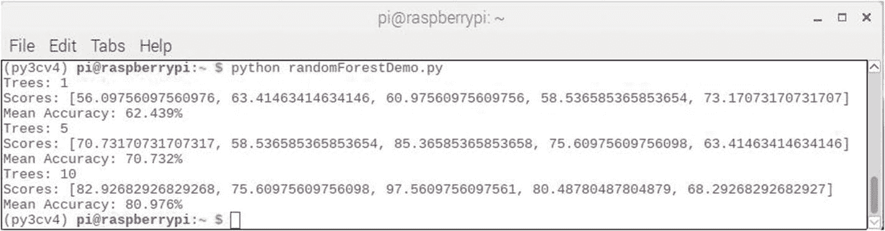

图 3-27

randomForestDemo 结果

交叉验证使用了 k 值为 5，使得每次迭代评估时，每折有 208/5 = 41.6 条，即略多于 40 条记录。构建了深度为 10 的深层树，每个节点的最小训练行数为 1。训练数据集的样本大小与原始数据集相同，这是随机森林算法的默认期望。每个分割点考虑的特征数设置为 `sqrt(num_features)` 或 `sqrt(60)=7.74`，四舍五入为 7 个特征。

为了进行比较，评估了大小为 1、5 和 10 的树集，结果显示随着添加更多树，准确率不断提高。随着树集的增大，平均准确率得分从 62.4% 增加到 81.0%。最终得分比装袋演示提高了 5% 以上，这表明随机森林的修改按预期发挥了作用。

