# 4. 深度学习准备

本章将为您提供足够的背景知识，以便理解后续章节中开始的深度学习讨论。在尝试理解任何实际的深度学习算法之前，理解一些基本的深度学习术语和概念非常重要。我尽量减少了数学内容，但有些公式是不可避免的，因为深度学习本质上全是数学。

## 深度学习基础

任何深度学习讨论的起点显然都必须是回答“什么是深度学习？”这个问题。像许多相对较新的技术领域一样，如果你让一打专家来定义某样东西，你很可能会得到一打不同但又出奇相似的答案。深度学习也不例外。我研究了许多不同的深度学习定义，并创建了以下一个似乎包含了众多定义中共同主题的定义：

> *深度学习是机器学习的一个子领域，涉及被称为人工神经网络的算法，这些算法受人类大脑的结构和功能启发。从数据集中学习可以是*[*监督式*](https://en.wikipedia.org/wiki/Supervised_learning)*、*[*半监督式*](https://en.wikipedia.org/wiki/Semi-supervised_learning) *或无监督式的。*

我将在下一章介绍并讨论人工神经网络，但首先我需要讨论这些基础知识。

### 从数据模式中学习机器学习

机器学习（ML）是深度学习（DL）的一个重要子集，通常被描述为对算法和数据模型的研究，这些算法和模型能够执行计算机实现的任务，而无需通过显式编程来完成这些任务。相反，机器学习依赖于检测数据模式并生成关于数据的推论。机器学习通常有四个主要任务。这些任务是：

*   检测
*   分类
*   识别
*   预测

这些任务中的大多数（如果不是全部）都可以应用于各种数据集，包括静态图像、数值数据和实时数据流。最后提到的数据集包括视频、音频，甚至射频（RF）流。我也非常肯定，机器学习还有其他我尚未提及的应用。

我将从讨论分类任务开始我的基础知识讲解，这个任务在前面的章节中已经讨论过。回想一下在第 1 章关于 k-NN 数据模型的讨论中，我提到过：

> *我将 k-NN 描述为非参数化的，这意味着该模型不会对底层数据分布做出任何假设。换句话说，模型结构是由数据决定的。鉴于此，当对数据分布方式知之甚少或一无所知时，k-NN 可能应该是你进行分类研究的首选之一。*

你可能对我使用术语*非参数化*来描述 k-NN 数据模型感到有些困惑。希望解释什么是参数化分类算法有助于澄清这个术语。参数化的定义如下：

> *参数化是一个*[数学](https://en.m.wikipedia.org/wiki/Mathematical)*过程，包括将*[系统](https://en.m.wikipedia.org/wiki/System)*、*[过程](https://en.m.wikipedia.org/wiki/Process_%2528science%2529)*或模型的状态表示为某些独立量（称为*[参数](https://en.m.wikipedia.org/wiki/Parameter)*）的*[函数](https://en.m.wikipedia.org/wiki/Function_%2528mathematics%2529)*。

在机器学习应用中，用于描述系统状态的关键参数包括：

*   数据
*   评分函数
*   损失函数
*   权重和偏置

是的，我知道最后一个列表项包含两个组成部分，但它们紧密交织在一起，通常被视为构成一个单一参数。我将分别讨论每个参数。

**数据** – 这是所有机器学习必须基于的过程中的一个明显元素。数据有两个方面，第一个是数值，第二个是类别标签。数值的范围很广，从图像中的原始像素值到住房数据集中的房价。在机器学习领域中，数据通常表示为一个矩阵。这样的矩阵通常被称为设计矩阵，命名为 `X`，其中

`$${x}_i={i}^{th}\ element\ in\ the\ design\ matrix $$`

`$${y}_i={i}^{th}\ class\ label $$`

**评分函数** – 一个将输入数据映射到预测类别标签的函数。这可以用一个通用方程形式表示：

`$$ f\left( input\ data\right)= predicted\ class\ label $$`

实际上，这个方程只是产生一个数值。与该最大值相关联的类别标签将是该分类器的预测结果。

**损失函数** – 一个量化预测类别标签与数据集中记录的实际类别标签一致程度的函数。在机器学习术语中，实际类别标签也称为真实标签。低损失值是理想的，因为这意味着预测结果与真实标签高度一致。本章后面将详细讨论如何计算损失函数以获得最小损失值。

**权重和偏置** – 权重矩阵 `W` 和偏置向量 `b` 被迭代计算，以便相对于评分函数最小化损失函数。

#### 线性分类器

在本节中，我将讨论什么是线性分类器以及它是如何工作的。我加入这个讨论的原因是为了向你提供一个框架，通过这个框架你可以更好地理解神经网络是如何工作的。线性分类器和神经网络的基本概念是相同的。我还会将前面介绍的四个关键参数中的三个融入到这个讨论中。损失函数将在下一节中单独讨论。

用于这个线性分类器的数据集名为“哺乳动物”，包含三个类别（即猫、狗和松鼠）的 5000 张图像。每张图像的分辨率相当低，为 32 x 32 像素，总共 1024 个像素。此外，每个像素都是全彩 RGB，需要三个字节来表示 RGB 颜色通道值，这意味着分类器需要处理 3072 个值。表示一张图像的数据点被“展平”成一个一维向量（1D），命名为 `X`，它有 N 个元素，其中 N 等于 3072。权重矩阵 `W` 的形状必须是 3 x 3072，因为数据集中有三个类别。最后，偏置向量 `b` 的大小仅为 3 x 1。使用刚刚描述的符号，最终的评分方程为：

`$$ f\left(\boldsymbol{X},\boldsymbol{W},\boldsymbol{b}\right)=\boldsymbol{W}\cdotp \boldsymbol{X}\kern0.5em +\boldsymbol{b} $$`

其中 `W` · `X` 是权重矩阵与输入数据向量之间的点积。

图 4-1 是评分函数的图形表示。

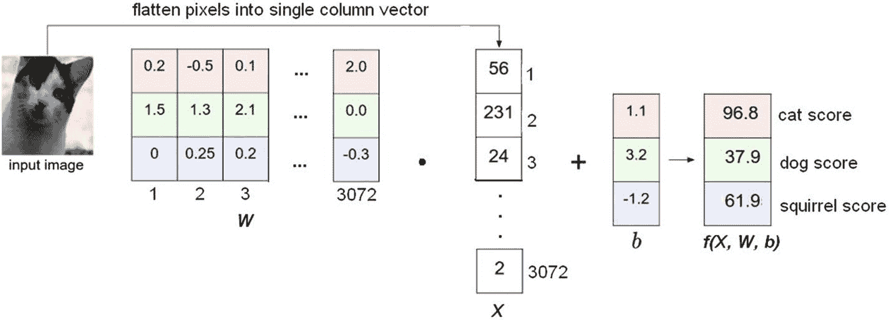
*图 4-1 评分函数的图形表示*

图中的所有数值都是虚构的，但我确实让猫类在评分函数向量中获得了最高值，这将使其成为预测的类别标签。

有一个常用的简化“技巧”，可以将评分函数中的参数从三个减少到两个。这个技巧是将偏置向量包含到权重矩阵中。图 4-2 展示了如何做到这一点。

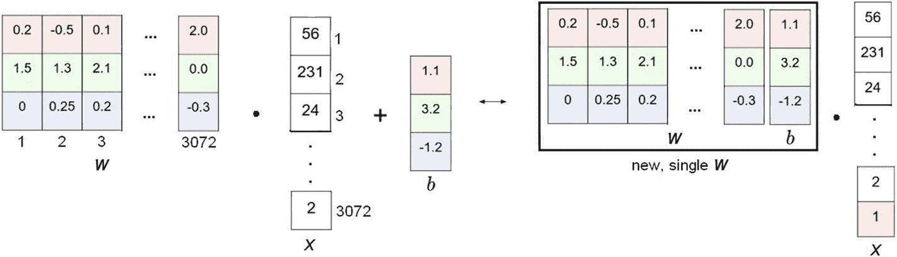
*图 4-2 将偏置向量添加到权重矩阵中*

输入数据向量 `X` 被扩展了一个元素，该元素始终包含值 1。在这个例子中，权重矩阵 `W` 也被扩展了一列，现在其形状变为 3 x 3073。这个额外的列就是偏置向量 `b`。新的评分函数现在简化为一个单一的点积乘法，如下面的方程所示：

`$$ f\left(\boldsymbol{X},\boldsymbol{W}\right)=\boldsymbol{W}\cdotp \boldsymbol{X} $$`

使用这种偏置技巧意味着你只需要一个单一的权重矩阵，而不是一个权重矩阵和一个偏置向量。这个技巧只是数据预处理的一部分，有助于简化整个机器学习工作。

以下内容旨在向您展示如何在 Python 中实现一个线性分类器。这个脚本绝对是“作弊”的，它会直接选择标签列表中的第一个类别。之所以必须这样做，是因为该脚本没有使用任何预训练网络。我的目标仅仅是展示如何编写一个简单的线性分类器。我没有将其称为演示，而是认为它更接近于伪代码的范畴。再次强调，这仅供您参考，因为它确实用到了我讨论过的四个主要参数，只是缺少了对预训练网络的调用。该脚本名为 `linear_Classifier.py`。我*没有*将其放在本书的配套网站上，因为我认为它只是一个用于教学的工具。如果您愿意，可以随意从代码清单中复制它。

# 导入所需库
```python
import numpy as np
import cv2
# 初始化类别标签并设置伪随机种子值
labels = ['dog', 'cat', 'squirrel']
np.random.seed(1)
# 随机初始化权重矩阵和偏置向量
W = np.random.randn(3, 3072)
b = np.random.randn(3)
# 设置用于绘制标签的字体
font = cv2.FONT_HERSHEY_SIMPLEX
# 加载图像并调整大小。图像来自数据集。
orig = cv2.imread('dog.png')
image = cv2.resize(orig, (32,32)).flatten()
# 计算输出分数
scores = W.dot(image) + b
# 遍历分数和标签
for (label, score) in zip(labels, scores):
    print('[INFO] {}: {:.2f}'.format(label, score))
# 获取得分最高的类别标签
classLabel = labels[np.argmax(scores)]
# 在原始图像上绘制预测的标签
cv2.putText(orig, classLabel, (10,30),  font, 0.9, (255,0,0), 2)
# 显示图像
cv2.imshow('Image', orig)
cv2.waitKey(0)
```

通过输入以下命令来运行此脚本：

```
python linear_Classifier.py
```

图 4-3 显示了输入命令后的终端窗口结果。

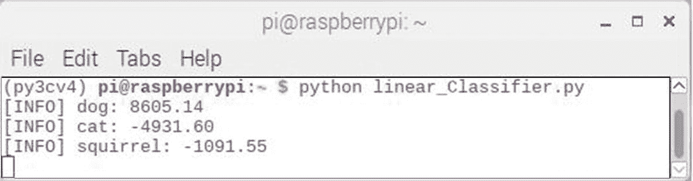

**图 4-3** 运行 `linear_Classifier` 脚本后的终端结果

您应该能够看到，`dog` 类别的值最大，因此它是预测的类别标签。

图 4-4 显示了叠加了类别标签的原始图像。


**图 4-4** `linear_Classifier` 脚本处理后的图像

从这个例子中要理解的关键点是，必须对权重矩阵进行优化，才能实际执行真正的分类任务。我将在下一章中通过一个实际问题来讨论如何实现这一点。目前我并不太关注偏置向量，因为它通常用于“微调”最终的网络解决方案。在考虑偏置向量之前，创建一个有效的权重矩阵要重要得多。

### 损失函数

损失函数是机器学习的核心。它使您能够将算法从理论概念转化为实际实现，并将神经网络从抽象的矩阵乘法转变为深度学习。

损失函数的概念非常简单。它是一种评估算法对输入数据集建模效果的方法。如果预测或分类出现错误，损失函数会输出一个高数值。如果结果合理，则数值会较低。它还能告知开发者，随着网络和模型的训练，算法的改进情况如何。该函数可以轻松显示训练过程是收敛还是发散。收敛是好的，而您需要避免发散。

#### 不同类型的损失函数

一种朴素的损失函数方法可能简单如下：

$$ \epsilon = abs\left(\hat{y_i}-{y}_i\right) $$

其中

*   ϵ = 误差
*   $$ \hat{y_i} $$ = 预测的类别标签
*   *y*[*i*] = 实际的类别标签（真实值）

在这个损失函数定义中，预测值过高或过低都没有区别。唯一重要的是它们错误的程度，即方向无关。这种方法并不适用于所有损失函数。损失函数会根据机器学习问题的领域而有显著变化。在某个特定项目中，猜测过高可能比猜测过低糟糕得多，所选的损失函数必须反映这种情况。

以下是几种常用的损失函数：

**均方误差（MSE）**——这是基本损失函数中非常流行的一种。它易于理解和实现，且效果良好。MSE 的计算方法是：计算预测值与真实值之间的差值，将其平方，然后求和，再除以整个数据集的大小。MSE 的 Python 代码如下：

```python
def MSE(y_Hat, y):
    sq_error = (y_Hat - y) ** 2
    sum_sq_error = np.sum(sq_error)
    mse = sum_sq_sq_error / y.size
    return mse
```

**似然函数**——似然函数也很简单，常用于分类问题。该函数取每个输入数据类别的预测概率，并将它们相乘。虽然输出结果不易于人类解读，但它对于比较模型的表现非常有用。

考虑以下示例，其中模型输出了一系列与不同数据集类别相关的概率。概率如表 4-1 所示。

**表 4-1** 示例分类模型的概率

| 类别 | 真实值 (`y[i]`) | 概率 (`p`) | 1 - `p` |
| --- | --- | --- | --- |
| A | 0 | 0.4 | 0.6 |
| B | 1 | 0.6 | 不适用 |
| C | 1 | 0.9 | 不适用 |
| D | 0 | 0.1 | 0.9 |

当模型输出为 `False` 或真实值为 `0` 时，在似然计算中使用 `1 - p` 概率，如下所示：

*   0.6 ∗ 0.6 ∗ 0.9 ∗ 0.9 = 0.292

**对数损失（交叉熵损失）**——对数损失也是一种常用于分类问题的损失函数。它是使用对数对似然函数进行的修改。

$$ \epsilon =-\Big(y\ast \mathit{\log}(p)+\left(1-y\right)\ast \mathit{\log}\left(1-p\right) $$

这个公式与似然函数的公式相同，但使用了对数。然而，您应该注意到，当类别值为 1 时，函数的后半部分消失；当类别值为 0 时，前半部分消失。这样，在乘法中只使用了真实值类别的预测概率的对数。

对数损失函数有一个有趣的特点，即它会严厉惩罚那些“非常自信”但“非常错误”的情况。为错误类别预测高概率会使函数“爆炸”。图 4-5 说明了当真实标签 = 1 时发生的情况。您可以看到，当标签 = 0 的预测概率接近 1 时，损失值会急剧上升。

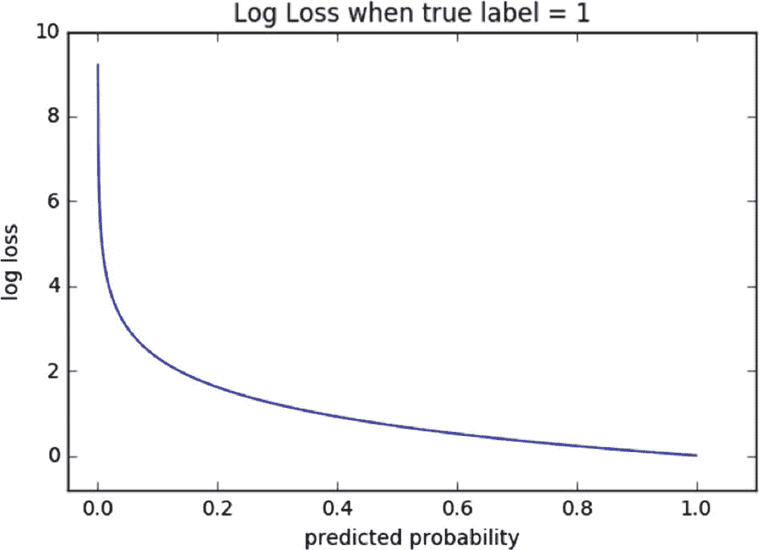

**图 4-5** 对数损失函数图

关于损失函数讨论的最后一点是，要认识到它们提供的不仅仅是模型性能的静态表示。大多数机器学习算法在优化过程中或确定数据集最佳参数（权重）时都会使用损失函数。

以我在前一章讨论的线性回归数据模型为例。在传统的“最小二乘”回归中，最佳拟合线是通过均方误差（MSE）确定的。对于模型尝试的每组权重，都会计算所有输入样本的 MSE。然后，模型会优化 MSE 函数，换句话说，就是通过使用像梯度下降这样的优化器算法，使其尽可能达到最小值。

正如不同的问题有不同类型的损失函数一样，不同的优化器也对应着特定的问题领域，我将在下一节中讨论这一点。

### 优化器算法

机器学习从业者常说，优化器算法是机器学习的核心。没有好的优化器，机器学习就不可能存在。最常见的算法称为梯度下降，它有两种形式：线性和随机。我将先讨论线性版本，因为它最容易理解和解释。实际上，随机版本才是现实世界中最常用的。在介绍完线性版本后，我会解释随机版本。

为了给梯度下降的讨论做好铺垫，我想请你想象以下场景。假设你正在山里徒步旅行，忘记了时间，天开始黑了。你很快意识到，必须在天色太暗、气温太低之前下到地势较低的地方。假设你还忘了带手电筒或提灯，所以只能依靠仅存的、逐渐减弱的日光来安全抵达低处。你自然会开始向山下走，但由于光线不好，你看不太远。这种情况迫使你只能迈小步，以免撞上巨石，或掉进坑洞或洼地。本质上，你是在一点一点地摸索下山，每一步都试图走得更低，并且每次不小心开始上坡时，都会进行微小的修正。

这个场景类比了梯度下降的工作原理。梯度下降的峰和谷是其算法定义的直接结果。为了便于讨论，考虑一个极其简单的网络，它只有两个权重，没有偏置值。这种简单情况下的损失函数将完全依赖于这两个权重值。图 4-6 展示了一个假设的损失函数与两个独立权重值的三维图。

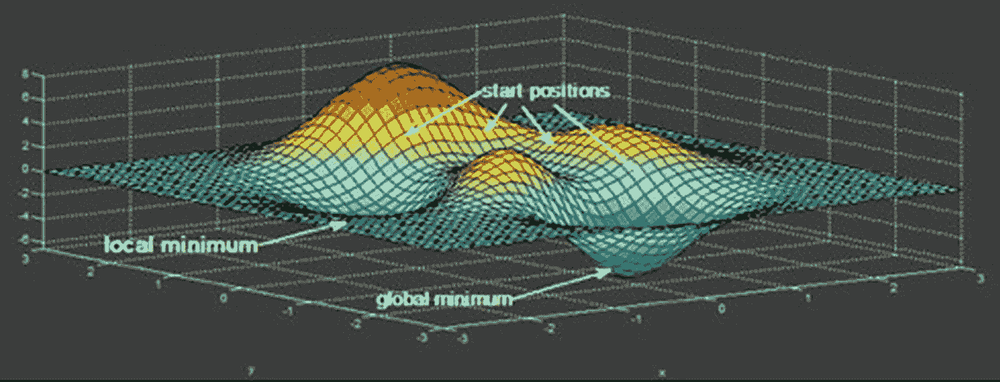

**图 4-6** 两个权重变量的损失函数

图中的峰值是最大损失值，需要避免；而谷底是最小值，是网络达到最佳性能所期望的。我还要指出，图中有些谷底比其他谷底更深。最深的那个谷底被称为全局最小值，它始终是设置所有权重值时最理想的目标。那些“不那么深”的谷底被称为局部最小值，虽然并非最优，但通常也“足够好了”。关于这一点，稍后会在讨论中详细介绍。

计算图上任意一点的斜率，是确定如何在峰谷之间穿行或“行走”的关键。回想一下开头的场景，你总是想向下走，从而避开那些高成本区域的峰值。因此，持续计算瞬时斜率并沿着向下的方向前进是合理的。从分析的角度来看，斜率是通过计算原始方程的导数来确定的。在这种情况下，原始方程就是损失函数，并且有两个自变量，代表两个权重。由于涉及两个自变量，这种情况下必须使用偏导数。寻找全局最小值还涉及步长的大小。步长太大，很容易错过最小值；步长太小，则可能导致训练时间过长。你很快就会知道，步长和学习率是同义词。

此时还需要指出一点。前面展示的三维图只涉及两个权重和一个损失函数。实际上，一个实用的神经网络模型涉及的权重远不止三个。在下一章中，我将讨论一个包含 100 个权重的网络。我无法想象，并且我怀疑许多其他人也无法想象，100 个自变量将如何与单个输出函数相互作用。当然，无法像我对两个变量那样，将这种相互作用可视化。我建议你只需接受这个假设：从数学上讲，优化 100 个变量的方式与处理 2 个变量是相同的。

考虑这样一种情况：一个垂直平面与图 4-6 所示的图形相交，得到一个二维图，显示损失函数与自变量某个范围的关系。这个范围对于本讨论来说无关紧要。图 4-7 展示了一个具有全局最小值和局部最小值的代表性二维图。

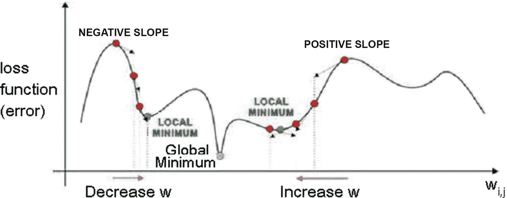

图 4-7

显示全局最小值和局部最小值的二维图

## 深入探讨梯度下降算法

对梯度下降算法的深入探讨，首先要回顾我在第 2 章中讨论的线性回归（LR）数据模型。我建议你重新阅读该讨论，以重温关于该模型的关键要点。广义的线性回归方程如下：

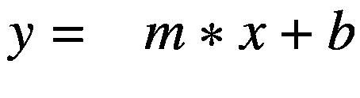

其中

*   `m` = 直线的斜率

*   `b` = y 轴截距

请注意，我对第 2 章中展示的方程做了略微改动，去掉了误差估计项，并将斜率常数改为 `m`，截距常数改为 `b`。这样做是为了与本次讨论中使用的图形保持一致。

我将从一些数据的 x-y 散点图开始，并配以一条平坦的线性回归方程直线，如图 4-8 所示。

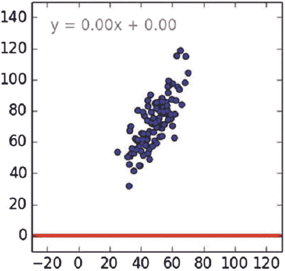

图 4-8

带有平坦线性回归预测线的数据散点图

最优的线性回归预测线穿过数据点的位置，能够最小化总误差——如果你仅使用该预测线来计算任意给定 `x[i]` 数据点对应的 `y[i]` 值，就会产生这个总误差。确定最优 `m` 和 `b` 值的通用方法是遍历数据集中所有可能的 `m` 和 `b` 值，并找出使用所有 `x[i]` 值计算时产生的最小误差。下面列出了一些实现此通用过程的示例 Python 代码：

```python
# 使用 y = mx + b 方程
# m 是斜率，b 是 y 轴截距
def computeErrorForLineGivenPoints(b, m, points):
    totalError = 0
    for i in range(0, len(points)):
        totalError += (points[i].y - (m * points[i].x + b)) ** 2
    return totalError / float(len(points))
```

在调用此脚本之前，需要设置一个名为 `points` 的数据数组，其中包含所有原始的 x-y 点。此外，主调用脚本必须设置待测试的 `m` 和 `b` 变量的范围。

此线性回归示例的正式误差函数如下所示：

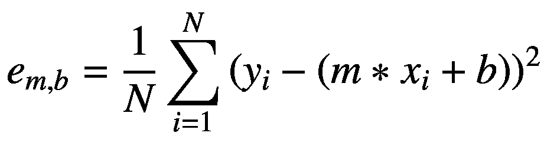

现在的重点是推导出一个方程，该方程能针对 `m` 和 `b` 优化这个误差函数，从而产生最小误差。在讨论这一点之前，先说明一下这个线性回归示例中变量相互作用的性质会很有帮助。图 4-9 从两个角度展示了 `m` 和 `b` 的不同取值如何影响误差函数。

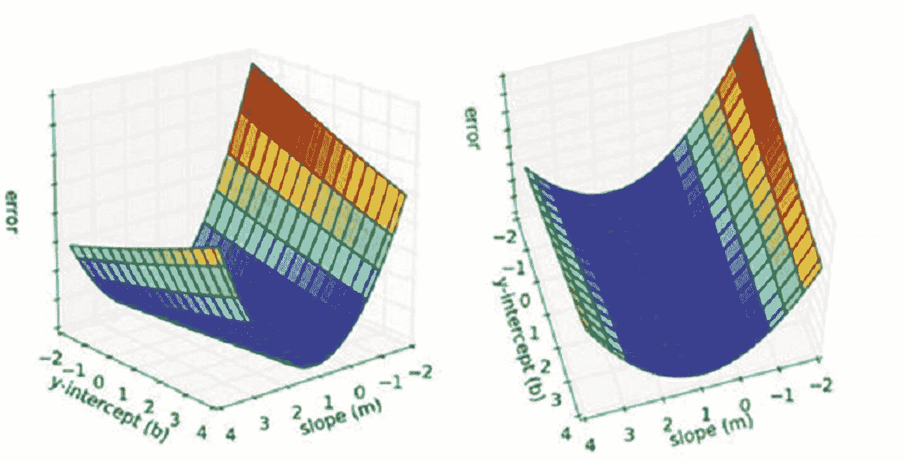

图 4-9

误差随 `m` 和 `b` 变量变化的曲线图

你应该能很容易地想象出，让一颗弹珠从斜坡上滚下，最终停在一个最低点。这个最低点对应着最小 `e[m,b]` 值所关联的 `m` 和 `b` 值。使用梯度下降搜索方法就相当于让弹珠滚下斜坡。

实现梯度下降方法的第一步是对误差函数进行两次偏微分，因为这里有两个自变量。这一步与我之前讨论的两个权重示例中的步骤完全相同。偏微分方程实际上比原始误差方程更简单：

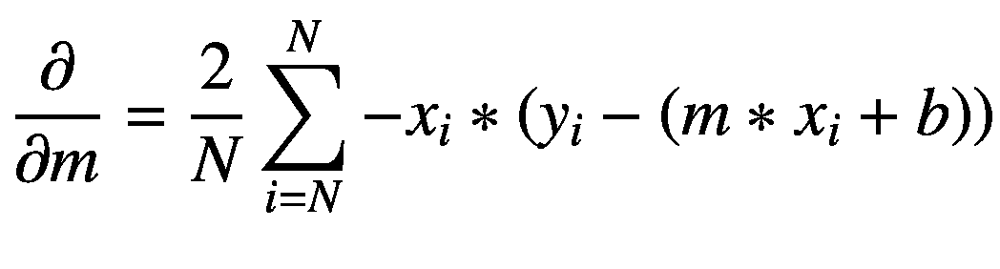

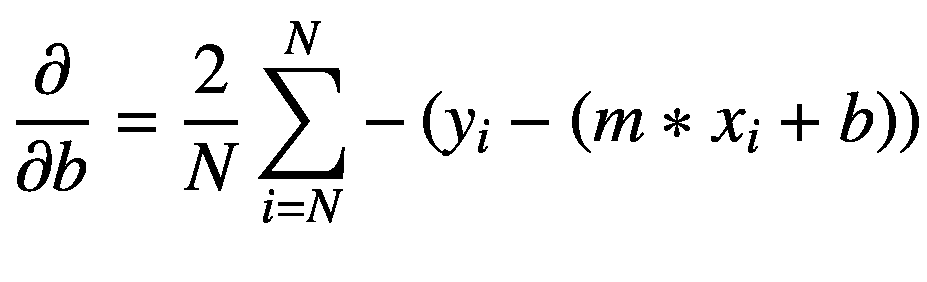

搜索通常从原点开始，即 `m` = –1 且 `b` = 0。这个 –1 值只是让弹珠开始滚下坡。梯度下降算法是迭代的，这意味着每次迈出一小步，然后重新评估误差函数，如果可能进一步改进，则再迈出一步。以下 Python 代码为线性回归示例实现了一个梯度下降算法：

```python
def stepGradient(b_current, m_current, points, learningRate):
    b_gradient = 0
    m_gradient = 0
    N = float(len(points))
    for i in range(0, len(points)):
        b_gradient += -(2/N) * (points[i].y - ((m_current*points[i].x) + b_current))
        m_gradient += -(2/N) * points[i].x * (points[i].y - ((m_current*points[i].x) + b_current))
    new_b = b_current - (learningRate * b_gradient)
    new_m = m_current - (learningRate * m_gradient)
    return [new_b, new_m]
```

前面脚本中的 `learningRate` 参数控制步长。这个参数必须仔细调整，因为值太大容易错过最小值，而值太小则会不必要地增加找到最小值之前的迭代次数。

接下来的一系列图将说明梯度下降算法如何为这个线性回归示例收敛到最优解。在每张图中，左侧的图显示了梯度下降的起始位置，右侧的图则显示了当前 `m` 和 `b` 变量对应的数据点和预测线。

图 4-10 显示了梯度搜索的起点。

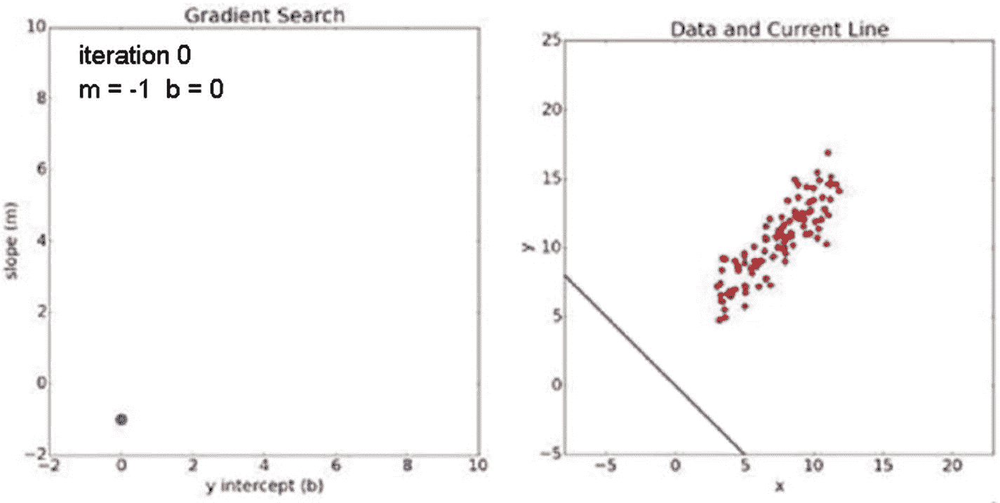

图 4-10

梯度搜索的起点

从这张图中可以明显看出，初始估计值偏差很大。

下一次迭代如图 4-11 所示。

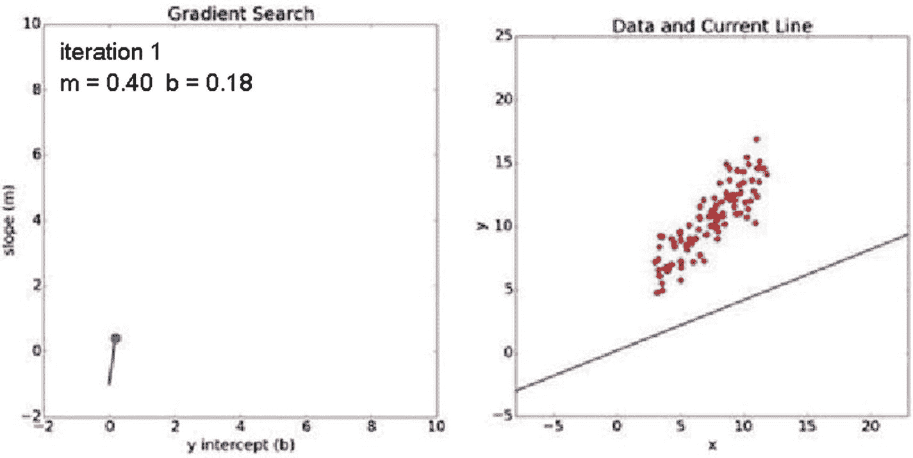

图 4-11

梯度搜索的第二次迭代

请注意，图左侧的图中现在出现了一条线，它表示搜索算法从初始起点所走的路径。图右侧显示的预测线相比初始图有了很大改进。然而，它显然还需要改进，因为它完全没有穿过任何数据点。

图 4-12 显示了第三次迭代，尽管右侧图在绘图区域中标注的是“迭代 2”。这是因为第一次尝试被标记为 0。

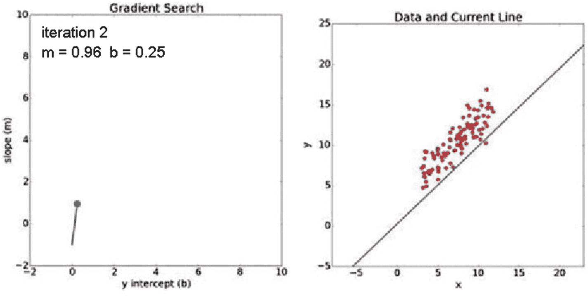

图 4-12

梯度搜索的第三次迭代

搜索算法所走的路径与第二次迭代的路径完全相同。然而，预测线现在勉强穿过了几个数据点，但显然还需要进一步改进。

# 快进到第 100 次迭代（由于从 0 开始计数，实际上是第 101 次），从图 4-13 中可以看出，预测线在视觉上“看起来”拟合得很好。

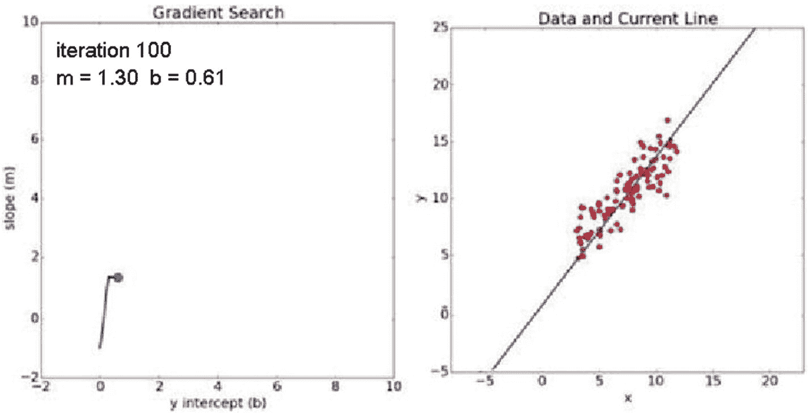

**图 4-13 梯度搜索的 101 次迭代**

左侧的图显示，梯度搜索路径向右小幅偏移，以寻找全局最小值。

图 4-14 是误差与迭代次数的关系图。

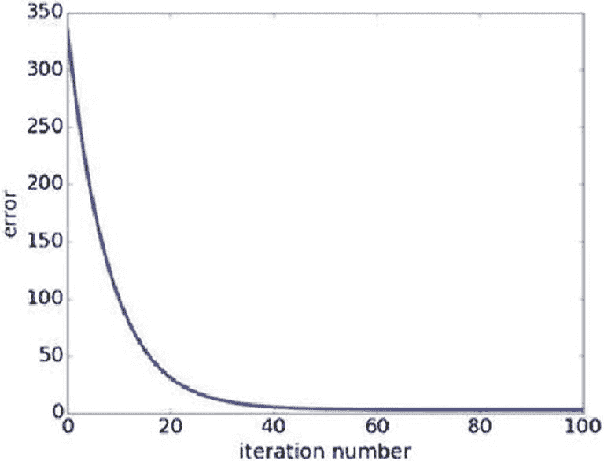

**图 4-14 误差与迭代次数的关系图**

从该图可以明显看出，将迭代次数扩展到 100 次以上几乎无法带来任何改进。虽然完全有可能未达到全局最小值，但任何边际损失改进都可忽略不计。这种情况正是我在之前讨论中所说的“足够好”。

对于感兴趣的读者，最终确定的最佳拟合线性回归方程为：

$$ y=1.3\ast x+0.61 $$

## 人工神经网络

人工神经网络在人工智能领域有着相对悠久的历史。关于人工神经网络的奠基性论文被认为是沃伦·麦卡洛克和沃尔特·皮茨于 1943 年发表的《神经活动中固有思想的逻辑演算》，他们在文中提出了一种基于数学和算法（他们称之为阈值逻辑）的神经网络计算模型。该模型为后续神经网络研究分为两种方法铺平了道路：一种方法侧重于大脑中的生物过程，另一种则侧重于神经网络在人工智能中的应用。

人工神经网络的一个核心概念是神经元模型，其旨在一定程度上模仿人脑神经元。我认为在讨论人工神经元之前，首先讨论人脑神经元非常重要。通过这种方式，你应该能理解人工神经元为何会以今天的形式被创造出来。

人脑神经元的生物示意图如图 4-15 所示。

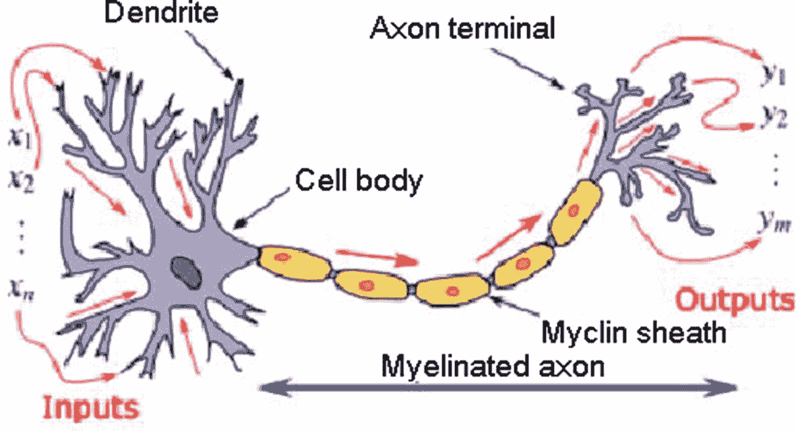

**图 4-15 人脑神经元示意图**

图中所示的人脑神经元部分描述如下：
*   **树突** – 树突允许细胞体从大量（>1000 个）相邻神经元接收信号。每个树突都能通过其“权重值”对电信号进行“乘法”运算。这种乘法是通过增加或减少突触神经递质与响应突触神经递质而引入树突的信号化学物质的比例来实现的。通过沿树突体传递信号抑制剂（即带相反电荷的离子）以响应突触神经递质的接收，可以实现负乘法效应。
*   **胞体** – 胞体起到求和函数的作用。当正负信号（分别为兴奋性和抑制性）从树突到达胞体时，正负离子通过简单地在细胞体内的溶液中混合而有效地相加求和。
*   **轴突** – 轴突从胞体内发生的求和行为中获取信号。轴突的开口本质上是对胞体内溶液的电位进行采样。一旦胞体达到某个电位，轴突就会沿其长度传递一个全有或全无的信号脉冲。通过这种方式，轴突直接与其他神经元通信。

生物神经元以离散脉冲的形式放电。每次胞体内的电位达到预设阈值时，就会有一个脉冲沿轴突传递。这种脉冲可以转化为连续值。轴突放电的速率（每秒激活次数等）直接转化为相邻神经元接收信号离子的速率。生物神经元放电越快，附近神经元积累电位（或失去电位，取决于连接到放电神经元的树突的“权重”）的速度就越快。正是这种转换使得人工智能研究人员能够使用可以输出不同值（通常在-1 到 1 范围内）的人工神经元来模拟生物神经网络。

早期的人工智能研究人员基于前述部分生物学事实，开发了一个相对简单的脑神经元模型。图 4-16 展示了一个具有 `N` 个输入和一个输出的人工神经元示意图。

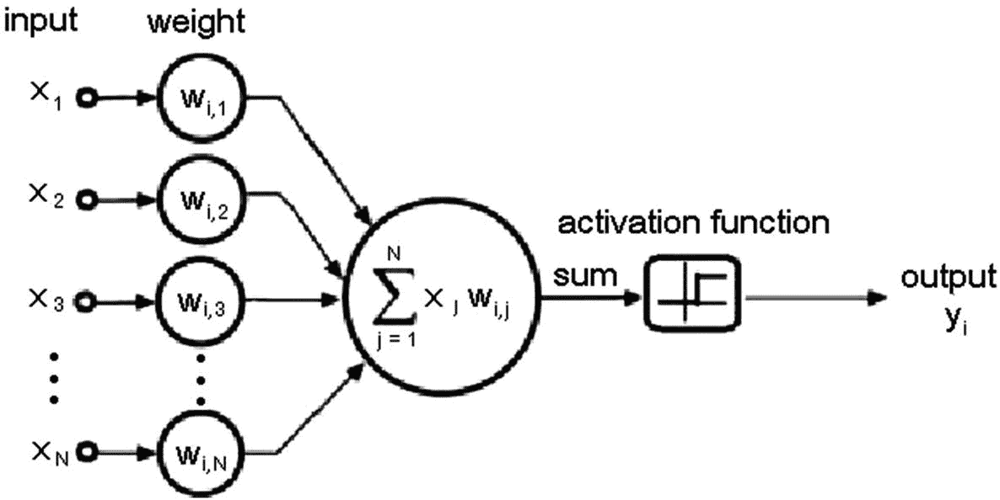

**图 4-16 人工神经元示意图**

带有权重的输入分支相当于树突。圆圈是一个求和节点，相当于胞体内发生的过程。标有激活函数的方框相当于轴突，当加权电信号的总和超过某个阈值时，它就会放电。我认为这个模型非常简单，但似乎能真实地捕捉到真实脑神经元中发生的情况。

人工神经元的数学表示简洁地展示如下：

$$ g\left({x}_1,{x}_2,{x}_3,\cdots {x}_n\right)=g(X)=\sum \limits_{i=1}^n{x}_i $$

$$ y=f\left(g(X)\right)=1\kern0.5em if\ g(X)\ge \theta $$

$$ =0\kern0.5em if\ g(X)<\theta $$

输出 1 和 0 仅表示加权输入总和超过某个阈值 `θ` 时的状态。实际输出值取决于由激活函数转换后的真实总和值。

人工神经元模型中常用的激活函数是 `Sigmoid` 函数，我在第 2-16 章中向你介绍过它。请回顾该讨论以加深印象，并查看图 2 以了解该函数如何转换求和信号。通过检查该图，你应该很容易意识到，对于大多数在-8 到+8 范围内的求和信号，最终输出信号将在 0 到 1.0 的范围内。

### 人工神经网络（`ANN`）的训练与工作原理

现在，我们来探索一个由人工神经元组成的网络，通常简称为 `ANN`。

图 4-17 展示了一个通用的三层 `ANN` 结构。

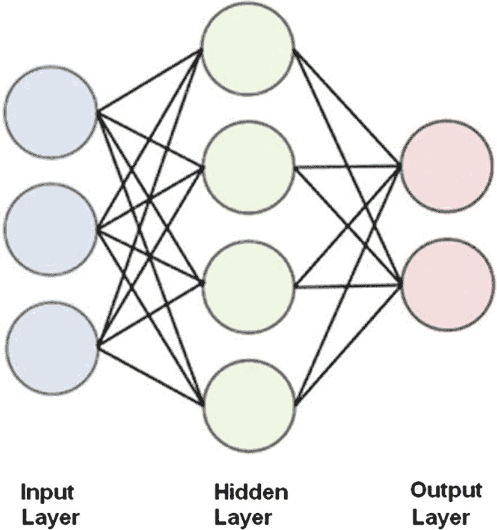

**图 4-17 三层人工神经网络**

构成 `ANN` 的三个层级分别是：
*   **输入层** – 原始数据输入到这一层。这些数据输入不带权重。一个 `ANN` 中只有一个输入层。
*   **隐藏层** – 指既不是输入层也不是输出层的任何层。隐藏层可以有一个或多个。权重通常与隐藏层节点之间的连接，以及最后一个隐藏层到输出层的连接相关联。
*   **输出层** – 处理后的信号作为输出从这一层产生。对于分类 `ANN`，输出节点的数量通常等于类别的数量。

`ANN` 通常分为两类：
*   **前馈型**
*   **反馈型**

图 4-18 展示了信号在这两种 `ANN` 中的流动方式。

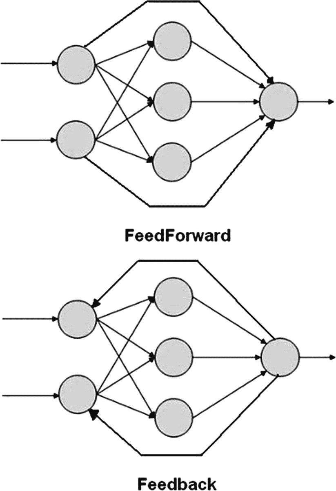

**图 4-18 前馈型和反馈型 `ANN` 模型**

每种 `ANN` 类别相对于另一种都有其优缺点。最终使用哪种 `ANN` 模型取决于数据集的性质以及 `ANN` 的预期用途。然而，在训练 `ANN` 时，总是使用反馈模型。这是因为训练的主要目的是确定用于隐藏层节点的权重值。确定这些值是 `ANN`“学习”的关键方法。`ANN` 的学习过程是：首先将大型数据集逐条或逐元素地输入网络。这些输入数据最终产生输出数据，然后将输出数据与真实数据进行对比。产生的任何误差随后会在反馈配置中用于调整权重值，以减少并最小化误差。这种单条记录的训练周期通常会重复数千次，以完成网络的完整训练。术语“**轮次**”用于描述将整个数据集一次性通过 `ANN` 的过程。在一次训练会话中使用多个轮次并不罕见，为了获得比单次遍历更好的学习效果，训练数据集会在下一个轮次中稍作重新排列。整个训练过程被称为*反向传播*。

图 4-19 展示了一个三层 `ANN`，并在节点互连上标注了权重。

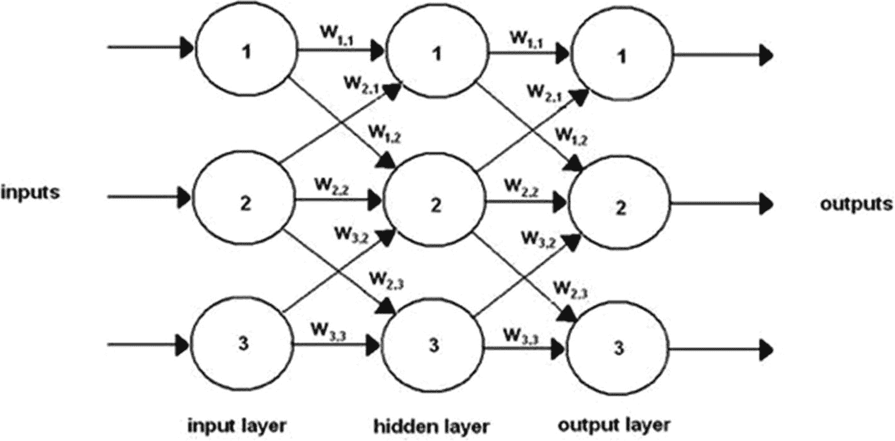

**图 4-19 带权重的三层人工神经网络**

权重标注为 `w[i,j]`，其中 `i` 是源节点，`j` 是目标节点。图中并非所有节点都有互连，因为我不想让图显得过于“拥挤”。实际上，当学习开始时，所有节点都会与其他节点“连接”。最终，一些权重会逐渐减小到不再被使用的程度，这意味着节点连接实际上将不复存在。

#### 实际 `ANN` 示例

我认为展示一个完全“解算”的 `ANN` 示例将是一个有用的学习练习。图 4-20 展示了一个高度简化的两层 `ANN`，我将用它作为本例。

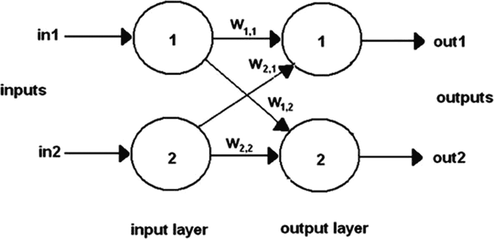

**图 4-20 两层人工神经网络**

本例中不需要隐藏层，因为我只专注于演示反向传播过程。用于开始本例的初始数据输入和权重如表 4-2 所示。

**表 4-2 初始输入和权重值**

| 符号 | 值 |
| --- | --- |
| `in1` | 0.8 |
| `in2` | 0.4 |

# 人工神经网络（ANN）计算示例

这些值是随机的，并不反映任何现实世界的问题领域。我将在后面的章节中描述如何使用随机数生成器预设一整组权重。另外需要注意的一点是，我将使用 Sigmoid 函数来转换求和值。Sigmoid 方程如下：

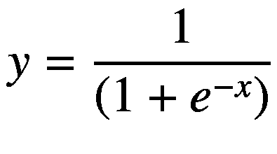

其中
* `e` = 2.71828 ...（欧拉数）
将 `x` = 1 代入上述方程，可得 `y` = 0.731。

计算 `out1` 需要求解以下方程：

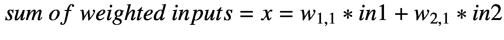

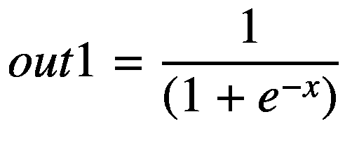

代入表 4-2 中的值得出：

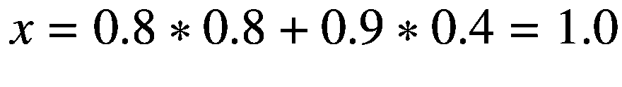

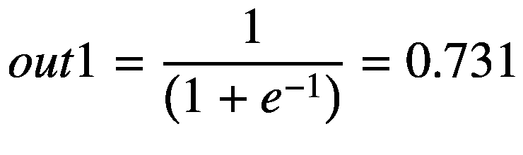

类似地，计算 `out2` 需要求解这些方程：


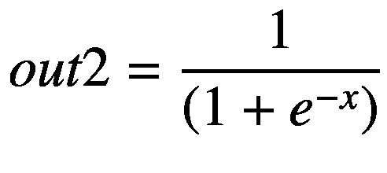

代入表 4-2 中的值得出：

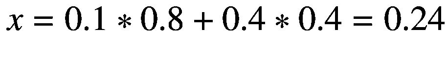

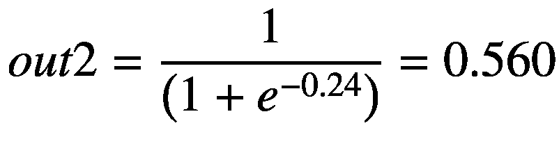

通过相当多的手动计算，现在已经确定了两个 ANN 的输出。此时应该清楚，尝试手动计算更大、更复杂的 ANN 的输出是不现实的。既然我已经演示了手动计算是多么繁琐，从现在开始将使用矩阵和矩阵运算。

这个简单示例的输入数据可以表示为一个向量：

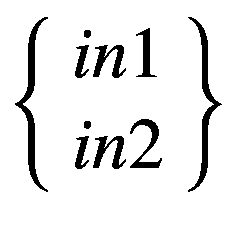

同样，权重矩阵可以表示为一个 2 x 2 矩阵：

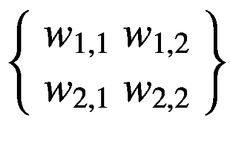

图 4-21 展示了在交互式 Python 会话中使用矩阵运算执行相同手动计算的过程。

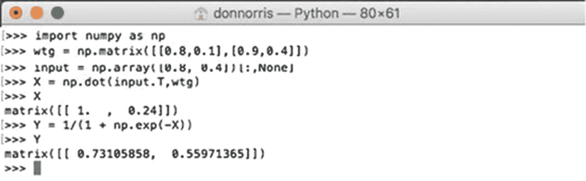

图 4-21 交互式 Python 会话

你可以很容易地看到，Python 会话的结果与手动计算的结果相匹配。

## 复杂 ANN 示例

图 4-22 展示了一个更复杂的 ANN 示例，我使用 Python 脚本对其进行了处理。

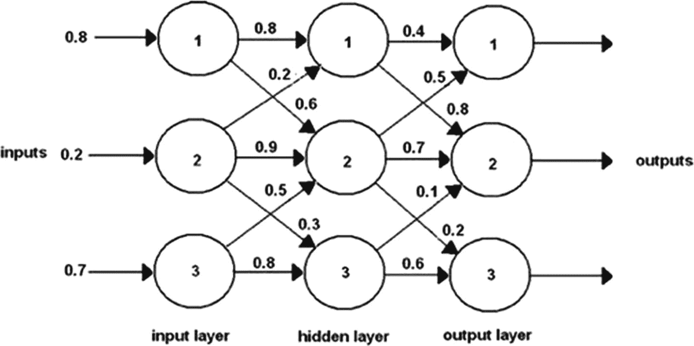

图 4-22 复杂 ANN 示例

输入数据向量并不代表任何有意义的领域问题。它只是一组随机数，因为本次演示的目的是展示复杂 ANN 的计算过程。

向量格式的输入数据集为

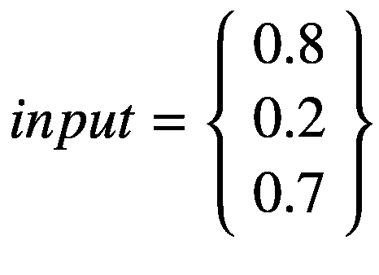

输入层与隐藏层之间的权重矩阵（`wtg[ih]`）为

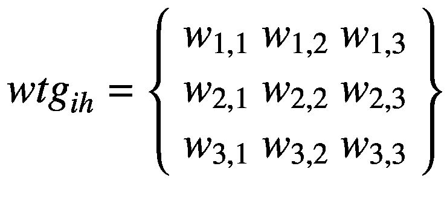 = 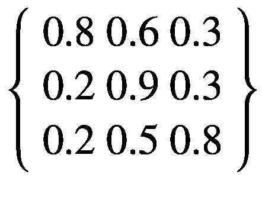

隐藏层与输出层之间的权重矩阵（`wtg[ho]`）为

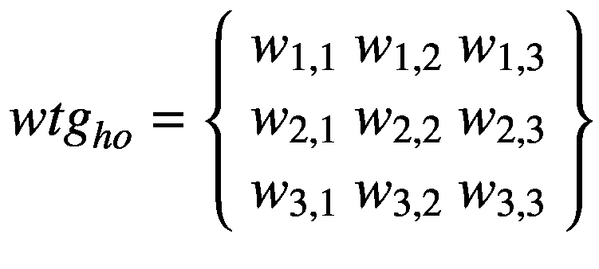 = 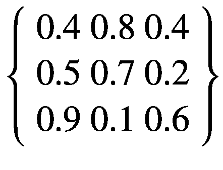

这些矩阵的元素被赋值为 0 到 1.0 范围内的随机数。

用于处理该 ANN 的 Python 脚本名为 `annDemo1.py`，可从本书的配套网站获取。该脚本注释详尽，不过我在代码清单之后还会补充一些说明。

```python
# 导入所需库
import numpy as np
# 创建输入数据向量
input = np.array([0.8, 0.2, 0.7])[:,None]
# 创建 wtgih 矩阵
wtgih = np.matrix([[0.8, 0.6, 0.3], \
[0.2, 0.9, 0.3], \
[0.2, 0.5, 0.8]])
# 创建 wtgho 矩阵
wtgho = np.matrix([[0.4, 0.8, 0.4], \
[0.5, 0.7, 0.2], \
[0.9, 0.1, 0.6]])
# 计算输入向量与 wtgih 矩阵的点积
X1 = np.dot(input.T, wtgih)
# 显示矩阵
print('X1 矩阵\n', X1)
print()
# 对 X1 矩阵应用激活函数
out1 = 1 / (1 + np.exp(-X1))
# 显示矩阵
print('out1 矩阵\n', out1)
print()
# 计算 X1 与 wtgho 矩阵的点积
X2 = np.dot(out1, wtgho)
# 显示矩阵
print('X2 矩阵\n', X2)
print()
# 对 X2 矩阵应用激活函数
out2 = 1 / (1 + np.exp(-X2))
# 显示矩阵
print('out2 矩阵\n', out2)
```

该脚本利用 `numpy` 的点积函数来完成矩阵乘法。另外，请注意使用 `numpy` 的 `exp` 函数应用激活函数是多么简便。

通过输入以下命令来运行脚本：

```
python annDemo1.py
```

图 4-23 显示了运行脚本后的结果。

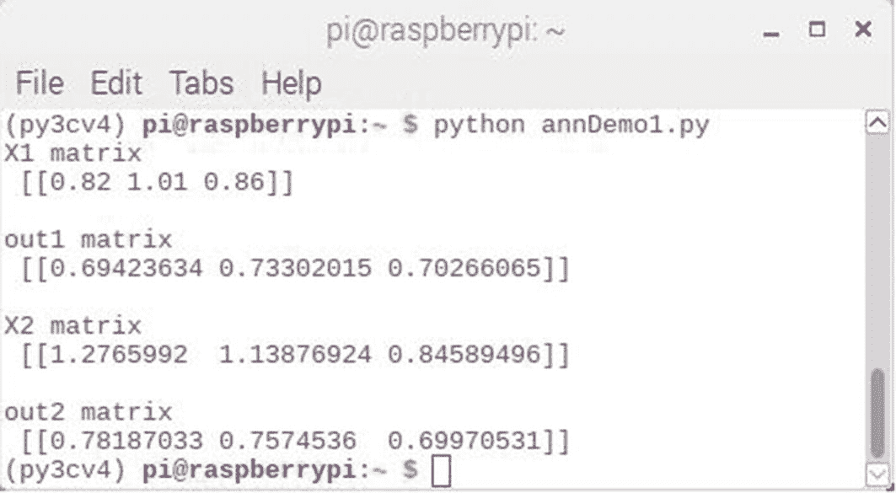

图 4-23 运行 `annDemo1` 脚本的结果

最终输出向量以及所有中间矩阵和向量都一并显示。顺便提一下，当我在矩阵和向量这两个术语之间混用时，请不要感到困惑。我通常将单行数据称为向量，尽管从技术上讲，你也可以将其标记为一维矩阵。在我看来，这种标记方式有点过于学究气了。

该 ANN 的最终输出数据没有实际意义，因为输入数据本身就没有意义。不过，最终输出应该在一定程度上反映输入值。表 4-3 比较了输入值和输出值以及它们之间的误差。

# 表 4-3

## 输入值与输出值对比

| 输入 | 输出 | 误差 |
| --- | --- | --- |
| 0.8 | 0.78187033 | 0.01812967 |
| 0.2 | 0.75745360 | –0.55745360 |
| 0.7 | 0.69970531 | 0.00029469 |

除了表中的中间值，结果都很接近。这表明必须修改初始权重以减少误差。但如何做到呢？答案将在下一节揭晓。

## 修改权重值

考虑如图`4-24`所示三个节点相连的情况。

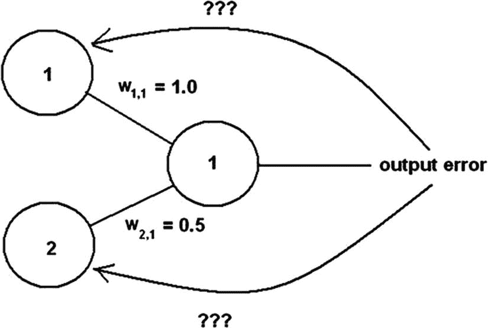

`图 4-24` 单一误差分配设置

求和节点存在一些误差，必须通过调整输入节点 1 和 2 与输出节点 1 之间的权重来修正。一种简单的方法可能是将误差平均分配给各个节点。然而，这并不能准确反映每个输入节点的误差贡献，因为节点 1 的权重是节点 2 的两倍。正确的解决方案是根据连接节点的权重按比例分配误差。在这种情况下，节点 1 应承担三分之二的误差，节点 2 承担三分之一。

以这种方式使用权重矩阵是初次接触人工神经网络（ANN）时不易察觉的一个额外特性。通常，信号如前所述以前馈配置传播。而这种修改方法则利用权重将误差值反向传播。这就是为何这种误差确定方法被称为反向传播。

现在考虑如图`4-25`所示，两个输出节点出现多个误差的情况。

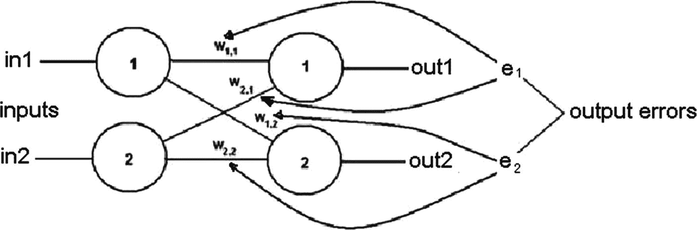

`图 4-25` 多重误差分配设置

多节点的权重修改过程与单节点相同。这是因为输出节点之间相互独立，没有直接连接。分配给每条互连线的误差比例仅取决于连接到该输出节点的每条线上的权重值。在图`4-25`的情况下，分配给误差`e[1]`的权重`w[1,1]`和`w[2,1]`的比例为：

`$$ \frac{w_{1,1}}{\left({w}_{1,1}+{w}_{2,1}\right)}\kern0.5em \mathrm{和}\ \frac{w_{2,1}}{\left({w}_{1,1}+{w}_{2,1}\right)} $$`

类似地，误差`e[2]`的比例为：

`$$ \frac{w_{1,2}}{\left({w}_{1,2}+{w}_{2,2}\right)}\kern0.5em \mathrm{和}\ \frac{w_{2,2}}{\left({w}_{1,2}+{w}_{2,2}\right)} $$`

到目前为止，基于输出误差修改权重的过程很简单。由于训练数据易于获取，误差很容易确定。训练两层人工神经网络时无需其他操作。但是，当隐藏层中肯定存在误差，却又没有训练数据时，如何处理三层人工神经网络呢？

图`4-26`展示了一个三层、六节点的人工神经网络，每层有两个节点。

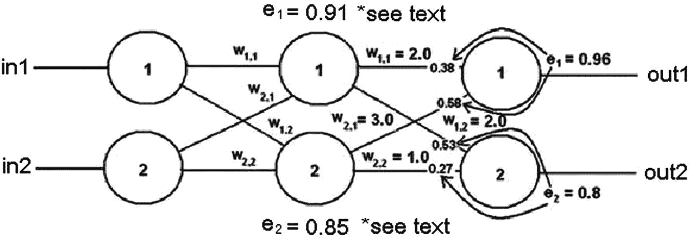

`图 4-26` 三层、六节点人工神经网络

此人工神经网络已被简化，以帮助您专注于所需的少量反向传播计算。输出误差是随机生成的，因为后续计算需要用到它们。以下各个误差贡献是根据图中所示的权重计算得出的：

对于`w[1,1]`线：

`$$ {e}_{1 node1}\ast \frac{w_{1,1}}{\left({w}_{1,1}+{w}_{2,1}\right)}=0.96\ast \frac{2}{\left(2+3\right)}=0.96\ast 0.4=0.38 $$`

对于`w[2,1]`线：

`$$ {e}_{1 node2}\ast \frac{w_{2,1}}{\left({w}_{1,1}+{w}_{2,1}\right)}=0.96\ast \frac{3}{\left(2+3\right)}=0.96\ast 0.6=0.58 $$`

对于`w[1,2]`线：

`$$ {e}_{2 node1}\ast \frac{w_{1,2}}{\left({w}_{1,2}+{w}_{2,2}\right)}=0.8\ast \frac{2}{\left(2+1\right)}=0.8\ast 0.66=0.53 $$`

对于`w[2,2]`线：

`$$ {e}_{2 node2}\ast \frac{w_{2,2}}{\left({w}_{1,2}+{w}_{2,2}\right)}=0.8\ast \frac{1}{\left(2+1\right)}=0.8\ast 0.33=0.27 $$`

每个隐藏节点的总归一化误差值是该节点各个误差贡献之和，计算如下：

`$$ {e}_1={e}_{1 node1}\kern0.5em +{e}_{2 node1}=0.38+0.53=0.91 $$`

`$$ {e}_2={e}_{1 node2}\kern0.5em +{e}_{2 node2}=0.58+0.27=0.85 $$`

这些值显示在图`4-26`中每个隐藏节点旁边。

此误差计算过程可以继续，以涵盖所有剩余隐藏层节点的所有误差，不仅限于本例中的单个隐藏层，而是针对人工神经网络中任意数量的隐藏层。但是，无需计算输入层的误差值，因为所有输入层节点的误差必须为 0。它们只是不加修改地传递输入数据向量值。

您应该能察觉到，计算隐藏层误差值是一个繁琐的过程，并且可以像前馈计算那样以自动化方式进行。如果误差计算直接从我刚才演示的手动过程转换而来，则适用以下矩阵表示法：

`$$ {e}_{hidden}=\left\{\begin{array}{c}\frac{w_{1,1}}{\left({w}_{1,1}+{w}_{2,1}\right)}\kern0.5em \frac{w_{1,2}}{\left({w}_{1,1}+{w}_{2,1}\right)}\\ {}\frac{w_{2,1}}{\left({w}_{2,1}+{w}_{2,2}\right)}\kern0.5em \frac{w_{2,2}}{\left({w}_{2,1}+{w}_{2,2}\right)}\end{array}\right\}\ast \left\{\begin{array}{c} in1\\ {} in2\end{array}\right\} $$`

不幸的是，没有简单的方法可以像矩阵中所示那样输入分数。然而，只需考虑分数仅用于归一化误差贡献，这意味着贡献值范围仅在 0 到 1.0 之间。通过舍弃分母，仍然可以保持相对误差贡献。去掉分母得到：

`$$ {e}_{hidden}=\left\{\begin{array}{c}{w}_{1,1}\kern0.5em {w}_{1,2}\\ {}{w}_{2,1}\kern0.5em {w}_{2,2}\end{array}\right\}\ast \left\{\begin{array}{c} in1\\ {} in2\end{array}\right\} $$`

这个矩阵公式与之前演示的相同，并且可以轻松地使用 `numpy` 函数处理。

到目前为止，我只讨论了如何确定各个误差贡献。现在是时候讨论在确定误差贡献后如何修改权重了。

我将首先向您展示一个相当复杂的方程，该方程用于计算三层、九节点人工神经网络中给定输出节点的输出：

`$$ {O}_k=\frac{1}{-\sum \limits_{j=1}³\left({w}_{j,k}\ast \frac{1}{\sum \limits_{j=1}³\left({w}_{j,k}\ast {x}_i\right)}\right)} $$`

其中

`$$ {O}_k= 第 k 个节点的输出 $$`

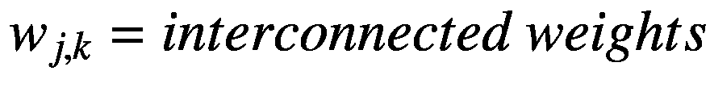
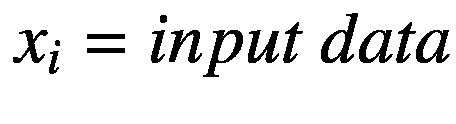

即使这个方程仅适用于一个简单的三层、九节点人工神经网络，它也已经相当复杂。想象一下适用于六输入、五层人工神经网络的方程会是什么样。拥有更大规模的人工神经网络极为常见，因此试图解析求解人工神经网络方程完全不切实际，也超出了人类的理解能力。排除了解析方法后，您可能会尝试一种“暴力”方法。

考虑使用一台极快的计算机，并对每个权重尝试一系列不同的值。假设权重范围是 –1 到 +1，这对于一个实际的人工神经网络来说是完全可能的。再假设增量大小为 0.001，这同样是一个合理的假设。这意味着对于一个三层、九个节点的人工神经网络，将有 18 个权重需要测试，每个连接进行 2000 次测试，总共需要进行 36,000 次增量测试。假设每次测试需要 1 秒，那么总共需要 36,000 秒，即大约 10 小时的运算时间。十个小时虽然很长，但你可以去睡觉，电脑在早上就能完成。但现在考虑一个实际的 900 节点人工神经网络，我计划在下一章中进行演示。这将需要近十亿次测试，大约需要 32 年才能完成。我不知道你怎么想，但等待一代人左右的时间来完成一次计算，似乎有点过分了。暴力方法的实用替代方案是使用本章前面介绍过的梯度下降算法。

图 4-27 将作为我用来解释如何将梯度下降应用于人工神经网络的网络。
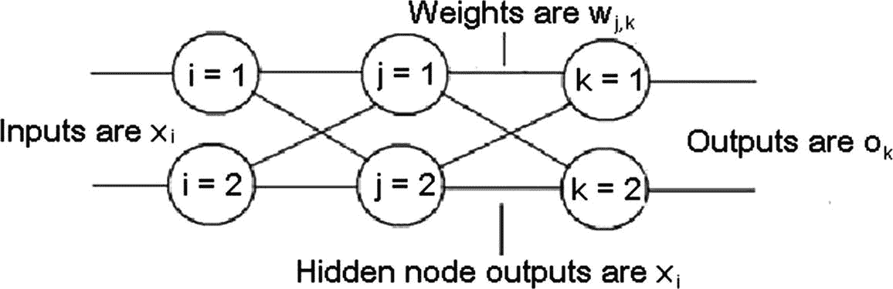
图 4-27 三层、六节点人工神经网络

除了图中所示的符号外，还需要一个额外的符号 `e[k]` 来表示输出节点误差。
输出节点误差表示为
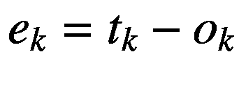
其中
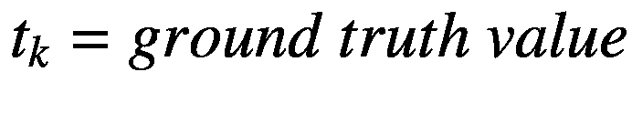
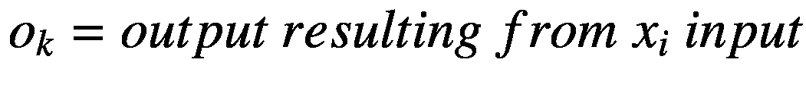

总误差是每个节点误差值的总和。得到的方程是

其中


误差项也被平方，以确保负误差不会抵消正误差，正如我在讨论梯度下降时提到的那样。
这个误差函数等同于损失函数。这意味着必须对其关于 `w[j,k]` 求导，以创建用于优化权重的方程。导数形式为


注意到任何给定节点的误差完全由其输入连接引起，可以大大简化这个方程。这意味着第 `k` 个节点仅依赖于其输入连接上的权重 `w[j,k]`。认识到这一事实，你可以从误差函数中移除求和，因为没有其他节点对第 `k` 个节点的输出有贡献。这种简化得到了一个简单得多的误差函数：


完成微分并应用激活函数后的最终方程是


前面的方程虽然看起来相当复杂，但如果赋予其物理意义，实际上很容易理解。第一部分 (`t[k] − o[k]`) 就是误差。`sigmoid` 函数内部的求和是输入到第 `k` 个最终层节点的值。最后一项 `o[j]` 是隐藏层中第 `j` 个节点的输出。

隐藏层梯度下降算法的方程与前面所示的类似。它是


剩下的唯一需要展示的方程是，如何根据旧权重和梯度下降算法的结果来计算新权重。这个方程是

其中


你应该能够看到，学习率参数对人工神经网络在梯度下降过程中的步进效果有很强的影响。
用矩阵符号表示上述所有方程在计算上会更高效。以下函数计算连接隐藏层节点到输出节点的单个链接的梯度下降值：

其中


以下是三层、六节点人工神经网络示例的矩阵：

其中 `o[n]` = 来自隐藏层的输出。

至此，我已经涵盖了所有必要的理论和数学背景，以便你理解一个关于人工神经网络如何学习的详尽示例。

### 实际 ANN 权重修改示例

我将使用之前模型中稍作修改的网络来详细说明如何计算修改后的权重。图 4-28 是图 4-26 的修改版本，我在其中插入了两个随机值来表示隐藏层节点的输出。

图 4-28 修改后的三层六节点 ANN

计算从更新 `w[1,1]` 开始，该权重连接隐藏层节点 1 与输出层节点 1。以下是该连接的梯度下降方程：

# ANN 学习中的关键问题与实践


将图中的数值代入该方程可得


将上述因子相乘得到


假设学习率为 `0.15`，则新权重为


新权重与旧权重相差不大；但请注意，在达到全局最小值之前，可能需要数百甚至数千次迭代。当多次迭代累积后，微小的变化最终会导致巨大的改变。网络中所有其他权重的调整过程与我刚才演示的相同。

## ANN 学习中的一些问题

关于 `sigmoid` 激活函数，有两个要点需要了解。我将图 2-16 复制为图 4-29，以辅助本次讨论。


**图 4-29** Sigmoid 函数

观察该图，您应该能发现当 `x` 输入大于 `2.5` 时，`y` 输出变化非常小。这是因为 `sigmoid` 函数在该值附近渐近趋近于 `1.0`。大 `x` 输入下的微小变化意味着梯度变化非常小。由于梯度下降算法依赖于存在“合理”的斜率，ANN 学习会受到抑制。因此，ANN 训练数据集应将 `x` 值限制在所谓的*伪线性*范围内，大约为 `-3` 到 `3`。负值限制的出现是因为 `sigmoid` 函数关于 y 轴对称，当 `x` 小于或等于 `2.5` 时会发生饱和。超出*伪线性*范围的 `x` 值会导致 ANN 产生饱和效应，无法进行有效的权重更新。

`sigmoid` 函数的另一个问题是它无法输出大于 `1.0` 或小于 `0` 的值。必须选择初始权重，以确保函数能在其允许范围内输出。实际上，由于前面描述的渐近特性，输出范围必须大致在 `0.01` 到 `0.99` 之间。

如前所述，初始权重的选择至关重要。选择一组良好的 ANN 初始权重可以避免输入饱和和输出限制问题。最直接的选择是将权重限制在我之前指定的*伪线性*范围内。然而，为了更保守起见，权重通常被限制在 ±1 之间。

多年来，AI 研究人员一直遵循一条有用的经验法则来帮助选择权重：

> 初始权重应使用正态分布分配，其均值设置为 ANN 节点数的平方根的倒数。

如果您使用一个包含 `36` 个节点的小型 ANN，则均值为 `1 / sqrt(36)` 或 `0.16667`。图 4-30 显示了具有该均值及 ±2 个标准差的正态概率分布。


**图 4-30** 36 节点 ANN 初始权重的正态偏差

在约 `-0.5` 到 `0.833` 范围内随机选择权重，可以为 `36` 节点 ANN 的学习提供一个极佳的起点。

关于初始权重选择，最后还有两点。第一点是避免将所有权重设置为相同值。ANN 学习依赖于权重的非均匀分布。第二点（希望显而易见）是不要将所有权重设置为 `0`，因为那样会禁用 ANN。

最后这一节完成了关于 ANN 的所有预备性讨论。是时候着手构建一个基于 Python 的实际 ANN 了。

## ANN Python 演示 – 第 1 部分

在本演示的第 1 部分中，我将向您展示如何使用 Python 创建一个未经训练的 ANN。在第 2 部分中，我将向您展示如何训练该 ANN。

本讨论首先描述一个实用 ANN 的组成模块。每个模块都必须有精心设计的软件，使其能够实现其目的。

第一个模块是 `Init` 模块，用于“构建”ANN 结构。在本演示中，我将构建一个三层、九个节点的 ANN。这意味着我必须拥有代表每一层的对象，以及输入、输出和权重。表 4-4 显示了 `Init` 模块的对象和引用。

**表 4-4** Init 模块对象和引用

| 名称 | 描述 |
| :--- | :--- |
| `inode` | 输入层节点数 |
| `hnode` | 隐藏层节点数 |
| `onode` | 输出层节点数 |
| `wtgih` | 输入层与隐藏层之间的权重矩阵 |
| `wtgho` | 隐藏层与输出层之间的权重矩阵 |
| `w[ij]` | 单个权重矩阵元素 |
| `input` | 输入向量 |
| `output` | 输出向量 |
| `ohidden` | 隐藏层输出数组 |
| `lr` | 学习率 |

以下 `Init` 模块代码设置了节点的数量和类型以及学习率：

```python
def __init__(self, inode, hnode, onode, lr):
    # 设置局部变量
    self.inode = inode
    self.hnode = hnode
    self.onode = onode
    self.lr = lr
```

必须使用适当的值调用此 `Init` 模块代码，以构建一个三层、九个节点的 ANN。这些值为：

* `inode` = 3
* `hnode` = 3
* `onode` = 3
* `lr` = 0.25

接下来要讨论的模块是设置权重矩阵的模块。我决定使用均值为 `0.1667`、标准差为 `0.3333` 的正态分布，正如我之前讨论的那样。NumPy 包含一个随机数生成器，可以很好地满足这一要求。以下代码创建了一个名为 `wtgih` 的 `3 x 3` 矩阵，其中填充了具有所需统计特征的随机数：

```python
self.wtgih = np.random.normal(0.1667, 0.3333, self.hnodes, self.inodes)
```

我在 Python 交互式会话中测试了上述代码，如图 4-31 所示。


**图 4-31** 测试代码的 Python 交互式会话

生成的 `wtgih` 矩阵结构良好，初始值非常出色。现在可以扩展 `Init` 模块以包含矩阵生成代码，其中我使用了前面描述的经验法则来设置矩阵的统计参数。

### `__init__` 模块

```python
def __init__(self, inode, hnode, onode, lr):
    # 设置局部变量
    self.inode = inode
    self.hnode = hnode
    self.onode = onode
    self.lr = lr
    # 均值是节点数之和的平方根的倒数
    mean = 1 / (pow((inode + hnode + onode), 0.5))
    # 标准差约为总权重范围的 1/6
    # 总范围 = 2
    sd = 2 / 6
    # 生成两个权重矩阵
    # 输入层到隐藏层
    self.wtgih = np.random.normal(mean, sd, [hnode, inode])
    # 隐藏层到输出层
    self.wtgho = np.random.normal(mean, sd, [onode, hnode])
```

此时，我将引入第二个模块，用于测试 `Init` 模块。这个新模块名为 `testNet`，这反映了它的用途。该模块接收一个输入向量并返回一个输出向量。这个新模块执行以下步骤：

1.  将输入数据向量转换为 `numpy` 数组。
2.  将输入数组乘以 `wtgih` 权重矩阵。
3.  应用 `sigmoid` 激活函数。
4.  将隐藏层输出乘以 `wtgho` 矩阵。
5.  应用 `sigmoid` 激活函数。

这个新模块的代码清单如下：

```python
import numpy as np
def testNet(self, input):
    # 将输入数据向量转换为数组
    input = np.array(input, ndmin=2).T
    # 将输入数组乘以 wtgih 矩阵
    hInput = np.dot(self.wtgih, input)
    # 应用激活函数
    hOutput = 1 / (1 + np.exp(-hInput))
    # 将隐藏层输出乘以 wtgho 矩阵
    oInput = np.dot(self.wtgho, hOutput)
    # 应用激活函数
    oOutput = 1 / (1 + np.exp(-oInput))
    return oOutput
```

`Init` 和 `testNet` 模块都被放入一个名为 `ANN` 的 `Python` 类中，我将在第 2 部分演示之后向您展示这个类。但是，我首先需要演示一个完全未经训练的 `ANN` 的表现。

### 注意

此时，您将无法复制以下交互式会话，因为您的 `home` 目录中不存在 `ANN` 类文件。您可以在创建或加载类文件后尝试进行此交互式会话。

图 4-32 显示了实例化一个名为 `ann` 的 `ANN` 对象，然后调用 `testNet` 方法的交互式会话。请注意，当实例化 `ann` 对象时，`Init` 方法会被自动调用。


图 4-32

调用 `testNet` 的 `Python` 交互式会话

输出中存在一些严重错误，我已在表 4-5 中详细列出。

表 4-5

初始测试错误

| 输入 | 输出 | 误差 | 百分比误差 |
| --- | --- | --- | --- |
| 0.8 | 0.628566 | –0.171434 | 21.4 |
| 0.5 | 0.782561 | 0.282561 | 56.5 |
| 0.6 | 0.672449 | 0.072449 | 12.1 |

这些错误在网络经过训练后应该会大大减少，这是下一个演示的主题。

### ANN Python 演示 – 第二部分

在演示的第二部分，我将向你展示如何训练你在第一部分中创建的网络。训练将使用一个名为 `trainNet` 的第三个模块，并将其添加到 `ANN` 类文件中。该模块的功能与 `testNet` 模块类似，都是基于输入数据集计算输出数据集。然而，`trainNet` 模块的输入数据集是一个预定的训练集，而不是随机生成的数据集。随着我逐步展开模块开发的讨论，这里的“预定”含义会变得更加清晰。

`trainNet` 模块会计算一个误差数据集，即 `ANN` 输出与输入训练数据集之间的差异。这种行为被称为**监督学习**，因为网络“知道”正确的输出应该是什么，并且可以修改其权重，以尝试达到输入训练数据集中包含的真实值。

接下来展示的 `trainNet` 模块代码，从一些独立于 `Init` 模块代码内部初始化的初始化代码开始：

```python
def trainNet(self, inputT, train):
    # 此模块依赖于运行 init 模块时创建的值、数组和矩阵
    # 从列表参数创建数组
    self.inputT = np.array(inputT, ndmin=2).T
    self.train = np.arrat(train, ndmin=2).T
```

计算出的误差是训练集值与实际输出之间的差值。如前所示，第 *k*[*th*] 个输出节点的误差方程为：


输出误差的矩阵表示形式为：


对于此示例 `ANN`，隐藏层误差数组的矩阵表示形式为：


以下是生成此数组的 `Python` 代码：

```python
self.hError = np.dot(self.wtgho.T, self.eOutput)
```

以下是用于调整第 `j` 层和第 `k` 层之间连接的权重更新方程：


新的 *g*(*w*[*j*, *k*]) 数组必须加到原始数组上，因为这些是对原始权重的调整。上述方程很容易用 `Python` 代码表示为：

```python
self.wtgho += self.lr*np.dot((self.eOutput*self.oOutputT*(1 - self.oOutputT)), self.hOutputT.T)
```

输入层和隐藏层之间权重更新的代码使用完全相同的格式：

```python
self.wtgih += self.lr*np.dot((self.hError*self.hOutputT*(1 - self.hOutputT)), self.inputT.T)
```

上述两条 `Python` 语句是梯度下降算法的核心。它们基本上沿着复杂的误差（损失）函数轮廓逐步下降，以寻找全局最小值。你应该注意，没有限制语句来停止此搜索。这是调用函数的责任，我稍后会演示。

完整的 `ANN` 类列表如下，其中包括 `trainNet` 模块以及 `Init` 和 `testNet` 模块。此文件名为 `ANN.py`，可从本书的配套网站获取。除了列表中包含的内容外，我没有添加任何额外的代码注释。我认为我前面的所有讨论应该已经解释了这段代码的工作原理。

```python
# 导入所需库
import numpy as np

class ANN:
    def __init__(self, inode, hnode, onode, lr):
        # 设置局部变量
        self.inode = inode
        self.hnode = hnode
        self.onode = onode
        self.lr = lr
        # 均值是总节点数平方根的倒数
        mean = 1/(pow((inode + hnode + onode), 0.5))
        # 标准差约为总范围的 1/6
        # 范围 = 2
        sd = 2/6
        # 生成两个权重矩阵
        # 输入到隐藏层矩阵
        self.wtgih = np.random.normal(mean, sd, [hnode, inode])
        # 隐藏到输出层矩阵
        self.wtgho = np.random.normal(mean, sd, [onode, hnode])

    def testNet(self, input):
        # 将输入数据向量转换为 numpy 数组
        input = np.array(input, ndmin=2).T
        # 将输入乘以 wtgih
        hInput = np.dot(self.wtgih, input)
        # 应用激活函数
        hOutput = 1/(1 + np.exp(-hInput))
        # 将隐藏层输出乘以 wtgho
        oInput = np.dot(self.wtgho, hOutput)
        # 应用激活函数
        oOutput = 1/(1 + np.exp(-oInput))
        return oOutput

    def trainNet(self, inputT, train):
        # 此模块依赖于运行 init 模块时创建的值、数组和矩阵
        # 从参数创建数组
        self.inputT = np.array(inputT, ndmin=2).T
        self.train = np.array(train, ndmin=2).T
        # 将 inputT 数组乘以 wtgih
        self.hInputT = np.dot(self.wtgih, self.inputT)
        # 应用激活函数
        self.hOutputT = 1/(1 + np.exp(-self.hInputT))
        # 将隐藏层输出乘以 wtgho
        self.oInputT = np.dot(self.wtgho, self.hOutputT)
        # 应用激活函数
        self.oOutputT = 1/(1 + np.exp(-self.oInputT))
        # 计算输出误差
        self.eOutput = self.train - self.oOutputT
        # 计算隐藏层误差数组
        self.hError = np.dot(self.wtgho.T, self.eOutput)
        # 更新权重矩阵 wtgho
        self.wtgho += self.lr*np.dot((self.eOutput*self.oOutputT*(1 - self.oOutputT)), self.hOutputT.T)
        # 更新权重矩阵 wtgih
        self.wtgih += self.lr*np.dot((self.hError*self.hOutputT*(1 - self.hOutputT)), self.inputT.T)

    def getMatrices(self):
        matrixList = list([self.wtgih, self.wtgho])
        return matrixList
```

以下脚本使用 `ANN` 类来训练与我在演示第一部分中使用的相同规模的网络。此脚本名为 `testANN3.py`，可从本书的配套网站获取：

```python
# 导入所需库
from ANN import ANN

# 创建输入数据向量
inputT = [0.8, 0.5, 0.6]
# 显示它
print('输入数据向量')
print(inputT)
print()

# 训练 1 次迭代
train = inputT
ann = ANN(3,3,3,0.3)
output = ann.testNet(inputT)
# 显示输出
print('经过一次迭代后')
print(output)
print()

# 训练 499 次迭代
for i in range(499):
    ann.trainNet(inputT, train)
    output = ann.testNet(inputT)

# 显示输出
print('经过 500 次迭代后')
print(output)
print()
```

通过输入以下命令来运行脚本：

```bash
python testANN3.py
```


**图 4-33**：运行 `testANN3` 脚本后的结果

你可以清楚地看到，除了第三个元素外，初始输出与初始数据向量相差甚远。然而，在总共 500 次迭代之后，输出基本上与输入匹配，这表明网络已针对这个特定的输入数据集向量进行了充分训练。如果你想知道，我选择 500 次迭代作为限制并没有特别的原因，只是因为我尝试了该区域的不同数字，输出结果都没有变化。我使用了“试错法”，因为 `RasPi` 只需几秒钟就能完成数百次迭代。这个结果只是表明，对于要使用的迭代次数，并没有“神奇”的数字，因为每个网络都是独一无二的。有时你只需使用一个足够好的数字，正如我之前说过的。

我还对两个权重矩阵从初始化版本到完全训练版本的净变化感兴趣。因此，我为 `ANN` 类添加了一个额外的方法，该方法在被调用时返回这两个矩阵。这个方法名为 `getMatrices`，如下所示：

```python
def getMatrices(self):
    matrixList = list([self.wtgih, self.wtgho])
    return matrixList
```

随后，我对 `testANN3` 脚本进行了轻微修改，使其两次调用 `getMatrices` 方法。第一次调用在第一次迭代之后，第二次调用在第 500 次迭代之后。修改后的 `testANN3.py` 脚本被重命名为 `testANN4.py`。该脚本可从本书的配套网站获取。

```python
from ANN import ANN

inputT = [0.8, 0.5, 0.6]
print('Input data vector')
print(inputT)
print()

train = inputT
ann = ANN(3,3,3,0.3)
output = ann.testNet(inputT)
print('After one iteration')
print(output)
print()

matrixList = ann.getMatrices()
print('wtgih matrix')
print(matrixList[0])
print()
print('wtgho matrix')
print(matrixList[1])
print()

for i in range(499):
    ann.trainNet(inputT, train)
    output = ann.testNet(inputT)

print('After 500 iterations')
print(output)
print()

matrixList = ann.getMatrices()
print('wtgih matrix')
print(matrixList[0])
print()
print('wtgho matrix')
print(matrixList[1])
print()
```

通过输入以下命令来运行该脚本：

```bash
python testANN4.py
```


**图 4-34**：运行 `testANN4` 脚本后的结果

两个矩阵的初始版本和最终版本之间存在显著差异，这清楚地展示了梯度下降算法是如何改变权重的。

接下来，我很好奇如果简单地重新运行脚本，这两个矩阵会发生什么变化。图 4-35 显示了重新运行的结果。


**图 4-35**：重新运行 `testANN4` 脚本后的结果

比较图 4-34 和图 4-35，很容易看出每次运行时的起始矩阵都不同。这是因为 `__init__` 模块使用随机数过程来创建每个矩阵。一个更有趣的特点是，每次运行脚本时，每个矩阵的最终版本也各不相同。我得出结论，对于特定的解决方案，不存在唯一一组优化的矩阵，最终的矩阵集取决于初始化的矩阵集。从数学角度来看，这意味着必然存在无限多的矩阵集，可以用来通过这个特定的 `ANN` 解决这个特定的输入数据集。我猜想，这很可能是 `AI` 研究人员将 `ANN` 称为“黑箱”的原因之一，因为这些非解析解的存在。

至此，我的深度学习准备章节就结束了。如果我在某些主题上，尤其是在数学部分，有点“过头”，我深表歉意，但我认为至少让你接触一次 DL 的重要基础是必要的。现在，你应该已经做好了充分准备，能够理解并欣赏后续章节中那些有趣且实用的 ANN 演示了。