# 5. 实用的深度学习 ANN 演示

本章将展示几个实用的深度学习演示。只要你阅读了前一章，或者之前有过 DL 技术和概念的经验，你就能跟上这些演示。在撰写本章时，我有两个目标。第一个是清晰地展示如何完成一个完整的 ANN 项目，以产生现实且有用的结果。第二个是指出一些在 ANN 开发中常见的潜在陷阱和不切实际的假设。

## 零件清单

本章的演示需要标准的 RasPi 桌面配置和 Pi 摄像头。

| 项目 | 型号 | 数量 | 来源 |
| --- | --- | --- | --- |
| Raspberry Pi 3 或 4 | Model B 或 B+ (RasPi 3)Model B (RasPi 4) | 1 | mcmelectronics.comadafruit.comdigikey.commouser.comfarnell.com |
| Micro SD 卡 | 16 GB，class 10 或更大 | 1 | amazon.com |
| 带排线的 Raspberry Pi 摄像头 | 版本 2 或更高 | 1 | amazon.com |
| Raspberry Pi 摄像头支架 | 任何适配版本 2 型号的支架 | 1 | amazon.com |
| USB 键盘 | Amazon Basic | 1 | amazon.com |
| USB 鼠标 | Amazon Basic | 1 | amazon.com |
| HDMI 显示器 | 普通商品 | 1 | amazon.com |


## 手写数字识别演示

这个人工神经网络项目在 ANN 领域被视为经典项目之一，其核心任务是识别手写数字。不过，在深入探讨该项目细节之前，我想先就一些通用的项目开发准则发表看法。遵循这些准则将有助于你成功完成大多数项目，包括像本项目这样的小型项目。这些准则可分为一系列步骤，将在列表后逐一讨论：

1.  写下需求。
2.  确定人员、硬件和软件资源。
3.  制定包含里程碑的切实可行的时间表。
4.  开始构建、开发和/或实施。
5.  开始测试。
6.  根据测试结果修正开发/实施。
7.  开始生产或现场发布。
8.  制定维护计划。

**写下需求** – 写下项目需求非常重要，即使你是项目唯一负责人也是如此。将需求写下来能迫使你牢固理解项目完成后应实现的目标。当项目有多个团队成员时，这一准则尤为重要。将需求落实到书面并让所有团队成员达成一致，可以避免未来在“要做什么”以及“如何完成”方面产生分歧。

**确定人员、资金、硬件和软件资源** – 了解项目所需的所有资源要么立即可用，要么有获取计划，是任何项目成功完成的关键。对于需求有限、单人负责的项目，这一步可能可选，但对于有专门团队的中大型项目则至关重要。

**制定包含里程碑的切实可行的时间表** – 无论项目规模大小，制定时间表总是一个好主意。对于单人软件项目，在办公桌或日历上做个简单记录就足够了；而对于中大型项目，则需要更正式的进度安排文档。创建里程碑也很有用，即使它只是提醒自己是否按计划进行或（更常见的是）落后于计划。长期大型项目通常会设立专门的项目进度安排团队，协助项目经理确保按时推进。

**开始构建、开发和/或实施** – 这是实际项目工作开始的阶段。对于本书所述的软件开发项目，你应分配足够的时间，在干扰较少的情况下开展工作。我知道在家庭环境中这很难做到，但拥有不被打断的时间对于高效完成项目至关重要。正式项目则另当别论，因为这就是它们存在的*根本理由*。

**开始测试** – 这一步适用于涉及原型和/或软件开发的项目。测试硬件原型以确定其是否满足需求是绝对必要的，没有这一步，任何项目都无法合理推进。同样，测试软件以确保其满足需求也是一项要求。根据项目的性质和规模，可能有正式的方法来记录原型/软件满足需求的程度。

**根据测试结果修正开发/实施** – 对开发/实施进行更改和/或修改必须遵循测试结果的审查和接受。不使用测试结果将违背测试的整个目的，并最终导致项目失败。有时，测试会揭示初始需求列表在某些方面不切实际或存在缺陷。在项目生命周期中，由于潜在发现，甚至因计划资源意外延迟或不可用等不幸事件而导致需求有所变化，这并不罕见。你需要警惕的是需求“蔓延”，即那些“锦上添花”的需求被悄悄添加到列表中。这种情况可能导致项目结果出现问题。

**开始生产或现场发布** – 项目基本完成，准备按预期目的发布。有时，项目经理会为了添加一些“锦上添花”的小“调整”而推迟最终发布。应避免这种情况，因为如果项目是按照严格准则开发的，它就应该在预定日期准备就绪。此时还应提供适当的文档，说明潜在用户应如何与项目交互。在大型项目中，用户培训很可能在发布日之前就已经开始甚至完成。

**制定维护计划** – 除小型个性化项目外，所有项目都应包含维护方案。这可以是一个正式计划，也可以只是一个更新网站。这完全取决于项目范围和预期项目生命周期。

上述步骤中只有四个适用于本项目。最后一步是前面列表中步骤 4、5 和 6 的混合组合：

1.  写下需求。
2.  确定人员、硬件和软件资源。
3.  制定包含里程碑的切实可行的时间表。
4.  开始开发和测试，并根据需要修正开发。

在实际操作中，这些步骤包含以下具体细节：

**写下需求：**

*   创建一个由树莓派控制的手写数字识别系统。
*   它将使用一个为适配可用训练/验证数据集而设计的人工神经网络。
*   它将在显示器屏幕上显示结果。
*   用户将使用终端窗口与系统交互。

**确定人员、硬件和软件资源：**

*   人员 – 仅限本人。
*   设备 – 参见零件清单。需要互联网连接以下载所需数据集。

**制定包含里程碑的切实可行的时间表：**

*   三个工作日用于创建和测试初始人工神经网络
*   一个工作日用于测试视觉识别功能
*   一个工作日用于完成文档

**开始开发和测试，并根据需要修正开发：**

*   对每位开发者来说都是非常独特的体验。我怀疑我的方法与其它开发者的方法有很大不同。
*   我尝试在开发过程中进行注释/记录文档，并会根据最终结果回溯修正注释。


### 项目历史与准备细节

手写数字识别一直是全球邮政服务的重要优先事项。在许多国家，邮政编码被写在信件和包裹上，以改进这些物品在系统中的处理方式。使用摄像头配合手写数字识别软件的自动化系统，可以在无需人工干预的情况下机械分拣信件和包裹。当然，技术不断进步，如今通过邮政服务寄送的大多数包裹都已使用条形码。尽管如此，许多信件仍然带有手写邮政编码，仍需人工处理。

我们创建了能够轻松识别手写数字的人工神经网络（ANN）。本项目使用的训练集和验证/测试集来自两个混合国家标准与技术研究院（MNIST）数据库。这些数据库多年来在人工智能社区中被广泛使用，并被公认为评估特定 ANN 执行此任务能力的公认标准。

MNIST 数据库由 500 人书写的数千张手写数字图像创建而成。其中一半人是美国人口普查局员工，另一半是高中生。原始黑白图像被归一化处理，以适应 20 x 20 像素的图像尺寸。随后通过抗锯齿技术进一步处理，为原始图像中的每个像素生成 1 字节的灰度值。

MNIST 数据集规模庞大，包含 60,000 张训练图像（104 MB）和 10,000 张验证图像（18 MB）。它们以逗号分隔值格式免费提供，下载地址为：

训练集：

`www.pjreddie.com/media/files/mnist_train.csv`

测试集：

`www.pjreddie.com/media/files/mnist_test.csv`

这两个数据集都将用于本项目。我建议你下载它们，并存储在一个易于访问的命名目录中。如前所述，两个数据集均为 CSV 格式，便于导入 Python 脚本。两个数据集中的每条记录都有一个标签，指示图像所代表的实际数字。标签的使用对于训练和验证 ANN 至关重要。使用标签数据集被称为监督学习，这是 ANN 学习的基本概念。如果每条记录没有标签，本项目使用的 ANN 就无法进行训练或测试。

在本例中，有独立的训练和测试数据集可用。但情况并非总是如此。当只有一个数据集可用时，必须对其进行解析以提供训练记录和测试记录。关于如何解析单个数据集，并没有硬性规定。就个人而言，我采用 80/20 规则，即 80%的数据集用于训练，20%用于测试/验证。其他 AI 从业者可能有自己的经验法则，但我发现 80/20 规则在大多数情况下效果良好。

图 5-1 显示了训练数据集中第一条记录的开头部分。此图是我在 MacBook Pro 笔记本电脑上运行的十六进制编辑器的截图。

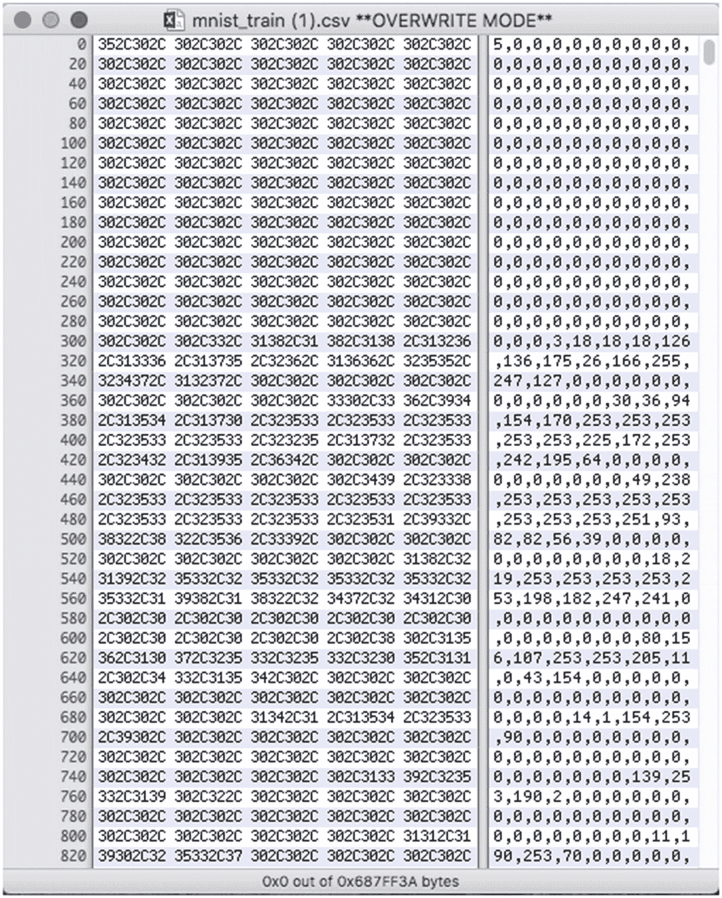

图 5-1

MNIST 训练数据集中第一条记录的一部分

每幅图像由 784 个字节组成，因为每幅图像已从 20 x 20 像素重新缩放为 28 x 28 像素。每个像素代表一个灰度像素强度，取值范围为 0 到 255，其中 0 为纯黑，255 为纯白。数据库中的每条记录有 784 个像素值、785 个逗号和 1 个字节的标签值。这些值加起来共 1570 个字节。考虑到有超过 60,000 条训练记录，整个数据集大小约为 100 MB。在编写脚本时处理如此规模的数据集，即使对于最快的处理器来说也是一项繁重的工作，而树莓派（RasPi）并不属于此类处理器。幸运的是，MNIST 训练和测试数据集都有两个较小的子集，可用于开发。这些子集可在以下地址获取：

训练数据集：

`https://raw.githubusercontent.com/makeyourownneuralnetwork/makeyourownneuralnetwork/master/mnist_dataset/mnist_train_100.csv`

测试数据集：

`https://raw.githubusercontent.com/makeyourownneuralnetwork/makeyourownneuralnetwork/master/mnist_dataset/mnist_test_10.csv`

前面描述的所有数据集均为 CSV 格式，其中使用逗号分隔各个数据值。Python 语言包含有用的函数，可以将 CSV 数据以易于使用的数值格式输入到脚本中。以下代码片段打开一个 CSV 文件，并将内容“读取”到一个数据列表中。数据列表是一种对象，能够高效地存储和检索数据，供脚本快速访问。

```
dataFile = open('mnist_train_100.csv')
dataList = dataFile.readlines()
dataFile.close()
```

我将上述代码输入到一个交互式 Python 会话中，以揭示该代码片段的工作原理。图 5-2 显示了该交互式会话。

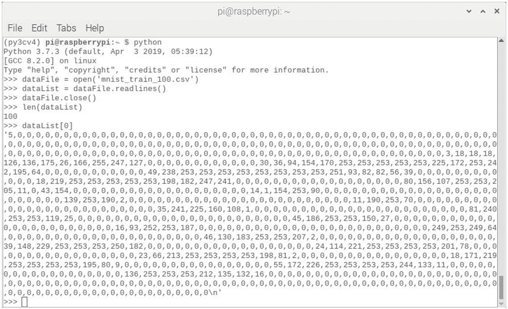

图 5-2

用于数据文件操作的交互式 Python 会话

你应该能够看到数据列表已正确实例化。我还输入了一个长度命令，返回值为 100。这反映了数据列表中的元素数量，与`mnist_train_100.csv`文件的预期一致。此外，我显示了第一条记录 dataList [0]的内容，显示为一串由逗号分隔的 1570 个整数。请注意，第一个整数是 5，对应于记录标签。

你还应注意，显示的整数开头和结尾出现了单引号。这表明 Python 将数据视为一个长字符串。虽然它看起来像数字，但 Python 解释器将其视为一串 ASCII 字符。在结束单引号之前显示的字符是“\n”。这是“转义”字母 n。在 ASCII 术语中，它代表回车功能，意味着在解释 ASCII 字符时，记录中的这一点将创建一个新行。换行符用作数据集的分隔符。分隔符指示一条记录在哪里结束，下一条记录在哪里开始。所有 100 条记录都由列表对象索引，这意味着可以随机访问任何特定记录，而无需读取或写入该记录之前的所有记录。索引从 0 开始，这意味着所有记录的索引范围是 0 到 99。任何记录都可以使用 Python 的数组元素表示法随机访问。例如，中间的第 50 个元素将引用为 dataList [49]。

回顾前几章，无论尝试进行何种类型的数学运算，了解所处理数据的性质都很重要。在本例中，直观地查看单个手写记录可以让你深入了解整个问题领域，而这仅仅通过查看数值数据列表是无法获得的。


将使用 Matplotlib Python 库为任何选定的数据列表记录提供图像。依次输入以下两条命令，以便将 Matplotlib 库导入脚本：

```
sudo apt-get update
sudo apt-get install python-matplotlib
```

以下脚本将用于查看 100 条记录的 MNIST 训练数据集中的任意记录。该脚本名为 viewRecord.py，可从本书的配套网站获取：

```
# 导入所需库
import numpy as np
import matplotlib.pyplot as plt
# 创建数据列表
dataFile = open('mnist_train_100.csv')
dataList = dataFile.readlines()
dataFile.close()
# 获取记录编号
print('请输入要查看的记录编号：', end = ' ')
num = input()
# 获取记录
record = dataList[int(num)].split(',')
# 重塑数组以便成像
imageArray = np.asfarray(record[1:]).reshape(28,28)
# 以灰度图形式显示
plt.imshow(imageArray, cmap="Greys", interpolation="None")
plt.show()
```

名为 dataList 的对象包含所请求记录的全部 785 个元素。这些元素是独立的，因为 split 方法根据逗号分隔符将它们创建为独立元素。然后必须将 `dataList` 对象重塑为 28 x 28 的 numpy 数组，以便进行成像。数组中的每个值现在将对应原始图像中显示的像素强度。另请注意，numpy 数组从第二个元素开始，其索引等于 1。这是因为第一个元素是标签，你不希望它包含在图像中。另一个需要注意的事项是，`imshow` 命令中的“`Greys`”是故意拼写错误的。我只能猜测，某位开源开发者不太熟悉如何正确拼写它。

通过输入以下命令来运行脚本：

```
python3 viewRecord.py
```

记录 0 的最终图像如图 5-3 所示。

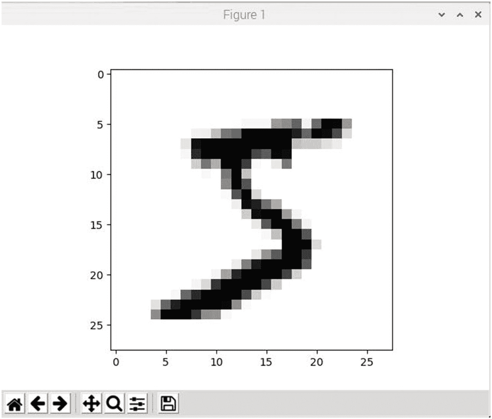

图 5-3

记录 0 的图像

该图清晰地显示了一个相当“懒散”的数字 5 的笔画。你可以通过检查图 5-2 中数字记录列表的第一个元素来确认它应该是数字 5。

至此，你应该能够自如地处理项目中将要使用的数据集了。下一节将向你展示如何调整或修改数据集，使其与实用人工神经网络所需的输入数据源兼容。

### 调整输入数据集

在前面的讨论中，已经指出像素值的范围是 0 到 255。这个范围远远超出了人工神经网络可接受的数据值输入范围。回想一下，在第 4 章中，我讨论了人工神经网络的一些问题和局限性。在那部分，我提到

> *因此，人工神经网络训练数据集应将 x 值限制在所谓的伪线性范围内，大约为 -3 到 3。*

原因是 sigmoid 函数的限制作用。超过 +/- 3 的输入数据值会使函数输出饱和，从而有效关闭任何人工神经网络的学习功能。在通信电子学术语中，这种情况通常被称为动态范围不足。幸运的是，可以轻松地将输入数据值调整到 0.01 到 1.00 的可接受范围，而不会损失人工神经网络的准确性。进行此调整的 Python 语句是

```
adjustedRecord = (np.asfarray(record[1:])/255.0 * 0.99) + 0.01
```

我将此语句添加到了之前运行的交互式 Python 会话中。图 5-4 显示了修订后的结果以及交互式会话。

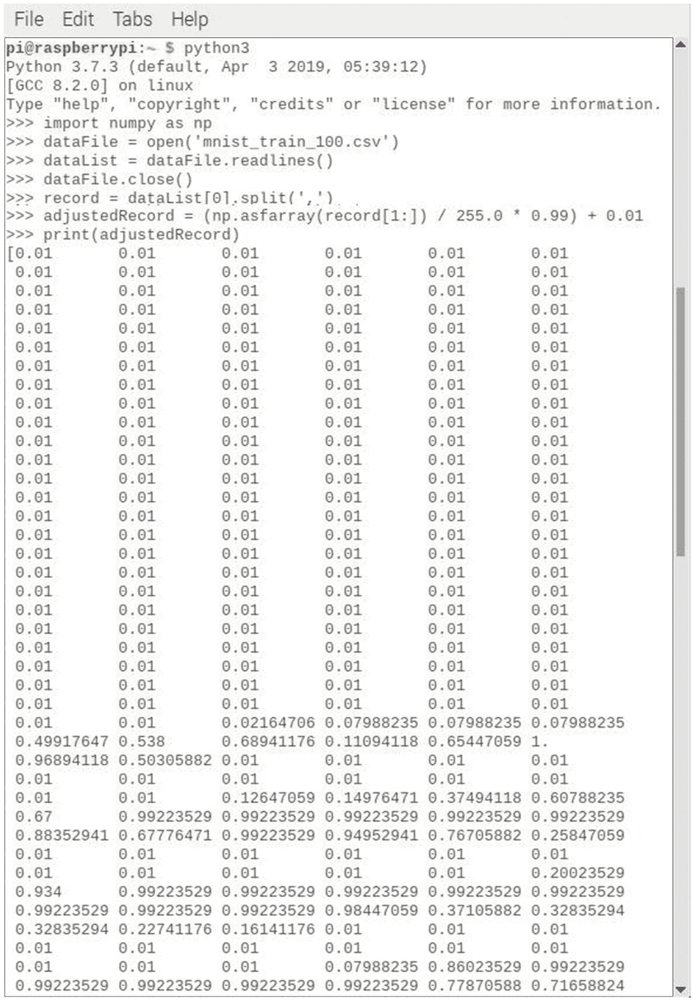

图 5-4

用于数据文件操作的修订版交互式 Python 会话

我将记录调整语句添加到了脚本中，以便为输入数据值设置一个可接受的值范围。但是输出数据值呢？我接下来将解决这个问题。

### 解释人工神经网络输出数据值

我在前几章中提到过，人工神经网络只做两件事之一。它们要么预测，要么分类。本项目中使用的人工神经网络是分类类型，因为其目的是接受数字化的手写数字，并将其分类为十个类别之一，即数字 0 到 9。我刚刚展示了如何将所有输入数据值调整到 0.01 到 1.00 的范围内。这只能意味着所有人工神经网络输出也必须保持在该范围内。在普通的人工神经网络中，不存在乘法或增益函数来产生大于最大输入值的输出值。因此，输出范围将从 0.0 到 1.0。请注意，我将输出下限从输入的 0.01 降低到了 0.0。这是因为完全有可能某个给定的输出节点完全没有输入。实际上，输出层的所有节点输出上总会存在一些噪声。你会看到像 5 x 10-9 这样的电平，实际上可以视为 0。

这个问题的答案不在于如何能够或应该如何调整输出电平，而在于如何解释最终生成的这些电平。在一个理想的手写数字识别人工神经网络中，当训练集中的记录 0 被呈现给人工神经网络时，输出将如下面的数据向量所示：

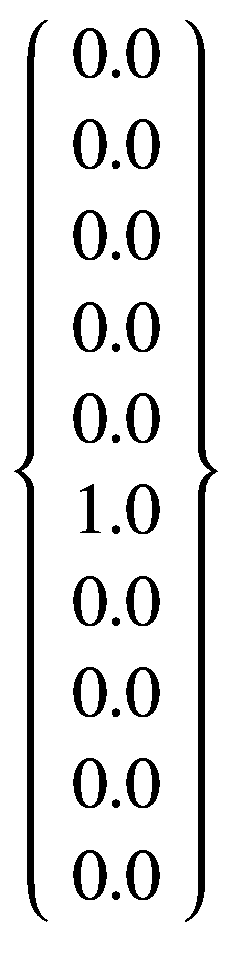

实际上，你可能会看到一个像这样的向量：

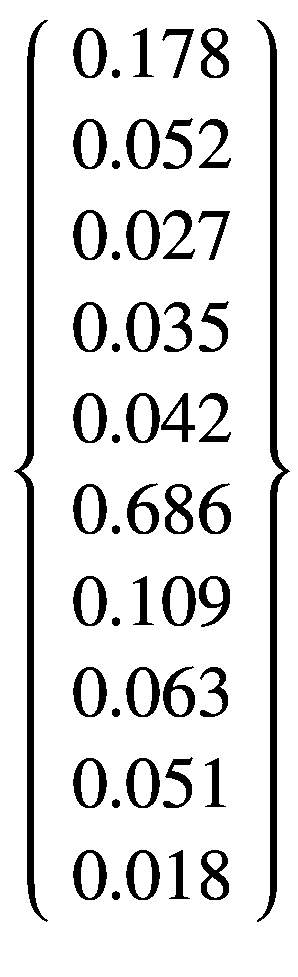

十个数字中有九个接近 0，一个远高于其他数字。将这个高值视为人工神经网络“认为”输入图像是数字 5 的概率，并非不合理。没有正式的数学逻辑可以证明这个人工神经网络产生了真实的概率，但大多数从业者接受我对结果的解释。请注意，在其他人工神经网络结构中，可以添加一些层来生成真实的概率，但在这个简化的人工神经网络中不行。有时，可能还有一两个其他类别的数字较高，但低于最大值。这种情况表明人工神经网络在分类输入时遇到困难，并且“认为”输入数据模式可能与其他类别有些关联。在这种情况下，只有更多的训练才能缓解这种情况。请记住，训练出一个能做出完美预测或分类的人工神经网络实际上是不可能的。考虑到人类专家也是如此。没有人能够 100% 正确地对他或她遇到的任何手写数字进行分类。

本项目开发的下一步是创建一个人工神经网络结构，这对于获得成功的结果至关重要。


### 创建用于手写数字识别的人工神经网络

首先要做的是确定要使用的基本人工神经网络结构。我认为三层人工神经网络是最简单且仍然有效的设计。不要因为只有一个隐藏层就低估三层人工神经网络。如果发现三层设计性能不佳，随时可以添加额外的隐藏层。本演示中使用的人工神经网络结构采用了多层感知器模型。这是因为作为计算单元的基本人工神经元，于 1958 年被康奈尔航空实验室的弗兰克·罗森布拉特命名为感知器。

创建人工神经网络结构的下一步是确定每层的节点数。在本应用中，设置输入层和输出层的节点数很容易。输入层必须有 784 个节点，以表示来自每个像素值的输入。输出层必须有十个节点，以表示可能被识别的每个类别。隐藏层是剩下的那一层，必须设置其节点数。确定分配给隐藏层的节点数比设置输入层或输出层的节点数要困难得多。我做了大量关于如何设置隐藏层节点数的研究。有多种“经验法则”可以确定这个数字。以下是最常见的几种：

*   使用输入层节点数 (N[i]) 和输出层节点数 (N[o]) 的平均值。
*   使用 N[i] 乘以 N[o] 的平方根。
*   隐藏层节点数 (N[h]) 应介于 N[i] 和 N[o] 的大小之间。
*   N[h] 应为 N[i] 加上 N[o] 大小的三分之二。
*   N[h] 应小于 N[i] 大小的两倍。

我很快就明白，设置 N[h] 有点像反复试验。此时我想讨论两个术语，它们在考虑实例化多少个隐藏层节点时非常适用。第一个是欠拟合，当创建的节点太少时可能会发生。欠拟合的症状是人工神经网络无法训练和/或错误率高得无法接受。另一个术语是过拟合，即节点过剩。在这种情况下，症状包括由于额外节点导致训练永远无法收敛，以及由于人工神经网络对噪声和伪影过于敏感而导致精度下降。当发生过拟合时，人工神经网络拥有太多信息，以至于输入数据集不足以训练隐藏层中的所有节点；此外，训练时间可能会急剧增加，达到如前所述永不停止或收敛的程度。设置适当隐藏层节点数的最佳目标是同时避免欠拟合和过拟合。

基于前面的讨论和我的实验，关于设置隐藏层节点数，我得出了以下结论：

> *三层人工神经网络中隐藏层的节点数应设置为输出节点数的平方，但不应超过输入层和输出层节点的平均值。*

这条指导原则是我之前引用的几条经验法则的混合体。我还根据经验注意到，在设计人工神经网络结构时，似乎经常出现平方关系。这种关系在计算设置权重的平均值以及计算误差函数斜率时都存在。将 10 个输出节点数平方意味着应该设置 100 个隐藏层节点。考虑到输入层规模较大而输出层规模相对较小，这个值似乎是合适的。如果人工神经网络性能不佳，始终可以修改 100 这个数字。

既然人工神经网络结构已经确定，是时候向您展示初始训练脚本了。

### 初始人工神经网络训练脚本演示

以下数据实现了一个简短的脚本，该脚本设置了一个人工神经网络，并使用简化的 100 条记录 MNIST 训练数据集对其进行训练。它尚未测试人工神经网络的准确性。这将在讨论完此脚本后进行。此脚本名为 `trainANN.py`，它使用了第 4 章中开发的 `ANN` 类。请重新阅读该章中关于此类的部分，因为它是此脚本的关键部分。此脚本可从本书的配套网站获取：

```
# 导入所需库
import numpy as np
import matplotlib.pyplot as plt
from ANN import ANN
# 设置人工神经网络配置
inode = 784
hnode = 100
onode = 10
# 设置学习率
lr = 0.2
# 实例化一个名为 ann 的 ANN 对象
ann = ANN(inode, hnode, onode, lr)
# 创建训练列表数据
dataFile = open('mnist_train_100.csv')
dataList = dataFile.readlines()
dataFile.close()
# 使用列表中的所有记录训练人工神经网络
for record in dataList:
    recordx = record.split(',')
    inputT = (np.asfarray(recordx[1:])/255.0*0.99) + 0.01
    train = np.zeros(onode) + 0.01
    train[int(recordx[0])] = 0.99
    # 训练从这里开始
    ann.trainNet(inputT, train)
```

在运行上述脚本之前，有几个先决条件必须满足。文件 `ANN.py` 必须与脚本位于同一目录中，并且 `mnist_train_100.csv` 数据集也必须位于同一目录中。只需输入以下命令即可运行脚本：

```
python trainANN.py
```

如果脚本运行无误，则不会显示任何结果，因为其目的仅仅是训练人工神经网络。在继续本演示的下一部分之前，您应该纠正所有错误。


### ANN 测试脚本演示

上一节中完成的训练好的 ANN 现在必须进行测试，以评估其对手写数字进行分类的性能。要使用的测试数据集是从下载 100 条记录训练数据集的同一网站下载的 10 条记录小数据集。本次测试将使用 `trainANN` 脚本的修改版本。我将修改后的 `trainANN` 脚本重命名为 `testANN_short.py`，以反映其新用途，并使其与将使用完整训练和测试数据集的后续版本区分开来。

该脚本可从本书的配套网站获取：

```
# 导入所需库
import numpy as np
import matplotlib.pyplot as plt
from ANN import ANN
# 设置 ANN 配置
inode =784
hnode =100
onode =10
# 设置学习率
lr = 0.2
# 实例化一个名为 ann 的 ANN 对象
ann = ANN(inode, hnode, onode, lr)
# 创建训练列表数据
dataFile = open('mnist_train_100.csv')
dataList = dataFile.readlines()
dataFile.close()
# 创建测试列表数据
testDataFile = open('mnist_test_10.csv')
testDataList = testDataFile.readlines()
testDataFile.close()
# 使用列表中的所有记录训练 ANN
for record in dataList:
recordx = record.split(',')
inputT = (np.asfarray(recordx[1:])/255.0*0.99) + 0.01
train = np.zeros(onode) + 0.01
train[int(recordx[0])] =0.99
# 训练从这里开始
ann.trainNet(inputT, train)
# 遍历所有 10 条测试记录并显示输出
# 数据向量
for record in testDataList:
recordz = record.split(',')
# 确定记录的标签
labelz = int(recordz[0])
# 调整记录值以适应 ANN
inputz = (np.asfarray(recordz[1:])/255.0*0.99)+0.01
outputz = ann.testNet(inputz)
print('标签为 ', labelz, ' 的输出')
print(outputz)
```

与前面的脚本一样，请确保文件 `ANN.py`、`mnist_train_100.csv` 和 `mnist_test_10.csv` 数据集与脚本位于同一目录中。输入以下命令来运行脚本：

```
python testANN.py
```

图 5-5 显示了运行脚本后的完整结果。我从两个屏幕截图中制作了一个合成图，以捕获所有结果。

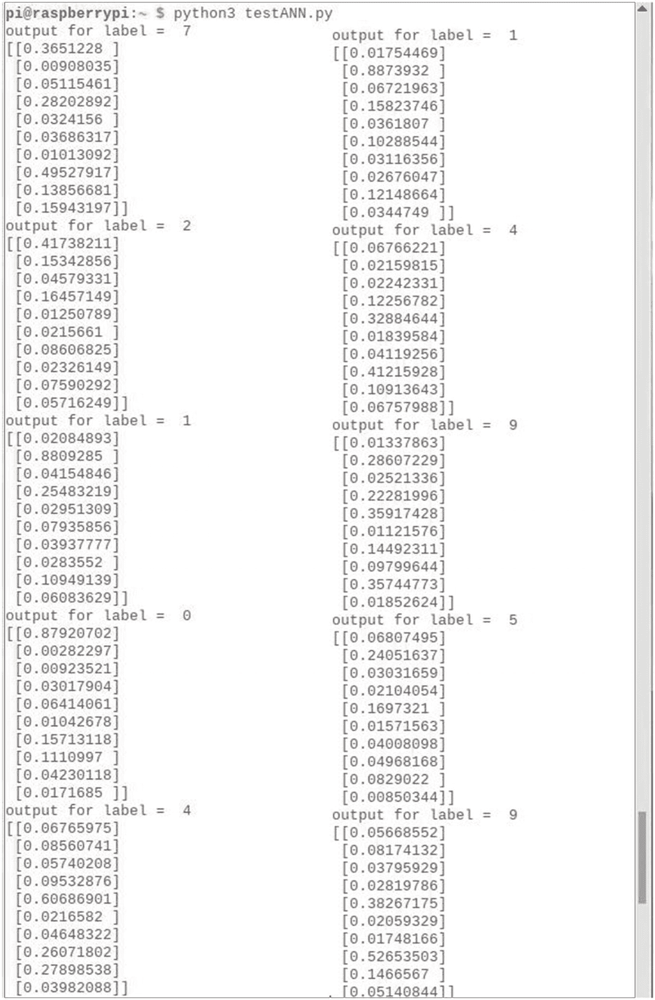

**图 5-5**

testANN 脚本结果

表 5-1 中显示的 60% 匹配率勉强令人满意；然而，考虑到 ANN 仅使用可用的 60,000 条训练记录中的 100 条进行训练，这并不令人惊讶。当面对明显较大的误差结果时，我也喜欢深入研究细节。因此，我修改了 `viewResults` 脚本以检查四个未被正确识别的记录。我将它们的图像收集并合并到图 5-6 中，以识别可能导致错误识别的任何共同属性。

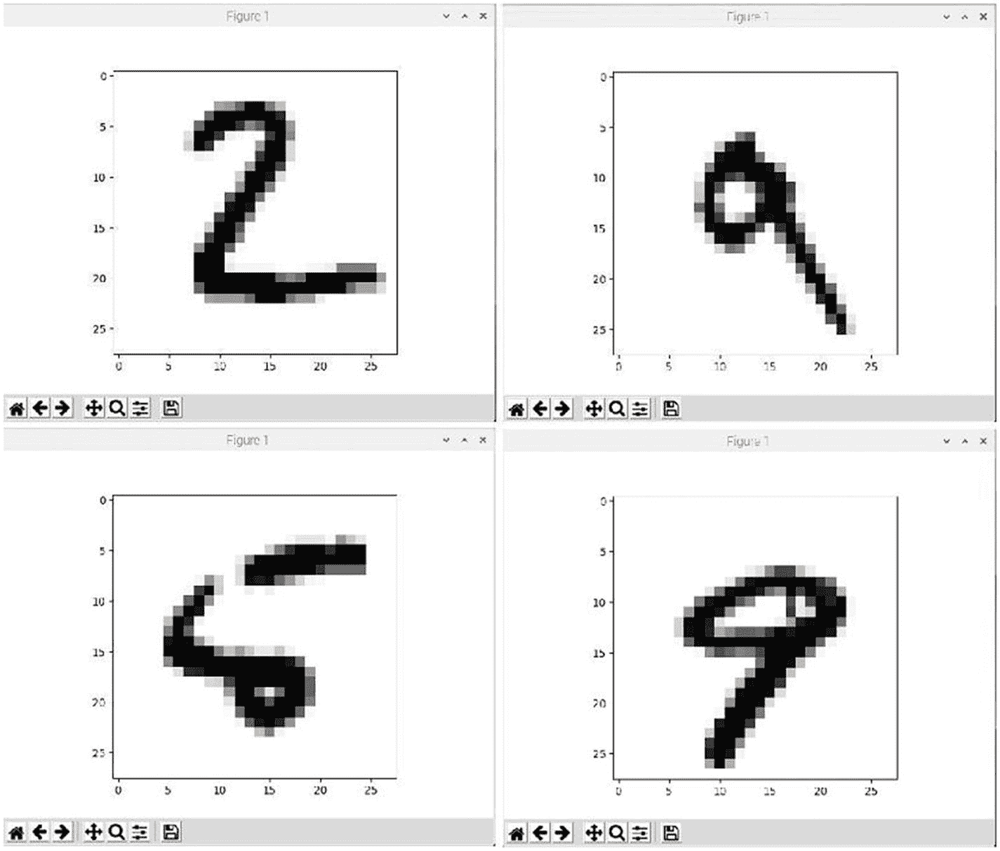

**图 5-6**

被错误识别的手写数字

**表 5-1**

ANN 测试运行结果

| **标签** | 7 | 2 | 1 | 0 | 4 | 1 | 4 | 9 | 5 | 9 |
| **索引** | 7 | 3 | 1 | 0 | 4 | 1 | 4 | 8 | 1 | 4 |
| **匹配** | x |   | x | x | x | x | x |   |   |   |

你可以立即看到 ANN 对数字 9 的处理存在问题。四张图像中有两张是这个数字。数字 5（左下角的那张）写得太糟糕，以至于没有人（机器或人类）能识别出来，所以 ANN 可以被原谅。剩下的是左上角的数字 2 图像。这个数字写得很清楚，本应被正确识别。除了数字 5 这个可能的例外，解决这些问题的唯一方法是进一步训练 ANN。鉴于这个早期实验的结果，我完全期望一个经过充分训练的 ANN 能够轻松达到 90% 以上的准确率。

我还对多次运行 `testANN` 脚本的结果感兴趣，但不显示输出数据向量，只显示匹配结果（这是一种准确率指标）。因此，我修改了 `testANN_short.py` 脚本以适应这些变化，并将其重命名为 `testANN_metrics.py`。该脚本可从本书的配套网站获取：

```
# 导入所需库
import numpy as np
import matplotlib.pyplot as plt
from ANN import ANN
# 设置 ANN 配置
inode =784
hnode =100
onode =10
# 设置学习率
lr = 0.2
# 实例化一个名为 ann 的 ANN 对象
ann = ANN(inode, hnode, onode, lr)
# 创建训练列表数据
dataFile = open('mnist_train_100.csv')
dataList = dataFile.readlines()
dataFile.close()
# 创建测试列表数据
testDataFile = open('mnist_test_10.csv')
testDataList = testDataFile.readlines()
testDataFile.close()
# 使用列表中的所有记录训练 ANN
for record in dataList:
recordx = record.split(',')
inputT = (np.asfarray(recordx[1:])/255.0*0.99) + 0.01
train = np.zeros(onode) + 0.01
train[int(recordx[0])] =0.99
# 训练从这里开始
ann.trainNet(inputT, train)
# 遍历所有 10 条测试记录并显示输出
# 数据向量
match = 0
no_match = 0
for record in testDataList:
recordz = record.split(',')
# 确定记录的标签
labelz = int(recordz[0])
# 调整记录值以适应 ANN
inputz = (np.asfarray(recordz[1:])/255.0*0.99)+0.01
outputz = ann.testNet(inputz)
max_value = np.argmax(outputz)
if max_value == labelz:
match = match + 1
else:
no_match = no_match + 1
success = float(match) / float(match + no_match)
print('成功率 = {0}'.format(success))
```

通过输入以下命令来运行脚本：

```
python3 testANN_metrics.py
```

图 5-7 显示了我连续运行该脚本十次后的结果。

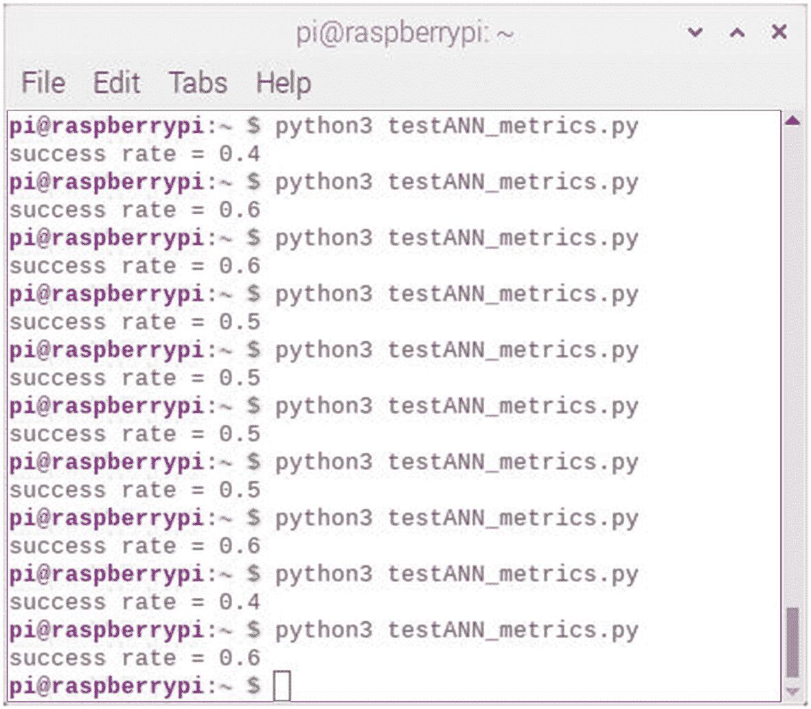

**图 5-7**

连续运行十次脚本 testANN_metrics 的结果

你应该能看到成功率在 0.4 到 0.6 之间。我计算了所有十个值的平均值，确定平均成功率为 0.52。这是一个相当差的结果，但正如我之前解释的，ANN 仅使用了 60,000 多条可用记录中的 100 条进行训练，训练不足。顺便提一下，那些具备 Python 技能的读者可能想知道为什么我没有包含一个用于连续十次运行脚本或周期的循环。我没有这样做，因为每次运行都必须重新初始化 ANN，否则每次传递都会使用相同的训练好的 ANN，从而产生相同的成功率。重写脚本以适应重新初始化的 ANN 当然是可行的，但我不想花时间这样做，因为手动重新运行脚本十次要简单得多。

你可能会问为什么每个周期的结果不同？答案是初始权重矩阵是使用随机正态分布生成的。因此，一些矩阵天生就比其他矩阵更适合产生更准确的结果。当 ANN 使用完整的 60,000 条训练记录集（这是演示计划中的下一步）进行训练时，这些初始分布差异将会消失。


### 使用完整训练数据集的 ANN 测试脚本演示

你只需对`testANN_metrics`脚本做一处微小改动，即可使用完整训练集。将以下语句：

```
dataFile = open('mnist_train_100.csv')
```

改为：

```
dataFile = open('mnist_train.csv')
```

由于修改幅度很小且易于操作，我未提供新的脚本清单。之后你可以用这十条测试记录重新运行`testANN_metrics`脚本；但由于需要处理超过 60,000 条训练记录，执行时间会显著延长。根据树莓派处理器速度，预计需要等待最多 10 分钟。我运行了修改后的脚本，发现仅耗时 6 分 3 秒。这个结果令人惊喜，也让我见识到树莓派 4 中 A-72 ARM 四核 1.5GHz 处理器的强大性能。

结果显示成功率为 0.9，这其实在我的预料之中，因为我认为十个测试图像中有一个难以辨认。

本演示系列的下一步是使用完整的 10,000 条测试数据集运行脚本。同样，只需修改一条语句即可轻松实现：

```
testDataFile = open('mnist_test_10.csv')
```

改为：

```
testDataFile = open('mnist_test.csv')
```

同样，由于修改幅度很小且易于在现有脚本上完成，我未提供新的脚本清单。之后你可以用这 10,000 条测试记录重新运行`testANN_metrics`脚本；但由于除了用 60,000 条记录进行训练外，还需处理 10,000 条测试记录，执行时间会比上述步骤更长。幸运的是，逐条测试 ANN 的速度远快于逐条训练。

我重新运行了修改后的脚本，发现仅耗时 6 分 15 秒。结果显示成功率为 0.9458，这与之前关于完全训练 ANN 的所有讨论结果一致。这个成功率通常被认为是良好的 ANN 表现。

学习率也会对 ANN 的准确性产生显著影响。我再次修改了`testANN_metrics`脚本，以测试学习率对准确性的影响。修改内容包括创建一个循环，在重新计算成功率的同时将学习率从 0.1 调整到 0.6。我也认为在实际 ANN 中设置超过 0.6 的学习率并不现实。这次修改幅度较大，我认为有必要提供完整的脚本清单。我还将脚本重命名为`testANN_metrics_lr.py`以体现学习率的变化。该清单可从本书配套网站获取：

```
# 导入所需库
import numpy as np
from ANN import ANN
# 设置 ANN 配置
inode =784
hnode =100
onode =10
# 设置初始学习率
lr = 0.1
# 创建训练列表数据
dataFile = open('mnist_train.csv')
dataList = dataFile.readlines()
dataFile.close()
# 创建测试列表数据
testDataFile = open('mnist_test.csv')
testDataList = testDataFile.readlines()
testDataFile.close()
# 循环迭代学习率，从 0.1 到 0.6，步长 0.1
for i in range(6):
# 实例化一个名为 ann 的 ANN 对象
ann = ANN(inode, hnode, onode, lr)
# 使用列表中的所有记录训练 ANN
for record in dataList:
recordx = record.split(',')
inputT = (np.asfarray(recordx[1:])/255.0*0.99) + 0.01
train = np.zeros(onode) + 0.01
train[int(recordx[0])] =0.99
# 训练开始
ann.trainNet(inputT, train)
# 遍历所有测试记录
match = 0
no_match = 0
for record in testDataList:
recordz = record.split(',')
# 确定记录的标签
labelz = int(recordz[0])
# 调整记录值以适应 ANN
inputz = (np.asfarray(recordz[1:])/255.0*0.99)+0.01
outputz = ann.testNet(inputz)
max_value = np.argmax(outputz)
if max_value == labelz:
match = match + 1
else:
no_match = no_match + 1
success = float(match) / float(match + no_match)
# 显示学习率和成功率
print('lr = {0} success rate = {1}'.format(lr,success))
lr = lr + 0.1
```

需要提醒的是，此脚本完全运行一次需要将近一小时。通过输入以下命令运行：

```
python3 testANN_metrics_lr.py
```

图 5-8 显示了我运行脚本后的结果。

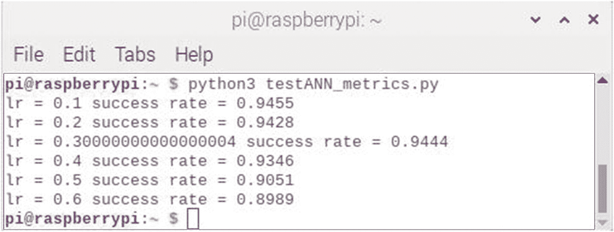

图 5-8

运行 testANN_metrics_lr 脚本后的结果

你应该能看到，当学习率从 0.1 递增到 0.6 时，成功率相应地从 0.9456 下降到 0.8989。ANN 的准确性随着学习率的增加而显著下降。这是因为梯度下降算法的步长增大，导致无法达到全局最小值。如果你对上述内容感到困惑，建议重新阅读第 4 章的相关章节，以复习学习率与梯度下降算法之间的关系。我认为初始测试运行中选择的 0.2 学习率是最优的，因为 0.9458 的成功率高于本次运行中记录的任何值。不过，实际成功率的差异微乎其微，很可能与随机波动有关。无论如何，对于这个 ANN 来说，0.1 或 0.2 的学习率都是理想的选择。

如果你已经按照演示步骤操作到这里，现在你将拥有一个性能良好的 ANN。任何准确率约为 95%的 ANN 通常被认为性能优异。我建议继续对这个 ANN 进行实验，例如改变隐藏节点数量，观察其对网络性能的影响。

下一系列演示将在此基础上扩展，通过集成树莓派摄像头实现实时数字识别。

### 识别你自己手写的数字

在前述演示的基础上，自然可以进一步尝试识别自己手写的数字，而不是依赖存储的示例。这一功能可以通过树莓派摄像头轻松实现，这是一款专为与树莓派无缝协作而设计的视频摄像头。树莓派摄像头接口已集成到所有最新版本的 Raspbian Linux 发行版中。只需激活该功能即可，我稍后会讨论具体方法。但首先，你需要了解如何安装硬件。


#### 安装树莓派摄像头

我将介绍如何在树莓派 4 上安装第二代树莓派摄像头。这些说明同样适用于树莓派 2 和 3 版本。图 5-9 展示了一个将在后续演示中使用的第二代树莓派摄像头。

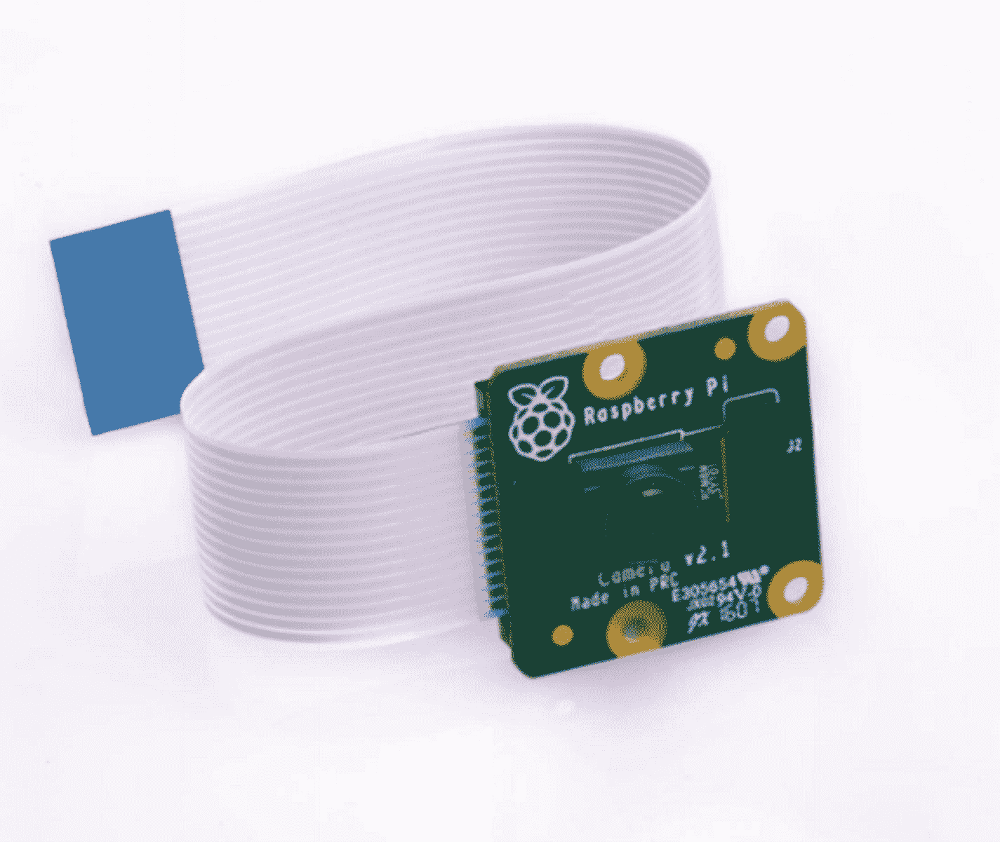

图 5-9

第二代树莓派摄像头

考虑到其紧凑的尺寸和低廉的成本，这款摄像头的规格令人印象深刻。我将其关键规格总结如下：

*   800 万像素原生分辨率，高品质索尼 IMX219 图像传感器
*   最大静态照片分辨率为 3280 x 2464 像素
*   支持 1080p30、720p60 和 640x480p90 分辨率的视频拍摄
*   所有软件均受最新版树莓派操作系统支持
*   光学尺寸为 1/4 英寸
*   广角镜头，对焦范围从 4 英寸到无限远

摄像头附带一根短而柔软的排线，需要插入树莓派上 RJ45 接口正后方的摄像头串行接口（CSI）插槽。图 5-10 显示了树莓派上 CSI 插槽的位置。

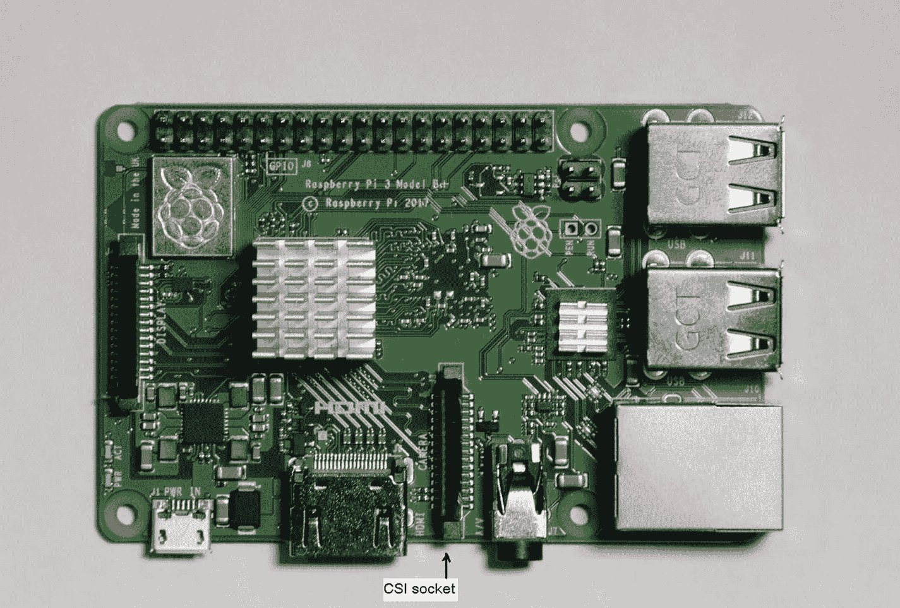

图 5-10

CSI 插槽位置

请注意，树莓派 2、3 和 4 型号上还有另一个类似的插槽。那是显示串行接口（DSI）插槽。你可能会不小心将摄像头排线插入那个插槽，但这不会造成任何损坏，只是摄像头无法工作而已。

要将摄像头排线插入 CSI 插槽，你必须小心地向上拉起细长塑料条两侧的两个黑色塑料卡扣。操作时务必小心，因为塑料条很脆弱，用力过猛很容易折断。当塑料条被提起时，它会变得松动，但仍会连接在插槽上。

接下来，小心地将排线插入插槽，确保裸露的银色触点背对 RJ45 接口。此时，排线的蓝色背衬应朝向 RJ45 接口。确保排线牢固地插入插槽底部，并且排线与电路板垂直，没有倾斜。然后，轻轻向下按压黑色塑料卡扣以锁定排线。只需用稳定而轻柔的压力即可锁定排线。

请注意，当树莓派被移动或重新放置时，排线很可能会松动。如果发生这种情况，操作系统会开始报告奇怪的错误，例如无法加载某些驱动程序，或者提示你应该启用摄像头。在排查这些错误之前，我总是先检查摄像头排线是否正确插入。图 5-11 展示了一个正确插入的摄像头排线。

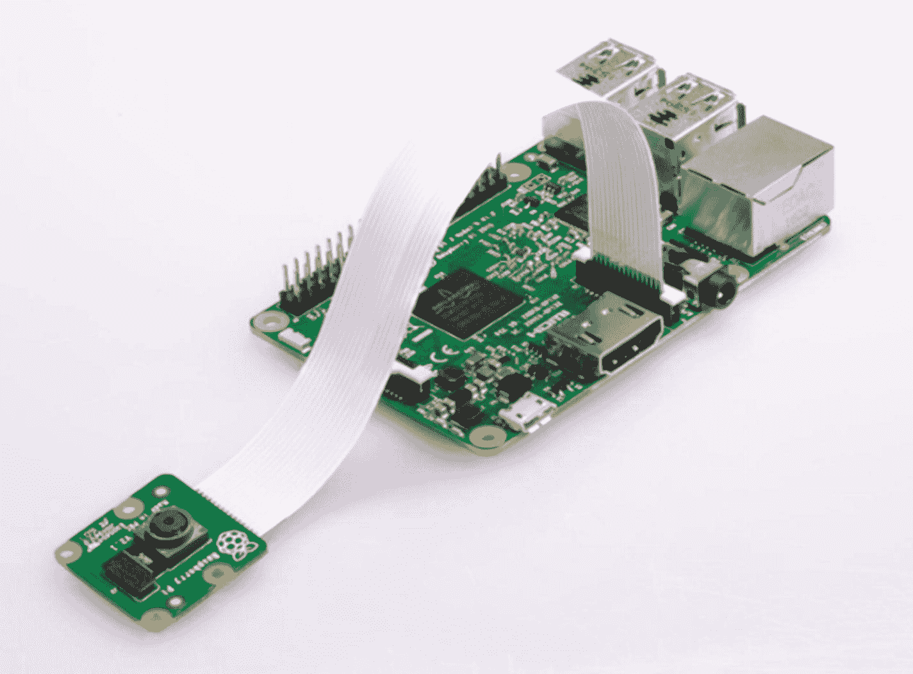

图 5-11

正确插入的摄像头排线

接下来，你需要安装一些额外的软件包，以便在演示中使用摄像头。

#### 安装树莓派摄像头软件

首先要做的是在树莓派操作系统中启用摄像头。这可以通过`raspi-config`工具来完成。输入以下命令启动该工具：

```
sudo raspi-config
```

图 5-12 显示了输入此命令后的初始菜单。选择“5 Interfacing Options”（接口选项），这将安装树莓派摄像头的所有驱动程序。在做出初始选择后，会有一个后续界面，你可以在其中启用摄像头驱动程序。

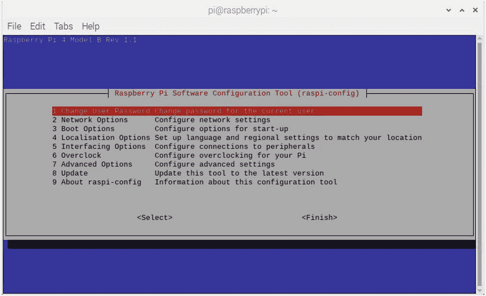

图 5-12

`raspi-config`菜单界面

启用摄像头后，你需要安装一些额外的软件。输入以下命令来安装 Python 的`picamera`库：

```
sudo apt-get update
sudo apt-get install python-picamera
```

你需要安装`Pillow`包，其中包含 Python 图像库（PIL）。输入以下命令：

```
sudo apt-get install python-pillow
```

这就是开始演示所需安装的全部软件。


#### 手写数字识别演示

你应该尝试的第一个操作是测试树莓派摄像头是否安装成功。输入以下命令：

```
raspistill -t 5000
```

你应该会在显示器上看到摄像头所指向的画面，以全高彩色视频形式显示 5 秒钟。由于宽高比的原因，画面宽度不会完全铺满显示器；不过，如果你能看到实时图像，就可以确认树莓派摄像头工作正常。如果没有显示图像，我建议重新检查摄像头线缆连接，确保连接正确无误。根据我的经验，至少 95%的硬件问题都与电气连接有关。

如果通过了这第一步检查，你就可以准备进行使用树莓派摄像头的手写数字识别初始演示了。

你需要制作一个用于成像的目标。我建议使用 3x5 英寸的白色卡片纸和一支细尖黑色“Sharpie”记号笔。在白色卡片纸上用记号笔书写，能为数字成像提供良好的对比度。不建议使用钢笔或铅笔在普通纸上书写，因为对比度不足，无法生成与训练人工神经网络（ANN）所用图像一致的图像。请记住，如果向 ANN 提供未经训练识别的图像，它就无法正确执行任务。图 5-13 展示了我手写的数字目标。


图 5-13

手写数字目标

该图像是通过以下命令拍摄的：

```
raspistill -o zerobw.jpg
```

在将图像输入 ANN 进行数字识别之前，需要对其进行预处理。这个预处理过程是我用于处理该图像的修改版 testANN 脚本的一部分。我将修改后的脚本重命名为 testANN_Image.py，该脚本可从本书的配套网站获取。

```
# 导入所需库
import numpy as np
import matplotlib.pyplot as plt
from ANN import ANN
import PIL
from PIL import Image
# 设置 ANN 配置
inode = 784
hnode = 100
onode = 10
# 设置学习率
lr = 0.1
# 实例化一个名为 ann 的 ANN 对象
ann = ANN(inode, hnode, onode, lr)
# 创建训练列表数据
dataFile = open('mnist_train.csv')
dataList = dataFile.readlines()
dataFile.close()
# 使用列表中的所有记录训练 ANN
for record in dataList:
recordx = record.split(',')
inputT = (np.asfarray(recordx[1:])/255.0*0.99) + 0.01
train = np.zeros(onode) + 0.01
train[int(recordx[0])] = 0.99
# 训练开始
ann.trainNet(inputT, train)
# 从图像创建测试列表数据
img = Image.open('zerobw.jpg')
img = img.resize((28,28), PIL.Image.ANTIALIAS)
# 将像素读取到列表中
pixels = list(img.getdata())
# 从元组转换为单个值
pixels = [i[0] for i in pixels]
# 保存到名为 test.csv 的临时文件，使用逗号分隔
imgTmp = np.array(pixels)
imgTmp.tofile('test.csv', sep=',')
# 打开临时文件并读取到列表中
testDataFile = open('test.csv')
testDataList = testDataFile.readlines()
testDataFile.close()
# 遍历所有列表元素
for record in testDataList:
recordx = record.split(',')
# 调整记录值以适应 ANN
input = (np.asfarray(recordx[0:])/255.0*0.99)+0.01
output = ann.testNet(input)
# 显示输出数据向量
print(output)
```

以下说明适用于脚本中为预处理使用树莓派摄像头获取的图像而进行的修改。

```
import PIL
from PIL import Image
```

需要使用 Python 图像库（PIL）及其子库 Image，才能用 Python 处理获取的图像。

```
img = Image.open('zerobw.jpg')
img = img.resize((28,28), PIL.Image.ANTIALIAS)
```

第一条命令加载文件，该文件名已硬编码在脚本中。加载的图像随后被调整为 28x28 像素大小。`ANTIALIAS`参数确保在缩小操作过程中不会产生伪影。

```
pixels = list(img.getdata())
```

此命令将 784 个像素值转换为名为`pixels`的列表。

```
imgTmp = np.array(pixels)
imgTmp.tofile('test.csv', sep=',')
```

这些命令将列表转换为名为`imgTmp`的数组。然后该数组被转换为逗号分隔的数组，随后存储到名为`test.csv`的文件中。

我通过输入以下命令运行此脚本：

```
python3 testANN_image.py
```

脚本运行耗时超过 6 分钟，这在意料之中，因为所有 60,000 条记录都用于训练 ANN。结果如图 5-14 所示。

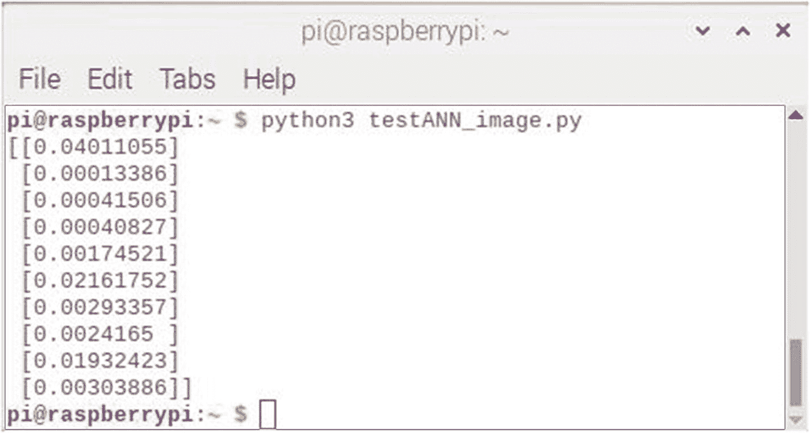

图 5-14

运行 testANN_image 脚本的结果

结果清楚地显示，第 0 个索引的值最高，这意味着 ANN 将输入图像分类为数字 0，这是正确的结果。

这最后一个演示花费了大量精力，目的是向你展示，由树莓派控制的摄像头与训练有素的 ANN 相结合，能够识别手写数字。

## 使用 Keras 进行手写数字识别

除了我刚才演示的相对简单的方法之外，还有多种技术可用于识别手写数字。通过使用 Keras ANN，完全有可能达到超过 95%的准确率。但现在，我必须解释什么是 Keras，以及如何将其用于此应用。

### Keras 简介

Keras 是一个用 Python 编写的开源神经网络库，运行在 Theano、CNTK 或 TensorFlow 后端之上。它由谷歌工程师弗朗索瓦·肖莱设计并开发，旨在实现模块化、快速且易于使用。

Keras 是一个高级 API，用于创建模型、定义层和/或设置多输入-输出模型。Keras 还使用损失函数和优化器函数来编译网络模型。此外，还提供了带有拟合函数的训练过程。

Keras 不处理低级 API 函数，例如创建计算图、张量或其他变量，因为这些功能被交由后端引擎处理，即 TensorFlow、CNTK 或 Theano。

在 Keras 中，神经层、成本函数、优化器、初始化方案、激活函数和正则化方案都是独立的模块，可以组合起来创建新模型。添加新模块、新类和新函数都很简单。所有模型都在常规 Python 代码中定义，无需使用单独的模型配置文件。

如前所述，Keras 不执行低级操作，例如张量积和卷积。相反，它依赖后端引擎来完成这些操作。尽管 Keras 支持多个后端引擎，但其主要（也是默认的）后端是 TensorFlow，其主要企业支持者是谷歌。Keras API 作为`tf.keras`打包在 TensorFlow 中，自 2019 年初起成为 TensorFlow 的主要 API。


### 安装 Keras

Keras 应安装在 Python 虚拟环境中，最好是与支持 OpenCV 的虚拟环境相同。以下命令将安装最新版本的 TensorFlow 和 Keras。在撰写本文时，TensorFlow 后端的最新版本是 2.0，而 Keras 的最新版本是 2.2.4。

实例化虚拟环境并输入以下命令来安装 TensorFlow：

```
pip install tensorflow
```

接着，输入以下命令来安装 Keras：

```
pip install keras
```

请注意，使用 pip 包管理器安装的 TensorFlow 版本是 1.13，而非 2.0。这是因为在撰写本文时，2.0 版本仍被归类为测试版，显然 pip 仓库的管理者不希望提供测试版。无论如何，这个 TensorFlow 版本在本书的所有演示中运行良好。

接下来，请确保虚拟环境中安装了以下 Python 依赖项：

*   numpy

*   scipy

*   Matplotlib

至此，就可以使用 Keras 创建一个相对简单的多层感知器（MLP）模型了。

### 下载数据集并创建模型

本节的第一步是向您展示如何下载完整的 MNIST 数据集。Keras 深度学习库提供了一个便捷方法来加载 MNIST 数据集。以下语句将加载完整尺寸的训练数据集和测试数据集：

```
(X_train, y_train), (X_test, y_test) = mnist.load_data()
```

我将分段呈现 Python 脚本，并在代码清单后附上注释。

```
# 导入所需的 Keras 库
from keras.datasets import mnist
from keras.models import Sequential
from keras.layers import Dense
from keras.utils import np_utils
import numpy as np
```

这段代码导入了用于构建人工神经网络（ANN）以及 MNIST 数据集的 Keras 模块。同时也导入了 Numpy。

```
# 设置随机种子
seed = 42
np.random.seed(seed)
```

初始化随机数生成器，这能确保人工神经网络的结果是可复现的。

```
# 将 MNIST 数据集加载为训练数据集和测试数据集。
(X_train, y_train), (X_test, y_test) = mnist.load_data()
```

加载训练数据集和测试数据集。

```
# 将 28 x 28 的图像展平为包含 784 个元素的输入数据向量
num_pixels = X_train.shape[1] * X_train.shape[2]
X_train = X_train.reshape(X_train.shape[0], num_pixels).astype('float32')
X_test = X_test.reshape(X_test.shape[0], num_pixels).astype('float32')
```

这段代码将三维数据集转换为一维数据向量。使用 4 字节浮点数值有助于减少内存占用。

```
# 将数据输入值从 0 - 255 归一化到 0 - 1.0。
X_train = X_train / 255.0
X_test = X_test / 255.0
```

这段代码只是另一种调整像素强度的方法，将范围从 0 到 255 调整到人工神经网络所需的 0 到 1.0。

```
# 对分类输出进行独热编码
y_train = np_utils.to_categorical(y_train)
y_test = np_utils.to_categorical(y_test)
num_classes = y_test[1]
```

独热编码是将分类变量表示为二进制向量的方法。它应始终用于编码具有类别或分类输出的人工神经网络输出，即使输出是数字（本例即是如此）也不例外。

这种编码首先需要将分类值映射为整数值。然后，每个整数值被表示为一个二进制向量，即除了该整数索引位置标记为 1 外，其余位置均为 0。

以下示例有助于阐明这一概念：

假设有一个标签序列，其值为“红色”和“绿色”。

将“红色”赋值为整数 0，将“绿色”赋值为整数 1。只要将这些数字分配给这些标签，就称为整数编码。保持一致性很重要，这样以后才能反转编码，并从整数值恢复标签。

接下来，创建一个二进制向量来表示每个整数值。对于 2 个可能的整数值，该向量的长度为 2。编码为 0 的“红色”标签将用二进制向量 [1, 0] 表示，其中第 0 个索引位置标记为 1。相应地，编码为 1 的“绿色”标签将用二进制向量 [0, 1] 表示，其中索引 1 等于 1。

因此，如果序列是

*   “红色”，“红色”，“绿色”

它将由以下整数编码表示

*   0, 0, 1

以及以下独热编码

*   [1, 0]

*   [1, 0]

*   [0, 1]

初学者经常问的一个问题是，为什么要费心使用独热编码？答案是机器学习算法无法直接处理分类数据。必须将类别转换为数字。这对于分类的输入变量和输出变量都是如此。


有时，整数编码可以直接应用并根据需要重新缩放。这种方法可能适用于类别之间存在自然顺序关系的问题，例如温度标签“冷”、“温”和“热”。当不存在顺序关系时，问题就会出现，允许这种表示存在可能会对人工神经网络（ANN）的学习造成问题。考虑一下如何处理像“狗”和“猫”这样的标签。

```
# 基线模型定义
def baseline_model():
# 创建模型
model = Sequential()
model.add(Dense(num_pixels, input_dim=num_pixels, kernel_initializer="normal", activation="relu"))
model.add(Dense(num_classes, kernel_initializer="normal", activation="softmax"))
# 编译模型
model.compile(loss='categorical_crossentropy', optimizer="adam", metrics=['accuracy'])
return model
```

这是定义并编译人工神经网络（ANN）的代码部分。ANN 定义采用方法的形式，允许根据需要调用以进一步优化模型。定义中包含一个隐藏层，该层使用“`relu`”激活函数。ReLU 是修正线性单元（Rectified Linear Unit）的缩写，是深度学习模型中最常用的激活函数。该函数在接收到任何负输入时返回 0。对于正输入，它根据以下方程返回值：

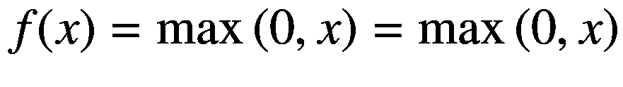

从图形上看，该函数如图 5-15 所示。

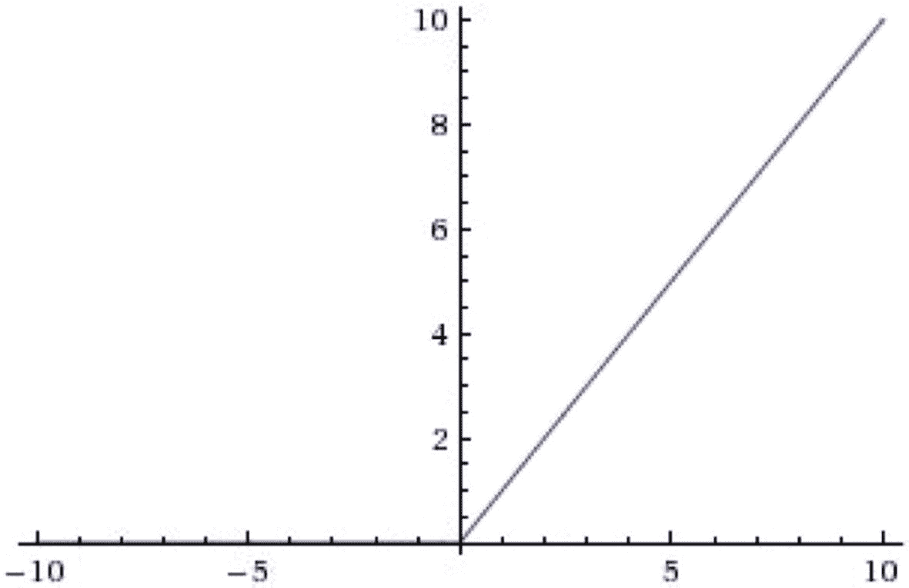

图 5-15

ReLU 函数图

令人惊讶的是，这样一个简单的函数（并且由两个线性部分组成）竟然能让模型很好地处理非线性和交互作用。但 ReLU 函数在大多数应用中效果出色，因此被广泛使用。

最后一层使用“softmax”激活函数。Softmax 函数，也称为 `softargmax` 或 `归一化指数函数`，是一个将 K 个实数的向量作为输入，并将其归一化为由 K 个概率组成的概率分布的函数。也就是说，在应用 softmax 之前，某些向量分量可能为负或大于 1，并且总和可能不为 1；但在应用 softmax 之后，每个分量将位于 [*区间*](https://en.wikipedia.org/wiki/Interval_%2528mathematics%2529) 0 到 1 之间，并且所有分量之和为 1，因此它们可以被解释为概率。此外，较大的输入分量将对应较大的概率。因此，softmax 函数通常用作 ANN 中的激活函数，将网络的非归一化输出映射到所有预测输出类上的概率分布。

此代码部分中的最后一条语句用于编译模型。在训练模型之前需要编译。在编译期间，根据三个参数配置模型：

*   **损失函数** – 这是模型将尝试最小化的目标。它可以是现有损失函数的字符串标识符（例如 `categorical_crossentropy` 或 `mse`），也可以是一个目标函数。

*   **优化器** – 这可以是现有优化器的字符串标识符（例如 `adam`、`rmsprop` 或 `adagrad`），也可以是 Optimizer 类的一个实例。

*   **指标列表** – 对于任何分类问题，此参数应设置为 `metrics=['accuracy']`。指标可以是现有指标的字符串标识符，也可以是自定义指标函数。

```
# 运行演示
model = baseline_model()
model.fit(X_train, y_train, validation_data=(X_test, y_test), epochs=10, batch_size=200, verbose=2)
# 最终评估
scores = model.evaluate(X_test, y_test, verbose=0)
print('Baseline error: %.2f%%'%(100-scores[1]*100))
```

最后一部分代码是驱动代码，它使用 MNIST 数据集测试新的人工神经网络（ANN）。首先实例化一个名为 `model` 的模型，然后使用 Keras 的 `fit` 函数进行训练。接着，通过调用 Keras 的 `evaluate` 方法生成一个分数元组。测试持续 10 个周期，最后一条语句显示最终的 ANN 准确率。

带有注释的完整脚本如下所示。我将此脚本命名为 `kerasTest.py`，可从本书的配套网站获取。

```
# 导入所需库
import numpy as np
from keras.datasets import mnist
from keras.models import Sequential
from keras.layers import Dense
from keras.utils import np_utils
# 随机种子设置
seed = 42
np.random.seed(seed)
# 加载 MNIST 数据
(X_train, y_train), (X_test, y_test) = mnist.load_data()
# 展平 28 x 28 图像
num_pixels = X_train.shape[1] * X_train.shape[2]
X_train = X_train.reshape(X_train.shape[0], num_pixels).astype('float32')
X_test = X_test.reshape(X_test.shape[0], num_pixels).astype('float32')
# 将输入从 0-255 归一化到 0-1
X_train = X_train / 255.0
X_test = X_test / 255.0
# 独热编码
y_train = np_utils.to_categorical(y_train)
y_test = np_utils.to_categorical(y_test)
num_classes = y_test.shape[1]
# 定义基线模型
def baseline_model():
# 创建模型
model = Sequential()
model.add(Dense(num_pixels, input_dim=num_pixels, kernel_initializer="normal", activation="relu"))
model.add(Dense(num_classes, kernel_initializer="normal", activation="softmax"))
# 编译模型
model.compile(loss='categorical_crossentropy', optimizer="adam", metrics=['accuracy'])
return model
# 运行演示
model = baseline_model()
model.fit(X_train, y_train, validation_data=(X_test, y_test), epochs=10, batch_size=200, verbose=2)
# 最终评估
scores = model.evaluate(X_test, y_test, verbose=0)
print('Baseline error: %.2f%%'%(100-scores[1]*100))
```

该脚本应使用以下命令在虚拟环境中运行：

```
python kerasTest.py
```

该脚本需要一些时间才能完成，因为它不仅使用完整的 60,000 个 MNIST 训练数据集训练模型，而且重复进行 10,000 个测试记录的测试十次（即 10 个周期）。最终结果如图 5-16 所示。

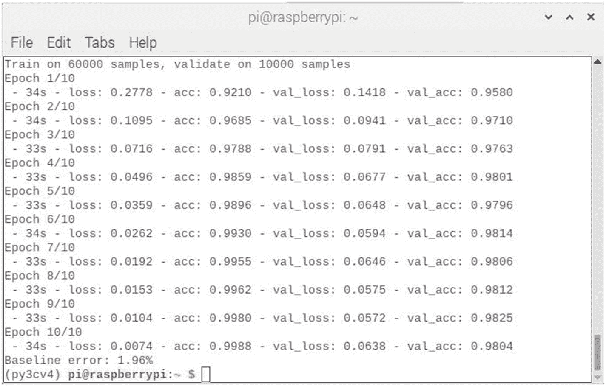

图 5-16

运行 kerasTest 脚本后的最终结果

这个使用 Keras 实现并在 TensorFlow 2 后端运行的极其简单的网络，实现了略高于 98% 的出色准确率。这比我之前的 MLP 模型高出三个百分点。然而，信不信由你，使用更先进的算法甚至有可能获得略高的准确率，我将在下一章中讨论这一点。

