# 6. CNN 演示

本章展示了几个实用的深度学习（DL）演示。如果您已阅读前一章或之前对深度学习技术和概念有所了解，您将能够跟随这些演示进行操作。在编写本章时，我有两个目标。第一个是清晰地展示如何完成一个完整的人工神经网络（ANN）项目，以产生现实且有用的结果。第二个是指出在 ANN 开发中常见的一些潜在陷阱和不切实际的假设。

## 零件清单

本章演示需要标准的 RasPi 桌面配置。

| 项目 | 型号 | 数量 | 来源 |
| --- | --- | --- | --- |
| 树莓派 4 | Model B（2 或 4 GB RAM 的 RasPi 4） | 1 | mcmelectronics.comadafruit.comdigikey.commouser.comfarnell.com |
| Micro SD 卡 | 16 GB，class 10 或更大 | 1 | amazon.com |
| USB 键盘 | Amazon Basic | 1 | amazon.com |
| USB 鼠标 | Amazon Basic | 1 | amazon.com |
| HDMI 显示器 | 普通商品 | 1 | amazon.com |


### 注意

RasPi 4 至少需要 2 GB 内存才能编译并训练本章演示中使用的 CNN 模型。仅有 1 GB 内存的 RasPi 将无法成功运行这些演示。

## CNN 模型简介

CNN 是卷积神经网络（Convolutional Neural Network）的缩写。在上一章中，我使用了多层感知机（MLP）模型，该模型基于一种长期存在的传统模型，其核心是被称为感知机的经典人工神经元。MLP 模型是全连接的，这意味着在给定的网络层中，每个神经元（至少在初始阶段）都与该层中的其他所有神经元相连。而 CNN 模型则并非如此，它被认为是一种稀疏连接的网络。

CNN 与上一章讨论的常规神经网络类似，因为它们都由具有权重和偏置的神经元组成，这些权重和偏置会根据学习过程进行调整。每个 CNN 神经元接收一些输入，执行点积运算，并可选地跟随一个非线性变换。整个 CNN 仍然使用原始图像像素作为输入端的评分函数，并在输出端输出类别分数。CNN 仍然具有损失函数，并在最后的全连接层上使用 softmax 函数。基本上，所有针对常规神经网络讨论的技术和概念都适用于 CNN。

那么，常规神经网络和 CNN 之间有哪些显著变化呢？CNN 架构明确假设输入是图像。这一基本假设允许对网络应用某些优化，从而可以将某些属性编码到架构中。这些优化使得前向传播函数的实现更加高效，并大幅减少了网络中的参数数量。

回顾上一章，常规神经网络接收一个单一输入数据向量作为输入，并通过一系列*隐藏层*对其进行变换。每个隐藏层由一组神经元组成，其中每个神经元都与前一层的所有神经元全连接，而同一层中的神经元功能完全独立，不共享任何连接。最后一个全连接层称为输出层，它生成的分类设置代表了类别分数。

*常规神经网络* *无法很好地扩展到全尺寸图像*。在流行的 CIFAR-10 数据集中，图像大小为 32 x 32 x 3（宽 32，高 32，3 个颜色通道），因此常规神经网络第一个隐藏层中的一个全连接神经元将拥有 3072（32 X 32 X 3）个权重。虽然这个权重数量尚可管理，但它清楚地表明，全尺寸图像将需要极其庞大的权重数量。例如，一张更常见的尺寸为 400 x 300 x 3 的图像将需要 360,000 个权重。此外，可能还会涉及多个隐藏层，因此计算复杂度显然会迅速呈指数级爆炸。显而易见，采用全连接的常规神经网络并不是处理较大尺寸图像的好方法。处理过多的参数很可能导致过拟合，进而导致网络性能不佳。

CNN 的设计利用了其输入仅包含图像这一事实，因此可以以最优方式设计架构。特别是，与常规神经网络不同，CNN 的层中的神经元按**宽度**、**高度**和**深度**三个维度排列。请注意，这里的*深度*一词仅指激活体积的第三个维度。在 CNN 设计中，后一层中的神经元将仅连接到前一层的一个小区域。

此时，我需要讨论一下卷积操作。图 6-1 展示了一个图像体积以及一个尺寸为 5 x 5 x 3 的较小图像体积。这个较小的体积被称为滤波器。

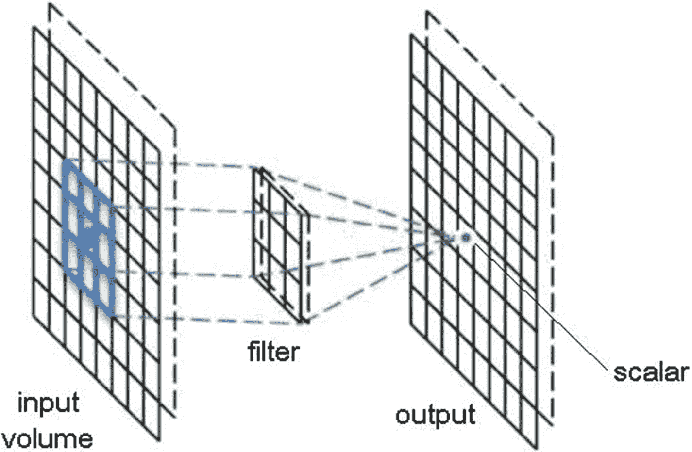

图 6-1

带有卷积滤波器的图像体积

在卷积操作中，一个小的滤波器块以步进方式“滑动”覆盖在较大的图像体积上，同时在每一步中，滤波器与其覆盖的图像体积之间执行点积运算。每一步计算点积都会产生一个标量值。所有逐步卷积操作的总和结果是一个一维图像，如图右侧所示的输出层。应用实际维度有助于阐明该操作。假设输入图像体积为 32 x 32 x 3。这意味着它的高度和宽度为 32 像素，深度为 3。这里的 3 指的是构成输入图像体积的三个颜色层，分别代表 RGB 或红、绿、蓝值。现在，如果滤波器是 5 x 5 x 3，那么它只能在水平和垂直方向上以 28 步“滑动”覆盖输入体积。这意味着输出“图像”必须是 28 x 28 x 1，因为只有这样，5 x 5 x 3 的滤波器才能唯一地逐步遍历原始图像体积。

然而，典型 CNN 的卷积操作并未完全结束。请将卷积操作中使用的滤波器视为特征提取器，这也是 CNN 创建者 Yann LeCun 的初衷。我将在下一节简要讨论 LeCun 教授的贡献。因此，合理地重复应用不同的滤波器并重复卷积操作，以提取不同的特征。这正是图 6-2 所传达的内容，其中对原始图像体积应用了五个额外的特征。这最终产生了一个尺寸为 28 x 28 x 6 的最终处理块。这个处理后的输出块现在被称为特征图或激活图。

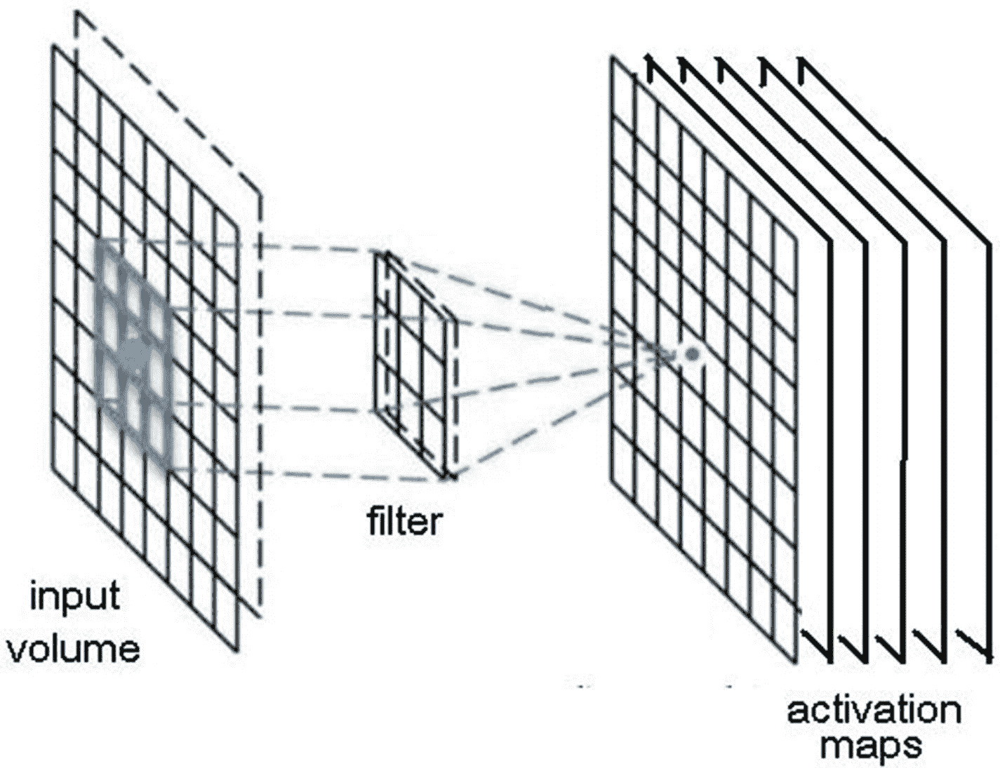

图 6-2

创建激活图

典型的 CNN 会使用多个卷积层。图 6-3 展示了堆叠卷积层的结果。请注意，在每个卷积层之后也会立即使用激活函数。

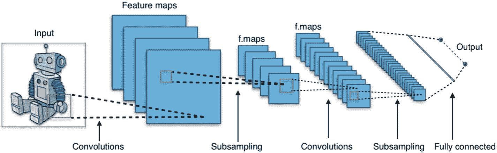

图 6-3

典型的 CNN 架构

当随机初始化的滤波器通过所有卷积层应用于图像体积时，CNN 的学习就“发生”了。

下一张图应该有助于你理解卷积层和特征之间的关系。图 6-4 展示了一个输入图像体积被应用于一系列三个卷积层和一个“类似输出”的层。

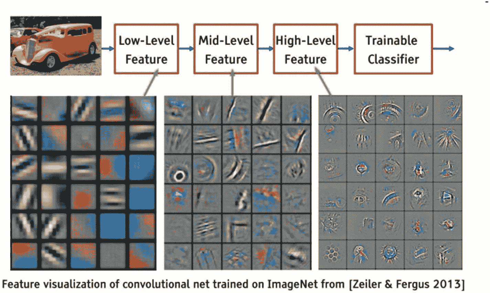

图 6-4

展示卷积特征的 CNN 示例

仔细观察第一层中的滤波器输出，它们是 5 x 5 x 3 的滤波器。通过反向传播，它们已经自我调整，变成了图像片段和边缘的彩色斑点。随着数据流经更多的卷积层，滤波器会对先前卷积操作的输出执行点积运算。传统的 CNN 架构使用线性滤波器进行卷积，并从图像中提取特征。早期层尝试提取线条、边缘和角点等原始特征，而后期层则建立在早期层的基础上，提取眼睛、耳朵、鼻子等更高级的特征。这些被称为潜在特征。


每个图像特征都可能存在多种变体，例如仅眼睛部分就有许多不同变化。用于检测眼睛的线性滤波器可能会尝试绘制直线来提取这些特征。因此，传统卷积神经网络隐含地假设潜在概念是线性可分的。但直线并不总是适用。各类眼睛特征与非眼睛特征之间的分界线可能并非直线，而是更具非线性的形态。在这种情况下，使用非线性函数可能会成为更好的特征提取器。

请仔细观察与高层特征卷积层相关的图像，并尝试将它们想象为来自 28 x 28 神经元网格的输出。在特定的特征图中，每个神经元仅与输入图像体积的一小部分相连。此外，给定特征图中的所有神经元都具有相同的连接权重。这种权重共享被称为参数共享。

卷积神经网络中的神经元还具有局部连接性，因为它们仅与输入图像的子集相连，这与传统人工神经网络中所有神经元全连接的方式不同。局部连接性减少了整个系统中的参数数量，并提高了计算效率。


## CNN 的历史与演变

CNN 自 1994 年便已存在，当时第一个 CNN 由**扬·勒昆**博士创建，他被许多人视为深度学习领域的先驱研究者之一。他将该网络命名为 LeNet-5，这反映了他自 1988 年开始创建的网络所经历的变化。

LeNet-5 架构具有革命性，因为它利用了一个基本洞察：图像特征通常分布在整个图像中，而使用可学习参数的卷积运算是用少量参数在多个位置提取相似特征的有效方法。需要记住的是，当时的现有计算机没有图形处理单元（GPU）来辅助训练，且桌面处理器的速度与现代处理器相比非常慢。因此，任何能够减少参数数量和相关计算量的方法都是巨大的优势。CNN 方法与当时将输入图像的每个像素单独处理作为大型多层神经网络输入的方法形成了对比。勒昆解释说，这些像素不应在第一层中使用，因为图像在空间上高度相关，将图像的单个像素作为独立的输入特征无法利用这些相关性。

LeNet-5 模型的特征可总结如下：

*   卷积神经网络使用一个由卷积层、池化层和非线性层组成的序列。这一特征至今对于 CNN 仍然适用。

*   使用卷积运算来提取空间特征。

*   使用激活图的空间平均值进行下采样。

*   使用 tanh 或 sigmoid 形式的非线性激活函数。

*   使用全连接多层感知器网络（MLP）作为最终分类器，并搭配 softmax 分类器。

*   在层之间使用稀疏连接矩阵以最大化计算效率。

图 6-5 展示了 LeNet-5 的架构。

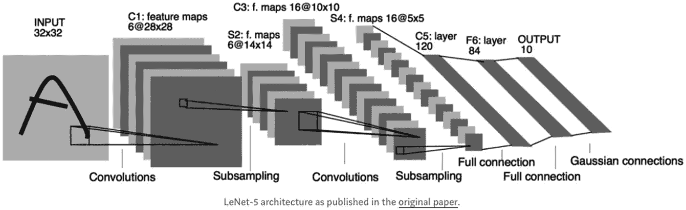

图 6-5

LeNet-5 架构

按照今天的标准，LeNet-5 是一个简单的网络。它只有七层，其中包括三个卷积层（C1、C3 和 C5）、两个下采样（池化）层（S2 和 S4）和一个全连接层（F6），其后是输出层。卷积层使用步长为 1 的 5x5 卷积。下采样层由 2x2 的平均池化层组成。整个网络使用 tanh 激活函数。LeNet-5 在网络架构上做出了两个在现代深度学习网络中不常见的选择。

第一个选择是，C3 层中的各个卷积核并未使用 S2 层产生的所有特征。做出这一选择的一个关键原因是使网络在计算上更高效。另一个原因是让卷积核学习不同的模式。如果不同的卷积核接收不同的输入，它们自然会学习到不同的模式，这完全合理。

第二个选择是在输出层使用十个欧几里得径向基函数神经元，这些神经元计算一个 84 维输入向量与**手动预定义的相同维度权重向量**之间的 L2 距离。数字 84 源于这些权重代表一个 7x12 的二进制掩码，每个掩码对应一个手写数字。这种设计迫使网络将输入图像转换为一种内部表示，使得 F6 层的输出尽可能接近输出层十个神经元的手工编码权重。

LeNet-5 在 MNIST 手写数字数据集上能够实现低于 1%的错误率，这非常接近当时的最优水平，而当时的最优水平是由三个 LeNet-4 网络的增强集成获得的。

从 1998 年到 2010 年，神经网络在缓慢进步。该领域的大多数人并未注意到它们日益增长的能力，而其他研究人员则在缓慢推进。由于智能手机和相对便宜的数码相机的兴起，可用的数据越来越多。计算能力也在提升；CPU 变得更快，GPU 变得更便宜且易于获得。这两种趋势都使得神经网络研究以缓慢的速度前进。计算能力的提升以及可用数据的增加，使得神经网络能够处理的任务变得更加有趣。

2010 年，Ciresan 等人发表了首批 GPU 神经网络实现之一，该网络旨在解决手写数字识别问题。该实现同时使用了前向和反向传播，并在早期的[NVIDIA GTX 280](http://www.geforce.com/hardware/desktop-gpus/geforce-gtx-280) GPU 上运行，神经网络最多使用了九层。

2012 年，亚历克斯·克里热夫斯基创建了 AlexNet，它是 LeNet CNN 的放大版本。AlexNet 用于学习比 LeNet 所能处理的更复杂的对象。AlexNet 的论文包含了以下贡献：

*   使用修正线性单元（ReLU）作为非线性激活函数。

*   使用 dropout 技术在训练期间有选择地忽略单个神经元。该技术避免了模型的过拟合。

*   使用重叠的最大池化，避免了平均池化的平均效应。

*   使用 GPU（NVIDIA GTX580）来减少训练时间。

在 AlexNet 论文发表时，GPU 提供的核心数量远多于 CPU，并允许更快的训练时间。所有这些都使得使用更大的数据集和图像成为可能。AlexNet 网络的成功清楚地向视觉领域展示了 CNN 是深度学习的“明星”。现在可以利用大幅改进的计算硬件来解决有用且实际的问题。

2013 年，在纽约大学深度学习实验室工作的扬·勒昆引入了 OverFeat 框架，这是一种使用 CNN 实现目标识别、定位和检测的方法。Overfeat 是 AlexNet 的一个衍生版本。勒昆还提出在目标识别中使用学习边界框，这现在已成为识别图像中对象的公认方法。

2014 年，牛津大学的一个团队引入了[VGG 网络](http://arxiv.org/abs/1409.1556)。该 CNN 实现在每个卷积层中使用小的 3×3 滤波器，并将它们组合成卷积序列。起初，这似乎与勒昆为 LeNet 所倡导的原则相悖，LeNet 使用较大的卷积滤波器尺寸来捕获图像中的相似特征。因此，LeNet 和 AlexNet 中较大的滤波器尺寸开始缩小，可能过于接近 LeNet 想要避免的臭名昭著的 1×1 卷积。然而，VGG 网络提供的巨大洞察是，多个 3×3 卷积序列可以模拟更大感受野的效果，例如 5×5 甚至 7×7 的卷积滤波器。这些概念已被用于更近期的网络架构中，如 Inception 和 ResNet。VGG 网络使用多个 3×3 卷积层来表示复杂特征。请注意 VGG-E 的块 3、4 和 5，其中 256×256 和 512×512 的 3×3 滤波器被多次顺序使用，以提取更复杂的特征及其组合。VGG 网络的一个缺点是训练计算成本高昂。这可以通过将较大的网络拆分为较小的网络并逐层添加来部分缓解。

[Network in Network](https://arxiv.org/abs/1312.4400)（NiN）有一个简单的洞察：使用 1×1 卷积为卷积层的特征提供更多的组合能力。NiN 架构，如图 6-6 所示，在每次卷积后使用空间 MLP 层，以便在进入下一层之前更好地组合特征。

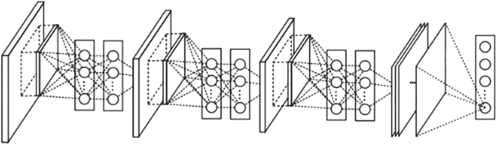

图 6-6

NiN 架构

同样，人们可能会认为 1×1 卷积违背了 LeNet 的原始原则，但它们反而有助于以更优的方式组合卷积特征，这是简单堆叠额外的卷积层所无法实现的。这与将原始像素作为下一层的输入不同。这里使用 1×1 卷积在卷积后跨特征图空间地组合特征，因此它们有效地使用了非常少的参数，并且所有特征共享像素。

MLP 的能力可以通过将单个卷积特征组合成更复杂的组，极大地提高其有效性。这个想法后来被用于大多数最新的架构中，如 ResNet 和 Inception 及其衍生版本。

NiN 还在最后的分类器中使用了平均池化层，这已成为另一种常见做法。这样做是为了在分类之前平均网络对多个输入图像的响应。

2014 年秋季，谷歌的克里斯蒂安·塞格迪启动了一个旨在减少深度神经网络计算负担的项目。他和他的团队创建了 GoogLeNet，这是第一个使用 Inception 架构的模型。在那个时期，深度学习模型在分类图像和视频帧内容方面变得非常有用。谷歌对其服务器群中深度学习架构的高效和大规模部署产生了浓厚兴趣。克里斯蒂安考虑了许多方法来减少深度神经网络的计算负担，同时仍能获得最先进的性能。主要目标是在实现改进性能的同时维持或降低计算成本。他和他的团队提出了 Inception 模块，如图 6-7 框图所示。

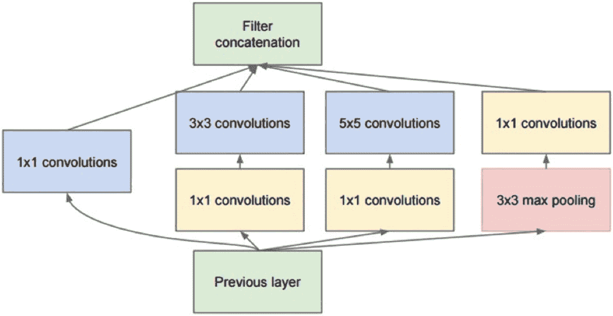

图 6-7

GoogLeNet 框图

乍一看，该图基本上是 1×1、3×3 和 5×5 卷积滤波器的并行组合。但 Inception 模块的巨大洞察是在昂贵的并行模块之前使用 1×1 卷积块（NiN）来减少特征数量。这通常被称为“瓶颈”，如下数据所示。

减少 Inception 模型中的瓶颈是通过减少待处理的特征数量来实现的。通过减少特征数量可以最小化推理时间；然而，问题在于不能损失太多的数据质量。

例如，假设有 256 个特征被输入到一个卷积层，并且有 256 个特征被输出。如果 Inception 层只执行 3x3 卷积，仍然需要大约 589,000 次乘加运算。这是以下计算的结果：

*   256 ∗ 256 ∗ 3 ∗ 3 = 589,824

与其这样做，不如决定减少需要卷积的特征数量，比如减少到 64。在这种情况下，首先执行 256 -> 64 的 1×1 卷积，然后在所有 Inception 分支上执行 64 个卷积，然后再使用一个 1×1 卷积从 64 -> 256 个特征。现在的运算量为：

*   256×64 × 1×1 = 16,384

*   64×64 × 3×3 = 36,864

*   64×256 × 1×1 = 16,384

总计 = 69,632

这总共大约 70,000 次运算，而使用完整特征集则需要近 600,000 次。尽管涉及的运算量显著减少，但处理精度并未损失，因为输入特征是相关的，因此可以通过使用 1×1 卷积适当地组合它们来消除冗余。成功的原因在于，在使用较少特征进行卷积后，它们可以再次扩展为有意义的组合，以供下一层使用。

2015 年 2 月，谷歌团队引入了批归一化 Inception V2。通过批归一化，计算所有特征图的均值和标准差，然后使用这些值对层的输出进行归一化。此操作“白化”了数据，并使所有神经图在零均值的相同范围内响应。此操作促进了训练，因为下一层不必学习输入数据中的偏移量，可以专注于如何最佳地组合特征。

2015 年 12 月，该团队发布了 Inception 模块的第三版。以下列表详细说明了该版本中包含的想法和概念：

*   通过精心构建平衡深度和宽度的网络，最大化流入网络的信息。在每次池化之前，增加特征图。

*   当深度增加时，特征数量或层的宽度也系统地增加。

*   在每一层增加宽度，以增加进入下一层之前的特征组合。

*   尽可能只使用 3×3 卷积，因为 5×5 和 7×7 的滤波器可以分解为多个 3×3。

*   滤波器也可以通过[扁平卷积](http://arxiv.org/abs/1412.5474)分解成更复杂的模块。

*   Inception 模块还可以在执行 Inception 计算的同时通过提供池化来减小数据尺寸。这基本上等同于在并行执行带步长的卷积的同时进行简单的池化层。

大约在 Inception V3 被引入的同时，何恺明等人引入了一个相当革命性的 CNN，他们称之为 ResNet。他们简单的想法是连接两个连续卷积层的输出，并将输入旁路到下一层。图 6-8 展示了说明 ResNet 思想的流程图。

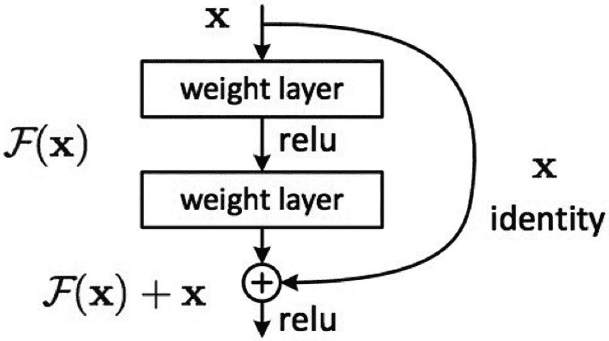

图 6-8

ResNet 核心概念流程图

一个自然而然会想到的问题是，为什么旁路卷积层会提高性能？答案在于深度网络的性质，深度网络就是包含许多层的网络。自从引入具有五个卷积层的 AlexNet 以来，CNN 通常变得更深。例如，Inception V1 从 19 层开始，最终达到 22 层。然而，网络性能并不总是通过简单地堆叠越来越多的层而提高。这是由于梯度消失问题。当梯度反向传播到较早的层时，重复的乘法运算开始使梯度变得无限小。结果，随着网络变得更深，其性能会饱和甚至开始迅速下降。

ResNet 的核心概念是引入所谓的恒等快捷连接，它跳过一个或多个层，如图 6-8 所示。ResNet 的作者认为，堆叠层不应降低网络性能，因为简单地在当前网络上堆叠恒等映射（一个什么都不做的层），得到的架构会执行相同的操作。这表明更深的模型不应产生比其较浅的对应模型更高的训练误差。

这类似于[这个](http://yann.lecun.com/exdb/publis/pdf/sermanet-ijcnn-11.pdf)等较早的想法。但在这里，它们跳过了两层，并应用于大规模。跳过两层是关键直觉，因为跳过单层并没有带来太多改进。但两层旁路可以被视为一个小型分类器或一个 Network in Network。

ResNet 也是首次训练了数百到一千层的网络。ResNet 也开始使用 Inception V2 网络创建的瓶颈缩减方案。图 6-9 显示了嵌入瓶颈方案以及恒等旁路的流程图。

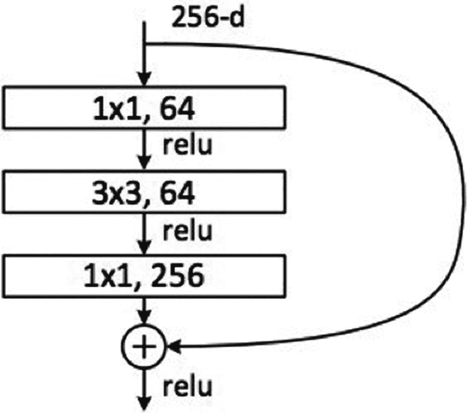

图 6-9

带有瓶颈消除的 ResNet 核心概念流程图

每层的特征数量通过首先使用输出较小的 1×1 卷积（通常是输入的四分之一），然后使用 3×3 层，然后再使用 1×1 卷积恢复到较大数量的特征来减少。与 Inception 模块的情况一样，这种方案允许在保持较低计算量的同时，仍然提供丰富的特征组合。

ResNet 在输入处使用一个相当简单的初始层（主干），一个 7×7 卷积层，后跟一个步长为 2 的池化。ResNet 还使用一个池化层加上 softmax 作为最终分类器。

以下是关于 ResNet 架构的一些额外见解：

*   ResNet 可以被视为并行和串行模块的组合，只需将输入视为并行进入许多模块，而每个模块的输出则串联起来。

*   ResNet 也可以被认为是[多个并行或串行模块的集成](http://arxiv.org/abs/1605.06431)。

*   已经发现，ResNet 通常在相对较浅的约 20-30 层的块上运行，这些块并行作用，而不是串行地流过整个网络。

*   当输出被反馈到输入时，如在 RNN 中，ResNet 可以被视为一个更好的[皮层生物合理模型](https://arxiv.org/abs/1604.03640)。

2016 年 2 月，克里斯蒂安和他的谷歌团队向社区引入了 Inception V4。主干之后的这个 Inception 模块与 Inception V3 类似。图 6-10 显示了初始的 V4 架构。

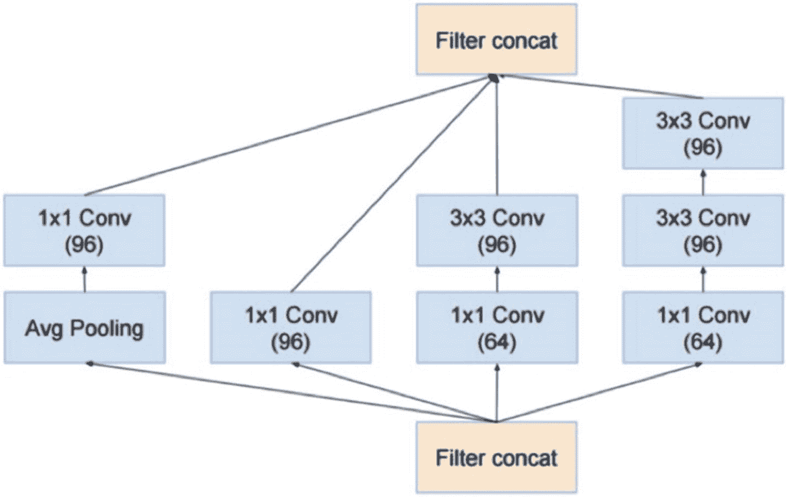

图 6-10

初始 Inception V4 架构

然而，他们还将 Inception V4 模块与 ResNet 模块结合了起来。如图 6-11 所示。

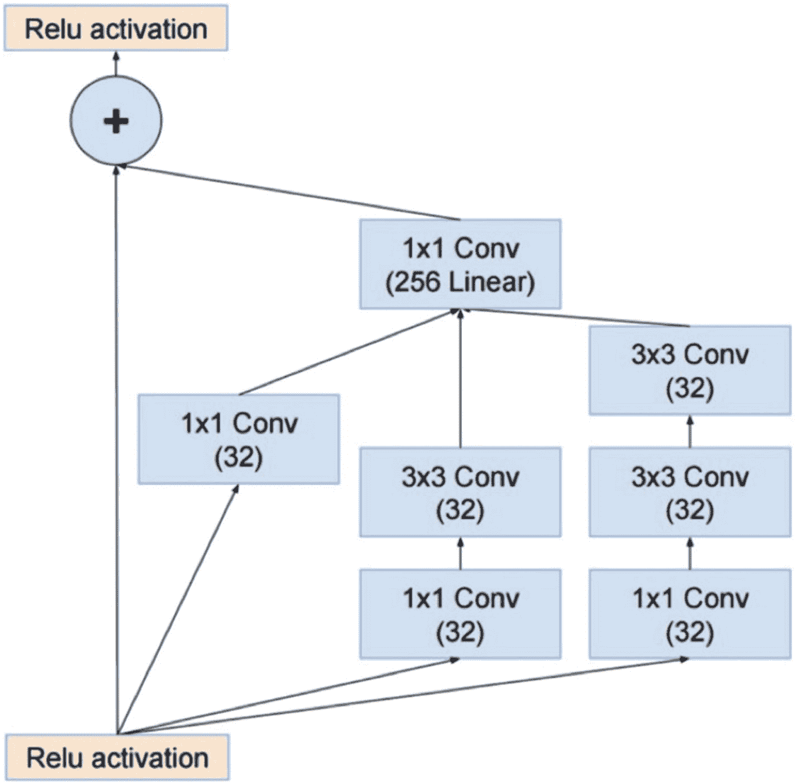

图 6-11

带有 ResNet 的 Inception V4 架构

该团队将此模块重命名为 Inception-ResNet V1，以表明它是对原始 Inception 设计协议的重大转变。经确定，这个新模块的计算成本与 Inception V3 大致相同，但训练速度更快。不幸的是，它的最终准确率略低于 Inception V3 模块。

2016 年，加州大学伯克利分校和斯坦福大学的研究人员发布了 SqueezeNet。作者设计 SqueezeNet 的目标是创建一个更小、参数更少的神经网络，使其能够更容易地适应有限的计算机内存，并且可以轻松地通过计算机网络传输。

SqueezeNet 的原始版本是在 Caffe 深度学习软件框架之上实现的。此后不久，开源研究社区将 SqueezeNet 移植到了许多其他深度学习框架，包括 Chainer、Apache MXNet 和 Keras。2017 年，几家商业公司展示了 SqueezeNet 在低功耗处理平台（如智能手机和 FPGA）上运行。

截至 2018 年，SqueezeNet 作为许多深度学习框架（如 PyTorch、Apache MXNet 和 Apple_CoreML）源代码的一部分“原生”提供。此外，第三方开发人员创建了与 TensorFlow 框架兼容的 SqueezeNet 实现。

[Xception](http://www.Xception) 通过一个简单而优雅的架构改进了 Inception 模块，其效果与 ResNet 和 Inception V4 相当。图 6-12 展示了 Xception 模块架构。

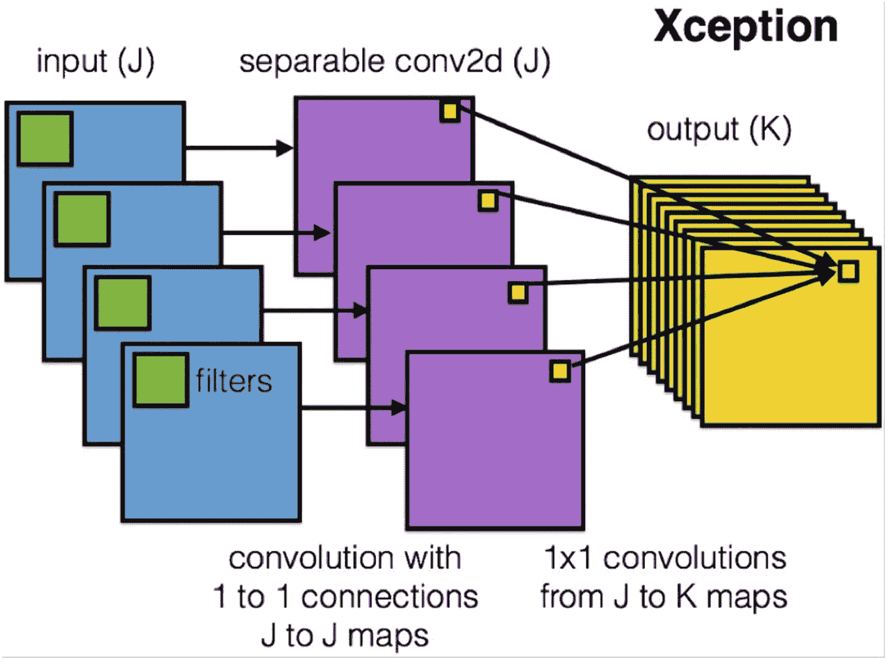

图 6-12

Xception 架构

Xception 架构有 36 个卷积阶段，这与 ResNet-34 非常相似。图 6-13 展示了 Xception 数据流图。

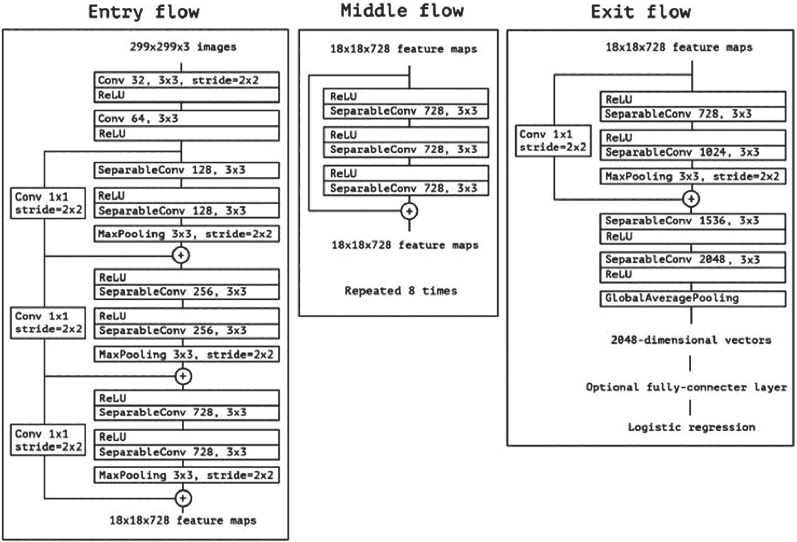

图 6-13

Xception 数据流图

Xception 的代码与 ResNet 一样简单，并且比 Inception V4 更容易理解。

Xception 已在 Torch7 和 Keras（搭配 TensorFlow）中实现。

在这个演变讨论中，我将提到的最后一个 CNN 模型是[FractalNet](http://www.FractalNet)，它使用递归架构。作者 Larsson 等人在其介绍性论文中指出：

> *我们引入了一种基于自相似性的神经网络宏观架构设计策略。重复应用一个简单的扩展规则会生成深度网络，其结构布局恰好是截断的分形。这些网络包含不同长度的交互子路径，但不包含任何直通或残差连接；每个内部信号在被后续层看到之前，都会经过滤波器和非线性变换。*

他们摘要中的这段摘录似乎表明与 ResNet 设计哲学存在相当根本性的背离。我相信关于这种深层分层 CNN 设计的性能，结论仍有待观察。


## Fashion MNIST 演示

### 注意

你将在树莓派上使用与第 5 章最后一次演示运行时完全相同的配置。运行此演示脚本需要带有 TensorFlow 后端的 Keras。

本演示与第 5 章末尾的演示一样，将使用 MNIST 数据集，但并非手写数字集。取而代之的是一个由服装图像组成的数据集。与手写数字数据集类似，它也有十个类别，但在新数据集中，每个类别对应不同的服装物品。数据集中的所有图像尺寸均为 28 x 28，以便与手写数字数据集“无缝兼容”。此外，该数据集包含约 60,000 张训练图像和 10,000 张测试图像。这个新数据集名为 `fashion_mnist`，可通过 Keras 的导入数据集库直接使用。

以下代码片段展示了如何加载这个新数据集：

```
from keras.datasets import fashion_mnist
(train_images, train_labels),(test_images, test_labels) = fashion_mnist.load_data()
```

你可能注意到，在本演示中，我对训练和测试数据集使用了与手写数字演示不同的名称。我提及这一点是因为，如果你只是简单地在两个脚本之间复制粘贴，可能会遇到问题。

如前所述，所有图像都是 28 x 28 的数组，像素整数值范围在 0 到 255 之间。图像标签也是一个整数数组，范围从 0 到 9。这些整数对应图像所代表的服装类别。表 6-1 显示了整数与服装描述的对应关系。

表 6-1

整数与服装描述对应关系

| 标签 | 类别 |
| --- | --- |
| 0 | T 恤/上衣 |
| 1 | 裤子 |
| 2 | 套头衫 |
| 3 | 连衣裙 |
| 4 | 外套 |
| 5 | 凉鞋 |
| 6 | 衬衫 |
| 7 | 运动鞋 |
| 8 | 包 |
| 9 | 短靴 |

在配置 CNN 时，需要使用整数来表示字符串描述。字符串变量与网络计算本质上是不兼容的。

给定类别中的每张图像都映射到一个标签。由于数据集中不包含类别名称，这些标签必须存储起来，以便在后续绘制图像时使用。以下语句用于存储标签：

```
class_names = ['T 恤/上衣', '裤子', '套头衫', '连衣裙', '外套', '凉鞋', '衬衫', '运动鞋', '包', '短靴']
```

检查或抽样将要使用的数据总是明智之举，以便了解数据并发现任何潜在问题。为此，我建议运行以下名为 `reviewData.py` 的简短脚本。该脚本可从本书的配套网站获取：

```
from keras.datasets import fashion_mnist
(train_images, train_labels),(test_images, test_labels) = fashion_mnist.load_data()
print('训练记录数量及每条训练记录的大小：', train_images.shape)
print()
print('训练标签数量：', len(train_labels))
print()
print('训练标签：', train_labels)
print()
print('测试记录数量及每条测试记录的大小：', test_images.shape)
print()
print('测试标签数量：', len(test_labels))
print()
```

通过输入以下命令来运行该脚本：

```
python reviewData.py
```

图 6-14 显示了运行脚本后的结果。

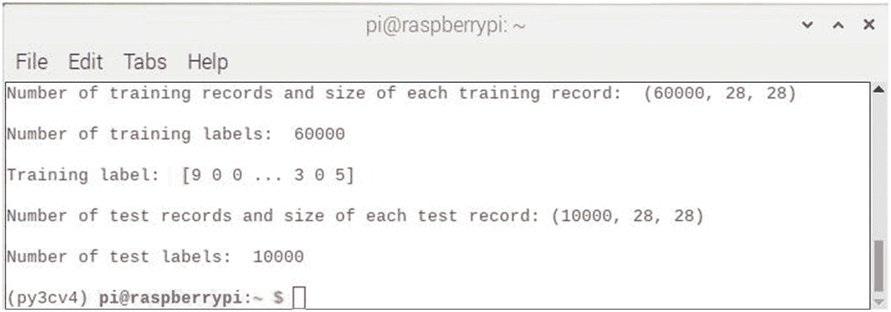

图 6-14

reviewData 脚本结果

查看该图时，你应该会发现数据集与早期手写数字识别演示中使用的数据集形状相同。此外，图中还显示了 60,000 个训练标签值中的前三个和后三个。这证实了 `training_labels` 数据集已正确加载。

此外，像手写数字识别项目那样，对输入数据集中的样本进行图像化展示总是有用且信息丰富的。为此，我启动了一个 Python 交互式会话来展示样本图像。以下代码输入到交互式 Python 会话中后，将显示第一个训练数据集的图像。你应在运行 `reviewData` 脚本后立即启动此会话，以确保 `fashion_mnist` 数据集已下载并可访问。

```
import matplotlib.pyplot as plt
plt.figure()
plt.imshow(train_images[0])
plt.colorbar()
plt.grid(False)
plt.show()
```

图 6-15 显示了第一个训练记录中的图像对象，并插入了颜色条以反映图像中存在的相关像素强度。

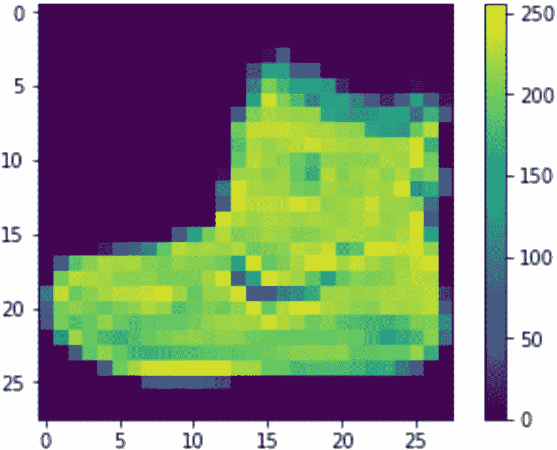

图 6-15

第一个训练记录图像

请注意，这是一张短靴的图像，对应于 `reviewData` 脚本结果中类别标签打印输出的整数“9”类引用。这种检查只是确认输入数据集一致性的另一种方式。

```
# 模型定义
def cnn_model():
# 创建模型
model = Sequential()
model.add(Conv2D(32, (5, 5), input_shape=(1, 28, 28), activation="relu"))
model.add(MaxPooling2D(pool_size=(2, 2)))
model.add(Dropout(0.2))
model.add(Flatten())
model.add(Dense(128, activation="relu"))
model.add(Dense(numClass, activation="softmax"))
# 编译模型
model.compile(loss='categorical_crossentropy', optimizer="adam", metrics=['accuracy'])
return model
```

这是定义 CNN 并对其进行编译的代码部分。该模型与第 5 章最后一次演示中使用的 MLP 模型有很大不同。首先，它按以下顺序包含六个层：

1.  卷积层

2.  池化层

3.  丢弃层

4.  展平层

5.  全连接层

6.  输出层

每一层都为 CNN 贡献了一个顺序操作，从而实现了从输入图像到分类输出的转换。

在第 5 章的 Keras 演示中，我在讨论编译函数时简要提到了 Adam 优化器。我将进一步阐述优化器的使用，因为理解其功能及其假设非常重要。CNN 的优化器是一个控制网络学习方式的函数。在非 Keras 网络（如第 5 章的 MLP）中，学习率（lr）控制梯度步长。较小的学习率意味着在尝试定位成本函数的全局最小值时步长较小。这意味着非常小的步长可能会使梯度下降算法花费数小时才能最终收敛到全局最小值。优化器采用不同的方法，使用动态技术来设置步长，以最小化定位全局最小值所需的总时间。

Adam 优化器根据梯度的一阶和二阶矩估计，为不同参数计算自适应的学习率。Adam 的作者将其描述为结合了随机梯度下降的另外两种扩展的优点。具体来说：

*   自适应梯度算法（AdaGrad），它保持每个参数的学习率，从而在稀疏梯度问题上提高性能。

*   均方根传播（RMSProp），它也保持每个参数的学习率，并根据权重梯度最近幅度的平均值（例如，其变化速度）进行调整。这意味着该算法在在线和非平稳问题（例如，噪声数据）上表现良好。


Adam 算法同时实现了 AdaGrad 和 RMSProp 算法的优势。与 RMSProp 基于平均一阶矩（均值）调整参数学习率不同，Adam 还利用了梯度的二阶矩（非中心方差）的平均值。具体来说，该算法会计算梯度及其平方的指数移动平均值。参数 `beta1` 和 `beta2` 控制这些移动平均值的衰减率。

Adam 是深度学习领域一种流行的算法，因为它能快速取得良好效果。实证结果表明，Adam 在实践中表现优异，且优于其他随机优化方法。在原始论文中，Adam 证明了其收敛性符合论文理论分析的预期。Adam 已被应用于 [MNIST 手写数字识别](https://machinelearningmastery.com/how-to-develop-a-convolutional-neural-network-from-scratch-for-mnist-handwritten-digit-classification/) 和 IMDB 情感分析数据集上的逻辑回归算法。作者得出结论，Adam 能够高效解决实际的深度学习问题。

```
# 运行演示并评估
from keras.layers import Conv2D
model = cnn_model()
model.fit(train_images, train_labels, validation_data=(test_images, test_labels), epochs=10, batch_size=200, verbose=2)
# 最终评估
scores = model.evaluate(test_images, test_labels, verbose=0)
print(scores[1])
```

最后一段代码是驱动代码，用于使用 `fashion_mnist` 数据集测试新的 CNN。首先实例化一个名为 `model` 的模型对象，然后使用 Keras 的 `fit` 函数进行训练。接着，通过调用 Keras 的 `evaluate` 方法生成一个 `scores` 元组。测试持续 10 个周期，最终语句显示 CNN 的最终错误率。

完整的脚本名为 `kerasFashionTest.py`，并在下方列出并附有注释。该脚本可从本书的配套网站获取。

```
import numpy as np
from keras.datasets import fashion_mnist
from keras.models import Sequential
from keras.layers import Dense
from keras.layers import Dropout
from keras.layers import Flatten
from keras.layers.convolutional import Conv2D
from keras.layers.convolutional import MaxPooling2D
from keras.utils import np_utils
from keras import backend as K
K.set_image_dim_ordering('th')
# 设置随机种子
seed = 42
np.random.seed(seed)
# 加载数据集
(train_images, train_labels),(test_images, test_labels) = fashion_mnist.load_data()
# 将所有 28 x 28 的图像展平为 784 个元素的 numpy 输入数据向量。
pixelNum = train_images.shape[1] * train_images.shape[2]
train_images = train_images.reshape(train_images.shape[0],1,28,28).astype('float32')
test_images = test_images.reshape(test_images.shape[0],1,28,28).astype('float32')
# 将输入从 0-255 归一化到 0-1
train_images = train_images / 255.0
test_images = test_images / 255.0
# 独热编码
train_labels = np_utils.to_categorical(train_labels)
test_labels = np_utils.to_categorical(test_labels)
numClass = test_labels.shape[1]
# 模型定义
def cnn_model():
# 创建模型
model = Sequential()
model.add(Conv2D(32, (5, 5), input_shape=(1, 28, 28), activation="relu"))
model.add(MaxPooling2D(pool_size=(2, 2)))
model.add(Dropout(0.2))
model.add(Flatten())
model.add(Dense(128, activation="relu"))
model.add(Dense(numClass, activation="softmax"))
# 编译模型
model.compile(loss='categorical_crossentropy', optimizer="adam", metrics=['accuracy'])
return model
# 运行演示并评估
model = cnn_model()
model.fit(train_images, train_labels, validation_data=(test_images, test_labels), epochs=10, batch_size=200, verbose=2)
# 最终评估
scores = model.evaluate(test_images, test_labels, verbose=0)
print(scores[1])
```

该脚本应使用以下命令在虚拟环境中运行：

```
python kerasFashionTest.py
```

该脚本大约需要 30 分钟才能运行完成，因为它使用完整的 60,000 个 `fashion_mnist` 训练数据集训练模型，然后使用 10,000 个 `fashion_mnist` 测试数据集对模型进行十次（即 10 个周期）测试。最终结果如图 6-16 所示。

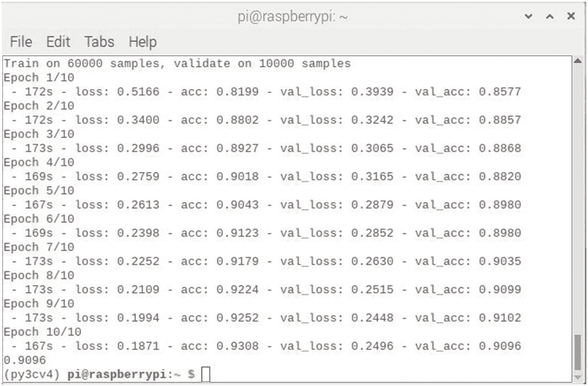

图 6-16

运行 kerasFashionTest 脚本后的最终结果

最终准确率为 90.96%，这被认为是 CNN 的良好成绩——虽然算不上卓越（卓越需要达到 98% 到 99% 的准确率），但仍然相当准确。要获得 CNN 的最高准确率，必须将 CNN 的设计与所处理的数据集相匹配。如何做到这一点更像是一门艺术而非科学。目前存在许多 CNN 设计策略，希望您通过阅读本章前面关于 CNN 演进的讨论已经有所了解。对于任何给定的数据集，使用哪种策略必然取决于实践者的判断和经验。我无法在这方面提供任何指导，因为我尚未积累足够的使用当前众多 CNN 设计以及大量数据集的经验。可能的组合数量是巨大的。我唯一的建议是在数据集上尝试新策略，看看效果如何。

基于尝试新设计的想法，我现在将展示之前演示的一个变体，使用一个稍微复杂一些的 CNN 模型，看看会发生什么。


## 更复杂的 Fashion MNIST 演示

在本演示中，我将向您展示一个比上一个更复杂的 CNN 模型。脚本中的其他内容保持不变。本演示的目的是确定新的 CNN 模型对数据集分类整体准确率的影响。

以下代码定义了本演示中使用的模型：

```
def complex_model():
# 创建模型
model = Sequential()
model.add(Conv2D(30, (5, 5), input_shape=(1, 28, 28), activation="relu"))
model.add(MaxPooling2D(pool_size=(2, 2)))
model.add(Conv2D(15, (3, 3), activation="relu"))
model.add(MaxPooling2D(pool_size=(2, 2)))
model.add(Dropout(0.2))
model.add(Flatten())
model.add(Dense(128, activation="relu"))
model.add(Dense(50, activation="relu"))
model.add(Dense(numClass, activation="softmax"))
```

该模型使用了九层，而之前的演示只用了六层。`kerasFashionTest` 脚本在其模型定义中添加了以下这些层：

*   一个卷积层
*   一个池化层
*   一个全连接层

修改后的脚本被重命名为 `kerasComplexFashionTest.py`，可从本书的配套网站获取。

```
import numpy as np
from keras.datasets import fashion_mnist
from keras.models import Sequential
from keras.layers import Dense
from keras.layers import Dropout
from keras.layers import Flatten
from keras.layers.convolutional import Conv2D
from keras.layers.convolutional import MaxPooling2D
from keras.utils import np_utils
from keras import backend as K
K.set_image_dim_ordering('th')
# 设置随机种子
seed = 42
np.random.seed(seed)
# 加载数据集
(train_images, train_labels),(test_images, test_labels) = fashion_mnist.load_data()
# 将所有 28 x 28 的图像展平为包含 784 个元素的 numpy 输入数据向量。
pixelNum = train_images.shape[1] ∗ train_images.shape[2]
train_images = train_images.reshape(train_images.shape[0],1,28,28).astype('float32')
test_images = test_images.reshape(test_images.shape[0],1,28,28).astype('float32')
# 将输入从 0-255 归一化到 0-1
train_images = train_images / 255.0
test_images = test_images / 255.0
# 独热编码
train_labels = np_utils.to_categorical(train_labels)
test_labels = np_utils.to_categorical(test_labels)
numClass = test_labels.shape[1]
# 复杂模型定义
def complex_model():
# 创建模型
model = Sequential()
model.add(Conv2D(30, (5, 5), input_shape=(1, 28, 28), activation="relu"))
model.add(MaxPooling2D(pool_size=(2, 2)))
model.add(Conv2D(15, (3, 3), activation="relu"))
model.add(MaxPooling2D(pool_size=(2, 2)))
model.add(Dropout(0.2))
model.add(Flatten())
model.add(Dense(128, activation="relu"))
model.add(Dense(50, activation="relu"))
model.add(Dense(numClass, activation="softmax"))
# 编译模型
model.compile(loss='categorical_crossentropy', optimizer="adam", metrics=['accuracy'])
return model
# 运行演示并评估
model = complex_model()
model.fit(train_images, train_labels, validation_data=(test_images, test_labels), epochs=10, batch_size=200, verbose=2)
# 最终评估
scores = model.evaluate(test_images, test_labels, verbose=0)
print(scores[1])
```

应使用以下命令在虚拟环境中运行该脚本：

```
python kerasComplexFashionTest.py
```

该脚本运行完成大约需要 27 分钟，比之前的演示稍短。最终结果如图 6-17 所示。

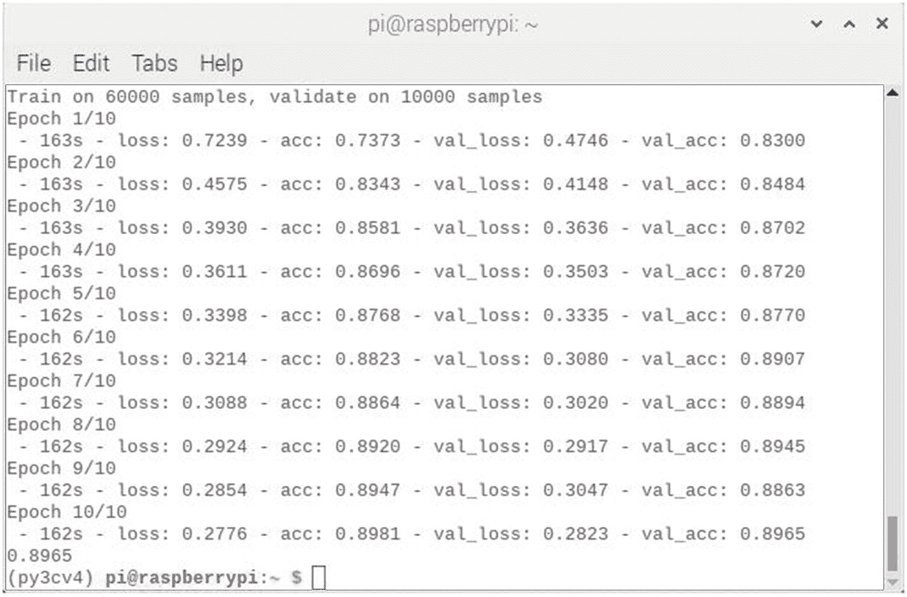

图 6-17

运行 `kerasComplexFashionTest` 脚本后的最终结果

最终准确率为 89.65%，略低于之前演示的 90.96%。考虑到本演示使用了更复杂的 CNN 模型，这个结果乍看可能有些奇怪。然而，这种结果在 CNN 项目中很常见。我们很可能无法预测某个特定的 CNN 模型在给定数据集上的表现。从这个结果中能得出的唯一合理结论是，必须先在一个数据集上使用某个模型，才能确定其性能。在这个案例中，较简单的 CNN 模型表现更好。情况并非总是如此，但如果不进行测试，你永远无法知道。

## VGG Fashion MNIST 演示

本演示将使用一个 VGG CNN 模型，以向您展示测试 `fashion_mnist` 数据集的另一种方法。首先，我要感谢 Adrian Rosebrock 在 2019 年 2 月发表的题为“Fashion MNIST with Keras and Deep Learning”的博客，本演示的灵感以及所使用的模型均来源于此。我承认对模型代码做了细微调整，以适配我的预处理语句以及模型的编译方式。

在本演示中，模型定义被放入一个类中，并单独存储在名为 `VGG.py` 的文件中。类的清单如下所示，可从本书的配套网站获取。

```
# 导入所需库
from keras.models import Sequential
from keras.layers.normalization import BatchNormalization
from keras.layers.convolutional import Conv2D
from keras.layers.convolutional import MaxPooling2D
from keras.layers.core import Activation
from keras.layers.core import Flatten
from keras.layers.core import Dropout
from keras.layers.core import Dense
from keras import backend as K
class VGG:
@staticmethod
def build(width, height, depth, classes):
# 初始化模型以及输入形状为 "channels last" 和通道维度本身
model = Sequential()
inputShape = (height, width, depth)
chanDim = -1
# 如果我们使用 "channels first"，则更新输入形状和通道维度
if K.image_data_format() == "channels_first":
inputShape = (depth, height, width)
chanDim = 1
# 第一组 CONV => RELU => CONV => RELU => POOL 层
model.add(Conv2D(32, (3, 3), padding="same",
input_shape=inputShape))
model.add(Activation("relu"))
model.add(BatchNormalization(axis=chanDim))
model.add(Conv2D(32, (3, 3), padding="same"))
model.add(Activation("relu"))
model.add(BatchNormalization(axis=chanDim))
model.add(MaxPooling2D(pool_size=(2, 2)))
model.add(Dropout(0.25))
# 第二组 CONV => RELU => CONV => RELU => POOL 层
model.add(Conv2D(64, (3, 3), padding="same"))
model.add(Activation("relu"))
model.add(BatchNormalization(axis=chanDim))
model.add(Conv2D(64, (3, 3), padding="same"))
model.add(Activation("relu"))
model.add(BatchNormalization(axis=chanDim))
model.add(MaxPooling2D(pool_size=(2, 2)))
model.add(Dropout(0.25))
# 第一组（也是唯一一组）FC => RELU 层
model.add(Flatten())
model.add(Dense(512))
model.add(Activation("relu"))
model.add(BatchNormalization())
model.add(Dropout(0.5))
# Softmax 分类器
model.add(Dense(classes))
model.add(Activation("softmax"))
# 编译模型
model.compile(loss='categorical_crossentropy', optimizer="adam", metrics=['accuracy'])
# 返回构建的网络架构
return model
```

主脚本如下所示，命名为 `kerasVGGTest.py`，同样可从本书的配套网站获取。


```
import numpy as np
from VGG import VGG
from keras.datasets import fashion_mnist
from keras.utils import np_utils
from keras import backend as K
K.set_image_dim_ordering('th')
# 设置随机种子
seed = 42
np.random.seed(seed)
# 加载数据集
(train_images, train_labels),(test_images, test_labels) = fashion_mnist.load_data()
# 将所有 28 x 28 的图像展平为包含 784 个元素的 numpy 输入数据向量。
pixelNum = train_images.shape[1] ∗ train_images.shape[2]
train_images = train_images.reshape(train_images.shape[0],1,28,28).astype('float32')
test_images = test_images.reshape(test_images.shape[0],1,28,28).astype('float32')
# 将输入从 0-255 归一化到 0-1
train_images = train_images / 255.0
test_images = test_images / 255.0
# 独热编码
train_labels = np_utils.to_categorical(train_labels)
test_labels = np_utils.to_categorical(test_labels)
numClass = test_labels.shape[1]
# 运行演示并评估
vgg = VGG()
model = vgg.build(28, 28, 1, numClass)
train_images = train_images.reshape(60000, 28, 28, 1)
test_images = test_images.reshape(10000, 28, 28, 1)
model.fit(train_images, train_labels, validation_data=(test_images, test_labels), epochs=10, batch_size=100, verbose=2)
# 最终评估
scores = model.evaluate(test_images, test_labels, verbose=0)
print(scores[1])
```

请注意，运行此脚本（10 个周期）将花费很长时间，大约 3 小时。这主要是由模型的性质决定的。在 CNN 演化讨论中曾提到，VGG CNN 的训练时间较长。

请确保在运行此脚本之前，类文件 `VGG.py` 与此脚本位于同一目录中。此脚本应在虚拟环境中使用以下命令运行：

```
python kerasVGGTest.py
```

此脚本运行完成大约需要 3 小时。最终结果如图 6-18 所示。

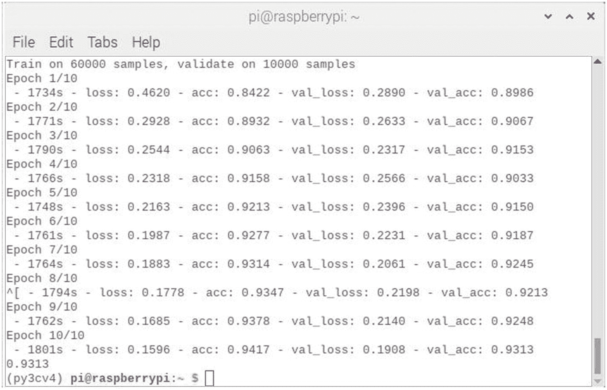

**图 6-18**

运行 kerasVGGTest 脚本后的最终结果

最终准确率为 93.13%，这是一个非常好的成绩。该分数比简单 CNN 的 90.96% 高出两个多百分点。考虑到高性能 CNN 的评分范围通常只有大约 10 个百分点，CNN 性能提升 2 个百分点意义重大。

## Jason 的 Fashion MNIST 演示

最后一个使用 Fashion MNIST 数据集的 CNN 演示来自 Jason Brownlee 博士在 2019 年 5 月撰写的一篇博客，标题为“如何为 Fashion MNIST 服装分类开发深度 CNN”。我选择使用 Jason 的脚本，因为它高度模块化、性能良好，并提供了一些关于其运行效果的信息性图表。脚本中使用的 CNN 模型与前一章演示中使用的模型类似，其性能也与它们相当。

为了运行此脚本，您需要安装一些额外的 Python 库。输入以下命令来安装这些库：

```
pip install matplotlib
pip install pandas
pip install sklearn
```

完整的脚本清单（我将其命名为 `jasonTest.py`）如下所示，也可从本书的配套网站获取。我在清单之后添加了一些解释性注释。

```
# 为 fashion mnist 数据集使用双倍滤波器的模型
from numpy import mean
from numpy import std
from matplotlib import pyplot
from sklearn.model_selection import KFold
from keras.datasets import fashion_mnist
from keras.utils import to_categorical
from keras.models import Sequential
from keras.layers import Conv2D
from keras.layers import MaxPooling2D
from keras.layers import Dense
from keras.layers import Flatten
from keras.optimizers import SGD
# 加载训练和测试数据集
def load_dataset():
# 加载数据集
(trainX, trainY), (testX, testY) = fashion_mnist.load_data()
# 重塑数据集为单通道
trainX = trainX.reshape((trainX.shape[0], 28, 28, 1))
testX = testX.reshape((testX.shape[0], 28, 28, 1))
# 对目标值进行独热编码
trainY = to_categorical(trainY)
testY = to_categorical(testY)
return trainX, trainY, testX, testY
# 缩放像素值
def prep_pixels(train, test):
# 将整数转换为浮点数
train_norm = train.astype('float32')
test_norm = test.astype('float32')
# 归一化到 0-1 范围
train_norm = train_norm / 255.0
test_norm = test_norm / 255.0
# 返回归一化后的图像
return train_norm, test_norm
# 定义 cnn 模型
def define_model():
model = Sequential()
model.add(Conv2D(64, (3, 3), padding="same", activation="relu", kernel_initializer="he_uniform", input_shape=(28, 28, 1)))
model.add(MaxPooling2D((2, 2)))
model.add(Flatten())
model.add(Dense(100, activation="relu", kernel_initializer="he_uniform"))
model.add(Dense(10, activation="softmax"))
# 编译模型
opt = SGD(lr=0.01, momentum=0.9)
model.compile(optimizer=opt, loss="categorical_crossentropy", metrics=['accuracy'])
return model
# 使用 k 折交叉验证评估模型
def evaluate_model(dataX, dataY, n_folds=5):
scores, histories = list(), list()
# 准备交叉验证
kfold = KFold(n_folds, shuffle=True, random_state=1)
# 枚举分割
for train_ix, test_ix in kfold.split(dataX):
# 定义模型
model = define_model()
# 选择训练和测试的行
trainX, trainY, testX, testY = dataX[train_ix], dataY[train_ix], dataX[test_ix], dataY[test_ix]
# 拟合模型
history = model.fit(trainX, trainY, epochs=10, batch_size=32, validation_data=(testX, testY), verbose=0)
# 评估模型
_, acc = model.evaluate(testX, testY, verbose=0)
print('> %.3f' % (acc ∗ 100.0))
# 追加分数
scores.append(acc)
histories.append(history)
return scores, histories
# 绘制诊断学习曲线
def summarize_diagnostics(histories):
for i in range(len(histories)):
# 绘制损失
pyplot.subplot(211)
pyplot.title('交叉熵损失')
pyplot.plot(histories[i].history['loss'], color="blue", label="训练")
pyplot.plot(histories[i].history['val_loss'], color="orange", label="测试")
# 绘制准确率
pyplot.subplot(212)
pyplot.title('分类准确率')
pyplot.plot(histories[i].history['acc'], color="blue", label="训练")
pyplot.plot(histories[i].history['val_acc'], color="orange", label="测试")
pyplot.show()
# 总结模型性能
def summarize_performance(scores):
# 打印摘要
print('准确率: 均值=%.3f 标准差=%.3f, n=%d' % (mean(scores)∗100, std(scores)∗100, len(scores)))
# 结果的箱线图
pyplot.boxplot(scores)
pyplot.show()
# 运行评估模型的测试框架
def run_test_harness():
# 加载数据集
trainX, trainY, testX, testY = load_dataset()
# 准备像素数据
trainX, testX = prep_pixels(trainX, testX)
# 评估模型
scores, histories = evaluate_model(trainX, trainY)
# 学习曲线
summarize_diagnostics(histories)
# 总结估计性能
summarize_performance(scores)
# 入口点，运行测试框架
run_test_harness()
```


该脚本使用 k 折交叉验证作为模型评估的一部分。在此例中，k 等于 5。如果你需要复习这个概念，我建议你回顾一下第 1 章，我在那里讨论了 k 折交叉验证。Jason 使用 k 折交叉验证本质上会执行 5 个周期，你将在结果屏幕中看到这一点。此外，每个周期的单独结果都存储在一个名为 `histories` 的列表中。当生成性能图时，会使用这个列表。

Jason 还使用了一个测试框架结构来安排所有模块的调用方式。我个人很喜欢这种风格，并会向任何希望创建可理解且可维护的模块化软件的人推荐它。以模块化方式编写软件的一个优点是，模块之间的解耦相对容易，从而使它们彼此独立。因此，你对某个特定模块所做的任何更改都不会影响其他模块。这种编程风格是软件设计原则——*高内聚，低耦合*——的一个绝佳范例。该原则意味着，软件的编写应使每个模块能做好一两件事（*高内聚*），并且不过分依赖其他模块（*低耦合*）。遵循此原则编写的软件往往更易于理解，对变更的适应性更强，也更易于维护。

应使用以下命令在虚拟环境中运行此脚本：

```
python jasonTest.py
```

此脚本运行完成大约需要 3.5 小时。最终结果显示在图 6-19 中。

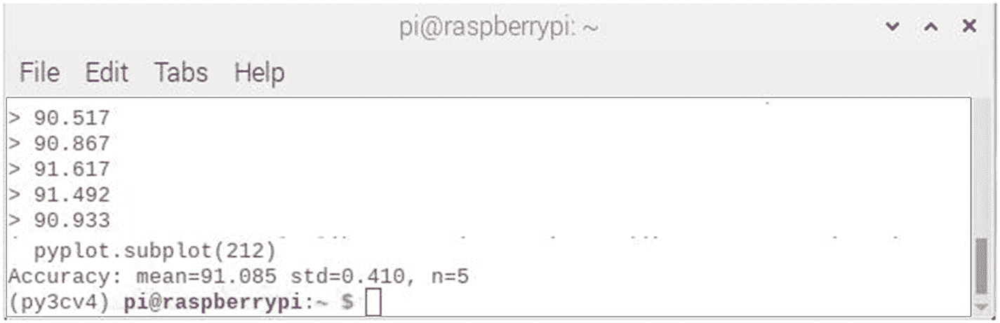

图 6-19

运行 jasonTest 脚本后的最终结果

最终准确率得分为 91.09%，这是 5 个周期得分的平均值。请注意，标准差为 0.41%，这为我们提供了一些关于准确率变异性的信息。需要指出的是，结果屏幕是在我移除了许多多余的 Keras 警告之后显示的。

图 6-20 是一个箱线图，总结了准确率得分的分布情况。

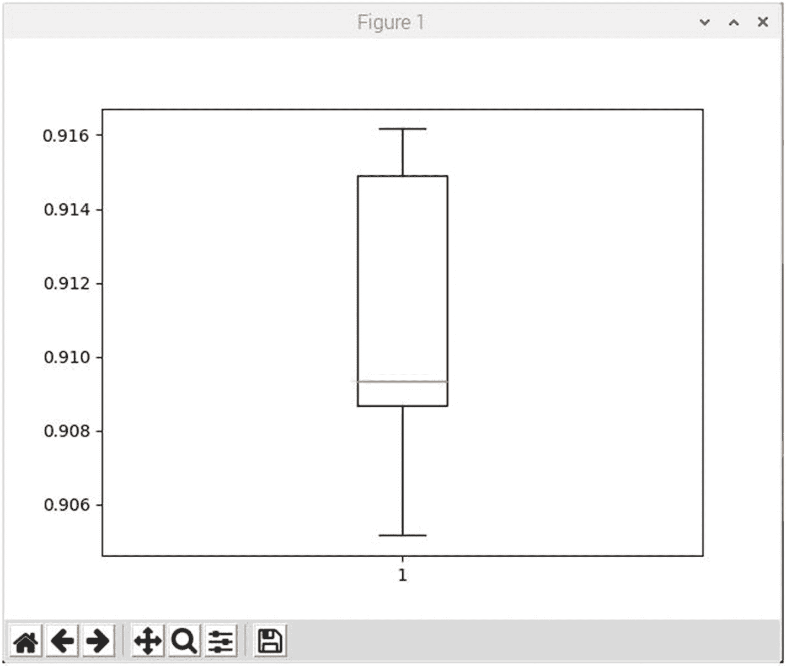

图 6-20

准确率得分分布的箱线图

从垂直刻度可以看出，得分紧密地聚集在一起，“须”的范围大约为 0.905 到 0.916，平均值为 0.919。大部分准确率值位于平均值之上，这可以从箱体的位置看出。

图 6-21 包含了交叉熵损失和分类准确率的图。

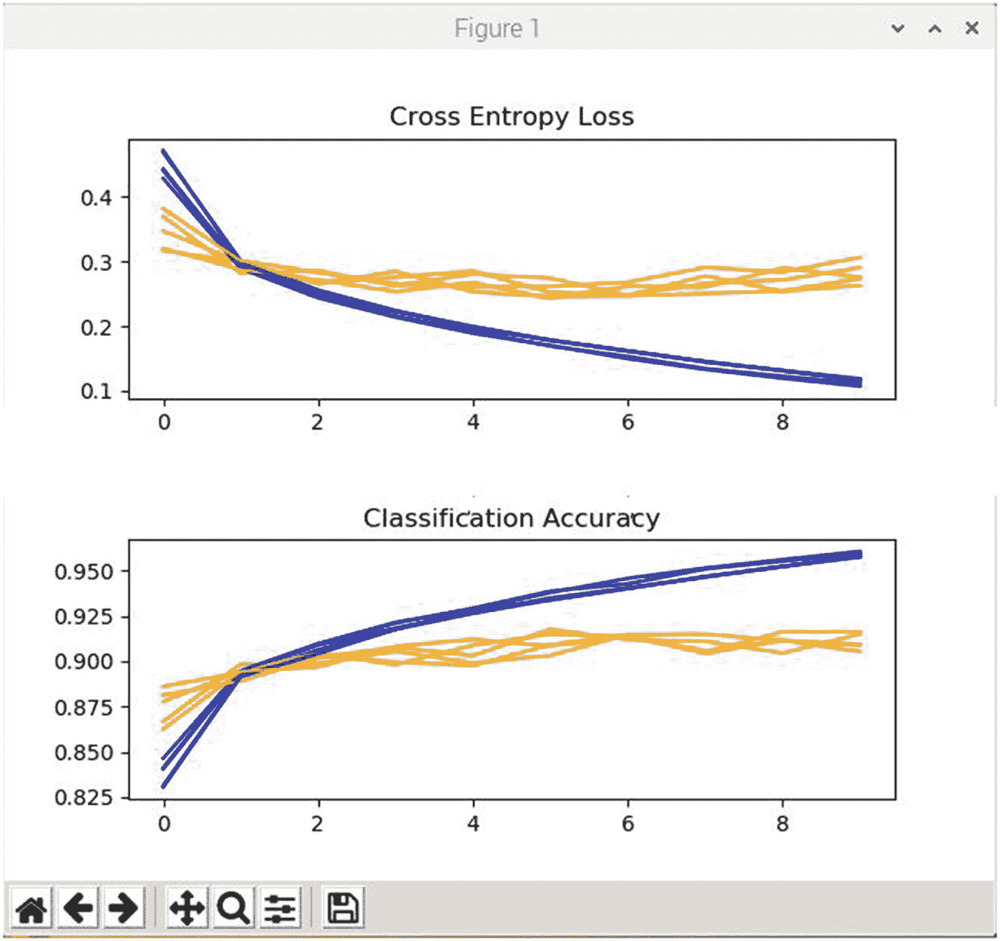

图 6-21

交叉熵损失和分类准确率图

这些图被称为学习曲线，因为它们展示了模型在训练过程中是如何收敛的。颜色较深的图线代表训练数据集，颜色较浅的图线代表测试数据集。总体而言，这些图表明模型通常能很好地拟合，训练和测试的学习曲线趋于收敛。由于两组图线之间存在分离，可能存在一定程度的过拟合。

