# 7. 使用 ANN 和 CNN 进行预测

在前面的章节中，我反复演示了 ANN 和 CNN 如何对包括手写数字和衣物在内的各种物体进行分类。在本章中，我将探讨 ANN 和 CNN 如何预测结果。我多次注意到，深度学习从业者常常混淆分类和预测。这是可以理解的，因为这些任务紧密相连。例如，当面对一张未知图像时，CNN 会尝试将其识别为它被训练识别的类别之一。这显然是一个分类过程。然而，如果从更广阔的视角来看待这个过程，你可以说 CNN 的任务是预测该图像代表什么。我选择采用更狭隘的视角，并限制我对预测的解释，至少就 ANN 和 CNN 而言，将其限定为以下定义：

*预测指的是深度学习算法在数据集上训练后，当应用新数据来预测特定结果的可能性时所产生的输出。*

“预测”这个词也可能产生误导。在某些情况下，它确实意味着预测未来的结果，例如当你使用深度学习来确定营销活动中的下一个最佳行动时。在其他情况下，预测与判断一笔已经发生的交易是否为欺诈有关。在这种情况下，交易已经发生，算法正在对其是否合法进行有根据的猜测。我的初步演示非常简单，当 ANN 面对一组事实时，它将做出二元选择。这个选择是：所应用的记录是否属于某个类别。当我接下来进行演示时，最后这句话会变得非常清晰。

## 皮马印第安人糖尿病演示

皮马印第安人糖尿病项目是深度学习学生经常研究的另一个经典问题。这是一个极好的案例研究，展示了当 ANN 在历史数据集上经过充分训练后，如何基于输入的记录进行预测。

### 皮马印第安人糖尿病研究的背景

糖尿病是一组代谢紊乱疾病，其特征是血糖水平长期高于正常值。糖尿病是由于体内胰岛素分泌不足或身体细胞对胰岛素反应不当引起的。前一种糖尿病原因也称为 1 型糖尿病或胰岛素依赖型糖尿病，后一种称为 2 型糖尿病或非胰岛素依赖型糖尿病。妊娠期糖尿病是第三种类型的糖尿病，指未患糖尿病的女性在怀孕期间出现高血糖水平。糖尿病对女性尤其不利，因为它可能影响母亲及其未出生的孩子。患有糖尿病的女性发生心脏病、流产或生出有先天缺陷婴儿的可能性更高。

自 1965 年以来，由于皮马族女性糖尿病发病率高，包含亚利桑那州凤凰城附近皮马印第安女性信息的糖尿病数据一直受到持续研究。该数据集最初由美国国家糖尿病、消化和肾脏疾病研究所发布，包含与年龄大于 20 岁的女性相关的诊断测量数据。它包含了 768 名女性的信息，其中 268 名女性被诊断患有糖尿病。可用信息包括八个变量，详见表 7-1。数据集中的响应变量是一个二元分类器“结果”，用于指示该人是否被诊断患有糖尿病。

**表 7-1**

皮马印第安人糖尿病研究中的八个因素

| 变量名 | 数据类型 | 变量描述 |
| --- | --- | --- |
| `Pregnancies` | 整数 | 怀孕次数 |
| `Glucose` | 整数 | 口服葡萄糖耐量试验中 2 小时的血浆葡萄糖浓度 |
| `BloodPressure` | 整数 | 舒张压 |
| `SkinThickness` | 整数 | 三头肌皮褶厚度 |
| `Insulin` | 整数 | 2 小时血清胰岛素（μU/ml） |
| `BMI` | 数值 | 身体质量指数 |
| `DiabetesPedigreeFunction` | 数值 | 亲属糖尿病史的综合指标，以及这些亲属与受试者的遗传关系 |
| `Outcome` | 整数 | 是否发生糖尿病 |

### 准备数据

首先需要下载数据集。该数据集可从多个网站获取，我使用的是以下网址：

`www.kaggle.com/kumargh/pimaindiansdiabetescsv`

下载的文件是压缩包格式。解压后，我将文件重命名为 `diabetes.csv`，以便于记忆和保持简洁。

接下来，你需要检查数据，确保其看起来正常，没有异常或奇怪之处。由于该数据集是 CSV 格式，Excel 可以很好地处理，因此我使用 Microsoft Excel 进行了初步检查。图 7-1 显示了数据集中 768 行数据的前 40 行。

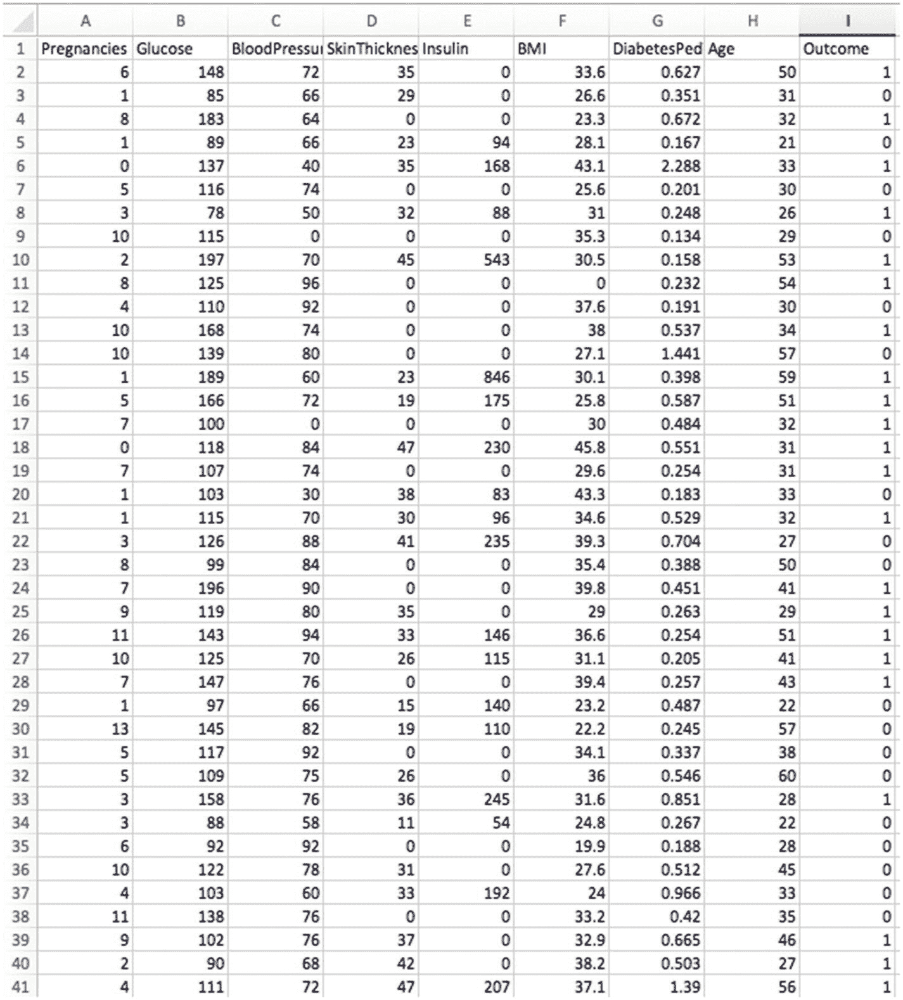

**图 7-1**

`diabetes.csv` 数据集的前 40 行

我立刻注意到，`SkinThickness` 和 `Insulin` 列中存在大量零值。这些列中不应该出现零，因为活着的患者不可能皮肤厚度为零或胰岛素水平为零。这促使我进行了一些研究，并确定最初构建该数据集的研究人员只是用零代替了空值或缺失值。这种做法完全不可接受，可能会破坏数据集，导致人工神经网络在处理时轻易产生错误或误导性结果。那么，我该如何处理呢？

我进一步研究后，找到了以下流程，它以一种合理的方式“修正”了缺失值，并展示了一种很好的数据可视化方法。我要感谢 Paul Mooney 及其博客“从医疗记录预测糖尿病”，为解决此问题提供了宝贵的见解。Paul 使用 Python 笔记本格式进行计算。为了便于讨论，我将他的交互式命令修改为常规的 Python 脚本。

在开始此部分之前，请确保你已进入 Python 虚拟环境。然后，你需要确保在运行脚本之前已安装 Seaborn、Matplotlib 和 Pandas 库。如果不确定这些库是否已安装，请输入以下命令进行安装：

```
pip install seaborn
pip install matplotlib
pip install pandas
```

以下脚本加载 `diabetes.csv` 数据集，然后执行一系列数据检查、汇总和直方图绘制。我将此脚本命名为 `diabetesTest.py`，可从本书的配套网站获取。我还添加了一些解释性注释，以帮助阐明脚本中的操作。

```python
# 导入所需库
import matplotlib.pyplot as plt
import seaborn as sns
import pandas as pd
# 加载 CSV 数据集
dataset = pd.read_csv('diabetes.csv')
dataset.head(10)
# 定义直方图绘制方法
def plotHistogram(values, label, feature, title):
    sns.set_style("whitegrid")
    plotOne = sns.FacetGrid(values, hue=label, aspect=2)
    plotOne.map(sns.distplot, feature, kde=False)
    plotOne.set(xlim=(0, values[feature].max()))
    plotOne.add_legend()
    plotOne.set_axis_labels(feature, 'Proportion')
    plotOne.fig.suptitle(title)
    plt.show()
# 绘制胰岛素直方图
plotHistogram(dataset, 'Outcome', 'Insulin', 'Insulin vs Diagnosis (Blue = Healthy; Orange = Diabetes)')
# 绘制皮肤厚度直方图
plotHistogram(dataset, 'Outcome', 'SkinThickness', 'SkinThickness vs Diagnosis (Blue = Healthy; Orange = Diabetes)')
# 按特征汇总数据集中零值的数量
dataset2 = dataset.iloc[:, :-1]
print("Num of Rows, Num of Columns: ", dataset2.shape)
print("\nColumn Name          Num of Null Values\n")
print((dataset[:] == 0).sum())
# 数据集中零值数量的百分比汇总
print("Num of Rows, Num of Columns: ", dataset2.shape)
print("\nColumn Name          %Null Values\n")
print(((dataset2[:] == 0).sum()) / 768 * 100)
# 创建热力图
g = sns.heatmap(dataset.corr(), cmap="BrBG", annot=False)
plt.show()
# 显示特征相关性值
corr1 = dataset.corr()
print(corr1[:])
```

解释性注释：

*   `dataset = pd.read_csv('diabetes.csv')` – 使用 Pandas 的 `read_csv` 方法将 CSV 数据集读入脚本。

*   `dataset.head(10)` – 显示数据集中的前十条记录。

*   `def plotHistogram(values, label, feature, title)` – 定义一个方法，用于绘制参数列表中提供的数据集特征的直方图。此方法使用我在第 2 章中讨论过的 `Seaborn` 库。在此定义之后，绘制了两个直方图，一个针对 `Insulin`，另一个针对 `SkinThickness`。这两个特征都存在大量零值。

*   `dataset2 = dataset.iloc[:, :-1]` – 是代码段的开始，该代码段显示每个数据集特征中存在的实际零值数量。唯一应该包含零值的特征是 `Outcome` 和 `Pregnancies`。

*   `print("Num of Rows, Num of Columns: ", dataset2.shape)` – 是代码段的开始，该代码段显示每个数据集特征中存在的零值百分比。

*   `g = sns.heatmap(dataset.corr(), cmap="BrBG", annot=False)` – 为数据集的相关性图生成热力图。热力图是一种以二维形式表示数据的方式。数据值在图中以颜色表示。热力图的目标是提供信息的彩色视觉摘要。

*   `corr1 = dataset.corr()` – 创建一个数据集特征变量之间的相关性值表。在数据集中的值被调整后，此统计量将具有相当大的意义。

此脚本应在虚拟环境中运行，并且 `diabetes.csv` 数据集应与该脚本位于同一目录中。输入以下命令来运行脚本：

```
python diabetesTest.py
```

此脚本会立即运行并生成一系列结果。最终的屏幕结果如图 7-2 所示。

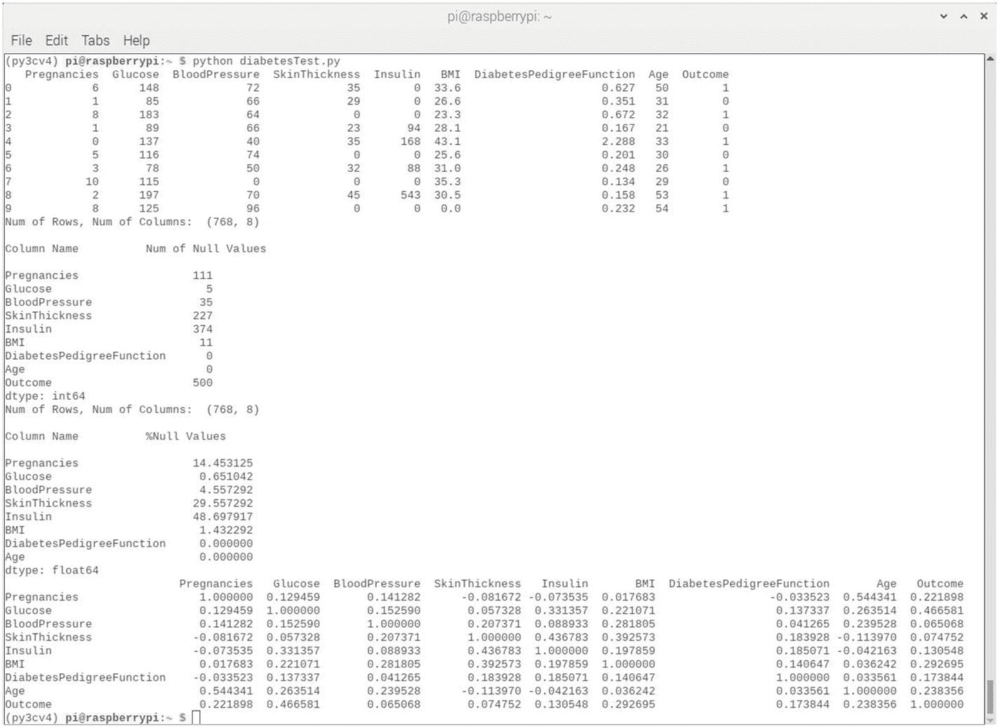
图 7-2：运行 `diabetesTest` 脚本后的最终结果。

图中第一个表格列出了每个特征的零值（0）。显然，`SkinThickness` 和 `Insulin` 这两个特征列中的零值数量达到了不可接受的程度。从图中下一个表格可以轻易看出，近 50% 的 `Insulin` 数据点缺失。这些缺失值会无意中给任何使用该数据集的 ANN（人工神经网络）引入偏差。这将对整体 ANN 预测性能产生何种影响尚不确定，但无论如何都会成为一个问题。

图中最后一个表格显示了特征变量之间的相关系数值。通常，我希望变量之间的值较低，但那些自然相关的特征（如年龄和怀孕次数）除外。你还应注意，该表格是一个关于单位对角线的对称矩阵。单位对角线（全为 1）的出现是因为变量与自身的相关系数必然等于 1。对称矩阵的出现则是因为相关函数是可交换的（变量的顺序无关紧要）。我将关注的关键值是，在修改数据以消除零值后，`SkinThickness` 和 `Insulin` 之间当前 0.436783 的相关系数会如何变化。

图 7-3 是显示胰岛素水平与健康/患病患者比例之间关系的直方图。

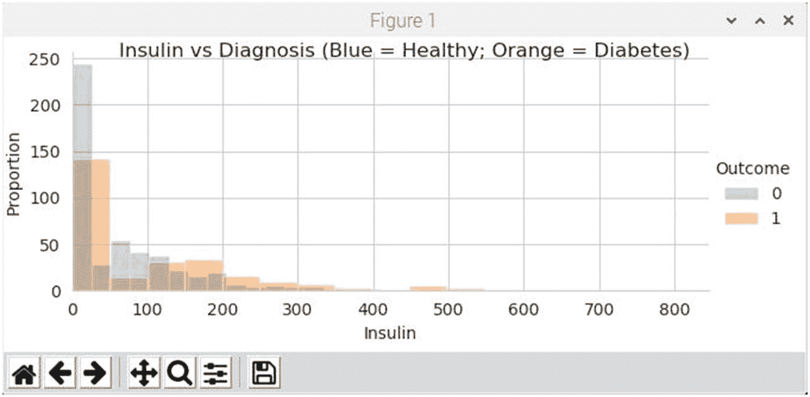
图 7-3：胰岛素水平与健康/患病患者比例的直方图。

在 40 水平以下似乎有大量不健康患者聚集，这不合常理，因为任何活着的患者都不太可能有如此低的水平。此外，健康患者在胰岛素水平为 20 或更低时出现强烈峰值也根本不现实。他们同样无法在如此低的水平下存活。显然，过多的零值问题正在扭曲数据，导致 ANN 做出错误预测。

图 7-4 是显示皮肤厚度测量值与健康/患病患者比例之间关系的直方图。

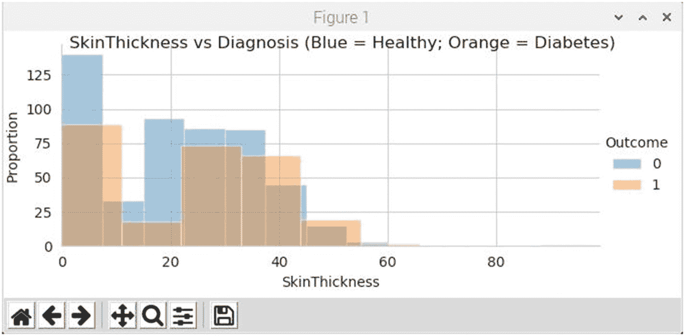
图 7-4：皮肤厚度测量值与健康/患病患者比例的直方图。

在此图中，与前一图类似，健康和不健康患者的皮肤厚度测量值在接近 0 皮肤厚度处均出现异常峰值。皮肤厚度为 0 是完全不可能的。过多的零值问题是导致这一异常的唯一原因。

图 7-5 显示了数据集所有特征变量之间相关矩阵的热力图。

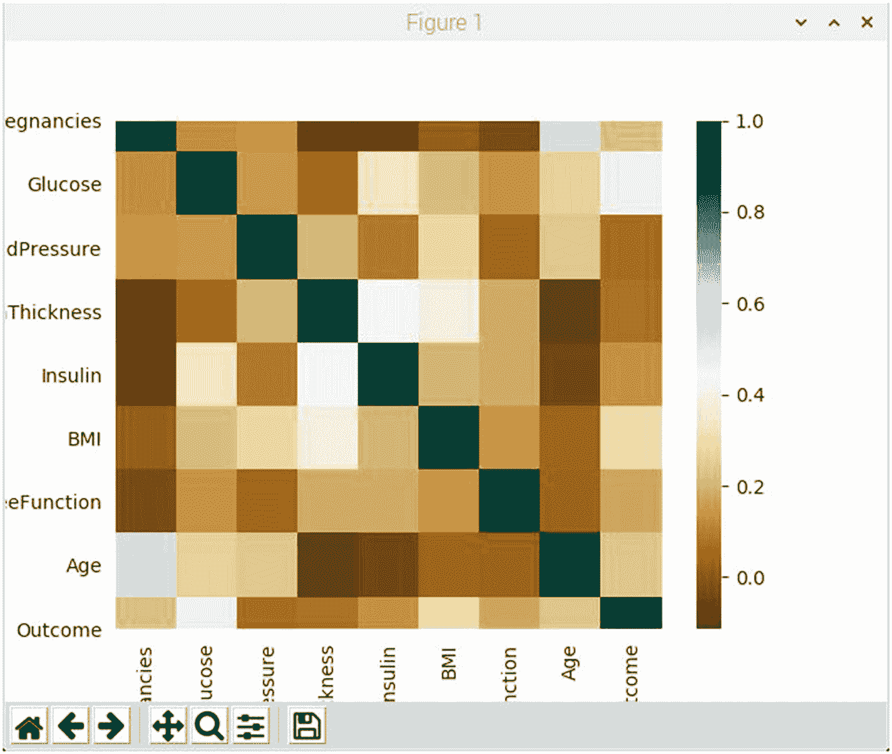
图 7-5：数据集特征变量的相关热力图。

你应在此图中寻找白色块，它们表示相关系数值达到或超过 0.4。该数据集的大多数相关系数值相对较低，除了：
*   `Glucose` 和 `Outcome`
*   `Age` 和 `Pregnancies`
*   `Insulin` 和 `SkinThickness`

列表中的前两个完全合理。葡萄糖（血液中的糖水平）确实与糖尿病相关，因此也与 `Outcome` 相关。年龄和怀孕次数自然相关，因为女性随着年龄增长怀孕次数减少，或者如果她们年轻，则没有足够时间经历多次怀孕。列表中的最后一个值得怀疑，这是由于过多零值问题导致的人为高相关系数值。

现在是时候解决过多的零值问题了。问题自然变成了如何在不给数据集造成太大干扰的情况下做到这一点？大多数统计学家会给出的答案是：对缺失数据进行插补。插补数据是一个棘手的过程，因为它可能给数据集引入额外的偏差。根据数据的性质，插补数据的过程可以有多种形式。如果数据来自时间序列，则缺失数据可以很容易地通过插值缺失值周围的数据来替换。不幸的是，糖尿病数据集对时间不敏感，因此这个选项不可行。

另一种插补方法是直接删除那些包含缺失数据的记录。这称为列表式删除。不幸的是，使用列表式删除会导致近 50% 的现有数据集记录消失。这将对 ANN 学习过程造成严重破坏，因此该选项不可行。剩下的插补选项之一是使用所有现有的特征数据来确定一个值来替换缺失数据。有一些插补过程，如`热卡`、`冷卡`、均值和众数，就采用了这种方法。不深入细节，我决定使用众数作为替换缺失数据值的选项。

以下脚本是对之前脚本的修订，其中我对数据集进行了插补，以移除特征变量中的所有零值。该数据集还被拆分为两个数据集，一个用于训练，另一个用于测试。该脚本名为 `revisedDiabetesTest.py`，可从本书的配套网站获取。我在代码清单后提供了一些解释性注释。

# 程序代码与执行分析

## 解释性注释

*   `X_train, X_test, y_train, y_test = train_test_split(X, y, test_size=0.2, random_state=1)` – 将输入数据集拆分为两个，其中 80% 用于训练，20% 用于测试。

*   `X_train3 = pd.DataFrame(X_train2)` – 将训练数据集从 numpy 数组转换为 Pandas DataFrame，以便与 Pandas 的互相关函数兼容。

### 运行脚本

同样，此脚本应在虚拟环境中运行，并且 `diabetes.csv` 数据集应与该脚本位于同一目录下。输入以下命令来运行脚本：

```
python revisedDiabetesTest.py
```

### 结果与图表

该脚本会立即运行并生成一系列结果。最终屏幕结果如图 7-6 所示。

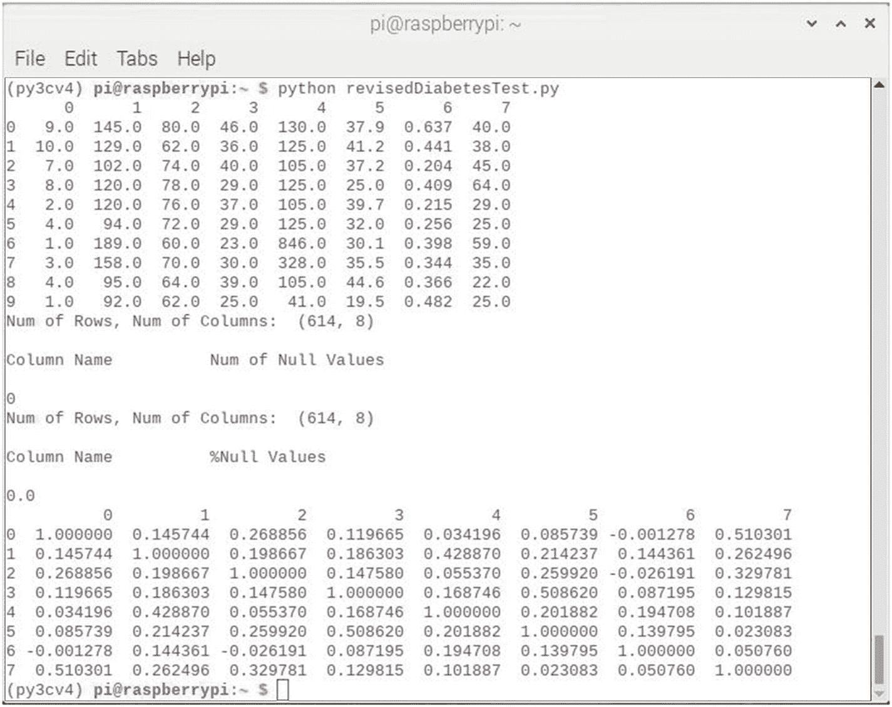

**图 7-6**
运行修订后的 DiabetesTest 脚本后的最终结果

你可以立即看到，前十条训练集记录中所有的 0 值都已被替换为其他值。这对于所有特征变量都是如此，但 `Outcome` 列除外，因为该列是监督学习所必需的。

0 值汇总代码现在显示数据集中已不存在 0 值。

图 7-7 是修订后的直方图，显示了健康患者的胰岛素分布。不再有任何胰岛素值处于或接近 0。分布峰值集中在 130 左右，这在我看来是合理的，但再次声明，我并非医学博士。

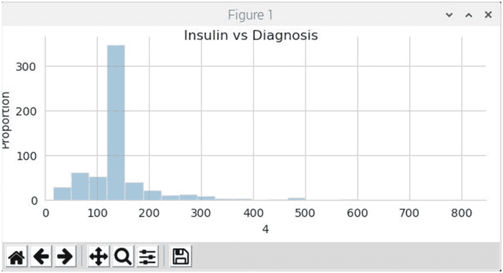

**图 7-7**
健康患者的胰岛素直方图

图 7-8 是修订后的直方图，显示了健康患者的皮肤厚度分布。与胰岛素图的情况一样，该图显示没有任何值低于 8。峰值似乎集中在 29 这个值上，我推测这是一个合理的数值。

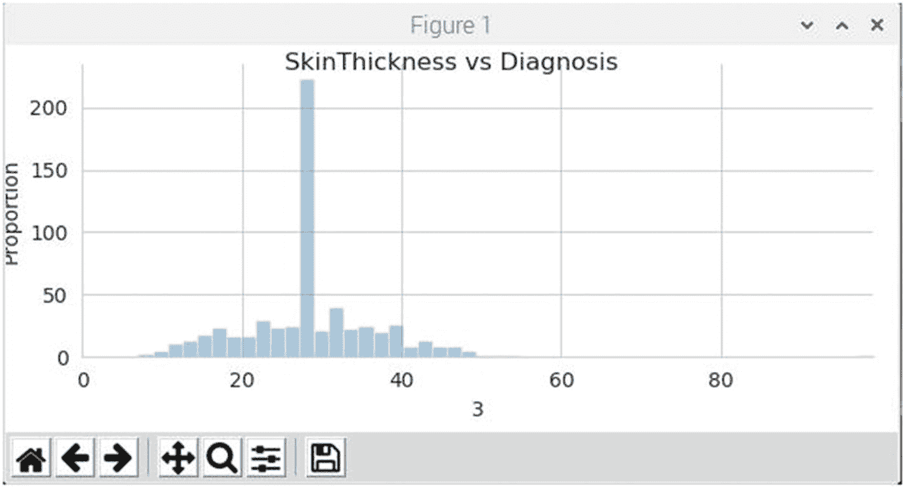

**图 7-8**
健康患者的皮肤厚度直方图

图 7-6 底部显示的相关矩阵现在表明，胰岛素与皮肤厚度之间的相关性值显著降低。在移除 0 值之前，这两个特征之间的相关性值为 `0.436783`。现在为 `0.168746`，大约降低了 61%。移除 0 值确实提高了数据质量，至少对于这两个特征而言是如此。

### Keras ANN 模型设计

既然数据集已被“清理”到更好的状态，是时候讨论 Keras ANN 模型了。将要构建的模型是一个相对简单的三层顺序模型。输入层将有八个输入，对应数据集的八个特征变量。模型将使用 Keras 的密集类（`dense class`）来构建全连接层。前两层将使用 ReLU 激活函数，因为它已被证明是一种性能最佳的激活函数。第三层是输出层，将使用 sigmoid 函数进行激活，因为输出必须在 0 和 1 之间。回想一下，这是一个预测模型，输出是二元的，只有 0 或 1 两个值。总之，模型假设如下：

*   期望输入包含八个变量的数据行（`input_dim=8` 参数）。

*   第一个隐藏层有 12 个节点，并使用 ReLU 激活函数。

*   第二个隐藏层有 8 个节点，并使用 ReLU 激活函数。

*   输出层有 1 个节点，并使用 sigmoid 激活函数。

请注意，第一个隐藏层实际上执行了两个功能。它既作为输入层接收八个变量，同时也作为具有 12 个节点和相关 ReLU 激活函数的隐藏层。

以下脚本名为 `kerasDiabetesTest.py`，可从本书的配套网站获取。列表后附有解释性注释。

---
（以下为原始代码块，按照要求保留）
```
# 导入所需库
import numpy as np
import matplotlib.pyplot as plt
import seaborn as sns
import pandas as pd
from sklearn.model_selection import train_test_split
from sklearn.impute import SimpleImputer
# 加载数据集
data = pd.read_csv('diabetes.csv')
X = data.iloc[:, :-1]
y = data.iloc[:, -1]
# 将数据集拆分为 80% 训练集和 20% 测试集
X_train, X_test, y_train, y_test = train_test_split(X, y, test_size=0.2, random_state=1)
# 使用特征众数插补缺失值
imputer = SimpleImputer(missing_values=0, strategy="median")
X_train2 = imputer.fit_transform(X_train)
X_test2 = imputer.transform(X_test)
# 将 numpy 数组转换为 DataFrame
X_train3 = pd.DataFrame(X_train2)
# 显示前 10 条记录
print(X_train3.head(10))
def plotHistogram(values, label, feature, title):
sns.set_style("whitegrid")
plotOne = sns.FacetGrid(values, hue=label, aspect=2)
plotOne.map(sns.distplot, feature, kde=False)
plotOne.set(xlim=(0, values[feature].max()))
plotOne.add_legend()
plotOne.set_axis_labels(feature, 'Proportion')
plotOne.fig.suptitle(title)
plt.show()
# 绘制胰岛素和皮肤厚度的健康患者直方图
plotHistogram(X_train3,None,4,'Insulin vs Diagnosis')
plotHistogram(X_train3,None,3,'SkinThickness vs Diagnosis')
# 检查是否还有零值残留
data2 = X_train2
print("行数, 列数: ", data2.shape)
print("\n 列名          空值数量\n")
print((data2[:] == 0).sum())
print("行数, 列数: ", data2.shape)
print("\n 列名          %空值\n")
print(((data2[:] == 0).sum()) / 614 * 100)
# 显示相关矩阵
corr1 = X_train3.corr()
print(corr1)
```

# Keras 模型与 scikit-learn 结合实践

## Keras 糖尿病预测模型

以下是第一个 Keras 模型的完整脚本代码。

```python
# 导入所需库
import numpy as np
import pandas as pd
from sklearn.model_selection import train_test_split
from sklearn.impute import SimpleImputer
from keras.models import Sequential
from keras.layers import Dense
# 加载数据集
data = pd.read_csv('diabetes.csv')
X = data.iloc[:, :-1]
y = data.iloc[:, -1]
# 将数据集拆分为 80% 的训练集和 20% 的测试集
X_train, X_test, y_train, y_test = train_test_split(X, y, test_size=0.2, random_state=1)
# 使用特征中位数填充缺失值
imputer = SimpleImputer(missing_values=0,strategy='median')
X_train2 = imputer.fit_transform(X_train)
X_test2 = imputer.transform(X_test)
# 将 numpy 数组转换为 DataFrame
X_train3 = pd.DataFrame(X_train2)
# 定义 Keras 模型
model = Sequential()
model.add(Dense(12, input_dim=8, activation="relu"))
model.add(Dense(8, activation="relu"))
model.add(Dense(1, activation="sigmoid"))
# 编译 Keras 模型
model.compile(loss='binary_crossentropy', optimizer="adam", metrics=['accuracy'])
# 在数据集上拟合 Keras 模型
model.fit(X_train2, y_train, epochs=150, batch_size=10)
# 评估 Keras 模型
_, accuracy = model.evaluate(X_test2, y_test)
print('Accuracy: %.2f' % (accuracy*100))
```

脚本的第一部分与 `revisedDiabetesTest.py` 脚本的第一部分相同，只是增加和删除了一些导入语句。模型定义是内联的，而不是像 CNN 脚本那样单独定义。这样做是因为这是一个非常简洁的模型。编译过程与 CNN 模型几乎相同，只是损失函数不同，这里使用的是 `binary_crossentropy` 而不是 `categorical_crossentropy`，后者用于多类别分类。该模型训练和测试速度非常快，因此可以运行多个 epoch 以提高准确率。在本例中，设置了 150 个 epoch。总体准确率是使用 Keras 的 `evaluate` 方法计算的，与 CNN 模型的做法相同。

此脚本应在虚拟环境中运行，并且 `diabetes.csv` 数据集应与此脚本位于同一目录下。输入以下命令来运行脚本：

```bash
python kerasDiabetesTest.py
```

该脚本会立即运行并生成一系列结果。最终屏幕结果如图 7-9 所示。

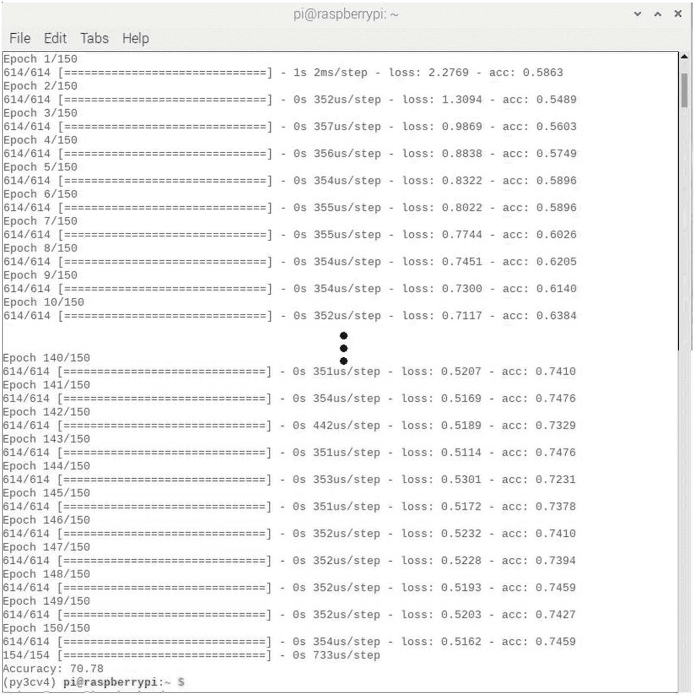

图 7-9：运行 `kerasDiabetesTest` 脚本后的最终结果

此图是一个合成图，显示了开始和结束 epoch 的结果。最终的总体准确率为 70.78%。这通常被认为是一个尚可但不算出色的分数。然而，我查阅了一些其他人使用类似模型运行此项目的研究，发现这个结果与大多数其他结果一致。看来皮马印第安人糖尿病研究的预测成功率（或准确率）大约在 70% 左右。我相信，如果用于实际的临床试验，这个准确率水平是不可接受的，但在这种学习和实验环境中是完全可以接受的。

## 将 scikit-learn 库与 Keras 结合使用

Python 的 scikit-learn 库利用 scipy 栈实现高效的数值计算。它是一个功能完备的通用机器学习库，提供了许多在模型开发中非常有用的工具。这些工具包括：使用重采样方法（如 k 折交叉验证）进行模型评估，高效评估模型超参数。Keras 库是一个便捷的封装器，用于将深度学习模型与 scikit-learn 库结合，进行分类或回归估计。

以下演示使用了 `KerasClassifier` 封装器，该封装器用于在 Keras 中创建的分类神经网络，并与 scikit-learn 库配合使用。我还会使用与上一个演示相同的修改版皮马印第安人糖尿病数据集。

这个演示脚本与上一个非常相似，因为它使用了相同的 Keras ANN 模型。显著的区别在于，本脚本中的模型由 `KerasClassifier` 使用，而不是通过 Keras 的 `fit` 函数将修改后的数据集直接应用于模型。我将在脚本列表之后解释 `KerasClassifier` 的工作原理，因为让您了解它是如何被调用的非常重要。

以下脚本命名为 `kerasScikitDiabetesTest.py`，以表明它现在使用 scikit-learn 的分类器来代替常规的 Keras `fit` 函数。该脚本可从本书的配套网站获取。

```python
# 加载所需库
from keras.models import Sequential
from keras.layers import Dense
from keras.wrappers.scikit_learn import KerasClassifier
from sklearn.model_selection import StratifiedKFold
from sklearn.model_selection import cross_val_score
from sklearn.model_selection import train_test_split
from sklearn.impute import SimpleImputer
import pandas as pd
# 创建模型的函数，KerasClassifier 需要此函数
def create_model():
# 创建模型
model = Sequential()
model.add(Dense(12, input_dim=8, activation="relu"))
model.add(Dense(8, activation="relu"))
model.add(Dense(1, activation="sigmoid"))
model.compile(loss='binary_crossentropy', optimizer="adam", metrics=['accuracy'])
return model
# 为结果可复现固定随机种子
seed = 42
# 加载数据集
data = pd.read_csv('diabetes.csv')
X = data.iloc[:, :-1]
y = data.iloc[:, -1]
# 将数据集拆分为 80% 训练集和 20% 测试集
X_train, X_test, y_train, y_test = train_test_split(X, y, test_size=0.2, random_state=1)
# 使用特征中位数填充缺失值
imputer = SimpleImputer(missing_values=0,strategy='median')
X_train2 = imputer.fit_transform(X_train)
X_test2 = imputer.transform(X_test)
# 将 numpy 数组转换为 DataFrame
X_train3 = pd.DataFrame(X_train2)
# 创建模型
model = KerasClassifier(build_fn=create_model, epochs=150, batch_size=10, verbose=0)
# 使用 10 折交叉验证进行评估
kfold = StratifiedKFold(n_splits=10, shuffle=True, random_state=seed)
# 使用 cross_val_score 函数进行评估
results = cross_val_score(model, X_train2, y_train, cv=kfold)
print(results.mean())
```

此脚本应在虚拟环境中运行，并且 `diabetes.csv` 数据集应与此脚本位于同一目录中。输入以下命令来运行脚本：

```bash
python kerasScikitDiabetesTest.py
```

此脚本会立即运行并产生一个结果。最终的屏幕结果如图 7-10 所示。

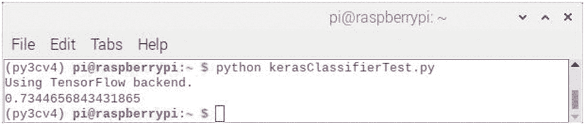

图 7-10 运行`kerasScikitDiabetesTest`脚本后的最终结果

图中显示的准确率为 73.45%。该值仅基于训练数据集（占原始数据集的 80%）计算得出。因此，我将训练集的分割比例改为 99% 后重新运行了脚本，这意味着它几乎与未分割的数据集大小相同。结果准确率为 73.40%，与第一次运行的结果在统计上无显著差异。

Keras 中的 `KerasClassifier` 和 `KerasRegressor` 类接受一个名为 `build_fn` 的参数，该参数是模型的函数名称。在前面的脚本中，一个名为 `create_model()` 的方法为此案例创建了一个 MLP。该函数通过 `build_fn` 参数传递给 `KerasClassifier` 类。此外，还有 `nb_epoch=150` 和 `batch_size=10` 等额外参数，这些参数会被 `fit()` 函数自动使用，而 `fit()` 函数由 `KerasClassifier` 类内部调用。

在此示例中，随后使用 scikit-learn 的 `StratifiedKFold` 函数执行十折分层交叉验证。这是一种重采样技术，可为所定义模型在应用数据集上的准确率提供稳健的估计。

scikit-learn 的 `cross_val_score` 函数用于通过交叉验证方案评估模型并显示结果。

## 使用 Keras 和 scikit-learn 进行网格搜索

在接下来的演示中，将使用网格搜索来评估 ANN 模型的不同配置。将报告产生最佳估计性能的配置。

`create_model()` 函数定义了两个参数：`optimizer` 和 `Init`，两者都有默认值。改变这些参数的值可以评估不同优化算法和权重初始化方案对网络模型的影响。

模型创建后，会定义用于网格搜索的参数数组。搜索旨在测试：
*   用于搜索不同权重值的优化器
*   用于使用不同方案准备网络权重的初始化器
*   用于训练模型的不同训练数据集暴露次数的周期数
*   用于在权重更新前改变样本数量的批次大小

上述选项存储在一个字典中，然后传递给 `GridSearchCV` scikit-learn 类的配置。该类会为每个参数组合（优化器、初始化、周期和批次的组合为 2 x 3 x 3 x 3）评估一个版本的 ANN 模型。然后，每个组合都使用默认的三折分层交叉验证进行评估。

模型数量很多，如果您使用 RasPi 复现此演示，会发现这需要相当长的计算时间。此 RasPi 设置的预估时长约为 2 小时，考虑到网络相对较小且数据集也较小（少于 800 条记录实例和 9 个特征与属性），这个时间是可以接受的。

脚本运行完成后，会显示最佳模型的性能及其配置组合，随后显示所有参数组合的性能。

以下脚本命名为`kerasScikitGridSearchDiabetesTest.py`，以表明它使用 scikit-learn 的网格搜索算法来帮助确定 ANN 模型的最佳配置。该脚本可从本书的配套网站获取：

```python
# 导入所需库
import numpy as np
import pandas as pd
from keras.models import Sequential
from keras.layers import Dense
from sklearn.model_selection import train_test_split
from sklearn.impute import SimpleImputer
from keras.wrappers.scikit_learn import KerasClassifier
from sklearn.model_selection import GridSearchCV
from sklearn.model_selection import cross_val_score
# 创建模型的函数，KerasClassifier 需要此函数
def create_model(optimizer='rmsprop', init="glorot_uniform"):
    # 创建模型
    model = Sequential()
    model.add(Dense(12, input_dim=8, kernel_initializer=init, activation="relu"))
    model.add(Dense(8, kernel_initializer=init, activation="relu"))
    model.add(Dense(1, kernel_initializer=init, activation="sigmoid"))
    # 编译模型
    model.compile(loss='binary_crossentropy', optimizer=optimizer, metrics=['accuracy'])
    return model
# 为结果可复现设置随机种子
seed = 42
np.random.seed(seed)
# 加载数据集
data = pd.read_csv('diabetes.csv')
X = data.iloc[:, :-1]
y = data.iloc[:, -1]
# 将数据集拆分为 80% 训练集和 20% 测试集
X_train, X_test, y_train, y_test = train_test_split(X, y, test_size=0.2, random_state=1)
# 使用特征中位数填充缺失值
imputer = SimpleImputer(missing_values=0,strategy='median')
X_train2 = imputer.fit_transform(X_train)
X_test2 = imputer.transform(X_test)
# 将 numpy 数组转换为 DataFrame
X_train3 = pd.DataFrame(X_train2)
# 创建模型
model = KerasClassifier(build_fn=create_model, verbose=0)
# 网格搜索 epochs、batch size 和优化器
optimizers = ['rmsprop', 'adam']
init = ['glorot_uniform', 'normal', 'uniform']
epochs = [50, 100, 150]
batches = [5, 10, 20]
param_grid = dict(optimizer=optimizers, epochs=epochs, batch_size=batches, init=init)
grid = GridSearchCV(estimator=model, param_grid=param_grid)
grid_result = grid.fit(X_train2, y_train)
# 汇总结果
print("最佳结果: %f 使用 %s" % (grid_result.best_score_, grid_result.best_params_))
means = grid_result.cv_results_['mean_test_score']
stds = grid_result.cv_results_['std_test_score']
params = grid_result.cv_results_['params']
for mean, stdev, param in zip(means, stds, params):
    print("%f (%f) 参数: %r" % (mean, stdev, param))
```

此脚本应在虚拟环境中运行，且`diabetes.csv`数据集需与该脚本位于同一目录。输入以下命令运行脚本：

```bash
python kerasScikitGridSearchDiabetesTest.py
```

由于运行了多组 epochs，此脚本大约需要 2 小时才能完成。最终屏幕结果如图 7-11 所示，该图是我制作的合成图，展示了 epochs 中间结果的起始和结束部分。

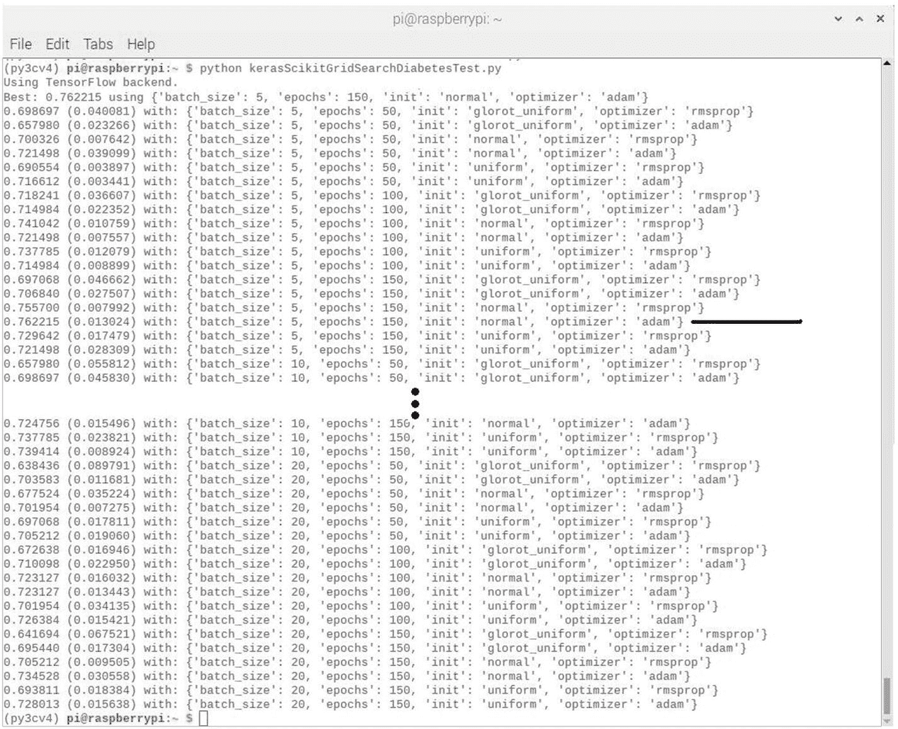

图 7-11 运行`kerasScikitGridSearchDiabetesTest`脚本后的最终结果

在所有运行的 epochs 组中，达到的最高准确率为 76.22%。请注意，我在图中画了一条线指向最优组。该组配置为 150 个 epochs、批次大小为 5、正态分布以及 Adam 优化器。

## 房价回归预测演示

# 波士顿房价数据集与模型准备

现代在线房产公司使用机器学习技术对房屋进行估值。本演示将使用人工神经网络和`scikit-learn`多元线性回归函数，预测美国马萨诸塞州波士顿都会区的房价。本演示使用的数据集年代较为久远（1978年），但对于本项目的目的而言仍然适用。

该数据集包含13个变量和507条记录。数据集的特征变量详见表7-2。

### 表 7-2：波士顿房价数据集特征变量

| 列名 | 描述 |
| --- | --- |
| `CRIM` | 城镇人均犯罪率 |
| `ZN` | 占地面积超过 25,000 平方英尺的住宅用地比例 |
| `INDUS` | 城镇非零售商业用地比例 |
| `CHAS` | 查尔斯河虚拟变量（若地块临河则为 1，否则为 0） |
| `NOX` | 一氧化氮浓度（每千万分之一） |
| `RM` | 每栋住宅的平均房间数 |
| `AGE` | 1940年之前建成的自住单位比例 |
| `DIS` | 到波士顿五个就业中心的加权距离 |
| `RAD` | 径向高速公路可达性指数 |
| `TAX` | 每 10,000 美元的全额财产税率 |
| `PTRATIO` | 城镇师生比 |
| `LSTAT` | 人口中较低地位阶层的百分比 |
| `MEDV` | 自住房屋的中位数价值（单位：千美元） |

由变量`MEDV`表示的房屋价格是目标变量，其余特征则是用于预测房屋价值的特征变量。

## 数据预处理

熟悉项目中将要使用的数据集始终是一个好习惯。显而易见的首要步骤是下载数据集。幸运的是，这个数据集可以通过`scikit-learn`库直接获取。以下语句将把数据集下载到脚本中：

```python
from sklearn.datasets import load_boston
boston_dataset = load_boston()
```

接下来，我创建了一个小脚本来研究数据集的特征，包括键和前几条记录。我将此脚本命名为`inspectBoston.py`，它可以从本书的配套网站获取。

```python
# 加载所需库
import pandas as pd
from sklearn.datasets import load_boston
# 加载波士顿房价数据集
boston_dataset = load_boston()
# 显示数据集的键
print(boston_dataset.keys())
# 显示前五条记录
boston = pd.DataFrame(boston_dataset.data, columns=boston_dataset.feature_names)
print(boston.head())
# 显示详细的数据集描述键
print(boston_dataset.DESCR)
```

使用以下命令运行此脚本：

```bash
python inspectBoston.py
```

图 7-12 显示了运行此脚本会话的结果。

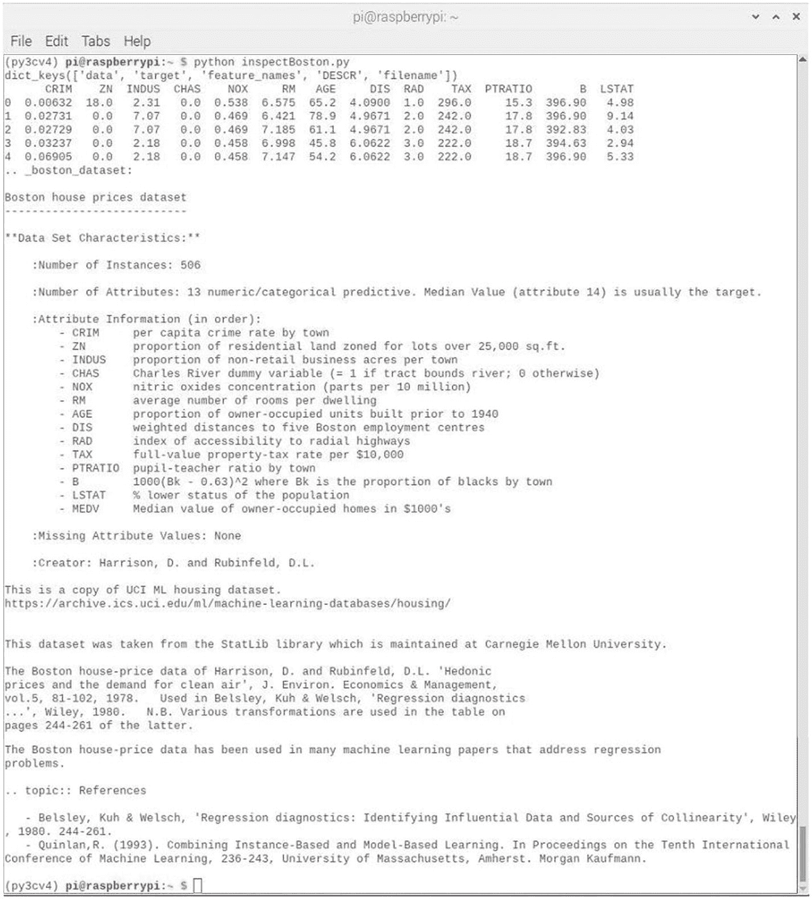

**图 7-12：** 运行`inspectBoston`脚本后的结果

数据集键中的`DESCR`部分内容详尽，为这个有用的数据集提供了非同寻常且全面的历史回顾。我希望其他机器学习数据集也能包含如此丰富的信息。

查看前五条记录后发现，目标变量`MEDV`在DataFrame中缺失。通过添加以下代码行可以轻松解决这个问题：

```python
boston['MEDV'] = boston_dataset.target
```

一个易于实现且非常实用的快速数据集检查是检查数据集中是否存在任何缺失值或0值。这可以通过`isnull()`方法结合求和操作来完成。实现此操作的语句是：

```python
boston.isnull().sum()
```

我将这个空值检查与`MEDV`修正一起整合到了修改后的`inspectBoston`脚本中。这个修改后的脚本现在命名为`inspectBostonRev.py`，它不再显示原始脚本中那样详尽的描述。此脚本可从本书的配套网站获取：

```python
# 加载所需库
import pandas as pd
from sklearn.datasets import load_boston
# 加载波士顿房价数据集
boston_dataset = load_boston()
# 显示数据集的键
print(boston_dataset.keys())
# 创建 boston DataFrame
boston = pd.DataFrame(boston_dataset.data, columns=boston_dataset.feature_names)
# 将目标变量添加到 DataFrame
boston['MEDV'] = boston_dataset.target
# 显示前五条记录
print(boston.head())
# 检查数据集中的空值
print(boston.isnull().sum())
```

使用以下命令运行此脚本：

```bash
python inspectBostonRev.py
```

图 7-13 显示了运行此脚本会话的结果。

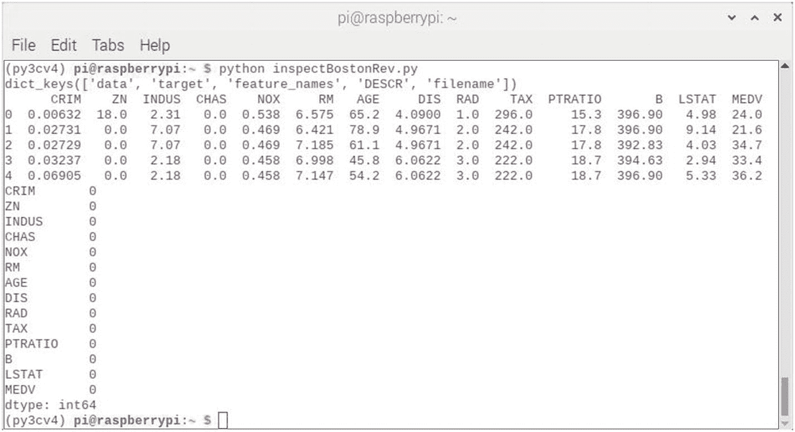

**图 7-13：** 运行`inspectBostonRev`脚本后的结果

结果显示，`MEDV`目标变量已成功添加到DataFrame中，并且数据集中不存在空值或0值。基于上述所有检查，我认为该数据集已准备好应用于模型。

## 基线模型

首先将创建一个MLP Keras模型，然后将其与scikit-learn包装器回归函数一起使用，以评估波士顿房价数据集。此操作与第一章演示中的操作几乎相同，区别在于第一章中scikit-learn包装器函数是分类器而非回归包。这种将Keras模型与scikit-learn包装器函数结合使用的方法非常强大，因为它允许使用易于构建的Keras模型，同时利用scikit-learn库内置的强大评估能力。

基线模型是一个简单的结构，包含一个全连接隐藏层，其节点数与输入特征变量数（13）相同。该网络还使用了高效的ReLU激活函数。然而，输出层未使用激活函数，因为该网络旨在预测数值，无需应用任何变换。

使用Adam优化器，并以均方误差（MSE）损失函数作为待优化的目标函数。MSE也将作为评估网络性能的同一指标。这是一个理想的指标，因为它可以在问题的上下文中被直接理解，即房价（以千美元为单位）的平方。

与scikit-learn库一起使用的Keras包装器对象名为`KerasRegressor`。它的实例化方式与`KerasClassifier`对象使用的参数类型相同。需要提供对模型的引用以及几个参数（epoch数量和batch size），这些参数最终会传递给执行训练的`fit()`函数。

脚本中还使用了一个随机数，以帮助在重复运行脚本时生成一致且可重现的结果。

最终，模型使用十折交叉验证过程进行评估，正如我之前在本章及前几章中讨论的那样。最终指标是MSE，包括交叉验证评估中所有十折的平均值和标准差。

在将数据集应用于模型和评估框架之前，必须对其进行归一化。这是因为数据集中包含量级差异很大的值，你现在应该意识到，这对于人工神经网络来说是不利的。归一化后的数据集通常也称为标准化数据集。在此案例中，使用scikit-learn的`StandardScaler`函数在交叉验证过程的每一折内对数据进行归一化（标准化）。

以下脚本整合了前面讨论的所有内容。它被命名为`kerasRegressionTest.py`，可从本书的配套网站获取。

```
# 导入所需库
import pandas as pd
from keras.models import Sequential
from keras.layers import Dense
from keras.wrappers.scikit_learn import KerasRegressor
from sklearn.model_selection import cross_val_score
from sklearn.model_selection import KFold
from sklearn.preprocessing import StandardScaler
from sklearn.pipeline import Pipeline
from sklearn.datasets import load_boston
# 加载波士顿房价数据集
boston_dataset = load_boston()
# 创建波士顿数据框
dataframe = pd.DataFrame(boston_dataset.data, columns=boston_dataset.feature_names)
# 将目标变量添加到数据框
dataframe['MEDV'] = boston_dataset.target
# 设置波士顿数据框
boston = dataframe.values
# 分割为输入（X）和输出（y）变量
X = boston[:,0:13]
y = boston[:,13]
# 定义基础模型
def baseline_model():
# 创建模型
model = Sequential()
model.add(Dense(13, input_dim=13, kernel_initializer='normal', activation="relu"))
model.add(Dense(1, kernel_initializer="normal"))
# 编译模型
model.compile(loss='mean_squared_error', optimizer="adam")
return model
# 随机种子以确保可重复性
seed = 42
# 创建回归对象
estimator = KerasRegressor(build_fn=baseline_model, epochs=100, batch_size=5, verbose=0)
# 使用标准化数据集评估模型
estimators = []
estimators.append(('standardize', StandardScaler()))
estimators.append(('mlp', KerasRegressor(build_fn=baseline_model, epochs=50, batch_size=5, verbose=0)))
pipeline = Pipeline(estimators)
kfold = KFold(n_splits=10, random_state=seed)
results = cross_val_score(pipeline, X, y, cv=kfold)
print("Standardized: %.2f (%.2f) MSE" % (results.mean(), results.std()))
```

使用以下命令运行此脚本：

```
python kerasRegressionTest.py
```

图 7-14 显示了运行此脚本会话的结果。

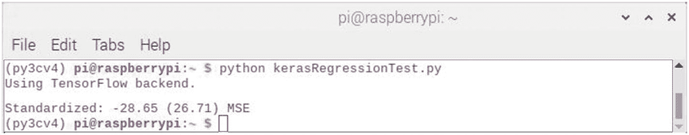

图 7-14

运行 `kerasRegressionTest` 脚本后的结果

得到的 MSE 为 28.65，这是一个不错的结果。对于那些在处理 MSE 等统计指标时遇到困难的读者，我将提供一个略显朴素但或许更直观的解释。我做了以下简要计算：

*   所有 MEDV 值的平均值 = 22.49（这是 1978 年波士顿地区的房价）
*   MSE 的平方根 = 5.35
*   MSE 平方根与平均值的比率 = 0.238
*   1 - 上述值 = 0.762 或“准确率” = 76.2%

现在，在统计学家开始批评我之前，我仅提供上述计算，以便对 MSE 指标给出一个有意义的解释。显然，MSE 趋近于 0 是理想的，但从这种方法可以看出，该模型相当准确。事实上，我针对其他人使用相同数据集和类似网络的结果做了一些额外研究。我发现报告的准确率在 75% 到 80% 之间，因此本次演示的结果正好处于预期范围内。

### 改进的基础模型

上述脚本的一大优点是，可以在不影响脚本其他部分的情况下对基础模型进行修改。这种固有特性是我之前提到的*高内聚、低耦合*的另一个微妙例子。为了提升模型性能，将在模型中添加另一个层。这个“更深”的模型“可能”允许模型提取并组合数据中嵌入的高阶特征，从而获得更好的预测结果。该模型的代码如下：

```
# 定义模型
def larger_model():
# 创建模型
model = Sequential()
model.add(Dense(13, input_dim=13, kernel_initializer="normal", activation="relu"))
model.add(Dense(6, kernel_initializer="normal", activation="relu"))
model.add(Dense(1, kernel_initializer="normal"))
# 编译模型
model.compile(loss='mean_squared_error', optimizer="adam")
return model
```

修改后的脚本被重命名为 `kerasDeeperRegressionTest.py`，如下所示。该脚本可从本书的配套网站获取。

# 导入所需库
```python
import pandas as pd
from keras.models import Sequential
from keras.layers import Dense
from keras.wrappers.scikit_learn import KerasRegressor
from sklearn.model_selection import cross_val_score
from sklearn.model_selection import KFold
from sklearn.preprocessing import StandardScaler
from sklearn.pipeline import Pipeline
from sklearn.datasets import load_boston
```
# 加载波士顿房价数据集
`boston_dataset` = `load_boston()`

# 创建波士顿数据框
`dataframe` = `pd.DataFrame(boston_dataset.data, columns=boston_dataset.feature_names)`

# 将目标变量添加到数据框
`dataframe['MEDV']` = `boston_dataset.target`

# 设置波士顿数据框
`boston` = `dataframe.values`

# 分割为输入（X）和输出（y）变量
`X` = `boston[:,0:13]`
`y` = `boston[:,13]`

# 定义模型
```python
def larger_model():
    # 创建模型
    model = Sequential()
    model.add(Dense(13, input_dim=13, kernel_initializer="normal", activation="relu"))
    model.add(Dense(6, kernel_initializer="normal", activation="relu"))
    model.add(Dense(1, kernel_initializer="normal"))
    # 编译模型
    model.compile(loss='mean_squared_error', optimizer="adam")
    return model
```
# 随机种子以确保可重复性
`seed` = 42

# 创建回归对象
`estimator` = `KerasRegressor(build_fn=larger_model, epochs=100, batch_size=5, verbose=0)`

# 使用标准化数据集评估模型
`estimators` = []
`estimators.append(('standardize', StandardScaler()))`
`estimators.append(('mlp', KerasRegressor(build_fn=larger_model, epochs=50, batch_size=5, verbose=0)))`
`pipeline` = `Pipeline(estimators)`
`kfold` = `KFold(n_splits=10, random_state=seed)`
`results` = `cross_val_score(pipeline, X, y, cv=kfold)`
`print("Standardized: %.2f (%.2f) MSE" % (results.mean(), results.std()))`

使用以下命令运行此脚本：
```bash
python kerasDeeperRegressionTest.py
```

`图 7-15` 显示了运行此脚本的结果。
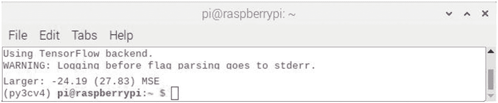

运行 `kerasDeeperRegressionTest` 脚本后的结果

使用更深层模型得到的结果是 `MSE` 等于 24.19，比之前的结果 28.65 有所降低。这表明新模型在预测方面优于较浅的模型。我还重复了我的朴素计算，得出准确率为 78.13%。这比之前脚本的结果高出近两个百分点。更深层的模型显然性能更优。

## 另一种改进的基线模型

增加深度并非改进模型的唯一途径。增加宽度（即增加隐藏层节点数量）同样可以提升模型性能，有望增强网络提取潜在特征的能力。该模型的代码如下：
```python
# 定义更宽的模型
def wider_model():
    # 创建模型
    model = Sequential()
    model.add(Dense(20, input_dim=13, kernel_initializer="normal", activation="relu"))
    model.add(Dense(1, kernel_initializer="normal"))
    # 编译模型
    model.compile(loss='mean_squared_error', optimizer="adam")
    return model
```

修改后的脚本已重命名为 `kerasWiderRegressionTest.py`，如下所示。该脚本可从本书配套网站获取。
```python
# 导入所需库
import pandas as pd
from keras.models import Sequential
from keras.layers import Dense
from keras.wrappers.scikit_learn import KerasRegressor
from sklearn.model_selection import cross_val_score
from sklearn.model_selection import KFold
from sklearn.preprocessing import StandardScaler
from sklearn.pipeline import Pipeline
from sklearn.datasets import load_boston

# 加载波士顿房价数据集
boston_dataset = load_boston()
# 创建波士顿数据框
dataframe = pd.DataFrame(boston_dataset.data, columns=boston_dataset.feature_names)
# 将目标变量添加到数据框
dataframe['MEDV'] = boston_dataset.target
# 设置波士顿数据框
boston = dataframe.values

# 分割为输入（X）和输出（y）变量
X = boston[:,0:13]
y = boston[:,13]

# 定义更宽的模型
def wider_model():
    # 创建模型
    model = Sequential()
    model.add(Dense(20, input_dim=13, kernel_initializer="normal", activation="relu"))
    model.add(Dense(1, kernel_initializer="normal"))
    # 编译模型
    model.compile(loss='mean_squared_error', optimizer="adam")
    return model

# 为可重复性设置随机种子
seed = 42

# 创建回归对象
estimator = KerasRegressor(build_fn=wider_model, epochs=100, batch_size=5, verbose=0)

# 使用标准化数据集评估模型
estimators = []
estimators.append(('standardize', StandardScaler()))
estimators.append(('mlp', KerasRegressor(build_fn=wider_model, epochs=50, batch_size=5, verbose=0)))
pipeline = Pipeline(estimators)
kfold = KFold(n_splits=10, random_state=seed)
results = cross_val_score(pipeline, X, y, cv=kfold)
print("Wider: %.2f (%.2f) MSE" % (results.mean(), results.std()))
```

使用以下命令运行此脚本：
```bash
python kerasWiderRegressionTest.py
```

`图 7-16` 显示了运行此脚本的结果。
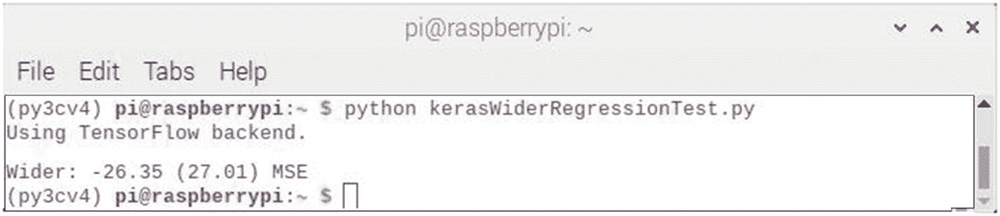

`图 7-16`

运行 `kerasWiderRegressionTest` 脚本后的结果

使用更宽模型得到的结果是`MSE`等于 26.35，这是一个令人失望的结果，因为它比更深模型的结果 24.19 略高。这个更宽模型的结果仍然低于原始未修改版本的 28.65。朴素准确率计算为 77.17%，大约介于原始模型和更深模型准确率之间。

我相信，尝试不同的节点数量很可能会使结果变得更好。本演示中使用的 20 个节点值只是一个合理的猜测。你可以轻松地将该值加倍，看看会发生什么；但要注意避免模型过拟合或欠拟合。

对于好奇的读者，我还有一个建议：尝试一个同时结合更深和更宽架构的模型。这很可能就是这个项目的理想点。

## 使用 `CNN` 进行预测

乍一看（请原谅这个双关语），使用 `CNN` 进行预测似乎是一项奇怪的任务。`CNN` 的前提是将图像作为输入数据源，那么自然会产生一个问题：什么是“预测”图像？答案在于图像的预期用途。`CNN` 与其对应的 `ANN` 一样，都是神经网络。它们仅被设计用于处理数值数组和矩阵，仅此而已。用户如何解释 `CNN` 的输出完全取决于用户。

近年来，`CNN` 已被用于细胞显微镜应用中，用于检测癌症和其他疾病。在这种情况下，预测是基于显微镜细胞图像分析，判断患者是否患有某种特定诊断。这种分析也广泛用于放射线（X 光）检查，其中 `CNN` 已被应用于大规模图像，以协助患者诊断。医学预测具有巨大的影响，而 `CNN` 分析只是医生用于辅助诊断的众多工具之一。`CNN` 医学分析的主题相当复杂，我决定将下一整章专门用于讨论它。

`CNN` 预测另一个常用的领域是时间序列分析，幸运的是，这个领域远没有医学诊断那么复杂。我包含了一系列相对简单的演示，以说明如何将 `CNN` 用于时间序列。然而，我将首先回答一个显而易见的问题：什么是时间序列？时间序列只是一系列按时间顺序索引的数据点。最常见的情况是，时间序列是一个数值序列，在时间上以连续等间距的数据点进行采样。它只是一系列离散的、与时间相关的数据点。时间序列的例子包括海洋潮汐高度、太阳黑子活动以及道琼斯工业平均指数的每日收盘值。所有时间序列的共同属性是它们都是历史数据。这就是 `CNN` 发挥作用的地方。`CNN` 利用历史记录来预测下一个数据点。实际上，如果时间序列是逻辑清晰且有序的，这并非一个大问题。如果我向你展示以下时间序列：

5, 10, 15, 20, 25, 30, 35, 40, 45, 50, 55, ?

并请你预测序列中的下一个数字，我相信我聪明的读者中没有人会觉得有困难。但是，如果我向你展示以下序列：

86.6, 50, 0, –50, –86.6, –100, –86.6, –50, 0, 50, 86.6, ?

你们中的一些人可能会在得出答案时遇到一些困难（提示：余弦值乘以 100）。尽管有些读者可能立即注意到序列中的重复模式，但 `CNN` 在检测该模式时不会有任何问题。在前面的例子中，绘制数据点会让你立即识别出正弦模式。

但如果时间序列是完全随机的，那么如何确定下一个数据点呢？这就是 `CNN` 可以帮助我们的地方——一个投入了大量资源来预测股票市场指数的领域。与这些指数相关的时间序列极其复杂，取决于许多相互冲突的因素，如金融稳定性、全球状况、社会情绪、未来不确定性等等。尽管如此，许多杰出的数据科学家一直在解决这个问题，并应用了一些最具创新性和最复杂的深度学习技术，包括极其复杂的 `CNN`。显然，开发一个强大的预测模型所带来的回报将是巨大的。我怀疑如果有人已经开发出了强大的算法，它很可能已被保密，并且很可能将继续保密。

以下演示内容非常简单，并且有意如此。它们仅旨在展示如何将 `CNN` 应用于各种时间序列。这些是基本概念，你可以利用它们来构建更复杂、更现实的预测模型。

### 单变量时间序列 `CNN` 模型

单变量时间序列是一系列按时间顺序采样的数据点，且样本之间的间隔相等。`CNN` 模型的目标是利用这个一维数值数组来预测序列中的下一个数据点。这个时间序列（或我接下来将称之为数据集）首先需要进行一些预处理，才能与 `CNN` 模型兼容。我将在数据集预处理部分之后讨论如何构建 `CNN` 模型。

#### 预处理数据集

请记住，`CNN` 必须学习一个函数，该函数将历史数值序列作为输入，映射到单个数值输出。这意味着时间序列必须被转换成 `CNN` 可以学习的多个样本。

假设输入提供了以下时间序列：

50, 100, 150, 200, 250, 300, 350, 400, 450, 500, 550, 600, 650

将上述序列分解为一系列输入/输出样本模式，如表 7-3 所示。

**表 7-3**

时间序列到样本的分布

| X | y |
| --- | --- |
| 50, 100, 150 | 200 |
| 100, 150, 200 | 250 |
| 150, 200, 250 | 300 |
| 200, 250, 300 | 350 |
| 250, 300, 350 | 400 |
| 300, 350, 400 | 450 |
| 350, 400, 450 | 500 |
| 400, 450, 500 | 550 |
| 450, 500, 550 | 600 |
| 500, 550, 600 | 650 |

以下脚本将时间序列解析为适用于 `CNN` 的数据集。该脚本名为`splitTimeSeries.py`，可从本书的配套网站获取：

```python
# Import required library
from numpy import array

# Split a univariate time series into samples
def split_sequence(sequence, n_steps):
    X, y = list(), list()
    for i in range(len(sequence)):
        # find the end of this pattern
        end_ix = i + n_steps
        # check if we are beyond the sequence
        if end_ix > len(sequence)-1:
            break
        # gather input and output parts of the pattern
        seq_x, seq_y = sequence[i:end_ix], sequence[end_ix]
        X.append(seq_x)
        y.append(seq_y)
    return array(X), array(y)

# Define input time series
raw_seq = [50, 100, 150, 200, 250, 300, 350, 400, 450, 500, 550, 600, 650]
# Choose a number of time steps
n_steps = 3
# Split into samples
X, y = split_sequence(raw_seq, n_steps)
# Display the data
for i in range(len(X)):
    print(X[i], y[i])
```

使用以下命令运行此脚本：

```
python splitTimeSeries.py
```

图 7-17 显示了运行此脚本的结果。

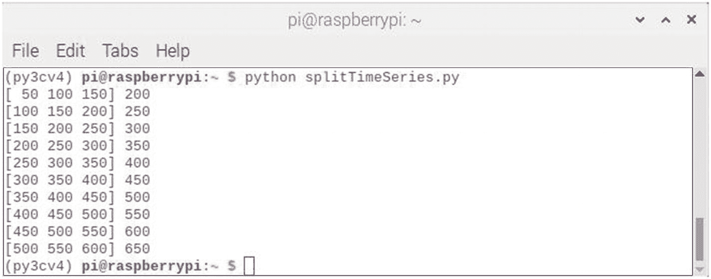

**图 7-17**

运行 `splitTimeSeries` 脚本后的结果

从图中可以看出，该脚本为 `CNN` 创建了十个学习样本。这应该足以训练一个 `CNN` 模型来有效预测数据点。本演示的下一步是创建一个 `CNN` 模型。

#### 创建 `CNN` 模型

`CNN` 模型必须有一个一维输入/卷积层，以匹配一维应用数据集。第一层之后是一个池化层，它将对卷积层的输出进行下采样，以提取显著特征。池化层之后连接一个全连接层，该层解释由卷积层提取的特征。随后是另一个全连接层，以帮助进一步定义特征，最后输出层将特征图缩减为一维向量。

该模型的代码如下：

```python
# Define 1-D CNN model
model = Sequential()
model.add(Conv1D(filters=64, kernel_size=2, activation="relu", input_shape=(n_steps, n_features)))
model.add(MaxPooling1D(pool_size=2))
model.add(Flatten())
model.add(Dense(50, activation="relu"))
model.add(Dense(1))
model.compile(optimizer='adam', loss="mse")
```

卷积层有两个参数，用于指定期望的时间步数（间隔）和特征数量。对于单变量问题，特征数量为 1。时间步数将与用于分割一维时间序列的数字相同，在本例中为 3。

输入数据集包含多条记录，每条记录的维度形状为 `[样本数, 时间步数, 特征数]`。

`split_sequence` 函数提供的 `X` 向量形状为 `[样本数, 时间步数]`，这意味着必须重塑数据集，以添加一个额外元素来覆盖特征数量。以下代码片段正是执行此重塑操作：

模型需要进行训练，这通过传统的 Keras `fit` 函数完成。由于这是一个简单的模型，并且与我演示的其他模型相比，数据集非常小，因此单个周期的训练将极其短暂。这意味着可以使用大量的周期来尝试获得性能最佳的模型。在本例中，该数量为 1000。以下代码调用模型的 `fit` 函数：

```
model.fit(X, y, epochs=1000, verbose=0)
```

最后，将使用 Keras 的 `predict` 函数来预测输入序列中的下一个值。例如，如果输入序列是 {150, 200, 250}，那么预测值应为 [300]。预测的代码如下：

```
# Demonstrate prediction
x_input = array([150, 200, 250])
x_input = x_input.reshape((1, n_steps, n_features))
yhat = model.predict(x_input, verbose=0)
```

整合了前面讨论的所有代码片段的完整脚本名为 `univariateTimeSeriesTest.py`，如下所示。该脚本可从本书的配套网站获取。

```
# 导入所需库
from numpy import array
from keras.models import Sequential
from keras.layers import Dense
from keras.layers import Flatten
from keras.layers.convolutional import Conv1D
from keras.layers.convolutional import MaxPooling1D
# 将单变量序列分割为样本
def split_sequence(sequence, n_steps):
    X, y = list(), list()
    for i in range(len(sequence)):
        # 找到该模式的结束索引
        end_ix = i + n_steps
        # 检查是否超出序列范围
        if end_ix > len(sequence)-1:
            break
        # 收集模式的输入和输出部分
        seq_x, seq_y = sequence[i:end_ix], sequence[end_ix]
        X.append(seq_x)
        y.append(seq_y)
    return array(X), array(y)
# 定义输入序列
raw_seq = [50, 100, 150, 200, 250, 300, 350, 400, 450, 500, 550, 600, 650]
# 选择时间步数
n_steps = 3
# 分割为样本
X, y = split_sequence(raw_seq, n_steps)
# 从 [样本数, 时间步数] 重塑为 [样本数, 时间步数, 特征数]
n_features = 1
X = X.reshape((X.shape[0], X.shape[1], n_features))
# 定义一维 CNN 模型
model = Sequential()
model.add(Conv1D(filters=64, kernel_size=2, activation="relu", input_shape=(n_steps, n_features)))
model.add(MaxPooling1D(pool_size=2))
model.add(Flatten())
model.add(Dense(50, activation="relu"))
model.add(Dense(1))
model.compile(optimizer='adam', loss="mse")
# 拟合模型
model.fit(X, y, epochs=1000, verbose=0)
# 演示预测
x_input = array([150, 200, 250])
x_input = x_input.reshape((1, n_steps, n_features))
yhat = model.predict(x_input, verbose=0)
print(yhat)
```

使用以下命令运行此脚本：

```
python univariateTimeSeriesTest.py
```

图 7-18 显示了运行此脚本的结果。

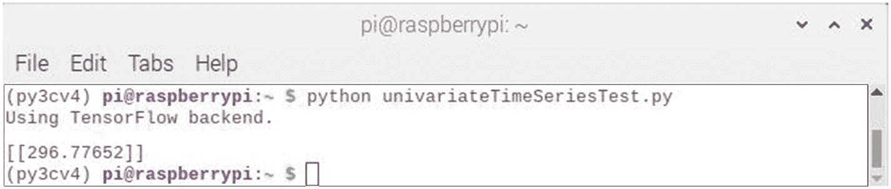

图 7-18

运行 `univariateTimeSeriesTest` 脚本后的结果

显示的预测值为 296.78，虽然与预期的 300 不完全一致，但已相当接近。算法中存在一定程度的随机性，我尝试多运行了几次。以下列表显示了十次重试的结果：

* 286.68
* 276.35
* 279.15
* 299.96
* 279.66
* 299.86
* 300.07
* 281.75
* 294.20
* 300.09

从列表中可以看出，预期值（四舍五入后）在十次中出现了四次。十个值的平均值为 289.78，标准差为 10.03，范围从 276.35 到 300.09。根据这些性能统计数据，我会将这个 CNN 预测器评为良好。

#### 多变量时间序列 CNN 模型

多变量时间序列与单变量时间序列相同，区别在于每个时间步有多个采样值。有两种模型类型可以处理多变量时间序列数据：

* 多输入序列
* 多并行序列

每种模型类型将分别讨论。

##### 多输入序列

首先需要说明，多输入序列具有并行的输入时间序列，不要与另一种模型类型混淆。这一点稍后会变得清晰。这种并行时间序列在相同的时间步对其值进行采样。例如，考虑以下原始时间序列值集合：

* [50, 100, 150, 200, 250, 300, 350, 400, 450, 500, 550, 600, 650]
* [50, 75, 100, 125, 150, 175, 200, 225, 250, 275, 300, 325, 350]

输出序列将是每个序列整个长度上每个采样值对的总和。在代码中，上述内容可以表示为：

```
from numpy import array
in_seq1 = array([50, 100, 150, 200, 250, 300, 350, 400, 450, 500, 550, 600, 650])
in_seq2 = array([50,   75, 100, 125, 150, 175, 200, 225, 250, 275, 300, 325, 350])
out_seq = array([in_seq1[i] + in_seq2[i] for i in range(len(in_seq1))])
```

这些数组必须像之前的演示中那样进行重塑。列也必须水平堆叠以便处理。完成所有这些操作的代码段如下：

```
# 转换为 [行, 列] 结构
in_seq1 = in_seq1.reshape((len(in_seq1), 1))
in_seq2 = in_seq2.reshape((len(in_seq2), 1))
out_seq = out_seq.reshape((len(out_seq), 1))
# 水平堆叠列
dataset = hstack((in_seq1, in_seq2, out_seq))
```

##### 预处理数据集

预处理上述数据集的完整脚本名为 `shapeMultivariateTimeSeries.py`，如下所示。该脚本可从本书的配套网站获取。

# 多变量数据准备

## 数据准备与初步查看

```python
from numpy import array
from numpy import hstack
# 定义输入序列
in_seq1 = array([50, 100, 150, 200, 250, 300, 350, 400, 450, 500, 550, 600, 650])
in_seq2 = array([50,  75, 100, 125, 150, 175, 200, 225, 250, 275, 300, 325, 350])
out_seq = array([in_seq1[i]+in_seq2[i] for i in range(len(in_seq1))])
# 转换为 [行, 列] 结构
in_seq1 = in_seq1.reshape((len(in_seq1), 1))
in_seq2 = in_seq2.reshape((len(in_seq2), 1))
out_seq = out_seq.reshape((len(out_seq), 1))
# 水平堆叠列
dataset = hstack((in_seq1, in_seq2, out_seq))
# 显示数据集
print(dataset)
```

使用以下命令运行此脚本：

```shell
python shapeMultivariateTimeSeries.py
```

图 7-19 显示了运行此脚本的结果。

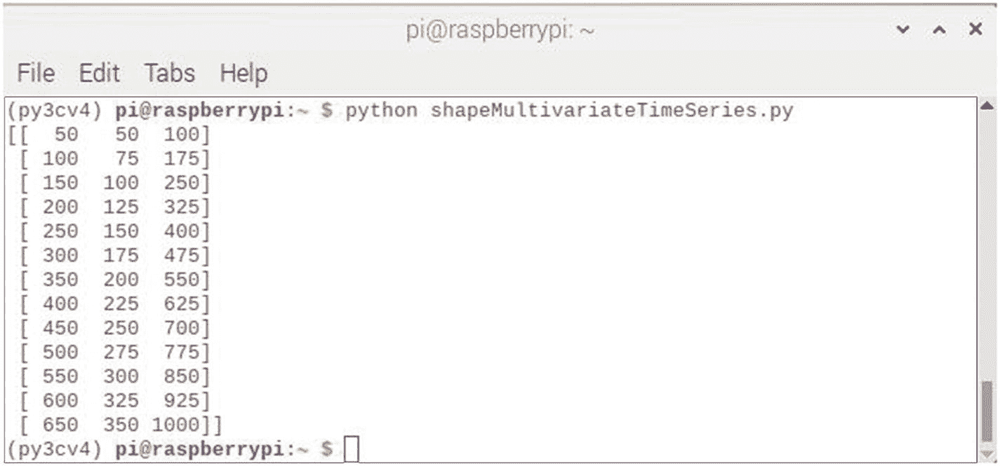

图 7-19：运行`shapeMultivariateTimeSeries`脚本后的结果。

结果屏幕显示的数据集包含每个时间步一行，以及两个输入和并行时间序列中每个元素求和输出的列。

## 分割为输入/输出样本

现在，必须像处理单变量时间序列那样，将这些重塑后的原始数据向量分割为输入/输出样本。一维 CNN 模型需要足够的输入来学习从输入序列到输出值的映射。数据需要分割为样本，同时保持两个输入序列中观测值的顺序。

如果选择三个输入时间步，那么第一个样本将如下所示：

输入：
*   50, 50
*   100, 75
*   150, 100

输出：
*   250

每个并行序列的前三个时间步作为输入提供给模型，模型将其与输出序列中第三个时间步的值（本例中为 250）关联起来。

显然，在将时间序列转换为输入/输出样本以训练模型时，会丢弃一些数据。选择输入时间步的数量将对最终使用的训练数据量产生很大影响。一个名为`split_sequences`的函数将接收之前重塑后的数据集，并返回所需的输入/输出样本。

## 定义分割函数

以下代码实现了`split_sequences`函数：

```python
# 将多变量序列分割为样本
def split_sequences(sequences, n_steps):
    X, y = list(), list()
    for i in range(len(sequences)):
        # 找到该模式的结束索引
        end_ix = i + n_steps
        # 检查是否超出数据集范围
        if end_ix > len(sequences):
            break
        # 收集模式的输入和输出部分
        seq_x, seq_y = sequences[i:end_ix, :-1], sequences[end_ix-1, -1]
        X.append(seq_x)
        y.append(seq_y)
    return array(X), array(y)
```

## 完整脚本与预测演示

以下代码测试了之前所有的代码片段和函数。我将此脚本命名为`splitMultivariateTimeSeries.py`。该脚本可从本书的配套网站获取。

```python
# 导入所需库
from numpy import array
from numpy import hstack
# 将多元序列分割成样本
def split_sequences(sequences, n_steps):
    X, y = list(), list()
    for i in range(len(sequences)):
        # 找到当前模式的结束索引
        end_ix = i + n_steps
        # 检查是否超出数据集范围
        if end_ix > len(sequences):
            break
        # 收集模式的输入和输出部分
        seq_x, seq_y = sequences[i:end_ix, :-1], sequences[end_ix-1, -1]
        X.append(seq_x)
        y.append(seq_y)
    return array(X), array(y)
# 定义输入序列
in_seq1 = array([50, 100, 150, 200, 250, 300, 350, 400, 450, 500, 550, 600, 650])
in_seq2 = array([50,  75, 100, 125, 150, 175, 200, 225, 250, 275, 300, 325, 350])
out_seq = array([in_seq1[i]+in_seq2[i] for i in range(len(in_seq1))])
# 转换为[行, 列]结构
in_seq1 = in_seq1.reshape((len(in_seq1), 1))
in_seq2 = in_seq2.reshape((len(in_seq2), 1))
out_seq = out_seq.reshape((len(out_seq), 1))
# 水平堆叠列
dataset = hstack((in_seq1, in_seq2, out_seq))
# 选择时间步数
n_steps = 3
# 转换为输入/输出样本
X, y = split_sequences(dataset, n_steps)
print(X.shape, y.shape)
# 显示数据
for i in range(len(X)):
    print(X[i], y[i])
```

使用以下命令运行此脚本：

```shell
python splitMultivariateTimeSeries.py
```

图 7-20 显示了运行此脚本的结果。

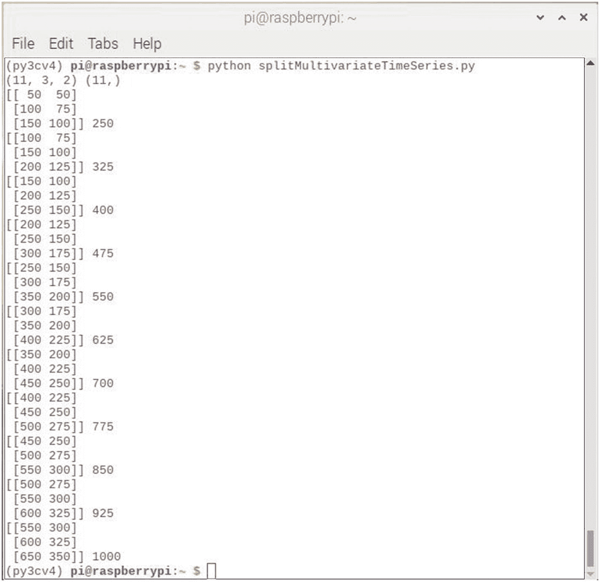

图 7-20：运行`splitMultivariateTimeSeries`脚本后的结果。

运行脚本首先显示`X`和`y`组件的形状。可以看到`X`组件具有三维结构。第一维是样本数量，本例中为 11。第二维是每个样本的时间步数，本例中为 3，最后一维指定并行时间序列的数量或变量数量，本例中为 2，对应两个并行序列。图中其余部分显示的数据集正是 1D CNN 输入所期望的精确三维结构。

本演示使用的模型与单变量演示中使用的模型完全相同。我之前对该模型的讨论同样适用于此情况。

将使用 Keras 的`predict`函数来预测输出序列中的下一个值，前提是输入值为：
*   200, 125
*   300, 175
*   400, 225

预测值应为 625。预测代码如下：

```python
# 演示预测
x_input = array([[200, 125], [300, 175], [400, 225]])
x_input = x_input.reshape((1, n_steps, n_features))
yhat = model.predict(x_input, verbose=0)
```

整合了前面所有代码片段的完整脚本名为`multivariateTimeSeriesTest.py`，如下所示。该脚本可从本书的配套网站获取。

# 导入所需库
```python
from numpy import array
from numpy import hstack
from keras.models import Sequential
from keras.layers import Dense
from keras.layers import Flatten
from keras.layers.convolutional import Conv1D
from keras.layers.convolutional import MaxPooling1D
```

# 将多元序列分割成样本
```python
def split_sequences(sequences, n_steps):
    X, y = list(), list()
    for i in range(len(sequences)):
        # 找到当前模式的结束索引
        end_ix = i + n_steps
        # 检查是否超出数据集范围
        if end_ix > len(sequences):
            break
        # 收集模式的输入和输出部分
        seq_x, seq_y = sequences[i:end_ix, :-1], sequences[end_ix-1, -1]
        X.append(seq_x)
        y.append(seq_y)
    return array(X), array(y)
```

# 定义输入序列
```python
in_seq1 = array([50, 100, 150, 200, 250, 300, 350, 400, 450, 500, 550, 600, 650])
in_seq2 = array([50,  75, 100, 125, 150, 175, 200, 225, 250, 275, 300, 325, 350])
out_seq = array([in_seq1[i]+in_seq2[i] for i in range(len(in_seq1))])

# 转换为[行, 列]结构
in_seq1 = in_seq1.reshape((len(in_seq1), 1))
in_seq2 = in_seq2.reshape((len(in_seq2), 1))
out_seq = out_seq.reshape((len(out_seq), 1))

# 水平堆叠列
dataset = hstack((in_seq1, in_seq2, out_seq))
```

# 选择时间步数
```python
n_steps = 3
```

# 转换为输入/输出样本
```python
X, y = split_sequences(dataset, n_steps)
```

# 数据集知道特征数量，例如 2
```python
n_features = X.shape[2]
```

# 定义模型
```python
model = Sequential()
model.add(Conv1D(filters=64, kernel_size=2, activation="relu", input_shape=(n_steps, n_features)))
model.add(MaxPooling1D(pool_size=2))
model.add(Flatten())
model.add(Dense(50, activation="relu"))
model.add(Dense(1))
model.compile(optimizer='adam', loss="mse")
```

# 拟合模型
```python
model.fit(X, y, epochs=1000, verbose=0)
```

# 演示预测
```python
x_input = array([[200, 125], [300, 175], [400, 225]])
x_input = x_input.reshape((1, n_steps, n_features))
yhat = model.predict(x_input, verbose=0)
```

# 显示预测结果
```python
print(yhat)
```

使用以下命令运行此脚本：
```bash
python multivariateTimeSeriesTest.py
```

图 7-21 显示了运行此脚本的结果。

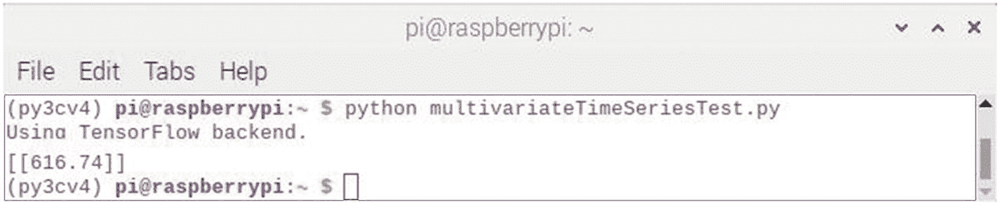

图 7-21 运行 `multivariateTimeSeriesTest` 脚本后的结果

显示的预测值为 `616.74.78`，并非预期的 `625`，但仍相当接近。算法中存在一定程度的随机性，我尝试多运行了几次。以下是十次重试的结果列表：

*   `586.93`
*   `610.88`
*   `606.86`
*   `593.37`
*   `612.66`
*   `604.88`
*   `597.40`
*   `577.46`
*   `605.50`
*   `605.94`

十个值的平均值为 `600.19`，标准差为 `11.28`，范围从 `577.46` 到 `612.66`。根据这些性能统计数据，我会将这个 CNN 预测器评为中等偏上。